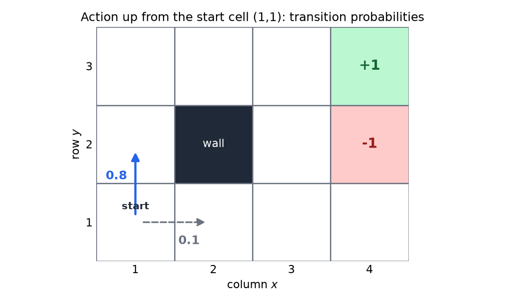
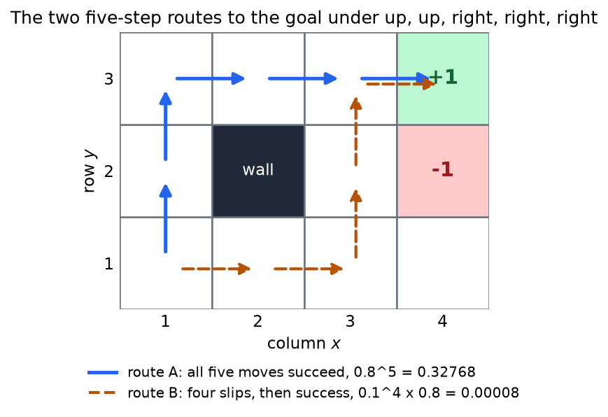
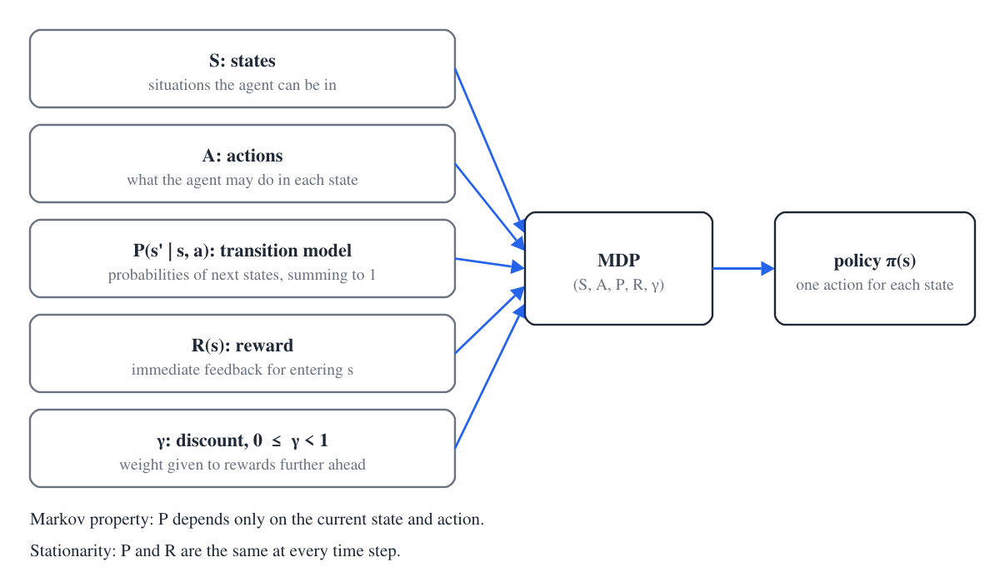
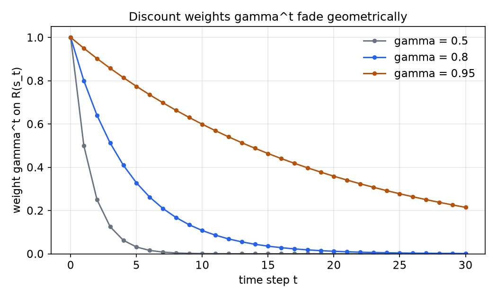

# Reinforcement Learning and the MDP Framework

Reinforcement learning (RL) studies an agent that must learn how to act from the reward it receives, not from labeled examples of the correct action. This chapter states the problem, introduces the small grid world used to illustrate it, and defines the Markov decision process (MDP) that gives the problem a precise form. It also builds the utility of a reward sequence, which the Bellman equations in the next chapter need. The first treatment of MDPs and their solution is in [Markov decision processes](../cs3600-cs6601-artificial-intelligence/mdps.md), and the one-page overview is in Reinforcement learning.

## Three kinds of learning

The three settings differ in what the learner is shown. In supervised learning the learner sees pairs \\((x, y)\\) and must find a function \\(f\\) that maps a new \\(x\\) to the right \\(y\\). In unsupervised learning it sees only the \\(x\\) values and seeks a compact description of them, such as a set of clusters. In reinforcement learning the learner sees the inputs and a stream of rewards, and it must find a decision rule that produces the output \\(y\\), which is never shown.

The difference is practical. In supervised learning the correct output is given for every example, so the learner can measure its error on each one. In reinforcement learning the learner receives only a number that says how well it did, and the effect of an action may appear many steps later. The learner must discover for itself which actions were good, and that is the problem the rest of this chapter formalizes.

## A grid world

Cells are written \\((x, y)\\), with column \\(x\\) running from 1 to 4 and row \\(y\\) from 1 to 3, row 1 at the bottom. The agent starts at \\((1,1)\\). The goal is the top-right cell \\((4,3)\\), which pays \\(+1\\). The cell \\((4,2)\\), directly below the goal, is a pit that pays \\(-1\\). The cell \\((2,2)\\) is a wall that cannot be entered.

The agent has four actions, up, down, left and right. A move that would leave the grid, or that would enter the wall, leaves the agent where it is. The goal and the pit are absorbing: entering either one ends the episode, and the agent starts over.

This \\(4 \times 3\\) grid with a goal, a pit and a wall is the standard small example in Russell and Norvig's textbook on artificial intelligence (see References). It is small enough to work by hand, and every idea in this chapter can be checked on it.

Actions are noisy. The intended move happens with probability \\(0.8\\), and with probability \\(0.1\\) each the agent moves at a right angle to the intended direction. A move at a right angle that runs into the boundary or the wall leaves the agent in place, like any other blocked move.

*Figure: the grid world. The start is \\((1,1)\\), the goal \\((4,3)\\) pays \\(+1\\), the pit \\((4,2)\\) pays \\(-1\\), and the wall \\((2,2)\\) cannot be entered. The arrows show two of the three outcomes of the action up taken at the start: the intended move to \\((1,2)\\) with probability 0.8, and a slip right to \\((2,1)\\) with probability 0.1. The third outcome, a slip left into the outer boundary, leaves the agent at \\((1,1)\\) with probability 0.1.*

Two details of the example need a fixed convention. First, the reachable states are the twelve cells less the wall, which gives eleven states, and the goal and the pit are among them. Some statements count the wall as a cell and say "at most twelve"; the count used here is eleven. Second, some statements label the goal \\((4,4)\\), which lies outside a grid with three rows, so the goal is taken to be the top-right cell \\((4,3)\\).

## Plans, policies and reliability

A plan is a fixed list of actions chosen in advance. If the world were deterministic, the plan up, up, right, right, right would take the agent from the start to the goal in five moves. Because actions are noisy, a plan can fail, and the question is how reliable it is.

**Example 1.1 (Reliability of a fixed plan).** Find the probability that the plan up, up, right, right, right ends the episode at the goal \\((4,3)\\).

*Solution.* The goal is three columns to the right and two rows up from the start, so a path of exactly five moves reaches it only if every move advances the agent. A move that is blocked, or a move that goes left or down, wastes one of the five steps and leaves the goal out of reach. Each of the two up steps therefore has two useful outcomes: a success, which moves up, or a slip right, which also advances. Each of the three right steps has two useful outcomes: a success, or a slip up.

The wall and the pit then cut the possibilities down to two outcome sequences.

1. *Route A.* All five intended moves succeed. The path is \\((1,1) \to (1,2) \to (1,3) \to (2,3) \to (3,3) \to (4,3)\\), with probability \\(0.8^5 = 0.32768\\).
2. *Route B.* The two up steps slip right and the first two right steps slip up, and the last right step succeeds. The path is \\((1,1) \to (2,1) \to (3,1) \to (3,2) \to (3,3) \to (4,3)\\), with probability \\(0.1^4 \times 0.8 = 0.00008\\).

Every other combination fails. A slip right from \\((1,2)\\) or a success up from \\((2,1)\\) runs into the wall at \\((2,2)\\) and wastes a step. If the agent reaches \\((3,2)\\) and the next right step succeeds, it reaches the pit \\((4,2)\\) instead of the goal. The two routes use different outcome sequences, so their probabilities add:

\\[
P(\text{goal}) = 0.8^5 + 0.1^4 \times 0.8 = 0.32768 + 0.00008 = 0.32776 .
\\]

The plan reaches the goal in only about one run in three, and it fails about two runs in three. The [Bellman equations chapter](bellman-equations.md) computes values on the same grid.

*Figure: the two routes that reach the goal under the fixed plan. Route A (solid) uses the intended move at every step. Route B (dashed) uses four slips and then one success. Each route's probability is the product of its step probabilities, and the two routes are the only outcome sequences that reach the goal.*

The example shows the weakness of plans. A plan commits to every action before anything is observed, so it cannot respond when a move goes wrong. A policy avoids this. A **policy** \\(\pi\\) gives an action for every state. The agent looks up the action for its current state after each move, so a slip is simply the next state the policy handles. A plan can be written as a policy only if the state records enough history, such as the step number, to tell the steps of the plan apart. The **optimal policy** \\(\pi^\*\\) is the policy that maximizes the expected long-term reward, and the expectation is needed because transitions are random.

## The MDP definition

The grid world is an instance of a general model. The model below is the standard one, and the rest of the book uses it.

**Definition 1.1 (Markov decision process).** A Markov decision process is a tuple \\((\mathcal{S}, \mathcal{A}, P, R, \gamma)\\), where:

- \\(\mathcal{S}\\) is a set of states, one for each situation the agent can be in;
- \\(\mathcal{A}\\) is a set of actions, which may depend on the state, \\(\mathcal{A}(s)\\);
- \\(P(s' \mid s, a)\\) is the transition model, the probability that the next state is \\(s'\\) when action \\(a\\) is taken in state \\(s\\);
- \\(R\\) is a reward function, which gives a real number for each state, state-action pair or transition;
- \\(\gamma \in [0,1)\\) is the discount factor, whose role is explained in the section on utility below.

The transition model is a probability distribution over the next state, so \\(\sum\_{s'} P(s' \mid s, a) = 1\\) for every state \\(s\\) and action \\(a\\). The model is assumed to be **Markov**, meaning that the next state depends only on the current state and action, and **stationary**, meaning that the rules do not change over time. In symbols,

\\[
P(s\_{t+1} \mid s\_0, a\_0, \ldots, s\_t, a\_t) = P(s\_{t+1} \mid s\_t, a\_t)
\\]

for every time \\(t\\), and the right-hand side does not depend on \\(t\\).

*Figure: the ingredients of an MDP. The states, actions, transition model, reward and discount feed the MDP, whose solution is a policy that gives one action for each state. The two notes at the bottom are the assumptions the model makes about time.*

**Example 1.2 (Transition model from the start).** Take the start state \\((1,1)\\) and the action up.

In the deterministic world, \\(P((1,2) \mid (1,1), \text{up}) = 1\\), and every other next state has probability zero. In the stochastic grid, \\(P((1,2) \mid (1,1), \text{up}) = 0.8\\), \\(P((2,1) \mid (1,1), \text{up}) = 0.1\\), and \\(P((1,1) \mid (1,1), \text{up}) = 0.1\\), because the slip left runs into the boundary and leaves the agent in place. The three probabilities sum to one, and the other states have probability zero.

The transition model is the rules of the world. It holds everything the agent would need to know to predict what happens after an action. In principle a complete state could include the position and velocity of every particle in a room, and the transition model would then be the physics. A grid world replaces that physics with a small table. Transition models are probabilistic by definition, even when the underlying physics is deterministic, because the agent does not know the full state.

### The Markov property

The Markov property is what makes the problem tractable. If the next state depended on the whole history, the agent would need to remember every past state and action, and the number of situations would grow with time. Any process can be made Markov by putting enough history into the state. The price is that a state built from a long history is rarely visited twice, so there is little experience to learn from. Definition 1.1 instead assumes that the state already carries everything the agent needs, so the transition probabilities depend on the current state and action alone.

### Stationarity

Stationarity says that the same rules apply at every time step. It is the assumption that lets a policy be a function of the state alone. The optimal policy in the infinite-horizon setting is stationary for the same reason. If the rules changed over time, the model would be non-stationary and would need a different analysis. The requirement is stationarity, meaning fixed rules, and not non-stationarity.

### Rewards

The reward is a number received for being in a state. In the grid, entering the goal gives \\(+1\\) and entering the pit gives \\(-1\\). Negative values are allowed, and they can be read as costs. The reward encodes the domain knowledge: it says which states are worth entering, and the optimal policy depends on it.

Three forms of reward function appear in the literature: \\(R(s)\\) for the reward of entering \\(s\\), \\(R(s,a)\\) for the reward of being in \\(s\\) and taking action \\(a\\), and \\(R(s,a,s')\\) for the reward of taking \\(a\\) in \\(s\\) and ending in \\(s'\\). The three forms give the same optimal behavior. The form \\(R(s,a,s')\\) reduces to \\(R(s,a)\\) by taking the expectation over \\(s'\\), since \\(R(s,a) = \sum\_{s'} P(s' \mid s, a) R(s,a,s')\\). The form \\(R(s,a)\\) reduces to \\(R(s)\\) by enlarging the state with a pseudo-state for each state-action pair, so that the reward is attached to the state the agent enters. This chapter uses \\(R(s)\\). The next chapter switches to \\(R(s,a)\\), because it makes the Q-form easier to state.

## Utility of reward sequences

A policy produces a sequence of states and rewards, and the agent must compare sequences. Write \\(U(s\_0, s\_1, s\_2, \ldots)\\) for the utility of a sequence. The choice of utility is a modeling decision, and it is constrained by one natural assumption.

**Assumption (stationarity of preferences).** If two sequences start in the same state, and the first is preferred, then the tails of the sequences are preferred in the same order:

\\[
U(s\_0, s\_1, s\_2, \ldots) > U(s\_0, s'\_1, s'\_2, \ldots)
\\;\Rightarrow\\;
U(s\_1, s\_2, \ldots) > U(s'\_1, s'\_2, \ldots).
\\]

In words, if the agent prefers one future today, it still prefers that future tomorrow, once the common first state has passed. This assumption forces the utility to have a specific form. A representation theorem in decision theory shows that, under stationarity and a few further conditions, the utility of a sequence must be either additive or discounted. This chapter takes that form as the working assumption and does not derive it.

### Additive utility and the riverbank

The additive form adds the rewards along the sequence:

\\[
U(s\_0, s\_1, \ldots) = \sum\_{t=0}^{\infty} R(s\_t).
\\]

For a finite sequence this is a natural measure, and it corresponds to adding up daily payments. For an infinite sequence it can fail to distinguish two futures that are clearly different.

**Example 1.3 (Two riverbanks).** Two infinite sequences are shown on the two banks of a river. The top bank pays \\(+1\\) forever. The bottom bank pays \\(1, 1, 2, 1, 1, 2, \ldots\\), with a \\(+2\\) every third step, forever. Which bank is better?

*Solution.* Under additive utility both sums diverge. The top bank sums to \\(1 + 1 + 1 + \cdots = \infty\\), and the bottom bank sums to \\(1 + 1 + 2 + 1 + 1 + 2 + \cdots = \infty\\). Two infinite sums cannot be ranked by their values, so the additive form does not say which bank is better. The intuition that the bottom bank is at least as good, because it sometimes pays more, is not captured.

### Discounted utility

The fix is to multiply the reward at time \\(t\\) by \\(\gamma^t\\), with \\(0 \le \gamma < 1\\):

\\[
U(s\_0, s\_1, \ldots) = \sum\_{t=0}^{\infty} \gamma^t R(s\_t).
\\]

Rewards far in the future have small weights and contribute little, so the sum stays finite.

**Proposition 1.1 (Bound on discounted utility).** Let \\(\gamma \in [0,1)\\), and suppose \\(\lvert R(s) \rvert \le R\_{\max}\\) for every state \\(s\\). Then for any sequence,

\\[
\lvert U(s\_0, s\_1, \ldots) \rvert \le \frac{R\_{\max}}{1 - \gamma}.
\\]

*Proof.* By the triangle inequality, \\(\lvert U \rvert \le \sum\_{t=0}^{\infty} \gamma^t \lvert R(s\_t) \rvert \le R\_{\max} \sum\_{t=0}^{\infty} \gamma^t\\). The geometric series converges for \\(0 \le \gamma < 1\\). Let \\(x = \sum\_{t=0}^{\infty} \gamma^t\\). Shifting the series by one step gives \\(x = 1 + \gamma x\\), so \\(x(1-\gamma) = 1\\) and \\(x = 1/(1-\gamma)\\). \\(\square\\)

The bound is finite even though the sequence is infinite. The discount factor controls how far ahead the agent looks: when \\(\gamma\\) is near zero only the first reward matters, and when \\(\gamma\\) is near one the bound is large, because it is divided by the small number \\(1-\gamma\\). The undiscounted case \\(\gamma = 1\\) is the sum that diverged in the riverbank example.

*Figure: the weight \\(\gamma^t\\) that discounted utility gives to the reward at step \\(t\\), for three values of \\(\gamma\\). Each curve decays geometrically, and the decay is faster for smaller \\(\gamma\\). The total weight of all steps is \\(1/(1-\gamma)\\), which is 2, 5 and 20 for these three values.*

**Example 1.4 (Riverbanks with discounting).** Take \\(\gamma = 1/2\\) and compare the two banks.

For the top bank every reward is 1, so \\(U = \sum\_t (1/2)^t = 2\\).

For the bottom bank the rewards repeat in blocks of three, \\(1, 1, 2\\). Block \\(k\\) starts at time \\(3k\\), and its three discount weights are \\(\gamma^{3k}\\), \\(\gamma^{3k+1}\\) and \\(\gamma^{3k+2}\\). Its contribution is

\\[
\gamma^{3k}\left(1 \cdot 1 + \gamma \cdot 1 + \gamma^2 \cdot 2\right) = \left(\tfrac{1}{8}\right)^k \left(1 + \tfrac{1}{2} + \tfrac{1}{2}\right) = 2\left(\tfrac{1}{8}\right)^k .
\\]

Summing over \\(k\\) gives \\(U = 2 \big/ (1 - 1/8) = 16/7 \approx 2.286\\). The bottom bank is better, which matches the intuition that the occasional \\(+2\\) matters. Discounting resolves the riverbank dilemma, and the chapter on Bellman equations uses the same discounted utility throughout.

The discount also has a horizon interpretation. The weights fall by a factor of about \\(e\\) after roughly \\(1/(1-\gamma)\\) steps when \\(\gamma\\) is close to one, so \\(1/(1-\gamma)\\) is a rough effective horizon. Because the discount is geometric, the effective horizon is the same distance ahead at every time step. Moving one step forward leaves the agent no closer to the end of the horizon, so the problem looks the same at every time, and the rule can remain stationary. This is the reason the infinite-horizon setting is convenient.

## Horizons

The chapter so far has assumed an **infinite horizon**. The agent may act forever, and the episode ends only when it reaches an absorbing state. A **finite horizon** \\(T\\) instead stops the agent after \\(T\\) steps, whatever the state.

The horizon changes the answer. Suppose each step costs a small negative reward, as in the grid with living reward \\(-0.04\\). With a very long horizon the agent should take the longer route that keeps well away from the pit, because the small cost of each extra step is worth paying to avoid the risk. With only two, three or four steps left, the same state may call for the shorter and riskier route to the goal, because a long detour may not reach the goal before time runs out, and the shorter route is then worth its risk. The best action depends on how many steps remain, not only on the state.

Formally, the finite-horizon values satisfy a recursion indexed by the number of steps left,

\\[
V\_k(s) = \max\_{a} \Big[ R(s) + \gamma \sum\_{s'} P(s' \mid s, a)\\, V\_{k-1}(s') \Big], \qquad V\_0(s) = 0,
\\]

and the optimal action \\(\pi\_k(s)\\) depends on \\(k\\). The optimal policy is therefore not stationary. This book concentrates on the infinite-horizon case, where a stationary optimal policy exists. The finite-horizon case is stated here only so that the assumption is clear.

## Summary

- An MDP is a tuple \\((\mathcal{S}, \mathcal{A}, P, R, \gamma)\\) with transition probabilities that sum to one, and the model is Markov and stationary.
- A policy gives an action for each state. A plan is a fixed action sequence, which fails when actions are noisy. In Example 1.1 the fixed plan reaches the goal with probability \\(0.8^5 + 0.1^4 \times 0.8 = 0.32776\\).
- The three reward forms \\(R(s)\\), \\(R(s,a)\\) and \\(R(s,a,s')\\) give the same optimal behavior, and this chapter uses \\(R(s)\\).
- Stationarity of preferences forces the utility of a sequence to be additive or discounted. The additive sum of an infinite sequence can diverge and fail to rank two futures.
- Discounted utility \\(\sum\_t \gamma^t R(s\_t)\\) is finite, bounded by \\(R\_{\max}/(1-\gamma)\\), and it ranks the riverbanks correctly: \\(16/7\\) against \\(2\\).
- Under a finite horizon the optimal policy depends on the time remaining. The infinite-horizon setting keeps the optimal policy stationary.

## See Also

- [Markov decision processes](../cs3600-cs6601-artificial-intelligence/mdps.md): the first treatment of MDPs and value iteration on the grid.
- [Bellman equations and learning from experience](bellman-equations.md): the Bellman equation for this utility, and the V, Q and C forms.
- [Temporal-difference learning](td-learning.md): learning values from sampled transitions.
- Reinforcement learning: the one-page overview.
- [Markov chains](../ece6601-random-processes/markov-chains.md): the Markov property and chains without actions.
- Series: the geometric series used in the discounted bound.

## References

- Russell, S. and Norvig, P., *Artificial Intelligence: A Modern Approach*. The grid world used in this chapter has the layout of the \\(4 \times 3\\) example in this textbook.
