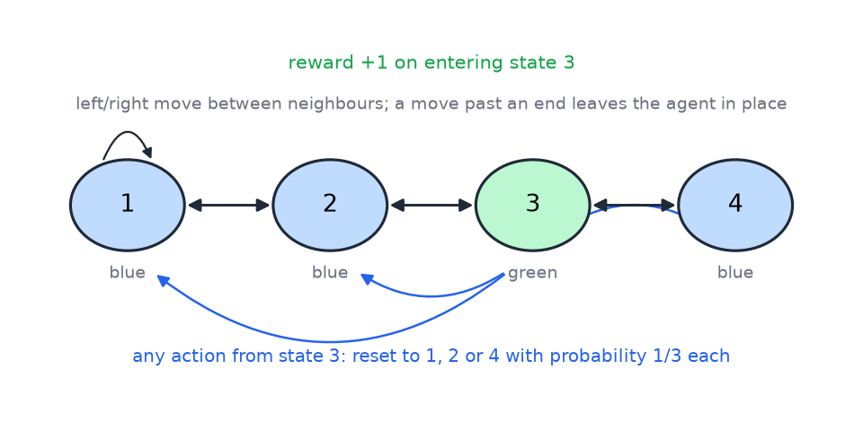
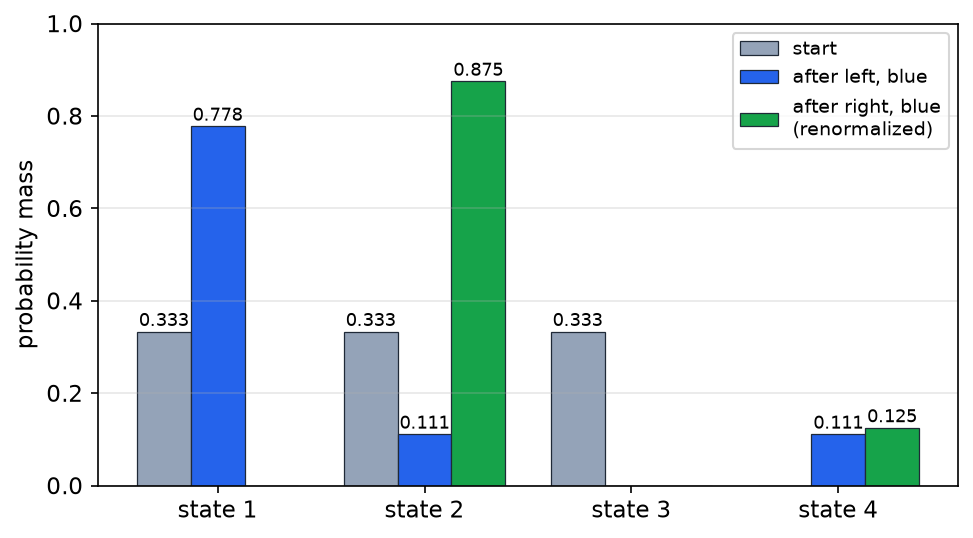
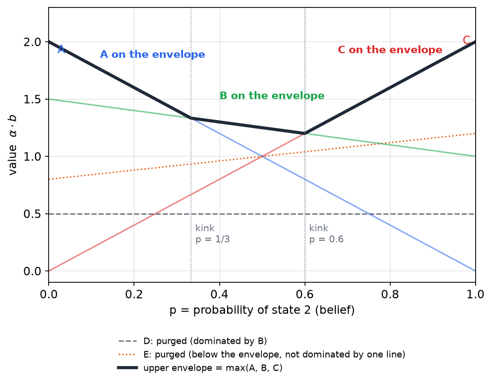
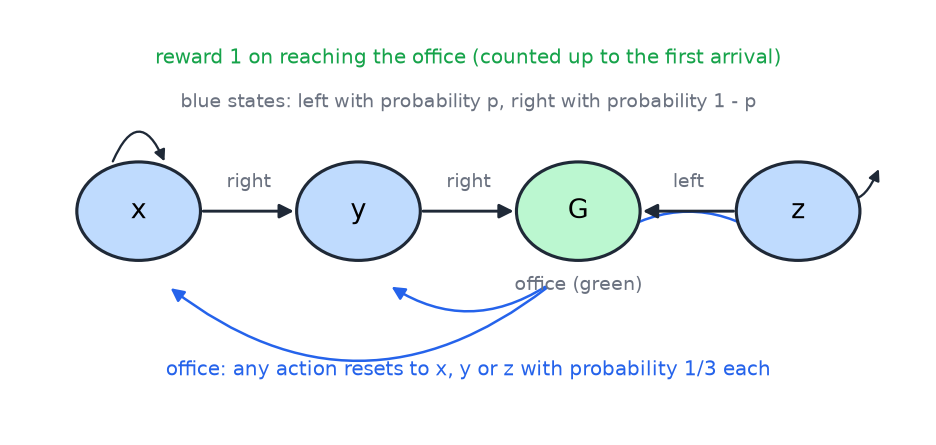
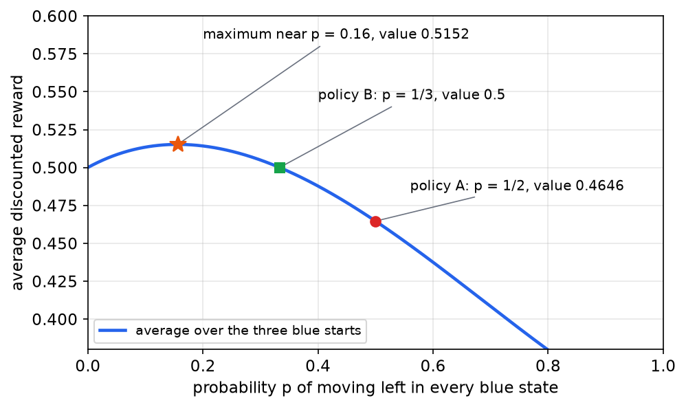

# Partially Observable MDPs

A Markov decision process assumes that the agent knows the state it is in. Many problems do not offer that: a robot reads its surroundings through noisy sensors, and a patient's condition is inferred from tests. A partially observable Markov decision process (POMDP) keeps the dynamics of an MDP but replaces the state with a noisy observation, so the agent must act on a belief, a probability distribution over the hidden states. This chapter covers the model, the belief update, exact value iteration over beliefs, purging, memoryless policies, Bayesian reinforcement learning and predictive state representations. The belief update is the filtering recursion of [Filtering over Time and Belief States](../cs3600-cs6601-artificial-intelligence/filtering.md).

## The POMDP Model

A POMDP is a tuple \\( (S, A, T, R, Z, O) \\). The hidden states are \\( S \\), the actions are \\( A \\), the transition function is \\( T(s,a,s') = P(s' \mid s, a) \\), the reward is \\( R(s,a) \\), the observations are \\( Z \\), and the observation function is \\( O(s,z) = P(z \mid s) \\). Each step, the environment moves from \\( s \\) to \\( s' \\) with probability \\( T(s,a,s') \\). It then emits an observation \\( z \\) with probability \\( O(s',z) \\), which depends on the state just reached. The agent sees \\( z \\) and never sees \\( s \\). Neither the previous state nor the next state is known exactly, so the agent's decisions must rest on what it can infer.

A simple example makes the point. Suppose a friend either has ice cream or does not, and the agent cannot see the freezer. The friend's taunting is observable. The probability of taunting given ice cream is close to one, and the probability of taunting without ice cream is lower but not zero. Smacking sounds from the kitchen are a second observation, also noisy. The agent's question is not "what state am I in?" but "what state am I probably in, given what I have seen?" That change of question is the whole subject of the chapter.

## Every MDP Is a POMDP

Any MDP can be written as a POMDP with the same \\( S \\), \\( A \\), \\( T \\) and \\( R \\). Set the observation set equal to the state set, \\( Z = S \\), and set \\( O(s,z) = 1 \\) when \\( z = s \\) and \\( O(s,z) = 0 \\) otherwise. Each state then emits a distinct observation with certainty, and the observation probabilities for each state sum to one. The agent sees the state exactly, so the POMDP is the MDP.

The converse does not hold. An MDP built from observations alone is not Markov in general, because the same observation can recur after the hidden state has changed. A learner that acts on the current observation alone is solving a non-Markov problem. To recover the Markov property, the agent must expand its state, using either the belief (a probability distribution over states) or the whole history of actions and observations. POMDPs are therefore a strict generalization of MDPs. If a POMDP happens to be an MDP in disguise, solving the POMDP solves the underlying MDP.

## A Worked Example: The Hallway

The hallway POMDP has four hidden states in a line, numbered 1, 2, 3 and 4. States 1, 2 and 4 emit the observation blue, and state 3 emits green. The agent has two actions, left and right. A move past either end of the line leaves the agent where it is. From state 1, left leads to 1 and right leads to 2. From state 2, left leads to 1 and right leads to 3. From state 4, left leads to 3 and right leaves the agent at 4. In state 3, every action resets the agent to one of the states 1, 2 or 4, each with probability 1/3. Entering state 3 gives reward +1. Figure 6 shows the structure.

*Figure 6: The hallway POMDP. Double arrows are moves in either direction between neighboring states. States 1, 2 and 4 are blue and state 3 is green. Entering state 3 gives reward +1, and any action taken in state 3 resets the agent to a blue state chosen uniformly at random.*

**Example (the hallway quiz).** The agent starts in state 1, 2 or 3 with probability 1/3 each, and state 4 has probability zero. It takes the actions left, right and left, and it observes blue, blue, and then something unknown. What is the probability that the next observation is blue, and what is the probability that it is green?

A tempting answer is 3/4 and 1/4, but it ignores the observations already made. The correct calculation tracks the probability mass in each state step by step.

1. **After left and blue.** From state 1, left leads to 1. From state 2, left leads to 1. From state 3, left leads to 1, 2 or 4 with probability 1/3 each, and all three are blue. The masses are \\( P(1) = \tfrac{1}{3} + \tfrac{1}{3} + \tfrac{1}{3}\cdot\tfrac{1}{3} = \tfrac{7}{9} \\), \\( P(2) = \tfrac{1}{9} \\), \\( P(3) = 0 \\) and \\( P(4) = \tfrac{1}{9} \\). The observation was blue, and every reachable state is blue, so nothing is eliminated.
2. **After right and blue.** Mass in state 1 moves to state 2, which is blue and consistent with the observation. Mass in state 2 moves to state 3, which is green and therefore inconsistent with the blue observation, so that branch is eliminated. Mass in state 4 stays at 4, which is blue. The surviving masses are \\( \tfrac{7}{9} \\) in state 2 and \\( \tfrac{1}{9} \\) in state 4, and they sum to \\( \tfrac{8}{9} \\). That sum is the probability of seeing blue after right.
3. **Renormalize.** Dividing by \\( \tfrac{8}{9} \\) gives \\( P(2) = \tfrac{7}{8} \\) and \\( P(4) = \tfrac{1}{8} \\).
4. **Next move, left.** From state 2, left leads to 1, which is blue, with mass \\( \tfrac{7}{8} \\). From state 4, left leads to 3, which is green, with mass \\( \tfrac{1}{8} \\).

The answer is \\( P(\text{blue}) = \tfrac{7}{8} \\) and \\( P(\text{green}) = \tfrac{1}{8} \\). Figure 7 shows the belief at each stage.

*Figure 7: The belief over the four hidden states. Gray is the uniform start over states 1, 2 and 3. Blue is the belief after left with a blue observation, which needs no renormalization because every surviving branch is blue. Green is the belief after right with a blue observation, renormalized by the probability \\( 8/9 \\) of that observation.*

The renormalization in step 3 was done by hand. The next section derives it as a general formula.

## Belief States and the Belief Update

The agent's belief is the vector \\( b(s) = P(s\_t = s \mid \text{history}) \\), the probability of each hidden state given the history of actions and observations. Two beliefs are equal when they assign the same probability to every state. The belief is a sufficient statistic: nothing about the history matters beyond the belief once it is known.

A POMDP becomes an MDP on beliefs. The belief MDP has the same actions, and its transitions come from the belief update: after action \\( a \\) and observation \\( z \\), the belief moves to a new belief determined by the old one. Because the reward is a function of the hidden state, its expectation under the belief is \\( R(b,a) = \sum\_s b(s)\\, R(s,a) \\).

**Derivation of the belief update.** Start from the belief \\( b \\), take action \\( a \\), and condition on the new observation \\( z \\). Bayes' rule gives

\\[
P(s' \mid b, a, z) = \frac{P(z \mid s', b, a)\\, P(s' \mid b, a)}{P(z \mid b, a)}.
\\]

The observation depends only on the state just reached, so \\( P(z \mid s', b, a) = O(s',z) \\). The predicted distribution of the new state is obtained by summing over the old state:

\\[
P(s' \mid b, a) = \sum\_s T(s,a,s')\\, b(s).
\\]

The denominator is the normalizing constant, obtained by summing the numerator over all new states:

\\[
P(z \mid b, a) = \sum\_{s''} O(s'',z) \sum\_s T(s,a,s'')\\, b(s).
\\]

Substituting these three expressions gives the belief update

\\[
b'(s') = \frac{O(s',z) \sum\_s T(s,a,s')\\, b(s)}{\sum\_{s''} O(s'',z) \sum\_s T(s,a,s'')\\, b(s)}.
\\]

The denominator is the probability of the observation, \\( P(z \mid b,a) \\), which is needed later for the value recursion.

**Algorithm (belief update \\( SE(b,a,z) \\)).**

1. Start with the belief \\( b \\), the action \\( a \\) and the observation \\( z \\).
2. For each new state \\( s' \\), compute the predicted mass \\( \sum\_s T(s,a,s')\\, b(s) \\).
3. Multiply each predicted mass by the observation likelihood \\( O(s',z) \\).
4. Divide each product by the sum of all such products, which equals \\( P(z \mid b,a) \\).
5. The results are the new belief \\( b'(s') \\) for every state.

**Example (the belief update by formula).** Take the uniform start \\( b = (\tfrac{1}{3}, \tfrac{1}{3}, \tfrac{1}{3}, 0) \\), action left and observation blue. The predicted masses are \\( \tfrac{7}{9} \\) for state 1, \\( \tfrac{1}{9} \\) for state 2, 0 for state 3 and \\( \tfrac{1}{9} \\) for state 4. Multiplying by the likelihood of blue, which is 1 for states 1, 2 and 4 and 0 for state 3, leaves the same numbers. Their sum is \\( P(\text{blue} \mid b, \text{left}) = 1 \\), so the new belief is \\( (\tfrac{7}{9}, \tfrac{1}{9}, 0, \tfrac{1}{9}) \\).

Now take action right with observation blue. The predicted masses are \\( \tfrac{7}{9} \\) for state 2, \\( \tfrac{1}{9} \\) for state 3 and \\( \tfrac{1}{9} \\) for state 4. The likelihood of blue kills state 3, leaving \\( \tfrac{7}{9} \\) and \\( \tfrac{1}{9} \\). Their sum is \\( \tfrac{8}{9} \\), so the new belief is \\( (0, \tfrac{7}{8}, 0, \tfrac{1}{8}) \\), which matches the hand calculation.

The belief space is continuous, so a dynamic program over beliefs has infinitely many states. The next section shows that the optimal value function still has a finite representation.

## Value Iteration over Beliefs

Value iteration works on the belief MDP:

\\[
V\_0(b) = 0, \qquad V\_t(b) = \max\_a \Big[ R(b,a) + \gamma \sum\_z P(z \mid b,a)\\, V\_{t-1}\bigl(SE(b,a,z)\bigr) \Big].
\\]

The surprising fact is that each \\( V\_t \\) is piecewise linear and convex in \\( b \\). It can be written as a maximum over a finite set \\( \Gamma\_t \\) of vectors:

\\[
V\_t(b) = \max\_{\alpha \in \Gamma\_t} \alpha \cdot b = \max\_{\alpha \in \Gamma\_t} \sum\_s \alpha(s)\\, b(s).
\\]

The two-state case shows why. A belief with two states is a single number \\( p \\), the probability of state 2, and the belief space is the segment \\( p \in [0,1] \\). Each vector \\( \alpha = (\alpha(1), \alpha(2)) \\) defines a straight line over the segment, with value \\( (1-p)\alpha(1) + p\\,\alpha(2) \\) at belief \\( p \\). The value function is the upper envelope of these lines. It is convex, because a maximum of linear functions is convex, and piecewise linear, with kinks where the maximizing line changes. Infinitely many beliefs are therefore represented by a finite bag of vectors. To evaluate a belief, take the dot product with every vector in the bag and keep the largest.

**Proof sketch by induction.** Suppose \\( V\_{t-1}(b) = \max\_{\alpha \in \Gamma\_{t-1}} \alpha \cdot b \\). The base case holds with \\( \Gamma\_0 = \\{0\\} \\), since \\( V\_0 = 0 \\). For the inductive step, the key identity removes the normalization from the belief update. For a vector \\( \alpha \\) and an action \\( a \\), define

\\[
g\_{a,z,\alpha}(s) = \sum\_{s'} T(s,a,s')\\, O(s',z)\\, \alpha(s').
\\]

Then

\\[
P(z \mid b,a)\\; \alpha \cdot SE(b,a,z) = \sum\_{s'} \alpha(s')\\, O(s',z) \sum\_s T(s,a,s')\\, b(s) = b \cdot g\_{a,z,\alpha}.
\\]

The denominator of the belief update cancels against the probability factor, leaving a function that is linear in \\( b \\). Since \\( P(z \mid b,a) \\) is nonnegative, it can be moved inside the maximum over \\( \alpha \\), so each observation contributes a maximum of linear functions:

\\[
P(z \mid b,a)\\, V\_{t-1}\bigl(SE(b,a,z)\bigr) = \max\_{\alpha \in \Gamma\_{t-1}} b \cdot g\_{a,z,\alpha}.
\\]

Summing over observations turns a sum of maxima into a maximum over all combinations, one vector per observation. The expression inside the outer maximum over actions is therefore a maximum of linear functions of \\( b \\).

The inductive step thus rests on four facts. The maximum over actions is a union of the vector sets for each action. The sum over observations is a cross-sum, which picks one vector per observation and adds the picks. Each term is linear in \\( b \\) once the normalization is removed. Finite sets of states, actions and observations keep every set finite at each step.

**Algorithm (exact piecewise-linear value iteration).**

1. Set \\( \Gamma\_0 \\) to the zero vector alone.
2. For \\( t = 1, 2, \ldots \\) up to the horizon:
3. For each action \\( a \\) and each observation \\( z \\), compute \\( g\_{a,z,\alpha} \\) for every \\( \alpha \\) in \\( \Gamma\_{t-1} \\).
4. For each action \\( a \\), form the set \\( \Gamma\_t^a \\) of all vectors \\( R\_a + \gamma \sum\_z g\_{a,z,\alpha\_z} \\), where \\( R\_a(s) = R(s,a) \\) and \\( \alpha\_z \\) is chosen from \\( \Gamma\_{t-1} \\) independently for each observation \\( z \\).
5. Set \\( \Gamma\_t \\) to the union of \\( \Gamma\_t^a \\) over all actions.
6. Optionally purge redundant vectors, as described below.
7. Stop at the horizon, or when the change in the value function is small.

Each \\( \Gamma\_t^a \\) is the action-value function in vector form. For a belief \\( b \\), the value \\( \alpha \cdot b \\) of the best vector in \\( \Gamma\_t^a \\) is \\( Q\_t(b,a) \\). The cross-sum fixes the size of the sets. Each new set has at most \\( \lvert \Gamma\_{t-1} \rvert^{\lvert Z \rvert} \\) vectors for each action, so

\\[
\lvert \Gamma\_t \rvert \le \lvert A \rvert\\, \lvert \Gamma\_{t-1} \rvert^{\lvert Z \rvert}.
\\]

The previous set size is raised to the number of observations, and the number of actions multiplies the result. The bound grows doubly exponentially in the number of iterations, which is why the algorithm is practical only for small problems and why pruning matters. The algorithm is efficient when the Q functions have small representations, and the purge step below is what keeps them small. The method is not one that anyone should code from scratch for a large problem. Published POMDP solvers and the BURLAP library implement these ideas.

## Purge: Removing Dominated Vectors

Most vectors in \\( \Gamma\_t \\) never attain the maximum at any belief. Purging removes them without changing the value function. The quick test is componentwise domination. A vector \\( \alpha \\) is dominated by \\( \alpha' \\) if \\( \alpha'(s) \ge \alpha(s) \\) for every state \\( s \\), and then \\( \alpha \\) can be discarded. This test costs time linear in the size of the vectors, and with two states, comparing the two end values is enough.

The quick test is not enough. A vector can lie below the maximum of several other vectors without being dominated by any single one. Testing this requires a linear program. Vector \\( \alpha \\) is useful if some belief gives it a strictly higher value than every other vector in the set. The linear program is

\\[
\max\_{b,\\, d} \\; d \quad \text{subject to} \quad (\alpha - \alpha') \cdot b \ge d \text{ for all } \alpha' \in \Gamma\_t \text{ other than } \alpha, \quad \sum\_s b(s) = 1, \quad b(s) \ge 0.
\\]

If the optimal \\( d \\) is positive, \\( \alpha \\) is kept. Otherwise it is removed. Purging is worth its cost, because leaving redundant vectors lets the sets grow by the bound above. Ties need a consistent rule, such as a lexicographic order on vectors, so that exactly one of two equal vectors is kept.

**Example (a purge quiz).** In a two-state belief segment, write each vector as a pair \\( (P\_i, Q\_j) \\): the value \\( P\_i \\) at one end of the segment and \\( Q\_j \\) at the other. Suppose the current bag contains \\( P\_1 \to Q\_4 \\) and \\( P\_4 \to Q\_1 \\), which cross in an X. Among the candidate lines, \\( P\_3 \to Q\_3 \\) never reaches the maximum, yet it crosses both lines of the X, so neither line dominates it. Only the linear program shows that it can be removed.

Figure 8 shows the same situation with illustrative numbers. The three thick lines form the envelope, and two other lines are below it. Line D is dominated componentwise by line B, so the quick test removes it. Line E lies below the envelope at every belief but is not dominated by any single line, so only the linear program removes it.

*Figure 8: Five illustrative vectors over the two-state belief axis, where \\( p \\) is the probability of state 2. The thick black curve is the upper envelope of A, B and C, which is convex and piecewise linear with kinks at \\( p = 1/3 \\) and \\( p = 0.6 \\). Line D is purged by the quick test, because B dominates it at both ends. Line E is below the envelope everywhere but is not dominated by one line, so the linear program removes it. The numbers are chosen for illustration.*

## Planning: Policies and Complexity

Given a value function, a policy is obtained by one-step lookahead. At belief \\( b \\), choose the action that maximizes \\( R(b,a) + \gamma \sum\_z P(z \mid b,a)\\, V(SE(b,a,z)) \\). For a finite horizon, the value iteration above gives exact vectors and an exact policy, although the number of vectors can grow very quickly. For the infinite-horizon problem, value iteration approaches the optimal value function only in the limit. After finitely many steps the value function is an approximation, but an arbitrarily good approximation is reached in finitely many steps, and a value function that is close to optimal yields a near-optimal policy by one-step lookahead.

The complexity of exact planning is high, and the standard results are more precise than their informal versions. Informal statements say that deciding the optimal action in a POMDP would solve the halting problem, which is a claim about undecidability. The precise result is that infinite-horizon POMDP planning is undecidable (Madani, Hanks and Condon, 1999), while finite-horizon planning is PSPACE-complete (Papadimitriou and Tsitsiklis, 1987). Approximate planning is a different question, and the chapter does not rely on any claim about it.

## Learning and Reinforcement Learning in POMDPs

Reinforcement learning in POMDPs has mainly empirical and algorithmic results, with few formal guarantees. The two families from fully observed reinforcement learning carry over. A model-based learner estimates the POMDP from experience and then plans in it. A model-free learner maps observations, or observation histories, directly to actions without building a model.

Learning a POMDP is closely related to learning a hidden Markov model. The expectation-maximization (EM) algorithm alternates two steps. The E-step computes the expected values of the hidden variables given the data and the current model. The M-step re-estimates the model by maximum likelihood using those expectations. The loop repeats until convergence. For a POMDP, the hidden variables are the states at each time step, conditioned on the action and observation history, and the model is the POMDP itself. The idea of learning POMDPs by EM appeared in the 1990s. Some POMDPs are easy to learn and others are hard, whatever algorithm is used, and no algorithm guarantees a good model. Learning HMMs is already hard in the worst case, so adding actions does not make the worst case easier.

Exploration can sometimes be structured. A blind agent may take a fixed action sequence, such as moving left until it hits a wall, to reach a known state, and then localize itself from there. Either family of methods can in principle discover such a strategy, but there are no guarantees that it will.

The four basic models differ in whether the process is controlled and whether the state is observed.

| | fully observed | partially observed |
|---|---|---|
| uncontrolled | Markov chain (MC) | hidden Markov model (HMM) |
| controlled | Markov decision process (MDP) | POMDP |

## Memoryless Policies

The model-free case in which the policy depends only on the current observation is especially instructive. In the hallway with an office in the middle, a memoryless policy cannot distinguish the three blue states, so it must treat them the same way. Consider the environment in which states x, y and z are blue and G is the green office. The moves are: from x, right leads to y; from y, right leads to G; from z, left leads to G; and a move past the wall leaves the agent in place. The office resets the agent to one of x, y or z uniformly at random, and only one action is available there. Figure 9 shows the layout.

*Figure 9: The memoryless hallway. The blue states x, y and z look identical to the agent. Reaching the office G gives reward 1, and the office resets the agent to a blue state chosen uniformly at random. The values in the example below count reward only up to the first arrival at the office, so the reset does not enter them.*

Memory can help in this problem. A sequence such as left, right, right or right, right, left can be better than any memoryless rule, because the sequence itself carries information about where the agent is. A POMDP model captures the memory needed for optimal behavior. A memoryless policy, by contrast, must use randomization to do well, and the question is how much.

Take the discount \\( \gamma = 1/2 \\), which makes the algebra simple and is the value the worked numbers below require. The return is the discounted reward of one episode: arrival at the office pays 1 and ends the episode, and each earlier step is discounted by \\( \gamma \\). Consider two randomized policies that use the same left probability \\( p \\) in every blue state. Policy A uses \\( p = 1/2 \\). Policy B uses \\( p = 1/3 \\), which is the probability suggested by a one-step argument: in the blue states, z prefers left, and x and y prefer right, so one might choose left with probability 1/3 and right with probability 2/3.

**Example (values of policies A and B).** Let \\( V(z) \\), \\( V(x) \\) and \\( V(y) \\) be the values of the three blue states under a policy with left probability \\( p \\), and write \\( q = 1 - p \\). The Bellman equations are

\\[
V(z) = p \cdot 1 + q\\, \gamma\\, V(z), \qquad V(x) = p\\, \gamma\\, V(x) + q\\, \gamma\\, V(y), \qquad V(y) = p\\, \gamma\\, V(x) + q \cdot 1.
\\]

Left from z reaches the office with reward 1, and right from z leaves the agent in place. Left from x leaves the agent in place, and right from x leads to y. Left from y leads to x, and right from y reaches the office.

For policy A, with \\( p = 1/2 \\) and \\( \gamma = 1/2 \\), the equations become \\( V(z) = \tfrac{1}{2} + \tfrac{1}{4} V(z) \\), so \\( V(z) = \tfrac{2}{3} \\). They also give \\( \tfrac{3}{4} V(x) = \tfrac{1}{4} V(y) \\) and \\( V(y) = \tfrac{1}{4} V(x) + \tfrac{1}{2} \\). Substituting \\( V(y) = 3 V(x) \\) into the last equation gives \\( \tfrac{11}{4} V(x) = \tfrac{1}{2} \\), so \\( V(x) = \tfrac{2}{11} \\) and \\( V(y) = \tfrac{6}{11} \\). The average over the three blue starting states is

\\[
\frac{1}{3}\left(\frac{2}{3} + \frac{2}{11} + \frac{6}{11}\right) = \frac{46}{99} \approx 0.4646.
\\]

For policy B, with \\( p = 1/3 \\), the equations become \\( V(z) = \tfrac{1}{3} + \tfrac{1}{3} V(z) \\), so \\( V(z) = \tfrac{1}{2} \\). They give \\( V(x) = \tfrac{1}{6} V(x) + \tfrac{1}{3} V(y) \\), which simplifies to \\( 5 V(x) = 2 V(y) \\), and \\( V(y) = \tfrac{1}{6} V(x) + \tfrac{2}{3} \\). Substituting \\( V(y) = \tfrac{5}{2} V(x) \\) gives \\( V(x) = \tfrac{2}{7} \\) and \\( V(y) = \tfrac{5}{7} \\). The average is

\\[
\frac{1}{3}\left(\frac{1}{2} + \frac{2}{7} + \frac{5}{7}\right) = \frac{1}{2}.
\\]

Policy B beats policy A, with average \\( 0.5 \\) against \\( 0.4646 \\). Policy B is better, but it is not the best memoryless policy.

**The heuristic is not optimal.** Because every blue state looks the same to the agent, a memoryless policy has one free parameter, \\( p \\), and its average value can be written in closed form. The Bellman equations above give

\\[
V(z) = \frac{2p}{1+p}, \qquad V(x) = \frac{2q^2}{D}, \qquad V(y) = \frac{2q(2-p)}{D}, \qquad D = 2(2-p) - pq.
\\]

The average value is \\( f(p) = \tfrac{1}{3}\bigl(V(z) + V(x) + V(y)\bigr) \\). Checking the formulas at \\( p = 1/3 \\) and \\( p = 1/2 \\) reproduces the values \\( \tfrac{1}{2} \\) and \\( \tfrac{46}{99} \\) found above. A scan over \\( p \\) shows that \\( f \\) peaks near \\( p \approx 0.156 \\), where its value is about \\( 0.5152 \\). The one-step argument that suggested \\( p = 1/3 \\) therefore does not give the best randomization. It sets each blue state's probability from its immediate preference and ignores how the randomization changes the whole sequence of moves toward the office. Figure 10 shows the curve.

*Figure 10: Average discounted reward of memoryless policies, plotted against the left probability \\( p \\) used in every blue state, with \\( \gamma = 1/2 \\). Policy A (\\( p = 1/2 \\)) and policy B (\\( p = 1/3 \\)) are marked. The curve peaks near \\( p = 0.16 \\), so the one-step value of \\( 1/3 \\) is good but not optimal.*

The randomization in memoryless policies is therefore necessary for good behavior here, and its best value is found numerically. A related undiscounted average-reward version of the problem is reported to have an optimal left probability that involves the square root of 2. That result is not derived in this chapter.

## Bayesian Reinforcement Learning

Bayesian reinforcement learning treats the unknown MDP as a hidden variable. The agent keeps a posterior distribution over the possible MDPs. Reinforcement learning then becomes planning in the belief space of a POMDP whose hidden state includes the identity of the MDP. Exploration and exploitation are no longer separate mechanisms. An optimal policy for the belief MDP balances them automatically, because it chooses actions that gather information when that is worth the cost.

**Example (three candidate MDPs).** Consider two states and two actions, black and purple. Three candidate MDPs, A, B and C, share the same transitions and differ only in where the reward of 1 is paid. We take the following assignment, which reproduces the belief updates described below: in A, purple from state 2 pays 1; in B, purple from state 1 pays 1; in C, black from state 1 pays 1. The initial belief has state 1 known, and each candidate MDP has probability 1/3.

In this setting, purple from state 1 has an expected reward of \\( \tfrac{1}{3} \\), because only B pays for it. If the agent receives the reward of 1, its belief collapses onto B and it can act optimally from then on by taking purple every time.

Now take black from state 1 and observe reward 0. Candidate C pays 1 for that action, so the zero reward rules C out. The remaining candidates A and B had prior probability \\( \tfrac{1}{3} \\) each, and they are equally consistent with the observation. The posterior is therefore \\( \tfrac{1}{2} \\) for the state where A is true and \\( \tfrac{1}{2} \\) for the state where B is true, both in state 2. In the posterior, purple is the right action, because either purple pays immediately under A, or the next observed state reveals which MDP is in force and the agent can exploit it.

The lesson is that exploration is not a separate phase. Maximizing expected reward in belief space produces actions that gather information when they are worth it, and the belief becomes more concentrated as information accumulates.

If the set of candidate MDPs is finite, POMDP value iteration solves the problem exactly. With infinitely many candidates, the belief space is continuous, and the value function is piecewise polynomial and convex, with a degree that grows with the number of value-iteration steps. The BEETLE algorithm (Bayesian Exploration Exploitation Tradeoff in Learning) approximates this function. The approach is often too expensive for practice, and Q-learning usually wins in practical comparisons. Its advantage is that it yields probability distributions over Q functions, such as the probability that an action is optimal.

## Predictive State Representations

A predictive state representation (PSR) replaces the distribution over hidden states with the probabilities of outcomes of future tests. The motivation is that POMDP states are never observed directly. They are useful fictions, and a learner cannot test whether a given hidden state was the true one. Most successful POMDP work measures hidden states by other means, such as sending researchers into the field, rather than learning them from observations.

A test is an action sequence followed by an observation. The test "go up, then see blue" asks whether the next observation after going up is blue. Its prediction from a state is the probability of the outcome, and the predictions for several tests form a vector. Predictions are independent quantities. They do not need to sum to one, because they are probabilities of different events.

The appeal of PSRs is that tests can be executed and checked, so the representation is grounded in observables. A state is recognized by what it lets the agent predict. The philosophical point is that the only use of a state is to predict what happens, so states and predictors are the same thing.

**Example (a PSR for four states).** The environment has four states and three observations, blue, green and red. The actions are up, down, left and right. The layout is reconstructed from the test outcomes: state 1 is upper-left and blue, state 2 is upper-right and green, state 3 is lower-left and red, and state 4 is lower-right and red. Up from state 3 leads to state 1, and up from state 4 leads to state 2. The arithmetic below assumes that horizontal moves leave the agent where it is, which is consistent with the observations used.

Start uniformly at random. The first observation is red, so the belief is \\( (0, 0, \tfrac{1}{2}, \tfrac{1}{2}) \\). Taking left leaves this belief unchanged under the assumption above. Taking up and observing green gives \\( (0,1,0,0) \\), since only state 2 emits green.

Two tests are useful. Test 1 is "go up, see blue", with predictions \\( (1,0,1,0) \\) for the four states. Test 2 is "go left, see red", with predictions \\( (0,0,1,1) \\). For a belief \\( b = (b\_1, b\_2, b\_3, b\_4) \\), the prediction of a test is the dot product of the belief with its vector of predictions. With belief \\( (0.1, 0.2, 0.4, 0.3) \\), the predictions are \\( 0.1 + 0.4 = 0.5 \\) for test 1 and \\( 0.4 + 0.3 = 0.7 \\) for test 2. The PSR state is the vector \\( (0.5, 0.7) \\).

The map from belief to PSR is simple, but it is not invertible with only two tests. Predictions \\( (0.7, 0.6) \\) are consistent with several beliefs. Writing \\( b = (b\_1, b\_2, b\_3, b\_4) \\), test 1 requires \\( b\_1 + b\_3 = 0.7 \\) and test 2 requires \\( b\_3 + b\_4 = 0.6 \\). Two valid beliefs are \\( (0.4, 0, 0.3, 0.3) \\) and \\( (0.3, 0.1, 0.4, 0.2) \\), and both sum to one. Adding more well-chosen tests removes the ambiguity. For this four-state example, four tests are enough to identify the belief uniquely.

**The PSR theorem.** Any \\( n \\)-state POMDP can be represented by a PSR with at most \\( n \\) tests, each of length at most \\( n \\) steps. Longer tests can be needed. In a four-state example with two white and two black states, a one-step test does not separate the states, but two-step tests do. For example, seeing white and then black identifies one state, and seeing black after one move identifies one of the middle states. The representation is not more learnable in general. POMDPs that are easy to learn remain easy as PSRs, and hard ones remain hard. Recent least-squares methods can learn models that resemble PSRs from enough data.

## Summary

- A POMDP replaces the observed state of an MDP with a noisy observation, so the agent acts on a belief, a probability distribution over the hidden states. Every MDP is a POMDP, and a POMDP is strictly more general.
- The belief update follows from Bayes' rule: \\( b'(s') \propto O(s',z) \sum\_s T(s,a,s')\\, b(s) \\), with the denominator equal to \\( P(z \mid b,a) \\).
- Value iteration over beliefs gives piecewise-linear convex value functions \\( V\_t(b) = \max\_{\alpha \in \Gamma\_t} \alpha \cdot b \\). The cross-sum over observations gives \\( \lvert \Gamma\_t \rvert \le \lvert A \rvert\\, \lvert \Gamma\_{t-1} \rvert^{\lvert Z \rvert} \\), so the sets grow quickly.
- Purging removes dominated vectors. The quick componentwise test is followed by a linear program that catches vectors below the envelope but not dominated by one line.
- Exact planning is hard. Infinite-horizon POMDP planning is undecidable, and finite-horizon planning is PSPACE-complete.
- For the memoryless hallway with \\( \gamma = 1/2 \\), policy B (left probability 1/3) has average value \\( 1/2 \\), policy A has \\( 46/99 \\), and the best left probability is near \\( 0.16 \\) with average about \\( 0.515 \\).
- Bayesian reinforcement learning is planning in the belief space of an MDP posterior, where exploration arises from the optimal policy. The belief value function is piecewise polynomial in the continuous case, and approximations such as BEETLE are needed.
- Predictive state representations describe a state by the probabilities of future tests. Any \\( n \\)-state POMDP has an equivalent PSR with at most \\( n \\) tests.

## See Also

- [Filtering over Time and Belief States](../cs3600-cs6601-artificial-intelligence/filtering.md): the belief update in its filtering form, with the hidden Markov model and POMDP belief states.
- [Markov Decision Processes](../cs3600-cs6601-artificial-intelligence/mdps.md): the fully observed model that this chapter generalizes.
- [Options and Monte Carlo Tree Search](options-mcts.md): temporal abstraction and search, which are the next tools for large decision problems.
- Reinforcement Learning: the one-page overview of the field.
- [MDP Framework](mdp-framework.md): the Markov property and the utility of reward sequences, which the belief MDP inherits.
- [Bellman Equations and Learning from Experience](bellman-equations.md): the value recursion that the belief MDP uses.
- [Exploration, Bandits, and R-max](exploration.md): the exploration analysis that the Bayesian view of reinforcement learning reinterprets.
- [Probability and Bayes' Rule](../cs3600-cs6601-artificial-intelligence/probability.md): the Bayes' rule used to derive the belief update.
