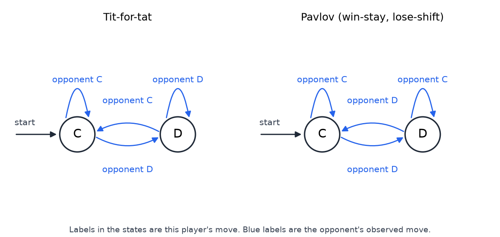
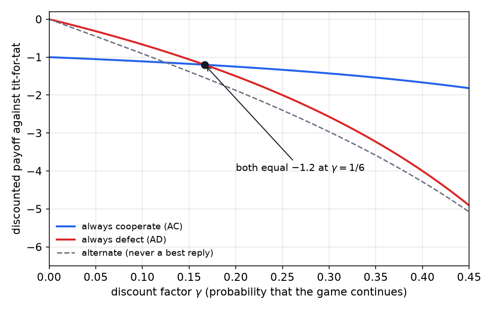
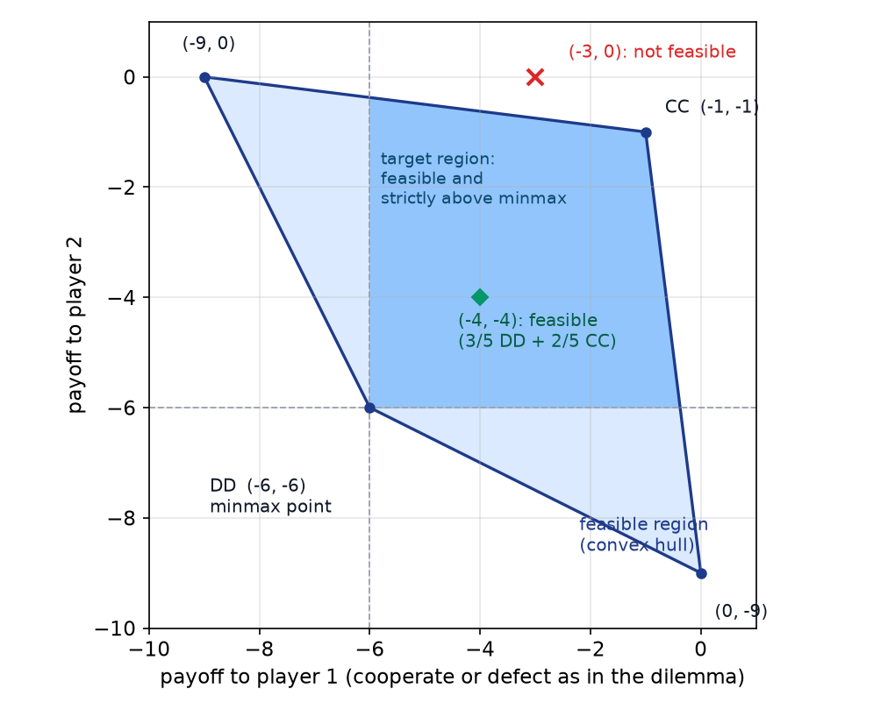
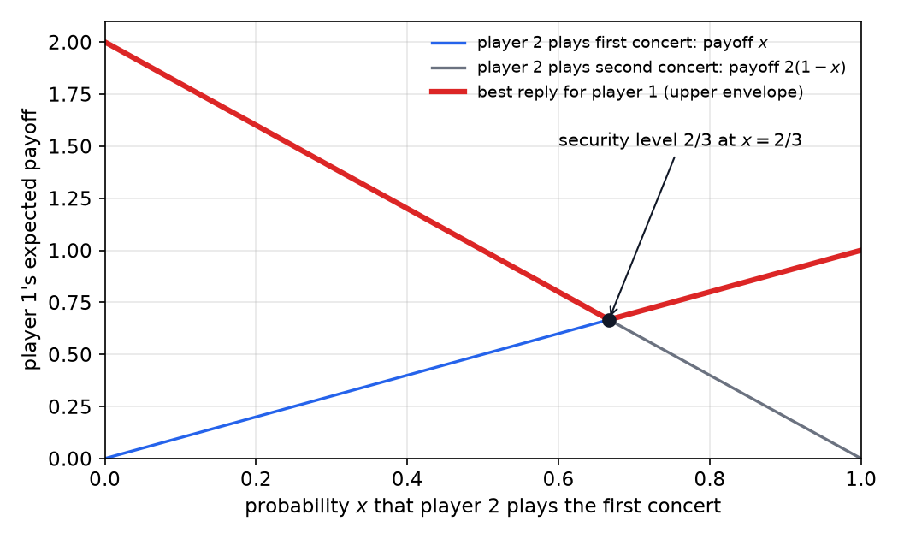

# Repeated and Stochastic Games

The prisoner's dilemma of the previous chapter is a one-shot game, and its only equilibrium is mutual defection. When the same players meet again and again, the situation changes. A strategy can now condition on the history of play, and a player can reward or punish the other in later rounds. This chapter studies the repeated dilemma when nobody knows when it ends, which is the model that makes the discount factor of an MDP reappear as a probability of continuing. It then develops the finite-state strategies, the folk theorem, and the subgame-perfect equilibria that separate credible threats from empty ones. The chapter ends with **stochastic games**, the model that generalizes both MDPs and repeated games and is the standard formal setting for multi-agent reinforcement learning.

## Repetition With an Unknown End

The dilemma from the previous chapter has payoffs (cooperate, cooperate) = (−1, −1), (cooperate, defect) = (−9, 0), (defect, cooperate) = (0, −9) and (defect, defect) = (−6, −6), written as (A, B) in months. If the dilemma is repeated a known number of times, backward induction removes cooperation from every round, as shown in the previous chapter. The argument needs the last round to be known. Without a last round, it has nothing to start from.

Consider the following model. Play one round. Then flip a coin with continuation probability \\(\gamma\\): with probability \\(\gamma\\) play another round, and with probability \\(1-\gamma\\) stop. Each continuation decision is independent of the others. Round 1 is always played. Round \\(k\\) is played exactly when the first \\(k-1\\) decisions all say continue, which has probability \\(\gamma^{k-1}\\). The expected number of rounds is therefore

\\[
E[N] = \sum\_{k \geq 1} \gamma^{k-1} = \frac{1}{1-\gamma}.
\\]

Two checks confirm the formula. With \\(\gamma = 0\\) there is exactly one round, and \\(1/(1-0) = 1\\). With \\(\gamma = 0.99\\) the expected number of rounds is 100. As \\(\gamma\\) approaches 1 the expected length grows without bound, so a player who cares about the whole sequence of rounds is planning for a long game.

The same probabilities explain why the discount factor of an MDP and the continuation probability are the same number. Let \\(r\_t\\) be the payoff in round \\(t+1\\), counting from \\(t = 0\\). The round \\(t+1\\) is played with probability \\(\gamma^t\\), so the expected total payoff over the random number of rounds is

\\[
E\Big[\sum\_{t=0}^{N-1} r\_t\Big] = \sum\_{t=0}^{\infty} P(N > t)\\, r\_t = \sum\_{t=0}^{\infty} \gamma^t r\_t.
\\]

The expected undiscounted total is a discounted sum. An agent that discounts by \\(\gamma\\) per round in an MDP is valuing a process that continues with probability \\(\gamma\\) per round. This is the reason the discount factor is also the continuation probability in the repeated game, and the reason the two models share their mathematics.

## Strategies as Finite-State Machines

A strategy for an unbounded game must be a finite object that can play any number of rounds. Action sequences and finite game trees cannot describe it, because the game has no fixed length. The natural representation is a **finite-state machine**. The machine has a set of states, each labeled with the move the player makes in that state, and arrows labeled with the opponent's observed move. After each round the machine follows the arrow matching the opponent's move, and the state it reaches determines the next move.

**Tit-for-tat** (TfT) is the simplest example. It cooperates on the first round, and on every later round it copies the opponent's previous move. As a machine it has two states, labeled C and D. Its start state is C. Whatever the opponent did last, TfT moves to the state with that name, so the state always equals the opponent's last move.

**Pavlov**, also called win-stay, lose-shift, is a second example. It starts by cooperating. A player in state C that sees the opponent cooperate stays in C, and a player in state C that sees a defection moves to D. In state D the transitions are reversed: a cooperation by the opponent keeps the player in D, and a defection moves it back to C. Equivalently, the Pavlov player cooperates on the next round if both players' moves in the last round matched, and defects if they differed.

*Figure: Two finite-state strategies for the repeated dilemma. The labels inside the circles are this player's move in that state. Blue labels on the arrows are the opponent's observed move. Tit-for-tat has the same destination after either observation, so its state is the opponent's last move. In Pavlov the two arrows out of state D are reversed.*

It helps to see how TfT responds to four opponents:

1. Against an opponent who always cooperates, TfT always cooperates.
2. Against an opponent who always defects, TfT cooperates in the first round and defects in every later round. Always defecting is therefore never the response of TfT itself: the defector gets 0 in round one and −6 after that.
3. Against another tit-for-tat, both cooperate forever.
4. Against an opponent who alternates D, C, D, C, ..., TfT plays C, D, C, D, ...: the opponent's sequence shifted by one round, with a cooperation placed in front.

## Best Responses and the Threshold 1/6

Suppose the other player plays TfT. Compare two strategies for the responder: always cooperate (AC) and always defect (AD). Against TfT the per-round payoffs are as follows. AC meets TfT's cooperation in every round, giving (C, C) = −1 each time. Its discounted total is

\\[
V\_{\text{AC}} = \sum\_{t \geq 0} \gamma^t (-1) = -\frac{1}{1-\gamma}.
\\]

AD gets 0 in round one, because TfT cooperates there and the defector receives (D, C) = 0. From round two on, TfT copies the defection, so every round gives (D, D) = −6. The discounted total is

\\[
V\_{\text{AD}} = 0 + \sum\_{t \geq 1} \gamma^t (-6) = -\frac{6\gamma}{1-\gamma}.
\\]

The two are equal when \\(-1 = -6\gamma\\), that is, when \\(\gamma = 1/6\\). To see which is larger, subtract. Since \\(1-\gamma > 0\\), the comparison \\(V\_{\text{AC}} > V\_{\text{AD}}\\) is the same as \\(-1 > -6\gamma\\), which is \\(\gamma > 1/6\\). At the threshold both values equal \\(-1/(5/6) = -6/5 = -1.2\\).

*Figure: The discounted payoff of always cooperate (solid blue), always defect (solid red) and the alternating strategy (dashed gray) against tit-for-tat, as functions of the continuation probability. The two solid curves cross at \\(\gamma = 1/6\\), where both equal −1.2. Below the threshold defection is better; above it cooperation is better.*

The threshold has a plain interpretation. When \\(\gamma\\) is small the game is likely to end soon, so the one-round gain from defecting against an unforgiving partner is worth more than the sustained cooperation that would follow. When \\(\gamma\\) is large the game is likely to last long, so the sustained cooperation is worth more. The decision depends on how long the game is expected to last.

### Best responses as an MDP

The best response to a finite-state opponent is an MDP problem. The opponent's states are the MDP's states. Our actions label the edges, and each action earns the payoff from the matrix. Our action also determines the opponent's next state, because TfT's state is our previous move. The transition rule is therefore simple: whatever we play this round becomes the state of TfT in the next round. The resulting MDP has two states, labeled by TfT's move, C and D, and two actions, C and D:

| State (TfT's move) | Our action | Payoff to us | Next state |
|---|---|---|---|
| C | C | −1 | C |
| C | D | 0 | D |
| D | C | −9 | C |
| D | D | −6 | D |

Because the MDP is so small, all its deterministic policies can be listed. A policy chooses an action in each state, so there are four. Starting from state C, where TfT begins, three of the four policies produce different plays. The policy that always plays C stays in state C and earns \\(-1/(1-\gamma)\\). The policy that always plays D reaches state D and earns \\(-6\gamma/(1-\gamma)\\). The policy that plays D in state C and C in state D alternates between the two states and earns the value \\(V\_{\text{Alt}}\\), found from \\(V\_{\text{C}} = 0 + \gamma V\_{\text{D}}\\) and \\(V\_{\text{D}} = -9 + \gamma V\_{\text{C}}\\):

\\[
V\_{\text{Alt}} = -\frac{9\gamma}{1-\gamma^2}.
\\]

The policy that plays C in state C and D in state D never leaves state C along the path from the start, so it is the same as always cooperating on the play. The best response to TfT is therefore one of three values, and the comparisons settle which is largest. Always cooperate beats the alternating policy exactly when \\(\gamma \geq 1/8\\), since \\(-1/(1-\gamma) \geq -9\gamma/(1-\gamma^2)\\) is the same as \\(1+\gamma \leq 9\gamma\\). Always defect beats the alternating policy exactly when \\(\gamma \leq 1/2\\), since the comparison reduces to \\(6(1+\gamma) \leq 9\\). So the alternating policy is never a best response. The best response is always defect when \\(\gamma < 1/6\\), and always cooperate when \\(\gamma > 1/6\\).

### Equilibria of the repeated game

Restrict attention to the three strategies AC, AD and TfT. A pair of strategies is a Nash equilibrium when each is a best response to the other. The best response to AC is AD, since defection earns 0 per round against an always cooperator. The best response to AD is AD, since against an always defector cooperating earns −9 per round while defecting earns −6. The best response to TfT is AC when \\(\gamma > 1/6\\), and TfT itself is also a best response to TfT, because against TfT it earns the same as AC. So:

- (AD, AD) is a Nash equilibrium for every \\(\gamma\\).
- (TfT, TfT) is a Nash equilibrium when \\(\gamma > 1/6\\). It is the cooperative equilibrium.
- (AC, AC) is not an equilibrium, because the always-cooperator would switch to AD. (AC, TfT) is not one either, because the tit-for-tat player would switch to AD against an always cooperator.

The repeated game therefore has two equilibria among these strategies. The cooperative one exists only because the game has no known end. A grim-trigger pair has the same threshold: each player cooperates until the other defects and then defects forever. Against grim trigger, a single deviation earns 0 and then leads to mutual defection, the same as the AD calculation. Cooperation is therefore strictly better than deviating exactly when \\(\gamma > 1/6\\), and the pair is an equilibrium for those discount factors.

## The Folk Theorem

The equilibrium result above concerns three strategies. A broader theorem says which payoffs can be sustained in equilibrium when the game is repeated. In mathematics a folk theorem is a result that experts know without a standard original publication, and the name is applied here to a result about repeated games. In the language of games it describes the set of payoffs that Nash equilibria can reach in repeated play.

### Feasible payoffs

Each joint action of the stage game gives a point in the plane, with one coordinate for each player's payoff. Over a long repeated game, the average payoff of any pair of strategies is a weighted average of such points, because a strategy can mix the joint actions over time. So the set of average payoffs achievable by any strategy profile is the convex hull of the stage-game points, called the **feasible region**.

For the dilemma the four points are (−1, −1) for mutual cooperation, (−6, −6) for mutual defection, (−9, 0) when player 1 cooperates and player 2 defects, and (0, −9) for the reverse. The convex hull is a quadrilateral with corners at those four points. The test points in the figure show the rule. The point (−1, −1) is a corner and is achievable. The point (−3, 0) is not: it lies above the edge running from (−9, 0) to (−1, −1), so no mixture of the four outcomes reaches it. The point (−4, −4) lies on the line from (−1, −1) to (−6, −6), and it is achievable as a convex combination. Solving \\(\alpha(-6) + (1-\alpha)(-1) = -4\\) gives \\(\alpha = 3/5\\), so the achieving mixture is three-fifths mutual defection and two-fifths mutual cooperation. A mixture of two-thirds defection and one-third cooperation gives \\(-13/3 \approx -4.33\\), not −4, so the weights must be 3/5 and 2/5.

*Figure: The feasible region for the dilemma, the convex hull of the four outcome points. The point (−4, −4) is achievable as a mixture; the point (−3, 0) lies outside the hull and cannot be reached by any mixture of outcomes. The shaded target region is feasible and gives each player strictly more than its minmax value of (−6, −6).*

### Minmax and security levels

Each player can guarantee a payoff regardless of what the others do, by assuming the others are malicious. Suppose the other players form an adversary whose only goal is to hurt this player. The adversary is then playing a zero-sum game against this player. The **minmax** value of a player is the best payoff it can guarantee against that adversary. If the adversary is restricted to pure strategies, the minimizing profile is the **pure minmax**. If the adversary may mix, the value is the **security level**, which is at least as large as the pure minmax.

Consider a coordination game in which player 1 prefers concert Y and player 2 prefers concert X. They choose without communicating. If they pick different concerts, both get 0. If they pick the same concert, player 1 gets 1 at concert X and 2 at concert Y, while player 2 gets 2 at concert X and 1 at concert Y. The payoff table, written (player 1, player 2), is:

| Player 1 / player 2 | Concert X | Concert Y |
|---|---|---|
| Concert X | (1, 2) | (0, 0) |
| Concert Y | (0, 0) | (2, 1) |

For player 1 the pure minmax is 1. If player 2 plays X, player 1's best reply is X, which gives 1. If player 2 plays Y, player 1's best reply is Y, which gives 2. So player 2 plays X, holding player 1 to 1. By symmetry the pure minmax for player 2 is also 1. The pure minmax profile is (1, 1).

The security level is larger. Let player 2 play X with probability \\(x\\). Player 1's expected payoff from X is \\(x\\), and from Y it is \\(2(1-x)\\). Player 1 can choose whichever is larger, so the adversary chooses \\(x\\) to minimize \\(\max(x,\\, 2(1-x))\\). The two lines are equal when \\(x = 2 - 2x\\), that is, \\(x = 2/3\\), where both equal \\(2/3\\). The security level of player 1 is therefore \\(2/3\\). The same calculation for player 2, with player 1 playing X with probability \\(y\\), gives \\(\max(2y,\\, 1-y)\\), minimized at \\(y = 1/3\\) with value \\(2/3\\). The security profile is \\((2/3, 2/3)\\).

*Figure: Player 1's expected payoff against the probability \\(x\\) that player 2 plays concert X. The blue line is the payoff from concert X and the gray line the payoff from concert Y. The bold red curve is player 1's best reply at each \\(x\\). The adversary chooses \\(x\\) to minimize this curve, at the crossing \\(x = 2/3\\), where the security level is \\(2/3\\).*

For the prisoner's dilemma, the pure minmax of each player is −6. The adversary defects, and the best reply to defection is defection, so the minmax profile is (−6, −6).

### The folk theorem

Put the two ideas together. A payoff profile is **acceptable** if it gives each player strictly more than its minmax value. Acceptable profiles lie strictly above and to the right of the minmax point. The **target region** is the set of payoffs that are both feasible and acceptable.

**Theorem (folk theorem, informal statement).** Let a stage game with finitely many players be given, and let \\(v\\) be a payoff profile that is feasible and gives each player strictly more than its minmax value. Then for every discount factor close enough to 1 there is a Nash equilibrium of the repeated game whose average payoff is \\(v\\).

The proof has a simple structure. Both players follow a path that realizes \\(v\\), by mixing the stage-game outcomes over time. If one player deviates, the other punishes by holding the deviator to its minmax value for the rest of the game. The best reply to the threat is to keep following the path. The target must be strictly better than the minmax, or the punishment would not hurt the deviator and the threat would not deter it.

The dilemma gives a clean case. The target (−1, −1) is feasible and strictly above (−6, −6), so it lies in the target region, and it can be sustained as an equilibrium when the game is patient enough. The punishment is mutual defection forever, the grim-trigger threat. We can quantify the condition. Let \\(d\\) be the best one-round payoff a deviator can get against the target, let \\(v\\) be the target payoff in each round, and let \\(m\\) be the minmax payoff the punishment holds the deviator to. Cooperating forever is worth \\(v/(1-\gamma)\\). Deviating gives \\(d\\) in the first round and \\(m\\) in every round after it, so it is worth \\(d + \gamma m/(1-\gamma)\\). The target is an equilibrium against this deviation when

\\[
\frac{v}{1-\gamma} \geq d + \frac{\gamma m}{1-\gamma}, \qquad \text{which is equivalent to} \qquad \gamma \geq \frac{d - v}{d - m}.
\\]

For the dilemma \\(v = -1\\), \\(d = 0\\) and \\(m = -6\\), so the condition is \\(\gamma \geq 1/6\\), the same threshold as before. This is the writer's derivation of the one-shot deviation check; the folk theorem asserts only that some such threshold exists.

## Credible Threats and Subgame Perfection

The folk theorem uses punishments, and not every punishment is believable. A threat is credible only if carrying it out is also a best response when the time comes. A Nash equilibrium can rely on threats that the threatener would never carry out, and the test for such threats is a stronger concept called **subgame-perfect equilibrium**. A profile is subgame perfect when, after every history of play, the continuation strategies form a Nash equilibrium of the game that remains. The history need not occur on the path of play. The test is therefore simple to state: look for a history after which some player is not taking a best response. If one exists, the profile is not subgame perfect.

### Grim trigger against tit-for-tat

Grim trigger against tit-for-tat is a Nash equilibrium for \\(\gamma > 1/6\\), since both cooperate forever and neither gains by switching. It is not subgame perfect. Consider the history in which grim cooperates in round one and TfT defects there. TfT never does this on the path, but the test must cover it. Grim now defects forever. TfT copies grim's cooperation in round one, so it cooperates in round two, and then copies grim's defection from round three on. The sequence from round two is (D, C), then mutual defection forever, worth \\(-6\gamma/(1-\gamma)\\) counting from round two.

Grim could instead cooperate from round two. Then TfT cooperates too, and the sequence is mutual cooperation from round two, worth \\(-1/(1-\gamma)\\). For \\(\gamma > 1/6\\) the second value is larger, so grim should not carry out its threat after the off-path defection. Its punishment is not credible, and the equilibrium is not subgame perfect.

### Tit-for-tat against tit-for-tat is not subgame perfect

Tit-for-tat against tit-for-tat is a Nash equilibrium, but it too fails the test. Start from a history in which one TfT player defects in some round. The second player copies, and from there the two players alternate: one defects while the other cooperates, and then the reverse. The per-round payoffs of the alternation are (D, C) = 0 and (C, D) = −9, so the average is \\(\tfrac12(0 - 9) = -4.5\\).

The second player can instead cooperate, which brings the pair back to mutual cooperation after a single round. The average payoff of mutual cooperation is −1, which is better than −4.5. So the second player's retaliation is not a best response at this history, and the profile is not subgame perfect.

### Pavlov is subgame perfect

Pavlov against Pavlov is a Nash equilibrium, because both start by cooperating and keep cooperating. It is also subgame perfect, and the reason is that from any joint state play returns to mutual cooperation. The joint states determine the next moves of both players. From joint state (C, C) play stays in (C, C). From (D, D) both players see a matched defection and move to C, so play goes to (C, C). From (C, D) or (D, C) the players disagree, both move to D, which gives (D, D), and then to (C, C). So within at most two rounds of any history, play is back in mutual cooperation. A punishment costs the punisher nothing in the long run, because the play returns to cooperation, and therefore the threat is credible.

The contrast with grim trigger is the point. Pavlov's punishment is a short disruption that ends with the punisher back in cooperation, while grim trigger's punishment never ends. A threat is credible when carrying it out does not cost the punisher in the long run.

## Computing Equilibria in Repeated Games

The existence of cooperative equilibria in repeated games is not only a theoretical point. For a general bimatrix game, a two-player game with separate payoff matrices for each player, the average-reward or long-discount version has a constructive answer. For any such game, a subgame-perfect equilibrium can be built in polynomial time, by one of three cases:

1. If the two players can both benefit from some joint behavior, construct a Pavlov-like machine that sustains that behavior.
2. If the game behaves like a zero-sum game, solve a linear program for the strategies.
3. Otherwise at most one player can improve on the others' behavior. Taking a best response against the other player's strategy gives a Nash equilibrium.

The result is computationally useful, because computing Nash equilibria of general games is hard in general, as the next chapter discusses. The repeated setting makes the construction easier because the punishments and rewards can be spread over many rounds.

## Stochastic Games

Repeated games add structure in time, but they keep the stage game fixed. MDPs have a changing state, but only one agent. A **stochastic game**, also called a Markov game, has both. It is the formal model in which several agents act in an environment that changes with their joint actions. The MDP is to reinforcement learning as the stochastic game is to multi-agent reinforcement learning.

### Definition

A two-player stochastic game has the following components:

- a finite set of states \\(S\\);
- a set of actions \\(A\\) for player 1 and a set \\(B\\) for player 2, chosen simultaneously in each state;
- a transition function \\(T(s,a,b,s')\\), the probability of moving to \\(s'\\) after the joint action \\((a,b)\\) in state \\(s\\);
- payoff functions \\(R\_1(s,a,b)\\) and \\(R\_2(s,a,b)\\), one for each player;
- a discount factor \\(\gamma\\), shared by the players.

The definition is due to Shapley and predates Bellman's work on MDPs. An MDP and a repeated game are both special cases, as the constraints below show.

### A grid example

A small example shows the features of a stochastic game. Two agents, A and B, move on a three-by-three grid. Each can move north, south, east or west, or stay put. Thick lines are walls. Most moves are deterministic, but a dashed semi-wall exists. An agent that tries to cross a semi-wall succeeds with probability one half and stays where it is with probability one half. The goal is a cell worth 100. The game ends when one agent reaches the goal, and the other agent gets nothing. The two agents cannot occupy the same cell, and a collision is resolved by a coin flip that decides which agent moves first.

Ignoring the other agent, each agent's shortest route is the direct one. The interaction is in the choice of route. Suppose both agents take the semi-wall route. Each attempt to cross has four equally likely outcomes. Both cross (probability 1/4), and in that case both reach the goal together and both collect the reward. Only A crosses (1/4), so A reaches the goal and B does not. Only B crosses (1/4), so B reaches the goal and A does not. Neither crosses (1/4), and the attempt is repeated. Conditioning on the attempt being resolved, which has probability 3/4, the probability that A reaches the goal is

\\[
\frac{1/4 + 1/4}{3/4} = \frac{2}{3},
\\]

and by symmetry the same holds for B. The two probabilities add to more than one because a joint arrival counts for both players, so the events are not exclusive.

This profile is not an equilibrium. If B instead takes the direct route, B reaches the goal with probability 1, and A's chance falls to one half, because A's first crossing must succeed before B arrives. B gains from the switch, so the profile with both on the semi-wall fails the equilibrium test. With B on the direct route and A on the semi-wall, A's payoff is one half and B's is one. B has no reason to switch to the semi-wall, which would lower its chance to two-thirds, and A gains nothing by switching to the direct route. The example has several equilibria, and the equilibrium policies are multi-step plans rather than single choices from a matrix. If the rule is changed so that a collision blocks both agents, the profile in which both take the direct route is no longer an equilibrium, because each agent then does better using the semi-wall.

The argument uses only the probabilities and the collision rule. The exact cell positions are not specified, and nothing in the equilibrium calculations depends on them.

### Special cases

The definition contains the two earlier models as special cases. Three constraints give them.

1. If the two players' rewards are opposite, \\(R\_1 = -R\_2\\), the game is a zero-sum stochastic game.
2. If player 2's action has no effect on the transitions or on player 1's rewards, and player 2's reward is constant, then player 1 faces a single-agent MDP.
3. If the state set has exactly one state, actions affect rewards but not transitions. The discount factor then plays the role of the stochastic ending of the previous section, and the game is a repeated game.

These cases show how the framework contains the earlier ones. The stochastic game is the general object and each special case removes a source of interaction.

### Zero-sum stochastic games and minimax-Q

When actions affect future states, a value function is needed, as in an MDP. For each joint action in each state, define the joint-action Q-function of player \\(i\\):

\\[
Q\_i(s,a,b) = R\_i(s,a,b) + \gamma \sum\_{s'} T(s,a,b,s')\\, V\_i(s').
\\]

In a given state the Q-values form a matrix game, with an entry for each pair of actions. A natural value for the state is then the value of that matrix game. A tempting alternative is to take the maximum over joint actions, but that assumes the other player will cooperate in choosing the best cell, which is unwarranted in a zero-sum game. The correct summary of a zero-sum matrix game is its minimax value, so the state value is

\\[
V\_i(s') = \text{minimax}\_{a',b'} Q\_i(s',a',b').
\\]

The resulting update is the Q-learning update with the minimax operator in place of the maximum. With learning rate \\(\alpha\\),

\\[
Q\_i(s,a,b) \leftarrow (1-\alpha)\\, Q\_i(s,a,b) + \alpha \Big[ R\_i(s,a,b) + \gamma\\, \text{minimax}\_{a',b'} Q\_i(s',a',b') \Big].
\\]

The algorithm is called minimax-Q. Several facts carry over from the single-agent case. Value iteration works, and its fixed point \\(Q^\*\\) is unique. Minimax-Q converges under the same conditions as Q-learning. Each player can run it on its own, without coordination, and the policies converge to minimax-optimal policies. Each update is polynomial in the size of the action sets, because the minimax of a matrix game is a linear program. An MDP can be solved by a single linear program, and whether zero-sum stochastic games can be solved in polynomial time in the same way is not known.

### General-sum stochastic games and Nash-Q

Minimax does not apply to general-sum games. Minimax assumes that the other player wants to minimize my payoff. In a general-sum game the other player has its own payoff and is not an adversary. The natural replacement is to compute a Nash equilibrium of the two-player matrix game formed by \\(Q\_1\\) and \\(Q\_2\\) in each state, and to propagate the pair of values back. This is the Nash-Q algorithm.

The general-sum case is harder in several ways.

1. Value iteration need not converge.
2. \\(Q^\*\\) is not unique, because different equilibria can have different values for the players.
3. Policies cannot be computed independently. Halves of different equilibria need not form an equilibrium together.
4. The update is not efficient. Computing a Nash equilibrium of a general two-player game is PPAD-complete, and no polynomial-time algorithm is known for problems in that class.
5. Consistent Q-values do not determine a policy. Even when the values are known, the Q-functions do not tell the players what to do.

The general-sum case is the one that matters in most applications, and it is the one where the Q-based approach loses its guarantees. The rest of the field is organized around ways to get some of the benefits back, and several of them connect to the earlier sections.

Repeated stochastic games extend the folk-theorem idea to stochastic games, and efficient algorithms exist for some classes. Cheap talk, meaning non-binding communication, lets the players coordinate on a correlated equilibrium, which is cheaper to compute than a Nash equilibrium and can approximate a stochastic-game solution. Cognitive hierarchy models assume that each player reasons about others with more limited computing power, and best responses to them are easy to compute. Side payments let players transfer reward to encourage joint actions that help both, and the CoCo values of the next chapter formalize this.

## Summary

- With an unknown end, each round continues with probability \\(\gamma\\), the expected number of rounds is \\(1/(1-\gamma)\\), and the discount factor of an MDP is the probability of continuing.
- A strategy for an unbounded game is a finite-state machine. Tit-for-tat, Pavlov and grim trigger are the standard examples.
- Against tit-for-tat, always cooperating is better than always defecting exactly when \\(\gamma > 1/6\\). The best response to tit-for-tat is an MDP over tit-for-tat's state, and its solution switches at the same threshold.
- Within the strategies AC, AD and TfT, the cooperative pair (TfT, TfT) is an equilibrium only when \\(\gamma > 1/6\\). Grim trigger has the same threshold.
- The feasible region is the convex hull of the stage payoffs. The folk theorem says that any feasible payoff strictly above the minmax point is an equilibrium payoff when players are patient. The minmax value of each player in the dilemma is −6. In the coordination example the pure minmax is 1 and the security level is \\(2/3\\).
- A Nash equilibrium can rely on threats that are not credible. Subgame perfection rules them out. Grim trigger and tit-for-tat against tit-for-tat are not subgame perfect. Pavlov against Pavlov is.
- A stochastic game has states, simultaneous actions for each player, transitions and payoffs. It generalizes MDPs and repeated games, and its zero-sum case is solved by minimax-Q.
- In general-sum stochastic games the minimax argument fails, and the Nash-Q approach has serious difficulties, including non-unique values and the complexity of computing equilibria.

## See Also

- [Two-Player Games and Nash Equilibria](two-player-games.md): the one-shot game, minimax and the dilemma that this chapter repeats.
- [Correlated Equilibria, CoCo Values, and Mechanism Design](beyond-nash.md): correlated equilibria, CoCo values for the general-sum case, and mechanism design.
- [Markov Decision Processes](../cs3600-cs6601-artificial-intelligence/mdps.md): the single-agent model whose discount factor is reinterpreted here as a continuation probability.
- [MDP Framework](mdp-framework.md): discounted utility and the MDP definition used in the best-response argument.
- [Bellman Equations and Learning from Experience](bellman-equations.md): the Bellman equations that the best-response MDP satisfies.
- [Game Playing and Adversarial Search](../cs3600-cs6601-artificial-intelligence/game-playing.md): the deterministic minimax search that the zero-sum stochastic game generalizes.
- Reinforcement Learning: the one-page overview of the subsection.
