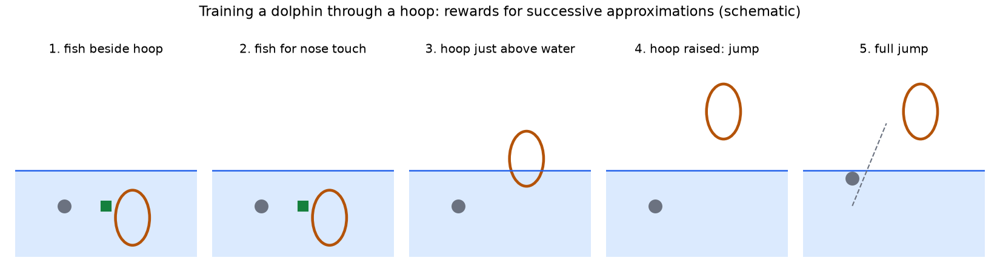
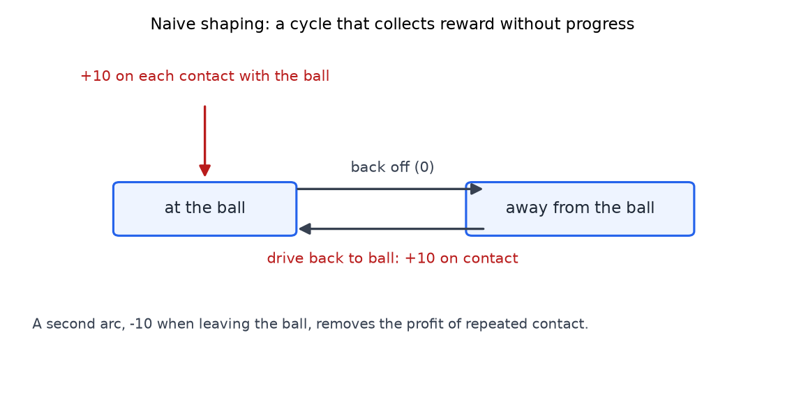
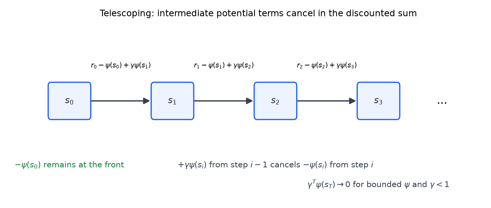
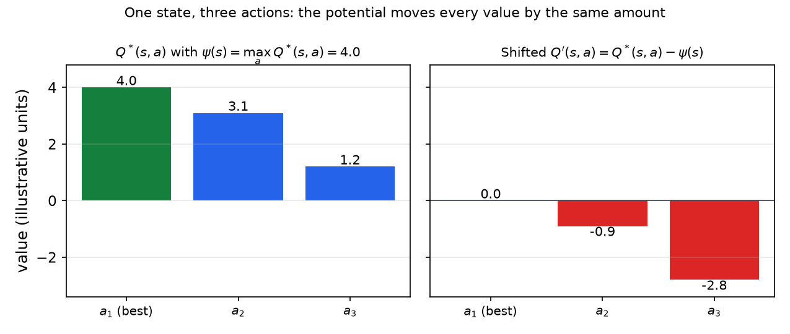

# Reward Shaping

A reinforcement learning agent learns what its reward function asks for, and nothing else. The reward is therefore a specification of behavior, and different reward functions can specify the same behavior at very different cost in learning. This chapter asks which changes to the reward leave the optimal policy alone, and which of those also make learning faster. It covers three families of transformations: multiplying the reward by a positive constant, adding a constant, and potential-based shaping. The last of these is the one that helps learning without changing the answer, and its proof is a clean telescoping argument. The chapter also shows how naive shaping can create a loop that collects reward without progress, and why potential functions avoid it.

## Why Change the Reward?

The reward function is the designer's only channel to the agent. The lecture compares it to a programming language: the reward specifies behavior, and the learning algorithm compiles it into a policy. Several programs can sort the same list with very different efficiency, and several reward functions can specify the same behavior at different efficiency.

"Efficiency" has four senses in the source.

- The **amount of experience** the agent needs before its behavior is right.
- The **amount of computation** the learning process needs.
- The **space** the reward function takes up, meaning how complicated it is to write down or reason about.
- Whether the problem is **solvable at all**. The lecture's phrase is "the difference between infinity and not-infinity".

Changing the reward is therefore a way to make learning easier while keeping the behavior the designer wants. The aim is a change that makes learning easier "without actually changing what it is going to learn".

There is a trap. Setting every reward to zero makes every policy optimal, so learning is trivially finished, but it solves the wrong problem. The lecture calls this turning the problem into "an easier problem that isn't really interesting anymore". A transformation is acceptable only if the optimal policy survives it, and the next section shows how to check that.

## Transformations That Keep the Optimal Policy

Keep the states, actions, transition probabilities and discount factor \\(\gamma\\) fixed. Change only the reward \\(R\\) to a new reward \\(R'\\). Let \\(Q\\) be the optimal action-value function for \\(R\\) and \\(Q'\\) the one for \\(R'\\). Both satisfy a Bellman equation,

\\[
Q(s,a) = R(s,a) + \gamma \sum\_{s'} T(s,a,s') \max\_{a'} Q(s',a') ,
\\]

with \\(T\\) the transition probabilities. Given \\(Q\\), the agent acts greedily: in state \\(s\\) it takes an action that maximizes \\(Q(s,a)\\). A transformation keeps the optimal policy if the greedy action in every state is unchanged.

The method for each transformation has the same three steps. Write the Bellman equation for the new reward. Substitute a guessed new function. Check that the guess satisfies the equation. The Bellman equation has a unique solution, so a correct guess is the new Q function. The question in each case is whether the action that was best before is still best after the change.

### Multiplying the reward by a positive constant

Let \\(R'(s,a) = c\\,R(s,a)\\) with \\(c > 0\\). The guess is \\(Q' = cQ\\). Intuition: \\(Q\\) is a discounted sum of rewards, so scaling every reward by \\(c\\) scales the sum by \\(c\\). A reward expressed in one unit or another changes nothing about which behavior is preferred.

*Derivation.*

1. Write the Bellman equation for the new reward, \\(Q'(s,a) = cR(s,a) + \gamma \sum\_{s'} T(s,a,s') \max\_{a'} Q'(s',a')\\).
2. Substitute the guess \\(Q' = cQ\\): \\(cQ(s,a) = cR(s,a) + \gamma \sum\_{s'} T(s,a,s') \max\_{a'} cQ(s',a')\\).
3. Because \\(c > 0\\), \\(\max\_{a'} cQ(s',a') = c \max\_{a'} Q(s',a')\\). A positive factor does not change which value is largest.
4. The factor \\(c\\) is common to every term, so the right side becomes \\(c \big[ R(s,a) + \gamma \sum\_{s'} T \max\_{a'} Q \big]\\).
5. Divide by \\(c\\). What remains is the original Bellman equation for \\(Q\\), which is true.
6. By uniqueness, \\(cQ\\) is the Q function for \\(R'\\). Since \\(c > 0\\), \\(\arg\max\_a cQ(s,a) = \arg\max\_a Q(s,a)\\), so the optimal policy is unchanged. \\(\square\\)

**Example (scaling).** Take \\(c = 1000\\). A transition worth 1 becomes worth 1000, and the optimal value function is multiplied by 1000 at every state. Two actions that were ranked 3.2 and 3.1 are still ranked in the same order, at 3200 and 3100.

The constant must be positive. Two cases fail. If \\(c = 0\\), every reward becomes zero, all information is lost, and every policy is optimal. If \\(c < 0\\), the reward is reversed: a maximum of the original rewards becomes a minimum of the new rewards, so the optimal policy changes. A single-state example shows this. Let the reward for two actions be \\(R = (1, 0)\\). The best action is \\(a\_1\\). With \\(c = -1\\), the reward is \\((-1, 0)\\), and the best action becomes \\(a\_2\\). The lecture's phrase is "we can swap max and min by accident".

### Adding a constant to the reward

Let \\(R'(s,a) = R(s,a) + C\\), a bonus added on every step. The guess is \\(Q' = Q + C/(1-\gamma)\\). Intuition: each step adds \\(C\\), and the discounted sum of these bonuses is the geometric series

\\[
C + \gamma C + \gamma^2 C + \cdots = \frac{C}{1-\gamma} .
\\]

*Derivation.*

1. Substitute \\(Q' = Q + C/(1-\gamma)\\) and \\(R' = R + C\\) into the Bellman equation for \\(Q'\\). The right side becomes

\\[
R(s,a) + C + \gamma \sum\_{s'} T(s,a,s') \max\_{a'} \Big[ Q(s',a') + \frac{C}{1-\gamma} \Big] .
\\]

2. The constant \\(C/(1-\gamma)\\) does not depend on \\(a'\\), so it comes out of the maximum. The transition probabilities sum to 1, so the sum over \\(s'\\) contributes \\(\gamma C/(1-\gamma)\\).

3. The right side is therefore

\\[
\Big[ R(s,a) + \gamma \sum\_{s'} T \max\_{a'} Q \Big] + C + \frac{\gamma C}{1-\gamma} = Q(s,a) + C + \frac{\gamma C}{1-\gamma} .
\\]

4. The left side of the guessed equation is \\(Q(s,a) + C/(1-\gamma)\\). Subtracting \\(Q(s,a)\\) from both sides, we need \\(C/(1-\gamma) = C + \gamma C/(1-\gamma)\\). Multiplying by \\(1-\gamma\\) gives \\(C = C(1-\gamma) + \gamma C = C\\), which is true. \\(\square\\)

A constant inside the maximum does not change which action wins, so the optimal policy is unchanged, for any constant. Unlike scaling, the sign of \\(C\\) does not matter. The lecture summarizes this as "any constant", because the value of the constant has no effect on behavior.

**Example (adding a constant).** Take \\(C = 0.5\\) and \\(\gamma = 0.9\\). Every value shifts by \\(0.5/(1-0.9) = 5\\). Two actions with values 10 and 8 become 15 and 13, and the choice between them is the same.

## Shaping With Hints

The first two transformations change only the scale or offset of the values, so they cannot make learning faster in a meaningful way. The third kind of change is different. It adds structure that tells the agent where it is making progress.

The motivation is that a reward given only at the goal may never be reached by chance. The lecture uses the example of training a dolphin to jump through a flaming hoop. Rewarding only the completed jump never happens, so the dolphin cannot learn that jump directly. Trainers instead work through successive approximations, and each stage is rewarded.

1. Put the hoop in the water with a fish beside it, so the dolphin swims over and eats the fish.
2. Pay the fish only for touching the hoop with the nose, not for being near it.
3. Lift the hoop slightly out of the water, so the dolphin must swim up to reach it.
4. Raise the hoop further, so the dolphin must jump to touch it.
5. Finally, add the fire.

*Figure: A schematic of the training ladder described in the source. Each panel is one stage; the hoop is raised in steps, and the reward is given for the behavior at that stage. The figure is drawn for this chapter and is not a course slide.*

The lesson is that a series of small rewards along the route to the large one gives the agent hints, in the same way that a learner receives feedback before the final result. The lecture applies the idea to a robot soccer pitch. The goal is worth +100 for scoring. The designer can add hints: a bonus for being near the ball, which might be a flat +1 inside a small region around the ball or a bonus inversely proportional to distance; and a bonus for moving the ball toward the goal, inversely proportional to the ball-goal distance. The bonus for moving the ball must outweigh the near-ball bonus that is lost when the ball is kicked away. The lecture gives no firm values for the balance. The chapter's later examples use labeled illustrative values.

### The spurious positive loop

Naive shaping has a failure mode. Suppose touching the ball pays +10 every time, and the robot can back off and touch again. Then the robot can collect +10 repeatedly, and the repeated contact may earn more than scoring. The lecture's phrase is that vibrating against the ball, "thirty or forty times a second", earns more than the goal. The shaping has created a **spurious optimal policy**: the agent maximizes the hint rather than the true goal.

The arithmetic is simple. Let the robot repeat a two-step cycle, one step back and one step in, with contact on every cycle. Each contact pays 10, so the discounted value of the cycle is

\\[
10 + 10\gamma^2 + 10\gamma^4 + \cdots = \frac{10}{1-\gamma^2} .
\\]

For \\(\gamma = 0.9\\) this is about 52.6, and for \\(\gamma = 0.99\\) it is about 502.5. A goal worth 100 reached 20 steps away is worth \\(100 \cdot 0.9^{20} \approx 12.2\\) at \\(\gamma = 0.9\\). The repeated contact is worth far more than scoring.

*Figure: A two-state cycle. The "at the ball" state pays +10 on each contact, and a back-off move leads to a state from which the agent returns to contact. The loop repeats forever and collects reward without progress toward the goal. Penalizing departure from the ball by -10 breaks the profit, because each contact is then paid back when the agent leaves.*

The first fix suggested by the lecture is to penalize letting go, for example -10 when contact ends. Then each repeated contact nets zero, and there is no money pump. The lecturer's requirement is that no cycle of behavior should collect shaping reward without progress toward the true goal. Potential functions achieve this in general, and the next section shows how.

## Potential-Based Shaping

Instead of attaching bonuses to individual actions, put them on states. Reaching a good state pays a bonus, and leaving it loses that bonus, so the bonuses balance out over any path that does not make progress. The lecture's soccer example uses potentials \\(\psi(s) = 1/(\text{robot-to-ball distance})\\) and \\(1/(\text{ball-to-goal distance})\\), and the reward for a transition is the change in potential.

Here is the arithmetic the lecture uses with \\(\psi = 1/\text{distance}\\). If the robot moves from 10 pixels to 5 pixels from the ball, \\(\psi\\) goes from 0.1 to 0.2, and the change is +0.1. If the robot moves back from 5 to 10 pixels, the change is \\(-0.1\\). With \\(\gamma = 1\\), the two moves sum to zero. The next paragraphs show what the discount does.

### Definition

Let \\(\psi\\) be a bounded function on states, called the **potential**. The shaped reward is

\\[
R'(s,a,s') = R(s,a,s') - \psi(s) + \gamma \psi(s') .
\\]

Entering \\(s'\\) pays \\(\gamma\psi(s')\\), and leaving \\(s\\) costs \\(\psi(s)\\). The lecture calls the cancellation "good bookkeeping or accounting": when the agent leaves a state, it gives back the advantage it gained on entering. This is what prevents the spurious loops of the previous section.

With the discount, the moves in the numerical example give shaped rewards \\(\gamma(0.2) - 0.1\\) for the move in and \\(\gamma(0.1) - 0.2\\) for the move out. For \\(\gamma = 0.9\\), these are \\(+0.08\\) and \\(-0.11\\). The round trip nets \\(-0.03\\), and the original reward for the round trip is zero. The round trip is therefore unprofitable, and the bonus structure rewards only progress.

The round-trip sum is an instance of a general identity. For a cycle that returns to its starting state, the undiscounted sum of the shaped rewards equals the original reward sum plus \\((\gamma - 1)\\) times the sum of the potentials on the cycle. Here the cycle has \\(\psi\\) values 0.1 and 0.2, so the correction is \\((0.9 - 1)(0.3) = -0.03\\), which matches.

### The Q function shifts by the potential

The central result is that the potential changes the Q function by a state-dependent constant. Let \\(Q\\) be optimal for \\(R\\). Then the optimal Q function for \\(R'\\) is

\\[
Q'(s,a) = Q(s,a) - \psi(s) .
\\]

The proof has two parts. The first is a telescoping argument on a trajectory. The second verifies the Bellman equation.

**Telescoping on a trajectory.** Follow a trajectory \\(s\_0, s\_1, s\_2, \ldots\\) with original rewards \\(r\_t\\). The discounted sum of shaped rewards is

\\[
\sum\_{t \ge 0} \gamma^t \Big[ r\_t - \psi(s\_t) + \gamma \psi(s\_{t+1}) \Big] .
\\]

Write out the first three terms to see the cancellation.

\\[
\begin{aligned}
t = 0&: \quad r\_0 - \psi(s\_0) + \gamma \psi(s\_1) \\\\
t = 1&: \quad \gamma r\_1 - \gamma \psi(s\_1) + \gamma^2 \psi(s\_2) \\\\
t = 2&: \quad \gamma^2 r\_2 - \gamma^2 \psi(s\_2) + \gamma^3 \psi(s\_3)
\end{aligned}
\\]

The term \\(+\gamma\psi(s\_1)\\) from step 0 cancels \\(-\gamma\psi(s\_1)\\) from step 1, and the term \\(+\gamma^2\psi(s\_2)\\) from step 1 cancels \\(-\gamma^2\psi(s\_2)\\) from step 2. Each intermediate term cancels with its neighbor, and the sum telescopes to

\\[
\sum\_{t} \gamma^t r\_t - \psi(s\_0) + \lim\_{T \to \infty} \gamma^T \psi(s\_T) .
\\]

If \\(\psi\\) is bounded and \\(\gamma < 1\\), the limit is zero, because a bounded quantity multiplied by a power of \\(\gamma\\) that goes to zero vanishes. For a finite MDP, every potential is automatically bounded. The discounted shaped return of any trajectory is therefore its original discounted return minus \\(\psi(s\_0)\\). The starting state is the only one that contributes, and its potential is a constant that does not depend on the action taken.

*Figure: The telescoping chain. Each step pays its shaped reward \\(r\_t - \psi(s\_t) + \gamma\psi(s\_{t+1})\\). Adjacent potential terms cancel, so the discounted sum keeps only \\(-\psi(s\_0)\\) at the front and a vanishing term at the end.*

**Bellman verification.** Substitute \\(Q' = Q - \psi(s)\\) into the Bellman equation for the shaped reward. The equation to check is

\\[
Q(s,a) - \psi(s) = \sum\_{s'} T(s,a,s') \Big[ R(s,a,s') - \psi(s) + \gamma \psi(s') + \gamma \max\_{a'} \big( Q(s',a') - \psi(s') \big) \Big] .
\\]

Check each piece.

- The term \\(-\psi(s)\\) does not depend on \\(s'\\), so it leaves the sum, and the transition probabilities sum to 1.
- The terms \\(+\gamma\psi(s')\\) and \\(-\gamma\psi(s')\\) inside the sum cancel.
- Since \\(\psi(s')\\) does not depend on \\(a'\\), \\(\max\_{a'} \big( Q(s',a') - \psi(s') \big) = \max\_{a'} Q(s',a') - \psi(s')\\).

What remains is \\(\sum\_{s'} T \big[ R + \gamma \max\_{a'} Q \big] - \psi(s) = Q(s,a) - \psi(s)\\), which is true because \\(Q\\) satisfies the original Bellman equation. So \\(Q - \psi\\) solves the shaped equation, and by uniqueness it is \\(Q'\\). The lecturer notes that at no point is there a division by zero. \\(\square\\)

**Same optimal policy.** The shift \\(-\psi(s)\\) is the same for every action in state \\(s\\), so the argmax over actions at each state is unchanged. The policy that was optimal for \\(R\\) is optimal for \\(R'\\).

**Interpretation.** The shaped Q value is the value after accounting for the potential the agent will lose. The bonus \\(\psi(s)\\) received on entering \\(s\\) is taken back on leaving, so the value of being in \\(s\\) is shifted down by \\(\psi(s)\\). A question raised in discussion was why the shift is not a plus. The answer is that the shaped reward already contains \\(\psi\\) in both directions, so subtracting \\(\psi\\) recovers the original Q function. The shift does not pre-spend the bonus.

**Restrictions.** The only requirement used in the proof is that \\(\psi\\) is bounded. The lecture says there are no other restrictions, because the potential terms cancel. The potential can still change how fast learning goes, even though it cannot change the answer. Choosing a good potential is a design problem. The lecture sets the question of which potentials actually speed learning as an exercise.

The result is the potential-based shaping theorem. The lecture credits it to a published paper and does not give the title, so this chapter cites it only by its result.

## Q-Learning With Potentials

The theorem is most useful with a learning algorithm. The lecture gives Q-learning with shaping in these steps.

1. Keep a table \\(Q(s,a)\\), initialized to some value.
2. Take action \\(a\\) in state \\(s\\), and observe the original reward \\(r\\) and the next state \\(s'\\).
3. Compute the shaped reward \\(r - \psi(s) + \gamma \psi(s')\\).
4. Move \\(Q(s,a)\\) a little toward \\(\big[ r - \psi(s) + \gamma \psi(s') \big] + \gamma \max\_{a'} Q(s',a')\\), using the standard step size.
5. Set \\(s \leftarrow s'\\) and repeat.

In the limit, this solves the original MDP, the one with reward \\(R\\) alone, because the shaped table converges to \\(Q - \psi\\). The potential affects only the path to the answer, not the answer.

**Special case, \\(\psi(s) = \max\_a Q^\*(s,a)\\).** Take the potential to be the true value of each state. Then \\(Q'(s,a) = Q^\*(s,a) - \max\_{a'} Q^\*(s,a')\\). This is zero for the optimal action and negative for each suboptimal action, by the amount it is suboptimal. The lecture calls this choice unrealistic, because it needs \\(Q^\*\\) to begin with.

*Figure: Illustrative values for one state with three actions. The values \\(Q^\*\\) are chosen for this example, since the lecture gives no numbers. The potential \\(\psi(s) = 4.0\\) shifts every action value down by 4.0. The best action sits at zero, and the suboptimal actions are below zero by their gaps.*

The lecture's point is what happens with zero initialization. The optimal action starts at its true shifted value of 0, and the suboptimal actions start at their negative values. The agent tries each action, finds that its value falls below 0, and takes the better ones. The lecture calls this "an incredible leg up on the learning problem".

**Equivalence to initialization.** The lecture states a stronger result. Q-learning with potential \\(\psi\\) takes exactly the same greedy choices as Q-learning on the unshaped reward, with the table initialized to \\(\psi(s)\\) for every action in \\(s\\). The stored values differ by the shift.

The proof is one substitution. Let \\(\tilde Q(s,a) = Q'(s,a) + \psi(s)\\) be the shaped table with the potential added back. Substitute the shaped update into this definition. The shaped update changes \\(Q'(s,a)\\) by \\(\alpha \big[ r - \psi(s) + \gamma\psi(s') + \gamma \max\_{a'} Q'(s',a') - Q'(s,a) \big]\\). Since \\(\max\_{a'} Q'(s',a') = \max\_{a'} \tilde Q(s',a') - \psi(s')\\) and \\(Q'(s,a) = \tilde Q(s,a) - \psi(s)\\), the bracket becomes

\\[
r - \psi(s) + \gamma\psi(s') + \gamma \max\_{a'} \tilde Q(s',a') - \gamma\psi(s') - \tilde Q(s,a) + \psi(s) = r + \gamma \max\_{a'} \tilde Q(s',a') - \tilde Q(s,a) .
\\]

This is exactly the unshaped Q-learning update for \\(\tilde Q\\). So \\(\tilde Q\\) follows unshaped Q-learning from the starting table \\(\tilde Q = Q'\_0 + \psi\\). Starting with \\(Q'\_0 = 0\\) means starting \\(\tilde Q\\) at \\(\psi(s)\\) for every action in \\(s\\). Because the shift depends only on the state, the argmax over actions is the same for both tables at every step, so the two algorithms take the same greedy choices.

Potentials and initialization are therefore interchangeable. Asking who needs potentials gets the answer that the same effect can be had by initializing \\(Q\\) to the right values. A table initialized to zero is then a potential of zero. Random initialization asserts a potential only when the random values are the same for every action in a state; otherwise it has no state-only equivalent, and the lecture's point is that it still asserts that some states and actions are better than others to start from. The lecture's advice is to "inject knowledge, not noise", and it says knowledge can be injected through initialization. The discussion adds a counterpoint: random values are sometimes the right choice, while a fixed value such as 0 or 1000 is a consistent bias that is easy to defeat with a constructed MDP. Optimistic initialization, if it is not too optimistic, can also bound the learning curve in some results. The lecture defers this to a later chapter, and the exploration chapter discusses it in full.

## Summary

- Multiplying the reward by a positive constant \\(c\\) multiplies \\(Q\\) by \\(c\\). The optimal policy is unchanged. A negative \\(c\\) changes the optimal policy, and \\(c = 0\\) destroys all information.
- Adding a constant \\(C\\) to the reward shifts \\(Q\\) by \\(C/(1-\gamma)\\). The optimal policy is unchanged, for any \\(C\\).
- Naive shaping can create a spurious positive loop, for example a cycle that collects a bonus on every contact. With discounting, that cycle can be worth more than the true goal.
- Potential-based shaping uses the reward \\(R' = R - \psi(s) + \gamma\psi(s')\\). It shifts the optimal Q function by \\(-\psi(s)\\), so the optimal policy is unchanged, and it cannot create a profitable cycle.
- The proof uses telescoping along a trajectory, and it needs only that \\(\psi\\) is bounded.
- Q-learning with a potential takes the same greedy choices as unshaped Q-learning with the table initialized to \\(\psi(s)\\). Potentials and initialization are interchangeable, and a potential can speed learning without changing the answer.

## See Also

- [Convergence and Analysis](convergence.md): the Q-learning convergence argument, which the shaped update inherits.
- [Temporal-Difference Learning](td-learning.md): the update rules that the shaped reward plugs into.
- [Exploration, Bandits, and R-max](exploration.md): optimistic initialization and its role in exploration.
- [Coordination, Inverse Reinforcement Learning, and Coaching](coordination-irl.md): policy shaping with human feedback.
- [Markov Decision Processes](../cs3600-cs6601-artificial-intelligence/mdps.md): the MDP definitions and the Bellman equation used here.
- [Q-Learning](../cs3600-cs6601-artificial-intelligence/q-learning.md): the introductory Q-learning update and its practice problems.
