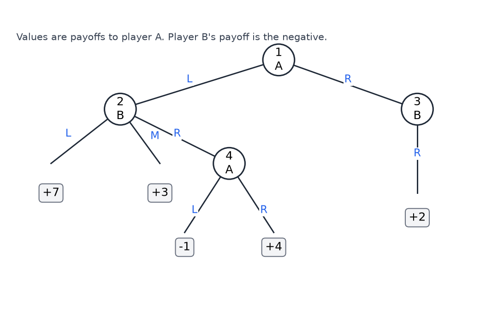
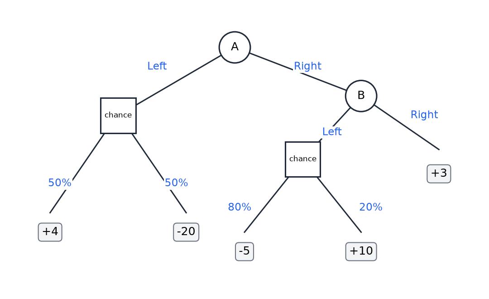
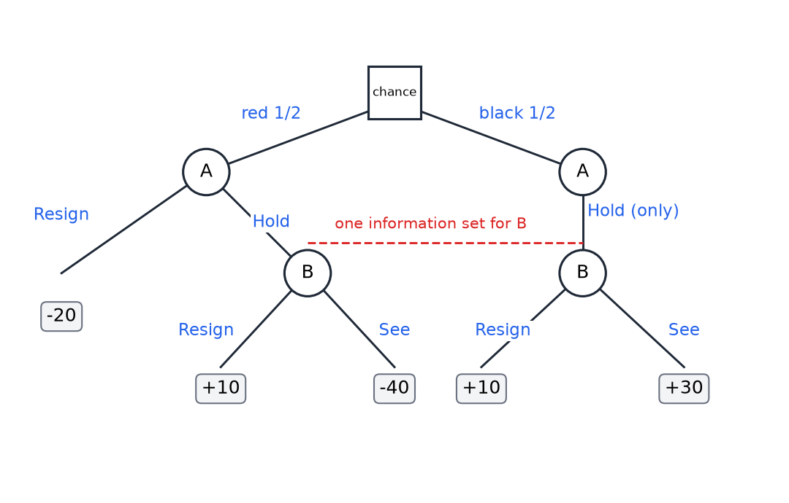
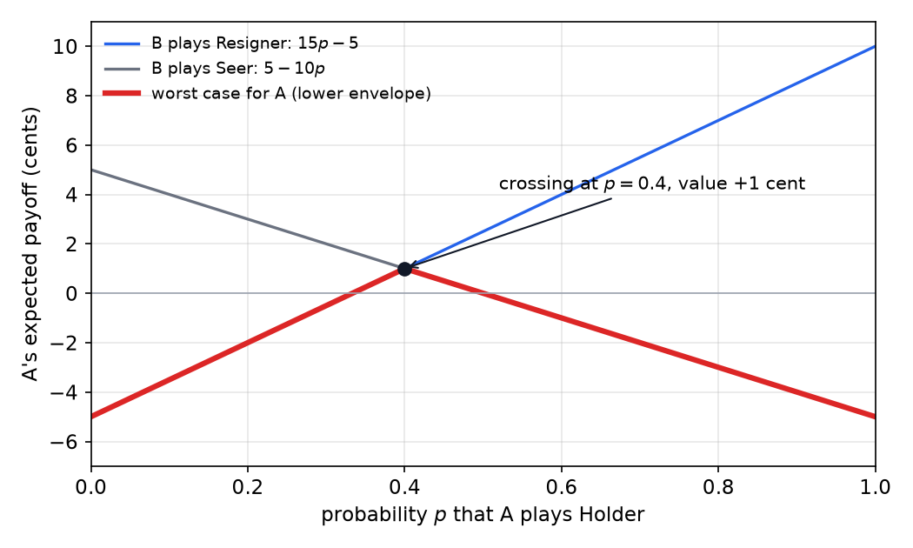

# Two-Player Games and Nash Equilibria

Reinforcement learning so far has had one decision maker. Other agents, when they appear at all, are hidden inside the transition model, and their behavior is treated as part of the environment. Game theory makes the goals of the other agents explicit. This chapter builds the basic tools: game trees, normal-form matrices, minimax, mixed strategies and Nash equilibrium. It applies them to two-player games that show where the simple solutions stop working, from a card game with hidden information to the prisoner's dilemma. The deterministic game-tree search of [Game Playing and Adversarial Search](../cs3600-cs6601-artificial-intelligence/game-playing.md) is the special case with perfect information and no randomization. The repeated and general-sum extensions follow in [Repeated and Stochastic Games](repeated-games.md) and [Correlated Equilibria, CoCo Values, and Mechanism Design](beyond-nash.md).

## What a Game Adds to an MDP

In a Markov decision process the environment is a fixed rule that maps states and actions to next states and rewards. Nothing in that rule responds to what the agent has decided to do. In a game the other players respond. Each player has its own payoff, and the payoff of each player depends on what all the players choose. The mathematics describes conflicts of interest between agents who each try to make the best choice available to them.

Two features of a game matter most. The first is who knows what. In a game of **perfect information** every player knows the full state of play when it moves. In a game of **imperfect** or **hidden** information some players cannot see part of the state, for example another player's card. The second is the relation between payoffs. A game is **zero-sum** if the payoffs of the players add to a constant at every outcome. Adding a constant to one player's payoffs changes nothing strategically, so a zero-sum game can be written with the second player's payoff equal to the negative of the first player's. A game that is not zero-sum is called **general-sum**: the players can both gain, or both lose, from the same outcome.

Throughout this chapter we take the games to be finite, with finitely many actions and finitely many outcomes. Player A and player B make their choices in turn or simultaneously, as the setting requires. The theory is easiest in the case of deterministic, perfect-information, zero-sum games, and most of the chapter is about what changes when each of those three assumptions is relaxed.

## Game Trees

A **game tree** is the picture of a sequential game. Each internal node belongs to one player, who chooses one of the edges leaving it. Each edge is an action. A leaf carries the payoff of the outcome that reaches it. In a deterministic game each action leads to exactly one child, so the tree is an unrolled version of the decision process: the nodes are states, stamped with the history that reached them.

Consider a small two-player zero-sum game with four internal states.

- **State 1** belongs to A. A chooses Left, which leads to state 2, or Right, which leads to state 3.
- **State 2** belongs to B. B chooses Left, which is a leaf with payoff +7 for A; Middle, which is a leaf with payoff +3; or Right, which leads to state 4.
- **State 3** belongs to B, who has one action, Right, leading to a leaf with payoff +2 for A.
- **State 4** belongs to A. A chooses Left, a leaf with payoff −1, or Right, a leaf with payoff +4.

*Figure: The example game tree. Circles are decision nodes, labeled with the player to move. Edge labels are the actions and the boxes are leaf payoffs for player A. Player B's payoff at each leaf is the negative of the value shown.*

Because the game is zero-sum, B's value is always the negative of A's. Every outcome of the game is therefore described by one number, A's payoff, and the table of values is enough to analyze the game.

A **strategy** for a player is a complete plan of action. It specifies an action at every state where that player might move, including states that the player's own earlier choices make unreachable. This requirement is what makes strategies comparable across opponents. A strategy is the game-theory analogue of an MDP policy, with one difference: a policy is evaluated against a fixed environment, while a strategy is evaluated against the other player's strategy.

A **pure strategy** chooses one action at each state. Counting pure strategies in the example:

- Player A chooses at states 1 and 4. It has two choices at each, so 2 × 2 = 4 pure strategies, written by the choices at states 1 and 4: LL, LR, RL and RR. The choice at state 4 matters only if A goes Left at state 1, but a strategy must still specify it.
- Player B chooses at states 2 and 3. It has three choices at state 2 and one at state 3, so 3 × 1 = 3 pure strategies: (L,R), (M,R) and (R,R).

## The Normal Form and Minimax

Once the strategies are listed, the whole game can be written as a matrix. Rows are A's strategies, columns are B's, and each cell is A's payoff when the two strategies are played. Each cell is determined by the two strategies alone, which is why the tree and its rules can be discarded afterwards. For the example:

| A's strategy / B's strategy | (L,R) | (M,R) | (R,R) |
|---|---|---|---|
| LL | 7 | 3 | −1 |
| LR | 7 | 3 | 4 |
| RL | 2 | 2 | 2 |
| RR | 2 | 2 | 2 |

For instance, the cell for LL against (L,R) is +7: A goes Left at state 1, B goes Left at state 2, and the game ends at +7. The cell for LL against (R,R) is −1: A goes Left, B goes Right into state 4, and A chooses Left there.

How should each player play this matrix? A chooses a row, and B then picks the column that is worst for A in that row. A therefore picks the row whose worst case is best. This is the **maximin** value for A:

\\[
\max\_{a} \min\_{b} v(a,b).
\\]

B picks a column, and A then picks the row that is best for A in that column. B therefore picks the column that is best for B, which is the column that makes A's best reply as poor as possible. This is the **minimax** value for B:

\\[
\min\_{b} \max\_{a} v(a,b).
\\]

Here \\(v(a,b)\\) is A's payoff when A plays row \\(a\\) and B plays column \\(b\\). For the table above, the row minima are −1 for LL, 3 for LR, 2 for RL and 2 for RR, so the maximin is 3, reached at LR. The column maxima are 7 for (L,R), 3 for (M,R) and 4 for (R,R), so the minimax is 3, reached at (M,R). The cell where LR meets (M,R) is a **saddle point**: neither player can improve by changing its strategy alone, and the game has value 3.

It is always true that maximin is at most minimax. Take a row \\(a^\*\\) that attains the maximin and a column \\(b^\*\\) that attains the minimax. Then \\(\min\_{b} v(a^\*,b) \le v(a^\*,b^\*) \le \max\_{a} v(a,b^\*)\\), so the maximin value cannot exceed the minimax value. The interesting fact is that for deterministic games of perfect information the two are equal.

**Theorem (minimax for deterministic perfect-information games).** Let a two-player game tree be finite, zero-sum and deterministic, and let each player know the node at which it moves. Then maximin equals minimax, and both players have optimal pure strategies.

*Proof sketch.* Define a backed-up value \\(V(n)\\) at each node. At a leaf, \\(V\\) is the payoff. At a node of A, \\(V(n)\\) is the maximum of \\(V\\) over the children. At a node of B, \\(V(n)\\) is the minimum over the children. Let A's strategy pick, at each of its nodes, a child that attains the maximum, and let B's strategy pick a child that attains the minimum at each of its nodes. Against any strategy of B, induction on the tree shows that the play from node \\(n\\) gives A at least \\(V(n)\\): at a node of A the chosen child has \\(V\\) equal to \\(V(n)\\), and at a node of B every child has \\(V\\) at least \\(V(n)\\). Symmetrically, B's strategy holds A to at most \\(V(\text{root})\\). So maximin is at least \\(V(\text{root})\\) and minimax is at most \\(V(\text{root})\\), and the easy inequality closes the gap. \\(\square\\)

Each hypothesis is used. Finiteness makes the maxima and minima exist. Determinism means that each pair of strategies produces one play. Perfect information lets each strategy depend on the node where a player finds itself, so that the backed-up choices are legal strategies. Zero-sum makes B's objective the negation of A's, so that a minimum for B is the right way to hurt A.

For the example, backing up the tree gives the value 3. At state 4, A's best choice is Right, worth 4. At state 2, B's best choice is Middle, worth 3, because B's Right would lead to the backed-up value 4 for A. At state 1, A's best choice is Left, which leads to the value 3. State 4 is never reached in play, but its backed-up value is what makes Right unattractive to B. This is exactly the minimax search of the AI chapter, and alpha-beta pruning computes the same value while skipping branches that cannot change it.

## Chance Nodes

Many games include randomness: dice, card draws or a noisy channel. In a game tree this is a **chance node**, drawn as a square. At a chance node nature chooses an edge with the stated probability, and no player controls the choice. The payoff of a node with chance children is the expected value of its children.

Figure 2 shows a small game with one chance node on each side of the tree.

*Figure: A game with chance nodes. The square nodes are chance: nature chooses the edge with the probability shown. A chooses Left or Right at the root, and after Right, B chooses Left or Right. The leaves are A's payoffs.*

A goes Left and then a chance node: with probability one half the payoff is +4, and with probability one half it is −20. The expected payoff is

\\[
\tfrac12 (4) + \tfrac12 (-20) = -8.
\\]

If A goes Right and B goes Left, the chance node gives −5 with probability 0.8 and +10 with probability 0.2, so the expected payoff is

\\[
0.8(-5) + 0.2(10) = -4 + 2 = -2.
\\]

If A goes Right and B goes Right, the payoff is +3 with no randomness. The matrix of expected payoffs is therefore:

| A's strategy / B's strategy | B Left | B Right |
|---|---|---|
| A Left | −8 | −8 |
| A Right | −2 | 3 |

A always prefers Right, because −2 beats −8 and 3 beats −8. Given Right, B prefers Left, because −2 is less than 3 for A. The game value is −2 at the cell (A Right, B Left). Only the matrix of expected payoffs decides this, which is the general lesson: once the expected payoffs are in the matrix, the tree that produced them can be forgotten.

The minimax theorem extends to this case. If the tree has chance nodes with known probabilities and the players maximize expected payoff, then maximin and minimax of the expected-payoff matrix are equal. The backing-up argument in the proof above works if the maximum at an A node and the minimum at a B node are replaced by the expectation at a chance node. This is the expectimax computation of [Game Playing and Adversarial Search](../cs3600-cs6601-artificial-intelligence/game-playing.md).

## Hidden Information and Mixed Strategies

### A card game

Now relax the perfect-information assumption. The following game, mini-poker, has a deal of a card that only A sees.

1. A is dealt a card that is red or black, each with probability one half. A red card is bad for A, and a black card is good for A.
2. Only A sees the card. B does not.
3. With a red card A chooses to **resign**, which costs A 20 cents, or to **hold**. With a black card A always holds.
4. If A holds, B chooses to **resign**, which gives A +10 cents whatever the card, or to **see** the card.
5. If B sees, a red card gives A −40 cents and a black card gives A +30 cents.

Because B's payoffs are the negatives of A's, the game is zero-sum.

*Figure: Mini-poker. The square at the top is the deal. A sees the card and chooses at its decision nodes. The two B nodes are joined by a dashed line because B cannot tell red from black, so they form one information set. Leaves are payoffs to A, in cents.*

The two nodes where B moves are joined in the figure. They form a single **information set**: B has the same information at both nodes, so its strategy must choose the same action at both. This is what hidden information does to the earlier theorem. Backward induction needs each player to choose at a known node. Here B's choice is made at a set of nodes, and it cannot depend on the card.

The strategies are as follows. A has two pure strategies. **Resigner** resigns on red and holds on black. **Holder** holds on both colors. (The black case is always hold, so these are the only two distinctions.) B has two pure strategies. **Resigner** resigns and **Seer** sees. B's strategy applies to both of its nodes, since they are one information set. Each cell of the matrix is an expected payoff to A, computed from the two cards:

- Resigner against Resigner: A resigns on red (−20) and holds on black, where B resigns (+10). The expected value is \\(\tfrac12(-20) + \tfrac12(+10) = -5\\).
- Resigner against Seer: red gives −20 and black, seen, gives +30. The expected value is \\(\tfrac12(-20) + \tfrac12(+30) = +5\\).
- Holder against Resigner: both colors end at +10, so the expected value is +10.
- Holder against Seer: red, seen, gives −40 and black, seen, gives +30. The expected value is \\(\tfrac12(-40) + \tfrac12(+30) = -5\\).

| A's strategy / B's strategy | B Resigner | B Seer |
|---|---|---|
| A Resigner | −5 | +5 |
| A Holder | +10 | −5 |

The pure-strategy values disagree. Maximin is the better of the two row minima, \\(\max(-5, -5) = -5\\). Minimax is the better of the two column maxima, \\(\min(10, 5) = 5\\). The two are not equal, so the matrix has no saddle point. The reason is intuitive. A pure strategy is predictable, and B can reply to it. Against Holder, B's best reply is to see, which gives A −5. Against Resigner, B's best reply is to resign, which also gives A −5. Whichever pure strategy A commits to, B can hold A to −5, and A has no pure strategy that does better in the worst case.

### Mixed strategies

The remedy is to randomize. A **mixed strategy** is a probability distribution over pure strategies. A pure strategy is a mixed strategy that puts all its probability on one choice. Here A's mixed strategy can be described by one number, \\(p\\), the probability of playing Holder. Then \\(1-p\\) is the probability of playing Resigner, and \\(p\\) lies in \\([0,1]\\).

If B always plays Resigner, A's expected payoff is the weighted average of the two entries in that column, −5 for A's Resigner and +10 for A's Holder:

\\[
E\_{R}(p) = 10p + (-5)(1-p) = 15p - 5.
\\]

If B always plays Seer, A's expected payoff is

\\[
E\_{S}(p) = -5p + 5(1-p) = 5 - 10p.
\\]

These two expressions are linear in \\(p\\). At \\(p = 0\\) they give −5 and +5, which match the pure Resigner row, and at \\(p = 1\\) they give +10 and −5, which match the pure Holder row. The two lines cross where \\(15p - 5 = 5 - 10p\\), which is \\(25p = 10\\), so \\(p = 2/5\\). At that point both expressions equal \\(15 \cdot \tfrac25 - 5 = 1\\). A's value is +1 cent. The amounts in this game are cents, so the correct reading is one cent and not one dollar.

To find A's best mixed strategy in general, plot A's expected payoff against \\(p\\), one line for each pure strategy of B. For each \\(p\\), the worst case for A is the lower envelope, the minimum of the lines. A chooses the \\(p\\) that maximizes this minimum.

*Figure: A's expected payoff in cents against the probability \\(p\\) that A holds. The blue and gray lines are the two pure strategies of B. The bold red curve is the lower envelope, the worst case for A at each \\(p\\). The lines cross at \\(p = 0.4\\), where the envelope peaks at +1.*

The envelope is the Resigner line up to \\(p = 2/5\\) and the Seer line after it. The first rises and the second falls, so the maximum is at the crossing. This is the maximin over mixed strategies, and the general procedure is the same for any number of pure strategies: take the lower envelope of the lines and maximize it. The maximum is at an endpoint or at a crossing of two lines.

Now check B's side, which the calculation so far has not used. Let \\(q\\) be the probability that B plays Resigner. If A plays Holder, A's expected payoff is \\(10q - 5(1-q) = 15q - 5\\). If A plays Resigner, it is \\(-5q + 5(1-q) = 5 - 10q\\). Both are equal at \\(q = 2/5\\), with common value 1. So at \\(q = 2/5\\) A is indifferent between its two pure strategies, and every mixed strategy of A gives the same payoff of 1. Together with \\(p = 2/5\\), which makes B indifferent between its two pure strategies, the pair \\((p,q) = (2/5, 2/5)\\) is an equilibrium with value +1 cent.

Each side of the equilibrium makes the other side indifferent. This is the key structural fact about mixed equilibria in zero-sum games. It is also von Neumann's minimax theorem: every finite two-player zero-sum game has equal maximin and minimax values once mixed strategies are allowed. Mini-poker is an example in which mixing is necessary: it has no pure saddle point, but it has a mixed one.

## Non-Zero-Sum Games: The Prisoner's Dilemma

Zero-sum games describe pure conflict. Many interactions are different: both players can gain by cooperating, and the question is whether they will. The standard example is the prisoner's dilemma. Two suspects are held in separate cells. Each may **cooperate** (stay quiet) or **defect** (blame the other). If both cooperate, each serves one month for a small charge. If one defects and the other does not, the defector goes free and the other serves nine months. If both defect, each serves six months. The payoffs are negative numbers of months, written (A, B):

| A's choice / B's choice | B cooperates | B defects |
|---|---|---|
| A cooperates | (−1, −1) | (−9, 0) |
| A defects | (0, −9) | (−6, −6) |

The game is not zero-sum. The sums of the two payoffs in the four cells are −2, −9, −9 and −12, which are not equal.

Defection is better for A whatever B does. If B cooperates, A gets 0 by defecting and −1 by cooperating, so 0 is better. If B defects, A gets −6 by defecting and −9 by cooperating, so −6 is better. Defection therefore **strictly dominates** cooperation: it is strictly better in every column. By symmetry the same holds for B. The outcome that follows is (defect, defect), giving (−6, −6), even though (cooperate, cooperate) gives (−1, −1), better for both. The dilemma is that individually rational choices produce a collectively worse outcome.

Two routes out are the usual ones. The players might communicate and agree to cooperate, but talk alone is not enough if one player can exploit the other's promise after it is made, so the agreement must be enforced. The other route is to change the payoffs so that cooperation becomes individually rational. The payoff changes are discussed below and again in the chapter on mechanism design.

## Nash Equilibrium

Dominance gives a clean answer in the prisoner's dilemma, but most games have no dominant strategy. The general concept is the **Nash equilibrium**. For \\(n\\) players with strategy sets \\(S\_1, \dots, S\_n\\) and payoff functions \\(u\_i\\), a profile \\((s\_1^\*, \dots, s\_n^\*)\\) is a Nash equilibrium if no player gains by changing its own strategy alone:

\\[
u\_i(s\_i^\*, s\_{-i}^\*) \geq u\_i(s\_i, s\_{-i}^\*) \quad \text{for every } i \text{ and every } s\_i \in S\_i.
\\]

Here \\(s\_{-i}^\*\\) is the profile of the other players' equilibrium strategies. The definition covers pure and mixed strategies alike: in a mixed equilibrium no player wants to change its probability distribution over strategies. A simple way to remember it is that if one player were picked at random and allowed to switch, that player would have no reason to switch.

In the prisoner's dilemma, (defect, defect) is a Nash equilibrium. If A switches to cooperate, A's payoff falls from −6 to −9. The same holds for B. The profile (cooperate, cooperate) is not an equilibrium: if B cooperates, A gains by switching to defect, going from −1 to 0.

Dominance and equilibrium are linked by a standard procedure. **Iterated elimination of strictly dominated strategies** removes any strategy that is strictly dominated, then removes strategies that become strictly dominated in the reduced game, and continues until nothing more can be removed. Three facts about equilibria follow.

**Theorem (equilibria and elimination).** Let a finite game be given with finitely many players and strategies.

1. If iterated elimination of strictly dominated strategies leaves exactly one profile, that profile is the unique Nash equilibrium.
2. Every Nash equilibrium survives iterated elimination of strictly dominated strategies. Elimination never removes an equilibrium.
3. Existence: if there are finitely many players and each has a finite strategy set, at least one Nash equilibrium exists, possibly in mixed strategies.

The first two facts are immediate from the definition, since a strictly dominated strategy is never a best response to any strategy of the others. The third is Nash's existence theorem. It explains why the search for equilibria always has a target: a finite game always has one, even when the pure strategies offer none.

## The Finitely Repeated Dilemma

The prisoner's dilemma repeated a fixed number of times is a useful first example of how sequences change incentives. Suppose the dilemma is played twice. The second round is a one-shot game, so by the argument above both players defect in it, whatever happened in round one. Round one then has no future to influence, so it is also a one-shot game, and both players defect there too.

Repeat the argument backward. In the last round the outcome is (defect, defect), and whatever was played before, that outcome is fixed for the final round. So in the second-to-last round the continuation payoffs are sunk, and the round is again effectively one-shot. Backward induction shows that with any known finite number of rounds, every subgame-perfect equilibrium plays (defect, defect) in every round.

The strategy count grows quickly even for two rounds. In the two-round version, a player's strategy specifies a first-round action and a second-round action for each of the two possible first-round outcomes of the other player. That gives 2 × 2 × 2 = 8 strategies for each player, and an 8 × 8 matrix. The matrix is bigger, but the answer does not change: the backward-induction argument shows that defection is the only sensible plan.

This argument is fragile. It depends on the last round being known. If the number of rounds is unknown, the last-round argument has no starting point, and the outcome can change. The discounted, unknown-end model that makes this possible is developed in [Repeated and Stochastic Games](repeated-games.md).

## Changing the Payoffs

One way to escape the dilemma is to change the payoffs rather than the players' behavior. This is the first step of mechanism design: design the rules and payments so that a chosen behavior becomes an equilibrium. The simplest example is a change of accounting. Suppose each player counts the other's months at half weight, so that its payoff is its own months plus half of the other player's months. The payoffs become:

| A's choice / B's choice | B cooperates | B defects |
|---|---|---|
| A cooperates | (−1.5, −1.5) | (−9, −4.5) |
| A defects | (−4.5, −9) | (−9, −9) |

The cells follow from the construction. For example, when A cooperates and B defects, A's own months are 9, B's are 0, so A's payoff is \\(-9 + \tfrac12 \cdot 0 = -9\\) and B's is \\(0 + \tfrac12 \cdot (-9) = -4.5\\).

With these payoffs, (cooperate, cooperate) is a Nash equilibrium. If B cooperates, A gets −1.5 by cooperating and −4.5 by defecting, so cooperating is better. The same holds for B. Defection is no longer strictly dominant. The profile (defect, defect) remains an equilibrium, but only a weak one: if B defects, A gets −9 either way, so A is indifferent to switching. The change makes the cooperative outcome a strict equilibrium and removes the strict pull toward defection.

Another design makes defection costly for the defector in a specific way. Suppose an informer who testifies against the other suspect is penalized beyond the jail time already given. Then the (defect, cooperate) cell becomes worse for the defector, and the dominance that drove the original result disappears. These schemes do not require the players to be more cooperative. They change what the game pays for, and the equilibrium follows. Mechanism design, treated in [Correlated Equilibria, CoCo Values, and Mechanism Design](beyond-nash.md), makes this reasoning systematic: it starts from the behavior one wants and looks for a game that produces it.

## Summary

- A game is specified by its players, what each player knows when it moves, and its payoffs. Zero-sum games need only one payoff per outcome. Hidden information and chance change the structure of the strategies.
- A strategy is a complete plan that specifies an action at every state the player might reach. A game tree can be reduced to a normal-form matrix of strategy pairs, and the matrix is what determines the outcome.
- **Maximin** and **minimax** are the values each player can guarantee in the matrix. For finite deterministic games of perfect information, and for expectations over chance nodes, they are equal, and the equal value is attained by pure strategies. The proof is backward induction on the tree.
- Hidden information breaks the equality for pure strategies, because a predictable strategy can be exploited. A mixed strategy restores it, and von Neumann's theorem says the mixed values of any finite two-player zero-sum game are equal.
- In mini-poker the mixed equilibrium is \\((p,q) = (2/5, 2/5)\\) with value +1 cent. Each side's mixing makes the other side indifferent.
- In the prisoner's dilemma defection strictly dominates, and (defect, defect) is the unique equilibrium, even though both players prefer (cooperate, cooperate).
- A **Nash equilibrium** is a profile from which no player gains by changing its own strategy alone. Every equilibrium survives iterated elimination of strictly dominated strategies, and every finite game has at least one equilibrium, possibly mixed.
- With a known finite number of repetitions, backward induction returns the one-shot equilibrium in every round. Changing the payoffs, for example by counting the other player's loss at half weight, can make cooperation a strict equilibrium.

## See Also

- [Game Playing and Adversarial Search](../cs3600-cs6601-artificial-intelligence/game-playing.md): deterministic minimax, alpha-beta pruning and expectimax, the search version of the same computations.
- [Repeated and Stochastic Games](repeated-games.md): the unknown-end repeated dilemma, folk theorems and games with states.
- [Correlated Equilibria, CoCo Values, and Mechanism Design](beyond-nash.md): correlated equilibria, the game of chicken, and the design of games that produce chosen behavior.
- [MDP Framework](mdp-framework.md): the single-agent decision framework that games generalize.
- [Markov Decision Processes](../cs3600-cs6601-artificial-intelligence/mdps.md): the single-agent model whose policies become strategies in a game.
- Convex Optimization: the linear programming background for solving zero-sum matrix games.
- Reinforcement Learning: the one-page overview of the subsection.
