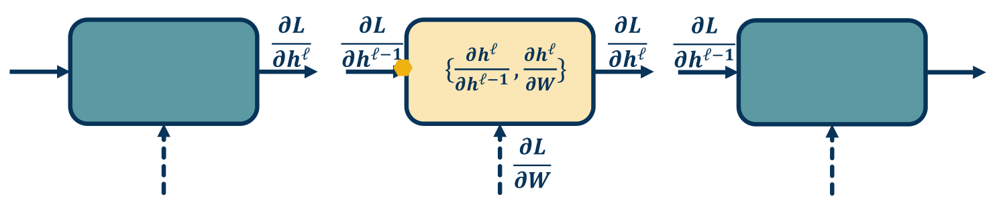
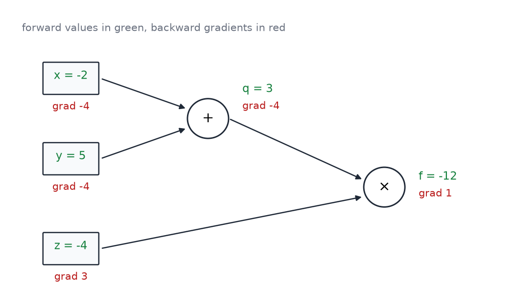
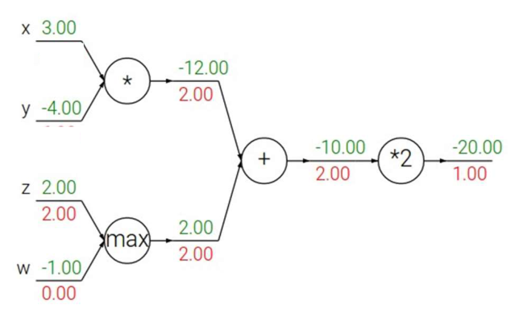
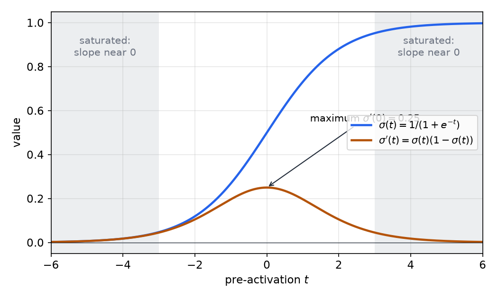
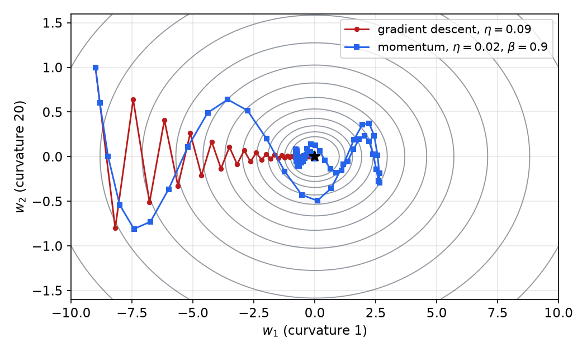
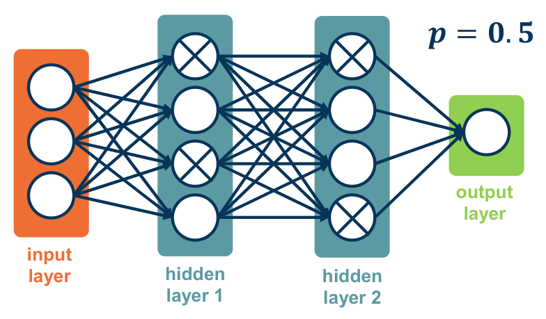

# Backpropagation and Training

A deep network can have millions of parameters, and training needs the derivative of the loss with respect to each of them. Backpropagation obtains all of these derivatives in one backward sweep through the computation graph, applying the chain rule once per module and reusing the values stored during the forward pass. The chapter develops this from scalar graphs to vectorized layers and automatic differentiation. It then covers the practical parts of training that make gradient descent work for deep networks: activation functions, initialization, normalization, optimizers, regularization and the process of tuning a model.

## Computation Graphs

A differentiable function built from primitive operations can be drawn as a **computation graph**, a directed acyclic graph whose nodes are operations and whose edges carry values. The graph fixes an order in which values can be computed, a topological order, and the paths along which derivatives must flow back. The graph is acyclic because a value cannot depend on itself. Undirected cycles are harmless, since they only mean that two paths reconverge.

**Example 2.1 (a graph with five operations).** Take \\(f(x\_1, x\_2) = \ln x\_1 + x\_1 x\_2 - \sin x\_2\\). Its graph has the leaves \\(x\_1\\) and \\(x\_2\\). The logarithm consumes \\(x\_1\\). A multiplication consumes both \\(x\_1\\) and \\(x\_2\\). A sine consumes \\(x\_2\\). An addition consumes the logarithm and the product, and a subtraction consumes the sum and the sine. Each node has a known local derivative, so the whole function is a composition of simple pieces, as in the previous chapter.

Training uses two passes over this graph.

- The **forward pass** evaluates every node in topological order and stores the intermediate values.
- The **backward pass** starts at the loss, where the gradient with respect to the loss is 1, and visits the nodes in reverse topological order. At each node it combines the incoming gradient with the local derivatives and sends the results to the node's inputs.

The stored values are needed because local derivatives depend on them. The derivative of a product \\(z = xy\\) with respect to \\(x\\) is \\(y\\), so the backward pass must know \\(y\\). Storing the activations of every layer is the main memory cost of training a deep network. Techniques that recompute activations instead of storing them trade this memory for extra computation.

## The Chain Rule on a Graph

### Local and upstream gradients

Consider one module \\(h^\ell = F(h^{\ell-1}; W)\\) that takes an input \\(h^{\ell-1}\\) and has parameters \\(W\\). Its **local** derivatives are \\(\partial h^\ell / \partial h^{\ell-1}\\) and \\(\partial h^\ell / \partial W\\). They depend only on the module's own inputs and parameters, so they can be computed without knowing the rest of the network.

When the backward pass reaches this module, the **upstream** gradient \\(\partial L / \partial h^\ell\\) has already been computed by the modules above it. The chain rule then gives both quantities the module needs:

\\[
\frac{\partial L}{\partial h^{\ell-1}} = \frac{\partial L}{\partial h^\ell}\\,\frac{\partial h^\ell}{\partial h^{\ell-1}},
\qquad
\frac{\partial L}{\partial W} = \frac{\partial L}{\partial h^\ell}\\,\frac{\partial h^\ell}{\partial W}.
\\]

The first result is the upstream gradient for the module below. The second is the gradient used for the parameter update. Each module needs only its local derivatives and the upstream gradient, which is what makes the algorithm modular. Backpropagation is therefore gradient descent with its gradient computed by the chain rule over a graph. It adds no new mathematics.



*Figure: one module in the graph. The gradient \\(\partial L / \partial h^\ell\\) comes from the layers above, and the module combines it with its local derivatives to produce \\(\partial L / \partial h^{\ell-1}\\) for the layer below. The dashed arrow is labeled \\(\partial L / \partial W\\), the parameter gradient used for the update.*

### Example: \\(f(x,y,z) = (x+y)z\\)

**Example 2.2 (forward and backward on a small graph).** Let \\(f(x, y, z) = (x+y)z\\) at \\(x = -2\\), \\(y = 5\\), \\(z = -4\\). The graph has two nodes: \\(q = x + y\\) and \\(f = qz\\).

The forward pass gives \\(q = 3\\) and \\(f = -12\\). The local derivatives are \\(\partial q / \partial x = \partial q / \partial y = 1\\), \\(\partial f / \partial q = z\\), and \\(\partial f / \partial z = q\\).

The backward pass starts with \\(\partial f / \partial f = 1\\). It then proceeds as follows.

- \\(\partial f / \partial z = q = 3\\), the upstream gradient 1 times the local derivative \\(q\\).
- \\(\partial f / \partial q = z = -4\\).
- \\(\partial f / \partial x = (\partial f/\partial q)(\partial q/\partial x) = -4 \cdot 1 = -4\\).
- \\(\partial f / \partial y = (\partial f/\partial q)(\partial q/\partial y) = -4 \cdot 1 = -4\\).

Check: changing \\(x\\) by a small amount \\(\varepsilon\\) changes \\(f\\) to \\((x+y+\varepsilon)z\\), so the derivative is \\(z = -4\\). That matches the backward result.

Figure 2 shows the graph with the forward values and the backward gradients. The addition node copies its upstream gradient to both of its inputs, because its local derivatives are both 1.



*Figure: the graph for \\(f = (x+y)z\\) at \\(x=-2\\), \\(y=5\\), \\(z=-4\\). Green values are computed forward. Red values are the gradients computed backward, each equal to the upstream gradient times the local derivative.*

### Gates: distribute, route and switch

Three simple operations show the patterns that recur in larger graphs.

**Example 2.3 (gates in \\(f = 2(xy + \max(z,w))\\)).** Take \\(x = 3\\), \\(y = -4\\), \\(z = 2\\), \\(w = -1\\). The forward pass computes \\(xy = -12\\), \\(\max(z,w) = 2\\), their sum \\(-10\\), and \\(f = -20\\).

The backward pass starts at \\(\partial f/\partial f = 1\\), and then:

- The multiplication by 2 passes \\(2\\) to the sum.
- The **addition gate** is a gradient distributor. It copies the incoming 2 to both inputs, so \\(xy\\) and \\(\max(z,w)\\) each receive 2.
- The **max gate** is a gradient router. The larger input, \\(z = 2\\), receives all of the gradient, so \\(\partial f/\partial z = 2\\), and the smaller input \\(w\\) receives \\(0\\).
- The **multiplication gate** is a gradient switcher. Its local derivative with respect to each input is the other input, so \\(\partial f / \partial x = 2 \cdot y = -8\\) and \\(\partial f / \partial y = 2 \cdot x = 6\\).

Figure 3 shows the same graph with forward values in green and backward gradients in red.



*Figure: the graph for \\(f = 2(xy + \max(z,w))\\). The addition node distributes its gradient, the max node sends it only to the larger input, and the multiplication nodes multiply it by the other factor. Gradient values are in red and forward values in green.*

Two rules follow from these examples.

1. **Gradients add at branches.** When a value feeds several downstream nodes, its gradient is the sum of the gradients from each use. This is the multivariable chain rule applied to a shared variable.
2. **Forward and backward are dual.** A sum in the forward pass becomes a copy in the backward pass, and a copy in the forward pass becomes a sum in the backward pass.

**Example 2.4 (a shared variable).** Let \\(f(x\_1, x\_2) = x\_1 x\_2 + \sin x\_2\\). Write it with intermediate variables \\(a\_1 = \sin x\_2\\), \\(a\_2 = x\_1 x\_2\\) and \\(f = a\_1 + a\_2\\). Write \\(\bar a = \partial f / \partial a\\) for the adjoint of each variable. Then \\(\bar a\_1 = \bar a\_2 = 1\\), and \\(x\_2\\) feeds two nodes, so it collects two contributions:

\\[
\frac{\partial f}{\partial x\_2} = \bar a\_1 \cos x\_2 + \bar a\_2\\, x\_1 = \cos x\_2 + x\_1,
\qquad
\frac{\partial f}{\partial x\_1} = \bar a\_2\\, x\_2 = x\_2.
\\]

At \\((x\_1, x\_2) = (2, 0)\\) the gradient is \\((0, 3)\\). The value 3 is the sum of the path through \\(\sin\\), which contributes \\(\cos 0 = 1\\), and the path through the product, which contributes \\(x\_1 = 2\\).

## Vectorized Layers

Real networks compute with vectors, matrices and batches, so the chain rule is applied to vector-valued functions. For vectors \\(v^1 \in \mathbb{R}^{m\_1}\\) and \\(v^2 \in \mathbb{R}^{m\_2}\\), the Jacobian \\(\partial v^1 / \partial v^2\\) is an \\(m\_1 \times m\_2\\) matrix whose entry in row \\(i\\) and column \\(j\\) is \\(\partial v^1\_i / \partial v^2\_j\\). Under this convention the derivative of a scalar with respect to a column vector is a row vector, and the chain rule reads as a product of matrices in the same order as the graph.

**Example 2.5 (derivatives of linear maps).** If \\(y = Wx\\), then \\(\partial y / \partial x = W\\), since \\(y\_i = \sum\_j W\_{ij} x\_j\\) and so \\(\partial y\_i / \partial x\_j = W\_{ij}\\). If \\(y = w^\top x\\), then \\(\partial y/\partial x = w^\top\\). If \\(y = w^\top A w\\) with a symmetric \\(A\\), then \\(\partial y/\partial w = 2 w^\top A\\).

### Fully connected layers

Consider the layer \\(h^\ell = W h^{\ell-1}\\), with \\(W\\) of size \\(n \times m\\). The local Jacobian with respect to the input is \\(\partial h^\ell / \partial h^{\ell-1} = W\\). If \\(g\\) is the upstream gradient written as a row vector of length \\(n\\), the chain rule gives

\\[
\frac{\partial L}{\partial h^{\ell-1}} = g\\,W.
\\]

The Jacobian with respect to the weights would be a three-index tensor, but it is sparse. Output \\(h\_i^\ell\\) depends only on row \\(i\\) of \\(W\\), so \\(\partial L/\partial W\_{ij} = g\_i\\, h\_j^{\ell-1}\\). In matrix form this is an outer product,

\\[
\frac{\partial L}{\partial W} = g^\top \big(h^{\ell-1}\big)^\top .
\\]

**Example 2.6 (a \\(2 \times 3\\) layer).** Let \\(W = \begin{bmatrix} 1 & 2 & 3 \\\\ 4 & 5 & 6 \end{bmatrix}\\) and \\(h^{\ell-1} = (0.5, -1, 2)^\top\\). The output is \\(h^\ell = (4.5, 9)^\top\\). Suppose the upstream gradient is \\(g = (0.3, -0.7)\\). Then

\\[
\frac{\partial L}{\partial h^{\ell-1}} = gW = (-2.5, -2.9, -3.3),
\qquad
\frac{\partial L}{\partial W} = \begin{bmatrix} 0.15 & -0.3 & 0.6 \\\\ -0.35 & 0.7 & -1.4 \end{bmatrix}.
\\]

Each row of the weight gradient is the upstream entry for that output times the input vector, which is the sparsity described above.

For a batch of \\(B\\) examples, stack the inputs as the rows of a matrix \\(H\\) and the upstream gradients as the rows of \\(G\\). The weight gradient summed over the batch is then \\(G^\top H\\), and the input gradient is \\(GW\\). Both are matrix products, which GPUs compute efficiently. This is why the vectorized form is used in practice, and why a layer's cost is dominated by these matrix multiplications.

### Element-wise nonlinearities

An activation such as ReLU, \\(h^\ell = \max(0, h^{\ell-1})\\), acts on each component separately. Its Jacobian is diagonal, with entry 1 where the input is positive and 0 otherwise. The backward pass therefore multiplies the upstream gradient element-wise by a mask. The full Jacobian is never formed.

**Example 2.7 (ReLU backward).** Let the input be \\(x = (1, -2, 3, -1)\\), so the output is \\(z = (1, 0, 3, 0)\\). If the upstream gradient is \\((4, -1, 5, 9)\\), the mask is \\((1, 0, 1, 0)\\), and the input gradient is \\((4, 0, 5, 0)\\). Units with negative input pass no gradient at all.

The same reasoning covers every element-wise function. The Jacobian is diagonal, and its off-diagonal entries are always zero. Implementing the layer as an element-wise product avoids storing a matrix with \\(n^2\\) entries for a vector of length \\(n\\).

### Automatic differentiation

Writing the backward formulas by hand for every new layer is error-prone. **Automatic differentiation** (AD) avoids this. The library knows the derivative of each primitive operation, such as addition, multiplication, exp and log, and it builds the graph as the program runs. A typical implementation gives each primitive a forward function and a backward function. A minimal multiplication node looks like this.

```python
class MultiplyGate:
    def forward(self, x, y):
        self.x, self.y = x, y           # keep the inputs for the backward pass
        return x * y

    def backward(self, dz):             # dz is the upstream gradient dL/dz
        dx = self.y * dz                # local derivative dz/dx times upstream
        dy = self.x * dz                # local derivative dz/dy times upstream
        return dx, dy
```

Running the nodes in reverse topological order is all that is needed. Because the graph is recorded dynamically, the program can contain ordinary control flow, such as loops and conditionals, and derivatives still flow through whichever operations ran.

Two modes of AD are possible. **Forward mode** carries a tangent, the derivative of each value with respect to one input, from the inputs to the outputs. Its cost grows with the number of inputs. **Reverse mode** carries adjoints from the output back to the inputs, as the backward pass does. Its cost grows with the number of outputs. A deep network has one scalar loss and millions of parameters, so one reverse pass gives all the gradients, while forward mode would need one pass per parameter. Reverse mode is therefore the one used for training. The term backpropagation usually names reverse-mode AD applied to a neural network.

## Activation Functions and Saturation

A nonlinearity is essential. Two linear layers compose to a single linear map, since \\(W\_2 (W\_1 x) = (W\_2 W\_1) x\\), so depth adds nothing unless an activation sits between the layers. The backward pass multiplies local derivatives along each path, so the choice of activation also controls how gradients behave. Three activations are common.

- **Sigmoid**, \\(\sigma(x) = 1/(1 + e^{-x})\\), has range \\((0, 1)\\), is always positive, and has derivative \\(\sigma(x)(1-\sigma(x))\\). The derivative is at most 0.25, and it tends to zero at both ends. The outputs are not centered on zero.
- **Tanh**, \\(\tanh x\\), has range \\((-1, 1)\\), is centered on zero, and has derivative \\(1 - \tanh^2 x\\), which peaks at 1 for \\(x = 0\\). It also saturates at both ends.
- **ReLU**, \\(\max(0, x)\\), does not saturate for positive inputs, and its derivative is 1 there. It is cheap to compute. Its derivative is 0 for negative inputs, so a unit whose input is always negative receives no gradient and can stop learning. This is a dead ReLU.

Leaky ReLU, \\(\max(\alpha x, x)\\) with a small \\(\alpha\\), keeps a small gradient for negative inputs and avoids dead units. ReLU is the usual starting point, and sigmoids are kept for outputs that must lie in \\((0, 1)\\).



*Figure: the sigmoid (blue) and its derivative (brown). The shaded regions are where the slope is near zero, so the unit passes almost no gradient back. Where the derivative is largest, at the center, it is only 0.25.*

**Example 2.8 (why depth hurts saturating units).** Along one path through a chain of sigmoid units with unit weights, the gradient is multiplied by a local derivative at each layer. Each factor is at most 0.25, so after ten layers the product is at most \\(0.25^{10} \approx 10^{-6}\\). The gradient reaching the early layers is then negligible. This is the vanishing-gradient problem. Its remedies are the choice of activation, careful initialization and normalization, and residual connections, which are treated in the convolutional chapter.

## Initialization

Initialization sets the scale of the activations and the gradients at the start of training. Its effect is largest in deep networks, because the scale changes multiplicatively from layer to layer.

Constant initialization is degenerate. If every weight equals the same value, every hidden unit computes the same function and receives the same gradient, so the units never differentiate. The symmetry must be broken by random weights. Small random weights are also not enough on their own. If each layer shrinks the activations, the signal and the gradients decay with depth, and the updates become too small to learn from. Analysis of deep tanh networks showed exactly this decay of activation variance with depth.

**Variance-preserving initialization.** Consider a linear unit \\(y = \sum\_{j=1}^{n} w\_j x\_j\\) with independent weights of mean zero. Then

\\[
\operatorname{E}[y^2] = \sum\_{j=1}^{n} \operatorname{E}[w\_j^2]\\,\operatorname{E}[x\_j^2] = n \operatorname{Var}(w)\\,\operatorname{E}[x^2].
\\]

To keep \\(\operatorname{E}[y^2] = \operatorname{E}[x^2]\\) from layer to layer, choose \\(\operatorname{Var}(w) = 1/n\\). This is the right scale for a nearly linear unit such as tanh near zero. A ReLU sets half of its inputs to zero, which halves the second moment, so for ReLU the variance should be \\(2/n\\). This is the He initialization.

For the backward pass the same argument applies to the gradients, with \\(n\\) replaced by the number of outputs. Xavier (Glorot) initialization compromises between the two by using \\(\operatorname{Var}(w) = 2/(n\_{\text{in}} + n\_{\text{out}})\\). A uniform distribution on \\([-a, a]\\) has variance \\(a^2/3\\), so the uniform bound is

\\[
a = \sqrt{\frac{6}{n\_{\text{in}} + n\_{\text{out}}}}.
\\]

For a layer with 256 inputs and 256 outputs, \\(a = \sqrt{6/512} \approx 0.108\\). The weights are drawn uniformly from \\([-0.108, 0.108]\\).

## Normalization

Normalization layers keep the activations at a stable scale during training. The simplest form is applied to the inputs: each feature is shifted by its mean and divided by its standard deviation over the training set. Whitening, which also decorrelates the features, is less common because it is expensive for high-dimensional inputs. **Batch normalization** applies the same idea inside the network, normalizing each feature over a mini-batch. For a feature with values \\(x\_1, \dots, x\_m\\) in the batch,

\\[
\mu\_{\mathcal{B}} = \frac{1}{m}\sum\_{i=1}^{m} x\_i,
\qquad
\sigma\_{\mathcal{B}}^2 = \frac{1}{m}\sum\_{i=1}^{m} (x\_i - \mu\_{\mathcal{B}})^2,
\qquad
\hat x\_i = \frac{x\_i - \mu\_{\mathcal{B}}}{\sqrt{\sigma\_{\mathcal{B}}^2 + \epsilon}},
\qquad
y\_i = \gamma \hat x\_i + \beta.
\\]

The normalization itself has no parameters. The learnable scale \\(\gamma\\) and shift \\(\beta\\) let the network choose its own scale: if \\(\gamma = \sigma\_{\mathcal{B}}\\) and \\(\beta = \mu\_{\mathcal{B}}\\) the layer computes the identity, so normalization never removes representational power.

**Example 2.9 (batch normalization).** For a batch \\((1, 2, 3, 6)\\), the mean is 3 and the variance is \\((4 + 1 + 0 + 9)/4 = 3.5\\). The normalized values are \\((-1.069, -0.535, 0, 1.604)\\), with mean zero and unit variance. With \\(\gamma = 1\\) and \\(\beta = 0\\) these are the outputs.

Three practical points matter. At test time the layer uses running averages of the mean and variance collected during training, because a test batch should not change the output for one example. The estimates need reasonably large batches, which is a problem when a batch is split across devices, and synchronized batch normalization computes the statistics over all devices. Batch normalization is usually placed before the nonlinearity, so that the input to the activation is centered and not saturated.

## Optimizers

### The loss landscape

Deep networks have non-convex losses with many local minima, but local minima are not usually the main obstacle. Two other features matter more. Saddle points, where the gradient vanishes but the loss decreases in some direction, appear to be far more common than poor local minima in high dimensions (Dauphin and colleagues, 2014). Ill-conditioning, where the curvature differs greatly across directions, makes plain gradient descent slow and erratic. Noisy gradients from mini-batches add further zig-zag.

The curvature is described by the Hessian \\(H = \nabla^2 L\\). Its eigenvalues \\(\lambda\_{\min}\\) and \\(\lambda\_{\max}\\) give the **condition number** \\(\kappa = \lambda\_{\max}/\lambda\_{\min}\\). For a quadratic loss with a constant Hessian, gradient descent with step size \\(\eta\\) converges along each eigen-direction with factor \\(1 - \eta\lambda\\). It is stable only when \\(\eta < 2/\lambda\_{\max}\\). A large \\(\kappa\\) therefore forces a small step, which is slow in the flat directions.

**Example 2.10 (ill-conditioned quadratic).** Take \\(L(w) = \tfrac{1}{2}(w\_1^2 + 20 w\_2^2)\\), with \\(\kappa = 20\\). Gradient descent needs \\(\eta < 2/20 = 0.1\\). With \\(\eta = 0.09\\) the steep coordinate \\(w\_2\\) is multiplied by \\(1 - 0.09 \cdot 20 = -0.8\\) at each step, so it oscillates and decays slowly. The flat coordinate \\(w\_1\\) is multiplied by \\(1 - 0.09 = 0.91\\), so it moves slowly. Figure 5 shows the resulting zig-zag path.

### Momentum

Momentum accumulates a velocity so that consistent gradient directions add up while oscillating components cancel. With velocity \\(v\\), learning rate \\(\eta\\) and momentum \\(\beta\\),

\\[
v \leftarrow \beta v + \nabla L(w),
\qquad
w \leftarrow w - \eta v.
\\]

Unrolling the recursion shows that \\(v\\) is an exponentially weighted sum of past gradients, \\(v = \sum\_k \beta^k \nabla L\_{t-k}\\). If the gradient is constant, the velocity approaches \\(\nabla L/(1-\beta)\\), so for \\(\beta = 0.9\\) the effective step is ten times larger along consistent directions. With \\(\beta = 0\\) the rule reduces to plain gradient descent.

**Nesterov momentum** evaluates the gradient at a look-ahead point, the position the velocity is about to carry the parameters to:

\\[
v \leftarrow \beta v + \nabla L\big(w - \eta \beta v\big),
\qquad
w \leftarrow w - \eta v.
\\]

Nesterov momentum corrects the velocity using the gradient at the point it will reach, which gives better behavior near the minimum and has stronger theoretical guarantees for convex problems.



*Figure: contours of \\(\tfrac{1}{2}(w\_1^2 + 20 w\_2^2)\\) with two paths from the same start. Gradient descent (red) zig-zags across the steep \\(w\_2\\) direction while creeping along the flat \\(w\_1\\) direction. Momentum (blue) reaches \\(\lvert w\_1 \rvert < 0.1\\) in about a third as many steps, then overshoots and oscillates before settling. Both paths are computed by the update rules in the text.*

### Adaptive step sizes

Adaptive methods give each parameter its own effective learning rate, based on the history of its gradients. **AdaGrad** accumulates the squared gradients, \\(G \leftarrow G + g^2\\), and divides the step by \\(\sqrt{G} + \epsilon\\). Parameters with large past gradients take smaller steps, but \\(G\\) only grows, so the effective rate eventually becomes very small. **RMSProp** replaces the sum with an exponential moving average, \\(G \leftarrow \beta G + (1-\beta) g^2\\), which avoids this decay.

**Adam** combines momentum for the first moment with RMSProp for the second:

\\[
m \leftarrow \beta\_1 m + (1-\beta\_1) g,
\qquad
v \leftarrow \beta\_2 v + (1-\beta\_2) g^2,
\\]

where \\(g = \nabla L(w)\\). The moments start at zero, so for early steps they are biased toward zero. At step \\(t\\) the corrections divide by \\(1 - \beta\_1^t\\) and \\(1 - \beta\_2^t\\):

\\[
\hat m = \frac{m}{1-\beta\_1^t},
\qquad
\hat v = \frac{v}{1-\beta\_2^t},
\qquad
w \leftarrow w - \eta \frac{\hat m}{\sqrt{\hat v} + \epsilon}.
\\]

The correction is exact in a simple case. If the gradient is a constant \\(g\\), then \\(m\_t = (1-\beta\_1^t)\\,g\\) and \\(\hat m = g\\). Typical values are \\(\beta\_1 = 0.9\\), \\(\beta\_2 = 0.999\\) and \\(\epsilon = 10^{-8}\\).

**Example 2.11 (the first Adam step).** At \\(t = 1\\), \\(\hat m = g\\) and \\(\hat v = g^2\\), so the step is \\(\eta\\, g/(\lvert g \rvert + \epsilon) \approx \eta\\,\mathrm{sign}(g)\\). With \\(\eta = 0.001\\), the gradients \\(0.5\\), \\(0.01\\) and \\(-3.0\\) all give steps of size 0.001 in the direction of the negative gradient. The first step ignores the gradient's magnitude, which is one reason Adam is robust to poor gradient scaling. In this regime the learning rate alone sets the size of every step.

Adaptive methods converge quickly in practice, but tuned SGD with momentum often generalizes better on image tasks, so the choice of optimizer is still an empirical decision.

### Learning-rate schedules

Stochastic gradient descent converges, in the classical analysis, when the step sizes \\(\eta\_t\\) satisfy \\(\sum\_t \eta\_t = \infty\\) and \\(\sum\_t \eta\_t^2 < \infty\\). In practice the rate is annealed. Common schedules are a step decay that divides the rate by a constant at fixed epochs, an exponential decay, a cosine decay to a small value, and a cyclical schedule that moves the rate up and down between two bounds. A learning rate that is too high makes the loss oscillate or grow. One that is too low makes the loss flat for a long time. Both are visible in the training curves and are the first things to check.

## Regularization in Training

### Weight decay

Adding \\(\lambda \lVert W \rVert\_2^2\\) to the loss changes the gradient by \\(2\lambda W\\). A gradient step then becomes \\(W \leftarrow (1 - 2\eta\lambda) W - \eta \nabla L\\), which shrinks every weight by a constant factor before the data gradient is applied. This is why L2 regularization is called weight decay. The general discussion of penalties is in Regularization.

### Dropout

**Dropout** randomly removes units during training. Each unit is kept with probability \\(p\\), and a fresh random mask is drawn at every iteration. A dropped unit contributes zero to the next layer, and it receives no gradient in that iteration.

Dropout as described above changes the expected input to the next layer, so the test-time network must be scaled to match. The usual implementation scales during training instead. Each kept activation is divided by \\(p\\), which is called inverted dropout. If \\(m\_i\\) is 1 with probability \\(p\\) and 0 otherwise, the training output \\(y\_i = m\_i a\_i / p\\) has expectation \\(a\_i\\). At test time no mask is applied and the activations are used directly.



*Figure: a network with units crossed out where the random mask removed them, here with keep probability \\(p = 0.5\\). Each training step samples a different subnetwork. Test time uses all units.*

Dropout discourages units from relying on particular partners, since any unit may be absent in a given step. Each mask defines a thinned network that shares weights with all others, so training is an implicit ensemble of a very large number of networks.

### Data augmentation

Augmentation enlarges the training set by transforming the inputs in ways that keep the label unchanged. Horizontal flips, random crops, color jitter and affine transformations are standard. Mixing methods such as CutMix replace a patch of one image with a patch from another and mix the labels in proportion to the area. Each transformation must preserve the label, or the label must change with it.

## The Training Process

Training a deep network is an empirical process, and most failures are visible in the logs if they are monitored. The basic practices are as follows.

- **Split the data.** Use training data for fitting, validation data for choosing hyperparameters and model variants, and test data only once every decision is fixed. Looking at the test set during development makes the reported performance optimistic.
- **Check the first loss.** With small random weights a softmax classifier should start near \\(\log C\\). A different starting loss points to a bug or a bad scale.
- **Overfit a small sample first.** A network that cannot drive the training loss near zero on a few examples has a bug. Only after this works should regularization be added, and adding it should raise the training loss.
- **Watch for NaNs.** A loss that becomes NaN usually means the learning rate is too high or there is a division by zero or a logarithm of zero.
- **Compare training and validation curves.** A validation loss that rises while the training loss falls indicates overfitting. Both being high indicates underfitting.

Hyperparameters such as the learning rate and weight decay matter most. Search them on a logarithmic scale, first coarsely and then finely. Random search is usually more efficient than a grid when only a few hyperparameters matter, because each trial samples a new value of every hyperparameter (Bergstra and Bengio, 2012).

The training objective is a differentiable surrogate, but the goal is usually accuracy, precision, recall or a similar measure. Cross-entropy and accuracy can move in different directions. A classifier can keep improving its cross-entropy by making correct predictions more confident while its accuracy stays flat, and it can improve accuracy while its loss rises if a few confident errors appear. For binary classifiers the true positive rate \\(\mathrm{TPR} = tp/(tp+fn)\\) and the false positive rate \\(\mathrm{FPR} = fp/(fp+tn)\\) are traced as the decision threshold varies, giving the ROC curve. Its area, the AUC, summarizes ranking quality over all thresholds, and it does not depend on a single threshold.

## Summary

- Backpropagation applies the chain rule to a computation graph. Each module combines its upstream gradient with its local derivatives, and a forward pass must store the values that the backward pass needs.
- The backward rules are simple: add gates distribute, max gates route, multiply gates switch, and gradients add where a value is shared. For a layer \\(h = Wx\\), the input gradient is \\(gW\\) and the weight gradient is an outer product. Element-wise nonlinearities are applied as masks.
- Reverse-mode automatic differentiation computes the gradient of a scalar loss with respect to millions of parameters in one backward pass.
- Saturating activations shrink gradients along each path. ReLU avoids saturation for positive inputs but can create dead units.
- Variance-preserving initialization uses \\(\operatorname{Var}(w) = 1/n\\) for tanh-like units and \\(2/n\\) for ReLU, and Xavier initialization uses \\(2/(n\_{\text{in}} + n\_{\text{out}})\\).
- Batch normalization standardizes each feature over the mini-batch and then applies a learned scale and shift.
- Momentum accumulates gradients along consistent directions. Adam combines momentum with per-parameter scaling, and its bias correction makes the early steps correct.
- Weight decay, dropout and augmentation regularize training. Careful monitoring, sanity checks and random hyperparameter search make the process reliable.

## See Also

- [Introduction and Linear Classifiers](linear-classifiers.md): the gradient-descent and loss-function background this chapter builds on.
- [Convolutional Networks and Visualization](convolutional-networks.md): the next chapter, which applies these gradients to convolution.
- [Backpropagation and Network Architectures](../cs3600-cs6601-artificial-intelligence/backpropagation.md): the hand-worked backpropagation in the AI section.
- Regularization: penalties and their effects on generalization.
- Gradient methods: the optimization background for momentum and step sizes.
- Deep Learning overview: the one-page summary of this section.
