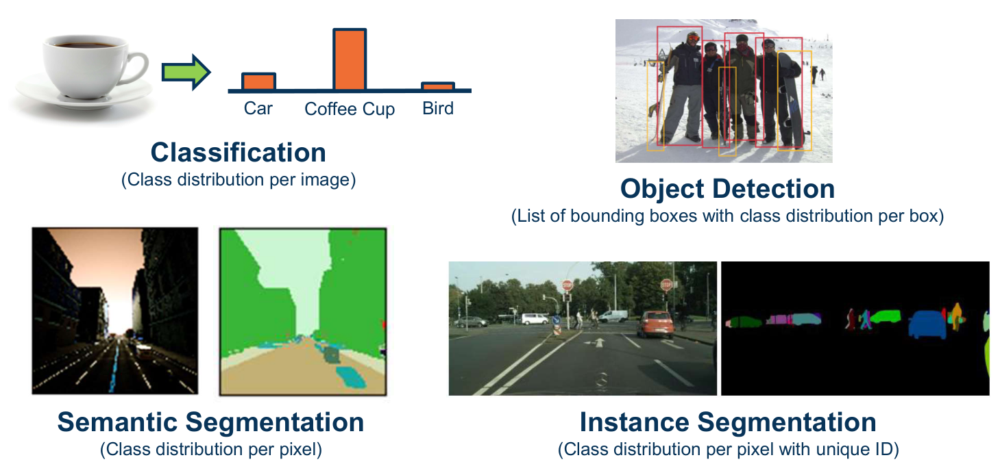
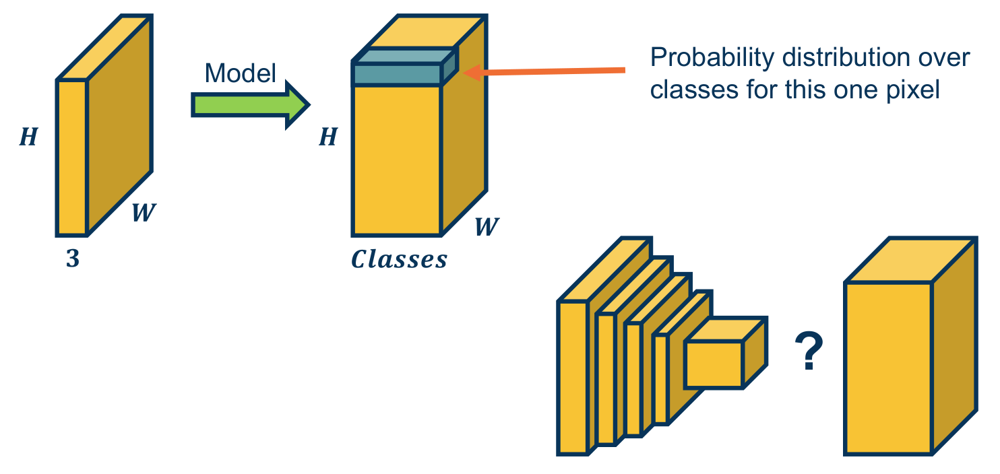
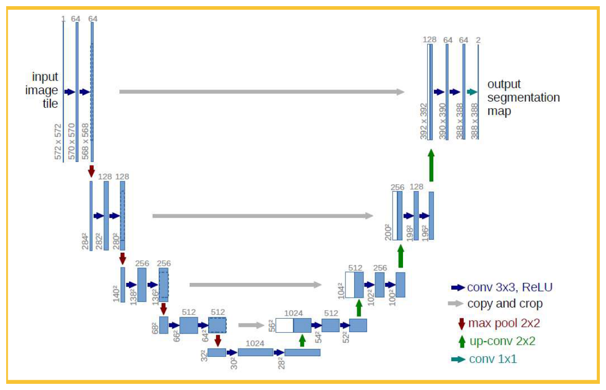
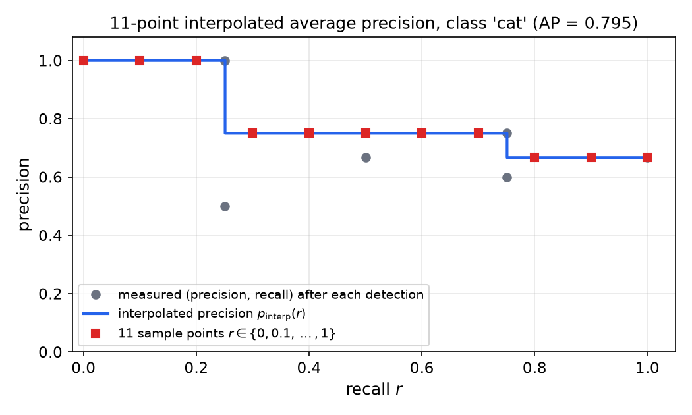
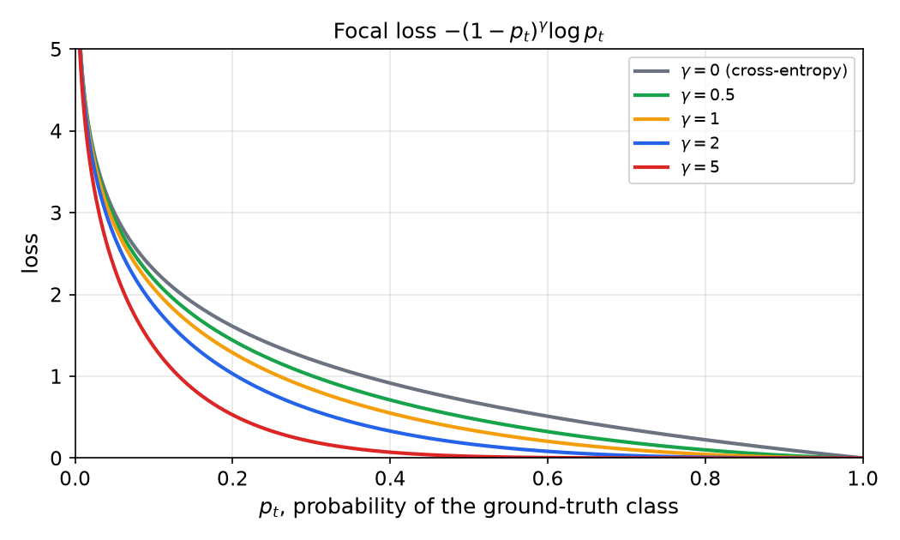

# Dense Prediction and Object Detection

Classification asks for one label per image, and its output has no spatial layout. Many vision problems need outputs that keep the layout of the input: a class for every pixel, or a list of boxes around the objects in a scene. This chapter shows how convolutional networks are adapted to those outputs, through fully convolutional networks, upsampling layers, the U-Net, and the detectors built on top of them. It also covers the metrics that score detectors and the focal loss that copes with the flood of easy background examples.

## Tasks Defined by Their Output Structure

Four standard vision tasks share the same input, an image of height \\( H \\), width \\( W \\) and three color channels, but they differ in what they return.

| Task | What the output describes | Form of the output |
|---|---|---|
| Classification | the whole image | one distribution over \\( C \\) classes |
| Semantic segmentation | every pixel | \\( H \times W \times C \\) array of class probabilities |
| Instance segmentation | every pixel, plus which object it belongs to | per-pixel class and a unique instance identifier |
| Object detection | each object in the scene | a variable-length list of boxes, each with a class distribution |

*Figure: The four tasks differ only in the structure of the prediction: one distribution for the image, one distribution per pixel, one per pixel with an object identity, or one per box. The number of boxes is not fixed in advance, which makes detection structurally different from the other three.*

Segmentation is an image-to-image problem. The input has shape \\( H \times W \times 3 \\), and the output has shape \\( H \times W \times C \\): at each pixel, a probability distribution over the classes.

*Figure: A dense predictor maps an input volume to an output volume on the same spatial grid, with one class distribution at each pixel. The question on the right is how a stack of layers that shrinks the grid can return to full resolution.*

A classification network is built to shrink the grid. Each pooling or strided layer halves or reduces the spatial size, and the final fully connected layers discard spatial position altogether. Dense prediction therefore needs two changes: the fully connected layers must be replaced by layers that keep spatial position, and the network must include operations that increase resolution. The next two sections treat these in turn.

## Fully Convolutional Networks

### Fully connected layers as convolutions

Consider a fully connected layer applied to a feature volume of shape \\( C \times H \times W \\). Flatten the volume to a vector \\( x \\) of length \\( n = CHW \\). The layer computes \\( y\_j = \sum\_{m=1}^{n} w\_{j,m}\\, x\_m + b\_j \\) for each output unit \\( j \\).

Now define one kernel \\( K\_j \\) for each output unit. Its shape equals the shape of the input volume, and its entries are the weights of that unit, arranged so that \\( K\_j[c,i,k] = w\_{j,(c,i,k)} \\). Apply \\( K\_j \\) to the volume with stride 1 and no padding. There is exactly one position where the kernel fits, so the output is a single number: the sum over the whole volume of kernel times input, plus the bias. That number is \\( y\_j \\). A fully connected layer is therefore a convolution whose kernel is as large as its input, with one kernel per output unit, and its output is a \\( 1 \times 1 \\) map.

The conversion is worth making because the kernels are now ordinary convolutional kernels. Nothing forces them to cover the input exactly. When the same kernel slides across a larger input, it produces a larger output, one value for each position it can occupy.

**Example 1 (output size of a valid convolution).** For an input of side \\( n \\), a kernel of side \\( k \\), stride 1 and no padding, the output has side \\( n - k + 1 \\). A \\( 3 \times 3 \\) kernel on a \\( 5 \times 5 \\) input gives a \\( 3 \times 3 \\) output, since \\( 5 - 3 + 1 = 3 \\). The same kernel on a \\( 7 \times 7 \\) input gives a \\( 5 \times 5 \\) output, since \\( 7 - 3 + 1 = 5 \\). The weights are unchanged. Only the number of positions at which the kernel is applied has grown.

Applied to an image of arbitrary size, a fully convolutional classifier therefore returns a grid of class scores whose resolution depends on the input. Long, Shelhamer and Darrell (2015) used this to turn a classifier into a heat map: a cat classifier, converted in this way and run on a larger scene, produces high scores over the cat and low scores elsewhere. The output is coarser than the input, because the backbone's pooling and strided layers have already reduced the grid, so a second stage is still needed to recover full resolution.

### The fully convolutional head

The convolutional part of the network already accepts any input size. Converting the fully connected layers removes the last obstacle: the output is no longer tied to a fixed input size. The summary of this argument is that the striding idea, which lets a convolution slide over a larger input, can be applied to the output classifiers as well as to the feature extractor.

## Upsampling: Unpooling and Transposed Convolution

The encoder of a dense predictor uses convolution, a nonlinearity and pooling to produce lower-resolution features. The decoder uses transposed convolution, a nonlinearity and unpooling to produce a map at the input resolution. The decoder's upsampling layers may have learned parameters, or they may be fixed.

### Max pooling and max unpooling

Max pooling replaces each window of values by its maximum. Max unpooling reverses this approximately. When the encoder pools, it records the position of the maximum in each window. The decoder then places each value at its recorded position and fills the rest of the window with zeros. The positions are known exactly, so the decoder can put the strongest response back where it came from.

**Example 2 (max pooling and unpooling with stored indices).** Take the encoder map

\\[
X\_{\text{enc}}=\begin{bmatrix}120&150&120\\\\100&50&110\\\\25&25&10\end{bmatrix}.
\\]

Pool it with a \\( 2 \times 2 \\) window and stride 1, which gives a \\( 2 \times 2 \\) output. The four windows are \\( \\{120,150,100,50\\} \\), \\( \\{150,120,50,110\\} \\), \\( \\{100,50,25,25\\} \\) and \\( \\{50,110,25,10\\} \\), with maxima 150, 150, 100 and 110. So

\\[
Y\_{\text{enc}}=\begin{bmatrix}150&150\\\\100&110\end{bmatrix}.
\\]

The decoder receives the map \\( X\_{\text{dec}}=\begin{bmatrix}300&450\\\\100&250\end{bmatrix} \\) and the stored positions \\( (0,1) \\), \\( (0,1) \\), \\( (1,0) \\) and \\( (1,2) \\) in the \\( 3 \times 3 \\) output grid, one for each entry in the order listed. Unpooling with a \\( 2 \times 2 \\) window and stride 1 writes each value at its position. The first two values both go to \\( (0,1) \\), because that cell lies in both windows, and the two contributions are summed:

\\[
Y\_{\text{dec}}=\begin{bmatrix}0&300+450&0\\\\100&0&250\\\\0&0&0\end{bmatrix}=\begin{bmatrix}0&750&0\\\\100&0&250\\\\0&0&0\end{bmatrix}.
\\]

The rule that overlapping windows add their contributions is what makes unpooling a linear operation, so it can be differentiated like any other layer. Unpooling needs the indices from the matching pooling layer, so the decoder must mirror the encoder's structure.

### Transposed convolution

A standard convolution with a \\( k\_1 \times k\_2 \\) kernel maps an \\( H \times W \\) input to an \\( (H-k\_1+1) \times (W-k\_2+1) \\) output. Its matrix form has more rows than columns when the output is smaller than the input. The transposed convolution is the adjoint of that matrix: it maps the smaller grid to the larger one. Concretely, each input value \\( X[i,j] \\) is multiplied by the kernel and the resulting block is added to the output at the position \\( (i,j) \\). Overlapping blocks add. At stride 1 the output has size \\( (H+k\_1-1) \times (W+k\_2-1) \\).

This operation is often called "deconvolution", but the name is loose. The transposed convolution is a learned upsampling layer. It is not the inverse of the convolution, and in general a convolution has no inverse, since it can discard information.

**Example 3 (transposed convolution).** Let

\\[
X=\begin{bmatrix}120&150&120\\\\100&50&110\\\\25&25&10\end{bmatrix},\qquad K=\begin{bmatrix}1&-1\\\\2&-2\end{bmatrix}.
\\]

The output is \\( 4 \times 4 \\), since \\( 3+2-1 = 4 \\). Each input value stamps a copy of \\( K \\) scaled by that value. The first stamp, \\( X[0,0]=120 \\), occupies rows 0 and 1 and columns 0 and 1:

\\[
\begin{bmatrix}120&-120&0&0\\\\240&-240&0&0\\\\0&0&0&0\\\\0&0&0&0\end{bmatrix}.
\\]

The stamp of \\( X[0,1]=150 \\) occupies columns 1 and 2. Adding it gives first rows \\( [120,\\; -120+150,\\; -150,\\; 0] = [120,\\,30,\\,-150,\\,0] \\) and \\( [240,\\; -240+300,\\; -300,\\; 0] = [240,\\,60,\\,-300,\\,0] \\). Completing all nine stamps and summing the overlaps gives

\\[
Y=\begin{bmatrix}120&30&-30&-120\\\\340&10&0&-350\\\\225&-100&105&-230\\\\50&0&-30&-20\end{bmatrix}.
\\]

Each interior entry is a sum over the overlapping stamps. For example, \\( Y[1,1] \\) collects four contributions:

\\[
Y[1,1]=X[0,0]K[1,1]+X[0,1]K[1,0]+X[1,0]K[0,1]+X[1,1]K[0,0]=(120)(-2)+(150)(2)+(100)(-1)+(50)(1)=10.
\\]

As a check, \\( K \\) has entries summing to \\( 1-1+2-2=0 \\). The entries of \\( Y \\) therefore sum to \\( (\sum X)(\sum K) = 0 \\), and indeed every row of \\( Y \\) sums to zero.

The decoder's kernel can be learned, or it can be tied to the matching encoder kernel rotated by \\( 180^\circ \\). Tying the kernels means the decoder has no parameters of its own, and the transposed convolution is exactly the transpose of the encoder's convolution.

### Encoder–decoder architectures

An encoder–decoder network consists of a contracting path that halves the resolution at each pooling stage and an expanding path that doubles it at each upsampling stage. The bottleneck at the middle holds a compact description of the whole image. For image-to-image prediction this architecture has two advantages: the encoder builds large receptive fields cheaply, and the decoder restores the output grid. Its main drawback is that the bottleneck forces fine spatial detail through a narrow channel, which is the problem the skip connections of the U-Net address.

A common shortcut is transfer learning. The encoder is a backbone pretrained on a classification dataset, such as ImageNet, and a decoder is attached to it and trained on the segmentation task. The pretrained features already carry object-level information, so the decoder needs far less labeled data than a network trained from scratch.

## U-Net

The U-Net of Ronneberger, Fischer and Brox (2015) is the standard encoder–decoder for biomedical segmentation, and it introduced a design that is now common in dense prediction. Its contracting path applies pairs of \\( 3 \times 3 \\) convolutions with ReLU, followed by \\( 2 \times 2 \\) max pooling, doubling the channel count at each level. Its expanding path applies a \\( 2 \times 2 \\) up-convolution, concatenates the matching encoder feature map, and applies two \\( 3 \times 3 \\) convolutions. Each concatenation is a skip connection: the decoder receives the high-resolution features of the encoder directly, so the bottleneck can be bypassed for fine detail. A final \\( 1 \times 1 \\) convolution maps the last feature map to the class scores.

*Figure: The U-Net. Each blue bar is a feature map, labeled with its spatial size and channel count. Gray arrows are skip connections, which copy the encoder map across to the decoder at the same level. Read the diagram from the top left to the top right along the right-hand path to see where the output resolution comes from.*

The original U-Net uses unpadded convolutions, so each \\( 3 \times 3 \\) convolution removes two pixels from each dimension. The sizes therefore shrink along the contracting path and must be matched when the skip connections are concatenated. The encoder map is center-cropped to the decoder size before concatenation:

| Level | Encoder side (channels) | Decoder side after up-convolution | Cropped skip side | Decoder side after two convolutions (channels) |
|---|---|---|---|---|
| bottom | 28 (1024) | — | — | — |
| 4 | 64 (512) | 56 | 56 | 52 (512) |
| 3 | 136 (256) | 104 | 104 | 100 (256) |
| 2 | 280 (128) | 200 | 200 | 196 (128) |
| 1 | 568 (64) | 392 | 392 | 388 (64) |

The input tile is \\( 572 \times 572 \\), and the final map is \\( 388 \times 388 \\) with two channels. The loss of border pixels is the reason the original method processes a large image as overlapping tiles and keeps only the central part of each prediction.

## Object Detection

### The problem and the output encoding

Detection outputs a set of boxes, and each box carries a class distribution. The number of boxes varies from image to image, and the network does not know in advance where the objects are or how large they are. Two broad strategies address this. Single-stage detectors predict boxes and classes directly from a dense grid of candidate locations. Two-stage detectors first propose candidate regions and then classify and refine each one.

Both strategies must solve two sub-problems: deciding which candidates contain objects, and refining the coordinates of the box around each object. Each candidate's box is parameterized relative to a reference box, so that the network regresses small offsets rather than absolute coordinates.

### Sliding windows and the multi-head detector

The simplest detector treats each window of the image as a classification problem. A pretrained backbone that accepts a fixed-size crop, such as \\( 224 \times 224 \\), can be made fully convolutional and applied to a larger image. Its output is then a map of classification scores over window positions. The windows are fixed by the stride of the backbone, so the boxes they produce are restricted to a grid.

The multi-head design adds a second output for each position. One head predicts the class distribution with a cross-entropy loss. A second head regresses four numbers that refine the box, with a squared-error loss. Both heads share the trunk features, so their gradients add at the shared layers, as in any multi-output network. The total loss is a weighted sum of the classification and regression losses.

### Single-stage detectors: SSD and YOLO

The Single Shot MultiBox Detector (SSD) of Liu et al. (2015) places a grid of **default boxes**, also called anchors, at several scales and aspect ratios over each feature map. For each default box, the network predicts an offset vector \\( \Delta(c\_x, c\_y, w, h) \\) that moves and reshapes the box toward the object, and a vector of class confidences \\( (c\_1, \dots, c\_p) \\). The feature maps have decreasing resolution, so large objects are detected on coarse maps and small objects on fine ones.

The number of predictions is fixed by the architecture and can be checked. The SSD configuration used in the source has feature maps of sizes 38, 19, 10, 5, 3 and 1, with 4, 6, 6, 6, 4 and 4 default boxes per location. The count is

\\[
4\cdot 38^2+6\cdot 19^2+6\cdot 10^2+6\cdot 5^2+4\cdot 3^2+4\cdot 1^2=5776+2166+600+150+36+4=8732,
\\]

which matches the total of 8732 predictions per class quoted for this network. The source lists seven feature maps, with 19 appearing twice, but the total is reproduced only with six, so the 19-by-19 level is counted once.

YOLO (Redmon et al., 2016) takes a different route with one scale only. A \\( 448 \times 448 \\) input becomes a \\( 7 \times 7 \\) grid, and each grid cell predicts a fixed number of boxes with confidences and a shared class distribution. In the original YOLO layout with two boxes per cell and 20 classes, each cell outputs \\( 2 \times 5 + 20 = 30 \\) values, so the output has shape \\( 7 \times 7 \times 30 \\). That gives \\( 7 \times 7 \times 2 = 98 \\) candidate boxes per class before suppression. The design is faster than multi-scale detection because it needs one pass over one grid, but it is less accurate for small objects that fall in the same cell.

### Non-maximum suppression

A dense detector produces many overlapping boxes for the same object, since neighboring anchors respond to the same object. Non-maximum suppression (NMS) removes the duplicates. Sort the boxes of one class by score. Keep the highest-scoring box, delete every remaining box whose IoU with it exceeds a threshold, and repeat with the next highest score. The result has at most one strong box per object, up to the threshold.

### Two-stage detectors: R-CNN, Fast R-CNN and Faster R-CNN

The R-CNN of Girshick et al. (2014) decomposes detection into two problems: find regions that look like objects, and classify and refine each region. Region proposals come from an unsupervised method such as selective search, which takes over a second per image and produces thousands of mostly background boxes. Each proposal is cropped, resized to a fixed size, and passed through a CNN. The cost is high because the convolutional computation is repeated for every crop, even where crops overlap heavily.

Fast R-CNN (Girshick, 2015) removes most of that cost. The whole image passes through the convolutional layers once, and each proposal is mapped to the corresponding region of the shared feature map. The regions have different sizes, but the fully connected layers need a fixed input, so Fast R-CNN introduces ROI pooling. ROI pooling divides the region's feature map into a fixed grid and max-pools each grid cell, so every region yields a representation of the same size. Because ROI pooling is an ordinary differentiable operation in the network, training can backpropagate through the whole model, including the pooling. (The source does not state the output grid size, so none is given here.)

Faster R-CNN (Ren et al., 2016) makes the proposals with the network itself. A Region Proposal Network (RPN) runs a small sliding window over the shared feature map. A \\( 3 \times 3 \\) convolution produces a 256-dimensional intermediate feature at each location, and two sibling layers output, for \\( k \\) anchor boxes at that location, \\( 2k \\) objectness scores and \\( 4k \\) box coordinates. The anchors cover several sizes and aspect ratios. For the original choice of \\( k = 9 \\), each location produces 18 scores and 36 coordinates. The top-scoring proposals are then passed through ROI pooling to the classifier and box regressor.

The selection of the top proposals is a discrete operation. The gradient with respect to the box coordinates does not pass through it, so the implementation uses an approximation during joint training. This is why the detector is more complicated to implement than the single-stage designs, even though its structure is simple to state.

### Mask R-CNN

Mask R-CNN (He et al.) adds a third branch to Faster R-CNN. For each proposal, a small fully convolutional head predicts a binary mask of the object, in addition to the class and box. The architecture replaces ROI pooling with RoIAlign, which samples the feature map at fractional positions rather than rounding them to the grid. The rounding in ROI pooling shifts features relative to the box, a misalignment that matters for pixel-accurate masks. The masks make this model an instance segmenter, and the same region-based design serves detection, instance segmentation.

## Evaluating Detectors

### Intersection over union and matching

A predicted box is matched to a ground-truth box by the intersection over union (IoU):

\\[
\text{IoU}(A,B)=\frac{\lvert A\cap B\rvert}{\lvert A\cup B\rvert}.
\\]

IoU is 1 for identical boxes and 0 for disjoint ones. A detection counts as a true positive when its IoU with an unmatched ground-truth box of the same class exceeds a threshold, conventionally 0.5. Each ground-truth box can be matched only once, so a second detection of the same object is a false positive. The matching is greedy: detections are visited in decreasing score, and each is matched to the best available ground truth.

### Precision, recall and the precision–recall curve

Sweep a threshold on the detection score from high to low. At each threshold, the detections above it define a precision \\( p = \text{TP}/(\text{TP}+\text{FP}) \\) and a recall \\( r = \text{TP}/N\_{\text{gt}} \\), where \\( N\_{\text{gt}} \\) is the number of ground-truth objects of the class. Plotting precision against recall gives the precision–recall curve. Lowering the threshold admits more detections, which raises recall, and usually lowers precision.

### Eleven-point interpolated average precision

The average precision (AP) of one class summarizes its curve. The 11-point version, used in the PASCAL VOC benchmarks, first replaces the measured precision by its interpolated envelope and then averages at 11 fixed recall levels:

\\[
p\_{\text{interp}}(r)=\max\_{\tilde r\ge r}\\,p(\tilde r),\qquad \text{AP}\_c=\frac{1}{11}\sum\_{r\in\\{0,\\,0.1,\\,\dots,\\,1\\}}p\_{\text{interp}}(r).
\\]

The envelope takes, at each recall level, the largest precision achieved at that recall or higher. This makes the curve non-increasing, so a detector cannot be penalized for a dip that a later detection repairs.

The source gives the mean average precision as \\( \text{mAP}=\frac{1}{11}\sum AP\_i \\) over recall levels, and separately says to average over categories. The two steps are reconciled here by reading the 11-point average as computed per class and the mean taken over the \\( C \\) categories:

\\[
\text{mAP}=\frac{1}{C}\sum\_{c=1}^{C}\text{AP}\_c.
\\]

This is the standard reading, and it is the one used in the example below.

**Example 4 (11-point AP for two classes).** Class "cat" has four ground-truth objects. Its detections, ranked by score and marked as true or false positives, give the following values:

| Rank | Result | Cumulative TP | Precision | Recall |
|---|---|---|---|---|
| 1 | TP | 1 | 1.000 | 0.25 |
| 2 | FP | 1 | 0.500 | 0.25 |
| 3 | TP | 2 | 0.667 | 0.50 |
| 4 | TP | 3 | 0.750 | 0.75 |
| 5 | FP | 3 | 0.600 | 0.75 |
| 6 | TP | 4 | 0.667 | 1.00 |

The interpolated precision at each of the 11 recall levels is the maximum precision at recall at least that level:

- at \\( r = 0, 0.1, 0.2 \\), the maximum over all points is 1.000;
- at \\( r = 0.3, \dots, 0.7 \\), the points with recall at least \\( r \\) include the detections with recall 0.75 and 1.00, so the maximum is 0.750;
- at \\( r = 0.8, 0.9, 1.0 \\), only the last detection qualifies, so the value is 0.667.

The sum is \\( 3(1.000)+5(0.750)+3(0.667)=8.750 \\), so \\( \text{AP}\_{\text{cat}} = 8.750/11 = 0.795 \\).

Class "dog" has two ground-truth objects, and its ranked detections are TP, FP, TP. Its precisions are 1.000, 0.500 and 0.667 at recalls 0.5, 0.5 and 1.0. The interpolated value is 1.000 at the six levels \\( r \le 0.5 \\) and 0.667 at the five levels \\( r \ge 0.6 \\). The sum is \\( 6(1.000)+5(0.667)=9.333 \\), so \\( \text{AP}\_{\text{dog}} = 9.333/11 = 0.848 \\).

The mean over the two classes is \\( \text{mAP} = (0.795 + 0.848)/2 = 0.822 \\).

*Figure: The measured points are the (recall, precision) pairs of the cat detections after each ranked detection. The blue step curve is the interpolated envelope, which never increases as recall grows. The red squares are the 11 recall levels at which the envelope is sampled; their mean is the AP of 0.795.*

The COCO benchmark uses a stricter convention. Its AP averages the metric over IoU thresholds from 0.50 to 0.95 in steps of 0.05, and it uses a finer recall sampling. The COCO values quoted below are on that scale, so they cannot be compared directly with the 11-point numbers of PASCAL VOC.

### Accuracy against cost

Detection papers now report accuracy against computation. The table below gives COCO AP and FLOPs for three detectors, as reported in the source:

| Detector | COCO AP | FLOPs |
|---|---|---|
| EfficientDet-D0 | 33.8 | 2.5 B |
| EfficientDet-D1 | 39.6 | 6.1 B |
| YOLOv3 | 33.0 | 71 B |
| RetinaNet | 39.2 | 97 B |
| EfficientDet-D7x | 55.1 | 410 B |

The comparison shows that accuracy does not grow with cost in a simple way. YOLOv3 reaches nearly the accuracy of EfficientDet-D0 (33.0 against 33.8 AP) at about 28 times the FLOPs, which is the kind of gap that motivates scaling studies of the detector architecture itself.

## Class Imbalance and the Focal Loss

In a dense detector most candidate boxes are background. A standard binary cross-entropy treats each of them as a training example, so the many easy background boxes dominate the summed loss, and the rare hard examples, which carry most of the useful signal, contribute little. For a binary label \\( y \in \\{0,1\\} \\) and predicted probability \\( p \\) of the positive class, the cross-entropy is

\\[
\text{CE}(p,y)=\begin{cases}-\log p & \text{if } y=1,\\\\ -\log(1-p) & \text{otherwise.}\end{cases}
\\]

Write \\( p\_t \\) for the probability the model assigns to the ground-truth class, so that \\( \text{CE} = -\log p\_t \\). The focal loss of Lin et al. (2017) multiplies this by a modulating factor:

\\[
\text{FL}(p\_t)=-(1-p\_t)^{\gamma}\log p\_t.
\\]

For \\( \gamma = 0 \\) the focal loss is the cross-entropy. For \\( \gamma > 0 \\) the factor \\( (1-p\_t)^{\gamma} \\) is close to 1 for a hard example with small \\( p\_t \\), and close to 0 for an easy example with \\( p\_t \\) near 1. The loss therefore concentrates on the examples the model gets wrong. The original paper also multiplies by a class-balance weight \\( \alpha\_t \\), which the source omits; the focusing term is the part that addresses the imbalance of easy and hard examples.

**Example 5 (down-weighting an easy example).** Take an easy background box with \\( p\_t = 0.9 \\) and \\( \gamma = 2 \\). The cross-entropy is \\( -\log 0.9 = 0.1054 \\). The focal loss is \\( (1-0.9)^2 \cdot 0.1054 = 0.01 \cdot 0.1054 = 0.00105 \\), a reduction by a factor of 100. For a hard example with \\( p\_t = 0.1 \\), the factor is \\( 0.9^2 = 0.81 \\), so the loss is almost unchanged: \\( 0.81 \cdot 2.303 = 1.865 \\) against \\( 2.303 \\) for cross-entropy.

*Figure: Focal loss against the probability of the ground-truth class, for \\( \gamma \\) equal to 0, 0.5, 1, 2 and 5. Read the curves at the right edge, where examples are easy: larger \\( \gamma \\) drives their loss toward zero faster. The left edge is hard examples, where all the curves remain large.*

## Summary

- Dense prediction produces an output on the spatial grid of the input. Segmentation outputs a class distribution per pixel; detection outputs a variable-length list of boxes with class distributions.
- A fully connected layer on a fixed-size volume is a convolution whose kernel equals the input size. Converting it lets the network accept inputs of any size and produce a map of scores.
- Max unpooling places each value at the position stored by the matching max pooling, and sums overlapping contributions. Transposed convolution stamps a scaled kernel for each input value and sums the overlaps. At stride 1 its output size is \\( H+k-1 \\).
- U-Net is a symmetric encoder–decoder with skip connections. With unpadded convolutions, the encoder maps are cropped before concatenation, and the output is smaller than the input.
- SSD and YOLO predict on a fixed grid of default boxes or cells. Faster R-CNN generates proposals with a Region Proposal Network that shares features with the detector.
- Non-maximum suppression keeps the highest-scoring box in each cluster of overlapping detections.
- Average precision is the mean of the interpolated precision at 11 recall levels for each class. The worked example gives AP 0.795 for cat, 0.848 for dog and mAP 0.822.
- The focal loss multiplies cross-entropy by \\( (1-p\_t)^\gamma \\), which reduces the weight of easy examples. With \\( \gamma = 2 \\), an example with \\( p\_t = 0.9 \\) has its loss reduced by a factor of 100.

## See Also

- Deep Learning
- [Convolutional Networks and Visualization](convolutional-networks.md)
- [Backpropagation and Training](backpropagation.md)
- [Recurrent Networks and LSTMs](recurrent-networks.md)
- [Fairness, Alignment, and the Road Ahead](fairness-alignment.md)
- Evaluation
- Deep Vision
