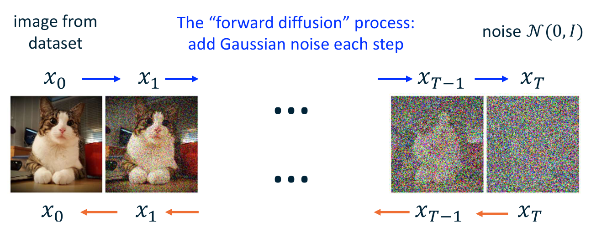
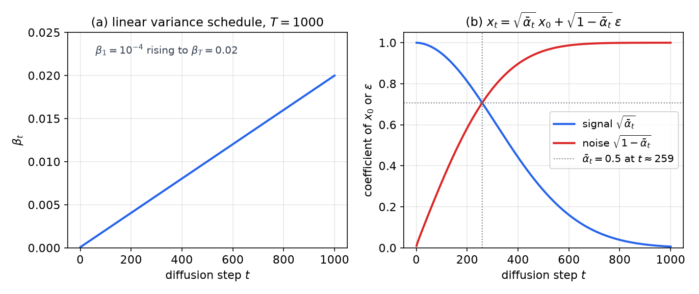
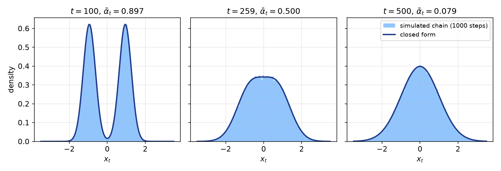
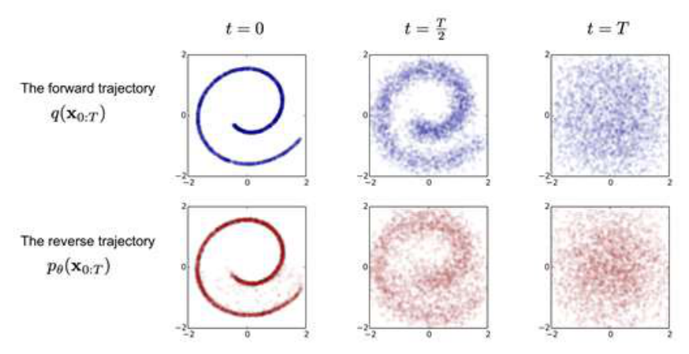
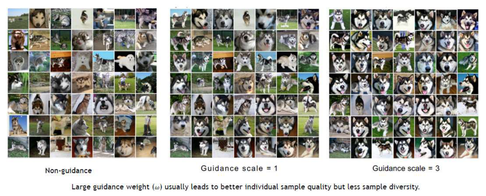
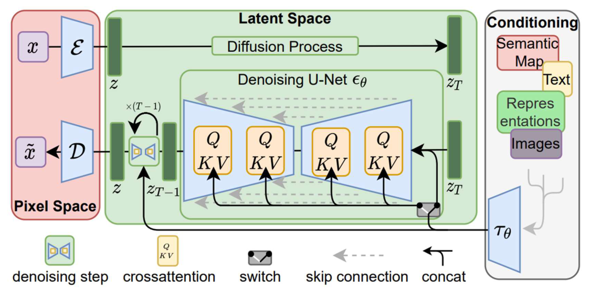

# Denoising Diffusion Models

Diffusion models generate data by learning to undo a fixed noising process. A forward chain adds a little Gaussian noise at each of a large number of steps until the data are indistinguishable from pure noise. A learned reverse chain starts from noise and removes a little of it at each step, and the composition of many small denoising steps produces samples that resemble the training data. Image, audio and video generators built on this idea share the same core mathematics. This chapter derives the forward process, the variational bound and its simplification to noise prediction, the sampler, and the two main routes to conditional generation: classifier-free guidance and latent diffusion. The derivation uses the evidence lower bound introduced in the [generative models](generative-models.md) chapter.

## Four Ways to Model a Distribution

Generative models differ in which quantities they make tractable. Explicit-density models define a probability \\(p\_\theta(x)\\) that can be evaluated, either exactly, as autoregressive models and normalizing flows do, or through a bound, as variational autoencoders do. Implicit-density models define only a procedure for drawing samples, as GANs do. A diffusion model is explicit and approximate. Its log-likelihood is bounded below by a sum of KL divergences, and training maximizes that bound.

The table compares the four families that matter for this chapter.

| Family | Mechanism | What is learned | Training signal | Cost of one sample |
|---|---|---|---|---|
| GAN | adversarial game | generator \\(G(\mathbf{z})\\) and discriminator \\(D(\mathbf{x})\\) | real-or-fake judgment of the discriminator | one pass through \\(G\\) |
| VAE | variational bound | encoder \\(q\_\phi(z \mid x)\\), decoder \\(p\_\theta(x \mid z)\\) | the ELBO | one pass through the decoder |
| Flow | invertible map | \\(f\\), and so \\(f^{-1}\\) | exact log-likelihood | one pass through \\(f^{-1}\\) |
| Diffusion | fixed noising, learned denoising | denoiser \\(\epsilon\_\theta(x\_t,t)\\) | bound on \\(\log p(x)\\), reduced to regression | \\(T\\) sequential denoising steps |

The last column shows the trade-off. Diffusion models replace the min-max game of a GAN with a regression problem, and their latent variables have the same dimension as the data, so no compressing encoder has to be learned. The price is \\(T\\) sequential network evaluations per sample, which is why much later work concerns faster samplers.

## The Forward Process

### A Chain of Gaussian Steps

Fix a variance schedule \\(\beta\_1, \dots, \beta\_T\\) with
\\[
0 < \beta\_1 < \beta\_2 < \cdots < \beta\_T < 1.
\\]
Start from a data point \\(x\_0\\) and define a Markov chain \\(x\_0 \to x\_1 \to \cdots \to x\_T\\) by
\\[
q(x\_{1:T} \mid x\_0) = \prod\_{t=1}^{T} q(x\_t \mid x\_{t-1}),
\qquad
q(x\_t \mid x\_{t-1}) = \mathcal{N}\big(x\_t;\ \sqrt{1-\beta\_t}\\,x\_{t-1},\ \beta\_t I\big).
\\]
The first equality is the chain rule of probability for a Markov chain. The second says that each step scales the current state by \\(\sqrt{1-\beta\_t}\\) and adds independent Gaussian noise with variance \\(\beta\_t\\) per coordinate. Because the process is fixed, it has no parameters and nothing about it is learned. Figure 1 shows the forward chain on an image: each arrow adds a little noise, and the chain ends in pure noise.



*Figure: how to read the diagram. The blue arrows run the forward chain, which adds Gaussian noise at each step, from the photograph \\(x\_0\\) to nearly pure noise \\(x\_T\\). The orange arrows run the reverse chain, which the learned model approximates. The dots stand for the intermediate steps, which are not shown.*

The scaling factor is the part that deserves attention. Suppose \\(x\_{t-1}\\) has covariance \\(I\\) and the new noise is independent of it. Then the covariance of \\(x\_t\\) is
\\[
(1-\beta\_t)I + \beta\_t I = I.
\\]
The chain therefore preserves variance, so a unit-variance state stays unit-variance. Without the shrinkage factor, the variance would increase by \\(\beta\_t\\) at every step, and the endpoint would not be a standard normal distribution. Data are usually scaled so that this reference behaves well.

Typical schedules take \\(\beta\_t\\) between \\(10^{-4}\\) and \\(0.02\\), with \\(T = 1000\\). A linear schedule is
\\[
\beta\_t = \beta\_1 + \frac{(t-1)(\beta\_T - \beta\_1)}{T-1},
\qquad \beta\_1 = 10^{-4},\quad \beta\_T = 0.02,
\\]
so the noise rate grows by about \\(2\times 10^{-5}\\) per step. Figure 2 shows this schedule together with the two coefficients that govern the marginal distribution derived next.



*Figure: left, the linear schedule \\(\beta\_t\\) over 1000 steps. Right, the coefficients of \\(x\_0\\) and \\(\epsilon\\) in \\(x\_t = \sqrt{\bar{\alpha}\_t}\\,x\_0 + \sqrt{1-\bar{\alpha}\_t}\\,\epsilon\\). The curves cross where \\(\bar{\alpha}\_t = 1/2\\), at about step 259. By the last step the signal coefficient is about 0.006, so \\(x\_T\\) is almost independent of \\(x\_0\\).*

### The Closed-Form Marginal

Define
\\[
\alpha\_t = 1 - \beta\_t,
\qquad
\bar{\alpha}\_t = \prod\_{s=1}^{t} \alpha\_s .
\\]
The key fact is that any \\(x\_t\\) can be sampled from \\(x\_0\\) in a single step:
\\[
q(x\_t \mid x\_0) = \mathcal{N}\big(x\_t;\ \sqrt{\bar{\alpha}\_t}\\,x\_0,\ (1-\bar{\alpha}\_t) I\big).
\\]
Equivalently, with \\(\epsilon \sim \mathcal{N}(0, I)\\),
\\[
x\_t = \sqrt{\bar{\alpha}\_t}\\,x\_0 + \sqrt{1-\bar{\alpha}\_t}\\,\epsilon .
\\]

**Proof (by induction).** For \\(t = 1\\), \\(\bar{\alpha}\_1 = \alpha\_1 = 1 - \beta\_1\\), which is the definition of the first step. Suppose the claim holds at \\(t-1\\), so that \\(x\_{t-1} = \sqrt{\bar{\alpha}\_{t-1}}\\,x\_0 + \sqrt{1-\bar{\alpha}\_{t-1}}\\,\epsilon'\\) for some \\(\epsilon' \sim \mathcal{N}(0,I)\\). Apply the one-step rule and use \\(\sqrt{1-\beta\_t} = \sqrt{\alpha\_t}\\):
\\[
x\_t = \sqrt{\alpha\_t}\\,x\_{t-1} + \sqrt{\beta\_t}\\,\epsilon
= \sqrt{\alpha\_t\bar{\alpha}\_{t-1}}\\,x\_0 +
\sqrt{\alpha\_t(1-\bar{\alpha}\_{t-1})}\\,\epsilon' +
\sqrt{\beta\_t}\\,\epsilon ,
\\]
where \\(\epsilon\\) is independent of \\(\epsilon'\\). The last two terms are independent Gaussians with zero mean, so their sum is Gaussian with the sum of their variances:
\\[
\alpha\_t(1-\bar{\alpha}\_{t-1}) + \beta\_t
= \alpha\_t - \alpha\_t\bar{\alpha}\_{t-1} + 1 - \alpha\_t
= 1 - \bar{\alpha}\_t ,
\\]
using \\(\alpha\_t\bar{\alpha}\_{t-1} = \bar{\alpha}\_t\\). The coefficient of \\(x\_0\\) is \\(\sqrt{\bar{\alpha}\_t}\\). This completes the induction. \\(\square\\)

The square root in the noise coefficient appears because the reparameterization trick writes a Gaussian with variance \\(s^2\\) as \\(\mu + s\\,\epsilon\\), so the standard deviation, not the variance, multiplies the unit normal.

This closed form is what makes training cheap. Training never has to run the chain. It picks a random \\(t\\), draws \\(\epsilon\\), and forms \\(x\_t\\) directly from \\(x\_0\\).

**Example 1 (one scalar value).** Take \\(x\_0 = 2\\) and the linear schedule above. The values of \\(\bar{\alpha}\_t\\) are \\(0.89702\\) at \\(t = 100\\), \\(0.07859\\) at \\(t = 500\\), and \\(4.04\times 10^{-5}\\) at \\(t = 1000\\). Therefore:

- At \\(t = 100\\): mean \\(\sqrt{0.89702}\cdot 2 = 1.894\\), standard deviation \\(\sqrt{1 - 0.89702} = 0.321\\).
- At \\(t = 500\\): mean \\(\sqrt{0.07859}\cdot 2 = 0.561\\), standard deviation \\(\sqrt{0.92141} = 0.960\\).
- At \\(t = 1000\\): mean \\(\sqrt{4.04\times 10^{-5}}\cdot 2 = 0.013\\), standard deviation \\(\sqrt{1 - 4.04\times 10^{-5}} = 1.000\\).

By step 500 the original value has mostly been replaced by noise, and at step 1000 it has no visible effect. The forward process destroys the data by design.

To check the closed form numerically, take the two-point data distribution with \\(x\_0\\) equal to \\(-1\\) or \\(+1\\) with probability one half each. Its marginal at step \\(t\\) is the mixture
\\[
p(x\_t) = \tfrac12\\, \mathcal{N}\big(x\_t;\ \sqrt{\bar{\alpha}\_t},\ 1-\bar{\alpha}\_t\big) +
\tfrac12\\, \mathcal{N}\big(x\_t;\ -\sqrt{\bar{\alpha}\_t},\ 1-\bar{\alpha}\_t\big).
\\]
Figure 3 simulates 200,000 chains through all 1000 steps, one step at a time, and compares their histograms with this density at three steps. The histograms agree with the formula within sampling noise. The bimodal distribution at \\(t = 100\\) has become a single Gaussian by \\(t = 500\\), and the two components merge near \\(t = 259\\), where \\(\bar{\alpha}\_t = 1/2\\).



*Figure: histograms of \\(x\_t\\) for two-point data at \\(t = 100\\), \\(259\\) and \\(500\\), from 200,000 chains each advanced one step at a time (bars), against the closed-form mixture (curve). The simulated and closed-form densities agree within the noise of 200,000 samples, which confirms the one-step formula.*

## The Reverse Process

### The Learned Chain

The generative model is a reverse chain that starts from the standard normal distribution and steps backward:
\\[
p\_\theta(x\_{0:T}) = p(x\_T) \prod\_{t=1}^{T} p\_\theta(x\_{t-1} \mid x\_t),
\qquad p(x\_T) = \mathcal{N}(0, I),
\\]
\\[
p\_\theta(x\_{t-1} \mid x\_t) = \mathcal{N}\big(x\_{t-1};\ \mu\_\theta(x\_t, t),\ \sigma\_t^2 I\big).
\\]
Only the mean \\(\mu\_\theta(x\_t,t)\\) is learned, by a neural network. The variance \\(\sigma\_t^2\\) is fixed and known. The derivation does not fix \\(\sigma\_t\\), so we take \\(\sigma\_t^2 = \beta\_t\\). This is one of the two choices in the original DDPM paper; the other is the posterior variance \\(\tilde{\beta}\_t\\) derived below, and in Ho et al.'s experiments the two choices gave similar sample quality.

### The Variational Bound

The model is a latent-variable model with latents \\(x\_{1:T}\\). The evidence lower bound (ELBO) from the generative models chapter gives
\\[
\log p\_\theta(x\_0) \ \ge\ \mathbb{E}\_{q(x\_{1:T} \mid x\_0)}\Big[\log \frac{p\_\theta(x\_{0:T})}{q(x\_{1:T} \mid x\_0)}\Big].
\\]
Because the forward chain is Markov, the joint distribution of the latents given \\(x\_0\\) can be written backward. Bayes' rule applied to each step gives
\\[
q(x\_{t-1} \mid x\_t, x\_0) = \frac{q(x\_t \mid x\_{t-1})\\, q(x\_{t-1} \mid x\_0)}{q(x\_t \mid x\_0)},
\\]
and the product of these ratios telescopes to
\\[
q(x\_{1:T} \mid x\_0) = q(x\_T \mid x\_0) \prod\_{t=2}^{T} q(x\_{t-1} \mid x\_t, x\_0).
\\]
Substitute this and the factorization of \\(p\_\theta\\) into the bound. Group the logarithms so that each \\(\log p\\) is paired with the \\(\log q\\) of the same variable. The result is
\\[
\log p\_\theta(x\_0) \ \ge\ -\mathbb{E}\_q\big[D\_{\mathrm{KL}}\big(q(x\_T \mid x\_0)\ \Vert\ p(x\_T)\big)\big] -
\sum\_{t=2}^{T} \mathbb{E}\_q\big[D\_{\mathrm{KL}}\big(q(x\_{t-1} \mid x\_t, x\_0)\ \Vert\ p\_\theta(x\_{t-1} \mid x\_t)\big)\big] +
\mathbb{E}\_q\big[\log p\_\theta(x\_0 \mid x\_1)\big].
\\]
Write \\(L\_{\mathrm{VLB}}\\) for the negative of the right-hand side, so that \\(-\log p\_\theta(x\_0) \le L\_{\mathrm{VLB}}\\). It has three kinds of term:

- The first term \\(D\_{\mathrm{KL}}\big(q(x\_T \mid x\_0)\ \Vert\ \mathcal{N}(0,I)\big)\\) contains no parameters. For this schedule it is nearly zero, because \\(q(x\_T \mid x\_0)\\) is almost \\(\mathcal{N}(0,I)\\).
- Each sum term compares the learned reverse step with the true posterior of the forward chain given \\(x\_0\\). These terms are what training reduces.
- The last term \\(\log p\_\theta(x\_0 \mid x\_1)\\) is a decoder term for the first step. The sum starts at \\(t = 2\\) because the first step is handled by this decoder term rather than by a KL divergence.

### The Forward Posterior

The sum terms need the distribution \\(q(x\_{t-1} \mid x\_t, x\_0)\\). Bayes' rule gives
\\[
q(x\_{t-1} \mid x\_t, x\_0) = \frac{q(x\_t \mid x\_{t-1})\\, q(x\_{t-1} \mid x\_0)}{q(x\_t \mid x\_0)} .
\\]
The denominator does not depend on \\(x\_{t-1}\\), so as a function of \\(x\_{t-1}\\) the posterior is proportional to the product of two Gaussians. Write it for one coordinate, where the covariances are \\(\beta\_t\\) and \\(1-\bar{\alpha}\_{t-1}\\):
\\[
q(x\_{t-1} \mid x\_t, x\_0) \ \propto\ \exp\Big\\{-\tfrac12\Big[\frac{(x\_t - \sqrt{\alpha\_t}\\,x\_{t-1})^2}{\beta\_t} +
\frac{(x\_{t-1} - \sqrt{\bar{\alpha}\_{t-1}}\\,x\_0)^2}{1-\bar{\alpha}\_{t-1}}\Big]\Big\\}.
\\]
A quadratic in \\(x\_{t-1}\\) is a Gaussian, so we identify its precision and linear term. The precision is
\\[
\frac{\alpha\_t}{\beta\_t} + \frac{1}{1-\bar{\alpha}\_{t-1}}
= \frac{\alpha\_t(1-\bar{\alpha}\_{t-1}) + \beta\_t}{\beta\_t(1-\bar{\alpha}\_{t-1})}
= \frac{1-\bar{\alpha}\_t}{\beta\_t(1-\bar{\alpha}\_{t-1})} ,
\\]
so the posterior variance is
\\[
\tilde{\beta}\_t = \frac{\beta\_t\\,(1-\bar{\alpha}\_{t-1})}{1-\bar{\alpha}\_t}.
\\]
The mean is \\(\tilde{\beta}\_t\\) times the sum of the two linear terms, \\(\sqrt{\alpha\_t}\\,x\_t/\beta\_t\\) and \\(\sqrt{\bar{\alpha}\_{t-1}}\\,x\_0/(1-\bar{\alpha}\_{t-1})\\):
\\[
\tilde{\mu}\_t(x\_t, x\_0)
= \frac{\sqrt{\alpha\_t}\\,(1-\bar{\alpha}\_{t-1})}{1-\bar{\alpha}\_t}\\,x\_t +
\frac{\sqrt{\bar{\alpha}\_{t-1}}\\,\beta\_t}{1-\bar{\alpha}\_t}\\,x\_0 .
\\]
So \\(q(x\_{t-1} \mid x\_t, x\_0) = \mathcal{N}(x\_{t-1};\ \tilde{\mu}\_t, \tilde{\beta}\_t I)\\).

The noise form of this mean is more useful. Substitute \\(x\_0 = (x\_t - \sqrt{1-\bar{\alpha}\_t}\\,\epsilon)/\sqrt{\bar{\alpha}\_t}\\) and use \\(\sqrt{\bar{\alpha}\_{t-1}}/\sqrt{\bar{\alpha}\_t} = 1/\sqrt{\alpha\_t}\\). The coefficient of \\(x\_t\\) becomes \\([\alpha\_t(1-\bar{\alpha}\_{t-1}) + \beta\_t]/(\sqrt{\alpha\_t}(1-\bar{\alpha}\_t)) = 1/\sqrt{\alpha\_t}\\), and the coefficient of \\(\epsilon\\) becomes \\(-\beta\_t/(\sqrt{\alpha\_t}\sqrt{1-\bar{\alpha}\_t})\\). Hence
\\[
\tilde{\mu}\_t = \frac{1}{\sqrt{\alpha\_t}}\Big(x\_t - \frac{\beta\_t}{\sqrt{1-\bar{\alpha}\_t}}\\,\epsilon\Big),
\qquad \epsilon \sim \mathcal{N}(0, I).
\\]
Here \\(\epsilon\\) is the noise that, through the closed form, produced \\(x\_t\\) from \\(x\_0\\). It is known during training and unknown at sampling time.

The printed version of this derivation differs from the standard result in three places, and all three look like typographical errors. The denominator of the mean is printed as \\(1-\sqrt{\bar{\alpha}\_t}\\) rather than \\(1-\bar{\alpha}\_t\\). The mean of the second Gaussian factor is printed as \\(\sqrt{\bar{\alpha}\_{t-1}}\\,x\_{t-1}\\) rather than \\(\sqrt{\bar{\alpha}\_{t-1}}\\,x\_0\\). The variance of the denominator Gaussian is printed as \\(1-\bar{\alpha}\_{t-1}\\) rather than \\(1-\bar{\alpha}\_t\\). The forms above are the standard ones, and the algebra in this section confirms them.

### From KL Divergence to Noise Prediction

Both \\(q(x\_{t-1} \mid x\_t, x\_0)\\) and \\(p\_\theta(x\_{t-1} \mid x\_t)\\) are Gaussians with the same covariance \\(\sigma\_t^2 I\\). For two Gaussians with equal isotropic covariances,
\\[
D\_{\mathrm{KL}}\big(\mathcal{N}(\mu\_1, \sigma^2 I)\ \Vert\ \mathcal{N}(\mu\_2, \sigma^2 I)\big)
= \frac{\lVert \mu\_1 - \mu\_2 \rVert^2}{2\sigma^2}.
\\]
Parameterize the learned mean through a noise predictor \\(\epsilon\_\theta(x\_t, t)\\):
\\[
\mu\_\theta(x\_t, t) = \frac{1}{\sqrt{\alpha\_t}}\Big(x\_t - \frac{\beta\_t}{\sqrt{1-\bar{\alpha}\_t}}\\,\epsilon\_\theta(x\_t, t)\Big).
\\]
The difference of the two means is then
\\[
\tilde{\mu}\_t - \mu\_\theta
= \frac{\beta\_t}{\sqrt{\alpha\_t}\\,\sqrt{1-\bar{\alpha}\_t}}\\,\big(\epsilon\_\theta(x\_t, t) - \epsilon\big),
\\]
and each sum term becomes
\\[
\mathbb{E}\big[w\_t\\,\lVert \epsilon - \epsilon\_\theta(x\_t, t)\rVert^2\big],
\qquad
w\_t = \frac{\beta\_t^2}{2\sigma\_t^2\\,\alpha\_t\\,(1-\bar{\alpha}\_t)} .
\\]
The derivation as printed does not state the weight \\(w\_t\\), so we define it here. It depends on the schedule and on the variance choice. The bound implies this variance-dependent weight, but dropping it gives a constant weight that works better in practice (Ho et al., 2020). With \\(\sigma\_t^2 = \beta\_t\\), the weight is \\(w\_t = \beta\_t/(2\alpha\_t(1-\bar{\alpha}\_t))\\). At the first step it is about \\(0.5\\), and at the last step it is about \\(0.01\\). The unweighted loss therefore puts relatively more emphasis on the high-noise steps, and those steps matter most for sample quality.

Dropping the weight gives the simplified objective, which is the one used in practice:
\\[
L\_{\mathrm{simple}}(\theta) = \mathbb{E}\_{t,\\,x\_0,\\,\epsilon}\Big[\lVert \epsilon - \epsilon\_\theta\big(\sqrt{\bar{\alpha}\_t}\\,x\_0 + \sqrt{1-\bar{\alpha}\_t}\\,\epsilon,\ t\big)\rVert^2\Big],
\qquad t \sim \mathrm{Uniform}(1, \dots, T).
\\]
The network is shown a noisy image at a random step and asked to predict the noise that was added. The reverse step uses the predicted noise to compute the mean of the previous state, and then adds a little fresh noise.

**Example 2 (the optimal noise predictor).** The regression target is noise, so it is worth checking what a perfect predictor would output. Take data drawn from \\(x\_0 \sim \mathcal{N}(1, 0.25)\\). Then every \\(x\_t\\) is Gaussian, and its conditional expectations are available in closed form. Consider a step with \\(\bar{\alpha}\_t = 0.5\\) and \\(\beta\_t = 0.02\\), so \\(\alpha\_t = 0.98\\) and \\(\bar{\alpha}\_{t-1} = 0.5/0.98 = 0.51020\\). These values are chosen to keep the arithmetic short; they are not the values at one particular step of the linear schedule. Suppose the noisy input is \\(x\_t = 1.0\\).

1. The marginal of \\(x\_t\\) has mean \\(\sqrt{0.5}\cdot 1 = 0.70711\\) and variance \\(0.5\cdot 0.25 + 0.5 = 0.625\\).
2. The optimal noise predictor minimizes the squared error, so it is the conditional mean \\(\mathbb{E}[\epsilon \mid x\_t]\\). For jointly Gaussian variables this is \\(\operatorname{Cov}(\epsilon, x\_t)/\operatorname{Var}(x\_t)\\) times the deviation of \\(x\_t\\) from its mean. Here \\(\operatorname{Cov}(\epsilon, x\_t) = \sqrt{0.5} = 0.70711\\), so
\\[
\mathbb{E}[\epsilon \mid x\_t = 1] = \frac{0.70711}{0.625}\\,(1 - 0.70711) = 0.33137 .
\\]
3. Route A, through the posterior mean of \\(x\_0\\). Here \\(\operatorname{Cov}(x\_0, x\_t) = \sqrt{0.5}\cdot 0.25 = 0.17678\\), so \\(\mathbb{E}[x\_0 \mid x\_t = 1] = 1 + (0.17678/0.625)(0.29289) = 1.08284\\). The mean of the reverse step is
\\[
\tilde{\mu}\_t = \frac{\sqrt{\alpha\_t}(1-\bar{\alpha}\_{t-1})}{1-\bar{\alpha}\_t}\\,x\_t + \frac{\sqrt{\bar{\alpha}\_{t-1}}\\,\beta\_t}{1-\bar{\alpha}\_t}\\,\mathbb{E}[x\_0 \mid x\_t]
= 0.969746 \cdot 1 + 0.028571 \cdot 1.082843 = 1.000684 .
\\]
4. Route B, through the noise predictor. The predicted mean is
\\[
\mu\_\theta = \frac{1}{\sqrt{0.98}}\Big(1 - \frac{0.02}{\sqrt{0.5}}\cdot 0.33137\Big) = 1.01015 \cdot 0.99063 = 1.00068 .
\\]

The two routes agree to five decimal places. This confirms the identity behind the simplified objective: predicting the noise and predicting the posterior mean are the same problem, related by a known linear map. Here the optimal noise predictor is linear in \\(x\_t\\) because the data are Gaussian. For real images the trained network approximates a nonlinear conditional expectation.

## Training and Sampling

### Training

Training follows the simplified objective. Each iteration uses one data point, one random step and one noise draw, and it costs one forward and backward pass through the denoiser:

```text
repeat
    x_0 ~ q(x_0)                       sample a data point
    t ~ Uniform(1, ..., T)             sample a step
    eps ~ N(0, I)                      sample noise
    take a gradient step on
        || eps - eps_theta(sqrt(abar_t) x_0 + sqrt(1 - abar_t) eps, t) ||^2
until converged
```

The forward chain is never simulated during training. The closed form supplies \\(x\_t\\) in one step.

### Sampling

Sampling runs the learned reverse chain from pure noise:

```text
x_T ~ N(0, I)
for t = T, ..., 1:
    z ~ N(0, I) if t > 1, else z = 0
    x_{t-1} = (1/sqrt(alpha_t)) (x_t - (beta_t / sqrt(1 - abar_t)) eps_theta(x_t, t)) + sigma_t z
return x_0
```

The mean is the reverse mean \\(\mu\_\theta(x\_t,t)\\) from the previous section, written with \\((1-\alpha\_t)/\sqrt{1-\bar{\alpha}\_t} = \beta\_t/\sqrt{1-\bar{\alpha}\_t}\\). The term \\(\sigma\_t z\\) injects fresh noise, which keeps the samples diverse; the last step is deterministic.

Continue Example 2. If the network had learned the optimal predictor, one reverse step from \\(x\_t = 1.0\\) would have mean \\(1.00068\\). With \\(\sigma\_t = \sqrt{0.02} = 0.14142\\) and the sampled draw \\(z = 0.5\\), the new value is \\(x\_{t-1} = 1.00068 + 0.14142 \cdot 0.5 = 1.07139\\). The mean barely moves the value, because one step with \\(\beta\_t = 0.02\\) is small, and most of the change comes from the noise term.

Sampling is slow by construction. Generating one sample takes \\(T\\) sequential network evaluations, here 1000. Faster samplers that reuse a trained denoiser with fewer steps are an active area and are not treated here.

The network also needs to know the step \\(t\\), because the noise level it must remove depends on \\(t\\). The derivation does not say how \\(t\\) enters the network. In common practice, \\(t\\) is embedded with sinusoidal features and added to the residual blocks of a U-Net, the same convolutional encoder-decoder with skip connections described in [dense prediction](dense-prediction.md).

### Diffusion on Two-Dimensional Data

The same mechanism can be seen on a planar data set. Figure 4 shows a spiral: the forward chain (top row) dissolves the spiral into a Gaussian cloud, and the learned reverse chain (bottom row) recovers it.



*Figure: top row, the forward trajectory \\(q(\mathbf{x}\_{0:T})\\) at \\(t = 0\\), \\(T/2\\) and \\(T\\), where the data have dissolved into noise. Bottom row, the reverse trajectory \\(p\_\theta(\mathbf{x}\_{0:T})\\) at the same steps, which recovers the spiral from noise. The figure is from Sohl-Dickstein et al. (2015), which introduced diffusion probabilistic models.*

## The Connection to VAEs

The structure of the bound is that of a variational autoencoder. The forward chain plays the role of the encoder, mapping \\(x\_0\\) to a sequence of latents \\(x\_1, \dots, x\_T\\) that have the same dimension as the data. The reverse chain plays the role of the decoder, mapping latents back toward data. The ELBO has the same shape: a reconstruction-like term and KL terms that pull the decoder toward the posterior.

Two differences matter. The encoder has no learned parameters, so the only trained part is the reverse chain. And the latents are not compressed, so the model never has to learn a bottleneck representation. In exchange, the decoder is a chain of \\(T\\) steps rather than one network pass, and each step is an easy Gaussian problem. The generative models chapter describes the single-step VAE in detail.

## Conditional Generation and Guidance

### Plain Conditioning

Suppose we want images from a text description \\(y\\). The conditional model \\(\epsilon\_\theta(x\_t, y, t)\\) is trained exactly like the unconditional one, with \\(y\\) supplied as an extra input. The conditioning can enter in several ways. A scalar, such as a class index, is embedded as a vector and added to the feature maps or used to set the scale and shift of group normalization. An image condition, such as a segmentation map, is concatenated channel-wise with \\(x\_t\\). A text condition is either a single vector embedding, combined as before, or a sequence of embeddings consumed through cross-attention.

Plain conditioning tends to produce blurry generations. The guidance methods below address this by amplifying the effect of the condition.

### Classifier Guidance

The idea is to steer the reverse chain with the gradient of an external classifier \\(f\_\phi(y \mid x\_t)\\). First we need the standard identity that links the noise predictor to the score, the gradient of the log density of \\(x\_t\\):
\\[
\nabla\_{x\_t} \log p(x\_t) = -\frac{\epsilon\_\theta(x\_t, t)}{\sqrt{1-\bar{\alpha}\_t}} .
\\]
Bayes' rule gives \\(\nabla \log p(x \mid y) = \nabla \log p(y \mid x) + \nabla \log p(x)\\). To strengthen the influence of the condition, introduce a guidance scale \\(\gamma\\), and define the tilted distribution \\(p\_\gamma(x \mid y) \propto p(x)\\,p(y \mid x)^{\gamma}\\). Its score is
\\[
\nabla \log p\_\gamma(x \mid y) = \nabla \log p(x) + \gamma\\,\nabla \log p(y \mid x).
\\]
Substituting the score identity and converting back to noise gives the guided noise prediction
\\[
\bar{\epsilon}\_\theta(x\_t, t) = \epsilon\_\theta(x\_t, t) - \gamma\sqrt{1-\bar{\alpha}\_t}\\,\nabla\_{x\_t} \log f\_\phi(y \mid x\_t).
\\]
With \\(\gamma = 1\\) this is the plain Bayes-rule combination. Values \\(\gamma > 1\\) emphasize the classifier evidence, which increases fidelity to the label and reduces diversity.

Classifier guidance has two drawbacks. The classifier must be trained on noisy images \\(x\_t\\) at every step, not on clean photographs, so an off-the-shelf classifier cannot be used. And the gradient of a classifier with respect to its input can point in arbitrary directions, because most input information is irrelevant to the label. The next method removes the separate classifier entirely.

### Classifier-Free Guidance

Apply Bayes' rule in the other direction: \\(\nabla \log p(y \mid x) = \nabla \log p(x \mid y) - \nabla \log p(x)\\). Substituting this into the tilted score gives
\\[
\nabla \log p\_\gamma(x \mid y) = \nabla \log p(x) + \gamma\big(\nabla \log p(x \mid y) - \nabla \log p(x)\big)
= (1-\gamma)\\,\nabla \log p(x) + \gamma\\,\nabla \log p(x \mid y).
\\]
The guided score is a weighted combination of the unconditional and conditional scores, with weights that sum to one. In noise terms, define \\(\omega = \gamma - 1\\), so that \\(\omega = 0\\) means no guidance. Then the guided prediction is
\\[
\hat{\epsilon}\_\theta(x\_t, t, y) = (1+\omega)\\,\epsilon\_\theta(x\_t, t, y) - \omega\\,\epsilon\_\theta(x\_t, t).
\\]
This is the conditional prediction, extrapolated away from the unconditional one by the amount \\(\omega\\), and it is the form used in practice.

Training needs both predictions from one network. During training, the condition \\(y\\) is replaced by a special null input with some probability, commonly 10 to 20 percent of examples. The same network then acts as a conditional model \\(\epsilon\_\theta(x\_t, t, y)\\) and as an unconditional model \\(\epsilon\_\theta(x\_t, t)\\), depending only on whether the condition is provided. Sampling with guidance then costs two network evaluations per step, one with the condition and one without.

Figure 5 shows the trade-off on a class-conditional example. Without guidance the samples are varied, and several do not look like the class at all. A moderate guidance weight gives more recognizable husky-like samples, and a larger weight gives sharp, similar-looking samples. The original caption puts the trade-off in one sentence: a large guidance weight usually improves individual sample quality but reduces diversity.



*Figure: grids of samples from a class-conditional model. Left, no guidance (\\(\omega = 0\\)); middle and right, guidance weights of 1 and 3, labeled guidance scale in the figure. Individual samples become sharper and more typical of the class as the weight grows, and the set of samples becomes less diverse. Samples as reported by Ho and Salimans (2022).*

## Latent Diffusion

Running diffusion directly on high-resolution pixels is expensive. A \\(512 \times 512\\) RGB image has \\(786{,}432\\) numbers, and every sampling step runs the denoiser over all of them. Latent diffusion first learns a compact representation and runs the diffusion in that space.

An autoencoder with an encoder \\(\mathcal{E}\\) and a decoder \\(\mathcal{D}\\) maps the image to a latent grid \\(z = \mathcal{E}(x)\\) and back. The autoencoder has a VQGAN-style design: a codebook replaces each latent vector with its nearest entry, and an adversarial discriminator that works on image patches pushes the reconstructions toward realistic detail. Both are trained alongside a reconstruction loss. Released Stable Diffusion models use a continuous, KL-regularized autoencoder with the same encoder-decoder structure. The rest of this section does not depend on which kind is used. The diffusion model then operates on the latent grid, and the decoder maps the final latent back to pixels. In a widely used configuration, a spatial downsampling factor of 8 and 4 latent channels turn the \\(512 \times 512 \times 3\\) image into a \\(64 \times 64 \times 4\\) latent with \\(16{,}384\\) values, which is \\(48\\) times fewer. The numbers for this configuration are standard in practice and show the scale of the saving.

The denoiser is a U-Net with cross-attention layers at several resolutions. The conditioning encoder \\(\tau\_\theta\\) turns a prompt, a semantic map or other inputs into a sequence of embeddings. The U-Net attends to that sequence through cross-attention, where the queries come from the image features and the keys and values come from the conditioning. The architecture is shown in Figure 6.



*Figure: the latent diffusion architecture. The encoder \\(\mathcal{E}\\) maps the image to a latent \\(z\\), the diffusion process and the denoising U-Net run in latent space with cross-attention blocks (the Q, K, V boxes), and the decoder \\(\mathcal{D}\\) returns an image. The conditioning encoder \\(\tau\_\theta\\) supplies text, semantic maps, layouts or images, and a switch selects which conditioning is used.*

The same trained model accepts different conditions. The published examples include layout-conditioned generation, where labeled boxes place objects in the image; segmentation-conditioned generation, where a color-coded map sets the regions of a landscape; and inpainting, where a masked person is removed and the background is filled in. All three use the same denoiser with a different conditioning signal.

## Beyond Images

The denoising principle is not tied to the pixel grid, and two extensions are worth noting. The first uses a text-to-image diffusion model as a loss for optimizing a three-dimensional scene. This technique, called score distillation, renders the scene from random viewpoints and uses the 2D model's denoising predictions to form gradients that move the renderings toward images the model considers likely for the prompt. The second is text-to-video generation, where the denoiser works on a sequence of frames, and latent video diffusion applies the same latent-space idea to clips. In both cases the output space differs and the reverse-chain training is unchanged.

## Summary

- The forward process is a fixed Markov chain of Gaussian steps with variance schedule \\(\beta\_t\\), and it has the closed form \\(x\_t = \sqrt{\bar{\alpha}\_t}\\,x\_0 + \sqrt{1-\bar{\alpha}\_t}\\,\epsilon\\) with \\(\bar{\alpha}\_t = \prod\_{s\le t}(1-\beta\_s)\\).
- The reverse chain has Gaussian steps with a learned mean and a fixed variance \\(\sigma\_t^2\\). The variational bound is a sum of KL divergences between the true posterior \\(q(x\_{t-1} \mid x\_t, x\_0)\\) and the learned steps.
- The posterior has mean \\(\tilde{\mu}\_t = (1/\sqrt{\alpha\_t})\big(x\_t - (\beta\_t/\sqrt{1-\bar{\alpha}\_t})\\,\epsilon\big)\\) and variance \\(\tilde{\beta}\_t = \beta\_t(1-\bar{\alpha}\_{t-1})/(1-\bar{\alpha}\_t)\\).
- Matching the means is equivalent to predicting the noise. The simplified objective \\(\lVert \epsilon - \epsilon\_\theta(x\_t,t)\rVert^2\\), with uniform \\(t\\), drops the variance-dependent weight \\(w\_t\\) and works better in practice.
- Sampling runs \\(T\\) steps of \\(x\_{t-1} = (1/\sqrt{\alpha\_t})\big(x\_t - (\beta\_t/\sqrt{1-\bar{\alpha}\_t})\\,\epsilon\_\theta\big) + \sigma\_t z\\), which is slow but simple.
- Classifier guidance uses an external classifier on noisy images. Classifier-free guidance combines conditional and unconditional predictions, \\(\hat{\epsilon} = (1+\omega)\epsilon\_\theta(x\_t,t,y) - \omega\\,\epsilon\_\theta(x\_t,t)\\), from one network trained with conditioning dropout.
- Latent diffusion runs the chain in the latent space of a pretrained autoencoder, which makes high-resolution generation practical, and cross-attention lets the same denoiser accept many kinds of condition.

## See Also

- [Generative models: autoregressive models, VAEs and GANs](generative-models.md)
- [Dense prediction and the U-Net](dense-prediction.md)
- [Transformers and attention](transformers.md)
- [Actor-critic, PPO and RLHF](actor-critic.md)
- [Fairness, alignment and the road ahead](fairness-alignment.md)
- Probability distributions
- Entropy and information
