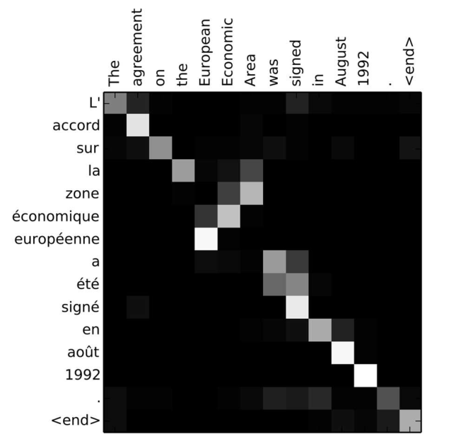
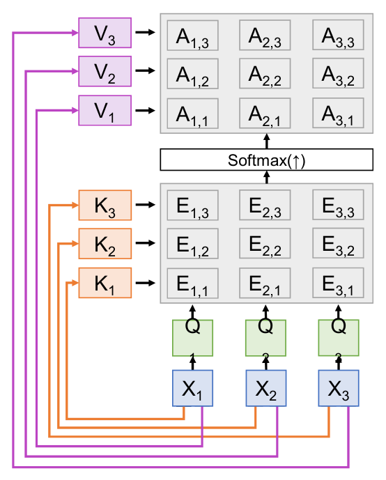
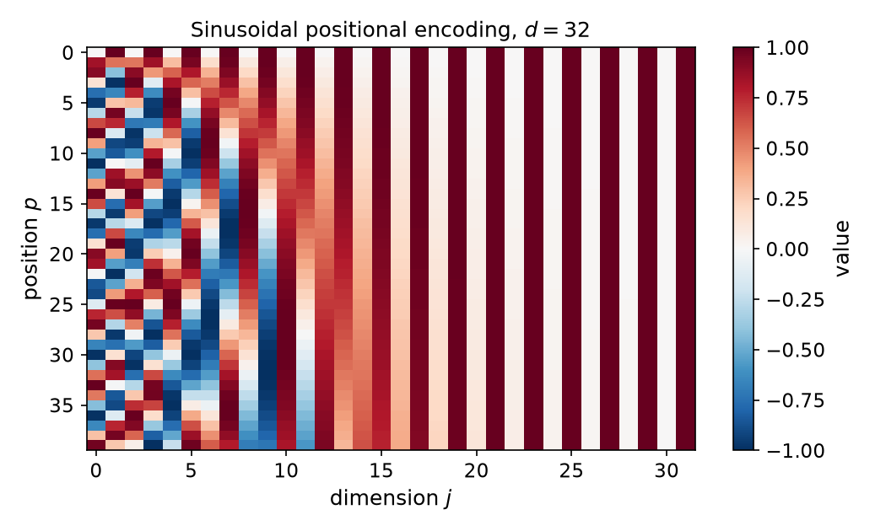
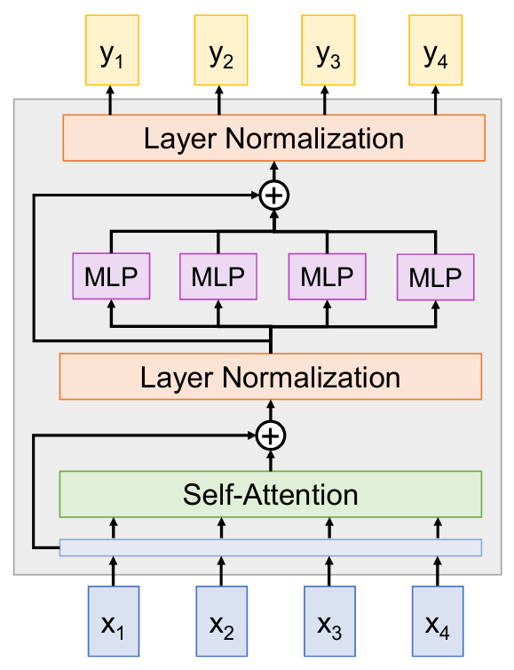
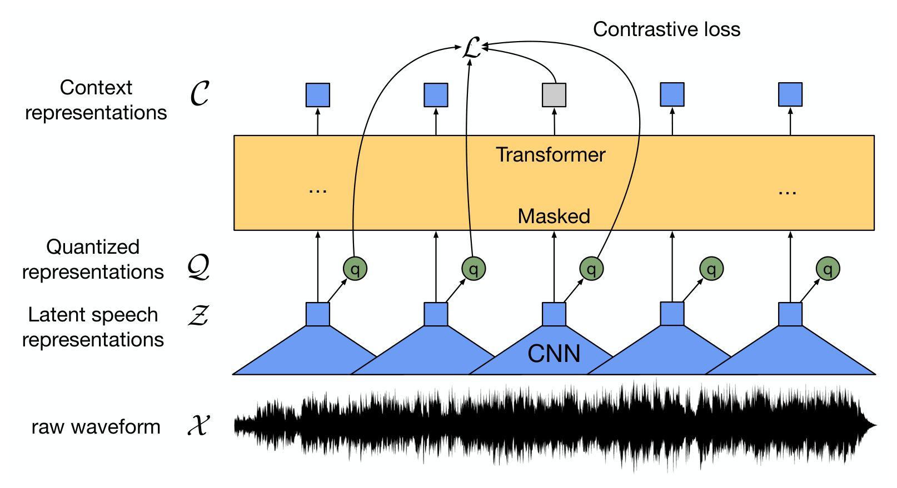
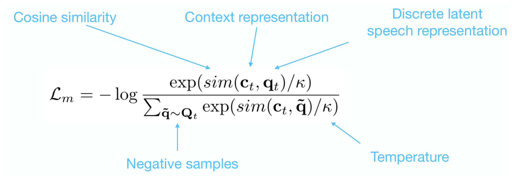
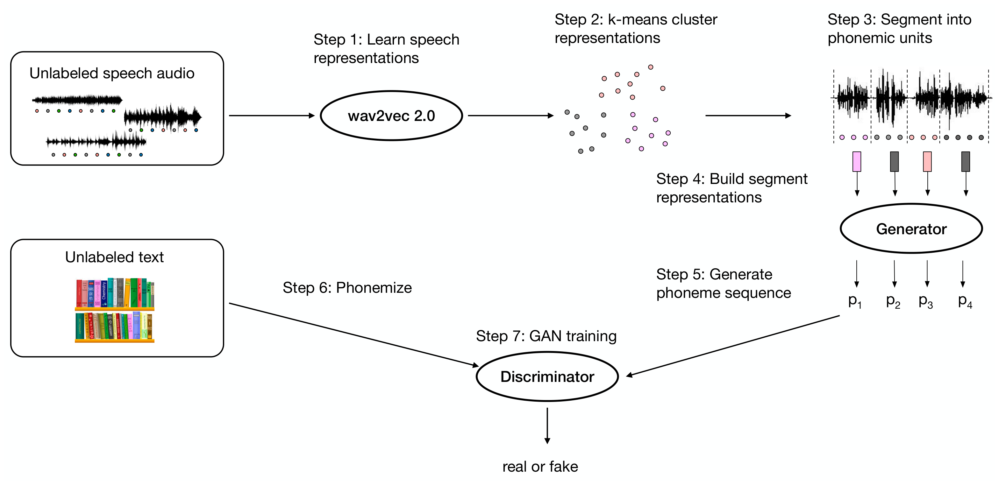

# Attention, Transformers, and Speech Self-Supervision

Recurrent networks carry all information about the past through one fixed-size state, which limits how much of a long input they can use and forces sequential computation. Attention removes that bottleneck: each output is a weighted average of many inputs, and the weights are computed from the data. This chapter develops attention from its origin in neural machine translation to the self-attention layer, the Transformer block built from it, and the encoder–decoder Transformer. The second half applies self-supervised learning to speech: wav2vec 2.0 learns speech representations from unlabeled audio, wav2vec-U learns to recognize speech without transcriptions, and data2vec uses one learning procedure for images, speech and text. The speech methods replace the hand-built acoustic models described in [Hidden Markov Models and Sequence Recognition](../cs3600-cs6601-artificial-intelligence/hidden-markov-models.md).

## From the Fixed Context Vector to Attention

Consider translating "we are eating bread" into Spanish with an encoder–decoder pair of recurrent networks. The encoder produces hidden states \\( h\_1, \dots, h\_4 \\). The simplest decoder starts from the final state \\( s\_0 = h\_4 \\) and emits one word per step. A variant feeds a fixed context vector \\( c = h\_4 \\) into every decoder step, so that \\( s\_t = g(y\_t, s\_{t-1}, c) \\).

The fixed context is a bottleneck. Everything the decoder knows about the source sentence must pass through one vector of fixed size, whatever the sentence length. A second problem is that the same state \\( s\_t \\) is used both to encode the input and to carry the decoder's own history, so the two roles compete for capacity.

The remedy, due to Bahdanau, Cho and Bengio (2015), is to give the decoder a new context vector at each step, computed as a weighted combination of all the encoder states. At decoder step \\( t \\), the decoder state \\( s\_{t-1} \\) is compared with each encoder state \\( h\_i \\) by a learned score function \\( f\_{\text{att}} \\) implemented as a small MLP:

\\[
e\_{t,i}=f\_{\text{att}}(s\_{t-1},h\_i),\qquad a\_{t,i}=\frac{\exp(e\_{t,i})}{\sum\_{j}\exp(e\_{t,j})},\qquad c\_t=\sum\_{i}a\_{t,i}\\,h\_i.
\\]

The weights \\( a\_{t,i} \\) are positive and sum to one over \\( i \\). The context vector \\( c\_t \\) is their weighted average of the encoder states. The decoder uses \\( c\_t \\) together with \\( s\_{t-1} \\) and the previous output to produce \\( s\_t \\) and the next word.

**Example 1 (attention weights from scores).** The source gives the first-step weights \\( a\_{1,1}=0.45 \\), \\( a\_{1,2}=0.45 \\), \\( a\_{1,3}=0.05 \\), \\( a\_{1,4}=0.05 \\). One set of scores that produces them is \\( (e\_{1,1},\dots,e\_{1,4}) = (\ln 9, \ln 9, 0, 0) \\). Then the exponentials are \\( (9, 9, 1, 1) \\) with sum 20, and dividing gives \\( (0.45, 0.45, 0.05, 0.05) \\). The first two source words receive 90 percent of the attention, and the context vector is \\( c\_1 = 0.45\\,h\_1+0.45\\,h\_2+0.05\\,h\_3+0.05\\,h\_4 \\). The score function is not determined by these weights alone; the weights only show what the scores must be up to a common shift.

Attention is differentiable, and no supervision is given for the weights themselves. They are trained only through the translation loss, and training nevertheless produces alignments. The weights form a matrix over output and input positions, and for English–French translation the matrix is close to diagonal, with a block that reverses word order where a phrase is reordered.

*Figure: Attention weights \\( a\_{t,i} \\) for an English-to-French translation. Rows are output words and columns are input words, and a brighter cell means more weight. The diagonal shows words translated in order; the block where "European Economic Area" is matched to "zone économique européenne" shows the reordering that attention learns without being told.*

## Scaled Dot-Product Attention

The score function \\( f\_{\text{att}} \\) can be replaced by something cheaper and more general. Suppose a query vector \\( q \\) of dimension \\( D \\) is compared with input vectors \\( X\_1,\dots,X\_N \\), each of dimension \\( D \\). The dot-product score \\( e\_i = q \cdot X\_i \\) needs no extra parameters. Dividing by \\( \sqrt{D} \\) gives the scaled version \\( e\_i = q\cdot X\_i/\sqrt{D} \\), and the output is \\( y = \sum\_i a\_i X\_i \\) with \\( a = \operatorname{softmax}(e) \\).

The scaling has a clear motivation. If the components of \\( q \\) and \\( X\_i \\) are independent with zero mean and unit variance, then \\( q\cdot X\_i \\) has mean zero and variance \\( D \\). Without scaling, the scores grow with \\( \sqrt{D} \\), and the softmax saturates toward a one-hot vector, where its gradients are nearly zero. Dividing by \\( \sqrt{D} \\) restores unit variance.

With several queries, the operation is a matrix product. Let \\( Q \\) have shape \\( N\_Q \times D \\) and \\( X \\) have shape \\( N\_X \times D \\). Compute the similarity matrix \\( E = QX^{\top}/\sqrt{D} \\), take the softmax along each row to get \\( A \\), and form \\( Y = AX \\). Separating the roles of the input into keys and values, with learned matrices \\( W\_K \\) and \\( W\_V \\), gives the general form:

\\[
K=XW\_K,\qquad V=XW\_V,\qquad E=\frac{QK^{\top}}{\sqrt{D}},\qquad A=\operatorname{softmax}(E,\ \text{dim}=1),\qquad Y=AV.
\\]

Here \\( Y\_i = \sum\_j A\_{i,j} V\_j \\): output \\( i \\) is a weighted average of the values, with weights set by the similarity of query \\( i \\) to every key.

**Example 2 (scaled dot-product attention with full numbers).** Take three inputs in dimension \\( D = 2 \\), \\( X = \begin{bmatrix}1&0\\\\0&1\\\\1&1\end{bmatrix} \\), and set \\( W\_Q = W\_K = W\_V = I \\), so \\( Q = K = V = X \\). The raw similarities are \\( QK^{\top} = \begin{bmatrix}1&0&1\\\\0&1&1\\\\1&1&2\end{bmatrix} \\). Dividing by \\( \sqrt{2} = 1.4142 \\) gives

\\[
E=\begin{bmatrix}0.7071&0&0.7071\\\\0&0.7071&0.7071\\\\0.7071&0.7071&1.4142\end{bmatrix}.
\\]

Each row softmax uses exponentials \\( e^{0.7071} = 2.0281 \\), \\( e^{0} = 1 \\) and \\( e^{1.4142} = 4.1133 \\). The first row sums to \\( 2.0281+1+2.0281 = 5.0562 \\), so its weights are \\( (0.4011, 0.1978, 0.4011) \\). The second row is the mirror image, \\( (0.1978, 0.4011, 0.4011) \\). The third row has sum \\( 2.0281+2.0281+4.1133 = 8.1695 \\) and weights \\( (0.2483, 0.2483, 0.5035) \\). Multiplying by \\( V = X \\):

\\[
Y=AV\approx\begin{bmatrix}0.8022&0.5989\\\\0.5989&0.8022\\\\0.7517&0.7517\end{bmatrix}.
\\]

The first output, for example, is \\( 0.4011(1,0)+0.1978(0,1)+0.4011(1,1)=(0.8022,\\,0.5989) \\). The third input attends most strongly to itself, because it is most similar to itself, and the outputs are a smooth blend of the inputs.

## Self-Attention

In a self-attention layer every input is a query as well as a key and a value. The three projections are learned from the same inputs \\( X \\) of shape \\( N \times D\_X \\):

\\[
Q=XW\_Q,\qquad K=XW\_K,\qquad V=XW\_V,\qquad E=\frac{QK^{\top}}{\sqrt{D\_Q}},\qquad A=\operatorname{softmax}(E,\ \text{dim}=1),\qquad Y=AV.
\\]

The shapes are \\( Q, K \in \mathbb{R}^{N\times D\_Q} \\), \\( V \in \mathbb{R}^{N\times D\_V} \\), and \\( E, A \in \mathbb{R}^{N\times N} \\), so \\( Y \in \mathbb{R}^{N\times D\_V} \\). Every output depends on every input, in one layer. This is the property that a recurrent network lacks: information from the first element reaches the last after one step, not after \\( N \\) steps.

*Figure: The self-attention layer. Each input \\( X\_i \\) produces a query \\( Q\_i \\), a key \\( K\_i \\) and a value \\( V\_i \\). The grid of \\( E\_{i,j} \\) compares every query with every key, the softmax turns each row into weights, and the output \\( Y\_i \\) is the weighted sum of the values.*

### Permutation equivariance

Self-attention treats its input as a set. Let \\( P \\) be a permutation matrix that reorders the rows of \\( X \\). Then \\( Q, K, V \\) are reordered by \\( P \\) in the same way, \\( E \\) becomes \\( PEP^{\top} \\), and because the softmax acts row by row, its output becomes \\( PAP^{\top} \\). The output is therefore

\\[
(PAP^{\top})(PV)=PAV=PY.
\\]

So permuting the inputs permutes the outputs in the same way: the layer is permutation equivariant. It cannot tell the first element from the last. A model of sequences therefore needs position information.

The usual remedy is to add a positional encoding \\( E(p) \\) to the input vector at position \\( p \\). The encoding can be learned, with one vector per position, or fixed. The fixed sinusoidal form of the original Transformer uses, for dimension index \\( j \\) and model width \\( d \\),

\\[
\text{PE}(p,2i)=\sin\\!\big(p/10000^{2i/d}\big),\qquad \text{PE}(p,2i+1)=\cos\\!\big(p/10000^{2i/d}\big).
\\]

Each pair of dimensions is a sinusoid of a different wavelength, so that nearby positions have similar encodings and the encoding of any offset is a linear function of the encoding at the start.

*Figure: Sinusoidal positional encoding for 40 positions and width 32, computed from the formula above. Each row is one position and each column one dimension. Low dimensions oscillate quickly across positions and high dimensions slowly, so every position has a distinct pattern.*

### Masked self-attention for language modeling

A language model predicts each word from the words before it. Self-attention must therefore not look ahead. The fix is a mask: set \\( E\_{i,j} = -\infty \\) for \\( j > i \\) before the softmax. The masked weights become zero, and the output at position \\( i \\) depends only on positions up to \\( i \\). For the input "[START] Big cat" with targets "Big cat [END]", the first query can attend only to [START], the second to [START] and "Big", and so on.

### Multihead self-attention

A single attention map can focus on one kind of relation at a time. Multihead attention runs \\( H \\) attention layers in parallel, each with its own projections of smaller dimension \\( D/H \\). The input is split into \\( H \\) parts, each part gets its own self-attention, and the \\( H \\) outputs are concatenated. The original design follows the concatenation with a learned output projection \\( W\_O \\), which mixes the heads. The total cost is the same as one attention layer of full width, because each head works in a smaller space.

### Three ways of processing sequences

Each of the three layer types makes a different trade-off between range and parallelism:

| Layer | Works on | Reach after one layer | Parallel over positions | Cost |
|---|---|---|---|---|
| Recurrent | ordered sequences | the whole sequence, through the state | no | linear in length, sequential |
| 1D convolution | local neighborhoods | the kernel width | yes | linear in length |
| Self-attention | sets of vectors | every position | yes | quadratic in length in memory |

The recurrent layer carries long-range information but must be computed in order. The convolution is parallel but needs many layers before distant positions interact. Self-attention connects every pair in one step at the price of an \\( N \times N \\) attention matrix.

## The Transformer Block

A Transformer block combines self-attention with a per-vector MLP, residual connections and layer normalization. The input is a set of vectors \\( x\_1,\dots,x\_N \\), and the output is a set of vectors \\( y\_1,\dots,y\_N \\) of the same size. The block computes, in order:

1. self-attention over the set;
2. a residual connection adding the block input to the attention output, followed by layer normalization;
3. an MLP applied independently to each vector;
4. a second residual connection and layer normalization.

Self-attention is the only operation in which vectors interact. The MLP and the layer norm act on each vector on its own, so the block is highly parallel. Stacking such blocks gives a Transformer.

*Figure: One Transformer block. The input vectors pass through self-attention, a residual connection and layer normalization, then through an MLP applied to each vector, followed by a second residual connection and layer normalization.*

The residual connection adds the input to the output of each sublayer. It lets gradients pass around the sublayer unchanged, the same mechanism that makes deep residual networks trainable. Layer normalization standardizes each vector across its \\( D \\) features. For a vector \\( h\_i = (h\_{i,1},\dots,h\_{i,D}) \\), with learned scale \\( \gamma \\) and shift \\( \beta \\), the standard definition is

\\[
\mu\_i=\frac{1}{D}\sum\_{j=1}^{D}h\_{i,j},\qquad \sigma\_i=\sqrt{\frac{1}{D}\sum\_{j=1}^{D}(h\_{i,j}-\mu\_i)^2+\varepsilon},\qquad y\_i=\gamma\odot\frac{h\_i-\mu\_i}{\sigma\_i}+\beta,
\\]

where \\( \varepsilon \\) is a small constant for numerical stability.

The source's version of the normalization has a different scale. Its \\( \sigma\_i = \bigl(\sum\_j (h\_{i,j}-\mu\_i)^2\bigr)^{1/2} \\) has neither the \\( 1/D \\) factor nor \\( \varepsilon \\). The standard form is used here. The difference matters, because the source's \\( \sigma \\) is larger by a factor of \\( \sqrt{D} \\).

**Example 3 (layer normalization).** Take \\( h = (1,2,3,4) \\), so \\( D = 4 \\) and \\( \mu = 2.5 \\). The deviations are \\( (-1.5,-0.5,0.5,1.5) \\), with mean square \\( (2.25+0.25+0.25+2.25)/4 = 1.25 \\). The standard normalization with \\( \varepsilon = 0 \\) gives \\( \sigma = 1.118 \\) and

\\[
z = (-1.342,\\,-0.447,\\,0.447,\\,1.342).
\\]

The source's form gives \\( \sigma = \sqrt{5} = 2.236 \\) and \\( z = (-0.671,\\,-0.224,\\,0.224,\\,0.671) \\), which is half as large, as the factor \\( \sqrt{D} = 2 \\) predicts. The standard form gives vectors with unit variance, which is the property the normalization is meant to provide.

## The Encoder–Decoder Transformer

The Transformer of Vaswani et al. (2017) for translation has an encoder and a decoder, each a stack of blocks. The encoder is a stack of blocks as above, with self-attention over the source. The decoder is a stack of blocks with three parts: masked self-attention over the target so far, a second multihead attention whose queries come from the decoder and whose keys and values come from the encoder output, and a feed-forward sublayer. Both stacks add positional encodings to their embeddings. A final linear layer and softmax produce the output probabilities. During training the decoder input is the target sentence shifted right by one position, so each position predicts its own next word. The original paper's base model uses six blocks per stack and model width 512; the source figure does not state the number of blocks, so the number is not taken from the source.

The second attention in the decoder plays the role of Bahdanau's attention over the encoder states, with dot-product scores applied to all encoder states at once. The Transformer therefore keeps the content-based alignment of the earlier models and removes the recurrence.

The results reported in the source are benchmark scores rather than derived quantities. On the GLUE natural-language-understanding benchmark, the leaderboard in the source lists many systems against a human baseline score of 87.1. The source also shows text generated by a large Transformer language model (GPT-2), and Transformers apply beyond text: ViLBERT uses two Transformer streams, one for images and one for language, with co-attention between them, and applies it to tasks that join the two modalities.

## Self-Supervised Learning

Supervised learning needs an input–label pair for every example. Labels are expensive, and their distribution may differ from the one the system meets in use. Self-supervised learning (SSL) instead learns representations from unlabeled data, which is much more plentiful, and then learns a simple classifier on top of the representations from a small labeled set. The representation is learned without labels, and the label association is learned afterward with few labels. Speech is a natural case: hours of recorded audio are easy to collect, while transcribed hours are scarce.

## wav2vec 2.0

wav2vec 2.0 (Baevski et al., 2020) is a self-supervised model for speech, built from three parts. A convolutional feature encoder maps the raw waveform \\( \mathcal{X} \\) to a sequence of latent speech representations \\( \mathcal{Z} \\), at a rate of about one vector every 20 milliseconds. A quantizer maps each \\( z\_t \\) to a discrete code \\( q\_t \\) from a learned codebook, and the codes form the targets \\( \mathcal{Q} \\). A Transformer takes the sequence \\( \mathcal{Z} \\) with some positions masked and produces context representations \\( \mathcal{C} \\).

*Figure: The wav2vec 2.0 architecture. The raw waveform passes through a CNN to latent vectors. Some latent vectors are masked, and the Transformer produces a context vector at each position. The loss compares the context vector at each masked position with the quantized target at that position and with distractors.*

The learning task is to identify, for each masked time step \\( t \\), the true quantized latent \\( q\_t \\) among distractors. The distractors are quantized latents from other time steps of the same utterance. The contrastive loss for masked step \\( t \\) is

\\[
\mathcal{L}\_m=-\log\frac{\exp\big(\operatorname{sim}(\mathbf{c}\_t,\mathbf{q}\_t)/\kappa\big)}{\sum\_{\tilde{\mathbf{q}}\sim\mathbf{Q}\_t}\exp\big(\operatorname{sim}(\mathbf{c}\_t,\tilde{\mathbf{q}})/\kappa\big)},
\\]

where \\( \operatorname{sim} \\) is cosine similarity, \\( \kappa \\) is a temperature, and the sum runs over the true target and the distractors. This is an InfoNCE-type loss: it is small when the context vector points toward its own target and away from the rest. A codebook diversity penalty encourages all codebook entries to be used; the source notes it but does not write it out, and the source does not give the weighting between the two terms.

*Figure: The contrastive loss with its terms labeled: the cosine similarity, the context representation, the discrete latent speech representation, the negative samples and the temperature. The numerator is the true target, and the denominator adds the negatives.*

The quantizer uses a Gumbel-softmax, which makes the choice of codebook entry differentiable during pretraining. The codes are a training device. They are not needed afterward, and the quantizer is removed at fine-tuning.

**Masking.** Mask starts are sampled without replacement, and each start expands to a span of 10 time steps, with spans allowed to overlap. For a 15-second utterance about 49 percent of time steps are masked, and the average span is about 300 milliseconds. A masked step must be predicted from its context on both sides, which is what makes the representations bidirectional, as in BERT.

**Fine-tuning.** After pretraining, the quantizer is removed and the network is fine-tuned on labeled audio for recognition. A linear output layer is trained with a connectionist temporal classification (CTC) loss, which marginalizes over alignments between audio frames and characters, and the pretrained encoder is updated.

### Results and the 10-minute setting

On the LibriSpeech test-other set with the full 960 hours of labels, the source's comparison gives a word error rate (WER) of 4.1 for a supervised ContextNet, 3.4 for Noisy Student, which uses 60,000 hours of unlabeled audio, and 3.3 for wav2vec 2.0 pretrained on the same unlabeled audio. The benchmark table lists the same wav2vec 2.0 system at 3.3 and a combination with a Conformer and noisy-student training at 2.6.

The headline result is in the low-resource setting. With 10 minutes of transcribed speech, the source's benchmark table gives a WER of 8.6 for wav2vec 2.0 alone and 5.2 with self-training. The results chart in the same source gives 10.8 for 10 minutes of labels and 8.2 when 60,000 hours of unlabeled audio are also used. The two charts are not consistent, and this chapter quotes the benchmark-table values, because they are the ones compared against the best published systems. The 10-minute result is the claim that matters: pretraining on unlabeled audio plus a few minutes of labels is competitive with systems trained on 960 hours of labels a year earlier.

| Labeled data | WER, test-other (benchmark table) |
|---|---|
| 960 hours | 3.3 (wav2vec 2.0) |
| 10 minutes | 8.6 (wav2vec 2.0), 5.2 with self-training |

The source also reports that larger models and more unlabeled data improve the low-resource curves, and that a language model applied at decoding time corrects spelling errors that the acoustic model makes, such as "SESED" for "ceased" in one example.

## wav2vec-U: Unsupervised Speech Recognition

wav2vec-U (Baevski et al., 2021) asks whether a recognizer can be trained with no transcribed audio at all. Its input is unlabeled speech and unlabeled text. The text supplies the language, and the speech supplies the acoustics. The difficulty is that the speech has no units: the system must discover what the phonemic units in the audio are before it can match them to text.

The method works in stages. Speech representations come from wav2vec 2.0 pretrained on unlabeled audio. These representations are clustered with k-means, and the audio is segmented into units that are then represented by pooled cluster features. A generator maps each segment to a distribution over phonemes, and the generator's output sequence is compared with the phonemized unlabeled text by a discriminator. The generator is trained adversarially, to make its phoneme sequences indistinguishable from the phonemized text. The text is converted to phonemes in advance with a phonemizer, so the discriminator sees one-hot phoneme vectors on the text side and probability vectors from the generator on the speech side.

The generator is a one-layer convolutional network with about 90,000 parameters on frozen wav2vec features, and the discriminator is a three-layer convolutional network. Training takes 12 to 15 hours on one V100 GPU. Model selection uses an unsupervised metric, since no transcripts exist to measure error. After adversarial training, self-training with a hidden Markov model and fine-tuning of the wav2vec representations refine the output.

*Figure: The wav2vec-U pipeline. Pretrained wav2vec 2.0 features are clustered and the audio is segmented into units. A generator maps the segments to phoneme sequences, and a discriminator compares them with phonemized unlabeled text. No transcripts are used.*

On the TIMIT benchmark, the phoneme error rate is 11.3 for wav2vec-U, compared with 26.1 for a matched earlier method (Chen et al., 2018). On LibriSpeech, wav2vec-U reaches a WER of 5.9 with no labeled audio. This is worse than the best systems trained on 960 hours of labels, such as wav2vec 2.0 at 3.3, but better than the supervised Deep Speech 2 at 13.25 and close to the SpecAugment system at 5.8. For low-resource languages, the source reports phoneme error rates on Tatar and Kyrgyz that use 4.6 and 1.8 hours of speech, compared with 17 hours for the comparison systems.

The source's own assessment is that good audio features are the main driver of performance, that the method remains light (apart from the wav2vec 2.0 pretraining), and that a phonemizer is still needed, along with a segment construction step that is not learned. The table below records the LibriSpeech values as given in the source for the comparison with wav2vec 2.0. One earlier TDNN–Kaldi system is listed at 7.63 in the benchmark text, while the wav2vec-U comparison chart shows 7.53 for the same system; this chapter uses 7.63, the text value.

## data2vec: One Learning Procedure for Vision, Speech and Language

Most self-supervised methods are built for one modality, with modality-specific design choices. data2vec (Baevski et al., 2022) uses the same learning objective for images, speech and text. The only modality-specific parts are the input encoder, a CNN for speech, an embedding table for words and a patch projection for images, and a masking policy.

The procedure is self-distillation. The student sees the input with some positions masked and predicts a representation. The teacher sees the unmasked input and produces the targets. The teacher's weights are an exponential moving average of the student's, which keeps the targets stable while the student learns. The target at each position is not a single layer's output but the average of the teacher's top \\( K \\) Transformer layers, which gives contextualized targets that depend on the whole input.

The ablations in the source support both design choices. Averaging several top layers matters: for speech, the WER falls from about 39 when a single layer is used to about 14 once six or more layers are averaged, and the GLUE score for language rises from about 58 at \\( K = 1 \\) to about 81 to 82 by K = 10. For vision, the top-1 accuracy peaks near \\( K = 3 \\) at about 84 and stays near 83.7 beyond that. Contextualized targets also matter: when the teacher's context is reduced toward zero, speech WER rises from about 15 at full context to about 78 at 0.3 percent of the context.

Vision results for ViT-Large on ImageNet-1K put data2vec at 86.6 top-1 among single-model methods, ahead of MAE at 85.9 and MaskFeat at 85.7, while the multiple-model methods BEiT and PeCo report 85.2 and 86.5. Speech and language results are competitive with the modality-specific methods. In the plotted range from 10 minutes to 10 hours of labels on LibriSpeech, data2vec has the lowest WER, with values read from the plot.

### data2vec 2.0

The original procedure has two costs: the student and the teacher both process the full input, and the masked input is still encoded. data2vec 2.0 (Baevski et al., 2023) makes two changes. First, as in the masked autoencoder, the student encodes only the unmasked positions and a light decoder predicts the teacher's representations at the masked positions. Second, multi-masking: several masks of the same input share one teacher pass, so the expensive teacher computation is amortized across masks. The source reports that these changes reduce training time: for images, ViT-Base reaches 83.7 top-1 in 3.1 hours on 32 A100 GPUs, compared with 83.6 for MAE in 50.7 hours on the same hardware, which is the stated 16-fold speed-up (\\( 50.7/3.1 \approx 16.4 \\)). The speech speed-up reported in the source is 11-fold relative to wav2vec 2.0, and the language speed-up is 2-fold.

The limitations are stated in the source. The modality-specific feature encoder remains, and the original version needs two forward passes, one for the teacher and one for the student.

## Summary

- Attention computes each output as a weighted average of inputs, with weights from a softmax over similarity scores. It removes the fixed-size bottleneck of the encoder–decoder recurrent model.
- Scaled dot-product attention computes \\( A=\operatorname{softmax}(QK^{\top}/\sqrt{D}) \\) and \\( Y=AV \\). The \\( \sqrt{D} \\) scaling keeps the scores at unit variance.
- Worked example: for \\( X = \begin{bmatrix}1&0\\\\0&1\\\\1&1\end{bmatrix} \\) with identity projections, the output rows are \\( (0.802,0.599) \\), \\( (0.599,0.802) \\) and \\( (0.752,0.752) \\).
- Self-attention is permutation equivariant, so it needs positional encodings. Masking enforces causal order for language modeling.
- The Transformer block combines self-attention, residual connections, layer normalization and a per-vector MLP. Layer normalization uses the \\( 1/D \\) factor and \\( \varepsilon \\) of the standard definition.
- wav2vec 2.0 learns from unlabeled audio by predicting quantized latent speech units at masked positions with a contrastive loss. Ten minutes of labels plus pretraining gives a WER of 8.6 on test-other, and 5.2 with self-training.
- wav2vec-U recognizes speech without transcripts by matching clustered speech segments to phonemized text with a GAN. It reaches a phoneme error rate of 11.3 on TIMIT.
- data2vec uses one self-distillation objective with contextualized targets averaged over the top layers, across images, speech and text.

## See Also

- Deep Learning
- [Recurrent Networks and LSTMs](recurrent-networks.md)
- [Dense Prediction and Object Detection](dense-prediction.md)
- [Fairness, Alignment, and the Road Ahead](fairness-alignment.md)
- [Hidden Markov Models and Sequence Recognition](../cs3600-cs6601-artificial-intelligence/hidden-markov-models.md)
- Neural Networks
- Deep Vision
