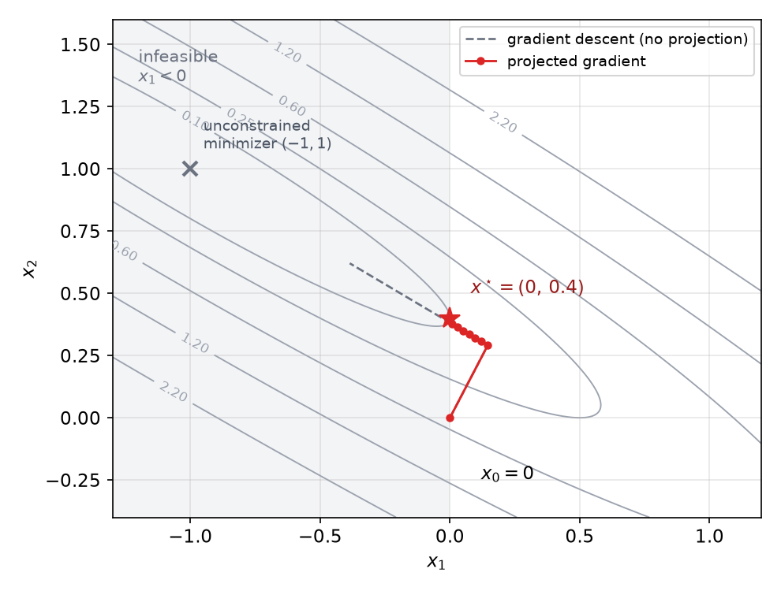
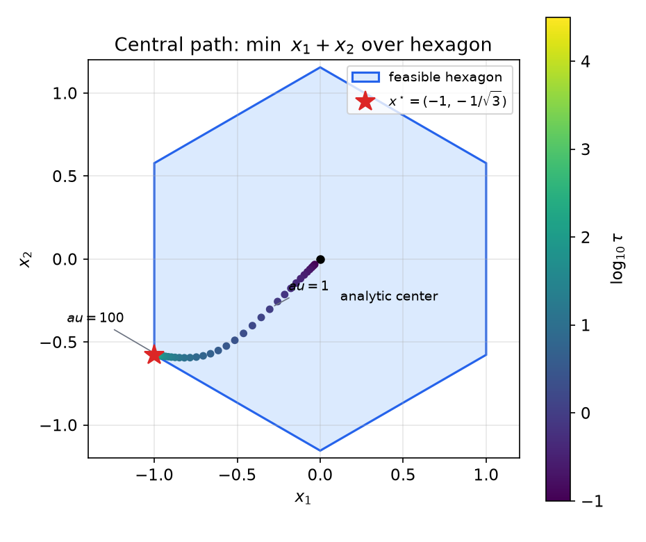
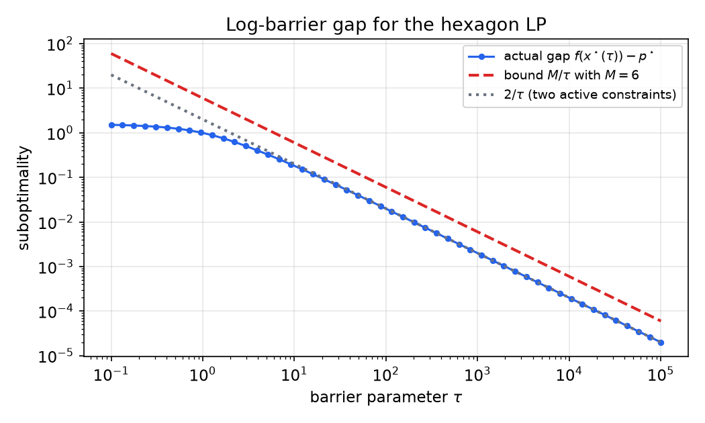
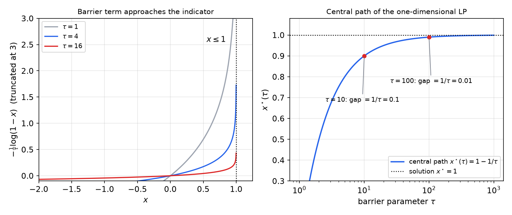

# Algorithms for Constrained Problems

The KKT conditions of [Constrained Optimality and the KKT Conditions](constrained-optimality.md) describe what a solution looks like, but they do not produce one. Most algorithms for constrained convex problems share a single device: replace the constrained problem by an unconstrained one, or by a sequence of unconstrained problems, whose solutions converge to the constrained solution. This chapter develops four routes that follow this pattern: eliminating equality constraints, projected gradient methods, log-barrier (interior-point) methods, and primal–dual interior-point methods. Their analysis uses the duality gap certificate of [Lagrange and Fenchel Duality](duality.md), which tells us how close we are to the optimum without knowing it. The splitting methods of [ADMM and Primal–Dual Splitting](admm.md) extend the same program to problems that are too large or too structured for a single unconstrained solve.

## Eliminating Equality Constraints

The simplest reduction handles linear equality constraints. Consider
\\[
\min\_{x\in\mathbb{R}^N} f(x)\quad\text{subject to}\quad Ax=b,
\\]
with \\(A\in\mathbb{R}^{M\times N}\\). Choose any \\(x\_0\\) with \\(Ax\_0=b\\), and let the columns of \\(Q\in\mathbb{R}^{N\times K}\\) form a basis of \\(\operatorname{Null}(A)\\), where \\(K=N-\operatorname{rank}(A)\\). Every feasible point has the form \\(x=x\_0+Qw\\) with \\(w\in\mathbb{R}^K\\), and every such point is feasible. The map \\(w\mapsto x\_0+Qw\\) is therefore a bijection between \\(\mathbb{R}^K\\) and the feasible set, and the problem is equivalent to the unconstrained problem
\\[
\min\_{w\in\mathbb{R}^K} f(x\_0+Qw).
\\]

**Proposition 10.1.** If \\(f\\) is convex, the reduced function \\(\tilde f(w)=f(x\_0+Qw)\\) is convex. A point \\(w^\star\\) minimizes \\(\tilde f\\) if and only if \\(x^\star=x\_0+Qw^\star\\) solves the original problem. Its gradient is \\(\nabla\tilde f(w)=Q^{T}\nabla f(x\_0+Qw)\\).

*Proof.* Convexity is preserved under composition with an affine map. The bijection between \\(w\\) and feasible \\(x\\) carries minimizers to minimizers. The gradient formula is the chain rule. ∎

The reduction is exact, and it converts the problem into one where gradient, Newton and quasi-Newton methods apply directly. Its cost is the computation of \\(x\_0\\) and \\(Q\\), which can be expensive for large or sparse \\(A\\). For those problems, one prefers to keep the equality constraints and solve the KKT linear system of Chapter 8, which is the Newton step in the reduced space written in the original variables.

**Example 10.1 (Elimination in a small example).** Minimize \\(x\_1^2+x\_2^2+x\_3^2\\) subject to \\(x\_1+x\_2=1\\). Take \\(x\_0=(1,0,0)\\) and the null space basis \\(Q=\begin{bmatrix}-1 & 0\\\\ 1 & 0\\\\ 0 & 1\end{bmatrix}\\). Then \\(x=(1-w\_1,\\,w\_1,\\,w\_2)\\), and the reduced objective is \\((1-w\_1)^2+w\_1^2+w\_2^2\\). Setting its gradient to zero gives \\(w\_1=\tfrac12\\), \\(w\_2=0\\), so \\(x^\star=(\tfrac12,\tfrac12,0)\\). This agrees with the multiplier computation of Chapter 8.

## Projected Gradient Methods

### The projection as a proximal step

Suppose we must minimize a differentiable convex \\(f\\) over a nonempty closed convex set \\(C\\). Write the problem as
\\[
\min\_{x\in\mathbb{R}^N} f(x)+\mathcal I\_C(x),
\\]
where \\(\mathcal I\_C(x)=0\\) on \\(C\\) and \\(+\infty\\) outside. The indicator is not differentiable, so gradient descent does not apply directly. But the problem has the smooth-plus-nonsmooth structure of [Subgradients and Proximal Algorithms](nonsmooth.md), and the proximal gradient step needs the proximal operator of the indicator. For \\(\alpha>0\\),
\\[
\operatorname{prox}\_{\alpha\mathcal I\_C}(z)=\arg\min\_{x}\Big(\mathcal I\_C(x)+\frac{1}{2\alpha}\lVert x-z\rVert\_2^2\Big)=\arg\min\_{x\in C}\lVert x-z\rVert\_2^2=P\_C(z).
\\]
The proximal operator of the indicator is the Euclidean projection. The proximal gradient step therefore becomes the **projected gradient** method:
\\[
\boxed{x\_{k+1}=P\_C\big(x\_k-\alpha\_k\nabla f(x\_k)\big)}
\\]
Each iteration takes a gradient step on \\(f\\) and projects the result back onto \\(C\\). If \\(x\_0\in C\\), every iterate is feasible. The method is practical when \\(P\_C\\) is cheap. Boxes, balls, affine sets, and simplices all have simple projections; for a box, \\(P\_C\\) clips each coordinate. Chapter 8 showed that the fixed points of the method are exactly the optimal points, since \\(x^\star=P\_C(x^\star-\alpha\nabla f(x^\star))\\) is the characterization in Theorem 8.1.

### Projections onto simple sets

The method is attractive only when the projection is cheap. Three sets cover many applications:

- *Box* \\(C=\\{x : l\le x\le u\\}\\). The projection clips each coordinate: \\([P\_C(z)]\_n=\min\\{\max\\{z\_n,l\_n\\},u\_n\\}\\).
- *Euclidean ball* \\(C=\\{x : \lVert x\rVert\_2\le r\\}\\). The projection is \\(z\\) if \\(\lVert z\rVert\_2\le r\\), and \\(rz/\lVert z\rVert\_2\\) otherwise.
- *Probability simplex* \\(C=\\{x : x\ge 0,\ \mathbf 1^{T}x=1\\}\\). The projection is \\(P\_C(z)=(z-\theta)\_+\\), where the threshold \\(\theta\\) is the unique solution of \\(\sum\_n(z\_n-\theta)\_+=1\\). This is a water-filling equation of the same type as in Example 8.7, and it is solved by sorting the entries of \\(z\\) and scanning for the level where the sum reaches one.

For a general set, the projection is itself an optimization problem, and then projected gradient is only useful if that inner problem is much cheaper than the original one. Those cases are the ones that lead to the splitting methods of the next chapter.

### Convergence

**Theorem 10.1 (Projected gradient).** Let \\(f\\) be convex with \\(L\\)-Lipschitz gradient, let \\(C\\) be nonempty, closed and convex, and let \\(x^\star\\) minimize \\(f\\) over \\(C\\). Let \\(x\_0\in C\\) and \\(x\_{k+1}=P\_C\big(x\_k-\tfrac1L\nabla f(x\_k)\big)\\). Then \\(f(x\_k)\\) is nonincreasing and
\\[
f(x\_k)-f(x^\star)\le\frac{L}{2k}\lVert x\_0-x^\star\rVert\_2^2 .
\\]

*Proof.* Fix \\(x\in C\\), and let \\(x^+=P\_C(x-\tfrac1L\nabla f(x))\\) and \\(G=L(x-x^+)\\). The proof has five steps.

*Step 1 (projection inequality).* The point \\(x^+\\) is the projection of \\(z=x-\tfrac1L\nabla f(x)\\), and \\(z-x^+=(G-\nabla f(x))/L\\). The projection characterization gives \\(\langle z-x^+,y-x^+\rangle\le 0\\) for all \\(y\in C\\), that is,
\\[
\langle\nabla f(x),x^+-y\rangle\le\langle G,x^+-y\rangle\qquad\text{for all } y\in C.
\\]

*Step 2 (sufficient decrease).* The quadratic upper bound for \\(L\\)-smooth functions, with \\(x^+-x=-G/L\\), gives
\\[
f(x^+)\le f(x)-\tfrac1L\langle\nabla f(x),G\rangle+\tfrac1{2L}\lVert G\rVert\_2^2 .
\\]

*Step 3 (key inequality).* Let \\(y\in C\\). Convexity gives \\(f(x)\le f(y)+\langle\nabla f(x),x-y\rangle\\). Insert this into Step 2 and use \\(x-G/L=x^+\\):
\\[
f(x^+)\le f(y)+\langle\nabla f(x),x^+-y\rangle+\tfrac1{2L}\lVert G\rVert\_2^2 .
\\]
By Step 1 and \\(x^+=x-G/L\\), \\(\langle\nabla f(x),x^+-y\rangle\le\langle G,x-y\rangle-\tfrac1L\lVert G\rVert\_2^2\\). Hence
\\[
f(x^+)\le f(y)+\langle G,x-y\rangle-\tfrac1{2L}\lVert G\rVert\_2^2 \qquad\text{for all } y\in C. \tag{10.1}
\\]

*Step 4 (telescoping).* Let \\(x=x\_k\\), so \\(x^+=x\_{k+1}\\) and \\(G\_k=L(x\_k-x\_{k+1})\\). Take \\(y=x^\star\\) in (10.1), and write \\(a=x\_k-x^\star\\), \\(b=x\_k-x\_{k+1}\\), so that \\(a-b=x\_{k+1}-x^\star\\). The identity \\(2\langle a,b\rangle-\lVert b\rVert^2=\lVert a\rVert^2-\lVert a-b\rVert^2\\) gives
\\[
f(x\_{k+1})-f(x^\star)\le \tfrac L2\big(\lVert x\_k-x^\star\rVert\_2^2-\lVert x\_{k+1}-x^\star\rVert\_2^2\big).
\\]

*Step 5 (conclusion).* Taking \\(y=x\_k\\) in (10.1) shows \\(f(x\_{k+1})\le f(x\_k)\\), so the sequence is nonincreasing. Summing Step 4 over the first \\(k\\) iterations telescopes to \\(\sum\_{i=1}^k\big(f(x\_i)-f(x^\star)\big)\le\tfrac L2\lVert x\_0-x^\star\rVert\_2^2\\). Since the sequence is nonincreasing, the last term is the smallest, so \\(k\big(f(x\_k)-f(x^\star)\big)\le\sum\_{i=1}^k\big(f(x\_i)-f(x^\star)\big)\\). Divide by \\(k\\). ∎

The proof is the one of Chapter 5 with the projection inserted: the only new ingredient is Step 1. Under strong convexity the iterates converge linearly, as in the unconstrained case; the proximal gradient analysis of [Subgradients and Proximal Algorithms](nonsmooth.md) gives this result. The \\(O(1/k)\\) bound and the linear rate are the same as for unconstrained gradient descent, so the constraint costs nothing in rate, only the price of the projection.

The accelerated methods of Chapter 5 carry over as well. The proximal form of Nesterov's method, with the projection in place of the proximal operator, keeps the \\(O(1/k^2)\\) rate for smooth convex \\(f\\) over \\(C\\): the momentum step is taken from \\(x\_k\\) and \\(x\_{k-1}\\), and the gradient step is projected back onto \\(C\\). The analysis of the proximal form applies verbatim with the indicator of \\(C\\), whose proximal operator is the projection.

### Example: nonnegative least squares

**Example 10.2 (Projected gradient for NNLS).** Minimize \\(f(x)=\tfrac12\lVert y-Ax\rVert\_2^2\\) subject to \\(x\ge 0\\), with \\(A=\begin{bmatrix}1 & 1\\\\ 1 & 2\end{bmatrix}\\) and \\(y=(0,1)\\), the problem of Example 8.3. Here \\(\nabla f(x)=A^{T}Ax-A^{T}y\\), and \\(A^{T}A=\begin{bmatrix}2 & 3\\\\ 3 & 5\end{bmatrix}\\) has eigenvalues \\(\tfrac{7\pm\sqrt{45}}{2}\\). So \\(L=\tfrac{7+\sqrt{45}}2\approx 6.854\\), and the step is \\(\alpha=1/L\approx 0.1459\\). The projection onto the nonnegative orthant is \\((\cdot)\_+\\), so the iteration is
\\[
x\_{k+1}=\big(x\_k-\alpha\\,(A^{T}Ax\_k-A^{T}y)\big)\_+ .
\\]
Starting from \\(x\_0=0\\), the first iterates are
\\[
x\_1\approx(0.1459,\\;0.2918),\qquad x\_2\approx(0.1215,\\;0.3069),\qquad x\_3\approx(0.0976,\\;0.3216),
\\]
and \\(x\_{30}\\) agrees with the optimum \\(x^\star=(0,\tfrac25)\\) to six decimals. The unprojected gradient iteration, shown in gray in the figure, instead heads for the unconstrained minimizer \\((-1,1)\\) and is at \\((-0.386,\\,0.621)\\) after 30 steps. The projection is what keeps the iterates in the feasible region.

*Figure: contours of \\(f\\) for the NNLS problem of Example 10.2. The shaded half-plane \\(x\_1<0\\) is infeasible. Projected gradient (red) moves to the optimum \\((0,0.4)\\) on the boundary, while plain gradient descent (dashed gray) crosses into the infeasible region on its way to \\((-1,1)\\).*

## Barrier Methods

### The log barrier and the central path

Consider the inequality-constrained problem
\\[
\min\_x f(x)\quad\text{subject to}\quad g\_m(x)\le 0,\qquad m=1,\dots,M,
\\]
with \\(f\\) and the \\(g\_m\\) convex and differentiable, and with a minimizer \\(x^\star\\) and optimal value \\(p^\star\\). Assume there is a strictly feasible point, so that the domain \\(\\{x : g\_m(x)<0 \text{ for all } m\\}\\) is nonempty. Projected gradient handles constraints that have cheap projections. Barrier methods handle general inequalities by penalizing approach to the boundary with a function that is \\(+\infty\\) there.

The **log barrier** for \\(g\_m\le 0\\) is \\(-\log(-g\_m(x))\\), which is finite inside the feasible set and tends to infinity at its boundary. For a parameter \\(\tau>0\\), define
\\[
\phi\_\tau(x)=\tau f(x)-\sum\_{m=1}^{M}\log\big(-g\_m(x)\big).
\\]
The function \\(\phi\_\tau\\) is convex on its domain, and we assume that it has a minimizer \\(x^\star(\tau)\\) for every \\(\tau>0\\). The curve \\(\tau\mapsto x^\star(\tau)\\) is the **central path**. Its gradient is
\\[
\nabla\phi\_\tau(x)=\tau\nabla f(x)-\sum\_{m=1}^{M}\frac{\nabla g\_m(x)}{g\_m(x)} .
\\]
At \\(x^\star(\tau)\\) this vanishes. Define
\\[
\lambda\_m^\star(\tau)=-\frac{1}{\tau\\,g\_m(x^\star(\tau))}>0 .
\\]
Dividing the stationarity equation by \\(\tau\\) gives
\\[
\nabla f(x^\star(\tau))+\sum\_{m}\lambda\_m^\star(\tau)\nabla g\_m(x^\star(\tau))=0 .
\\]
So \\(x^\star(\tau)\\) is primal feasible, \\(\lambda^\star(\tau)\\) is dual feasible, and stationarity holds exactly. Only complementary slackness fails: instead of \\(\lambda\_m g\_m=0\\), we have
\\[
\lambda\_m^\star(\tau)\\,g\_m(x^\star(\tau))=-\frac1\tau .
\\]
As \\(\tau\to\infty\\), the central path satisfies the KKT conditions of Chapter 8 in the limit.

### The duality gap of the central path

**Theorem 10.2 (Gap certificate).** For every \\(\tau>0\\),
\\[
f(x^\star(\tau))-p^\star\le f(x^\star(\tau))-d(\lambda^\star(\tau))=\frac{M}{\tau}.
\\]

*Proof.* The Lagrangian \\(L(x,\lambda)=f(x)+\sum\_m\lambda\_m g\_m(x)\\) is convex in \\(x\\) for \\(\lambda\ge 0\\), and its gradient at \\(x^\star(\tau)\\) vanishes by the stationarity condition just derived. So \\(x^\star(\tau)\\) minimizes \\(L(\cdot,\lambda^\star(\tau))\\), and the dual function is
\\[
d(\lambda^\star(\tau))=L(x^\star(\tau),\lambda^\star(\tau))=f(x^\star(\tau))+\sum\_m\lambda^\star\_m(\tau)g\_m(x^\star(\tau))=f(x^\star(\tau))-\frac{M}{\tau}.
\\]
Weak duality gives \\(d(\lambda^\star(\tau))\le p^\star\\), which yields \\(-p^\star\le -d(\lambda^\star(\tau))\\) and hence the claim. ∎

Theorem 10.2 is a remarkable certificate. It bounds the suboptimality of the computed point \\(x^\star(\tau)\\) by \\(M/\tau\\), and the bound uses only the computed quantities \\(f(x^\star(\tau))\\) and \\(\lambda^\star(\tau)\\), not the unknown \\(p^\star\\). To achieve accuracy \\(\varepsilon\\), it suffices to take \\(\tau\ge M/\varepsilon\\).

### The barrier method

The barrier method solves the sequence of problems \\(\min\phi\_\tau\\) for increasing \\(\tau\\), warm-starting each from the previous solution:

1. Choose a strictly feasible \\(x\\), an initial \\(\tau>0\\), a factor \\(\mu>1\\), and a tolerance \\(\varepsilon>0\\).
2. *Centering.* Minimize \\(\phi\_\tau\\) starting from \\(x\\), for example by Newton's method, to obtain an approximation of \\(x^\star(\tau)\\).
3. If \\(M/\tau\le\varepsilon\\), stop. Otherwise set \\(\tau\leftarrow\mu\tau\\) and return to step 2.

The inner problems are smooth, so Newton's method applies. The gradient is given above, and the Hessian is
\\[
\nabla^2\phi\_\tau(x)=\tau\nabla^2 f(x)+\sum\_{m=1}^{M}\Big(\frac{\nabla g\_m(x)\nabla g\_m(x)^{T}}{g\_m(x)^2}-\frac{\nabla^2 g\_m(x)}{g\_m(x)}\Big).
\\]
This follows by differentiating \\(-\log(-g)\\) twice: the first derivative is \\(-\nabla g/g\\), and the second is \\(\nabla g\nabla g^{T}/g^2-\nabla^2 g/g\\). When the \\(g\_m\\) are convex, the second term is positive semidefinite, since \\(g\_m<0\\) inside the domain. Hence \\(\phi\_\tau\\) is convex.

Newton's method converges quadratically once it is close to \\(x^\star(\tau)\\), and a damped version with a backtracking line search that keeps the iterate strictly feasible converges from any strictly feasible start. The natural stopping rule uses the Newton decrement \\(\mathrm{dec}(x)^2=\nabla\phi\_\tau(x)^{T}\nabla^2\phi\_\tau(x)^{-1}\nabla\phi\_\tau(x)\\), which estimates how far \\(x\\) is from the minimizer of \\(\phi\_\tau\\) in the local norm. Centering stops when \\(\mathrm{dec}(x)^2/2\\) falls below a small tolerance, and only then is \\(\tau\\) increased. Because the centering is inexact in practice, the certificate of Theorem 10.2 holds for the exact central point; with inexact centering one uses the computed gap \\(f(x)-d(\lambda)\\) at the current iterate instead, which is the quantity the primal–dual method monitors.

The complexity of the method is governed by the number of constraints. With \\(\mu=1+1/\sqrt M\\), and the self-concordance theory of Boyd and Vandenberghe (2004, §11.5), the total number of Newton steps to reach accuracy \\(\varepsilon\\) is \\(O(\sqrt M\log(1/\varepsilon))\\). In this sense a constrained problem costs roughly \\(\sqrt M\\) unconstrained problems. In practice the method needs a few dozen Newton steps for good accuracy. A strictly feasible starting point is required, and it is obtained by a phase-one problem, which we do not discuss here.

### Example: a linear program over a hexagon

**Example 10.3 (Hexagonal LP).** Minimize \\(x\_1+x\_2\\) subject to \\(\langle x,a\_m\rangle\le 1\\) for \\(m=1,\dots,6\\), where \\(a\_m=(\cos\tfrac{m\pi}3,\sin\tfrac{m\pi}3)\\). The feasible set is a regular hexagon with apothem \\(1\\). The objective decreases in the direction \\(225^\circ\\), and the optimum is the vertex at \\(210^\circ\\), namely \\(x^\star=(-1,-\tfrac1{\sqrt3})\\), with \\(p^\star=-1-\tfrac1{\sqrt3}\approx -1.5774\\). The active constraints are \\(m=3\\) and \\(m=4\\). Solving \\(c=-\lambda\_3a\_3-\lambda\_4a\_4\\) with \\(c=(1,1)\\) gives \\(\lambda\_4=\tfrac{2}{\sqrt3}\\) and \\(\lambda\_3=1-\tfrac1{\sqrt3}\\), both positive.

The barrier function is
\\[
\phi\_\tau(x)=\tau(x\_1+x\_2)-\sum\_{m=1}^{6}\log\big(1-\langle x,a\_m\rangle\big),
\\]
with gradient \\(\tau c+\sum\_m a\_m/(1-\langle x,a\_m\rangle)\\) and Hessian \\(\sum\_m a\_ma\_m^{T}/(1-\langle x,a\_m\rangle)^2\\). Theorem 10.2 gives \\(f(x^\star(\tau))-p^\star\le 6/\tau\\). The bound is not tight, and the actual gap has a sharper asymptotic. Let \\(\mathcal A\\) be the set of active constraints and \\(s\_m(\tau)=1-\langle x^\star(\tau),a\_m\rangle\\) the slacks. The slack satisfies \\(s\_m(\tau)=1/(\tau\lambda\_m(\tau))\\), and \\(\lambda\_m(\tau)\to\lambda^\star\_m\\) for \\(m\in\mathcal A\\). Since \\(f\\) is linear, the gap equals \\(c^{T}(x^\star(\tau)-x^\star)\\). Using \\(c=-\sum\_{m\in\mathcal A}\lambda^\star\_m a\_m\\) and \\(\langle a\_m,x^\star(\tau)-x^\star\rangle=-s\_m(\tau)\\) for active \\(m\\),
\\[
f(x^\star(\tau))-p^\star=\sum\_{m\in\mathcal A}\lambda^\star\_m s\_m(\tau),\qquad\text{so}\qquad \tau\big(f(x^\star(\tau))-p^\star\big)\longrightarrow\lvert\mathcal A\rvert .
\\]
Here \\(\lvert\mathcal A\rvert=2\\), so the gap behaves like \\(2/\tau\\) for large \\(\tau\\).

*Figure: the central path \\(x^\star(\tau)\\) for the hexagonal LP, colored by \\(\log\_{10}\tau\\). It starts at the analytic center of the hexagon for small \\(\tau\\) and approaches the vertex \\(x^\star\\) as \\(\tau\\) grows.*

*Figure: the actual gap \\(f(x^\star(\tau))-p^\star\\) (blue) against the certified bound \\(M/\tau\\) with \\(M=6\\) (red dashed). The gap decays like \\(2/\tau\\) (gray dotted), the number of active constraints divided by \\(\tau\\), so the certificate is conservative by a factor of three.*

A numerical experiment with gradient descent and backtracking line search (parameters \\(10^{-3}\\) and \\(0.8\\)), starting from the origin, gives the following counts. Cold starts at \\(\tau=1,10,100,500,1000\\) required 25, 30, 112, 373 and 777 iterations. Warm starts, using the previous solution as the initial point, required 25, 27, 70, 50 and 34 iterations, a total of 206 instead of 777 for the final value of \\(\tau\\) alone. Iteration counts depend on implementation details, but the qualitative lesson is robust: the central path is the right way to climb to large \\(\tau\\), because a cold start there is badly conditioned.

### A one-dimensional example

**Example 10.4 (Barrier approximation of a constraint).** Minimize \\(-x\\) subject to \\(x\le 1\\). The solution is \\(x^\star=1\\) with \\(p^\star=-1\\), and the barrier function is \\(\phi\_\tau(x)=-\tau x-\log(1-x)\\) on \\(x<1\\). Setting \\(\phi\_\tau'(x)=-\tau+1/(1-x)\\) to zero gives the central path
\\[
x^\star(\tau)=1-\frac1\tau,\qquad f(x^\star(\tau))-p^\star=\frac1\tau .
\\]
Here \\(M=1\\), and the gap bound of Theorem 10.2 holds with equality. The barrier term \\(-\tfrac1\tau\log(1-x)\\) is a smooth, one-sided approximation of the indicator of \\(x\le 1\\): for every fixed interior point it tends to zero as \\(\tau\\) grows, while it still blows up at the wall.

*Figure: left, the barrier term \\(-\tfrac1\tau\log(1-x)\\) for \\(\tau=1,4,16\\), which approaches the indicator of \\(x\le 1\\) as \\(\tau\\) grows. Right, the central path \\(x^\star(\tau)=1-1/\tau\\) for the problem of Example 10.4, with the gap \\(1/\tau\\) marked at two values.*

## Primal–Dual Interior-Point Methods

The barrier method treats the primal variable alone and recomputes the central path from scratch at each \\(\tau\\). A closely related method treats the relaxed KKT conditions directly as nonlinear equations. Define the residual
\\[
r\_\tau(x,\lambda)=\begin{bmatrix}\nabla f(x)+\sum\_m\lambda\_m\nabla g\_m(x)\\\\ -\lambda\_1 g\_1(x)-\tfrac1\tau\\\\ \vdots\\\\ -\lambda\_M g\_M(x)-\tfrac1\tau\end{bmatrix}\in\mathbb{R}^{N+M}.
\\]
Its zero set is exactly the central path with its multipliers, \\((x^\star(\tau),\lambda^\star(\tau))\\). A Newton step solves \\(J\_\tau(x,\lambda)\\,(\delta x,\delta\lambda)=-r\_\tau(x,\lambda)\\), where
\\[
J\_\tau(x,\lambda)=\begin{bmatrix}\nabla^2 f(x)+\sum\_m\lambda\_m\nabla^2 g\_m(x) & \nabla g\_1(x) & \cdots & \nabla g\_M(x)\\\\ -\lambda\_1\nabla g\_1(x)^{T} & -g\_1(x) & \cdots & 0\\\\ \vdots & \vdots & \ddots & \vdots\\\\ -\lambda\_M\nabla g\_M(x)^{T} & 0 & \cdots & -g\_M(x)\end{bmatrix}.
\\]
The method takes such a step, with a line search that keeps \\(\lambda\\) positive and reduces \\(\lVert r\\rVert\\), and updates \\(\tau\\) using a surrogate duality gap \\(\eta(x,\lambda)=-\sum\_m\lambda\_m g\_m(x)\\). On the central path \\(\eta=M/\tau\\), so the surrogate gap agrees with the certificate of Theorem 10.2. Off the path it is only a heuristic: since \\(d(\lambda)\le L(x,\lambda)=f(x)-\eta\\), the gap \\(f(x)-d(\lambda)\\) is at least \\(\eta\\), and it can be larger.

Two features distinguish the primal–dual method. The iterates \\(x\_k\\) need not be feasible, and they become feasible only in the limit. And the multipliers are updated along with the primal variables, so the algorithm never needs to recompute a central point from scratch. In practice, primal–dual methods are usually faster than the barrier method, which is why they form the core of modern interior-point solvers. The convergence analysis is in Boyd and Vandenberghe (2004, §11.7).

## Quadratic Penalties and Certificates

Quadratic penalties offer a simpler route to unconstrained problems, and they also provide certificates. For \\(\min f(x)\\) subject to \\(Ax=b\\), with \\(f\\) convex, let \\(\tilde x\\) minimize the penalized objective \\(f(x)+\alpha\lVert Ax-b\rVert\_2^2\\). Set \\(\tilde\nu=2\alpha(A\tilde x-b)\\). The penalty optimality condition is \\(\nabla f(\tilde x)+2\alpha A^{T}(A\tilde x-b)=0\\), that is, \\(\nabla f(\tilde x)+A^{T}\tilde\nu=0\\). So \\(\tilde x\\) minimizes the Lagrangian \\(L(\cdot,\tilde\nu)\\), and weak duality gives
\\[
p^\star\ge d(\tilde\nu)=f(\tilde x)+2\alpha\lVert A\tilde x-b\rVert\_2^2 .
\\]
The right side is a computable lower bound on the optimal value, valid for any \\(\alpha>0\\). The penalty solution itself is not feasible, and the bound is accurate only when the violation \\(A\tilde x-b\\) is small. The augmented Lagrangian of [ADMM and Primal–Dual Splitting](admm.md) removes this accuracy trade-off by adding a multiplier update.

## Summary

- Equality constraints can be eliminated: \\(x=x\_0+Qw\\) with \\(Q\\) a basis of \\(\operatorname{Null}(A)\\) gives an equivalent unconstrained problem.
- Projected gradient \\(x\_{k+1}=P\_C(x\_k-\alpha\nabla f(x\_k))\\) is the proximal gradient method for \\(f+\mathcal I\_C\\), since \\(\operatorname{prox}\_{\alpha\mathcal I\_C}=P\_C\\).
- For \\(L\\)-smooth convex \\(f\\) and step \\(1/L\\), projected gradient satisfies \\(f(x\_k)-f^\star\le L\lVert x\_0-x^\star\rVert\_2^2/(2k)\\), the same rate as the unconstrained method.
- The log barrier \\(\phi\_\tau=\tau f-\sum\_m\log(-g\_m)\\) has minimizers \\(x^\star(\tau)\\) that define the central path, and with \\(\lambda\_m(\tau)=-1/(\tau g\_m(x^\star(\tau)))\\) they satisfy the KKT conditions with complementary slackness relaxed to \\(-1/\tau\\).
- The certificate \\(f(x^\star(\tau))-p^\star\le M/\tau\\) gives an \\(\varepsilon\\)-optimal point once \\(\tau\ge M/\varepsilon\\); the barrier method needs \\(O(\sqrt M\log(1/\varepsilon))\\) Newton steps.
- Primal–dual interior-point methods apply Newton's method to the relaxed KKT residual \\(r\_\tau\\); their iterates need not be feasible.
- Quadratic penalties yield lower bounds \\(p^\star\ge f(\tilde x)+2\alpha\lVert A\tilde x-b\rVert\_2^2\\) from the penalized minimizer.

## See Also

- [Constrained Optimality and the KKT Conditions](constrained-optimality.md): the optimality conditions and normal-cone geometry used throughout.
- [Lagrange and Fenchel Duality](duality.md): the dual function and the weak duality bound behind the certificates.
- [ADMM and Primal–Dual Splitting](admm.md): augmented Lagrangians and splitting methods for structured problems.
- [Subgradients and Proximal Algorithms](nonsmooth.md): proximal gradient methods, of which projected gradient is the special case for indicator functions.
- [Newton and Quasi-Newton Methods](newton.md): the Newton steps used in barrier and primal–dual methods.
- [Gradient Descent and Accelerated Methods](first-order-methods.md): the unconstrained rates that projected gradient inherits.
- [Model Predictive Control](../ae8803-optimal-learning-control/mpc.md): constrained quadratic programs solved by these methods in control.
