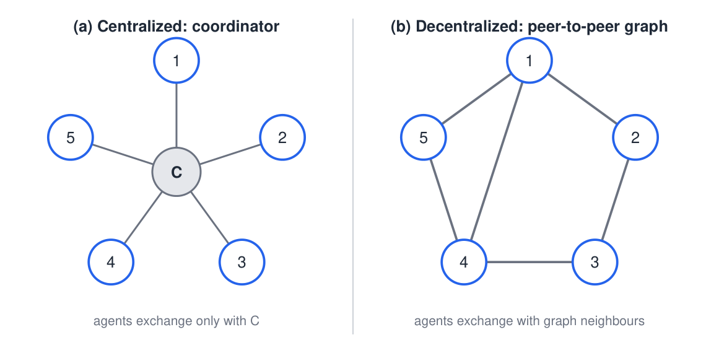
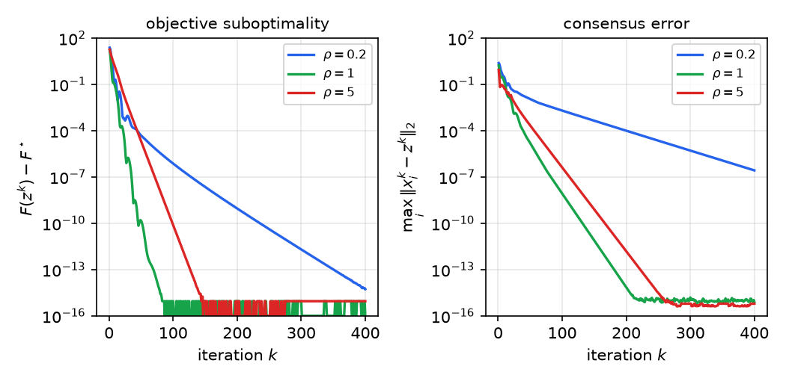
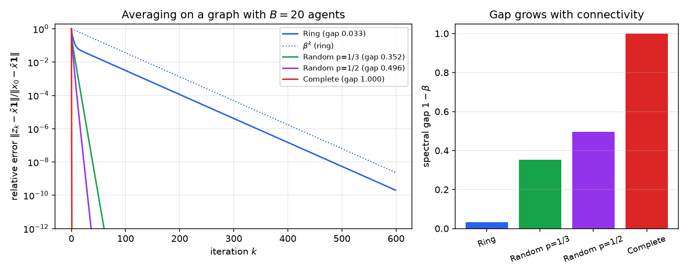
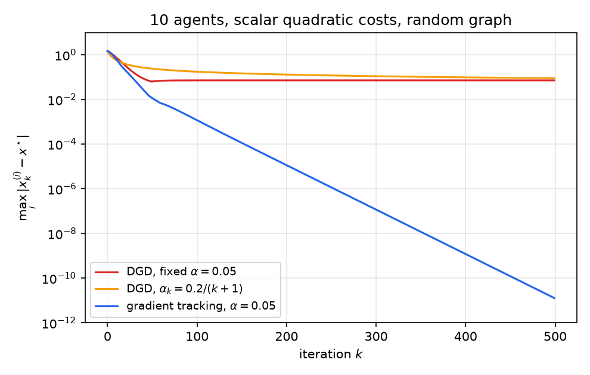
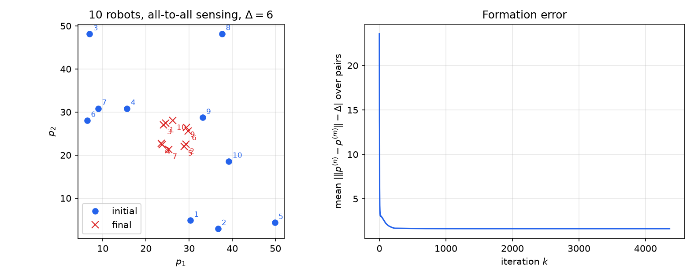

# Distributed and Decentralized Optimization

Many optimization problems are too large for one machine, or their data are spread over agents that cannot pool them: sensors in a network, robots in a swarm, or separate institutions holding private records. This chapter studies two architectures. In the first, a **coordinator** gathers local solutions and returns a global variable, and the consensus form of the alternating direction method of multipliers (ADMM) implements this. In the second, there is **no coordinator**, and agents exchange messages only with their neighbors on a graph. The central tool in both cases is consensus, that is, averaging over a network, whose speed is governed by the spectral gap of the graph.

## Two Communication Models

Consider the problem
\\[
\min\_{x\in\mathbb{R}^N}\ \sum\_{i=1}^B f\_i(x)+g(x), \tag{1}
\\]
in which agent \\(i\\) knows only its own function \\(f\_i\\). Most problems in this subsection have this form, with \\(f\_i\\) a loss on the data held by agent \\(i\\) and \\(g\\) a regularizer. Two kinds of separability are common. **Splitting across examples** partitions the rows of the data matrix, \\(f(x)=\sum\_i\ell\_i(A^{(i)}x-b^{(i)})\\), so each agent holds some data points. **Splitting across features** partitions the columns, \\(g(x)=\sum\_i g\_i(x^{(i)})\\), with \\(x^{(i)}\\) a block of the variable. Ridge regression and LASSO are separable in both ways, and so is the support vector machine with hinge loss.

The communication pattern is the other half of the model. In a **centralized** architecture, each agent talks only to a coordinator \\(C\\). In a **decentralized** architecture, the agents form a graph \\(\mathcal G=(\mathcal V,\mathcal E)\\) and communicate along its edges. The neighborhood of agent \\(i\\) is \\(\mathcal N(i)=\\{j:(i,j)\in\mathcal E\\}\cup\\{i\\}\\), which includes \\(i\\) itself. We assume the graph is undirected and connected, so that information can reach every agent.

*Figure: left, a coordinator \\(C\\) with five agents, each communicating only with \\(C\\). Right, five agents on a graph with edges \\(1\\)–\\(2\\), \\(2\\)–\\(3\\), \\(3\\)–\\(4\\), \\(4\\)–\\(5\\), \\(5\\)–\\(1\\) and the chord \\(1\\)–\\(4\\). Each agent exchanges information only with its graph neighbors.*

## Distributed ADMM with a Coordinator

### Splitting across examples

Problem (1) is hard to distribute as written, because every \\(f\_i\\) depends on the same \\(x\\). The trick is to give each agent its own copy \\(x^{(i)}\\) of the variable and to force the copies to agree with a common variable \\(z\\):
\\[
\min\_{x^{(1)},\dots,x^{(B)},z}\ \sum\_{i=1}^B f\_i(x^{(i)})+g(z)\qquad\text{subject to}\qquad x^{(i)}-z=0,\ \ i=1,\dots,B . \tag{2}
\\]
Use the scaled multipliers \\(\mu^{(i)}\\). The augmented Lagrangian is separable in the copies, and each ADMM step has a simple form:
\\[
\begin{aligned}
x^{(i)}\_{k+1}&=\arg\min\_{x}\Big(f\_i(x)+\tfrac\rho2\big\lVert x-z\_k+\mu^{(i)}\_k\big\rVert\_2^2\Big), &&i=1,\dots,B,\\\\
z\_{k+1}&=\arg\min\_{z}\Big(g(z)+\tfrac\rho2\sum\_{i=1}^B\big\lVert z-x^{(i)}\_{k+1}-\mu^{(i)}\_k\big\rVert\_2^2\Big),\\\\
\mu^{(i)}\_{k+1}&=\mu^{(i)}\_k+x^{(i)}\_{k+1}-z\_{k+1}, &&i=1,\dots,B .
\end{aligned}
\\]
The first step runs in parallel, one subproblem per agent. The second step couples the agents, but it depends on them only through an average. Indeed, for any vectors \\(v\_i\\) with mean \\(\bar v\\),
\\[
\sum\_{i=1}^B\lVert z-v\_i\rVert\_2^2=B\lVert z-\bar v\rVert\_2^2+\Big(\sum\_{i}\lVert v\_i\rVert\_2^2-B\lVert\bar v\rVert\_2^2\Big),
\\]
and the bracket does not depend on \\(z\\). Writing \\(\bar x\_{k+1}\\) and \\(\bar\mu\_k\\) for the averages of \\(x^{(i)}\_{k+1}\\) and \\(\mu^{(i)}\_k\\), the \\(z\\)-step becomes \\(\arg\min\_z\big(g(z)+\tfrac{B\rho}{2}\lVert z-\bar x\_{k+1}-\bar\mu\_k\rVert\_2^2\big)\\). This gives the **distributed ADMM**:
\\[
\begin{aligned}
x^{(i)}\_{k+1}&=\arg\min\_{x}\Big(f\_i(x)+\tfrac\rho2\big\lVert x-z\_k+\mu^{(i)}\_k\big\rVert\_2^2\Big), &&i=1,\dots,B,\\\\
z\_{k+1}&=\arg\min\_{z}\Big(g(z)+\tfrac{B\rho}{2}\big\lVert z-\bar x\_{k+1}-\bar\mu\_k\big\rVert\_2^2\Big),\\\\
\mu^{(i)}\_{k+1}&=\mu^{(i)}\_k+x^{(i)}\_{k+1}-z\_{k+1}, &&i=1,\dots,B .
\end{aligned}
\\]
The architecture follows directly. Each agent solves its own subproblem and sends \\(x^{(i)}\_{k+1}+\mu^{(i)}\_k\\) to the coordinator. The coordinator averages these vectors, solves the small problem for \\(z\_{k+1}\\), and broadcasts \\(z\_{k+1}\\). Each agent then updates its own multiplier. Only vectors of dimension \\(N\\) are communicated, and the raw data never leave the agents.

**Example 12.1 (Distributed LASSO with five agents).** Five agents hold pairs \\((A\_i,y\_i)\\) and want to solve
\\[
\min\_x\ \frac\delta2\sum\_{i=1}^5\lVert y\_i-A\_ix\rVert\_2^2+\lVert x\rVert\_1 .
\\]
Here \\(f\_i(x)=\tfrac\delta2\lVert y\_i-A\_ix\rVert\_2^2\\) and \\(g(z)=\lVert z\rVert\_1\\). Each agent's step is a ridge-type linear solve, \\(x^{(i)}\_{k+1}=(\delta A\_i^{T}A\_i+\rho I)^{-1}\big(\delta A\_i^{T}y\_i+\rho(z\_k-\mu^{(i)}\_k)\big)\\). The coordinator's step is a soft-thresholding of an average. Since the \\(z\\)-subproblem is \\(\lVert z\rVert\_1+\tfrac{5\rho}{2}\lVert z-v\rVert\_2^2\\) with \\(v\\) the average of \\(x^{(i)}\_{k+1}+\mu^{(i)}\_k\\),
\\[
z\_{k+1}=S\_{1/(5\rho)}\Big(\tfrac15\sum\_{i=1}^5\big(x^{(i)}\_{k+1}+\mu^{(i)}\_k\big)\Big),\qquad S\_\kappa(v)=\operatorname{sign}(v)\max(\lvert v\rvert-\kappa,0),
\\]
applied componentwise. The multiplier update is unchanged.

We tested this scheme on a random instance with \\(N=40\\) unknowns, \\(15\\) measurements per agent, and a sparse truth with five nonzero entries. A proximal-gradient run on the centralized problem gives \\(F^\star\approx 7.35\\). The figure below shows the convergence of the objective and of the consensus error for three values of \\(\rho\\). With \\(\rho=1\\) the objective gap drops below \\(10^{-6}\\) after 27 iterations, against 63 for \\(\rho=5\\) and 97 for \\(\rho=0.2\\). The consensus error is slowest for the smallest value of \\(\rho\\) as well. The value of \\(\rho\\) controls how strongly agreement is enforced, and too small a value leaves the agents disagreeing for a long time.

*Figure: left, objective suboptimality \\(F(z^k)-F^\star\\) for consensus ADMM with \\(\rho=0.2\\), \\(1\\) and \\(5\\), where \\(F^\star\approx 7.35\\) is the centralized optimum. Right, the largest deviation \\(\max\_i\lVert x^{(i)}\_k-z^k\rVert\_2\\) of an agent from the consensus variable. Values below \\(10^{-16}\\) are drawn at the plotting floor.*

**Example 12.2 (Support vector machines across examples).** Let agent \\(i\\) hold a block \\(\mathcal I\_i\\) of the training pairs \\((x\_m,y\_m)\\), and let \\(x=(w,b)\in\mathbb{R}^{N+1}\\) stack the separator. Writing \\(a\_m=(-y\_mx\_m,\ y\_m)\\), the hinge loss of example \\(m\\) is \\((1+a\_m^{T}x)\_+=\big(1-y\_m(\langle x\_m,w\rangle-b)\big)\_+\\), so the hinge-loss SVM is \\(\min\_x\sum\_m(1+a\_m^{T}x)\_++\tfrac12\lVert w\rVert\_2^2\\). The regularizer does not involve the offset, so \\(g(z)=\tfrac12\sum\_{n\le N}z\_n^2\\) with the last coordinate unpenalized. Each agent's subproblem \\(\min\_x\sum\_{m\in\mathcal I\_i}(1+a\_m^{T}x)\_++\tfrac\rho2\lVert x-z\_k+\mu^{(i)}\_k\rVert\_2^2\\) is a small nonsmooth problem, which the proximal methods of [Subgradients and Proximal Algorithms](nonsmooth.md) can solve. The coordinator's step is coordinatewise. Minimizing \\(\tfrac12z^2+\tfrac{B\rho}{2}(z-v)^2\\) gives \\(z=\tfrac{B\rho}{1+B\rho}v\\) for a penalized coordinate and \\(z=v\\) for the offset, where \\(v\\) is the corresponding entry of \\(\bar x\_{k+1}+\bar\mu\_k\\).

### Splitting across features

Now let the regularizer be separable across blocks of coordinates, and let the data matrix be split into column blocks, \\(A=[A^{(1)}\ \cdots\ A^{(B)}]\\), so that \\(Ax=\sum\_iA^{(i)}x^{(i)}\\). Consider \\(\min\_x f(Ax)+\sum\_i g\_i(x^{(i)})\\), where \\(f\\) acts on \\(\mathbb{R}^K\\). Introduce a variable \\(z^{(i)}\in\mathbb{R}^K\\) for each agent's contribution:
\\[
\min\ f\Big(\sum\_i z^{(i)}\Big)+\sum\_i g\_i(x^{(i)})\qquad\text{subject to}\qquad A^{(i)}x^{(i)}-z^{(i)}=0 .
\\]
Each agent owns \\(x^{(i)}\\) and its constraint. Following the same pattern as before, ADMM gives a subproblem for each block, \\(x^{(i)}\_{k+1}=\arg\min\_x\big(g\_i(x)+\tfrac\rho2\lVert A^{(i)}x-z^{(i)}\_k+\mu^{(i)}\_k\rVert\_2^2\big)\\), which is a smaller version of the original problem. The \\(z\\)-update involves \\(BK\\) variables, but it can be reduced to \\(K\\) variables. Let \\(\bar z\\) and \\(\bar b\\) be the averages of \\(z^{(i)}\\) and of \\(A^{(i)}x^{(i)}\_{k+1}+\mu^{(i)}\_k\\). Optimality for the \\(z^{(i)}\\) shows that \\(z^{(i)}=\bar z-\bar b+A^{(i)}x^{(i)}\_{k+1}+\mu^{(i)}\_k\\) and that the \\(\bar z\\)-problem is \\(\min\_{\bar z}\big(f(B\bar z)+\tfrac{B\rho}{2}\lVert\bar z-\bar b\rVert\_2^2\big)\\). The multiplier update then makes all \\(\mu^{(i)}\\) equal, so the algorithm needs only one vector \\(\mu\\) and one \\(K\\)-dimensional coordinator problem:
\\[
\begin{aligned}
x^{(i)}\_{k+1}&=\arg\min\_x\Big(g\_i(x)+\tfrac\rho2\big\lVert A^{(i)}x-z^{(i)}\_k+\mu\_k\big\rVert\_2^2\Big),\\\\
\bar b\_{k+1}&=\tfrac1B\sum\_i\big(A^{(i)}x^{(i)}\_{k+1}+\mu\_k\big),\qquad \bar z\_{k+1}=\arg\min\_{\bar z}\Big(f(B\bar z)+\tfrac{B\rho}{2}\lVert\bar z-\bar b\_{k+1}\rVert\_2^2\Big),\\\\
z^{(i)}\_{k+1}&=\bar z\_{k+1}-\bar b\_{k+1}+A^{(i)}x^{(i)}\_{k+1}+\mu\_k,\qquad \mu\_{k+1}=\bar b\_{k+1}-\bar z\_{k+1}.
\end{aligned}
\\]
Each agent sends the \\(K\\)-vector \\(A^{(i)}x^{(i)}\_{k+1}+\mu\_k\\), and the coordinator returns \\(\bar z\_{k+1}\\) and \\(\bar b\_{k+1}\\).

**Example 12.3 (LASSO split across features).** Take \\(f(w)=\tfrac12\lVert w-y\rVert\_2^2\\) and \\(g\_i(x)=\lambda\lVert x\rVert\_1\\). The coordinator's problem is then a single linear system, because \\(\tfrac12\lVert B\bar z-y\rVert\_2^2+\tfrac{B\rho}{2}\lVert\bar z-\bar b\rVert\_2^2\\) has gradient \\(B(B\bar z-y)+B\rho(\bar z-\bar b)\\). Setting it to zero,
\\[
\bar z\_{k+1}=\frac{y+\rho\\,\bar b\_{k+1}}{B+\rho} .
\\]
Each agent solves a LASSO problem with its own columns and a shifted target at every iteration, so the feature blocks can be small even when the full problem is large.

## Decentralized Consensus

### Averaging on a graph

Suppose agent \\(i\\) holds a vector \\(x^{(i)}\in\mathbb{R}^N\\) and agents can talk only to neighbors. A basic task is for every agent to learn the average \\(\bar x=\tfrac1B\sum\_i x^{(i)}\\). The simplest method is local averaging. Start with \\(z^{(i)}\_0=x^{(i)}\\) and repeat
\\[
z^{(i)}\_{k+1}=\sum\_{j\in\mathcal N(i)}w\_{ij}\\,z^{(j)}\_k,\qquad w\_{ij}\ge 0,\qquad\sum\_{j\in\mathcal N(i)}w\_{ij}=1 . \tag{3}
\\]
Each agent needs only its neighbors' current values. The weights are symmetric, \\(w\_{ij}=w\_{ji}\\), in the analysis below. Stack the agents' values into \\(z\_k\\) and let \\(W\\) be the matrix with entries \\(W\_{ij}=w\_{ij}\\) for \\(j\in\mathcal N(i)\\) and \\(0\\) otherwise. Then \\(z\_{k+1}=Wz\_k\\), a linear dynamical system.

**Proposition (Consensus convergence).** Let \\(W\\) be symmetric, nonnegative, with rows summing to one. Let \\(\beta=\max\\{\lvert\lambda\rvert:\lambda\text{ an eigenvalue of }W\text{ other than the first}\\}\\), where the first eigenvalue is \\(1\\) with eigenvector \\(\mathbf 1\\). Then
\\[
\big\lVert z\_k-\bar x\mathbf 1\big\rVert\_2\le\beta^k\big\lVert x-\bar x\mathbf 1\big\rVert\_2\qquad\text{for all }k .
\\]

*Proof.* Because the rows of \\(W\\) sum to one, \\(W\mathbf 1=\mathbf 1\\). Because \\(W\\) is symmetric, \\(\mathbf 1^{T}W=\mathbf 1^{T}\\), so \\(\mathbf 1^{T}z\_{k+1}=\mathbf 1^{T}z\_k\\) and the sum of the agents' values is invariant: \\(\mathbf 1^{T}z\_k=\mathbf 1^{T}x=B\bar x\\). Let \\(e\_k=z\_k-\bar x\mathbf 1\\). Since \\(W\bar x\mathbf 1=\bar x\mathbf 1\\), we have \\(e\_{k+1}=We\_k\\), and \\(\mathbf 1^{T}e\_k=0\\) for all \\(k\\). The subspace \\(\mathbf 1^{\perp}\\) is invariant under \\(W\\), and \\(W\\) restricted to it is symmetric with eigenvalues bounded in modulus by \\(\beta\\). So \\(\lVert e\_{k+1}\rVert\_2\le\beta\lVert e\_k\rVert\_2\\), and induction gives the claim. ∎

Convergence is linear with factor \\(\beta\\). If the graph is connected and every agent keeps a positive self-weight, then \\(\beta<1\\), because the matrix is then primitive and the eigenvalue \\(1\\) is simple. The **spectral gap** \\(1-\beta\\) measures how quickly the averaging mixes the network. For a ring of \\(B\\) agents, where each agent keeps weight \\(1/3\\) and gives \\(1/3\\) to each of its two neighbors, the eigenvalues are \\(\tfrac13+\tfrac23\cos(2\pi k/B)\\). For \\(B=20\\) this gives \\(\beta\approx 0.967\\) and a gap of \\(0.033\\). At the other extreme, the complete graph with \\(w\_{ij}=1/B\\) has \\(W=\tfrac1B\mathbf 1\mathbf 1^{T}\\), so \\(\beta=0\\) and the average is reached in one step.

*Figure: left, the relative error \\(\lVert z\_k-\bar x\mathbf 1\rVert\_2/\lVert x-\bar x\mathbf 1\rVert\_2\\) of consensus iteration (3) on \\(B=20\\) agents, on a log scale, for a ring, two random graphs and the complete graph. The dotted line is \\(\beta^k\\) for the ring. Right, the spectral gap \\(1-\beta\\) of each graph. The gap grows with connectivity, and the error decays faster as it grows.*

The figure's random graphs use Metropolis weights, and their realized gaps are \\(0.352\\) and \\(0.496\\). For vectors with \\(N>1\\) the same analysis applies to \\(W\otimes I\_N\\), which replaces each weight by a multiple of the identity. Each coordinate is averaged identically, so the rate is still set by \\(\beta\\).

### Decentralized gradient methods

Now consider the decentralized optimization problem
\\[
\min\_{x\in\mathbb{R}^N}\ \sum\_{i=1}^B f\_i(x) \tag{4}
\\]
on a connected graph, where each agent has its own copy \\(x^{(i)}\\) of the variable. The **decentralized subgradient method** averages with the neighbors and then takes a local step:
\\[
x^{(i)}\_{k+1}=\sum\_{j\in\mathcal N(i)}w\_{ij}\\,x^{(j)}\_k-\alpha\_k\\,g^{(i)}\_k,\qquad g^{(i)}\_k\in\partial f\_i(x^{(i)}\_k). \tag{5}
\\]
For convex \\(f\_i\\) and diminishing step sizes, the error in the objective decays at rate \\(O(\log k/\sqrt k)\\), essentially the rate of the centralized subgradient method (Nedić and Ozdaglar, 2009).

For smooth strongly convex \\(f\_i\\), a fixed step is tempting, because centralized gradient descent converges linearly with a fixed step. Here it does not work. At the solution \\(x^\star\\) we have \\(\sum\_i\nabla f\_i(x^\star)=0\\), but in general \\(\nabla f\_i(x^\star)\ne 0\\) for each \\(i\\). With a fixed step, \\(x^\star\\) is not a fixed point of the iteration, and the agents settle in a neighborhood of \\(x^\star\\) whose size is proportional to the step. Diminishing steps remove the bias, but they slow the convergence to a sublinear rate. The figure below shows both effects.

**Gradient tracking** avoids the trade-off. Each agent keeps a second vector \\(s^{(i)}\\) that tracks the average gradient, initialized by \\(s^{(i)}\_0=\nabla f\_i(x^{(i)}\_0)\\):
\\[
\begin{aligned}
x^{(i)}\_{k+1}&=\sum\_{j\in\mathcal N(i)}w\_{ij}\\,x^{(j)}\_k-\alpha\\,s^{(i)}\_k,\\\\
s^{(i)}\_{k+1}&=\sum\_{j\in\mathcal N(i)}w\_{ij}\\,s^{(j)}\_k+\nabla f\_i(x^{(i)}\_{k+1})-\nabla f\_i(x^{(i)}\_k).
\end{aligned}
\\]
The sum over agents of \\(s^{(i)}\_k\\) equals the sum of the current gradients, \\(\sum\_i s^{(i)}\_k=\sum\_i\nabla f\_i(x^{(i)}\_k)\\), because \\(\mathbf 1^{T}W=\mathbf 1^{T}\\) and the correction terms telescope. So \\(s^{(i)}\_k\\) follows the average gradient, and with a fixed step the iterates converge linearly to \\(x^\star\\) for smooth strongly convex \\(f\_i\\) (Qu and Li, 2018). The cost is two vectors communicated per iteration instead of one.

*Figure: ten agents with scalar quadratic costs on a random graph. The curves show the largest error \\(\max\_i\lvert x^{(i)}\_k-x^\star\rvert\\). DGD with a fixed step \\(0.05\\) stalls at a nonzero error. DGD with the diminishing step \\(0.2/(k+1)\\) decreases very slowly. Gradient tracking with the fixed step \\(0.05\\) converges linearly.*

### Consensus as optimization

Consensus can also be posed as minimization. Assign to each edge \\((i,j)\\) the penalty \\(\lVert x^{(i)}-x^{(j)}\rVert\_2^2\\). The total penalty \\(\sum\_{(i,j)\in\mathcal E}\lVert x^{(i)}-x^{(j)}\rVert\_2^2\\) vanishes exactly when all agents agree, on a connected graph. For scalar values, with the **graph Laplacian** \\(L=D-A\\), where \\(D\\) is the diagonal matrix of degrees and \\(A\\) is the adjacency matrix, the penalty is a quadratic form:
\\[
\sum\_{(i,j)\in\mathcal E}(x\_i-x\_j)^2=x^{T}Lx .
\\]
This holds because each node \\(i\\) contributes \\(d\_ix\_i^2\\) and each edge contributes \\(-2x\_ix\_j\\). For the five-agent network of the figure, the degrees are \\((3,2,2,3,2)\\) and
\\[
L=\begin{bmatrix}3&-1&0&-1&-1\\\\ -1&2&-1&0&0\\\\ 0&-1&2&-1&0\\\\ -1&0&-1&3&-1\\\\ -1&0&0&-1&2\end{bmatrix}.
\\]
Gradient descent on \\(x^{T}Lx\\) is \\(x\_{k+1}=x\_k-\alpha Lx\_k\\) up to a constant. Its \\(i\\)th component uses only the values of the neighbors of \\(i\\), since \\((Lx)\_i=\sum\_{j\in\mathcal N(i)}L\_{ij}x\_j\\). The matrix \\(W=I-\alpha L\\) has rows summing to one, so this is the averaging iteration (3) with weights \\(w\_{ij}=-\alpha L\_{ij}\\) for \\(j\neq i\\) and \\(1-\alpha d\_i\\) on the diagonal, for sufficiently small \\(\alpha\\). Because \\(L\mathbf 1=0\\) and \\(L\\) is symmetric, the sum \\(\mathbf 1^{T}x\\) is invariant, and the iteration converges to \\(\bar x\mathbf 1\\). For vectors use \\(L\otimes I\_N\\).

**Example 12.4 (Rendezvous of a robot swarm).** Let \\(p^{(i)}\in\mathbb{R}^2\\) be the position of robot \\(i\\), and let robot \\(i\\) measure \\(p^{(i)}-p^{(j)}\\) for each neighbor \\(j\\), with symmetric neighborhoods. The objective \\(f=\sum\_i\sum\_{j\in\mathcal N(i)}\lVert p^{(i)}-p^{(j)}\rVert\_2^2\\) has gradient whose \\(i\\)th block is proportional to \\(\sum\_{j\in\mathcal N(i)}(p^{(i)}-p^{(j)})\\). Gradient descent therefore reduces to the local **consensus law**
\\[
p^{(i)}\_{k+1}=p^{(i)}\_k-\alpha\sum\_{j\in\mathcal N(i)}\big(p^{(i)}\_k-p^{(j)}\_k\big).
\\]
Each robot uses only its neighbors' positions, and no global coordination is needed. The center of mass is invariant, because the summed displacements cancel, so the robots meet at \\(\tfrac1B\sum\_ip^{(i)}\_0\\). Every global minimum places all robots at one point when the graph is connected.

The same idea gives a primal–dual method for nonsmooth functions. Consensus is equivalent to \\(\tilde Lx=0\\), where \\(\tilde L=L\otimes I\_N\\) and \\(x\\) stacks the agents' vectors, so problem (4) becomes
\\[
\min\_{x}\ \sum\_{i=1}^B f\_i(x^{(i)})\qquad\text{subject to}\qquad\tilde Lx=0 . \tag{6}
\\]

### A primal–dual method for decentralized optimization

Apply the Chambolle–Pock primal–dual algorithm to (6), with \\(K=\tilde L\\), \\(g(x)=\sum\_if\_i(x^{(i)})\\) and \\(f(w)=I\_{\\{0\\}}(w)\\), the indicator of the zero vector (Chambolle and Pock, 2011; 2016). The conjugate of this indicator is zero, \\(f^\*(\nu)=\sup\_w\langle\nu,w\rangle-I\_{\\{0\\}}(w)=0\\), so \\(\operatorname{prox}\_{\sigma f^\*}(z)=z\\), and the dual variable update becomes \\(\nu\_{k+1}=\nu\_k+\sigma\tilde Lx\_k\\). The primal update is a proximal step on each agent's own function, applied to \\(x\_k-\alpha\tilde L\nu\_{k+1}\\). Written agent by agent, the **decentralized primal–dual iteration** is
\\[
\begin{aligned}
\nu^{(i)}\_{k+1}&=\nu^{(i)}\_k+\sigma\sum\_{j\in\mathcal N(i)}L\_{ij}\\,x^{(j)}\_k,\\\\
x'^{(i)}\_{k+1}&=\operatorname{prox}\_{\alpha f\_i}\Big(x^{(i)}\_k-\alpha\sum\_{j\in\mathcal N(i)}L\_{ij}\\,\nu^{(j)}\_{k+1}\Big),\\\\
x^{(i)}\_{k+1}&=x'^{(i)}\_{k+1}+\theta\big(x'^{(i)}\_{k+1}-x'^{(i)}\_k\big).
\end{aligned}
\\]
Each agent needs only the variables of its neighbors, and the proximal step is local, so the method handles nonsmooth \\(f\_i\\) such as \\(\ell\_1\\) terms. Each iteration involves two rounds of communication, one for \\(x\\) and one for \\(\nu\\). The convergence rate, by the general theory of the Chambolle–Pock method, depends on the spectral gap of \\(L\\).

**Example 12.5 (Decentralized LASSO over a graph).** The LASSO objective of Example 12.1 can be solved on the five-agent graph without a coordinator. Each agent keeps a pair \\((x^{(i)},z^{(i)})\\): \\(x^{(i)}\\) fits the agent's own data, and \\(z^{(i)}\\) is an auxiliary copy that carries an equal share of the \\(\ell\_1\\) term. Stack the pairs into \\(\theta\\). The constraint \\(\tilde L\theta=0\\), with \\(\tilde L=\begin{bmatrix}L+I&-I\\\\ -I&I\end{bmatrix}\otimes I\_N\\), holds exactly when the \\(x^{(i)}\\) agree and each \\(z^{(i)}\\) equals \\(x^{(i)}\\). The primal–dual updates above then reduce, for each agent, to a ridge-type solve for \\(x^{(i)}\\) and a soft-thresholding step for \\(z^{(i)}\\), using only neighbor values. Both methods converge to the same minimizer as the coordinator-based method of Example 12.1.

## Formation Control by Gradient Flows

Gradient methods on local costs also model a swarm that must keep a prescribed formation. Let robots \\(p^{(n)}\in\mathbb{R}^2\\) sense their neighbors, and let each pair of neighbors aim for distance \\(\Delta\\). The cost
\\[
F(p)=\sum\_n\sum\_{m\in\mathcal N\_n}\big(\lVert p^{(n)}-p^{(m)}\rVert\_2^2-\Delta^2\big)^2
\\]
is nonconvex, but its gradient is local. With symmetric neighborhoods, \\(\nabla\_{p^{(n)}}F=8\sum\_{m\in\mathcal N\_n}(p^{(n)}-p^{(m)})\big(\lVert p^{(n)}-p^{(m)}\rVert\_2^2-\Delta^2\big)\\). Absorbing the constant 8 into the step size gives the controller
\\[
p^{(n)}\_{k+1}=p^{(n)}\_k-\alpha\_k\sum\_{m\in\mathcal N\_n}\big(p^{(n)}\_k-p^{(m)}\_k\big)\big(\lVert p^{(n)}\_k-p^{(m)}\_k\rVert\_2^2-\Delta^2\big).
\\]
Robot \\(n\\) moves toward a neighbor that is farther than \\(\Delta\\) away and away from a neighbor that is closer. Each update uses only relative positions that the robot measures itself.

With all-to-all sensing, the formation cannot be perfect once there are four or more robots. At most three points in the plane can be pairwise at distance exactly \\(\Delta\\), so the cost has a positive minimum, and the controller settles at a configuration with pairwise distances close to \\(\Delta\\). A momentum version of the controller, with the Nesterov extrapolation of [First-Order Methods](first-order-methods.md), reaches the same accuracy in fewer iterations.

Newton's method would converge faster near the formation, but it needs the inverse Hessian of \\(F\\). The Hessian couples every pair of robots, so a single robot would need the global configuration to apply it. Gradient descent is the decentralized choice, because each robot uses only its neighbors.

*Figure: ten robots with all-to-all sensing and \\(\Delta=6\\). Left, initial (blue) and final (red) positions after gradient descent on \\(F\\), in the plane. Right, the mean pairwise formation error \\(\lvert\lVert p^{(n)}-p^{(m)}\rVert-\Delta\rvert\\), which levels off at a positive value, because four or more points cannot all be at distance \\(\Delta\\) from each other in the plane.*

## Summary

- Problem (1) splits as \\(\sum\_i f\_i+g\\). Splitting across examples gives copies of the variable and a coordinator-based consensus ADMM. Splitting across features gives a coordinator problem in the dimension of the data.
- Distributed ADMM: each agent solves a local subproblem in parallel, the coordinator solves one averaged problem, and the multipliers are updated locally. The LASSO \\(z\\)-step is a soft threshold of an average.
- Consensus averaging \\(z\_{k+1}=Wz\_k\\) with a row-stochastic symmetric \\(W\\) converges at rate \\(\beta^k\\), where \\(\beta\\) is the second largest eigenvalue in modulus. The spectral gap \\(1-\beta\\) governs the speed. It is \\(0.033\\) for a ring of twenty agents and \\(1\\) for the complete graph.
- Decentralized subgradient and gradient methods average with neighbors and then take a local step. A fixed step leaves a bias, diminishing steps are slow, and gradient tracking with a second variable gives linear convergence with a fixed step.
- The graph Laplacian \\(L\\) gives the consensus energy \\(x^{T}Lx\\). Its gradient flow is the consensus averaging iteration, which drives robots to a rendezvous point, and its primal–dual form handles nonsmooth costs with neighbor-only communication.
- Formation control is a nonconvex but local gradient flow. With all-to-all sensing and four or more robots it cannot reach zero cost, and a momentum variant converges faster.

## See Also

- [ADMM and Primal–Dual Splitting](admm.md): the ADMM and Chambolle–Pock methods used here, in general form.
- [Lagrange and Fenchel Duality](duality.md): the dual decomposition behind coordinator-based methods.
- [Algorithms for Constrained Problems](constrained-algorithms.md): projected and proximal methods for the local subproblems.
- [Stochastic Gradient Methods](stochastic.md): distributed stochastic gradients for large data sets.
- [Gradient Descent and Accelerated Methods](first-order-methods.md): momentum and gradient methods on which the local updates are built.
- [Convex Relaxations](relaxations.md) and [Minimax Problems and Matrix Games](minimax.md): other problems with distributed structure.
- Convex Optimization (overview): a shorter survey of convex methods.
- Machine Learning Overview: federated and distributed learning as applications.
