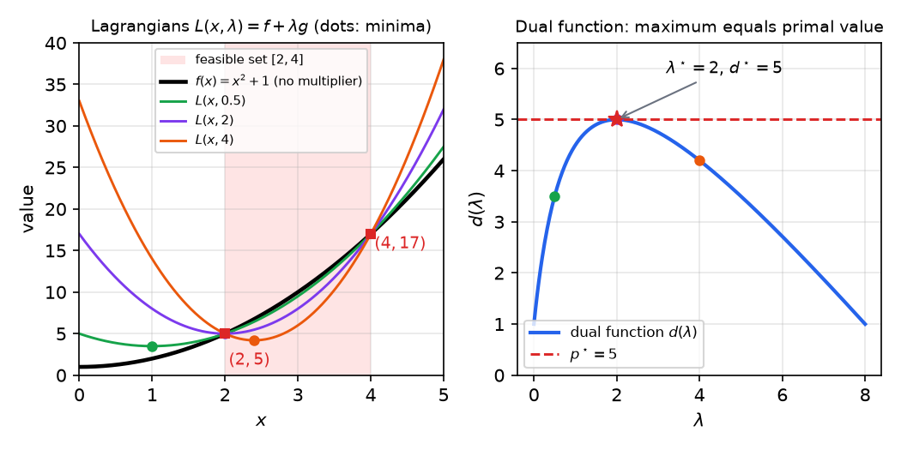
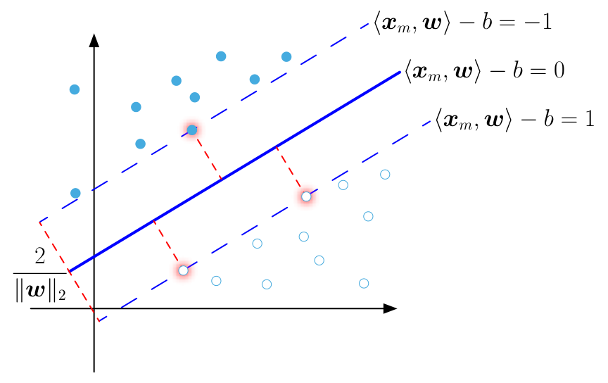
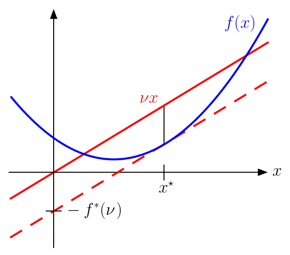
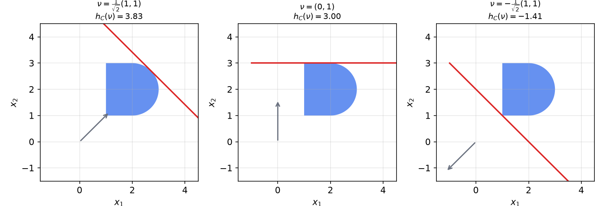
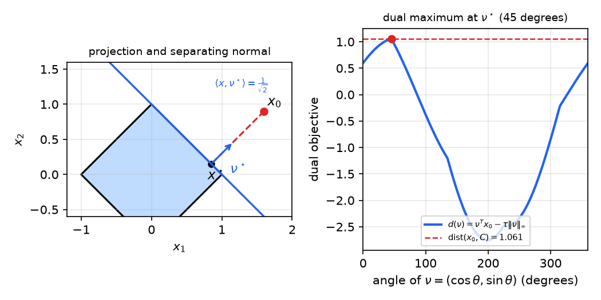

# Lagrange and Fenchel Duality

Duality replaces a hard minimization by the maximization of a concave lower bound. The bound is obtained either by pricing the constraints with multipliers (Lagrange duality) or by splitting the objective into two convex pieces and taking their conjugates (Fenchel duality). Every dual feasible point certifies how far a primal point can be from optimal, the dual problem often has fewer variables or a simpler structure, and several algorithms of this subsection, such as dual ascent and primal–dual splitting, are duality in action. This chapter develops both theories, proves weak and strong duality, connects strong duality with the Karush–Kuhn–Tucker conditions of [Constrained Optimality](constrained-optimality.md), and works through examples from support vector machines and basis pursuit to water filling and projections.

## The Lagrangian

### Constraints priced with multipliers

Consider the problem
\\[
\min\_{x\in\mathbb{R}^N} f(x)\quad\text{subject to}\quad g\_m(x)\le 0,\ \ m=1,\dots,M,\qquad Ax=b, \tag{1}
\\]
where \\(A\in\mathbb{R}^{K\times N}\\), and assume that the feasible set \\(\mathcal C=\\{x : g\_m(x)\le 0,\ Ax=b\\}\\) is nonempty. Let \\(p^\star\\) be the optimal value of (1), with \\(p^\star=-\infty\\) if the problem is unbounded below. The **Lagrangian** attaches a multiplier to each constraint:
\\[
L(x,\lambda,\nu)=f(x)+\sum\_{m=1}^M\lambda\_m g\_m(x)+\nu^{T}(Ax-b),\qquad \lambda\ge 0,\ \nu\in\mathbb{R}^K .
\\]
The inequality multipliers \\(\lambda\_m\\) must be nonnegative, and the equality multipliers \\(\nu\\) are unrestricted.

The idea is a penalty. For \\(\lambda\_m\ge 0\\), the term \\(\lambda\_m g\_m(x)\\) is positive when \\(x\\) violates the constraint and negative when \\(x\\) is strictly inside it. Minimizing \\(f(x)+\sum\_m\lambda\_m g\_m(x)\\) without constraints therefore discourages violations, but a large multiplier also rewards over-satisfying the constraint, which can distort the minimum. The question is whether some choice of multipliers makes the unconstrained minimization reproduce the constrained solution. Duality answers this by optimizing over the multipliers themselves.

## The Lagrange Dual

### The dual function is concave

The **Lagrange dual function** is the infimum of the Lagrangian over the primal variables,
\\[
d(\lambda,\nu)=\inf\_{x\in\mathbb{R}^N} L(x,\lambda,\nu) .
\\]
It may take the value \\(-\infty\\), and its domain is the set where it is finite.

**Theorem (Concavity of the dual function).** The function \\(d\\) is concave in \\((\lambda,\nu)\\), whether or not \\(f\\) and the \\(g\_m\\) are convex.

*Proof.* For fixed \\(x\\), the map \\((\lambda,\nu)\mapsto L(x,\lambda,\nu)\\) is affine. For \\((\lambda,\nu)\\), \\((\lambda',\nu')\\) and \\(\theta\in[0,1]\\),
\\[
L(x,\theta(\lambda,\nu)+(1-\theta)(\lambda',\nu'))=\theta L(x,\lambda,\nu)+(1-\theta)L(x,\lambda',\nu') .
\\]
Taking the infimum over \\(x\\) on both sides, and using that the infimum of a sum is at least the sum of the infima, gives \\(d(\theta(\lambda,\nu)+(1-\theta)(\lambda',\nu'))\ge\theta d(\lambda,\nu)+(1-\theta)d(\lambda',\nu')\\). ∎

This is a remarkable property. The dual problem is always a convex maximization, even when the primal problem is a hard nonconvex one, and it can then be solved by convex methods.

### Weak duality

**Theorem (Weak duality).** For every \\(\lambda\ge 0\\) and every \\(\nu\\), \\(d(\lambda,\nu)\le p^\star\\).

*Proof.* Let \\(x\\) be feasible for (1). Then \\(g\_m(x)\le 0\\) and \\(\lambda\_m\ge 0\\), so \\(\sum\_m\lambda\_m g\_m(x)\le 0\\), and \\(Ax-b=0\\). Hence \\(L(x,\lambda,\nu)\le f(x)\\). Therefore \\(d(\lambda,\nu)\le L(x,\lambda,\nu)\le f(x)\\) for every feasible \\(x\\), and taking the infimum over feasible \\(x\\) gives \\(d(\lambda,\nu)\le p^\star\\). ∎

### The dual problem and the duality gap

The best lower bound from the dual function is obtained by solving
\\[
\max\_{\lambda,\nu}\ d(\lambda,\nu)\quad\text{subject to}\quad\lambda\ge 0 . \tag{2}
\\]
Its optimal value is \\(d^\star=\sup\_{\lambda\ge 0,\nu}d(\lambda,\nu)\\), and weak duality says \\(d^\star\le p^\star\\). The difference \\(p^\star-d^\star\ge 0\\) is the **duality gap**. When the gap is zero we have **strong duality**. Problem (2) is a convex problem, since it maximizes a concave function over a convex set, so it can be solved efficiently whether or not (1) is convex.

### Certificates of suboptimality

Weak duality gives a practical certificate. For any feasible \\(x\\) and any \\(\lambda\ge 0\\), \\(\nu\\),
\\[
f(x)-p^\star\le f(x)-d(\lambda,\nu) .
\\]
The right side is computable without knowing \\(p^\star\\). If it is at most \\(\varepsilon\\), then \\(x\\) is \\(\varepsilon\\)-optimal. Primal–dual algorithms exploit this: they generate feasible primal and dual iterates and stop when the gap is small. The same inequality shows that, if strong duality holds and the gap closes, the pair \\((x,(\lambda,\nu))\\) is optimal for both problems.

## Strong Duality, KKT Conditions and Slater's Condition

### Strong duality implies the KKT conditions

Let \\(f\\) and the \\(g\_m\\) be differentiable. The **Karush–Kuhn–Tucker (KKT) conditions** for \\((x,\lambda,\nu)\\) are
\\[
\begin{aligned}
&\text{(K1)}\ \ g\_m(x)\le 0,\ \ Ax=b; \qquad \text{(K2)}\ \ \lambda\ge 0;\qquad \text{(K3)}\ \ \lambda\_m g\_m(x)=0\ \ \forall m;\\\\
&\text{(K4)}\ \ \nabla f(x)+\sum\_m\lambda\_m\nabla g\_m(x)+A^{T}\nu=0 .
\end{aligned}
\\]
Condition (K3) is complementary slackness: an inactive constraint has zero multiplier. [Constrained Optimality](constrained-optimality.md) studies these conditions in detail. Here we need their relation to duality.

**Theorem (Strong duality and KKT).** (a) If \\(p^\star=d^\star\\), \\(x^\star\\) is primal optimal and \\((\lambda^\star,\nu^\star)\\) is dual optimal, then \\((x^\star,\lambda^\star,\nu^\star)\\) satisfies (K1)–(K4). (b) Conversely, if \\(f\\) and the \\(g\_m\\) are convex and \\((x^\star,\lambda^\star,\nu^\star)\\) satisfies (K1)–(K4), then \\(x^\star\\) is primal optimal, \\((\lambda^\star,\nu^\star)\\) is dual optimal, and strong duality holds.

*Proof.* (a) Since \\(p^\star=d^\star\\), chaining the definitions gives
\\[
f(x^\star)=d(\lambda^\star,\nu^\star)\le L(x^\star,\lambda^\star,\nu^\star)=f(x^\star)+\sum\_m\lambda^\star\_m g\_m(x^\star)+\nu^{\star T}(Ax^\star-b)\le f(x^\star).
\\]
So every inequality is an equality. The last one, together with \\(\lambda^\star\ge 0\\), \\(g\_m(x^\star)\le 0\\) and \\(Ax^\star=b\\), forces each term \\(\lambda\_m^\star g\_m(x^\star)\\) to vanish, which is (K3). The first equality says that \\(x^\star\\) minimizes the differentiable function \\(L(\cdot,\lambda^\star,\nu^\star)\\), so its gradient vanishes there, which is (K4).

(b) If (K4) holds, then \\(\nabla\_x L(x^\star,\lambda^\star,\nu^\star)=0\\). Since \\(\lambda^\star\ge 0\\) and the \\(g\_m\\) are convex, \\(L(\cdot,\lambda^\star,\nu^\star)\\) is convex in \\(x\\), so \\(x^\star\\) minimizes it. By (K1)–(K3),
\\[
d(\lambda^\star,\nu^\star)=L(x^\star,\lambda^\star,\nu^\star)=f(x^\star).
\\]
Weak duality gives \\(d(\lambda^\star,\nu^\star)\le p^\star\le f(x^\star)\\), so all these quantities are equal. ∎

Part (a) says that strong duality produces KKT multipliers. Part (b) says that, for convex problems, a KKT point is automatically a primal–dual optimal pair.

### Slater's condition

When do multipliers exist, so that strong duality holds? The standard answer is Slater's condition.

**Definition (Slater's condition).** There exists a point \\(\bar x\\) with \\(A\bar x=b\\) and \\(g\_m(\bar x)<0\\) for every \\(m\\) whose \\(g\_m\\) is not affine.

**Theorem (Slater).** Suppose (1) is convex and \\(p^\star\\) is finite. If Slater's condition holds, then strong duality holds and the dual problem (2) attains its optimum.

Affine constraints need only be feasible, not strictly feasible, which is why linear programs satisfy Slater's condition whenever they are feasible. Some regularity is needed. Take \\(f(x)=x\_2\\) and the two unit disks \\(g\_1(x)=\lVert x-(1,0)\rVert\_2^2-1\le 0\\) and \\(g\_2(x)=\lVert x-(-1,0)\rVert\_2^2-1\le 0\\), which touch at the origin. The only feasible point is \\(0\\), so Slater's condition fails. The gradients \\(\nabla g\_1(0)=(-2,0)\\) and \\(\nabla g\_2(0)=(2,0)\\) cannot cancel \\(-\nabla f(0)=(0,-1)\\), so no multipliers satisfy (K4). Here \\(p^\star=0\\), and one checks that \\(d(\lambda)=-(\lambda\_2-\lambda\_1)^2/(\lambda\_1+\lambda\_2)-1/(4(\lambda\_1+\lambda\_2))\\), which approaches \\(0\\) only as \\(\lambda\_1=\lambda\_2\to\infty\\). So strong duality holds, but the dual optimum is not attained and KKT fails.

## Examples of Lagrange Duality

**Example 9.1 (Linear programs).** Consider \\(\min\_x c^{T}x\\) subject to \\(Ax\le b\\). The Lagrangian is
\\[
L(x,\lambda)=c^{T}x+\lambda^{T}(Ax-b)=(c+A^{T}\lambda)^{T}x-b^{T}\lambda .
\\]
It is linear in \\(x\\), so its infimum is \\(-b^{T}\lambda\\) if \\(c+A^{T}\lambda=0\\) and \\(-\infty\\) otherwise. The dual problem is therefore the linear program
\\[
\max\_{\lambda}\ -b^{T}\lambda\quad\text{subject to}\quad A^{T}\lambda=-c,\ \ \lambda\ge 0 .
\\]
The dual of a linear program is again a linear program, and by Slater's theorem strong duality holds whenever the primal is feasible and bounded.

**Example 9.2 (Minimum-norm solutions).** Consider \\(\min\_x\lVert x\rVert\_2^2\\) subject to \\(Ax=b\\), with \\(A\in\mathbb{R}^{K\times N}\\) of full row rank. The Lagrangian is \\(x^{T}x+\nu^{T}(Ax-b)\\). It is minimized at \\(x=-\tfrac12A^{T}\nu\\), so
\\[
d(\nu)=-\tfrac14\nu^{T}AA^{T}\nu-b^{T}\nu .
\\]
Setting the gradient to zero gives \\(\nu^\star=-2(AA^{T})^{-1}b\\). The corresponding primal point is \\(x^\star=-\tfrac12A^{T}\nu^\star=A^{T}(AA^{T})^{-1}b\\), the minimum-norm solution, and
\\[
d(\nu^\star)=b^{T}(AA^{T})^{-1}b=\lVert x^\star\rVert\_2^2 .
\\]
The duality gap is zero, and the dual optimum is explicit.

**Example 9.3 (A one-dimensional problem).** Minimize \\(x^2+1\\) subject to \\((x-2)(x-4)\le 0\\). The feasible set is \\([2,4]\\), so \\(x^\star=2\\) and \\(p^\star=5\\). With \\(g(x)=(x-2)(x-4)\\), the Lagrangian is
\\[
L(x,\lambda)=(1+\lambda)x^2-6\lambda x+8\lambda+1 .
\\]
Its minimizer is \\(x(\lambda)=3\lambda/(1+\lambda)\\), and substituting gives the dual function
\\[
d(\lambda)=\frac{-\lambda^2+9\lambda+1}{\lambda+1},\qquad\lambda\ge 0 .
\\]
Differentiating, \\(d'(\lambda)=-(\lambda-2)(\lambda+4)/(\lambda+1)^2\\), so the maximum is at \\(\lambda^\star=2\\), where \\(d(2)=15/3=5=p^\star\\). Strong duality holds, since \\(x=3\\) is strictly feasible. Note that \\(x(\lambda^\star)=2=x^\star\\), as the theorem predicts.

The figure shows the mechanism. Every Lagrangian passes through the points \\((2,5)\\) and \\((4,17)\\), where the constraint is active and \\(g=0\\), and each one has a minimum at \\(x(\lambda)\\). The dual function is the lower envelope of these minima, and its peak is the primal value.

*Figure: left, \\(f(x)=x^2+1\\) with the feasible set \\([2,4]\\) shaded, and the Lagrangians \\(L(x,\lambda)=f(x)+\lambda(x-2)(x-4)\\) for \\(\lambda=0.5\\), \\(2\\) and \\(4\\). All pass through \\((2,5)\\) and \\((4,17)\\), and the dots mark their minima. Right, the dual function \\(d(\lambda)\\) peaks at \\(\lambda^\star=2\\) with value \\(5\\), which equals \\(p^\star\\).*

**Example 9.4 (Water filling).** Power \\(P\\) is shared among \\(N\\) parallel Gaussian channels with noise variances \\(\sigma\_n^2\\). Choosing powers \\(p\_n\ge 0\\) with \\(\sum\_n p\_n\le P\\) maximizes the capacity \\(\sum\_n\tfrac12\log\_2(1+p\_n/\sigma\_n^2)\\). Capacity is increasing in each power, so the whole budget is used. Put \\(x\_n=p\_n/P\\) and \\(\alpha\_n=\sigma\_n^2/P\\). Since \\(\log(1+p\_n/\sigma\_n^2)=\log(\alpha\_n+x\_n)-\log\alpha\_n\\), the problem is
\\[
\min\_x\ -\sum\_n\log(\alpha\_n+x\_n)\quad\text{subject to}\quad x\ge 0,\ \ \mathbf 1^{T}x=1 .
\\]
The objective is strictly convex, so the solution is unique.

Attach \\(\lambda\ge 0\\) to \\(-x\le 0\\) and \\(\nu\\) to \\(\mathbf 1^{T}x-1=0\\). The KKT conditions are \\(x\ge 0\\), \\(\mathbf 1^{T}x=1\\), \\(\lambda\ge 0\\), \\(\lambda\_nx\_n=0\\), and
\\[
-\frac{1}{\alpha\_n+x\_n}-\lambda\_n+\nu=0 .
\\]
If \\(x\_n>0\\), then \\(\lambda\_n=0\\) and \\(\alpha\_n+x\_n=1/\nu\\). If \\(x\_n=0\\), then \\(\lambda\_n=\nu-1/\alpha\_n\ge 0\\), so \\(1/\nu\le\alpha\_n\\). In both cases
\\[
x\_n^\star=\Big(\frac1{\nu^\star}-\alpha\_n\Big)\_+ .
\\]
Write \\(w=1/\nu^\star\\). The multiplier is fixed by the budget, \\(\sum\_n(w-\alpha\_n)\_+=1\\). The left side is continuous, nondecreasing and piecewise linear in \\(w\\), so \\(w\\) can be found by bisection or by sorting the \\(\alpha\_n\\). In the original units, \\(\mu=Pw\\) is the **water level** and the optimal powers are \\(p\_n=(\mu-\sigma\_n^2)\_+\\), with \\(\sum\_n p\_n=P\\). Pour water up to level \\(\mu\\) over the floor of noise levels: channels whose floor is above the water receive nothing.

*Figure: noise floors \\(\sigma\_n^2\\) (gray bars) for five channels and total power \\(P=4\\). The water level \\(\mu=2.5\\) gives allocated powers \\(p\_n=(\mu-\sigma\_n^2)\_+\\) (blue), namely \\(2.0\\), \\(1.5\\), \\(0.5\\), \\(0\\) and \\(0\\), which sum to \\(P\\). The multiplier of the power constraint is inversely proportional to the water level.*

**Example 9.5 (Nonnegative least squares).** Consider \\(\min\_x\tfrac12\lVert y-Ax\rVert\_2^2\\) subject to \\(x\ge 0\\), where \\(A\in\mathbb{R}^{M\times N}\\) has full column rank. Let \\(H=A^{T}A\\) and attach \\(\lambda\ge 0\\) to the constraints. The Lagrangian is \\(L(x,\lambda)=\tfrac12\lVert y-Ax\rVert\_2^2-\lambda^{T}x\\). Its minimizer satisfies \\(A^{T}(Ax-y)=\lambda\\), that is, \\(x(\lambda)=H^{-1}(A^{T}y+\lambda)\\). Substituting, and writing \\(q=A^{T}y+\lambda\\), a short calculation gives
\\[
d(\lambda)=\tfrac12\lVert y\rVert\_2^2-\tfrac12 q^{T}H^{-1}q=\tfrac12\lVert y\rVert\_2^2-\tfrac12\big\lVert H^{-1/2}(A^{T}y+\lambda)\big\rVert\_2^2 .
\\]
The dual problem \\(\max\_{\lambda\ge 0}d(\lambda)\\) is therefore another nonnegative least-squares problem, now in \\(\lambda\\). Strong duality holds because the constraints are affine and \\(x=0\\) is feasible.

The KKT conditions reduce to a compact form. Stationarity gives \\(\lambda^\star=A^{T}(Ax^\star-y)=\nabla f(x^\star)\\), so the KKT conditions say \\(x^\star\ge 0\\), \\(w^\star:=\nabla f(x^\star)\ge 0\\), and \\(x\_n^\star w\_n^\star=0\\) for every \\(n\\). Each coordinate is either at the bound with a nonnegative gradient, or free with zero gradient.

Two algorithms illustrate the difference. Projected gradient steps \\(x\leftarrow(x-\alpha A^{T}(Ax-y))\_+\\) with \\(\alpha\le 1/\lVert A^{T}A\rVert\_2\\) need many iterations. In a small random instance with \\(M=30\\) and \\(N=10\\), about seventy iterations were needed to reach a KKT residual of \\(10^{-6}\\). A primal–dual active-set iteration does better. It estimates the active set from the multiplier \\(\lambda=(A^{T}Ax-A^{T}y)\_+\\), solves the unconstrained least-squares problem on the complementary indices, and clips the result to be nonnegative. On the same instance it reached an error of \\(3\times 10^{-16}\\) in four iterations. Naive versions of the iteration that ignore complementary slackness also stop early, but they violate the KKT conditions.

**Example 9.6 (Support vector machines).** Let \\(x\_1,\dots,x\_M\in\mathbb{R}^N\\) have labels \\(y\_m\in\\{-1,+1\\}\\), and suppose the classes are linearly separable. The maximum-margin hyperplane \\(\\{x:\langle x,w\rangle-b=0\\}\\) solves
\\[
\min\_{w,b}\ \tfrac12\lVert w\rVert\_2^2\quad\text{subject to}\quad 1-y\_m(\langle x\_m,w\rangle-b)\le 0,\ \ m=1,\dots,M .
\\]
The margin hyperplanes \\(\langle x,w\rangle-b=\pm 1\\) are at distance \\(1/\lVert w\rVert\_2\\) from the separator, so the margin width is \\(2/\lVert w\rVert\_2\\). Let \\(X=[y\_1x\_1\ \cdots\ y\_Mx\_M]\in\mathbb{R}^{N\times M}\\). The Lagrangian with \\(\lambda\ge 0\\) is
\\[
L(w,b,\lambda)=\tfrac12\lVert w\rVert\_2^2-w^{T}X\lambda+b\\,y^{T}\lambda+\mathbf 1^{T}\lambda .
\\]
Minimizing over \\(b\\) gives \\(-\infty\\) unless \\(y^{T}\lambda=0\\). Minimizing over \\(w\\) gives \\(w=X\lambda\\). Substituting, the dual function is \\(\mathbf 1^{T}\lambda-\tfrac12\lVert X\lambda\rVert\_2^2\\) when \\(y^{T}\lambda=0\\), and the dual problem is the quadratic program
\\[
\max\_{\lambda}\ \mathbf 1^{T}\lambda-\tfrac12\lVert X\lambda\rVert\_2^2\quad\text{subject to}\quad y^{T}\lambda=0,\ \ \lambda\ge 0 .
\\]
Strong duality holds because the constraints are affine and feasible for separable data. The primal solution is recovered by \\(w^\star=\sum\_m\lambda\_m^\star y\_mx\_m\\). Points with \\(\lambda\_m^\star>0\\) lie exactly on the margin and are the **support vectors**. The classifier is
\\[
\hat y(x)=\operatorname{sign}\Big(\sum\_m\lambda^\star\_m y\_m\langle x,x\_m\rangle-b^\star\Big).
\\]
The data enter the dual only through inner products, since \\(\lVert X\lambda\rVert\_2^2=\sum\_{\ell,m}\lambda\_\ell\lambda\_my\_\ell y\_m\langle x\_\ell,x\_m\rangle\\). Replacing \\(\langle x\_\ell,x\_m\rangle\\) by a positive semidefinite kernel \\(K(x\_\ell,x\_m)\\), such as \\((1+\langle x\_\ell,x\_m\rangle)^2\\) or \\(\exp(-\gamma\lVert x\_\ell-x\_m\rVert\_2^2)\\), gives a nonlinear classifier with the same convex dual. This is the kernel trick.

*Figure: a maximum-margin separator for separable data. The solid line is \\(\langle x,w\rangle-b=0\\) and the dashed lines are the margins \\(\langle x,w\rangle-b=\pm 1\\). The three highlighted points are support vectors on the margins, and the margin width is \\(2/\lVert w\rVert\_2\\).*

**Example 9.7 (Basis pursuit and sparsity).** Let \\(A\in\mathbb{R}^{K\times N}\\) have full row rank, with \\(K<N\\), and consider the sparse recovery problem \\(\min\_x\lVert x\rVert\_1\\) subject to \\(Ax=b\\). Its Lagrangian is \\(\lVert x\rVert\_1+\nu^{T}(Ax-b)\\). For each coordinate, \\(\inf\_t(\lvert t\rvert+ut)\\) is \\(0\\) if \\(\lvert u\rvert\le 1\\) and \\(-\infty\\) otherwise. Hence the dual function is \\(-b^{T}\nu\\) when \\(\lVert A^{T}\nu\rVert\_\infty\le 1\\), and \\(-\infty\\) otherwise. With \\(\mu=-\nu\\), the dual problem is
\\[
\max\_\mu\ b^{T}\mu\quad\text{subject to}\quad\lVert A^{T}\mu\rVert\_\infty\le 1 ,
\\]
a linear program. Strong duality holds because the primal is a feasible linear program.

Let \\(x^\star\\) and \\(\mu^\star\\) be optimal. Strong duality gives \\(\lVert x^\star\rVert\_1=b^{T}\mu^\star=\langle A^{T}\mu^\star,x^\star\rangle\\). Since \\(\lvert\langle A^{T}\mu^\star,x^\star\rangle\rvert\le\lVert A^{T}\mu^\star\rVert\_\infty\lVert x^\star\rVert\_1\le\lVert x^\star\rVert\_1\\), both inequalities are equalities. So \\((A^{T}\mu^\star)\_n=\operatorname{sign}(x\_n^\star)\\) whenever \\(x\_n^\star\ne 0\\), and \\(\lvert(A^{T}\mu^\star)\_n\rvert\le 1\\) elsewhere. This is a certificate that identifies the support of \\(x^\star\\).

There is always a solution with at most \\(K\\) nonzeros. Let \\(x^\star\\) be a solution with support \\(S\\) and suppose \\(\lvert S\rvert>K\\). The columns of \\(A\\) indexed by \\(S\\) are linearly dependent, so there is \\(h\ne 0\\) supported on \\(S\\) with \\(Ah=0\\). For small \\(\lvert t\rvert\\), the signs of the entries of \\(x^\star+th\\) on \\(S\\) do not change, so \\(\lVert x^\star+th\rVert\_1=\lVert x^\star\rVert\_1+t\langle\sigma,h\rangle\\), where \\(\sigma\_n=\operatorname{sign}(x^\star\_n)\\) on \\(S\\). Since \\(x^\star\\) is optimal in both directions, \\(\langle\sigma,h\rangle=0\\). Moving along \\(\pm h\\) keeps the \\(\ell\_1\\) norm constant and feasibility intact until some entry in \\(S\\) reaches zero. The new point is optimal with a smaller support. Repeating the step gives a solution with at most \\(K\\) nonzeros.

*Figure: left, recovery from \\(M=40\\) equations in \\(N=120\\) unknowns. The gray stems are the true \\(6\\)-sparse vector, the red crosses are the basis-pursuit solution computed by ADMM (exact recovery), and the blue dots are the minimum-\\(\ell\_2\\)-norm solution, which is dense. Right, the relative error of the ADMM iterates on a log scale.*

## Conjugate Functions

### Definition and geometry

The Lagrangian dual of a constrained problem is one instance of a more general construction. For a function \\(f\\) on \\(\mathbb{R}^N\\), its **convex conjugate** (Fenchel conjugate) is
\\[
f^\*(\nu)=\sup\_{x\in\operatorname{dom} f}\big(\langle x,\nu\rangle-f(x)\big).
\\]
Since \\(f^\*\\) is a pointwise supremum of affine functions of \\(\nu\\), it is convex, even when \\(f\\) is not. Geometrically, \\(f^\*(\nu)\\) is the largest amount by which the linear function \\(\langle x,\nu\rangle\\) exceeds \\(f(x)\\). Equivalently, \\(-f^\*(\nu)\\) is the intercept of the line with slope \\(\nu\\) that is tangent to \\(f\\) from below.

*Figure: the blue convex function \\(f\\), the red line \\(\nu x\\), and the vertical gap at \\(x^\star\\), which is the largest gap between \\(\nu x\\) and \\(f(x)\\). The gap equals \\(f^\*(\nu)\\). The dashed line is parallel to \\(\nu x\\) and tangent to \\(f\\) at \\(x^\star\\), with intercept \\(-f^\*(\nu)\\).*

**Example 9.8 (A quadratic).** For \\(f(x)=x^2-2x+2=(x-1)^2+1\\), the function \\(\nu x-f(x)=-x^2+(\nu+2)x-2\\) is maximized at \\(x=\nu/2+1\\), giving
\\[
f^\*(\nu)=\frac{\nu^2}{4}+\nu-1 .
\\]
The conjugate of a quadratic with curvature \\(a\\) is a quadratic with curvature \\(1/a\\), a fact used repeatedly in the examples below.

### Basic properties

The following properties are the working tools of Fenchel duality.

- **Fenchel–Young inequality.** \\(f(x)+f^\*(\nu)\ge\langle x,\nu\rangle\\) for all \\(x,\nu\\). This follows from the definition.
- **Subgradients.** For convex \\(f\\), \\(\nu\in\partial f(x)\\) if and only if \\(f(x)+f^\*(\nu)=\langle x,\nu\rangle\\). Indeed, \\(\nu\in\partial f(x)\\) means \\(f(y)\ge f(x)+\langle\nu,y-x\rangle\\) for all \\(y\\), which rearranges to \\(\langle y,\nu\rangle-f(y)\le\langle x,\nu\rangle-f(x)\\) for all \\(y\\). The supremum over \\(y\\) of the left side is \\(f^\*(\nu)\\), so \\(f^\*(\nu)=\langle x,\nu\rangle-f(x)\\).
- **Biconjugate.** Always \\(f^{\*\*}\le f\\), and for a convex function with closed epigraph \\(f^{\*\*}=f\\). This is the Fenchel–Moreau theorem, which says a closed convex function is the pointwise supremum of its affine minorants.
- **Separable sums.** If \\(f(x)=f\_1(x\_1)+f\_2(x\_2)\\), then \\(f^\*(\nu\_1,\nu\_2)=f\_1^\*(\nu\_1)+f\_2^\*(\nu\_2)\\), because the supremum over a product set splits into a sum of suprema.

### Indicators and support functions

For a convex set \\(\mathcal C\\), the indicator \\(I\_{\mathcal C}\\) is \\(0\\) on \\(\mathcal C\\) and \\(+\infty\\) elsewhere. Its conjugate is the **support function**
\\[
h\_{\mathcal C}(\nu)=I\_{\mathcal C}^\*(\nu)=\sup\_{x\in\mathcal C}\langle x,\nu\rangle ,
\\]
the largest value of the linear function \\(\langle\cdot,\nu\rangle\\) over \\(\mathcal C\\). Geometrically, \\(\\{x:\langle x,\nu\rangle=h\_{\mathcal C}(\nu)\\}\\) is the supporting hyperplane of \\(\mathcal C\\) with normal \\(\nu\\).

*Figure: the support function \\(h\_{\mathcal C}(\nu)=\sup\_{x\in\mathcal C}\langle x,\nu\rangle\\) of the D-shaped set \\(\mathcal C\\) for three directions (arrows). The red line is the supporting line in each case. For \\(\nu=(1,1)/\sqrt2\\) the value \\(4/\sqrt2+1\approx 3.83\\) is attained on the rounded part.*

**Norms.** Let \\(\lVert\cdot\rVert\_\*\\) be the dual norm, \\(\lVert\nu\rVert\_\*=\sup\_{\lVert x\rVert\le 1}\langle x,\nu\rangle\\). Then the conjugate of a norm is the indicator of the dual unit ball:
\\[
\lVert\cdot\rVert^\*(\nu)=\begin{cases}0,&\lVert\nu\rVert\_\*\le 1,\\\\ +\infty,&\lVert\nu\rVert\_\*>1.\end{cases}
\\]
*Proof.* If \\(\lVert\nu\rVert\_\*\le 1\\), then \\(\langle x,\nu\rangle\le\lVert x\rVert\\) for all \\(x\\), so \\(\langle x,\nu\rangle-\lVert x\rVert\le 0\\) with equality at \\(x=0\\). If \\(\lVert\nu\rVert\_\*>1\\), there is \\(x\_0\\) with \\(\lVert x\_0\rVert\le 1\\) and \\(c=\langle x\_0,\nu\rangle>1\\). Then \\(\langle tx\_0,\nu\rangle-\lVert tx\_0\rVert\ge t(c-1)\to\infty\\) as \\(t\to\infty\\). ∎

**Example 9.9 (Nuclear norm and spectral norm).** The nuclear norm \\(\lVert X\rVert\_{\mathrm{nn}}\\), the sum of singular values, is the dual of the spectral norm: \\(\lVert X\rVert\_{\mathrm{nn}}=\sup\_{\lVert Y\rVert\le 1}\langle X,Y\rangle\\). Let \\(X=U\Sigma V^{T}\\) be a compact SVD. For the lower bound, \\(Y'=UV^{T}\\) has \\(\lVert Y'\rVert=1\\) and \\(\langle X,Y'\rangle=\operatorname{tr}\Sigma\\). For the upper bound, \\(\langle X,Y\rangle=\sum\_i\sigma\_i u\_i^{T}Yv\_i\le\sum\_i\sigma\_i\lVert Y\rVert\le\sum\_i\sigma\_i\\). Thus the nuclear norm is the support function of the spectral-norm ball, and its conjugate is the indicator of that ball. This is the matrix analogue of the \\(\ell\_1\\)–\\(\ell\_\infty\\) pair in Example 9.7.

## Fenchel Duality

### Duality for a sum of two functions

Fenchel duality concerns problems of the form
\\[
\min\_x\ f(x)+g(x) . \tag{3}
\\]
Rewrite it with a copy of the variable, \\(\min\_{x,z} f(x)+g(z)\\) subject to \\(x=z\\). Attaching \\(\nu\\) to the constraint gives the Lagrangian \\(f(x)+g(z)+\langle z-x,\nu\rangle\\). Its infimum separates:
\\[
d(\nu)=\inf\_x\big(f(x)-\langle x,\nu\rangle\big)+\inf\_z\big(g(z)+\langle z,\nu\rangle\big)=-f^\*(\nu)-g^\*(-\nu).
\\]
The dual problem is therefore
\\[
\max\_\nu\ -f^\*(\nu)-g^\*(-\nu)\quad\Longleftrightarrow\quad\min\_\nu\ f^\*(\nu)+g^\*(-\nu). \tag{4}
\\]
Weak duality is immediate from the Fenchel–Young inequality: \\(f(x)+g(x)\ge-f^\*(\nu)-g^\*(-\nu)\\) for all \\(x,\nu\\), since \\(f(x)\ge\langle x,\nu\rangle-f^\*(\nu)\\) and \\(g(x)\ge-\langle x,\nu\rangle-g^\*(-\nu)\\).

The point of Fenchel duality is that the dual often has far fewer variables than the primal. Each conjugate can be evaluated separately, and in many examples the dual collapses to a one-dimensional problem.

### Strong Fenchel duality

**Theorem (Fenchel duality).** Let \\(D=\operatorname{dom} f\\), and let \\(C\\) be the set on which \\(g\\) is finite and continuous. If some \\(\bar x\\) lies in the relative interior of \\(D\cap C\\), then
\\[
\inf\_x\big(f(x)+g(x)\big)=\sup\_\nu\big(-f^\*(\nu)-g^\*(-\nu)\big).
\\]

The relative interior is the right notion here. Sets such as the unit simplex have empty interior in \\(\mathbb{R}^N\\) but a nonempty relative interior, and the separating-hyperplane argument behind the theorem works inside the affine hull ([Convex Sets](convex-sets.md)).

**Constrained problems.** Take \\(g=I\_{\mathcal C}\\) for a convex set \\(\mathcal C\\). Then \\(\inf\_{x\in\mathcal C}f(x)\\) is the Fenchel problem, and the condition of the theorem says that \\(\mathcal C\\) contains a point of the relative interior of \\(\operatorname{dom} f\\), which is the Slater condition in this setting. Write \\(h'\_{\mathcal C}(\nu)=\inf\_{x\in\mathcal C}\langle x,\nu\rangle=-h\_{\mathcal C}(-\nu)\\). The dual becomes
\\[
\inf\_{x\in\mathcal C}f(x)=\sup\_\nu\big(h'\_{\mathcal C}(\nu)-f^\*(\nu)\big). \tag{5}
\\]
The Lagrange dual of a constrained problem is a special case of (5).

**Example 9.10 (A cubic on an interval).** Minimize \\(x^3\\) over \\(\mathcal C=[3,5]\\). The answer is \\(27\\) at \\(\hat x=3\\), and (5) confirms it. Here \\(f(x)=x^3\\) on \\(\operatorname{dom} f=[0,\infty)\\). Since \\(\inf\_{x\in[3,5]}\nu x=3\nu\\) for \\(\nu\ge 0\\) and \\(5\nu\\) for \\(\nu<0\\), we have \\(h'\_{\mathcal C}(\nu)=3\nu\\) or \\(5\nu\\) accordingly. The conjugate is \\(f^\*(\nu)=\tfrac23\sqrt{\nu^3/3}\\) for \\(\nu\ge 0\\) (the maximizer is \\(x=\sqrt{\nu/3}\\)) and \\(f^\*(\nu)=0\\) for \\(\nu<0\\). The dual objective for \\(\nu\ge 0\\) is \\(3\nu-\tfrac23\sqrt{\nu^3/3}\\), whose derivative \\(3-\sqrt{\nu/3}\\) vanishes at \\(\nu^\star=27\\). The dual value is \\(81-\tfrac23\cdot 81=27\\). Note that \\(\nu^\star=27=f'(3)\\).

**Example 9.11 (Resource allocation).** Divide a budget \\(D\\) among \\(N\\) activities whose returns \\(f\_n\\) are concave, reflecting diminishing returns:
\\[
\max\_x\ \sum\_n f\_n(x\_n)\quad\text{subject to}\quad\sum\_n x\_n=D,\ \ x\ge 0 .
\\]
Let \\(F=-\sum\_n f\_n\\), which is convex, and apply (5) with \\(\mathcal C=\\{x:\mathbf 1^{T}x=D\\}\\). Since \\(\mathcal C\\) is affine, \\(h'\_{\mathcal C}(\nu)=-\infty\\) unless \\(\nu=\lambda\mathbf 1\\), in which case it equals \\(D\lambda\\). The dual is the one-dimensional problem
\\[
\max\_{\lambda}\ \Big[D\lambda-\sum\_n\sup\_{x\_n\ge 0}\big(\lambda x\_n+f\_n(x\_n)\big)\Big].
\\]
At the optimum, each \\(x\_n^\star\\) maximizes \\(\lambda x\_n+f\_n(x\_n)\\), so \\(f\_n'(x\_n^\star)=-\lambda^\star\\) whenever \\(x\_n^\star>0\\). The dual variable is minus the common marginal return. This is the same equal-marginal-return principle as in water filling.

**Example 9.12 (Minimum-norm interpolation).** Minimize \\(\lVert x\rVert\\) subject to \\(Ax=y\\), where \\(\lVert\cdot\rVert\\) is any norm. Take \\(f=\lVert\cdot\rVert\\), so \\(f^\*\\) is the indicator of the dual unit ball, and \\(\mathcal C=\\{x:Ax=y\\}\\). If \\(\langle u,\nu\rangle\ne 0\\) for some \\(u\\) in the null space of \\(A\\), then \\(h'\_{\mathcal C}(\nu)=-\infty\\), since \\(x+tu\in\mathcal C\\) for all \\(t\\). Otherwise \\(\nu=A^{T}w\\) for some \\(w\\), and \\(\inf\_{x\in\mathcal C}\langle x,A^{T}w\rangle=\langle y,w\rangle\\). So the dual problem is
\\[
\max\_w\ \langle y,w\rangle\quad\text{subject to}\quad\lVert A^{T}w\rVert\_\*\le 1 .
\\]
For the \\(\ell\_1\\) norm, this is the basis-pursuit dual of Example 9.7. For the \\(\ell\_2\\) norm, it is the norm analogue of the dual in Example 9.2.

**Example 9.13 (Horse-race betting).** A bettor places money \\(x\_i\ge 0\\) on horse \\(i\\), with \\(\sum\_i x\_i=M\\). The public has wagered \\(s\_i\\) on horse \\(i\\), with total \\(S\\). The bettor believes horse \\(i\\) wins with probability \\(p\_i\\), where \\(\sum\_i p\_i=1\\). If horse \\(i\\) wins, the pool \\(M+S\\), reduced by a fraction for the track, is shared in proportion to the bets, so the payout is \\(C(M+S)x\_i/(x\_i+s\_i)\\) for a constant \\(C<1\\). The expected return is \\(C(M+S)\sum\_i p\_ix\_i/(x\_i+s\_i)\\), and up to the constant we maximize \\(\sum\_i f\_i(x\_i)\\) with \\(f\_i(x)=p\_ix/(x+s\_i)\\). Each \\(f\_i\\) is concave, since \\(f\_i''(x)=-2p\_is\_i/(x+s\_i)^3<0\\).

This is the resource-allocation problem with \\(D=M\\). Its conjugate pieces are simple. For \\(\lambda>0\\), \\(\sup\_{x\ge 0}(\lambda x+f\_i(x))=+\infty\\). At \\(\lambda=0\\) the supremum is \\(p\_i\\). For \\(\lambda<0\\), the stationarity condition \\(\lambda+p\_is\_i/(x+s\_i)^2=0\\) gives \\(x=\sqrt{-p\_is\_i/\lambda}-s\_i\\), which is feasible when \\(\lambda\ge -p\_i/s\_i\\), and the supremum equals \\(\big(\sqrt{p\_i}-\sqrt{-s\_i\lambda}\big)\_+^2\\). Hence the dual is
\\[
\max\_{\lambda\le 0}\ M\lambda-\sum\_i\big(\sqrt{p\_i}-\sqrt{-s\_i\lambda}\big)\_+^2 ,
\\]
a one-dimensional concave problem. The optimal bets are
\\[
x\_i^\star=\Big(\sqrt{-p\_is\_i/\lambda^\star}-s\_i\Big)\_+ .
\\]
The bettor places money only on horses whose edge \\(p\_i/s\_i\\) over the public exceeds \\(-\lambda^\star\\), and the bets grow with that edge. For the eight-horse field of the 2022 Kentucky Derby, with the bettor's beliefs given by \\(p=(0.25,0.25,0.10,0.08,0.08,0.08,0.06,0.10)\\), the optimal bets are approximately $0, $45,006, $0, $0, $0, $0, $61,834 and $393,166 for a total stake of $500,000, with \\(\lambda^\star\approx-5.9\times 10^{-8}\\). Most of the money goes to the longest shot with the largest edge. As the total stake \\(M\\) grows, the optimal allocation spreads across more horses, because each dollar bet moves the odds against the bettor.

**Example 9.14 (Closest point to a convex set).** Let \\(\mathcal C\\) be closed and convex, and let \\(x\_0\notin\mathcal C\\). Minimize \\(\lVert x-x\_0\rVert\_2\\) over \\(\mathcal C\\). Take \\(f(x)=\lVert x-x\_0\rVert\_2\\) and \\(g=I\_{\mathcal C}\\). With \\(x'=x-x\_0\\), the conjugate is \\(f^\*(\nu)=\nu^{T}x\_0+\sup\_{x'}(\langle x',\nu\rangle-\lVert x'\rVert\_2)\\), which is \\(\nu^{T}x\_0\\) if \\(\lVert\nu\rVert\_2\le 1\\) and \\(+\infty\\) otherwise. Substituting into (5) and replacing \\(\nu\\) by \\(-\nu\\) gives
\\[
\text{dist}(x\_0,\mathcal C)=\max\_{\lVert\nu\rVert\_2\le 1}\ \big(\nu^{T}x\_0-h\_{\mathcal C}(\nu)\big).
\\]
The optimal \\(\nu^\star\\) is the unit vector \\((x\_0-x^\star)/\lVert x\_0-x^\star\rVert\_2\\), since the dual objective is at most \\(\nu^{T}(x\_0-x^\star)\\) for every \\(\nu\\) in the unit ball. The dual asks for the hyperplane separating \\(x\_0\\) from \\(\mathcal C\\) that is farthest from \\(x\_0\\), and the optimal hyperplane supports \\(\mathcal C\\) at the projection. This is the supporting-hyperplane characterization of the projection in [Convex Sets](convex-sets.md).

**Example 9.15 (Projection onto the \\(\ell\_1\\) ball).** Let \\(\mathcal C=\\{x:\lVert x\rVert\_1\le\tau\\}\\) and \\(x\_0\notin\mathcal C\\). Here \\(h\_{\mathcal C}(\nu)=\tau\lVert\nu\rVert\_\infty\\), so by Example 9.14 the dual is \\(\max\_{\lVert\nu\rVert\_2\le 1}\big(\nu^{T}x\_0-\tau\lVert\nu\rVert\_\infty\big)\\), with optimal \\(\nu^\star=(x\_0-x^\star)/\lVert x\_0-x^\star\rVert\_2\\). Strong duality gives \\(\langle x\_0-x^\star,x^\star\rangle=\tau\lVert x\_0-x^\star\rVert\_\infty\\). Since \\(\lVert x^\star\rVert\_1=\tau\\), Hölder's inequality is an equality, which forces
\\[
x^\star\_n=\operatorname{sign}(x\_{0,n})\big(\lvert x\_{0,n}\rvert-\lambda\big)\_+ ,\qquad\lambda=\lVert x\_0-x^\star\rVert\_\infty .
\\]
So the projection is **soft thresholding**, \\(x^\star=T\_\lambda(x\_0)\\), where the scalar \\(\lambda\ge 0\\) solves \\(\lVert T\_\lambda(x\_0)\rVert\_1=\tau\\) when \\(\lVert x\_0\rVert\_1>\tau\\). This is a piecewise linear, decreasing equation in \\(\lambda\\), solved by sorting the \\(\lvert x\_{0,n}\rvert\\).

For \\(x\_0=(1.6,0.9)\\) and \\(\tau=1\\), the threshold is \\(\lambda=0.75\\), giving \\(x^\star=(0.85,0.15)\\) on the edge \\(x\_1+x\_2=1\\). The dual certificate is \\(\nu^\star=(1,1)/\sqrt2\\), which is the normal of the supporting line through \\(x^\star\\).

*Figure: left, the projection of \\(x\_0=(1.6,0.9)\\) onto the \\(\ell\_1\\) ball (blue diamond). The projection \\(x^\star=(0.85,0.15)\\) lies on the edge \\(x\_1+x\_2=1\\), and the dashed segment points along the normal \\(\nu^\star=(x\_0-x^\star)/\lVert x\_0-x^\star\rVert\_2\\) of the supporting line. Right, the dual objective \\(\nu^{T}x\_0-\lVert\nu\rVert\_\infty\\) on the unit circle. Its maximum, at \\(45^\circ\\), equals \\(\lVert x\_0-x^\star\rVert\_2\approx 1.061\\).*

## Summary

- The Lagrangian \\(L(x,\lambda,\nu)=f(x)+\sum\_m\lambda\_mg\_m(x)+\nu^{T}(Ax-b)\\) with \\(\lambda\ge 0\\) gives the dual function \\(d(\lambda,\nu)=\inf\_xL\\), which is always concave.
- Weak duality: \\(d(\lambda,\nu)\le p^\star\\) for every \\(\lambda\ge 0\\). The dual problem is always convex, and the gap \\(f(x)-d(\lambda,\nu)\\) certifies suboptimality.
- Strong duality implies the KKT conditions (complementary slackness and stationarity). For convex problems, KKT points are primal–dual optimal.
- Slater's condition (a strictly feasible point for the nonaffine constraints) guarantees strong duality and attainment of the dual optimum.
- Fenchel duality: \\(\inf(f+g)=\sup(-f^\*(\nu)-g^\*(-\nu))\\) under a relative-interior condition. Conjugates of indicators are support functions, and conjugates of norms are indicators of dual balls.
- Examples: the LP dual; the water-filling and NNLS duals; the SVM dual, which depends on the data only through inner products; the basis-pursuit dual, whose solutions have at most \\(K\\) nonzeros; the closest point and the \\(\ell\_1\\)-ball projection, both reduced to one scalar multiplier.

## See Also

- [Convex Functions](convex-functions.md): the convexity facts behind conjugates and the Lagrangian's concavity.
- [Convex Sets](convex-sets.md): separating and supporting hyperplanes, which prove strong duality and give support functions.
- [Constrained Optimality and the KKT Conditions](constrained-optimality.md): the optimality conditions that strong duality produces.
- [Algorithms for Constrained Problems](constrained-algorithms.md): projected gradient, barrier methods and primal–dual interior-point methods.
- [ADMM and Primal–Dual Splitting](admm.md): dual decomposition and splitting methods built on these dual problems.
- [Distributed and Decentralized Optimization](decentralized.md): dual decomposition applied across agents.
- [Convex Relaxations](relaxations.md): dual bounds for hard problems.
- Supervised Learning and Regularization: support vector machines and basis pursuit in machine learning and sparse estimation.
- Singular Value Decomposition: the SVD behind the nuclear norm.
