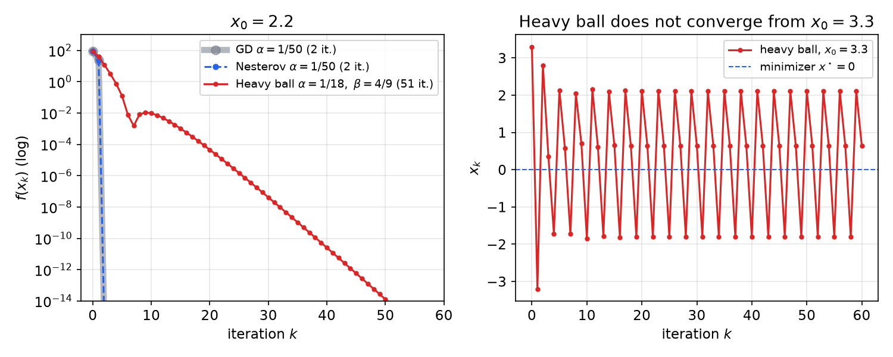
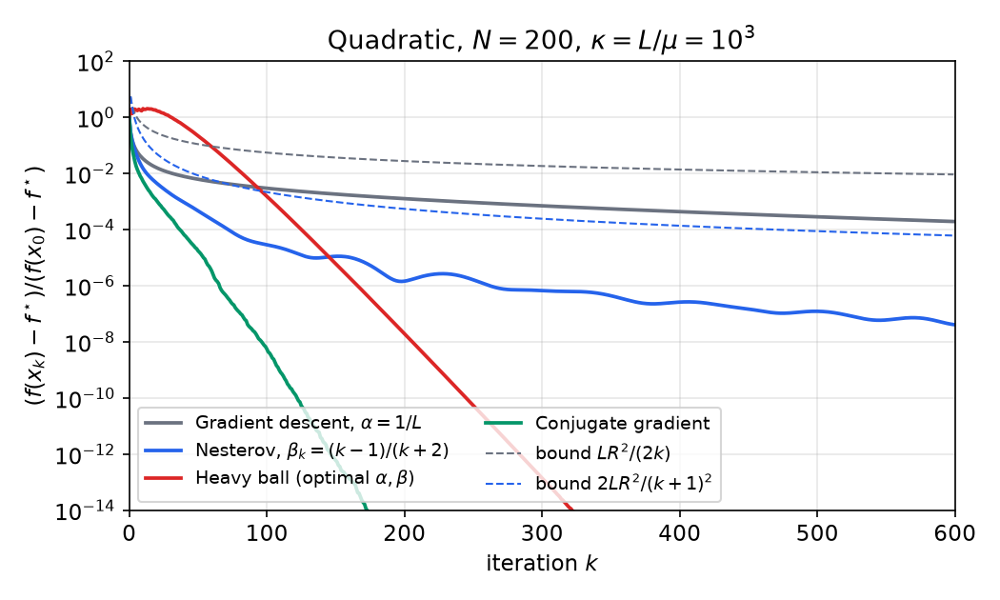
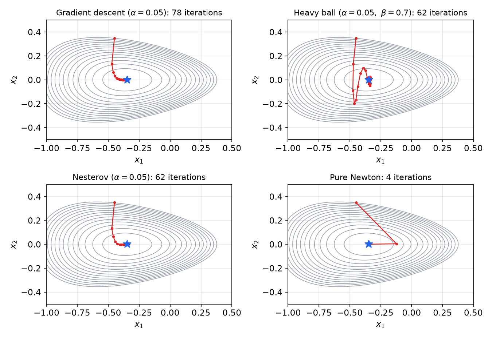

# Gradient Descent and Accelerated Methods

Gradient descent is the simplest algorithm for unconstrained minimization: step against the gradient and repeat. This chapter answers the question the [previous chapter](unconstrained.md) left open: *how fast* does it converge, and under which assumptions? We prove three rates for gradient descent (quadratics, smooth convex functions, smooth strongly convex functions) and then show how **momentum** improves them: the heavy ball method and conjugate gradients reduce the dependence on the condition number from \\(\kappa\\) to \\(\sqrt\kappa\\), and Nesterov's accelerated method improves the \\(O(1/k)\\) rate for smooth convex functions to the optimal \\(O(1/k^2)\\).

## Setting and Two Kinds of Guarantees

We consider \\(\min\_{x\in\mathbb{R}^N} f(x)\\) with \\(f\\) convex and differentiable, and we always assume that a minimizer \\(x^\star\\) exists; \\(f^\star = f(x^\star)\\). **Gradient descent** (GD) chooses the direction \\(d\_k = -\nabla f(x\_k)\\):
\\[
x\_{k+1} = x\_k - \alpha\_k \nabla f(x\_k).
\\]
A convergence result can bound two different things.

- **Iterates:** \\(\lVert x\_k - x^\star\rVert\_2 \le (\text{something} \to 0)\\). This makes sense only when \\(x^\star\\) is unique, and it says how close we are to the solution in \\(\mathbb{R}^N\\).
- **Function values:** \\(f(x\_k) - f^\star \le (\text{something} \to 0)\\), where \\(x^\star\\) may be any minimizer. This measures the quality of the point we return.

The two can behave very differently. On a very flat function, \\(f(x\_k)\\) can be close to \\(f^\star\\) while \\(x\_k\\) is far from \\(x^\star\\); on a very steep one, \\(x\_k\\) can be close to \\(x^\star\\) while \\(f(x\_k) - f^\star\\) is still large. Under smoothness and strong convexity they are tied together, as we will see.

All the analysis rests on two quadratic bounds, derived in [Convex Functions](convex-functions.md):

- **\\(L\\)-smoothness** (Lipschitz gradient), \\(\lVert\nabla f(x) - \nabla f(y)\rVert\_2 \le L\lVert x-y\rVert\_2\\), implies the **quadratic upper bound**
\\[
f(y) \le f(x) + \langle y-x, \nabla f(x)\rangle + \tfrac{L}{2}\lVert y-x\rVert\_2^2 \qquad \text{for all } x,y. \tag{U}
\\]
- **\\(\mu\\)-strong convexity** is the **quadratic lower bound**
\\[
f(y) \ge f(x) + \langle y-x, \nabla f(x)\rangle + \tfrac{\mu}{2}\lVert y-x\rVert\_2^2 \qquad \text{for all } x,y. \tag{S}
\\]
With \\(\mu = 0\\) this is ordinary convexity (the tangent plane lies below the graph).

For completeness, here is the one-line proof of (U). By the fundamental theorem of calculus along the segment from \\(x\\) to \\(y\\),
\\[
f(y) - f(x) - \langle y-x,\nabla f(x)\rangle = \int\_0^1 \langle \nabla f(x + t(y-x)) - \nabla f(x),\\, y-x\rangle\\,dt \le \int\_0^1 tL\lVert y-x\rVert\_2^2\\,dt = \tfrac{L}{2}\lVert y-x\rVert\_2^2,
\\]
using Cauchy–Schwarz and the Lipschitz bound. An equivalent proof notes that \\(\tfrac L2\lVert x\rVert\_2^2 - f(x)\\) has a monotone gradient, hence is convex, and writes its first-order condition. For twice-differentiable \\(f\\), (U) and (S) together say \\(\mu I \preceq \nabla^2 f(x) \preceq LI\\) everywhere; the ratio
\\[
\kappa = \frac{L}{\mu} \ge 1
\\]
is the **condition number** of \\(f\\). Wherever both (U) and (S) hold, \\(f\\) is "trapped" between two quadratics at every point, and comparing the two bounds at any \\(y\ne x\\) shows \\(\mu \le L\\).

We study three cases:

1. \\(f(x) = \tfrac12 x^{T}Qx - b^{T}x\\) with \\(Q \succ 0\\): fast when \\(Q\\) is well conditioned;
2. \\(f\\) convex and \\(L\\)-smooth: much slower, \\(O(1/k)\\);
3. \\(f\\) \\(L\\)-smooth and \\(\mu\\)-strongly convex: essentially recovers the quadratic rate.

## Case 1: Quadratic Objectives

Let \\(f(x) = \tfrac12 x^{T}Qx - b^{T}x\\) with \\(Q\\) symmetric and \\(\mu I \preceq Q \preceq LI\\), \\(\mu>0\\). The Hessian is \\(Q\\) everywhere, so \\(f\\) is \\(L\\)-smooth and \\(\mu\\)-strongly convex, and the unique minimizer solves \\(\nabla f(x^\star) = Qx^\star - b = 0\\), that is, \\(x^\star = Q^{-1}b\\).

Using \\(b = Qx^\star\\), one GD step gives
\\[
x\_{k+1} - x^\star = x\_k - x^\star - \alpha\_k(Qx\_k - Qx^\star) = (I - \alpha\_k Q)(x\_k - x^\star).
\\]
With a fixed step \\(\alpha\\), the error \\(e\_k = x\_k - x^\star\\) evolves as a **linear dynamical system** \\(e\_{k+1} = (I-\alpha Q)e\_k\\), and
\\[
\lVert e\_{k+1}\rVert\_2 \le \lVert I - \alpha Q\rVert\\,\lVert e\_k\rVert\_2 .
\\]
For a symmetric matrix the spectral norm is the largest eigenvalue magnitude. The eigenvalues of \\(I - \alpha Q\\) are \\(1 - \alpha\lambda\_n\\) with \\(\lambda\_n \in [\mu, L]\\), so they lie in \\([1-\alpha L, 1-\alpha\mu]\\) and
\\[
\lVert I - \alpha Q\rVert \le \max\big(\lvert 1-\alpha\mu\rvert, \lvert 1-\alpha L\rvert\big).
\\]

**Theorem (GD on a quadratic).** With \\(\alpha = 1/L\\),
\\[
\lVert x\_k - x^\star\rVert\_2 \le \Big(1 - \frac{\mu}{L}\Big)^k \lVert x\_0 - x^\star\rVert\_2 = \Big(1-\frac1\kappa\Big)^k\lVert x\_0 - x^\star\rVert\_2 .
\\]

*Proof.* With \\(\alpha = 1/L\\) the eigenvalues of \\(I - Q/L\\) lie in \\([0, 1-\mu/L]\\), so \\(\lVert I - Q/L\rVert \le 1 - \mu/L\\). Apply the one-step bound \\(k\\) times. ∎

The error shrinks by a constant factor at every step: this is **linear convergence** (linear because \\(\log\lVert e\_k\rVert\\) decreases linearly in \\(k\\)). Two remarks:

1. \\(\alpha = 1/L\\) is not the best fixed step. The bound \\(\max(\lvert 1-\alpha\mu\rvert,\lvert 1-\alpha L\rvert)\\) is minimized when the two terms balance, \\(1 - \alpha\mu = \alpha L - 1\\), which gives \\(\alpha = 2/(L+\mu)\\) and contraction factor
\\[
\frac{L-\mu}{L+\mu} = \frac{\kappa-1}{\kappa+1} = 1 - \frac{2}{\kappa+1} \le 1 - \frac1\kappa.
\\]
We use \\(1/L\\) to parallel the other two cases, which need it.
2. The function values \\(f(x\_k)-f^\star\\) also converge linearly at the same rate; this is a special case of Case 3 below.

**Example 5.1 (A 2-D quadratic).** Let \\(f(x) = 2x\_1^2 + x\_2^2 - 2x\_1(x\_2+1)\\). Then
\\[
\nabla f(x) = \begin{bmatrix} 4x\_1 - 2x\_2 - 2 \\\\ 2x\_2 - 2x\_1\end{bmatrix}, \qquad \nabla^2 f = \begin{bmatrix} 4 & -2 \\\\ -2 & 2\end{bmatrix}.
\\]
The Hessian has trace 6 and determinant 4, both positive, so both eigenvalues are positive: they are \\(3\pm\sqrt5\\), i.e. \\(\mu = 3-\sqrt5 \approx 0.764\\) and \\(L = 3+\sqrt5 \approx 5.236\\). The function is strongly convex with \\(\kappa = (3+\sqrt5)/(3-\sqrt5) = (7+3\sqrt5)/2 \approx 6.85\\). Setting \\(\nabla f = 0\\) gives \\(x\_2 = x\_1\\) and then \\(2x\_1 - 2 = 0\\), so \\(x^\star = (1,1)\\). From \\(x\_0 = 0\\) the GD direction is \\(-\nabla f(0) = (2, 0)\\); it points along the \\(x\_1\\) axis, not at \\(x^\star\\). With \\(\alpha = 1/L\\) the error contracts at least by \\(1 - 1/\kappa \approx 0.854\\) per step; with the balanced step \\(\alpha = 2/(L+\mu) = 1/3\\) it contracts by \\((L-\mu)/(L+\mu) = \sqrt5/3 \approx 0.745\\), and the first step lands at \\(x\_1 = (2/3, 0)\\). (We will see in the [next chapter](newton.md) that Newton's method reaches \\(x^\star\\) in one step.)

## Case 2: Smooth Convex Functions, the \\(O(1/k)\\) Rate

Now drop strong convexity: \\(f\\) is convex and \\(L\\)-smooth. The minimizer need not be unique, so we bound \\(f(x\_k) - f^\star\\). Use the fixed step \\(\alpha = 1/L\\) (this requires knowing \\(L\\); any \\(\alpha<1/L\\) also works with a slightly worse constant, and the analysis extends to backtracking line search).

### Sufficient decrease

Substitute \\(y = x\_{k+1} = x\_k - \tfrac1L\nabla f(x\_k)\\) into the upper bound (U):
\\[
f(x\_{k+1}) \le f(x\_k) + \Big\langle -\tfrac1L\nabla f(x\_k), \nabla f(x\_k)\Big\rangle + \tfrac{L}{2}\Big\lVert \tfrac1L\nabla f(x\_k)\Big\rVert\_2^2 = f(x\_k) - \tfrac{1}{2L}\lVert\nabla f(x\_k)\rVert\_2^2 . \tag{1}
\\]
Every step decreases \\(f\\) strictly unless we are already at a solution, and the decrease is at least \\(\frac{1}{2L}\lVert\nabla f(x\_k)\rVert\_2^2\\): a large gradient guarantees large progress. Inequality (1) is called **sufficient decrease**; it is the only place where smoothness enters.

**Theorem (GD, smooth convex).** If \\(f\\) is convex and \\(L\\)-smooth and \\(\alpha\_k = 1/L\\), then for every minimizer \\(x^\star\\),
\\[
f(x\_k) - f^\star \le \frac{L}{2k}\lVert x\_0 - x^\star\rVert\_2^2 .
\\]

*Proof.* Convexity at \\(x\_k\\), written with \\(y = x^\star\\), gives \\(f(x\_k) \le f^\star + \langle x\_k - x^\star, \nabla f(x\_k)\rangle\\). Combine with (1):
\\[
f(x\_{k+1}) \le f^\star + \langle x\_k - x^\star, \nabla f(x\_k)\rangle - \tfrac{1}{2L}\lVert \nabla f(x\_k)\rVert\_2^2 .
\\]
Substitute \\(\nabla f(x\_k) = L(x\_k - x\_{k+1})\\):
\\[
f(x\_{k+1}) - f^\star \le L\langle x\_k - x^\star, x\_k - x\_{k+1}\rangle - \tfrac{L}{2}\lVert x\_k - x\_{k+1}\rVert\_2^2 .
\\]
Now use the identity
\\[
2\langle a, b\rangle - \lVert b\rVert\_2^2 = \lVert a\rVert\_2^2 - \lVert a-b\rVert\_2^2 \tag{2}
\\]
with \\(a = x\_k - x^\star\\) and \\(b = x\_k - x\_{k+1}\\), so that \\(a - b = x\_{k+1} - x^\star\\):
\\[
f(x\_{k+1}) - f^\star \le \tfrac{L}{2}\big(\lVert x\_k - x^\star\rVert\_2^2 - \lVert x\_{k+1} - x^\star\rVert\_2^2\big).
\\]
The right side **telescopes**. Summing the last display over the iterations \\(0,\dots,k-1\\),
\\[
\sum\_{i=1}^{k}\big(f(x\_i) - f^\star\big) \le \tfrac{L}{2}\big(\lVert x\_0 - x^\star\rVert\_2^2 - \lVert x\_k - x^\star\rVert\_2^2\big) \le \tfrac{L}{2}\lVert x\_0 - x^\star\rVert\_2^2 .
\\]
By (1) the sequence \\(f(x\_i)\\) is nonincreasing, so the last term is the smallest: \\(k\big(f(x\_k) - f^\star\big) \le \sum\_{i=1}^k (f(x\_i) - f^\star)\\). Divide by \\(k\\). ∎

A by-product of the proof is that \\(\lVert x\_{k+1} - x^\star\rVert\_2 \le \lVert x\_k - x^\star\rVert\_2\\) for every minimizer: GD with \\(\alpha = 1/L\\) never moves away from the solution set. Notice how different the result is from Case 1. The bound is on function values, and it does not shrink by a constant factor: it "peters out" like \\(1/k\\). To guarantee \\(f(x\_k) - f^\star \le \epsilon\\) we need
\\[
k \ge \frac{L\lVert x\_0 - x^\star\rVert\_2^2}{2\epsilon} = O(1/\epsilon) \text{ iterations.}
\\]

## Case 3: Smooth and Strongly Convex Functions, Linear Rate

Now assume both (U) and (S). Keep the step \\(1/L\\) and start again from sufficient decrease (1). What we need is a lower bound on \\(\lVert\nabla f(x\_k)\rVert\_2\\) in terms of the optimality gap; strong convexity provides it.

### The Polyak–Łojasiewicz inequality

Fix \\(x\\) and minimize the right-hand side of (S) over \\(y\\). It is a convex quadratic in \\(y\\) with gradient \\(\nabla f(x) + \mu(y-x)\\), so the minimizer is \\(y - x = -\tfrac1\mu\nabla f(x)\\) and the minimum value is
\\[
f(x) - \tfrac1\mu\lVert\nabla f(x)\rVert\_2^2 + \tfrac{1}{2\mu}\lVert\nabla f(x)\rVert\_2^2 = f(x) - \tfrac{1}{2\mu}\lVert\nabla f(x)\rVert\_2^2 .
\\]
Since (S) holds for every \\(y\\), \\(f(y) \ge f(x) - \tfrac{1}{2\mu}\lVert \nabla f(x)\rVert\_2^2\\) for every \\(y\\); take \\(y = x^\star\\):
\\[
\boxed{\lVert\nabla f(x)\rVert\_2^2 \ge 2\mu\big(f(x) - f^\star\big)} \tag{PL}
\\]
This is the **Polyak–Łojasiewicz (PL) inequality**: far from optimal in value means a large gradient.

**Theorem (GD, smooth and strongly convex).** If \\(f\\) is \\(L\\)-smooth and \\(\mu\\)-strongly convex and \\(\alpha\_k = 1/L\\), then
\\[
f(x\_k) - f^\star \le \Big(1 - \frac{\mu}{L}\Big)^k\big(f(x\_0) - f^\star\big).
\\]

*Proof.* Subtract \\(f^\star\\) from (1) and use (PL):
\\[
f(x\_{k+1}) - f^\star \le f(x\_k) - f^\star - \tfrac{1}{2L}\lVert\nabla f(x\_k)\rVert\_2^2 \le \Big(1 - \frac{\mu}{L}\Big)\big(f(x\_k) - f^\star\big).
\\]
Iterate. Since \\(L \ge \mu\\), the factor lies in \\([0,1)\\). ∎

**Remarks.**

1. **Iterates.** Use (S) with \\(x = x^\star\\), \\(y = x\_k\\) and \\(\nabla f(x^\star) = 0\\): \\(f(x\_k) - f^\star \ge \tfrac\mu2\lVert x\_k - x^\star\rVert\_2^2\\). Use (U) with \\(x = x^\star\\), \\(y = x\_0\\): \\(f(x\_0) - f^\star \le \tfrac L2\lVert x\_0 - x^\star\rVert\_2^2\\). Chaining these with the theorem,
\\[
\lVert x\_k - x^\star\rVert\_2^2 \le \frac{L}{\mu}\Big(1-\frac\mu L\Big)^k\lVert x\_0 - x^\star\rVert\_2^2 .
\\]
A more careful analysis removes the factor \\(L/\mu\\) and gives \\(\lVert x\_k - x^\star\rVert\_2^2 \le (1-\mu/L)^k\lVert x\_0 - x^\star\rVert\_2^2\\), the same as for quadratics (Lan, *First-order and Stochastic Optimization Methods for Machine Learning*, §3.4).
2. **A principled stopping rule.** If \\(\lVert\nabla f(x\_k)\rVert\_2 \le \epsilon\\), then by (PL) \\(f(x\_k) - f^\star \le \tfrac{1}{2\mu}\lVert\nabla f(x\_k)\rVert\_2^2 \le \tfrac{\epsilon^2}{2\mu}\\). A small gradient certifies a small optimality gap, provided we know (a lower bound on) \\(\mu\\).
3. **PL without convexity.** Strong convexity was used only to obtain (PL). Some nonconvex functions satisfy (PL) as well; if they are also \\(L\\)-smooth, the same two-line proof shows that GD converges linearly to the *global* minimum value (Karimi, Nutini and Schmidt, 2016). Nonconvex functions of this kind exist (Karimi, Nutini and Schmidt, 2016).

### Linear versus sublinear: iteration counts

If \\(f(x\_k) - f^\star \le g(k)\\) with \\(g\\) strictly decreasing, then \\(k \ge g^{-1}(\epsilon)\\) iterations suffice for accuracy \\(\epsilon\\). Write \\(\epsilon\_0 = \lVert x\_0 - x^\star\rVert\_2\\) and \\(\varepsilon\_0 = f(x\_0) - f^\star\\).

- Smooth convex: \\(g(k) = \frac{L\epsilon\_0^2}{2k}\\), so \\(k \ge \frac{L\epsilon\_0^2}{2\epsilon}\\): \\(O(1/\epsilon)\\) iterations.
- Smooth and strongly convex: \\(g(k) = (1-\mu/L)^k\varepsilon\_0\\), so we need \\(k \ge \frac{\log(\epsilon/\varepsilon\_0)}{\log(1-\mu/L)}\\). Since \\(-\log(1-t) \ge t\\) for \\(0 \le t < 1\\), it suffices that
\\[
k \ge \frac{L}{\mu}\log\frac{\varepsilon\_0}{\epsilon} = O\big(\kappa\log(1/\epsilon)\big).
\\]

The difference is not subtle. Ignoring constants, \\(\epsilon = 10^{-2}\\) needs about \\(100\\) iterations at rate \\(1/\epsilon\\) and \\(\log(100) \approx 4.6\\) at rate \\(\log(1/\epsilon)\\); \\(\epsilon = 10^{-6}\\) needs \\(10^6\\) versus \\(\log(10^6) \approx 13.8\\). The price of linear convergence is the factor \\(\kappa\\), which can be huge for badly scaled problems. Reducing that factor is the goal of the momentum methods below.

**Example 5.2 (A piecewise quadratic).** Consider
\\[
f(x) = \begin{cases} 25x^2, & x < 1,\\\\ x^2 + 48x - 24, & 1 \le x \le 2,\\\\ 25x^2 - 48x + 72, & x > 2.\end{cases}
\\]
*It is \\(C^1\\).* At \\(x=1\\) both neighbouring pieces have value 25 and slope 50; at \\(x=2\\) both have value 76 and slope 52.

*It is 2-strongly convex.* \\(f\\) is \\(\mu\\)-strongly convex iff \\(f - \tfrac\mu2 x^2\\) is convex. With \\(\mu = 2\\), \\(g = f - x^2\\) has derivative \\(g' = 48x,\ 48,\ 48x - 48\\) on the three pieces. This is continuous and nondecreasing, so \\(g\\) is convex.

*It is 50-smooth.* \\(f\\) is \\(L\\)-smooth (and convex) iff \\(\tfrac L2 x^2 - f\\) is convex. With \\(L = 50\\), \\(h = 25x^2 - f\\) has \\(h' = 0,\ 48x - 48,\ 48\\), again nondecreasing.

*Minimizer.* \\(f' = 50x,\ 2x+48,\ 50x - 48\\) vanishes only at \\(x = 0\\), which by strong convexity is the unique minimizer. Here \\(\kappa = 25\\).

*GD with \\(\alpha = 1/L = 1/50\\) from \\(x\_0 = 2.2\\).* \\(f'(2.2) = 50(2.2) - 48 = 62\\), so \\(x\_1 = 2.2 - 62/50 = 0.96\\), which lies in the \\(25x^2\\) piece. There GD with step \\(1/50\\) is exact: \\(x\_2 = 0.96 - 48/50 = 0\\). GD finds the minimizer in two steps. This example returns below to show the limits of the heavy ball method.

## Momentum and the Heavy Ball Method

### From gradient flow to a heavy ball

Gradient descent is the forward-Euler discretization of the **gradient flow**
\\[
x'(t) = -\nabla f(x(t)), \qquad x(0) = x\_0 , \tag{3}
\\]
whose trajectories follow the steepest-descent direction to a point where \\(\nabla f = 0\\). Replacing \\(x'(t)\\) by the forward difference \\((x\_{k+1} - x\_k)/\alpha\\) gives \\(x\_{k+1} = x\_k - \alpha\nabla f(x\_k)\\). The discretized path tends to zig-zag across narrow valleys: the gradient points mostly across the valley, not along it.

Add inertia. A particle of mass \\(m\\) moving in the potential \\(f\\) with unit friction obeys
\\[
m\\,x''(t) + x'(t) = -\nabla f(x(t)). \tag{4}
\\]
A heavy ball rolls downhill faster than a light one and its momentum carries it along the valley floor; \\(m = 0\\) recovers (3). Discretize with step \\(h\\), using \\(x''(t\_k) \approx (x\_{k+1} - 2x\_k + x\_{k-1})/h^2\\) and the backward difference \\(x'(t\_k) \approx (x\_k - x\_{k-1})/h\\):
\\[
\frac{m}{h^2}(x\_{k+1} - 2x\_k + x\_{k-1}) + \frac1h(x\_k - x\_{k-1}) = -\nabla f(x\_k).
\\]
Solve for \\(x\_{k+1}\\):
\\[
x\_{k+1} = x\_k + \Big(1 - \frac hm\Big)(x\_k - x\_{k-1}) - \frac{h^2}{m}\nabla f(x\_k).
\\]
This is the **heavy ball method** (Polyak, 1964), also called gradient descent with momentum:
\\[
\boxed{x\_{k+1} = x\_k + \beta\_k(x\_k - x\_{k-1}) - \alpha\_k\nabla f(x\_k)} \tag{5}
\\]
with \\(\alpha = h^2/m\\) and \\(\beta = 1 - h/m\\) in the discretization above. Each step adds a fraction \\(\beta\\) of the previous step to the gradient step. In code it is convenient to carry the momentum \\(p\_k = \beta\_k(x\_k - x\_{k-1})\\), with \\(p\_0 = 0\\), and write \\(x\_{k+1} = x\_k + p\_k - \alpha\_k\nabla f(x\_k)\\).

### The rate on quadratics

**Theorem (heavy ball on a quadratic).** Let \\(f(x) = \tfrac12x^{T}Qx - b^{T}x\\) with the eigenvalues of \\(Q\\) in \\([\mu, L]\\), \\(\mu>0\\), and run (5) with the fixed parameters
\\[
\alpha = \frac{4}{(\sqrt L + \sqrt\mu)^2}, \qquad \beta = \Big(\frac{\sqrt L - \sqrt\mu}{\sqrt L + \sqrt\mu}\Big)^2 = \Big(\frac{\sqrt\kappa - 1}{\sqrt\kappa+1}\Big)^2 .
\\]
Then there is a constant \\(C\\) such that
\\[
\left\lVert\begin{bmatrix} x\_k - x^\star\\\\ x\_{k-1}-x^\star\end{bmatrix}\right\rVert\_2 \le C\Big(1 - \frac{1}{\sqrt\kappa+1}\Big)^k \left\lVert\begin{bmatrix} x\_0 - x^\star\\\\ x\_{-1}-x^\star\end{bmatrix}\right\rVert\_2,
\\]
so relative accuracy \\(\epsilon\\) is reached after \\(k \gtrsim \sqrt\kappa\log(1/\epsilon)\\) iterations.

Compare GD with \\(\alpha = 1/L\\), which needs \\(O(\kappa\log(1/\epsilon))\\) iterations. For \\(\kappa = 10^2\\) that is about \\(100\log(1/\epsilon)\\) iterations for GD against \\(10\log(1/\epsilon)\\) for heavy ball; for \\(\kappa = 10^6\\) it is a factor of a thousand.

*Proof.* Using \\(\nabla f(x) - \nabla f(x^\star) = Q(x - x^\star)\\), stack two consecutive errors into \\(z\_k = \begin{bmatrix} x\_k - x^\star \\\\ x\_{k-1} - x^\star\end{bmatrix}\\):
\\[
z\_{k+1} = \begin{bmatrix} x\_k + \beta(x\_k - x\_{k-1}) - x^\star\\\\ x\_k - x^\star\end{bmatrix} - \alpha\begin{bmatrix}\nabla f(x\_k) - \nabla f(x^\star) \\\\ 0\end{bmatrix} = \underbrace{\begin{bmatrix} (1+\beta)I - \alpha Q & -\beta I\\\\ I & 0\end{bmatrix}}\_{T} z\_k .
\\]
So \\(z\_k = T^kz\_0\\) and \\(\lVert z\_k\rVert\_2 \le \lVert T^k\rVert\\,\lVert z\_0\rVert\_2\\): again a linear dynamical system, now of dimension \\(2N\\).

*Spectral radius.* \\(T\\) is not symmetric, so its norm is not its largest eigenvalue magnitude. The right quantity is the **spectral radius** \\(\rho(T) = \max\lvert\text{eigenvalue}\rvert\\). Two facts: \\(\rho(T) \le \lVert T\rVert\\), and **Gelfand's formula** \\(\rho(T) = \lim\_{k\to\infty}\lVert T^k\rVert^{1/k}\\). The latter means that for every \\(\delta > 0\\) there is an \\(n\\) with \\(\lVert T^k\rVert^{1/k} \le \rho(T) + \delta\\) for \\(k \ge n\\); setting \\(C = \max\_{0\le k\le n}\lVert T^k\rVert/(\rho(T)+\delta)^k\\) we get
\\[
\lVert T^k\rVert \le C\big(\rho(T) + \delta\big)^k \quad\text{for all } k. \tag{6}
\\]
(If \\(T\\) were symmetric we would simply have \\(\lVert T^k\rVert = \rho(T)^k\\).)

*Block diagonalization.* Write \\(Q = V\Lambda V^{T}\\) with \\(V\\) orthogonal. Then
\\[
T = \begin{bmatrix} V & 0\\\\ 0 & V\end{bmatrix}\begin{bmatrix}(1+\beta)I - \alpha\Lambda & -\beta I\\\\ I & 0\end{bmatrix}\begin{bmatrix} V^{T} & 0\\\\ 0 & V^{T}\end{bmatrix},
\\]
an orthogonal similarity, which preserves eigenvalues. The middle matrix has four diagonal \\(N\times N\\) blocks; a permutation that interleaves the coordinates turns it into \\(\operatorname{diag}(T\_1,\dots,T\_N)\\) with \\(2\times2\\) blocks
\\[
T\_n = \begin{bmatrix} 1 + \beta - \alpha\lambda\_n & -\beta\\\\ 1 & 0\end{bmatrix}, \qquad \rho(T) = \max\_n\rho(T\_n).
\\]

*Eigenvalues of a block.* \\(\det(T\_n - \gamma I) = 0\\) is \\(\gamma^2 - (1+\beta-\alpha\lambda\_n)\gamma + \beta = 0\\), so
\\[
\gamma\_{1,2} = \tfrac12\Big(1+\beta-\alpha\lambda\_n \pm \sqrt{(1+\beta-\alpha\lambda\_n)^2 - 4\beta}\Big).
\\]
If \\((1+\beta-\alpha\lambda\_n)^2 \le 4\beta\\), the roots are complex conjugates (or a double real root) with product \\(\gamma\_1\gamma\_2 = \beta\\), hence
\\[
\lvert\gamma\_1\rvert = \lvert\gamma\_2\rvert = \sqrt\beta .
\\]
The condition \\(\lvert 1 + \beta - \alpha\lambda\_n\rvert \le 2\sqrt\beta\\) is equivalent to \\((1-\sqrt\beta)^2 \le \alpha\lambda\_n \le (1+\sqrt\beta)^2\\), i.e. to
\\[
\sqrt\beta \ge \big\lvert 1 - \sqrt{\alpha\lambda\_n}\big\rvert .
\\]
To have this for every \\(\lambda\_n \in [\mu, L]\\) we need \\(\sqrt\beta \ge \max\big(\lvert1-\sqrt{\alpha\mu}\rvert, \lvert 1 - \sqrt{\alpha L}\rvert\big)\\) (the maximum, so that the extreme eigenvalues are covered), and the smallest such \\(\beta\\) gives \\(\rho(T) = \sqrt\beta\\).

*Choosing \\(\alpha\\).* The bound is smallest when the two terms balance, \\(1 - \sqrt{\alpha\mu} = \sqrt{\alpha L} - 1\\), i.e. \\(\sqrt\alpha(\sqrt L + \sqrt\mu) = 2\\):
\\[
\alpha = \frac{4}{(\sqrt L+\sqrt\mu)^2}, \qquad \sqrt\beta = 1 - \frac{2\sqrt\mu}{\sqrt L + \sqrt\mu} = \frac{\sqrt L - \sqrt\mu}{\sqrt L+\sqrt\mu} = 1 - \frac{2}{\sqrt\kappa + 1}.
\\]
So \\(\rho(T) = 1 - 2/(\sqrt\kappa+1)\\). Take \\(\delta = 1/(\sqrt\kappa+1)\\) in (6): \\(\lVert z\_k\rVert\_2 \le C\big(1 - \tfrac{1}{\sqrt\kappa+1}\big)^k\lVert z\_0\rVert\_2\\). Finally, \\((1-t)^k \le e^{-tk}\\) shows \\(\lVert z\_k\rVert\_2 \le \epsilon\\) once \\(k \ge (\sqrt\kappa+1)\log(C\lVert z\_0\rVert\_2/\epsilon)\\). ∎

The constant \\(C\\) is needed because when a block has a double eigenvalue it is not diagonalizable, and \\(\lVert T^k\rVert\\) then carries a polynomial factor \\(k\\); the extra \\(\delta\\) absorbs it.

### Heavy ball beyond quadratics

The theorem is about quadratics, and it is *local* for general smooth strongly convex functions (near \\(x^\star\\), \\(f\\) is close to its quadratic Taylor model). Globally the heavy ball method with these parameters can fail.

**Example 5.3 (Heavy ball on the piecewise quadratic).** Return to Example 5.2, where \\(\mu = 2\\) and \\(L = 50\\). The heavy ball parameters are
\\[
\alpha = \frac{4}{(\sqrt{50} + \sqrt2)^2} = \frac{4}{(6\sqrt2)^2} = \frac{4}{72} = \frac1{18}, \qquad \beta = \Big(\frac{5\sqrt2 - \sqrt2}{5\sqrt2+\sqrt2}\Big)^2 = \Big(\frac23\Big)^2 = \frac49 .
\\]
With tolerance \\(10^{-6}\\) on \\(\lvert f'(x\_k)\rvert\\) and \\(x\_0 = 2.2\\), GD (\\(\alpha = 1/50\\)) and Nesterov's method (\\(\alpha = 1/50\\), below) stop after 2 iterations, while heavy ball needs about 50: it overshoots and then converges only linearly. Worse, this function appears in Lessard, Recht and Packard (2016) as a case where heavy ball fails: from \\(x\_0 = 3.3\\) the heavy ball iterates never converge but settle into a 3-cycle that visits approximately \\(-1.80\\), \\(2.12\\) and \\(0.65\\).



*Figure: left, \\(f(x\_k)\\) on a log scale from \\(x\_0 = 2.2\\) for gradient descent (thick gray), Nesterov (dashed blue) and heavy ball with Polyak's parameters (red). GD and Nesterov reach the minimizer exactly in two steps; heavy ball overshoots and then converges linearly. Right, heavy ball from \\(x\_0 = 3.3\\): the iterates lock into a period-3 cycle and never converge, although \\(f\\) is smooth and strongly convex.*

The lesson: the \\(\sqrt\kappa\\) acceleration of heavy ball is a statement about quadratics (or about local behaviour), not a global guarantee for smooth strongly convex functions.

## Conjugate Gradients

For quadratics there is a method with the heavy ball's rate that needs no knowledge of \\(L\\) and \\(\mu\\): the **conjugate gradient** (CG) method. For \\(f(x) = \tfrac12x^{T}Qx - b^{T}x\\), \\(Q\succ0\\), it reads
\\[
d\_0 = -\nabla f(x\_0), \qquad x\_{k+1} = x\_k + \alpha\_k d\_k, \qquad d\_{k+1} = -\nabla f(x\_{k+1}) + \beta\_{k+1}d\_k, \qquad \beta\_{k+1} = \frac{\lVert\nabla f(x\_{k+1})\rVert\_2^2}{\lVert\nabla f(x\_k)\rVert\_2^2},
\\]
with \\(\alpha\_k\\) chosen by exact line search. For a quadratic the exact line search has the closed form \\(\alpha\_k = -\langle d\_k, \nabla f(x\_k)\rangle / (d\_k^{T}Qd\_k)\\), which equals \\(\lVert\nabla f(x\_k)\rVert\_2^2/(d\_k^{T}Qd\_k)\\) because each new gradient is orthogonal to the previous direction.

**Why it is a momentum method.** Substituting \\(d\_k = -\nabla f(x\_k) + \beta\_kd\_{k-1}\\) and \\(d\_{k-1} = (x\_k - x\_{k-1})/\alpha\_{k-1}\\),
\\[
x\_{k+1} = x\_k + \alpha\_k\big(-\nabla f(x\_k) + \beta\_kd\_{k-1}\big) = x\_k - \alpha\_k\nabla f(x\_k) + \frac{\alpha\_k\beta\_k}{\alpha\_{k-1}}(x\_k - x\_{k-1}),
\\]
which is exactly the heavy ball iteration (5) with step \\(\alpha\_k\\) and momentum \\(\alpha\_k\beta\_k/\alpha\_{k-1}\\), both chosen adaptively at every step.

**Why it is called conjugate.** On a quadratic, the choice of \\(\beta\_k\\) makes each new direction \\(Q\\)-**conjugate** to all previous ones, \\(d\_k^{T}Qd\_j = 0\\) for \\(j<k\\), and the gradients mutually orthogonal. Consequently \\(x\_k\\) minimizes \\(f\\) over the affine Krylov space \\(x\_0 + \operatorname{span}\\{r\_0, Qr\_0,\dots,Q^{k-1}r\_0\\}\\), \\(r\_0 = -\nabla f(x\_0)\\), and in exact arithmetic CG terminates in at most \\(N\\) steps. The standard error bound in the \\(Q\\)-norm \\(\lVert e\rVert\_Q = \sqrt{e^{T}Qe}\\) is
\\[
\lVert x\_k - x^\star\rVert\_Q \le 2\Big(\frac{\sqrt\kappa-1}{\sqrt\kappa+1}\Big)^k\lVert x\_0 - x^\star\rVert\_Q ,
\\]
the same \\(\sqrt\kappa\log(1/\epsilon)\\) complexity as heavy ball, and in practice usually much better because CG adapts to the actual distribution of the eigenvalues. Shewchuk's tutorial *An Introduction to the Conjugate Gradient Method Without the Agonizing Pain* (1994) derives all of this carefully.

In implementations one writes \\(\nabla f(x\_k) = Qx\_k - b\\) as a residual \\(r\_k = b - Qx\_k\\) updated by \\(r\_{k+1} = r\_k - \alpha\_kQd\_k\\), so each iteration costs one matrix–vector product with \\(Q\\):

```python
import numpy as np

def conjugate_gradient(Q, b, x0, tol=1e-10, maxit=None):
    x = x0.copy(); r = b - Q @ x; d = r.copy(); rr = r @ r
    for _ in range(maxit or len(b)):
        Qd = Q @ d
        alpha = rr / (d @ Qd)          # exact line search
        x += alpha * d
        r -= alpha * Qd                # new residual = -gradient
        rr_new = r @ r
        if np.sqrt(rr_new) < tol:
            break
        d = r + (rr_new / rr) * d      # beta = |g_{k+1}|^2 / |g_k|^2
        rr = rr_new
    return x
```

For quadratics CG is "the way to go": its guarantees are as good as (though not better than) heavy ball's, without needing \\(L\\) or \\(\mu\\). For non-quadratic functions, nonlinear CG variants (Fletcher–Reeves, Polak–Ribière) exist, but the finely tuned \\(\alpha\_k\\) and \\(\beta\_k\\) can make them unstable, and they need restarts.

## Nesterov's Accelerated Method

On strongly convex quadratics, no method whose iterates lie in the span of past gradients can beat the \\(\sqrt\kappa\\) rate. For functions that are merely \\(L\\)-smooth and convex, GD's \\(O(1/k)\\) rate needs \\(k \ge L\lVert x\_0 - x^\star\rVert\_2^2/(2\epsilon)\\) iterations. Nesterov (1983) found a small change that improves this to \\(O(1/k^2)\\). The method was largely unknown in the West until his English textbook (*Introductory Lectures on Convex Optimization*, 2004).

Compare the two iterations, both with \\(p\_0 = 0\\):
\\[
\begin{aligned}
\text{heavy ball:}\quad & p\_k = \beta\_k(x\_k - x\_{k-1}), && x\_{k+1} = x\_k + p\_k - \alpha\_k\nabla f(x\_k),\\\\
\text{Nesterov:}\quad & p\_k = \beta\_k(x\_k - x\_{k-1}), && x\_{k+1} = x\_k + p\_k - \alpha\_k\nabla f(x\_k + p\_k).
\end{aligned} \tag{7}
\\]
The only difference is *where the gradient is evaluated*: Nesterov first moves along the momentum to the "look-ahead" point \\(y\_k = x\_k + p\_k\\) and then takes a gradient step from there, \\(x\_{k+1} = y\_k - \alpha\_k\nabla f(y\_k)\\). In theory and practice a good momentum schedule is
\\[
\beta\_k = \frac{k-1}{k+2}, \tag{8}
\\]
which uses little momentum early, when the first gradients may point in poor directions, and more as the iterates gain "confidence" (\\(\beta\_k \to 1\\)). No knowledge of \\(\mu\\) is needed, which is an advantage over heavy ball. The step \\(\alpha\_k\\) is \\(1/L\\) in the analysis and is usually set by backtracking in practice.

The result is \\(f(x\_k) - f^\star \lesssim \frac{L}{k^2}\lVert x\_0 - x^\star\rVert\_2^2\\), so \\(k \gtrsim 1/\sqrt\epsilon\\) iterations suffice instead of \\(1/\epsilon\\); for \\(\epsilon \sim 10^{-4}\\) that is \\(100\\) instead of \\(10^4\\) (up to constants). The method is called **optimal** because no method that uses only function values and gradients (more precisely, whose iterates stay in \\(x\_0 + \operatorname{span}\\) of the past gradients) can achieve a better rate uniformly over the class of \\(L\\)-smooth convex functions: Nesterov constructs quadratics on which every such method satisfies \\(f(x\_k) - f^\star \ge \frac{3L\lVert x\_0 - x^\star\rVert\_2^2}{32(k+1)^2}\\) for \\(k \le (N-1)/2\\), where \\(N\\) is the dimension.

### Building blocks

For all \\(x, y\\), convexity and smoothness give
\\[
f(y) \ge f(x) + \langle y - x, \nabla f(x)\rangle, \tag{9}
\\]
\\[
f(y) \le f(x) + \langle y - x, \nabla f(x)\rangle + \tfrac{L}{2}\lVert y - x\rVert\_2^2 . \tag{10}
\\]
Taking \\(y = x - \tfrac1L\nabla f(x)\\) in (10), as in (1),
\\[
f\Big(x - \tfrac1L\nabla f(x)\Big) \le f(x) - \tfrac{1}{2L}\lVert\nabla f(x)\rVert\_2^2 .
\\]
Bounding \\(f(x)\\) on the right with (9) rearranged, \\(f(x) \le f(y) + \langle x - y, \nabla f(x)\rangle\\), gives the key inequality
\\[
\boxed{f\Big(x - \tfrac1L\nabla f(x)\Big) \le f(y) + \langle x - y, \nabla f(x)\rangle - \tfrac{1}{2L}\lVert\nabla f(x)\rVert\_2^2 \quad\text{for all } x, y.} \tag{11}
\\]
It compares the value after a gradient step from \\(x\\) to the value at *any* point \\(y\\). Choosing \\(y = x^\star\\) bounds the optimality gap; choosing \\(y\\) equal to the current iterate bounds the progress.

**GD revisited.** With \\(x = x\_k\\) and \\(y = x^\star\\), (11) is the first display in the proof of the \\(O(1/k)\\) theorem; with \\(\delta\_k = f(x\_k) - f^\star\\) it led to \\(\delta\_{k+1} \le \tfrac L2(\lVert x\_k - x^\star\rVert\_2^2 - \lVert x\_{k+1} - x^\star\rVert\_2^2)\\), a telescoping sum, and \\(\delta\_k \le \tfrac1k\sum\_{i=0}^{k-1}\delta\_{i+1} \le \tfrac{L}{2k}\lVert x\_0 - x^\star\rVert\_2^2\\). For Nesterov's method, the right side no longer telescopes by itself; the trick is to combine the two choices of \\(y\\).

### The \\(O(1/k^2)\\) theorem

**Theorem (Nesterov).** Let \\(f\\) be convex and \\(L\\)-smooth with a minimizer \\(x^\star\\). Run (7) with \\(\alpha\_k = 1/L\\), \\(\beta\_k = (k-1)/(k+2)\\) and \\(p\_0 = 0\\). Then
\\[
f(x\_k) - f^\star \le \frac{2L}{(k+1)^2}\lVert x\_0 - x^\star\rVert\_2^2 .
\\]

*Proof.* Write \\(\delta\_k = f(x\_k) - f^\star\\) and define the scaled step
\\[
g\_k = -\tfrac1L\nabla f(x\_k + p\_k), \qquad\text{so}\qquad x\_{k+1} = x\_k + p\_k + g\_k .
\\]

*Step 1: two inequalities.* Apply (11) with \\(x = x\_k + p\_k\\) (so that the left side is \\(f(x\_{k+1})\\)) and \\(\nabla f(x) = -Lg\_k\\):
\\[
f(x\_{k+1}) \le f(y) - L\langle x\_k + p\_k - y, g\_k\rangle - \tfrac L2\lVert g\_k\rVert\_2^2 .
\\]
With \\(y = x^\star\\):
\\[
\delta\_{k+1} \le \tfrac L2\big(2\langle x^\star - x\_k - p\_k, g\_k\rangle - \lVert g\_k\rVert\_2^2\big). \tag{12}
\\]
With \\(y = x\_k\\), using \\(\delta\_k - \delta\_{k+1} = f(x\_k) - f(x\_{k+1})\\):
\\[
\delta\_k - \delta\_{k+1} \ge \tfrac L2\big(2\langle p\_k, g\_k\rangle + \lVert g\_k\rVert\_2^2\big). \tag{13}
\\]

*Step 2: a weighted combination.* Fix weights \\(\lambda\_k \ge 1\\). Multiply (13) by \\((1-\lambda\_k) \le 0\\), which flips it to \\((1-\lambda\_k)(\delta\_k - \delta\_{k+1}) \le (1-\lambda\_k)\tfrac L2(2\langle p\_k,g\_k\rangle + \lVert g\_k\rVert\_2^2)\\), and add (12). The left side becomes
\\[
\delta\_{k+1} + (1-\lambda\_k)(\delta\_k - \delta\_{k+1}) = \lambda\_k\delta\_{k+1} - (\lambda\_k - 1)\delta\_k ,
\\]
and the right side
\\[
\tfrac L2\big(2\langle x^\star - x\_k - p\_k + (1-\lambda\_k)p\_k, g\_k\rangle - \lVert g\_k\rVert\_2^2 + (1-\lambda\_k)\lVert g\_k\rVert\_2^2\big) = \tfrac L2\big(2\langle x^\star - x\_k - \lambda\_kp\_k, g\_k\rangle - \lambda\_k\lVert g\_k\rVert\_2^2\big).
\\]
Factor out \\(1/\lambda\_k\\) and use identity (2) with \\(a = x^\star - x\_k - \lambda\_kp\_k\\) and \\(b = \lambda\_kg\_k\\):
\\[
\tfrac{L}{2\lambda\_k}\big(2\langle x^\star - x\_k - \lambda\_kp\_k, \lambda\_kg\_k\rangle - \lVert\lambda\_kg\_k\rVert\_2^2\big) = \tfrac{L}{2\lambda\_k}\big(\lVert x^\star - u\_k\rVert\_2^2 - \lVert x^\star - u\_k - \lambda\_kg\_k\rVert\_2^2\big),
\\]
where \\(u\_k = x\_k + \lambda\_kp\_k\\). Multiplying through by \\(\lambda\_k\\),
\\[
\lambda\_k^2\delta\_{k+1} - (\lambda\_k^2 - \lambda\_k)\delta\_k \le \tfrac L2\big(\lVert x^\star - u\_k\rVert\_2^2 - \lVert x^\star - u\_k - \lambda\_kg\_k\rVert\_2^2\big). \tag{14}
\\]

*Step 3: make the right side telescope.* We want \\(u\_k + \lambda\_kg\_k = u\_{k+1}\\). Since \\(p\_{k+1} = \beta\_{k+1}(x\_{k+1} - x\_k) = \beta\_{k+1}(p\_k + g\_k)\\),
\\[
u\_{k+1} = x\_{k+1} + \lambda\_{k+1}p\_{k+1} = x\_k + p\_k + g\_k + \lambda\_{k+1}\beta\_{k+1}(p\_k + g\_k) = x\_k + (1 + \lambda\_{k+1}\beta\_{k+1})(p\_k + g\_k),
\\]
while \\(u\_k + \lambda\_kg\_k = x\_k + \lambda\_k(p\_k + g\_k)\\). These agree if
\\[
\lambda\_k = 1 + \lambda\_{k+1}\beta\_{k+1}, \qquad\text{i.e.}\qquad \beta\_{k+1} = \frac{\lambda\_k - 1}{\lambda\_{k+1}} . \tag{15}
\\]
Then summing (14) over \\(i = 0,\dots,k-1\\), the right side telescopes and, since \\(p\_0 = 0\\) gives \\(u\_0 = x\_0\\),
\\[
\sum\_{i=0}^{k-1}\Big(\lambda\_i^2\delta\_{i+1} - (\lambda\_i^2 - \lambda\_i)\delta\_i\Big) \le \tfrac L2\big(\lVert x^\star - u\_0\rVert\_2^2 - \lVert x^\star - u\_k\rVert\_2^2\big) \le \tfrac L2\lVert x^\star - x\_0\rVert\_2^2 . \tag{16}
\\]

*Step 4: choose \\(\lambda\_k\\).* The classical construction makes the left side telescope as well, which leads to a recursion for \\(\lambda\_k\\) without a closed form. A simpler choice is
\\[
\lambda\_k = \frac{k+2}{2}.
\\]
Then \\(\lambda\_k \ge 1\\), and (15) gives \\(\beta\_{k+1} = \frac{(k+2)/2 - 1}{(k+3)/2} = \frac{k}{k+3}\\), i.e. \\(\beta\_k = \frac{k-1}{k+2}\\), exactly the schedule (8). Regroup the left side of (16) by the index of \\(\delta\\):
\\[
\sum\_{i=0}^{k-1}\Big(\lambda\_i^2\delta\_{i+1} - (\lambda\_i^2-\lambda\_i)\delta\_i\Big) = (\lambda\_0 - \lambda\_0^2)\delta\_0 + \lambda\_{k-1}^2\delta\_k + \sum\_{i=1}^{k-1}\big(\lambda\_{i-1}^2 - \lambda\_i^2 + \lambda\_i\big)\delta\_i .
\\]
With \\(\lambda\_i = (i+2)/2\\): \\(\lambda\_0 = 1\\), so the \\(\delta\_0\\) term vanishes; the middle coefficients are
\\[
\lambda\_{i-1}^2 - \lambda\_i^2 + \lambda\_i = \frac{(i+1)^2 - (i+2)^2}{4} + \frac{i+2}{2} = \frac{-(2i+3) + (2i+4)}{4} = \frac14 ;
\\]
and \\(\lambda\_{k-1}^2 = \big(\tfrac{k+1}{2}\big)^2\\). Since every \\(\delta\_i \ge 0\\), the left side is at least \\(\big(\tfrac{k+1}2\big)^2\delta\_k\\). Combined with (16),
\\[
\Big(\frac{k+1}{2}\Big)^2\delta\_k \le \frac L2\lVert x\_0 - x^\star\rVert\_2^2 \quad\Longrightarrow\quad \delta\_k \le \frac{2L}{(k+1)^2}\lVert x\_0 - x^\star\rVert\_2^2 . \qquad ∎
\\]

**Remarks.**

1. Unlike GD, Nesterov's method is **not monotone**: \\(f(x\_k)\\) can go up (the "ripples" in the figures below). The proof never used monotonicity; it controls a weighted sum instead.
2. The sequence \\(u\_k = x\_k + \lambda\_kp\_k\\) is an auxiliary "aggressive" sequence that takes full gradient steps scaled by \\(\lambda\_k\\): \\(u\_{k+1} = u\_k - \tfrac{\lambda\_k}{L}\nabla f(x\_k + p\_k)\\). Many equivalent forms of the method use such a second sequence; the version with \\(t\_{k+1} = (1 + \sqrt{1+4t\_k^2})/2\\) and \\(\beta\_k = (t\_k - 1)/t\_{k+1}\\) is the form used by Beck and Teboulle's FISTA (see the [proximal chapter](nonsmooth.md)). Its momentum behaves like \\(1 - 3/k\\), asymptotically the same as \\((k-1)/(k+2)\\).
3. For \\(\mu\\)-strongly convex \\(f\\) there is a constant-momentum version, \\(\beta = (\sqrt\kappa - 1)/(\sqrt\kappa+1)\\) with \\(\alpha = 1/L\\), which converges linearly with factor \\(1 - 1/\sqrt\kappa\\) for *all* smooth strongly convex functions, not just quadratics. It achieves globally what heavy ball achieves only locally.
4. The analysis extends almost word for word to composite problems (a smooth function plus a nonsmooth one with an easy proximal operator); see [Subgradients and Proximal Algorithms](nonsmooth.md).

## Comparisons

### An ill-conditioned quadratic

The figure compares the four methods on a quadratic in \\(N = 200\\) dimensions with eigenvalues spread between \\(\mu = 10^{-3}\\) and \\(L = 1\\) (\\(\kappa = 10^3\\)).



*Figure: normalized optimality gap \\((f(x\_k) - f^\star)/(f(x\_0)-f^\star)\\) on a log scale. Gradient descent (gray) with \\(\alpha = 1/L\\) crawls, at rate roughly \\(1-1/\kappa\\) per step once the easy directions are solved. Nesterov's method with \\(\beta\_k = (k-1)/(k+2)\\) (blue) is faster and visibly non-monotone. Heavy ball with Polyak's parameters (red) rises at first, then converges linearly at the accelerated rate. Conjugate gradient (green) is fastest without being told \\(L\\) or \\(\mu\\). The dashed curves are the worst-case bounds \\(LR^2/(2k)\\) and \\(2LR^2/(k+1)^2\\) with \\(R = \lVert x\_0 - x^\star\rVert\_2\\); both methods beat them easily on this problem.*

Note that Nesterov's method with the schedule (8) does not exploit strong convexity: on this quadratic it is much slower than heavy ball and CG, which exploit \\(\mu\\) (heavy ball explicitly, CG implicitly).

### A non-quadratic example in two dimensions

**Example 5.4 (Four methods on an exponential function).** Minimize
\\[
f(x) = e^{x\_1 + 3x\_2 - 0.1} + e^{x\_1 - 3x\_2 - 0.1} + e^{-x\_1 - 0.1}
\\]
from \\(x\_0 = (-0.45, 0.35)\\), stopping when \\(\lVert\nabla f(x\_k)\rVert\_2 \le 10^{-5}\\). With \\(e\_1 = e^{x\_1 + 3x\_2 - 0.1}\\), \\(e\_2 = e^{x\_1 - 3x\_2 - 0.1}\\) and \\(e\_3 = e^{-x\_1 - 0.1}\\),
\\[
\nabla f(x) = \begin{bmatrix} e\_1 + e\_2 - e\_3\\\\ 3e\_1 - 3e\_2\end{bmatrix}, \qquad \nabla^2f(x) = \begin{bmatrix} e\_1 + e\_2 + e\_3 & 3e\_1 - 3e\_2\\\\ 3e\_1 - 3e\_2 & 9e\_1 + 9e\_2\end{bmatrix}.
\\]
*Minimizer.* The second gradient component vanishes when \\(e\_1 = e\_2\\), i.e. \\(x\_2 = 0\\). Then the first gives \\(2e^{x\_1 - 0.1} = e^{-x\_1 - 0.1}\\), so \\(e^{2x\_1} = 1/2\\) and \\(x\_1 = -\tfrac12\ln 2 \approx -0.347\\). The optimal value is \\(f^\star = 2e^{-\frac12\ln2 - 0.1} + e^{\frac12\ln2 - 0.1} = (\sqrt2 + \sqrt2)e^{-0.1} = 2\sqrt2\\,e^{-0.1} \approx 2.559\\).

*Runs.* Gradient descent with \\(\alpha = 0.05\\); heavy ball with \\(\alpha = 0.05\\), \\(\beta = 0.7\\); Nesterov with \\(\alpha = 0.05\\) and \\(\beta\_k = (k-1)/(k+2)\\); and pure Newton (next chapter). In code the momentum methods differ in one line:

```python
# heavy ball                              # Nesterov
x_next = x + p - alpha * grad(x)          x_next = x + p - alpha * grad(x + p)
p = beta * (x_next - x)                   p = beta_k * (x_next - x)
```

The trajectories are shown below. With this implementation the counts are 78, 62, 62 and 4. Exact numbers depend on the momentum indexing and the stopping test, but the qualitative picture is the same: the momentum methods need tens of iterations, and Newton needs four.



*Figure: contour lines of \\(f\\) (levels 2.56 to 3.3) with the iterates in red and the minimizer as a blue star. GD descends smoothly and curves into the minimizer. Heavy ball overshoots down to \\(x\_2 \approx -0.2\\) and spirals in. Nesterov follows a GD-like path but moves faster. Newton's method takes one long step to about \\((-0.13, 0)\\) and then returns to \\(x^\star\\) in a few quadratically convergent steps; tightening the tolerance to \\(10^{-10}\\) costs it at most one more step.*

### Summary of rates

| Method | Assumption | Iterations for accuracy \\(\epsilon\\) | Needs |
|---|---|---|---|
| GD, \\(\alpha = 1/L\\) | \\(L\\)-smooth convex | \\(O(L R^2/\epsilon)\\) | \\(L\\) (or line search) |
| GD, \\(\alpha = 1/L\\) | \\(L\\)-smooth, \\(\mu\\)-strongly convex | \\(O(\kappa\log(1/\epsilon))\\) | \\(L\\) |
| Heavy ball | quadratic (local otherwise) | \\(O(\sqrt\kappa\log(1/\epsilon))\\) | \\(L\\) and \\(\mu\\) |
| Conjugate gradient | quadratic | \\(O(\sqrt\kappa\log(1/\epsilon))\\), at most \\(N\\) steps | nothing |
| Nesterov, \\(\beta\_k = \frac{k-1}{k+2}\\) | \\(L\\)-smooth convex | \\(O(\sqrt{L R^2/\epsilon})\\) | \\(L\\) (or line search) |
| Nesterov, constant \\(\beta\\) | \\(L\\)-smooth, \\(\mu\\)-strongly convex | \\(O(\sqrt\kappa\log(1/\epsilon))\\) | \\(L\\) and \\(\mu\\) |

Here \\(R = \lVert x\_0 - x^\star\rVert\_2\\). The accelerated rates are optimal among gradient methods for their classes.

## Summary

- Gradient descent: \\(x\_{k+1} = x\_k - \alpha\nabla f(x\_k)\\). Its analysis uses the quadratic upper bound (smoothness) and the linear or quadratic lower bound (convexity or strong convexity).
- On a quadratic with spectrum in \\([\mu, L]\\): \\(e\_{k+1} = (I - \alpha Q)e\_k\\); \\(\alpha = 1/L\\) gives factor \\(1 - 1/\kappa\\), and \\(\alpha = 2/(L+\mu)\\) gives \\((\kappa-1)/(\kappa+1)\\).
- Sufficient decrease: \\(f(x\_{k+1}) \le f(x\_k) - \frac{1}{2L}\lVert\nabla f(x\_k)\rVert\_2^2\\).
- \\(L\\)-smooth convex: \\(f(x\_k) - f^\star \le \frac{L}{2k}\lVert x\_0 - x^\star\rVert\_2^2\\), so \\(O(1/\epsilon)\\) iterations.
- PL inequality \\(\lVert\nabla f\rVert\_2^2 \ge 2\mu(f - f^\star)\\) gives \\(f(x\_k) - f^\star \le (1-\mu/L)^k(f(x\_0) - f^\star)\\), so \\(O(\kappa\log(1/\epsilon))\\) iterations; it also gives a stopping rule.
- Heavy ball \\(x\_{k+1} = x\_k + \beta(x\_k - x\_{k-1}) - \alpha\nabla f(x\_k)\\) with \\(\alpha = 4/(\sqrt L+\sqrt\mu)^2\\), \\(\beta = \big(\frac{\sqrt\kappa-1}{\sqrt\kappa+1}\big)^2\\): spectral radius \\(1 - 2/(\sqrt\kappa+1)\\) on quadratics, \\(O(\sqrt\kappa\log(1/\epsilon))\\); not globally convergent for all smooth strongly convex functions.
- Conjugate gradient is heavy ball with adaptive \\(\alpha\_k,\beta\_k\\); on quadratics it matches the \\(\sqrt\kappa\\) rate with no parameters and terminates in \\(N\\) steps.
- Nesterov: \\(x\_{k+1} = x\_k + p\_k - \frac1L\nabla f(x\_k + p\_k)\\), \\(\beta\_k = \frac{k-1}{k+2}\\), gives \\(f(x\_k) - f^\star \le \frac{2L}{(k+1)^2}\lVert x\_0 - x^\star\rVert\_2^2\\), which is optimal for first-order methods.

## See Also

- [Unconstrained Optimality and Line Search](unconstrained.md): descent directions, exact and backtracking line search, the Armijo and Wolfe conditions.
- [Convex Functions](convex-functions.md): smoothness, strong convexity and the quadratic bounds used throughout.
- [Newton and Quasi-Newton Methods](newton.md): second-order methods, whose speed does not depend on \\(\kappa\\).
- [Subgradients and Proximal Algorithms](nonsmooth.md): ISTA and FISTA, the proximal versions of GD and Nesterov.
- [Stochastic Gradient Methods](stochastic.md): gradient descent with noisy gradients.
- Gradient Descent and Variants and Unconstrained Optimization: short overviews, including adaptive methods such as Adam.
- Eigenvalues and Eigenvectors: spectral norm, spectral radius and diagonalization used in the quadratic analyses.
- Numerical ODEs: forward Euler, whose step on the gradient flow is gradient descent.
