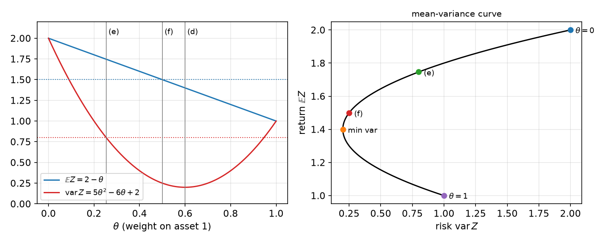
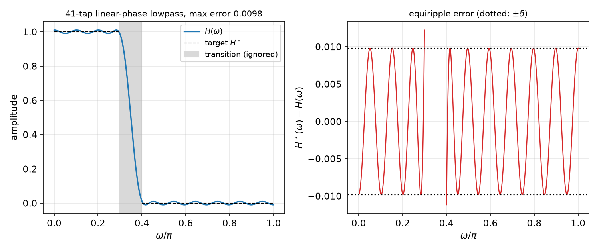
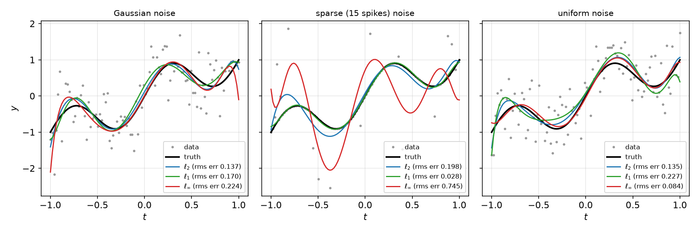
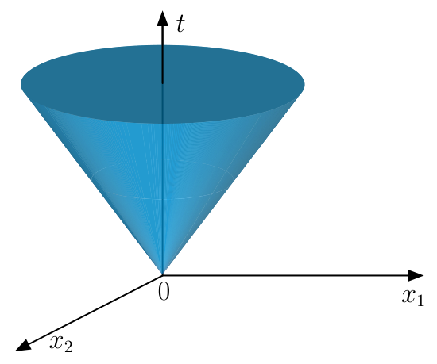
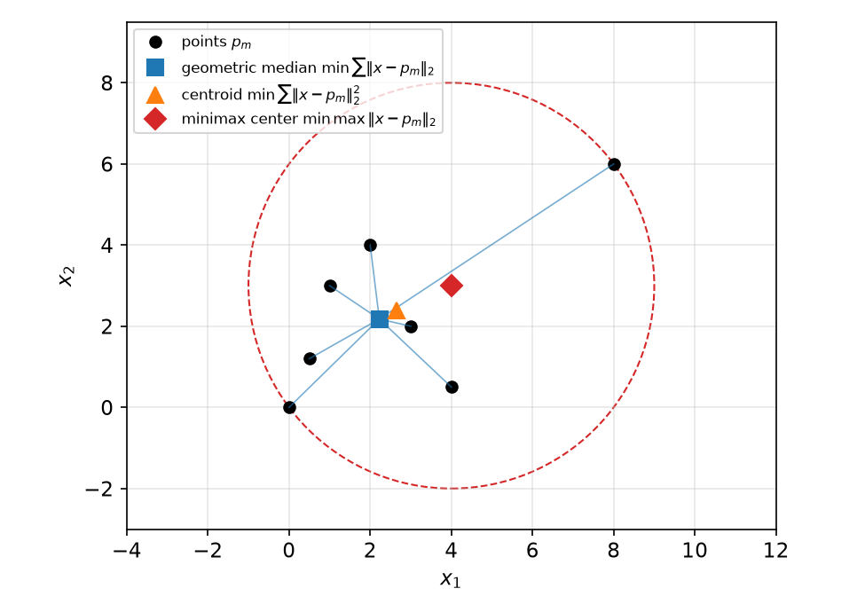

# Convex Optimization Problems and Modeling

Optimization asks us to select the "best" element of a collection. This chapter sets up the vocabulary used throughout the subsection (decision variables, objective, constraints, minimizers), explains why convexity rather than linearity is the dividing line between tractable and intractable problems, and then walks through the standard hierarchy of convex problem classes: linear programs, least squares and its regularized relatives, quadratic programs, second-order cone programs and semidefinite programs. Each class comes with applications (filter design, regression, portfolio selection, support vector machines, geometric medians, worst-case risk) and the reformulation tricks that turn an awkward-looking problem into a standard form a solver accepts. The theory of convex sets and functions that justifies all of this follows in [Convex Sets](convex-sets.md) and [Convex Functions](convex-functions.md).

## Optimization Problems

### Three ingredients

Casting a real problem as an optimization problem means identifying three things:

1. **Decision variables**: the quantities we control, collected into a vector \\(x\\).
2. An **objective function** \\(f\\): maps decision variables to a cost to be minimized (error, loss, risk) or a quality to be maximized (goodness of fit, profit).
3. A **constraint set** \\(\mathcal X\\): encodes physical limitations, budgets and design requirements.

The general problem is
\\[
\min\_{x}\ f(x) \quad \text{subject to} \quad x \in \mathcal X, \qquad f:\mathcal X\to\mathbb R .
\\]
We seek \\(\hat x \in \mathcal X\\) with
\\[
f(\hat x) \le f(x) \quad \text{for all } x\in\mathcal X .
\\]
Such an \\(\hat x\\) is called a **minimizer** of \\(f\\) over \\(\mathcal X\\), and a **solution** of the problem. The value \\(f(\hat x)\\) is the **optimal value**, often written \\(p^\star\\). We always minimize; \\(\hat x\\) maximizes \\(f\\) exactly when it minimizes \\(-f\\), so nothing is lost.

### Fundamental questions

For any problem we should ask:

1. **Existence.** Is there a solution at all? \\(f\\) might be unbounded below on \\(\mathcal X\\), or \\(\mathcal X\\) might be empty (the problem is *infeasible*). Even a bounded-below \\(f\\) need not attain its infimum: \\(\inf\_{x\ge 0} e^{-x} = 0\\) but no \\(x\\) achieves it.
2. **Uniqueness.** Is the solution unique? The defining inequality allows ties; only strict inequality \\(f(\hat x) < f(x)\\) for all \\(x\neq\hat x\\) gives a unique (strict) minimizer.
3. **Verification.** Is there a simple condition that certifies a candidate as optimal?
4. **Computation.** Is there a closed form, or at least an efficient algorithm?

The [Unconstrained Optimality and Line Search](unconstrained.md) chapter answers questions 1–3 for unconstrained convex problems; the remaining chapters of this subsection are largely about question 4.

### A warm-up: a two-asset portfolio

**Example 1.1 (Mean–variance trade-off with two assets).** Random returns \\(X\_1, X\_2\\) have means \\(\mu\_1,\mu\_2\\), variances \\(\sigma\_1^2,\sigma\_2^2\\) and covariance \\(\gamma\\). We invest a fraction \\(\theta\in[0,1]\\) in the first and \\(1-\theta\\) in the second, giving return \\(Z = \theta X\_1 + (1-\theta)X\_2\\).

*Mean.* By linearity of expectation, \\(\mathbb E Z = \theta\mu\_1 + (1-\theta)\mu\_2\\).

*Variance.* Use \\(\operatorname{var}Z = \mathbb E Z^2 - (\mathbb E Z)^2\\), \\(\mathbb E X\_i^2 = \sigma\_i^2+\mu\_i^2\\) and \\(\mathbb E X\_1X\_2 = \gamma + \mu\_1\mu\_2\\):
\\[
\mathbb E Z^2 = \theta^2(\sigma\_1^2+\mu\_1^2) + 2\theta(1-\theta)(\gamma+\mu\_1\mu\_2) + (1-\theta)^2(\sigma\_2^2+\mu\_2^2).
\\]
Subtracting \\((\theta\mu\_1+(1-\theta)\mu\_2)^2 = \theta^2\mu\_1^2 + 2\theta(1-\theta)\mu\_1\mu\_2 + (1-\theta)^2\mu\_2^2\\) removes every \\(\mu\\) term:
\\[
\operatorname{var}Z = \theta^2\sigma\_1^2 + 2\theta(1-\theta)\gamma + (1-\theta)^2\sigma\_2^2 .
\\]

Now take \\(\mu\_1 = 1\\), \\(\mu\_2 = 2\\), \\(\sigma\_1^2 = 1\\), \\(\sigma\_2^2 = 2\\), \\(\gamma=-1\\). Then \\(\mathbb E Z = 2-\theta\\) and
\\[
\operatorname{var}Z = \theta^2 + 2(1-\theta)^2 - 2\theta(1-\theta) = 5\theta^2 - 6\theta + 2 = 5(\theta-0.6)^2 + 0.2 .
\\]

- (c) *Maximize the mean.* \\(2-\theta\\) is decreasing, so \\(\theta^\star = 0\\) and \\(\mathbb E Z = 2\\): put everything in the higher-return asset.
- (d) *Minimize the variance.* From the completed square, \\(\theta^\star = 0.6\\) and \\(\operatorname{var}Z = 0.2\\). The negative covariance makes the mixture less risky than either asset alone.
- (e) *Maximize the mean subject to \\(\operatorname{var}Z\le 0.8\\).* The constraint is \\(5(\theta-0.6)^2\le 0.6\\), i.e. \\((\theta-0.6)^2\le 0.12\\), i.e. \\(\theta\in[0.6-\sqrt{0.12},\ 0.6+\sqrt{0.12}]\approx [0.254, 0.946]\subset[0,1]\\). Maximizing \\(2-\theta\\) picks the left end: \\(\theta^\star = 0.6-\sqrt{0.12}\approx 0.254\\), with \\(\mathbb E Z = 1.4+\sqrt{0.12}\approx 1.75\\).
- (f) *Minimize the variance subject to \\(\mathbb E Z\ge 1.5\\).* The constraint is \\(\theta\le 0.5\\), so the feasible set is \\([0,0.5]\\). The parabola \\(5(\theta-0.6)^2+0.2\\) is decreasing on that interval, so \\(\theta^\star = 0.5\\) with \\(\operatorname{var}Z = 0.25\\).

In (e) and (f) the unconstrained optimum is infeasible and the constrained optimum sits exactly on the boundary defined by the active constraint. This is the first glimpse of the complementary-slackness phenomenon treated in [Constrained Optimality](constrained-optimality.md).



*Figure: left, the expected return (blue, linear) and variance (red, a parabola with minimum 0.2 at θ = 0.6) against the weight θ on asset 1; dotted lines mark the constraint levels 0.8 and 1.5, and vertical lines the optima of parts (d)–(f). Right, the same family traced in the (risk, return) plane. The upper branch from the minimum-variance point to θ = 0 is the efficient frontier: no other portfolio has both higher return and lower risk.*

## Why Convexity

> "The great watershed in optimization is not between linearity and non-linearity, but convexity and non-convexity." — R. T. Rockafellar

A set \\(\mathcal C\\) is **convex** if \\(x,y\in\mathcal C\\) implies \\((1-\theta)x+\theta y\in\mathcal C\\) for all \\(\theta\in[0,1]\\). A function \\(f\\) is **convex** if \\(f(\theta x + (1-\theta) y)\le\theta f(x) + (1-\theta)f(y)\\) for all \\(x,y\\) and \\(\theta\in[0,1]\\). (Both are studied in depth in the next two chapters.)

**Definition (Convex program).** The problem \\(\min\_x f(x)\\) subject to \\(x\in\mathcal X\\) is a **convex program** if (1) \\(\mathcal X\\) is a convex subset of a real vector space (here \\(\mathbb R^N\\)) and (2) \\(f\\) is a convex function on \\(\mathcal X\\). ("Program" is a historical synonym for "optimization problem".)

Constraint sets are usually described by functional inequalities,
\\[
\mathcal X = \\{x : g\_m(x)\le b\_m,\ m=1,\dots,M\\}.
\\]
If each \\(g\_m\\) is convex, each set \\(\\{x : g\_m(x)\le b\_m\\}\\) is convex (it is a sublevel set of a convex function, see [Convex Functions](convex-functions.md)), and \\(\mathcal X\\) is the intersection of \\(M\\) convex sets. The intersection of two convex sets is convex (if \\(x,y\\) lie in both, so does every point between them), and by induction so is any finite (indeed arbitrary) intersection. So such a \\(\mathcal X\\) is convex.

What convexity buys:

- **Local minimizers are global minimizers.** Optimality can be checked by looking in a small neighbourhood for a descent direction; if there is none, we are done.
- **First-order necessary conditions are sufficient.** For an unconstrained differentiable convex \\(f\\), any point with \\(\nabla f(x^\star) = 0\\) is a global minimizer.

The upshot is that if \\(f\\) and \\(\nabla f\\) (and the \\(g\_m\\), \\(\nabla g\_m\\)) are easy to evaluate, simple algorithms such as gradient descent are provably effective. Most of this extends to non-differentiable functions via subgradients ([Nonsmooth Optimization](nonsmooth.md)).

### Convexity is not the same as efficiency

**Not every convex program is easy.** The \\((\infty,1)\\) matrix norm
\\[
f(X) = \lVert X\rVert\_{\infty,1} = \max\_{\lVert v\rVert\_\infty\le 1}\lVert Xv\rVert\_1
\\]
is a valid norm, and every norm is convex. Yet computing it is NP-hard (Rohn, 2000), and so is approximating it to fixed relative accuracy. Problems that involve it are hard despite their convexity: the obstacle is evaluating the objective, not its shape.

**Some nonconvex programs are easy.**

- *Eigenvalue problem.* For symmetric \\(A\\), \\(\max\_{x\in\mathbb R^N} x^{T}Ax\\) subject to \\(\lVert x\rVert\_2 = 1\\) maximizes an indefinite quadratic over a sphere (a nonconvex set). Its optimal value is the largest eigenvalue \\(\lambda\_{\max}(A)\\), attained at the corresponding unit eigenvector (see Eigenvalues).
- *Best rank-\\(R\\) approximation.* \\(\min\_X\sum\_{i,j=1}^{N}(X\_{ij}-A\_{ij})^2\\) subject to \\(\operatorname{rank}(X)\le R\\) has a nonconvex constraint. With the SVD \\(A = U\Sigma V^{T} = \sum\_{n=1}^{N}\sigma\_n u\_n v\_n^{T}\\), \\(\sigma\_1\ge\cdots\ge\sigma\_N\ge 0\\), the solution is the truncation \\(X^\star = \sum\_{n=1}^{R}\sigma\_n u\_n v\_n^{T}\\) (Eckart–Young; see SVD).

But change the second problem slightly, observing only the entries in an index set \\(\mathcal I\\),
\\[
\min\_X \sum\_{(i,j)\in\mathcal I}(X\_{ij}-A\_{ij})^2 \quad\text{s.t.}\quad \operatorname{rank}(X)\le R ,
\\]
and we get **matrix completion**, which is NP-hard in general. Tractable nonconvex problems tend to rely on "nice coincidences" (here, the SVD) that small perturbations destroy. Convex programs are robust to such changes: adding subspace constraints, positivity, or functionals of linear transforms keeps a problem convex.

Nonconvex problems can still often be attacked. **Convex relaxation** replaces the nonconvex part (say the rank constraint) by a well-chosen convex surrogate (the nuclear norm); for restricted classes of data the relaxed problem has the same solution ([Convex Relaxations](relaxations.md)). Alternatively one simply runs gradient descent and ignores the nonconvexity, as is routine for matrix factorization and neural networks; guarantees are lost but practice is often good.

## Linear Programming

A **linear program** (LP) has a linear objective and linear inequality constraints:
\\[
\min\_{x\in\mathbb R^N}\ c^{T}x \quad\text{s.t.}\quad a\_m^{T}x\le b\_m,\ m=1,\dots,M, \qquad\text{i.e.}\quad Ax\le b ,
\\]
where the rows of \\(A\in\mathbb R^{M\times N}\\) are the \\(a\_m^{T}\\) and \\(\le\\) between vectors is componentwise. An equality \\(a\_i^{T}x = b\_i\\) is the pair \\(a\_i^{T}x\le b\_i\\), \\((-a\_i)^{T}x\le -b\_i\\) (later chapters keep equalities separate, \\(Ax\le b\\), \\(Cx = d\\)). The feasible set is a polyhedron.

An LP can be **infeasible** (empty polyhedron) or **unbounded** (there is a sequence \\(x\_k\\) with \\(Ax\_k\le b\\) and \\(c^{T}x\_k\to-\infty\\)). There is no closed-form solution, but solvers are extremely mature: Dantzig's simplex method dates from the late 1940s (Kantorovich formulated LP in 1939, and von Neumann developed its duality theory in 1947), and interior-point methods followed in the 1980s. Structured LPs with millions of variables are solved routinely on a desktop computer. A single nonlinear term in the objective or constraints moves us into nonlinear programming, the main subject of this subsection.

**Example 1.2 (Maximizing a linear function over the classical boxes and balls).** Let \\(\alpha\in\mathbb R^N\\) be arbitrary and maximize \\(\alpha^{T}x\\) over five sets.

- (a) \\(-1\le x\_n\le 1\\). The problem separates by coordinate: \\(\max\_{\lvert x\_n\rvert\le 1}\alpha\_n x\_n = \lvert\alpha\_n\rvert\\), attained at \\(x\_n^\star = \operatorname{sign}(\alpha\_n)\\) (any \\(x\_n\in[-1,1]\\) if \\(\alpha\_n = 0\\)). Value \\(\lVert\alpha\rVert\_1\\).
- (b) \\(0\le x\_n\le 1\\). Take \\(x\_n^\star = 1\\) if \\(\alpha\_n\ge 0\\) and \\(0\\) otherwise. Value \\(\sum\_n\max(0,\alpha\_n)\\).
- (c) \\(\sum\_n x\_n\le 1\\) (no sign constraint). Usually unbounded: if some \\(\alpha\_k<0\\), send \\(x\_k\to-\infty\\); if \\(\alpha\_1>\alpha\_2\\), increase \\(x\_1\\) and decrease \\(x\_2\\) by the same amount, keeping the sum fixed. The problem is bounded exactly when \\(\alpha = c\mathbf 1\\) with \\(c\ge 0\\); then \\(\alpha^{T}x = c\sum\_n x\_n\le c\\), with value \\(c\\) attained at any \\(x\\) with \\(\sum\_n x\_n = 1\\).
- (d) \\(\sum\_n\lvert x\_n\rvert\le 1\\) (the \\(\ell\_1\\) ball). \\(\alpha^{T}x\le\sum\_n\lvert\alpha\_n\rvert\lvert x\_n\rvert\le\lVert\alpha\rVert\_\infty\lVert x\rVert\_1\le\lVert\alpha\rVert\_\infty\\), with equality at \\(x^\star = \operatorname{sign}(\alpha\_a)e\_a\\), \\(a = \arg\max\_i\lvert\alpha\_i\rvert\\). Value \\(\lVert\alpha\rVert\_\infty\\).
- (e) \\(\sum\_n x\_n^2\le 1\\) (the \\(\ell\_2\\) ball; not an LP). By Cauchy–Schwarz, \\(\alpha^{T}x\le\lVert\alpha\rVert\_2\lVert x\rVert\_2\le\lVert\alpha\rVert\_2\\), attained at \\(x^\star = \alpha/\lVert\alpha\rVert\_2\\). Value \\(\lVert\alpha\rVert\_2\\).

These values are **dual norms**: \\(\sup\_{\lVert x\rVert\le 1}\alpha^{T}x = \lVert\alpha\rVert\_\*\\), with \\(\ell\_\infty\leftrightarrow\ell\_1\\) and \\(\ell\_2\leftrightarrow\ell\_2\\). Notice also that in the LP cases (a), (b), (d) the optimum is attained at a vertex of the polyhedron, a general feature of LPs.

### Chebyshev approximation

Given \\(y\in\mathbb R^M\\) and \\(A\in\mathbb R^{M\times N}\\) with rows \\(a\_m^{T}\\), the **Chebyshev** (minimax, \\(\ell\_\infty\\)) approximation problem is
\\[
\min\_{x\in\mathbb R^N}\ \max\_{m=1,\dots,M}\lvert y\_m - a\_m^{T}x\rvert = \min\_x \lVert y-Ax\rVert\_\infty .
\\]
The objective is not linear (nor differentiable), but the problem is an LP in disguise. This is the **epigraph trick**: introduce a scalar \\(u\\) that upper-bounds every residual magnitude and minimize \\(u\\):
\\[
\min\_{x,u}\ u \quad\text{s.t.}\quad y\_m - a\_m^{T}x\le u,\quad y\_m - a\_m^{T}x\ge -u,\quad m=1,\dots,M .
\\]
At the optimum \\(u\\) equals the largest residual (if it were larger, it could be decreased). In standard form, with \\(z = (x,u)\in\mathbb R^{N+1}\\),
\\[
\min\_{z}\ c'^{T}z\quad\text{s.t.}\quad A'z\le b',\qquad
c' = \begin{bmatrix}0\\\\ 1\end{bmatrix},\quad
A' = \begin{bmatrix}-A & -\mathbf 1\\\\ A & -\mathbf 1\end{bmatrix},\quad
b' = \begin{bmatrix}-y\\\\ y\end{bmatrix}.
\\]
(First block row: \\(-a\_m^{T}x - u\le -y\_m\\), i.e. \\(y\_m - a\_m^{T}x\le u\\). Second: \\(a\_m^{T}x - u\le y\_m\\), i.e. \\(y\_m - a\_m^{T}x\ge -u\\).) Here \\(\mathbf 1\\) is the all-ones vector and \\(\mathbf 0\\) or \\(0\\) the zero vector.

**Example 1.3 (\\(\ell\_1\\) regression as an LP).** The same trick with one auxiliary variable *per residual* handles \\(\min\_x\lVert y-Ax\rVert\_1 = \min\_x\sum\_m\lvert y\_m - a\_m^{T}x\rvert\\). Introduce \\(u\in\mathbb R^M\\) with \\(-u\le y-Ax\le u\\) and minimize \\(\mathbf 1^{T}u\\); at the optimum \\(u\_m = \lvert y\_m - a\_m^{T}x\rvert\\). With \\(z = (x,u)\in\mathbb R^{N+M}\\):
\\[
\min\_z c^{T}z\ \text{ s.t. }\ Cz\le b,\qquad
c = \begin{bmatrix}0\_N\\\\ \mathbf 1\_M\end{bmatrix},\quad
C = \begin{bmatrix}A & -I\\\\ -A & -I\end{bmatrix},\quad
b = \begin{bmatrix}y\\\\ -y\end{bmatrix}.
\\]
The first block row says \\(Ax - u\le y\\), i.e. \\(y - Ax\ge -u\\); the second says \\(-Ax-u\le -y\\), i.e. \\(y-Ax\le u\\). Note that the all-ones vector has length \\(M\\) (one per residual), not \\(N\\), and both block rows carry \\(-I\\) on the \\(u\\) part.

### Application: equiripple FIR filter design

We want a finite impulse response (FIR) filter whose frequency response (DTFT) \\(H(\omega)\\) is uniformly close to a target \\(H^\star(\omega)\\):
\\[
\min\_{H}\ \sup\_{\omega\in[-\pi,\pi]}\lvert H^\star(\omega) - H(\omega)\rvert\quad\text{s.t.}\quad H\text{ is FIR}.
\\]
Minimizing the *uniform* error produces an **equiripple** design: the error oscillates with equal amplitude across the band. To keep the problem an LP we restrict to **linear phase**, i.e. a symmetric impulse response (general phase is still convex but not an LP). A symmetric filter with \\(2K+1\\) taps (\\(h\_n = h\_{-n}\\), \\(h\_n = 0\\) for \\(\lvert n\rvert>K\\)) has a real DTFT:
\\[
H(\omega) = \sum\_{n=-K}^{K}h\_n e^{-j\omega n} = h\_0 + \sum\_{k=1}^{K}h\_k\left(e^{-j\omega k}+e^{j\omega k}\right) = \sum\_{k=0}^{K}\tilde h\_k\cos(k\omega),\qquad
\tilde h\_k = \begin{cases} h\_0, & k = 0,\\\\ 2h\_k, & 1\le k\le K.\end{cases}
\\]
So the design problem is
\\[
\min\_{x\in\mathbb R^{K+1}}\ \sup\_{\omega}\Big\lvert H^\star(\omega) - \sum\_{k=0}^{K}x\_k\cos(k\omega)\Big\rvert .
\\]
This semi-infinite problem can be solved as stated by the **Parks–McClellan algorithm** (early 1970s, based on the Remez exchange), which is not obvious because of the supremum. A simple alternative is to discretize at \\(M\\) frequencies \\(\omega\_1,\dots,\omega\_M\\), which turns it into a Chebyshev approximation problem \\(\min\_x\lVert y - Fx\rVert\_\infty\\) with
\\[
y = \begin{bmatrix}H^\star(\omega\_1)\\\\ \vdots\\\\ H^\star(\omega\_M)\end{bmatrix},\qquad
F = \begin{bmatrix}1 & \cos\omega\_1 & \cos 2\omega\_1 & \cdots & \cos K\omega\_1\\\\ \vdots & & & & \vdots\\\\ 1 & \cos\omega\_M & \cos 2\omega\_M & \cdots & \cos K\omega\_M\end{bmatrix}\in\mathbb R^{M\times(K+1)} ,
\\]
and hence an LP. When the \\(\omega\_m\\) are equally spaced, \\(F\\) and \\(F^{T}\\) can be applied with a fast discrete cosine transform, which speeds up first-order solvers considerably. In practice one also leaves a **transition band** between passband and stopband out of the grid: an ideal brick-wall response is discontinuous, and no finite filter can approximate a jump uniformly (the error at the jump is at least half its height).



*Figure: a 41-tap (K = 20) linear-phase lowpass filter designed by solving the discretized Chebyshev LP with passband [0, 0.3π] (target 1), stopband [0.4π, π] (target 0) and the transition band omitted. Left: the amplitude response. Right: the error H* − H, which touches ±δ ≈ 0.0098 many times with alternating sign, the signature of a minimax optimum.*

## Least Squares and Regularization

The **least-squares** problem is
\\[
\min\_{x\in\mathbb R^N}\ \lVert y - Ax\rVert\_2^2,\qquad A\in\mathbb R^{M\times N}.
\\]

- **Full column rank** (\\(M\ge N\\), \\(\operatorname{rank}A = N\\)). The unique solution is \\(\hat x = (A^{T}A)^{-1}A^{T}y\\). With the (compact) SVD \\(A = U\Sigma V^{T}\\), \\(A^{T}A = V\Sigma^2V^{T}\\), so \\(\hat x = V\Sigma^{-2}V^{T}V\Sigma U^{T}y = V\Sigma^{-1}U^{T}y\\). The linear map \\(A^{+} = V\Sigma^{-1}U^{T}\\) is the **pseudo-inverse**.
- **Not full column rank.** The minimizer is not unique: anything in the null space of \\(A\\) can be added.
- **Underdetermined, full row rank** (\\(M<N\\), \\(\operatorname{rank}A = M\\)). Infinitely many \\(x\\) satisfy \\(Ax = y\\) exactly. The *minimum-norm* one, \\(\min\lVert x\rVert\_2\\) subject to \\(Ax = y\\), is again \\(\hat x = V\Sigma^{-1}U^{T}y\\), now with \\(U\\) and \\(\Sigma\\) of size \\(M\times M\\) and \\(V\\) of size \\(N\times M\\). It is the shortest vector obeying the \\(M\\) linear constraints.

(The projection viewpoint behind these formulas is developed in [Convex Sets](convex-sets.md).)

### Regression and its regularized forms

**Example 1.4 (Regression).** We observe pairs \\((x\_m,y\_m)\\), \\(m=1,\dots,M\\), and want a function with \\(f(x\_m)\approx y\_m\\). As stated this is ill-posed (infinitely many functions interpolate the data), so we regularize by restricting \\(f\\) to a span of basis functions,
\\[
f(x) = \sum\_{n=1}^{N}\alpha\_n\varphi\_n(x),
\\]
where \\(N\\) trades flexibility against robustness. With a loss \\(\frac1M\sum\_m\ell(\alpha; x\_m,y\_m)\\) and the squared loss \\(\ell = (y\_m - \sum\_n\alpha\_n\varphi\_n(x\_m))^2\\), define the \\(M\times N\\) matrix \\(\Phi\_{mn} = \varphi\_n(x\_m)\\), which maps coefficients to predictions. The fit is the least-squares problem \\(\min\_\alpha\lVert y - \Phi\alpha\rVert\_2^2\\).

- **Ridge regression (Tikhonov regularization).** If \\(\Phi\\) is ill-conditioned, least squares can do dramatic things to \\(\alpha\\) to chase small improvements in fit. Penalize the size of \\(\alpha\\):
  \\[
  \min\_\alpha\ \lVert y-\Phi\alpha\rVert\_2^2 + \tau\lVert\alpha\rVert\_2^2,\qquad\tau>0 .
  \\]
  This is still least squares: stacking gives \\(\left\lVert\begin{bmatrix}y\\\\ 0\end{bmatrix} - \begin{bmatrix}\Phi\\\\ \sqrt\tau I\end{bmatrix}\alpha\right\rVert\_2^2\\), and since the stacked matrix always has full column rank, the solution is unique: \\(\hat\alpha = (\Phi^{T}\Phi+\tau I)^{-1}\Phi^{T}y\\).
- **LASSO** (least absolute shrinkage and selection operator).
  \\[
  \min\_\alpha\ \lVert y-\Phi\alpha\rVert\_2^2 + \tau\lVert\alpha\rVert\_1 .
  \\]
  The \\(\ell\_1\\) penalty promotes **sparse** \\(\alpha\\) (many exact zeros), performing variable selection. There is no closed form and \\(\lVert\alpha\rVert\_1\\) is not differentiable, so this is the prototype for the nonsmooth methods of [Nonsmooth Optimization](nonsmooth.md). (See also Regularization.)

**Example 1.5 (Soft thresholding: the simplest LASSO).** With \\(\Phi = I\\) and a factor \\(\tfrac12\\), the scalar problem \\(\min\_x\tfrac12(x-u)^2+\tau\lvert x\rvert\\), \\(\tau>0\\), can be solved by hand. If \\(u\ge 0\\), any \\(x<0\\) does worse than \\(x = 0\\) (both terms are larger), so \\(x^\star\ge 0\\); on \\(x\ge 0\\) the objective is \\(\tfrac12x^2-(u-\tau)x+\text{const}\\), minimized over \\(x\ge 0\\) at \\(x^\star = \max(u-\tau,0)\\). Symmetrically, \\(u\le 0\\) gives \\(x^\star = \min(u+\tau,0)\\). Together:
\\[
x^\star = \operatorname{sign}(u)\max(\lvert u\rvert-\tau,0) =: T\_\tau(u).
\\]
For \\(u\in\mathbb R^N\\) and \\(\tfrac12\lVert x-u\rVert\_2^2+\tau\lVert x\rVert\_1\\), the objective is a sum of \\(N\\) scalar problems, so \\(x\_n^\star = T\_\tau(u\_n)\\) coordinatewise. Small entries are set exactly to zero; this is the mechanism behind LASSO sparsity, and \\(T\_\tau\\) reappears as the proximal operator of \\(\tau\lVert\cdot\rVert\_1\\).

### Choosing the norm: \\(\ell\_2\\), \\(\ell\_1\\) or \\(\ell\_\infty\\)

**Example 1.6 (Polynomial fitting under three noise models).** Fit a degree-8 polynomial (\\(N = 9\\) coefficients, Vandermonde matrix \\(A\\) with \\(M = 100\\) points on \\([-1,1]\\)) to noisy samples of \\(f(t) = 0.5\sin(\pi t)+0.5\sin(2\pi t)+t^3\\). Three noise vectors are scaled to \\(\ell\_2\\) norm 5: Gaussian, sparse (15 Gaussian spikes) and uniform. We compare least squares, \\(\min\lVert y-Ax\rVert\_1\\) and \\(\min\lVert y-Ax\rVert\_\infty\\). Least squares is a pseudo-inverse; the other two are LPs (above) or one line each in CVXPY:

```python
import cvxpy as cp, numpy as np
x_ls = np.linalg.pinv(A) @ y                      # least squares

x = cp.Variable(9)
cp.Problem(cp.Minimize(cp.norm(A @ x - y, "inf"))).solve()
x_inf = x.value                                   # Chebyshev
cp.Problem(cp.Minimize(cp.norm(A @ x - y, 1))).solve()
x_l1 = x.value                                    # l1 regression
```



*Figure: degree-8 polynomial fits (blue ℓ2, green ℓ1, red ℓ∞) to 100 noisy samples (grey) of the black curve, with the RMS error against the truth in each legend. Gaussian noise: ℓ2 is best and ℓ1 nearly as good. Sparse spikes: ℓ1 almost ignores the outliers while ℓ∞ is dragged around by them. Uniform (bounded) noise: ℓ∞ is best.*

The pattern is explained by maximum likelihood: minimizing \\(\lVert y-Ax\rVert\_p\\) is the maximum-likelihood estimate for i.i.d. noise with density proportional to \\(e^{-\lvert e\rvert^p}\\). Gaussian noise gives \\(\ell\_2\\); Laplacian, heavy-tailed or sparse noise gives \\(\ell\_1\\), which is robust to outliers; bounded uniform noise is the limit \\(p\to\infty\\), giving \\(\ell\_\infty\\).

## Quadratic Programming

Expanding the least-squares objective, \\(\lVert y-Ax\rVert\_2^2 = x^{T}A^{T}Ax - 2y^{T}Ax + y^{T}y\\), so least squares is \\(\min\_x x^{T}A^{T}Ax - 2y^{T}Ax\\). Add linear constraints (for instance \\(x\ge 0\\), giving nonnegative least squares) and we have a **quadratic program** (QP):
\\[
\min\_x\ x^{T}Hx + c^{T}x\quad\text{s.t.}\quad Ax\le b .
\\]
It is convex when \\(H\\) is symmetric positive semidefinite. If \\(H\\) has even a single negative eigenvalue, the general problem is NP-hard. QPs have been used in finance since the 1950s and are standard in operations research, control (model predictive control) and machine learning; solvers are mature.

A **quadratically constrained quadratic program** (QCQP) also allows quadratic constraints,
\\[
\min\_x\ x^{T}Hx + c^{T}x\quad\text{s.t.}\quad x^{T}H\_mx + c\_m^{T}x\le b\_m,\quad m=1,\dots,M,
\\]
and is convex when all \\(H\_m\succeq 0\\): a convex quadratic minimized over an intersection of ellipsoids (or, for singular \\(H\_m\\), paraboloid-bounded regions).

### Reformulations as QPs

**Example 1.7 (LASSO as a QP).** Write \\(\min\_x\tfrac12\lVert y-Ax\rVert\_2^2+\tau\lVert x\rVert\_1\\) as \\(\min\_z z^{T}Qz + b^{T}z\\) subject to \\(Mz\le d\\). Introduce \\(u\in\mathbb R^N\\) with \\(\tau\lvert x\_i\rvert\le u\_i\\), i.e. \\(\tau x\_i - u\_i\le 0\\) and \\(-\tau x\_i - u\_i\le 0\\), and minimize \\(\tfrac12\lVert y-Ax\rVert\_2^2+\sum\_iu\_i\\). Expanding, \\(\tfrac12\lVert y-Ax\rVert\_2^2 = \tfrac12x^{T}A^{T}Ax - y^{T}Ax + \tfrac12y^{T}y\\); drop the constant. With \\(z = (x,u)\\):
\\[
Q = \begin{bmatrix}\tfrac12A^{T}A & 0\\\\ 0 & 0\end{bmatrix},\quad
b = \begin{bmatrix}-A^{T}y\\\\ \mathbf 1\_N\end{bmatrix},\quad
M = \begin{bmatrix}\tau I & -I\\\\ -\tau I & -I\end{bmatrix},\quad
d = 0\_{2N}.
\\]
(The linear term is \\(-y^{T}Ax = (-A^{T}y)^{T}x\\).) At the optimum \\(u\_i = \tau\lvert x\_i\rvert\\); otherwise \\(u\_i\\) could be decreased, lowering the objective. Note that \\(Q\\) is only positive semidefinite, which is fine for a convex QP.

**Example 1.8 (\\(\ell\_2^2\\) fit plus an \\(\ell\_\infty\\) penalty).** For \\(\min\_x\lVert y-Ax\rVert\_2^2+\tau\lVert x\rVert\_\infty\\) a *single* scalar \\(u\\) suffices, with \\(\tau\lvert x\_n\rvert\le u\\) for all \\(n\\). With \\(z = (x,u)\in\mathbb R^{N+1}\\):
\\[
Q = \begin{bmatrix}A^{T}A & 0\\\\ 0 & 0\end{bmatrix},\quad
c = \begin{bmatrix}-2A^{T}y\\\\ 1\end{bmatrix},\quad
M = \begin{bmatrix}\tau I & -\mathbf 1\_N\\\\ -\tau I & -\mathbf 1\_N\end{bmatrix},\quad
b = 0\_{2N},
\\]
and \\(x^\star\\) is the first \\(N\\) entries of \\(z^\star\\). The contrast with Example 1.7 is instructive: a sum of absolute values needs one epigraph variable per term, a maximum needs only one.

**Example 1.9 (A sum of maxima as a QP).** \\(\min\_x\sum\_m\max(a\_m^{T}x, z\_m)+\tau\lVert x\rVert\_2^2\\) becomes
\\[
\min\_{x,u}\ \sum\_m u\_m + \tau\lVert x\rVert\_2^2\quad\text{s.t.}\quad u\_m\ge a\_m^{T}x,\quad u\_m\ge z\_m .
\\]
The problems are equivalent: if \\(u\_m<\max(a\_m^{T}x,z\_m)\\) the point is infeasible, and if \\(u\_m>\max(\cdot)\\) the objective can be lowered by decreasing \\(u\_m\\). This is the template for hinge-loss problems such as the soft-margin SVM.

### Portfolio optimization

**Example 1.10 (Markowitz portfolio).** Let \\(x\_n\\) be the fraction of wealth in asset \\(n\\), so \\(\sum\_n x\_n = 1\\) and \\(0\le x\_n\le 1\\) (no short selling). Asset returns are random multipliers with means \\(\mu\_n\\) (for example \\(\mu\_n = 1.16\\) means a 16% expected return) and covariance matrix \\(R\\). The expected return of the portfolio is \\(\mu^{T}x\\) and its variance, our measure of risk, is \\(x^{T}Rx = \sum\_{m,n}R\_{mn}x\_mx\_n\\). To achieve a target return \\(\rho\\) with minimum risk:
\\[
\min\_x\ x^{T}Rx\quad\text{s.t.}\quad\mu^{T}x\ge\rho,\quad\mathbf 1^{T}x = 1,\quad 0\le x\le\mathbf 1 .
\\]
This is a convex QP because a covariance matrix is positive semidefinite. (Markowitz, 1952; Nobel prize 1990.) Example 1.1 is the two-asset special case. As always, "optimal" means optimal for the model; how good the model (particularly the estimates of \\(\mu\\) and \\(R\\)) is, is a separate question, and the semidefinite example below addresses one aspect of it.

### Support vector machines

**Example 1.11 (Maximum-margin classifier).** Data \\(\\{(x\_i,y\_i)\\}\\) with \\(x\_i\in\mathbb R^N\\) and labels \\(y\_i\in\\{-1,+1\\}\\) are to be separated by a hyperplane \\(\\{x: w^{T}x+b = 0\\}\\). Requiring each point to be on the correct side with some slack, scaled so that
\\[
(x\_i^{T}w + b)\\,y\_i\ge 1\quad\text{for all } i ,
\\]
the distance from the hyperplane to the nearest point (the **margin**) is at least \\(1/\lVert w\rVert\_2\\): for a point with \\(\lvert w^{T}x\_i+b\rvert\ge 1\\), the distance \\(\lvert w^{T}x\_i+b\rvert/\lVert w\rVert\_2\ge 1/\lVert w\rVert\_2\\) (see the hyperplane-distance formula in [Convex Sets](convex-sets.md)). Maximizing the margin is therefore
\\[
\min\_{w,b}\ \lVert w\rVert\_2^2\quad\text{s.t.}\quad (x\_i^{T}w+b)\\,y\_i\ge 1\ \ \forall i ,
\\]
a QP. When the data are not separable, slack variables and a hinge-loss penalty (Example 1.9) give the soft-margin SVM. (See Supervised Learning.)

## Second-Order Cone Programming

The **second-order cone** (Lorentz cone, "ice-cream cone") in \\(\mathbb R^{N+1}\\) is
\\[
\mathcal K\_{N+1} = \\{(x,t): x\in\mathbb R^N,\ t\in\mathbb R,\ \lVert x\rVert\_2\le t\\}.
\\]



*Figure: the second-order cone {(x₁, x₂, t) : ‖(x₁, x₂)‖₂ ≤ t} in ℝ³, a solid circular cone with its apex at the origin opening upward along the t axis. Each horizontal slice at height t is a disk of radius t.*

A **second-order cone program** (SOCP) in standard form is
\\[
\min\_x\ c^{T}x\quad\text{s.t.}\quad\lVert A\_mx+b\_m\rVert\_2\le c\_m^{T}x+d\_m,\quad m=1,\dots,M ,
\\]
which says that the affine images \\((A\_mx+b\_m,\ c\_m^{T}x+d\_m)\\) of \\(x\\) lie in second-order cones. LPs are SOCPs (take \\(A\_m = 0\\), \\(b\_m = 0\\)); so are convex QPs and convex QCQPs, via the identity
\\[
x^{T}Px + q^{T}x + r\le 0\iff\left\lVert\begin{bmatrix}P^{1/2}x\\\\ \tfrac12(1+q^{T}x+r)\end{bmatrix}\right\rVert\_2\le\tfrac12(1-q^{T}x-r),
\\]
which follows by squaring both sides (\\((1-s)^2/4-(1+s)^2/4 = -s\\) with \\(s = q^{T}x + r\\)); a quadratic objective is moved into the constraints with the epigraph trick. SOCPs include much more, as the next example shows.

**Example 1.12 (Generalized geometric medians).** Given points \\(p\_1,\dots,p\_M\in\mathbb R^N\\), the **geometric median** minimizes the sum of (unsquared) Euclidean distances,
\\[
\min\_x\ \sum\_{m=1}^{M}\lVert x-p\_m\rVert\_2 .
\\]
For \\(N = 1\\) this is the ordinary median. For \\(M = 3\\), \\(N\ge 2\\) it is Fermat's problem, solved geometrically by Torricelli in the 17th century; in general there is no closed form. With one epigraph variable per term it becomes the SOCP
\\[
\min\_{x,t}\ \sum\_{m=1}^{M}t\_m\quad\text{s.t.}\quad\lVert x-p\_m\rVert\_2\le t\_m,\quad m=1,\dots,M .
\\]
The **minimax** variant \\(\min\_x\max\_m\lVert x-p\_m\rVert\_2\\) (the center of the smallest enclosing ball) needs only one variable:
\\[
\min\_{x,t}\ t\quad\text{s.t.}\quad\lVert x-p\_m\rVert\_2\le t,\quad m=1,\dots,M .
\\]



*Figure: seven points (black), one of them far from the rest. The geometric median (blue square, computed by Weiszfeld's iteration) stays with the cluster; the centroid (orange triangle, the least-squares solution) is pulled toward the outlier; the minimax center (red diamond) is the center of the smallest enclosing circle (dashed) and is determined entirely by the extreme points. The three solutions are the ℓ1, ℓ2 and ℓ∞ "averages" of the distance vector.*

## Semidefinite Programming

Let \\(\mathbb S^N\\) denote the symmetric \\(N\times N\\) matrices, \\(\mathbb S^N\_+\\) the positive semidefinite ones, and use the trace inner product \\(\langle Y,X\rangle = \operatorname{trace}(Y^{T}X) = \sum\_{i,j}Y\_{ij}X\_{ij}\\) (the ordinary inner product of the vectorized matrices). A **semidefinite program** (SDP) in standard form is
\\[
\min\_{X}\ \langle C,X\rangle\quad\text{s.t.}\quad\langle A\_m,X\rangle\le b\_m,\quad m=1,\dots,M,\qquad X\in\mathbb S^N\_+ ,
\\]
with \\(C, A\_m\in\mathbb S^N\\): a linear objective, linear constraints and the constraint that the matrix variable be positive semidefinite. This is the broadest class in this chapter: LPs (diagonal \\(X\\)), QPs and SOCPs are special cases. The SOCP constraint \\(\lVert u\rVert\_2\le t\\), for instance, is equivalent (by a Schur complement) to
\\[
\begin{bmatrix} tI & u\\\\ u^{T} & t\end{bmatrix}\succeq 0 .
\\]

**Example 1.13 (Worst-case portfolio risk).** For a fixed allocation \\(x\\), suppose the covariance is known only within elementwise bounds \\(L\_{mn}\le R\_{mn}\le U\_{mn}\\). The worst-case risk is
\\[
\max\_R\ x^{T}Rx\quad\text{s.t.}\quad L\_{mn}\le R\_{mn}\le U\_{mn},\quad R\in\mathbb S^N\_+ .
\\]
The objective is linear in the variable \\(R\\): \\(x^{T}Rx = \sum\_{m,n}R\_{mn}x\_mx\_n = \langle R,\ xx^{T}\rangle\\). The box constraints are linear, and the PSD constraint is essential: without it the maximizing \\(R\\) might not be a valid covariance matrix, and the resulting "risk" could not be realized by any random vector. So this is an SDP (written as a maximization; negate \\(C = xx^{T}\\) for standard form).

## Reformulation Toolkit

The examples used a handful of tricks repeatedly; they are worth stating once:

- **Epigraph variables.** \\(\min f(x)\\) is equivalent to \\(\min\_{x,t} t\\) subject to \\(f(x)\le t\\). For \\(f = \max\_m f\_m\\) this gives the constraints \\(f\_m(x)\le t\\) for all \\(m\\) (Chebyshev, minimax median, Example 1.8).
- **One variable per term for sums.** \\(\sum\_m\lvert r\_m\rvert\\) becomes \\(\sum\_m u\_m\\) with \\(-u\_m\le r\_m\le u\_m\\); \\(\sum\_m\lVert r\_m\rVert\_2\\) becomes \\(\sum\_m t\_m\\) with \\(\lVert r\_m\rVert\_2\le t\_m\\) (\\(\ell\_1\\) regression, LASSO, geometric median).
- **Absolute values and maxima are pairs of linear inequalities**: \\(\lvert r\rvert\le u\iff r\le u,\ -r\le u\\); \\(\max(a,b)\le u\iff a\le u,\ b\le u\\).
- **Equalities as two inequalities**, and inequalities as equalities with a nonnegative slack: \\(a^{T}x\le b\iff a^{T}x + s = b,\ s\ge 0\\).
- **Stacking** to absorb quadratic penalties into least squares (ridge regression).
- **Lifting a quadratic form to a matrix**: \\(x^{T}Rx = \langle R, xx^{T}\rangle\\), linear in \\(R\\) (SDP risk bound) or, with \\(X = xx^{T}\\) relaxed to \\(X\succeq xx^{T}\\), the starting point of semidefinite relaxations.

In each case the correctness argument is the same: at an optimum the auxiliary variable must equal the quantity it bounds, because otherwise it could be moved to improve the objective. With these tools a modeling language such as CVXPY (Python) or CVX (MATLAB) can accept problems written naturally and translate them into LP/QP/SOCP/SDP form automatically.

## Summary

- An optimization problem has decision variables \\(x\\), an objective \\(f\\) and a constraint set \\(\mathcal X\\); a minimizer satisfies \\(f(\hat x)\le f(x)\\) for all feasible \\(x\\). Ask: existence, uniqueness, verification, computation.
- A convex program has a convex \\(f\\) and a convex \\(\mathcal X\\) (for instance \\(\\{g\_m(x)\le b\_m\\}\\) with convex \\(g\_m\\)). Local minima are global and first-order conditions are sufficient. Convexity is the watershed, though not a guarantee of tractability (\\(\lVert X\rVert\_{\infty,1}\\) is NP-hard), and some nonconvex problems (eigenvalues, truncated SVD) are easy.
- Hierarchy: LP \\(\subset\\) convex QP \\(\subset\\) convex QCQP \\(\subset\\) SOCP \\(\subset\\) SDP.
- Chebyshev approximation \\(\min\lVert y-Ax\rVert\_\infty\\) and \\(\ell\_1\\) regression are LPs; equiripple linear-phase FIR design is a Chebyshev problem.
- Least squares \\(\hat x = (A^{T}A)^{-1}A^{T}y = V\Sigma^{-1}U^{T}y\\); ridge \\((\Phi^{T}\Phi+\tau I)^{-1}\Phi^{T}y\\); LASSO has no closed form and produces sparsity (soft thresholding \\(T\_\tau(u) = \operatorname{sign}(u)\max(\lvert u\rvert-\tau,0)\\)).
- The loss should match the noise: \\(\ell\_2\\) for Gaussian, \\(\ell\_1\\) for outliers, \\(\ell\_\infty\\) for bounded noise.
- Markowitz portfolio and the SVM are QPs; geometric medians are SOCPs; worst-case covariance is an SDP.
- Epigraph variables, per-term auxiliaries and stacking convert most "awkward" convex objectives into standard forms.

## See Also

- [Convex Sets](convex-sets.md) and [Convex Functions](convex-functions.md): the theory behind "convex program".
- [Unconstrained Optimality and Line Search](unconstrained.md): existence, uniqueness and optimality conditions.
- [Duality](duality.md), [Constrained Algorithms](constrained-algorithms.md) and [Convex Relaxations](relaxations.md): how these problem classes are solved and extended.
- Convex Optimization (overview) and Optimization: the shorter survey pages.
- [Optimization for Control](../ae8803-optimal-learning-control/optimization.md): QPs in model predictive control.
- Singular Value Decomposition and Eigenvalues and Eigenvectors: pseudo-inverse, low-rank approximation and the Rayleigh quotient.
- Regularization and Supervised Learning: ridge, LASSO and SVMs in machine learning.
