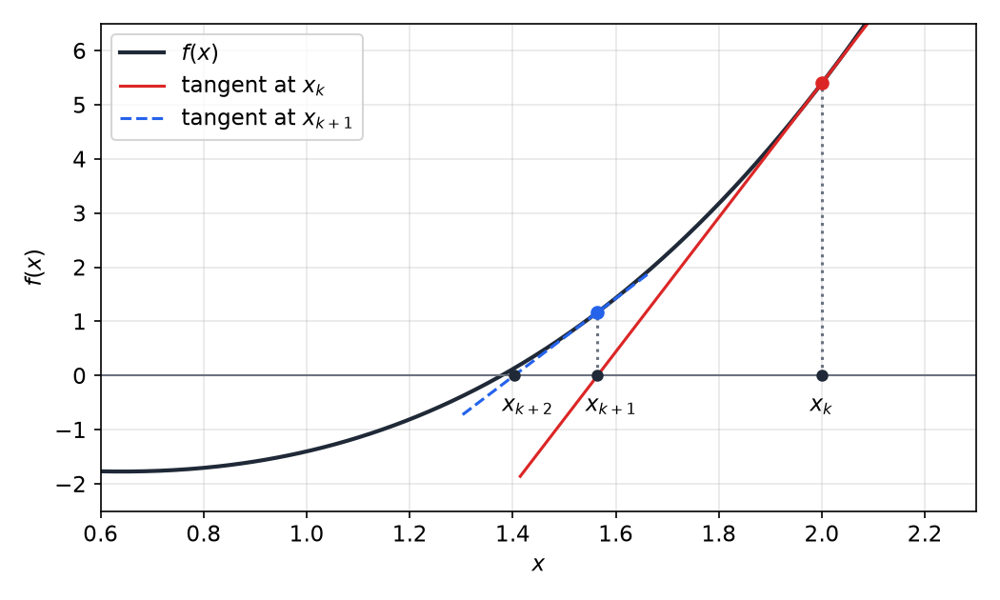
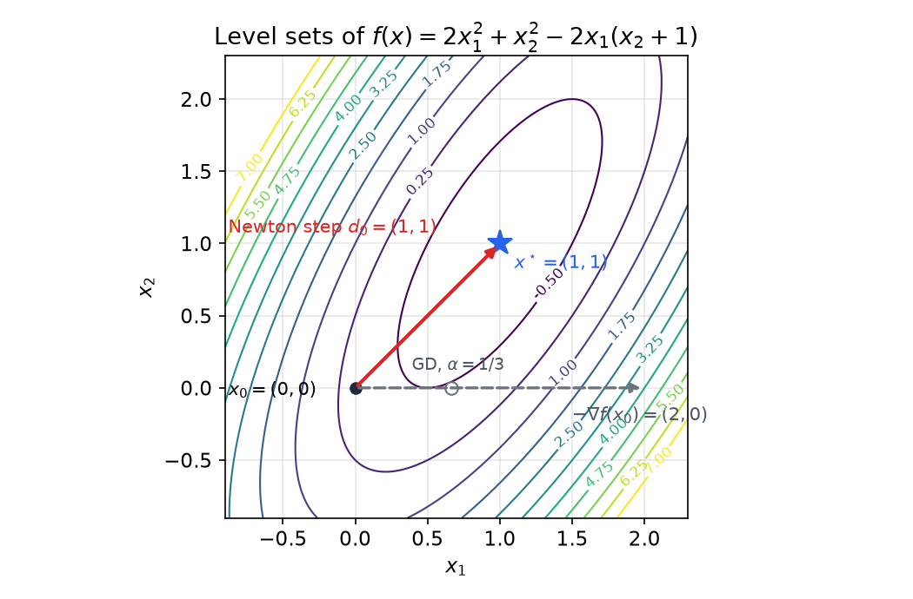
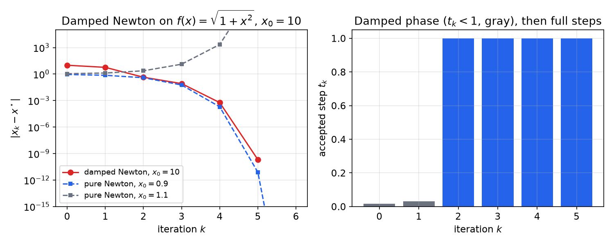
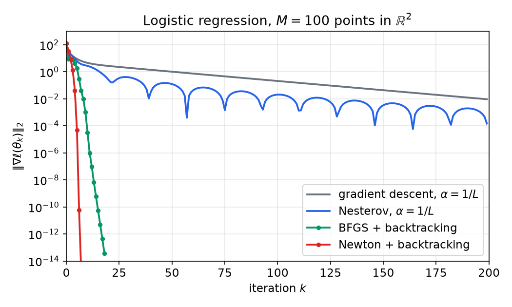
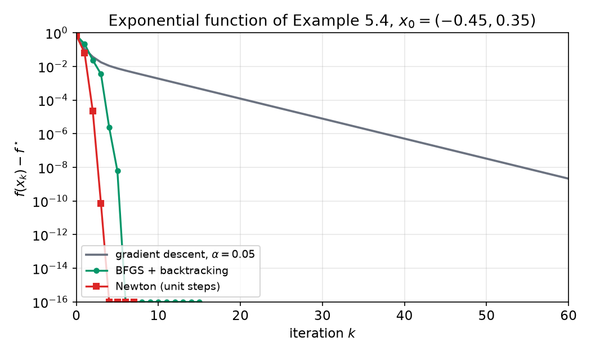

# Newton and Quasi-Newton Methods

Gradient descent uses only first derivatives, and its speed is governed by the condition number \\(\kappa\\). Newton's method also uses curvature: at each iterate it minimizes the best local quadratic model of \\(f\\), so its step adapts to the shape of the sublevel sets and not only to their scale. Near a solution it converges quadratically, and its iterates do not change under invertible linear changes of variables. Quasi-Newton methods keep much of this behavior while replacing the Hessian by an approximation built from observed gradient differences, of which BFGS is the standard example. The [previous chapter](first-order-methods.md) promised that Newton's method solves the quadratic of Example 5.1 in one step; this chapter proves that claim and the general theory behind it.

## Newton's Method for Root Finding

Newton's method was invented for equations, and the optimization method is a special case of it. Let \\(\varphi:\mathbb{R}\to\mathbb{R}\\) be differentiable. At an iterate \\(x\_k\\), replace \\(\varphi\\) by its tangent line and let \\(x\_{k+1}\\) be the zero of that line:
\\[
x\_{k+1} = x\_k - \frac{\varphi(x\_k)}{\varphi'(x\_k)}.
\\]
The step requires \\(\varphi'(x\_k)\neq 0\\), and which root is found depends on \\(x\_0\\). The method is a local tool. Once the iterates are close to a root, the error is squared at every step.

**Theorem (local quadratic convergence).** Let \\(\varphi\\) be twice continuously differentiable on an interval \\(I\\) that contains a root \\(x^\star\\), and assume \\(\varphi'(x)\neq 0\\) for all \\(x\in I\\). If \\(x\_k\in I\\), then
\\[
\lvert x\_{k+1}-x^\star\rvert \le C\\,\lvert x\_k-x^\star\rvert^2,\qquad C=\frac{\sup\_{\xi\in I}\lvert\varphi''(\xi)\rvert}{2\\,\inf\_{x\in I}\lvert\varphi'(x)\rvert}.
\\]

*Proof.* Taylor's theorem with the Lagrange remainder, expanded at \\(x\_k\\) and evaluated at \\(x^\star\\), gives a point \\(\xi\\) between \\(x\_k\\) and \\(x^\star\\) with
\\[
0=\varphi(x^\star)=\varphi(x\_k)+\varphi'(x\_k)(x^\star-x\_k)+\tfrac12\varphi''(\xi)(x^\star-x\_k)^2 .
\\]
Rearranging gives \\(\varphi'(x\_k)(x\_k-x^\star)-\varphi(x\_k)=\tfrac12\varphi''(\xi)(x\_k-x^\star)^2\\). The left side equals \\(\varphi'(x\_k)(x\_{k+1}-x^\star)\\), because \\(x\_{k+1}-x^\star=(x\_k-x^\star)-\varphi(x\_k)/\varphi'(x\_k)\\). Therefore
\\[
x\_{k+1}-x^\star=\frac{\varphi''(\xi)}{2\\,\varphi'(x\_k)}\\,(x\_k-x^\star)^2,
\\]
and the bound follows by taking absolute values over \\(I\\). ∎

The bound says that if the current error is \\(10^{-3}\\) and \\(C\approx 1\\), the next error is about \\(10^{-6}\\). The number of correct digits roughly doubles at every step. The constant \\(C\\) depends on the function only through its second derivative and the slope of \\(\varphi\\) near the root, which is why the theorem needs \\(\varphi'\\) to stay away from zero.

**Example 6.1 (Square roots).** Take \\(\varphi(x)=x^2-2\\), whose positive root is \\(\sqrt2\\). The Newton update is \\(x\_{k+1}=\tfrac12\\,(x\_k+2/x\_k)\\), and a direct computation gives the exact identity
\\[
x\_{k+1}-\sqrt2=\frac{(x\_k-\sqrt2)^2}{2x\_k}.
\\]
Starting from \\(x\_0=1\\), the iterates are \\(1.5\\), \\(1.4166667\\), \\(1.4142157\\), \\(1.41421356\\), with errors \\(0.41421\\), \\(0.085786\\), \\(0.0024531\\), \\(2.12\\times10^{-6}\\) and \\(1.59\\times10^{-12}\\). On \\(I=[1,2]\\) the theorem gives \\(C=\tfrac{2}{2\cdot 2}=\tfrac12\\), and the exact identity shows that \\(\tfrac{1}{2x\_k}\le\tfrac12\\) there, so the bound is attained in the form stated.



*Figure: Newton's method for root finding on \\(f(x)=x^3+0.6x^2-2x-1\\), started at \\(x\_k=2\\). Each step follows the tangent line at the current point to where it meets zero. The iterates \\(x\_{k+1}\\) and \\(x\_{k+2}\\) approach the root near \\(1.38\\) within two steps.*

## Newton's Method for Minimization

Let \\(f:\mathbb{R}^N\to\mathbb{R}\\) be convex and twice differentiable. A minimizer satisfies \\(\nabla f(x^\star)=0\\), so applying Newton's method to \\(\varphi=f'\\) in one dimension gives \\(x\_{k+1}=x\_k-f'(x\_k)/f''(x\_k)\\). The multivariate method has a clearer interpretation. Write \\(g\_k=\nabla f(x\_k)\\) and \\(H\_k=\nabla^2 f(x\_k)\\), and expand \\(f\\) to second order at \\(x\_k\\):
\\[
m\_k(y)=f(x\_k)+\langle y-x\_k,\\,g\_k\rangle+\tfrac12\\,(y-x\_k)^{T}H\_k\\,(y-x\_k).
\\]
If \\(H\_k\\) is positive definite, the model \\(m\_k\\) has the unique minimizer \\(x\_k-H\_k^{-1}g\_k\\). The **Newton step** is therefore
\\[
d\_k=-H\_k^{-1}g\_k, \qquad x\_{k+1}=x\_k+d\_k,
\\]
which is the solution of the linear system \\(H\_k\\,d=-g\_k\\). The version with unit steps is called **pure Newton**. The damped version \\(x\_{k+1}=x\_k+t\_kd\_k\\), with a step \\(t\_k\\) chosen by backtracking, is the one analyzed below.

Three facts about the step explain its behavior.

- **It is a descent direction.** Since \\(H\_k\\) is positive definite, \\(\langle g\_k,d\_k\rangle=-g\_k^{T}H\_k^{-1}g\_k<0\\) whenever \\(g\_k\neq0\\).
- **It respects the geometry.** It uses the Hessian to decide how far to move in each direction, so a direction with large curvature is taken with a short step and one with small curvature with a long step.
- **It is exact on quadratics.** If \\(f(x)=\tfrac12 x^{T}Qx-b^{T}x\\) with \\(Q\succ0\\), then \\(m\_k=f\\) for every \\(k\\), and pure Newton gives \\(x\_1=x\_0-Q^{-1}(Qx\_0-b)=Q^{-1}b=x^\star\\) from any starting point.

**Example 6.2 (One step on a quadratic).** Take the function of Example 5.1, \\(f(x)=2x\_1^2+x\_2^2-2x\_1(x\_2+1)\\). Its gradient and Hessian are
\\[
\nabla f(x)=\begin{bmatrix} 4x\_1-2x\_2-2\\\\ 2x\_2-2x\_1\end{bmatrix},\qquad \nabla^2 f(x)=\begin{bmatrix} 4 & -2\\\\ -2 & 2\end{bmatrix}.
\\]
The Hessian has determinant \\(4\\), so \\(H^{-1}=\tfrac14\begin{bmatrix} 2 & 2\\\\ 2 & 4\end{bmatrix}\\). At \\(x\_0=(0,0)\\) the gradient is \\(g\_0=(-2,0)\\), and the Newton direction is
\\[
d\_0=-H^{-1}g\_0=-\tfrac14\begin{bmatrix} 2 & 2\\\\ 2 & 4\end{bmatrix}\begin{bmatrix}-2\\\\ 0\end{bmatrix}=(1,1).
\\]
So \\(x\_1=(1,1)=x^\star\\), in one step. The gradient direction \\((2,0)\\) does not point at the minimizer, because the level sets are ellipses tilted along the diagonal. The Hessian accounts for that tilt, which is exactly what the gradient ignores.



*Figure: level sets of the quadratic of Example 6.2. From \\(x\_0=(0,0)\\), the dashed arrow is the negative gradient \\((2,0)\\), and the red arrow is the Newton step \\((1,1)\\), which lands on the minimizer \\(x^\star=(1,1)\\). The open circle is the gradient step with the balanced step size \\(\alpha=1/3\\), which lands at \\((2/3,0)\\).*

## Affine Invariance and the Newton Decrement

Let \\(A\\) be an invertible matrix and define \\(\tilde f(x)=f(Ax)\\). The chain rule gives \\(\nabla\tilde f(x)=A^{T}\nabla f(Ax)\\) and \\(\nabla^2\tilde f(x)=A^{T}\nabla^2 f(Ax)\\,A\\).

**Lemma (affine invariance).** Let \\(\tilde x\_k\\) be the pure Newton iterates for \\(\tilde f\\) started at \\(\tilde x\_0=A^{-1}x\_0\\). Then \\(\tilde x\_k=A^{-1}x\_k\\) for all \\(k\\), where \\(x\_k\\) are the pure Newton iterates for \\(f\\) started at \\(x\_0\\).

*Proof.* Induction on \\(k\\). Suppose \\(\tilde x=A^{-1}x\\). With \\(g=\nabla f(x)\\) and \\(H=\nabla^2 f(x)\\), the Newton step for \\(\tilde f\\) is
\\[
\tilde d=-(A^{T}HA)^{-1}A^{T}g=-A^{-1}H^{-1}A^{-T}A^{T}g=-A^{-1}H^{-1}g=A^{-1}d ,
\\]
so \\(\tilde x+\tilde d=A^{-1}(x+d)\\). ∎

The lemma says that Newton's iterates do not depend on how the variables are scaled. Gradient descent does depend on it, which is why its rate is governed by \\(\kappa\\). The gradient norm is not invariant, because \\(\lVert\nabla\tilde f(x)\rVert\_2\ne\lVert\nabla f(Ax)\rVert\_2\\) in general. A stopping rule based on it therefore depends on the coordinates chosen. The **Newton decrement** removes that dependence:
\\[
\lambda(x)=\sqrt{\nabla f(x)^{T}\\,\nabla^2 f(x)^{-1}\\,\nabla f(x)} .
\\]
Using the same transformation rules, \\(\lambda\\) of the transformed problem at the transformed point equals \\(\lambda(x)\\). The decrement has two useful interpretations. First, \\(\lambda(x)^2=-\langle\nabla f(x),d(x)\rangle\\), so it is the rate at which the model predicts decrease along the Newton step. Second, if \\(\mu I\preceq\nabla^2 f\preceq LI\\), then the eigenvalue bounds on \\(H^{-1}\\) give
\\[
\frac{\lVert\nabla f(x)\rVert\_2^2}{L}\le\lambda(x)^2\le\frac{\lVert\nabla f(x)\rVert\_2^2}{\mu},\qquad \lVert d(x)\rVert\_2^2\le\frac{\lambda(x)^2}{\mu}.
\\]
A natural stopping rule is therefore \\(\lambda(x\_k)\\) below a tolerance, which is comparable to the gradient norm but does not depend on the coordinates.

## Global Convergence: Damped and Quadratic Phases

The local result of the first section needs \\(x\_k\\) to start near the solution. For a global guarantee we need the step size to be chosen safely. The standard assumptions are the following.

**Assumptions.** There are constants \\(0<\mu\le L\\) and \\(Q>0\\) such that for all \\(x,y\\)
\\[
\mu I\preceq\nabla^2 f(x)\preceq LI,\qquad \lVert\nabla^2 f(x)-\nabla^2 f(y)\rVert\_2\le Q\\,\lVert x-y\rVert\_2 .
\\]
The first condition makes \\(f\\) strongly convex and \\(L\\)-smooth. The second says that the Hessian is Lipschitz.

**Algorithm (Newton with backtracking).** Fix \\(c\in(0,\tfrac13)\\) and \\(\beta\in(0,1)\\). At each iteration compute \\(d\_k=-H\_k^{-1}g\_k\\), set \\(t=1\\), and while \\(f(x\_k+td\_k)>f(x\_k)+c\\,t\langle g\_k,d\_k\rangle\\) replace \\(t\\) by \\(\beta t\\). Then set \\(x\_{k+1}=x\_k+td\_k\\).

**Theorem (Newton with backtracking).** Under the assumptions above, let
\\[
\gamma=c\\,\min\Big\\{1,\frac{2\beta(1-c)\mu}{L}\Big\\}\\,\frac{\mu^4}{L\\,Q^2},\qquad \varepsilon\_0=\frac{2\mu^3}{Q^2}.
\\]
For every \\(0<\varepsilon\le\varepsilon\_0/2\\) and every
\\[
k \ge \frac{f(x\_0)-f^\star}{\gamma}+1+\log\_2\log\_2\frac{\varepsilon\_0}{\varepsilon},
\\]
the iterate satisfies \\(f(x\_k)-f^\star\le\varepsilon\\).

*Proof.* Write \\(\lambda\_k^2=g\_k^{T}H\_k^{-1}g\_k\\), so that \\(\langle g\_k,d\_k\rangle=-\lambda\_k^2\\). The bounds of the previous section give \\(\lVert d\_k\rVert\_2^2\le\lambda\_k^2/\mu\\) and \\(\lambda\_k^2\ge\lVert g\_k\rVert\_2^2/L\\). Strong convexity gives the Polyak–Łojasiewicz inequality \\(f(x)-f^\star\le\lVert\nabla f(x)\rVert\_2^2/(2\mu)\\), as in the previous chapter.

*Step 1: the accepted step is not too small.* By \\(L\\)-smoothness, for \\(t\in(0,1]\\),
\\[
f(x\_k+td\_k)\le f(x\_k)-t\lambda\_k^2+\tfrac L2 t^2\lVert d\_k\rVert\_2^2 .
\\]
The Armijo inequality \\(f(x\_k+td\_k)\le f(x\_k)-ct\lambda\_k^2\\) therefore holds whenever \\(\tfrac L2 t\lVert d\_k\rVert\_2^2\le(1-c)\lambda\_k^2\\), that is, for all \\(t\le 2(1-c)\lambda\_k^2/(L\lVert d\_k\rVert\_2^2)\\). Since \\(\lVert d\_k\rVert\_2^2\le\lambda\_k^2/\mu\\), this threshold is at least \\(2(1-c)\mu/L\\). The backtracking rule therefore accepts a step \\(t\_k\\) with
\\[
t\_k\ge\bar t:=\min\Big\\{1,\frac{2\beta(1-c)\mu}{L}\Big\\}.
\\]
Indeed, either \\(t\_k=1\\), or the trial \\(t\_k/\beta\\) was rejected, which means \\(t\_k/\beta\\) exceeds the threshold, so \\(t\_k\\) exceeds \\(\beta\\) times it.

*Step 2: the damped phase decreases \\(f\\) by a fixed amount.* Suppose \\(\lVert g\_k\rVert\_2\ge\mu^2/Q\\). Then
\\[
f(x\_{k+1})\le f(x\_k)-c\\,t\_k\lambda\_k^2\le f(x\_k)-c\\,\bar t\\,\lambda\_k^2\le f(x\_k)-c\\,\bar t\\,\frac{\mu^4}{LQ^2}=f(x\_k)-\gamma .
\\]

*Step 3: near the solution the unit step is accepted and the gradient is squared.* Suppose \\(\lVert g\_k\rVert\_2<\mu^2/Q\\). Since \\(\lambda\_k^2\le\lVert g\_k\rVert\_2^2/\mu\\), we get \\(\lambda\_k<\mu^{3/2}/Q\\), that is, \\(Q\lambda\_k/\mu^{3/2}<1\\). Taylor's formula with the integral remainder and the Lipschitz Hessian gives
\\[
f(x\_k+d\_k)\le f(x\_k)+\langle g\_k,d\_k\rangle+\tfrac12 d\_k^{T}H\_k d\_k+\tfrac Q6\lVert d\_k\rVert\_2^3 .
\\]
Here \\(\langle g\_k,d\_k\rangle=-\lambda\_k^2\\), \\(d\_k^{T}H\_kd\_k=\lambda\_k^2\\) and \\(\lVert d\_k\rVert\_2^3\le\lambda\_k^3/\mu^{3/2}\\). Hence, if \\(\lambda\_k>0\\),
\\[
f(x\_k+d\_k)-f(x\_k)\le-\tfrac12\lambda\_k^2+\tfrac Q6\\,\frac{\lambda\_k^3}{\mu^{3/2}}<-\tfrac12\lambda\_k^2+\tfrac16\lambda\_k^2=-\tfrac13\lambda\_k^2\le-c\\,\lambda\_k^2 .
\\]
The strict inequality uses \\(Q\lambda\_k/\mu^{3/2}<1\\), and the last one uses \\(c<\tfrac13\\). So the unit step \\(t\_k=1\\) is accepted. Since \\(g\_k+H\_kd\_k=0\\), the fundamental theorem of calculus gives
\\[
g\_{k+1}=\nabla f(x\_k+d\_k)-g\_k-H\_kd\_k=\int\_0^1\big(\nabla^2 f(x\_k+sd\_k)-H\_k\big)\\,d\_k\\,ds .
\\]
The Lipschitz Hessian bounds the integrand by \\(Qs\lVert d\_k\rVert\_2\\), so
\\[
\lVert g\_{k+1}\rVert\_2\le\frac Q2\lVert d\_k\rVert\_2^2\le\frac{Q}{2\mu^2}\lVert g\_k\rVert\_2^2 .
\\]

*Step 4: combining the phases.* Let \\(e\_k=\tfrac{Q}{2\mu^2}\lVert g\_k\rVert\_2\\). Step 3 says that \\(e\_k<\tfrac12\\) implies \\(e\_{k+1}\le e\_k^2<e\_k<\tfrac12\\). So once an iterate enters the region \\(e<\tfrac12\\), it stays there. Let \\(\ell\\) be the first index with \\(e\_\ell<\tfrac12\\). Every iteration before \\(\ell\\) belongs to the damped phase of Step 2, and \\(f\\) is nonincreasing and bounded below by \\(f^\star\\), so \\(\ell\le (f(x\_0)-f^\star)/\gamma\\). For \\(k\ge\ell\\), iterating \\(e\_{k+1}\le e\_k^2\\) gives \\(e\_k\le(\tfrac12)^{2^{k-\ell}}\\). By the Polyak–Łojasiewicz inequality,
\\[
f(x\_k)-f^\star\le\frac{\lVert g\_k\rVert\_2^2}{2\mu}=\frac{2\mu^3}{Q^2}\\,e\_k^2\le\varepsilon\_0\Big(\frac12\Big)^{2^{k-\ell+1}} .
\\]
This is at most \\(\varepsilon\\) once \\(2^{k-\ell+1}\ge\log\_2(\varepsilon\_0/\varepsilon)\\), that is, once \\(k\ge\ell-1+\log\_2\log\_2(\varepsilon\_0/\varepsilon)\\). The stated bound on \\(k\\) guarantees this, and also \\(k\ge\ell+1\\) when \\(\varepsilon\le\varepsilon\_0/2\\). ∎

The proof shows the two phases clearly. The damped phase costs at most \\((f(x\_0)-f^\star)/\gamma\\) iterations, and the constant \\(\gamma\\) is small when \\(\mu\\) is small relative to \\(L\\) and \\(Q\\). The quadratic phase costs only \\(\log\_2\log\_2(\varepsilon\_0/\varepsilon)\\) more iterations, which is at most about six even for a precision of \\(10^{-20}\\) relative to \\(\varepsilon\_0\\). The bound is conservative, and in practice the damped phase is usually short, as the examples below show.

**Example 6.3 (Damped Newton on \\(\sqrt{1+x^2}\\)).** Let \\(f(x)=\sqrt{1+x^2}\\). Then \\(f'(x)=x(1+x^2)^{-1/2}\\) and \\(f''(x)=(1+x^2)^{-3/2}\\), so \\(f'/f''=x(1+x^2)\\) and the pure Newton map is
\\[
x\_{k+1}=x\_k-x\_k(1+x\_k^2)=-x\_k^3 .
\\]
Pure Newton therefore converges to the minimizer \\(0\\) when \\(\lvert x\_0\rvert<1\\), cycles between \\(\pm1\\) when \\(\lvert x\_0\rvert=1\\), and diverges when \\(\lvert x\_0\rvert>1\\). The function is not strongly convex, since \\(f''\\) tends to zero, so the theorem does not apply globally. The damped method still works. Start from \\(x\_0=10\\), with \\(c=\tfrac14\\) and \\(\beta=\tfrac12\\). The Newton step there is \\(-f'/f''=-1010\\), which overshoots badly. The backtracking rule accepts \\(t\_0=\tfrac1{64}\\), giving \\(x\_1\approx-5.78\\). At \\(x\_1\\) the rule accepts \\(t\_1=\tfrac1{32}\\), giving \\(x\_2\approx0.438\\). From then on \\(t\_k=1\\), and the iteration is the pure map \\(x\_{k+1}=-x\_k^3\\), which converges quadratically to \\(0\\).



*Figure: left, the distance to the minimizer \\(x^\star=0\\) on a log scale, for damped Newton from \\(x\_0=10\\) (red), and for pure Newton from \\(x\_0=0.9\\) (blue) and \\(x\_0=1.1\\) (gray). Right, the step sizes accepted by the backtracking rule. The first two steps are damped, and unit steps are accepted from the second iteration on.*

## Self-Concordant Functions

The constants \\(\mu\\), \\(L\\) and \\(Q\\) are rarely known, and the bounds above depend on them. A class of functions removes this difficulty.

**Definition.** A convex function \\(f:\mathbb{R}\to\mathbb{R}\\) is **self-concordant** if \\(\lvert f'''(x)\rvert\le2f''(x)^{3/2}\\) on its domain. A function \\(f:\mathbb{R}^N\to\mathbb{R}\\) is self-concordant if its restriction \\(t\mapsto f(x+tv)\\) is self-concordant for every \\(x\\) and \\(v\\). The constant \\(2\\) is a normalization; any uniform bound can be rescaled to it.

Standard examples are the following. Linear and quadratic functions satisfy \\(f'''=0\\). The function \\(-\log x\\) on \\(x>0\\) has \\(f''=x^{-2}\\) and \\(f'''=-2x^{-3}\\), so \\(\lvert f'''\rvert=2(f'')^{3/2}\\) exactly. The function \\(-\log\det X\\) on positive definite matrices is self-concordant. Self-concordance is preserved under composition with affine maps, so
\\[
f(x)=-\sum\_{m=1}^{M}\log\big(b\_m-a\_m^{T}x\big)
\\]
is self-concordant on \\(\\{x:a\_m^{T}x<b\_m\\}\\). Its gradient and Hessian are
\\[
\nabla f(x)=\sum\_{m=1}^{M}\frac{a\_m}{b\_m-a\_m^{T}x},\qquad \nabla^2 f(x)=\sum\_{m=1}^{M}\frac{a\_ma\_m^{T}}{(b\_m-a\_m^{T}x)^2}\succeq0 .
\\]
This is the logarithmic barrier that drives interior-point methods; see [Algorithms for Constrained Problems](constrained-algorithms.md).

**Theorem (Newton for self-concordant functions; cited).** If \\(f\\) is self-concordant and has a minimizer, Newton's method with standard backtracking satisfies \\(f(x\_k)-f^\star\le\varepsilon\\) after at most \\(C\\,(f(x\_0)-f^\star)+\log\_2\log\_2(1/\varepsilon)\\) iterations, where \\(C\\) depends only on the backtracking parameters. See Boyd and Vandenberghe (2004), Chapter 9.

The bound involves no unknown smoothness or strong-convexity constant, and it holds for every starting point with a bounded initial gap. The reason is affine invariance: the class of self-concordant functions is closed under affine change of variables, and the Newton decrement measures progress in a way that does not depend on coordinates.

## Computing the Newton Step

Each iteration of Newton's method requires the gradient, the Hessian, and the solution of a linear system. The system \\(H\_kd=-g\_k\\) should never be solved by forming \\(H\_k^{-1}\\) explicitly. If \\(H\_k\\) is dense and positive definite, a Cholesky factorization \\(H\_k=LL^{T}\\) costs about \\(N^3/3\\) operations, after which two triangular solves cost \\(O(N^2)\\). Forming and factoring a dense Hessian costs \\(O(N^3)\\) per iteration, while a gradient of a dense data problem costs \\(O(N^2)\\), so the Newton step is more expensive per iteration. It pays off when it saves enough iterations.

Two situations change this comparison. When the Hessian has structure, the solve can be cheap. When \\(N\\) is very large, the system can be solved inexactly, for instance by conjugate gradients, which need only Hessian-vector products. Those products can often be computed without forming \\(H\_k\\), and the conjugate gradient method is described in the [previous chapter](first-order-methods.md).

**Example 6.4 (Smoothed data fitting).** Minimize
\\[
f(x)=\tfrac12\sum\_{n=1}^{N}(x\_n-y\_n)^2+\tfrac\lambda2\sum\_{n=1}^{N-1}(x\_{n+1}-x\_n)^2 .
\\]
The second term is the squared difference of neighboring values. Let \\(D\\) be the tridiagonal matrix with diagonal \\((1,2,\dots,2,1)\\) and off-diagonal entries \\(-1\\). Then the gradient and Hessian are
\\[
\nabla f(x)=(I+\lambda D)x-y,\qquad \nabla^2 f(x)=I+\lambda D .
\\]
The Hessian is positive definite, since \\(D\\) is positive semidefinite. A Newton step from any \\(x\_0\\) is
\\[
x\_1=x\_0-(I+\lambda D)^{-1}\big((I+\lambda D)x\_0-y\big)=(I+\lambda D)^{-1}y ,
\\]
so the minimizer is found in one step. The Hessian is tridiagonal, so the linear solve costs \\(O(N)\\) with a banded solver, and the method is practical even for large \\(N\\). Gradient descent would need a number of iterations that grows with the condition number of \\(I+\lambda D\\), which is about \\(1+4\lambda\\) for large \\(N\\).

## Logistic Regression

Logistic regression is the standard example of a smooth convex problem where Newton's method is the method of choice. Let the data be pairs \\((x\_m,y\_m)\\), \\(m=1,\dots,M\\), with \\(y\_m\in\\{0,1\\}\\). Append a constant to each feature vector, \\(\tilde x\_m=(x\_m,1)\\), and write \\(t\_m=\tilde x\_m^{T}\theta\\) and \\(\sigma(t)=1/(1+e^{-t})\\). The negative log-likelihood is
\\[
\ell(\theta)=\sum\_{m=1}^{M}\Big[\log\big(1+e^{t\_m}\big)-y\_m t\_m\Big].
\\]
This follows from \\(-\big[y\log\sigma(t)+(1-y)\log(1-\sigma(t))\big]=\log(1+e^{t})-yt\\), which uses \\(\log\sigma(t)=-\log(1+e^{-t})\\) and \\(\log(1-\sigma(t))=-t-\log(1+e^{-t})\\). Its derivatives are
\\[
\nabla\ell(\theta)=\sum\_{m=1}^{M}\big(\sigma(t\_m)-y\_m\big)\tilde x\_m,\qquad \nabla^2\ell(\theta)=\sum\_{m=1}^{M}\sigma(t\_m)\big(1-\sigma(t\_m)\big)\tilde x\_m\tilde x\_m^{T}.
\\]

**Example 6.5 (Hessian bounds and separable data).** Let \\(\tilde X\\) be the matrix with rows \\(\tilde x\_m^{T}\\) and \\(S\\) the diagonal matrix with entries \\(\sigma(t\_m)(1-\sigma(t\_m))\\). Then \\(\nabla^2\ell=\tilde X^{T}S\tilde X\\). Since \\(\sigma(1-\sigma)\le\tfrac14\\), we have \\(\nabla^2\ell\preceq\tfrac14\tilde X^{T}\tilde X\\), so \\(\ell\\) is smooth with constant \\(\tfrac14\lVert\tilde X\rVert\_2^2\\). The function is not strongly convex in general. If the data are linearly separable, some direction \\(\theta\\) makes every margin \\(\tilde x\_m^{T}\theta\\) have the correct sign, and then \\(\ell\\) decreases to zero along a ray. The minimizer does not exist, and the Hessian becomes small along that direction. Adding a ridge term \\(\tfrac\tau2\lVert\theta\rVert\_2^2\\) with \\(\tau>0\\) makes the problem strongly convex with \\(\mu=\tau\\), and then the theorem of the previous section applies.

The Newton step has a classical interpretation. Writing \\(\theta\_{k+1}=\theta\_k-(\tilde X^{T}S\_k\tilde X)^{-1}\tilde X^{T}(\sigma\_k-y)\\) and multiplying out,
\\[
\theta\_{k+1}=\big(\tilde X^{T}S\_k\tilde X\big)^{-1}\tilde X^{T}S\_k\\,z\_k,\qquad z\_k=\tilde X\theta\_k-S\_k^{-1}(\sigma\_k-y).
\\]
This is a weighted least-squares problem with weights \\(S\_k\\) and working response \\(z\_k\\). For this reason Newton's method for logistic regression is known as iteratively reweighted least squares.

**Example 6.6 (Newton against first-order methods on logistic regression).** In a benchmark with \\(\theta\_0=0\\) and stopping tolerance \\(10^{-3}\\) on the gradient norm, each method was run with its own backtracking parameters:

| Method | Iterations | Backtracking steps |
|---|---|---|
| Gradient descent | 196 | 2547 |
| Nesterov's method | 151 | 2165 |
| Heavy ball | 59 | 963 |
| Newton | 6 | 0 |

Newton's method never backtracked: the unit step was accepted at every iteration. The figure below shows the same pattern on a synthetic dataset of \\(100\\) points in \\(\mathbb{R}^2\\), with class means \\((2,2)\\) and \\((-2,-2)\\) and noise of standard deviation \\(3\\). Gradient descent with step \\(1/L\\) still has a gradient norm near \\(10^{-2}\\) after 200 iterations. Newton's method reaches machine precision by about iteration 7, and BFGS, discussed below, by about iteration 18.



*Figure: gradient norm \\(\lVert\nabla\ell(\theta\_k)\rVert\_2\\) against iteration on a log scale, for synthetic logistic regression data. Gray is gradient descent with step \\(1/L\\), blue is Nesterov's method with the same step, green is BFGS and red is Newton's method, both with backtracking. The Nesterov curve is not monotone, and the quadratic drop of the Newton curve at the end is visible.*

## Comparing the Methods on an Exponential Function

The function of Example 5.4 provides a clean comparison, because all four methods have been run on it. Let
\\[
f(x)=e^{x\_1+3x\_2-0.1}+e^{x\_1-3x\_2-0.1}+e^{-x\_1-0.1},
\\]
whose minimizer is \\(x^\star=(-\tfrac12\ln2,0)\\) with \\(f^\star=2\sqrt2\\,e^{-0.1}\approx2.5593\\). The gradient and Hessian are given in Example 5.4.

**Example 6.7 (Newton's method on the exponential function).** Start from \\(x\_0=(-0.45,0.35)\\), where \\(f(x\_0)-f^\star\approx0.7104\\). The first Newton step is long: it lands at about \\((-0.123,\\,0.004)\\), where the gap has dropped to \\(0.0644\\). The second step moves back toward the solution, and the third and fourth steps finish the job:

| \\(k\\) | \\(x\_k\\) | \\(f(x\_k)-f^\star\\) |
|---|---|---|
| 0 | \\((-0.45000,\ 0.35000)\\) | \\(7.10\times10^{-1}\\) |
| 1 | \\((-0.12287,\ 0.00415)\\) | \\(6.44\times10^{-2}\\) |
| 2 | \\((-0.34288,\ 0.00091)\\) | \\(2.23\times10^{-5}\\) |
| 3 | \\((-0.346572,\ 3.4\times10^{-6})\\) | \\(7.0\times10^{-11}\\) |
| 4 | \\((-0.346574,\ 6\times10^{-12})\\) | below \\(10^{-15}\\) |

Pure Newton reaches \\(\lVert\nabla f(x\_k)\rVert\_2\le10^{-5}\\) in four iterations, and the gap is at machine precision after the fourth step. Gradient descent with step \\(0.05\\) needs 78 iterations, and the two momentum methods of Example 5.4 need 62 each for the same tolerance. A BFGS run with \\(H\_0=I\\) and Armijo backtracking reaches \\(\lVert\nabla f(x\_k)\rVert\_2\le10^{-10}\\) in seven iterations.



*Figure: optimality gap \\(f(x\_k)-f^\star\\) against iteration on a log scale, for the exponential function of Example 5.4 started at \\(x\_0=(-0.45,0.35)\\). Gray is gradient descent with step \\(0.05\\), green is BFGS with backtracking and red is pure Newton. Gradient descent decreases the gap linearly. BFGS is superlinear, and Newton's method squares the gap at each step, so its curve drops almost vertically once the iterates are close.*

## Quasi-Newton Methods

Newton's method needs the Hessian at every iteration, and forming and factoring it costs \\(O(N^3)\\) per step. Quasi-Newton methods avoid this. They maintain an approximation \\(H\_k\\) of the Hessian, built from gradients the algorithm has already computed, and update it cheaply. The aim is a method whose cost per iteration is comparable to gradient descent, with convergence much closer to Newton's.

### The Secant Condition

Let \\(s\_k=x\_{k+1}-x\_k\\) and \\(y\_k=g\_{k+1}-g\_k\\). A quasi-Newton model at \\(x\_{k+1}\\) is
\\[
\tilde m\_{k+1}(x)=f(x\_{k+1})+\langle x-x\_{k+1},g\_{k+1}\rangle+\tfrac12 (x-x\_{k+1})^{T}H\_{k+1}(x-x\_{k+1}),
\\]
with gradient \\(\nabla\tilde m\_{k+1}(x)=g\_{k+1}+H\_{k+1}(x-x\_{k+1})\\). The model should agree with the true gradient at the previous iterate, so \\(\nabla\tilde m\_{k+1}(x\_k)=g\_k\\). Since \\(x\_k-x\_{k+1}=-s\_k\\), this requires \\(g\_{k+1}-H\_{k+1}s\_k=g\_k\\), that is,
\\[
H\_{k+1}s\_k=y\_k .
\\]
This is the **secant condition**. It is the multivariate version of the secant method, which replaces a derivative by a difference quotient. For \\(N=1\\) it determines \\(H\_{k+1}=y\_k/s\_k\\) uniquely. For \\(N\ge2\\) it has many symmetric solutions, and the methods differ in how they choose one. The condition has a meaning for every \\(f\\): for a \\(\mu\\)-strongly convex function, monotonicity of the gradient gives \\(\langle y\_k,s\_k\rangle\ge\mu\lVert s\_k\rVert\_2^2>0\\), so the secant condition is consistent with a positive definite matrix.

### The BFGS Update

The **BFGS** update (Broyden, Fletcher, Goldfarb and Shanno) is the most widely used choice. It is the symmetric matrix closest to \\(H\_k\\), in a weighted norm, that satisfies the secant condition. Its formula is
\\[
H\_{k+1}=H\_k+\frac{y\_ky\_k^{T}}{y\_k^{T}s\_k}-\frac{H\_ks\_k\\,(H\_ks\_k)^{T}}{s\_k^{T}H\_ks\_k}. \tag{1}
\\]
Two checks confirm that it is the right kind of update. It is symmetric whenever \\(H\_k\\) is. It satisfies the secant condition, because
\\[
H\_{k+1}s\_k=H\_ks\_k+y\_k-\frac{H\_ks\_k\\,(s\_k^{T}H\_ks\_k)}{s\_k^{T}H\_ks\_k}=y\_k .
\\]

**Theorem (positive definiteness of BFGS).** If \\(H\_k\\) is positive definite and \\(s\_k^{T}y\_k>0\\), then \\(H\_{k+1}\\) is positive definite.

*Proof.* For \\(v\neq0\\), (1) gives
\\[
v^{T}H\_{k+1}v=\Big[v^{T}H\_kv-\frac{(v^{T}H\_ks\_k)^2}{s\_k^{T}H\_ks\_k}\Big]+\frac{(v^{T}y\_k)^2}{y\_k^{T}s\_k}.
\\]
The bracket is nonnegative by the Cauchy–Schwarz inequality for the inner product \\(\langle a,b\rangle\_{H\_k}=a^{T}H\_kb\\), and it vanishes only when \\(v\\) is a multiple of \\(s\_k\\). The last term is nonnegative and vanishes only when \\(v^{T}y\_k=0\\). Both terms vanish simultaneously only if \\(v\\) is a multiple of \\(s\_k\\) and \\(s\_k^{T}y\_k=0\\), which is excluded. ∎

The condition \\(s\_k^{T}y\_k>0\\) is therefore what keeps BFGS stable. A line search that satisfies the Wolfe conditions, described below, guarantees it.

### The Inverse Form and the Cost per Iteration

Newton-type methods need the solution of \\(H\_kd=-g\_k\\). It is convenient to update the inverse \\(M\_k=H\_k^{-1}\\) directly. The inverse of (1) is, with \\(\rho\_k=1/(y\_k^{T}s\_k)\\),
\\[
M\_{k+1}=(I-\rho\_ks\_ky\_k^{T})\\,M\_k\\,(I-\rho\_ky\_ks\_k^{T})+\rho\_ks\_ks\_k^{T}. \tag{2}
\\]
Expanding the product shows that (2) consists of two rank-one corrections, so each update and each direction \\(d\_k=-M\_kg\_k\\) costs \\(O(N^2)\\), compared with \\(O(N^3)\\) for a Newton step on a dense Hessian. No Hessian is ever formed, and only gradients are evaluated. A common choice is \\(M\_0=I\\), which makes the first step a gradient step.

### The Algorithm and Its Line Search

```text
Input: x_0, M_0 (for example M_0 = I), tolerance
g_0 = gradient of f at x_0;  k = 0
while ||g_k|| > tolerance:
    d_k = -M_k g_k
    choose t_k > 0 by a line search satisfying the Wolfe conditions
    x_{k+1} = x_k + t_k d_k;   g_{k+1} = gradient of f at x_{k+1}
    s_k = x_{k+1} - x_k;   y_k = g_{k+1} - g_k;   rho_k = 1/(y_k^T s_k)
    M_{k+1} = (I - rho_k s_k y_k^T) M_k (I - rho_k y_k s_k^T) + rho_k s_k s_k^T
    k = k + 1
```

The Wolfe conditions for the step \\(t\\) along a descent direction \\(d\\) are
\\[
f(x\_k+td)\le f(x\_k)+c\_1\\,t\\,\langle d,g\_k\rangle,\qquad \langle d,\nabla f(x\_k+td)\rangle\ge c\_2\\,\langle d,g\_k\rangle,
\\]
with \\(0<c\_1<c\_2<1\\). The first is the sufficient decrease condition, and the second is the curvature condition, which prevents steps that are too short.

**Lemma (curvature).** If the step satisfies the Wolfe conditions, then \\(s\_k^{T}y\_k>0\\).

*Proof.* Let \\(d=d\_k\\) and \\(t=t\_k\\), so \\(s\_k=td\\). The curvature condition gives \\(\langle d,g\_{k+1}\rangle\ge c\_2\langle d,g\_k\rangle\\), hence
\\[
\langle d,y\_k\rangle=\langle d,g\_{k+1}\rangle-\langle d,g\_k\rangle\ge(c\_2-1)\langle d,g\_k\rangle>0,
\\]
because \\(c\_2<1\\) and \\(\langle d,g\_k\rangle<0\\) for a descent direction. Multiplying by \\(t>0\\) gives \\(s\_k^{T}y\_k>0\\). ∎

The Wolfe conditions also make the initial trial \\(t=1\\) natural, which matters for superlinear convergence: near the solution, the unit step should be accepted.

### Convergence

The following results are standard and are proved in Nocedal and Wright (2006), Chapter 6; they are stated here without proof.

- **Global convergence.** If \\(f\\) is strongly convex with a Lipschitz gradient, BFGS with a Wolfe line search converges to the minimizer from any starting point and any \\(H\_0\\) positive definite.
- **Local superlinear convergence.** If in addition the Hessian is Lipschitz near \\(x^\star\\) and the unit step is eventually accepted, then \\(\lVert x\_{k+1}-x^\star\rVert\_2\le c\_k\lVert x\_k-x^\star\rVert\_2\\) with \\(c\_k\to0\\). The convergence is faster than any linear rate, but not quadratic in general.

Together with Example 6.7, these results place the three methods on one scale: gradient descent converges linearly with a factor depending on \\(\kappa\\), BFGS superlinearly, and Newton's method quadratically.

### Limited-Memory BFGS

For very large \\(N\\), even storing the \\(N\times N\\) matrix \\(M\_k\\) is too expensive. The limited-memory variant L-BFGS keeps only the last \\(m\\) pairs \\((s\_i,y\_i)\\), typically \\(m\\) between 5 and 20. The product \\(M\_kg\_k\\) is computed by a two-loop recursion that applies the rank-one corrections (2) implicitly to a simple initial matrix. Each iteration then costs \\(O(mN)\\) operations and \\(O(mN)\\) memory. The method is described in Nocedal (1980) and in Nocedal and Wright (2006), Chapter 7.

## Summary

- **Root finding.** Newton's step \\(x\_{k+1}=x\_k-\varphi(x\_k)/\varphi'(x\_k)\\) satisfies \\(\lvert x\_{k+1}-x^\star\rvert\le C\lvert x\_k-x^\star\rvert^2\\) with \\(C=\sup\_I\lvert\varphi''\rvert/(2\inf\_I\lvert\varphi'\rvert)\\).
- **Newton step.** \\(d=-H^{-1}g\\) minimizes the quadratic model, is a descent direction, and reaches the minimizer of a quadratic in one step.
- **Affine invariance.** Pure Newton iterates are unchanged by invertible linear changes of variables. The Newton decrement \\(\lambda(x)^2=g^{T}H^{-1}g\\) is invariant and satisfies \\(\lVert g\rVert\_2^2/L\le\lambda^2\le\lVert g\rVert\_2^2/\mu\\).
- **Backtracking theorem.** Under \\(\mu I\preceq H\preceq LI\\) and a Lipschitz Hessian, the damped phase lasts at most \\((f(x\_0)-f^\star)/\gamma\\) iterations, and the quadratic phase adds \\(\log\_2\log\_2(\varepsilon\_0/\varepsilon)\\).
- **Self-concordance.** For self-concordant functions the bound involves no unknown constants, and the barrier \\(-\sum\log(b\_m-a\_m^Tx)\\) is the central example.
- **Logistic regression.** The Hessian is \\(\tilde X^{T}S\tilde X\\) with \\(S\preceq\tfrac14 I\\), and the Newton step is iteratively reweighted least squares.
- **Secant condition.** \\(H\_{k+1}s\_k=y\_k\\). BFGS (1) and its inverse form (2) satisfy it, cost \\(O(N^2)\\) per iteration, and preserve positive definiteness when \\(s\_k^Ty\_k>0\\), which Wolfe line searches guarantee.

## See Also

- [Gradient Descent and Accelerated Methods](first-order-methods.md): the first-order methods compared here, and the conjugate gradient method used for inexact Newton steps.
- [Unconstrained Optimality and Line Search](unconstrained.md): descent directions, and the Armijo and Wolfe conditions used by the backtracking rules.
- [Convex Functions](convex-functions.md): strong convexity, smoothness and the quadratic bounds behind the assumptions.
- [Subgradients and Proximal Algorithms](nonsmooth.md): what changes when the objective is not differentiable.
- [Algorithms for Constrained Problems](constrained-algorithms.md): barrier and interior-point methods, which apply Newton's method to the logarithmic barrier.
- [Stochastic Gradient Methods](stochastic.md): when even one Hessian per iteration is too costly.
- Root Finding: Newton's method for scalar equations in numerical analysis.
- Supervised Learning: where logistic regression is used as a classifier.
