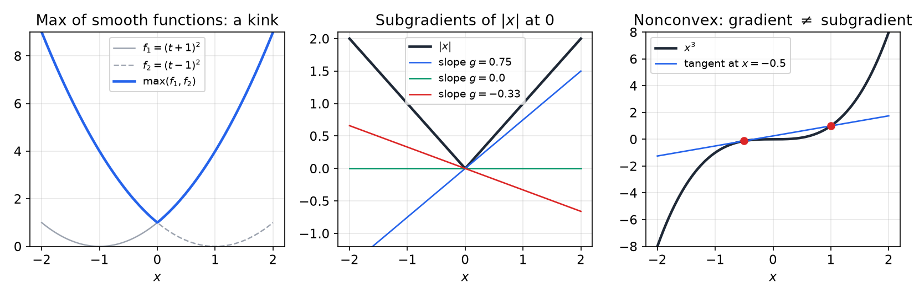
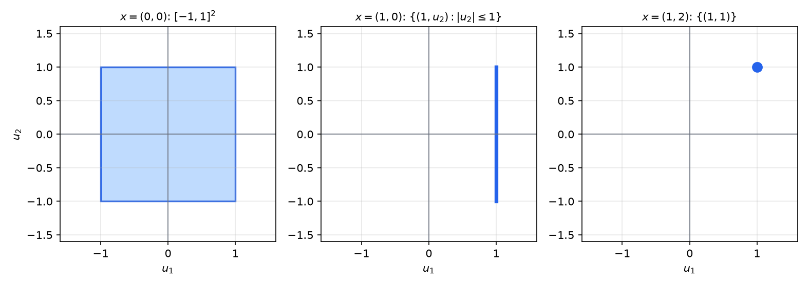
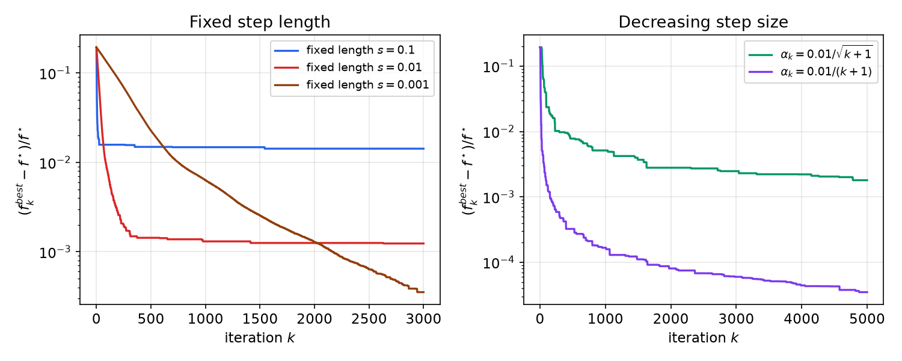
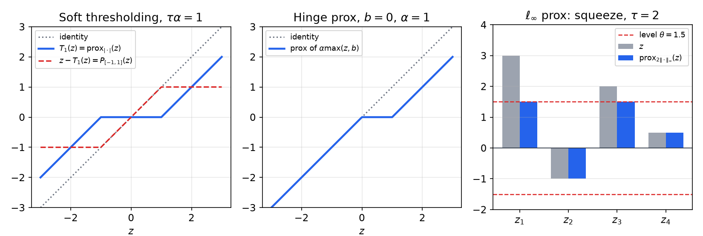
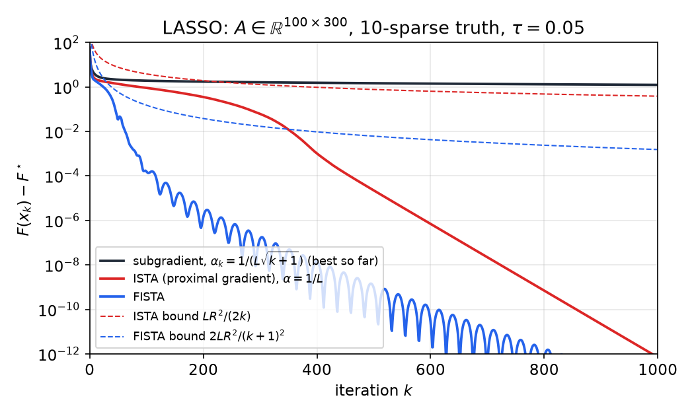
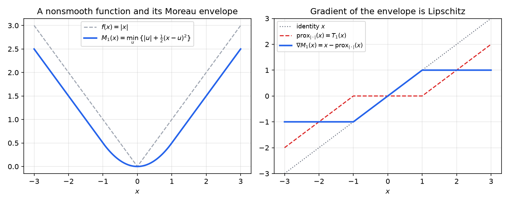

# Subgradients and Proximal Algorithms

Many useful convex functions are not differentiable: the absolute value, the \\(\ell\_1\\) norm that promotes sparsity, the hinge loss of support vector machines, the largest entry of a vector, and the nuclear norm that promotes low rank. Subgradients replace gradients at the points where a function has a kink, and they give optimality conditions and a descent method that looks just like gradient descent. That method, the subgradient method, is simple but slow, so the second half of this chapter treats a different idea. A proximal algorithm handles the nonsmooth part of the objective through its proximal operator, and the proximal gradient method and its accelerated form recover the rates of smooth gradient methods. This chapter connects the [first-order methods](first-order-methods.md) of the previous chapter to the nonsmooth problems that arise in sparse estimation and regularized regression.

## Motivation: Nonsmooth Convex Functions

A pointwise maximum of smooth convex functions is in general not smooth. Let \\(f\_1(t)=(t+1)^2\\) and \\(f\_2(t)=(t-1)^2\\). Their maximum \\(f(t)=\max\\{f\_1(t),f\_2(t)\\}\\) equals \\(f\_1\\) for \\(t\le0\\) and \\(f\_2\\) for \\(t\ge0\\), so it has a kink at \\(t=0\\), where neither derivative exists. The left panel of the figure below shows this picture. Many regularizers and loss functions have the same structure. The hinge loss \\(\max\\{a^{T}x+b,0\\}\\), the \\(\ell\_1\\) norm, the \\(\ell\_\infty\\) norm and the nuclear norm are all maxima of linear functions.

The theory of nonsmooth optimization needs only one new concept, the subgradient, and most of the earlier theory carries over. The middle panel is the subject of Example 7.1, and the right panel shows that for nonconvex functions a gradient need not be a subgradient.



*Figure: left, the maximum of \\((t+1)^2\\) and \\((t-1)^2\\), which has a kink at \\(t=0\\). Middle, several lines through the origin that lie below \\(\lvert x\rvert\\); their slopes are subgradients of \\(\lvert x\rvert\\) at \\(0\\). Right, a nonconvex cubic and its tangent at \\(x=-0.5\\), which crosses the curve at \\(x=1\\). The tangent is not a global under-estimator, so the gradient is not a subgradient in the nonconvex case.*

## Subgradients and Subdifferentials

Let \\(f:\mathbb{R}^N\to\mathbb{R}\\) be convex. For a differentiable convex function, the first-order condition says that the tangent plane under-estimates the function everywhere: \\(f(y)\ge f(x)+\langle y-x,\nabla f(x)\rangle\\) for all \\(x,y\\). The subgradient keeps this inequality and drops the requirement that a gradient exists.

**Definition (subgradient).** A vector \\(g\\) is a **subgradient** of \\(f\\) at \\(x\\) if
\\[
f(y)\ge f(x)+\langle y-x,\\,g\rangle\qquad\text{for all }y .
\\]
The set of all subgradients at \\(x\\) is the **subdifferential** \\(\partial f(x)\\).

**Proposition (basic properties).** Let \\(f\\) be convex and finite on \\(\mathbb{R}^N\\).

- The subdifferential \\(\partial f(x)\\) is closed and convex.
- If \\(f\\) is differentiable at \\(x\\), then \\(\partial f(x)=\\{\nabla f(x)\\}\\).
- \\(\partial f(x)\\) is nonempty and compact for every \\(x\\).

The first claim holds because \\(\partial f(x)\\) is an intersection of closed half-spaces in \\(g\\), one for each \\(y\\). For the second, let \\(g\in\partial f(x)\\) and \\(v\in\mathbb{R}^N\\). The subgradient inequality with \\(y=x+tv\\) gives \\(\big(f(x+tv)-f(x)\big)/t\ge\langle v,g\rangle\\) for \\(t>0\\). Letting \\(t\downarrow0\\) gives \\(\langle v,\nabla f(x)\rangle\ge\langle v,g\rangle\\). Replacing \\(v\\) by \\(-v\\) gives the reverse inequality, so \\(\langle v,\nabla f(x)-g\rangle=0\\) for every \\(v\\), and \\(g=\nabla f(x)\\). The third claim is standard convex analysis and is stated without proof. Nonemptiness comes from a separating hyperplane argument at \\((x,f(x))\\) in the epigraph, and compactness follows from the local Lipschitz bound.

**Example 7.1 (Absolute value).** For \\(f(x)=\lvert x\rvert\\),
\\[
\partial f(x)=\begin{cases}\\{-1\\}, & x<0,\\\\ [-1,1], & x=0,\\\\ \\{1\\}, & x>0.\end{cases}
\\]
Every slope in \\([-1,1]\\) gives a line through the origin that lies below \\(\lvert x\rvert\\), and no other slope does. This is the one-dimensional picture of the middle panel above.

### Norms

The \\(\ell\_1\\) norm is the workhorse of sparse estimation, so its subdifferential deserves a careful statement.

**Example 7.2 (The \\(\ell\_1\\) norm).** A vector \\(u\\) belongs to \\(\partial\lVert x\rVert\_1\\) if and only if
\\[
u\_n=\operatorname{sign}(x\_n)\ \text{ when } x\_n\neq0,\qquad \lvert u\_n\rvert\le1\ \text{ when } x\_n=0 .
\\]
*Proof.* Let \\(\Gamma=\\{n:x\_n\neq0\\}\\). Suppose the conditions hold. Then \\(\lvert x\_n\rvert=u\_nx\_n\\) for every \\(n\\) (for \\(n\notin\Gamma\\) both sides are zero), so
\\[
\lVert y\rVert\_1-\lVert x\rVert\_1-\langle y-x,u\rangle=\sum\_{n}\big(\lvert y\_n\rvert-u\_ny\_n\big)\ \ge\ 0,
\\]
since \\(\lvert u\_n\rvert\le1\\). Conversely, suppose \\(u\\) is a subgradient. Fix \\(n\in\Gamma\\) and take \\(y=x+se\_n\\) with \\(s\\) small of either sign. Then \\(\lVert y\rVert\_1-\lVert x\rVert\_1=s\operatorname{sign}(x\_n)\\) for small \\(\lvert s\rvert\\), and the subgradient inequality reads \\(s\operatorname{sign}(x\_n)\ge su\_n\\) for both signs of \\(s\\). Hence \\(u\_n=\operatorname{sign}(x\_n)\\). If \\(x\_n=0\\), take \\(y=x+se\_n\\) with \\(s=\operatorname{sign}(u\_n)\\,\sigma\\) and \\(\sigma>0\\). The inequality becomes \\(\sigma\ge\sigma\lvert u\_n\rvert\\), so \\(\lvert u\_n\rvert\le1\\). ∎

The subdifferential is a box in the coordinates where \\(x\\) is zero and a single point where \\(x\\) is nonzero. This is why the \\(\ell\_1\\) norm produces sparse solutions: the set of "subgradient directions" is large exactly at the points where coordinates vanish. The figure below shows three cases in the plane.



*Figure: the subdifferential \\(\partial\lVert x\rVert\_1\\) drawn as a set of vectors \\(u\\). At \\(x=(0,0)\\) it is the square \\([-1,1]^2\\). At \\(x=(1,0)\\) it is the vertical segment \\(u\_1=1\\), \\(\lvert u\_2\rvert\le1\\), because the second coordinate is zero. At \\(x=(1,2)\\), where both coordinates are nonzero, it is the single point \\((1,1)\\), and the norm is differentiable there.*

For a general norm \\(\lVert\cdot\rVert\\) on \\(\mathbb{R}^N\\), define the **dual norm** \\(\lVert u\rVert\_\*=\max\_{\lVert x\rVert\le1}\langle x,u\rangle\\). The maximum is attained because the unit ball is compact. The dual of the \\(\ell\_2\\) norm is the \\(\ell\_2\\) norm, the dual of \\(\ell\_1\\) is \\(\ell\_\infty\\), and the dual of \\(\ell\_\infty\\) is \\(\ell\_1\\). By definition, \\(\langle y,u\rangle\le\lVert y\rVert\lVert u\rVert\_\*\\) for all \\(y\\) (the generalized Cauchy–Schwarz inequality).

**Example 7.3 (Norms at the origin).** For \\(x\neq0\\), the function \\(\lVert x\rVert\_2\\) is differentiable with gradient \\(x/\lVert x\rVert\_2\\). At the origin, \\(u\in\partial\lVert0\rVert\\) means \\(\lVert y\rVert\ge\langle y,u\rangle\\) for all \\(y\\). This holds exactly when \\(\langle y,u\rangle\le\lVert y\rVert\\) for all \\(y\\), which by the definition of the dual norm is \\(\lVert u\rVert\_\*\le1\\). Hence
\\[
\partial\lVert0\rVert=\\{u:\lVert u\rVert\_\*\le1\\}.
\\]
For \\(\lVert\cdot\rVert=\lVert\cdot\rVert\_2\\) this is the Euclidean unit ball, and for the \\(\ell\_1\\) norm it is the \\(\ell\_\infty\\) ball.

**Example 7.4 (The \\(\ell\_\infty\\) norm).** Let \\(\Gamma(x)=\\{m:\lvert x\_m\rvert=\lVert x\rVert\_\infty\\}\\). For \\(x\neq0\\), the maximum rule below gives \\(\partial\lVert x\rVert\_\infty=\operatorname{conv}\\{\operatorname{sign}(x\_m)e\_m:m\in\Gamma(x)\\}\\). This set equals \\(\\{u:\lVert u\rVert\_1=1,\ u^{T}x=\lVert x\rVert\_\infty\\}\\). Indeed, if \\(\lVert u\rVert\_1=1\\) and \\(u^{T}x=\lVert x\rVert\_\infty\\), then \\(\lVert x\rVert\_\infty=\sum\_m u\_mx\_m\le\sum\_m\lvert u\_m\rvert\lvert x\_m\rvert\le\lVert x\rVert\_\infty\\), so equality holds throughout: \\(u\\) is supported on \\(\Gamma(x)\\) with the signs of \\(x\\). At \\(x=0\\), the subdifferential is the \\(\ell\_1\\) unit ball by Example 7.3. Combined with the affine chain rule below, for the residual \\(y-Ax\\),
\\[
\partial\lVert y-Ax\rVert\_\infty=\\{-A^{T}u:\ \lVert u\rVert\_1=1,\ u^{T}(y-Ax)=\lVert y-Ax\rVert\_\infty\\}.
\\]

### Calculus of Subdifferentials

The following rules are what make subgradients usable in practice. They are stated for finite convex functions on \\(\mathbb{R}^N\\).

- **Sum rule.** If \\(f=f\_1+f\_2\\), then \\(\partial f(x)=\partial f\_1(x)+\partial f\_2(x)\\), a Minkowski sum of sets.
- **Affine chain rule.** If \\(h(x)=f(Ax+b)\\), then \\(\partial h(x)=A^{T}\partial f(Ax+b)\\).
- **Maximum rule.** If \\(f=\max\\{f\_1,\dots,f\_M\\}\\), let \\(\Gamma(x)=\\{m:f\_m(x)=f(x)\\}\\). Then \\(\partial f(x)=\operatorname{conv}\big(\bigcup\_{m\in\Gamma(x)}\partial f\_m(x)\big)\\).

The maximum rule is the one used for \\(\lVert\cdot\rVert\_\infty\\) above and for the hinge-type functions below. The convex hull is needed because at a kink the subgradients of the active functions can be mixed.

**Example 7.5 (The median minimizes a sum of absolute deviations).** Let \\(f(x)=\sum\_{m=1}^{M}\lvert x-p\_m\rvert\\). Let \\(n\_<\\), \\(n\_=\\), \\(n\_>\\) count the points \\(p\_m\\) that are less than, equal to, and greater than \\(x\\). For \\(p\_m\ne x\\) the term is differentiable with derivative \\(\pm1\\), and for \\(p\_m=x\\) it contributes \\([-1,1]\\). By the sum rule,
\\[
\partial f(x)=\big[-n\_==-n\_-n\_>+n\_<,\ n\_=+n\_<-n\_>\big]=\big[-M+2n\_<,\ M-2n\_>\big].
\\]
Hence \\(0\in\partial f(x)\\) exactly when \\(n\_<\le M/2\\) and \\(n\_>\le M/2\\). This is the defining property of a median. For odd \\(M\\) the minimizer is the middle point \\(p\_{((M+1)/2)}\\) of the sorted list, and for even \\(M\\) every point of the interval between the two middle points is a minimizer.

**Example 7.6 (A separable hinge-type function).** Let \\(g(z)=\sum\_{m}\max(z\_m,b\_m)\\). Each term is separable, so the sum rule gives coordinate by coordinate
\\[
\partial g(z)=\\{u:\ u\_m=0\text{ if }z\_m<b\_m,\quad u\_m\in[0,1]\text{ if }z\_m=b\_m,\quad u\_m=1\text{ if }z\_m>b\_m\\}.
\\]
This is the nonsmooth part of a sum of hinge losses, where each kink contributes a whole interval of subgradients.

## Optimality Conditions

The subdifferential gives a complete optimality condition, with no differentiability assumption.

**Theorem (optimality).** Let \\(f:\mathbb{R}^N\to\mathbb{R}\\) be convex. A point \\(x^\star\\) minimizes \\(f\\) if and only if \\(0\in\partial f(x^\star)\\).

*Proof.* If \\(0\in\partial f(x^\star)\\), then \\(f(y)\ge f(x^\star)+\langle y-x^\star,0\rangle=f(x^\star)\\) for every \\(y\\), so \\(x^\star\\) is a minimizer. Conversely, if \\(x^\star\\) is a minimizer, then \\(f(y)\ge f(x^\star)=f(x^\star)+\langle y-x^\star,0\rangle\\) for every \\(y\\), which says that \\(0\\) is a subgradient. ∎

The theorem is the nonsmooth version of "the gradient vanishes at a minimum." It makes the condition checkable, which is often more useful than solving the problem.

**Example 7.7 (Optimality for the LASSO).** Consider
\\[
\min\_x\ \tfrac12\lVert y-Ax\rVert\_2^2+\tau\lVert x\rVert\_1 ,\qquad\tau>0 .
\\]
The first term is differentiable with gradient \\(A^{T}(Ax-y)\\), so the sum rule gives \\(\partial f(x)=A^{T}(Ax-y)+\tau\\,\partial\lVert x\rVert\_1\\). Writing \\(a\_n\\) for the \\(n\\)th column of \\(A\\), the condition \\(0\in\partial f(x^\star)\\) becomes, by Example 7.2,
\\[
a\_n^{T}(y-Ax^\star)=\tau\operatorname{sign}(x^\star\_n)\ \text{ if } x^\star\_n\neq0,\qquad \lvert a\_n^{T}(y-Ax^\star)\rvert\le\tau\ \text{ if } x^\star\_n=0 .
\\]
These conditions say that the correlation of each active column with the residual equals \\(\tau\\) in magnitude, and that inactive columns have correlation at most \\(\tau\\). There is no closed form except when \\(A\\) has orthonormal columns. The conditions are nevertheless valuable: they certify a candidate solution, and they explain why the solution is sparse.

## The Subgradient Method

The subgradient method replaces the gradient in gradient descent by any subgradient:
\\[
x\_{k+1}=x\_k-\alpha\_k\\,d\_k,\qquad d\_k\in\partial f(x\_k).
\\]
Choosing a good \\(d\_k\\) is problem dependent, and the analysis works for any subgradient. We consider the problem \\(\min\_x f(x)\\) under the following standard assumptions. The function \\(f\\) is convex, has a minimizer \\(x^\star\\) with optimal value \\(f^\star\\), and is Lipschitz with constant \\(L\\):
\\[
\lvert f(x)-f(y)\rvert\le L\lVert x-y\rVert\_2 .
\\]
Note that this is a Lipschitz condition on the function, not on its gradient. It is the natural hypothesis when gradients do not exist.

**Lemma (bounded subgradients).** Under the Lipschitz assumption, \\(\lVert d\rVert\_2\le L\\) for every \\(d\in\partial f(x)\\) and every \\(x\\).

*Proof.* Let \\(d\neq0\\) be a subgradient at \\(x\\) and set \\(y=x+d/\lVert d\rVert\_2\\). The subgradient inequality gives \\(f(y)\ge f(x)+\langle y-x,d\rangle=f(x)+\lVert d\rVert\_2\\). The Lipschitz bound gives \\(f(y)-f(x)\le L\\). Hence \\(\lVert d\rVert\_2\le L\\). ∎

**Lemma (one-step inequality).** For any \\(\alpha\_i\ge0\\) and \\(d\_i\in\partial f(x\_i)\\),
\\[
\lVert x\_{i+1}-x^\star\rVert\_2^2\le\lVert x\_i-x^\star\rVert\_2^2-2\alpha\_i\big(f(x\_i)-f^\star\big)+\alpha\_i^2\lVert d\_i\rVert\_2^2 .
\\]

*Proof.* Expand \\(\lVert x\_i-\alpha\_id\_i-x^\star\rVert\_2^2=\lVert x\_i-x^\star\rVert\_2^2-2\alpha\_i\langle x\_i-x^\star,d\_i\rangle+\alpha\_i^2\lVert d\_i\rVert\_2^2\\). The subgradient inequality at \\(x\_i\\), evaluated at \\(y=x^\star\\), gives \\(\langle x\_i-x^\star,d\_i\rangle\ge f(x\_i)-f^\star\\). Substitute. ∎

Note the difference from gradient descent. For a smooth function the gradient vanishes at the minimizer, so the inequality has a useful step size independent of the iterate. Here the subgradient need not vanish at \\(x^\star\\), so the step must shrink.

**Theorem (subgradient method).** Let \\(f^{\text{best}}\_k=\min\\{f(x\_i):0\le i<k\\}\\) and \\(R=\lVert x\_0-x^\star\rVert\_2\\). Then
\\[
f^{\text{best}}\_k-f^\star\le\frac{R^2+\sum\_{i=0}^{k-1}\alpha\_i^2\lVert d\_i\rVert\_2^2}{2\sum\_{i=0}^{k-1}\alpha\_i} .
\\]

*Proof.* Sum the one-step inequality over \\(i=0,\dots,k-1\\). The left side telescopes, giving \\(2\sum\_i\alpha\_i(f(x\_i)-f^\star)\le R^2-\lVert x\_k-x^\star\rVert^2+\sum\_i\alpha\_i^2\lVert d\_i\rVert^2\\). Drop the nonnegative term \\(-\lVert x\_k-x^\star\rVert^2\\). Since \\(f(x\_i)\ge f^{\text{best}}\_k\\) for \\(i<k\\), the left side is at least \\(2\big(\sum\_i\alpha\_i\big)(f^{\text{best}}\_k-f^\star)\\). Divide. ∎

The bound is the key quantitative fact of the method. Its consequences depend on the step rule.

- **Fixed step \\(\alpha\\).** With \\(\lVert d\_i\rVert\le L\\), the bound becomes \\(f^{\text{best}}\_k-f^\star\le\dfrac{R^2}{2k\alpha}+\dfrac{L^2\alpha}{2}\\). The second term does not vanish as \\(k\\) grows, so the method does not converge to the optimum however small \\(\alpha\\) is. It reaches a neighborhood whose size is proportional to \\(\alpha\\).
- **Fixed step length.** Taking \\(\alpha\_i=s/\lVert d\_i\rVert\_2\\) makes each step have length exactly \\(s\\). Since \\(\lVert d\_i\rVert\le L\\), the same argument gives \\(f^{\text{best}}\_k-f^\star\le\dfrac{LR^2}{2ks}+\dfrac{Ls}{2}\\). The iterates never converge, but they never move far from the solution either.
- **Horizon-tuned step.** For a fixed number \\(k\\) of iterations, take \\(\alpha=R/(L\sqrt k)\\). Then \\(f^{\text{best}}\_k-f^\star\le\dfrac{RL}{2\sqrt k}+\dfrac{RL}{2\sqrt k}=\dfrac{RL}{\sqrt k}\\). This is the \\(O(1/\sqrt k)\\) rate. It is optimal for this problem class in the worst case: Nesterov (2004) shows that no method using subgradients can do better uniformly over Lipschitz convex functions.
- **Decreasing steps.** Suppose \\(\alpha\_k\to0\\) and \\(\sum\_k\alpha\_k=\infty\\). Then \\(f^{\text{best}}\_k\to f^\star\\). To see this, fix \\(K\\) and note that \\(\sum\_{i<k}\alpha\_i^2\le\sum\_{i<K}\alpha\_i^2+\big(\sup\_{i\ge K}\alpha\_i\big)\sum\_{i<k}\alpha\_i\\). Dividing the bound by \\(2\sum\_{i<k}\alpha\_i\\) and letting \\(k\to\infty\\) leaves \\(\tfrac{L^2}{2}\sup\_{i\ge K}\alpha\_i\\), which tends to zero as \\(K\\) grows.

The schedule \\(\alpha\_k=\alpha/\sqrt{k+1}\\) is common. Here \\(\sum\_{i<k}\alpha\_i^2\le\alpha^2(1+\log k)\\) and \\(\sum\_{i<k}\alpha\_i\ge2\alpha(\sqrt{k+1}-1)\\), so the bound is \\(O(\log k/\sqrt k)\\). The extra logarithm is the price of not tuning the step to the horizon.

**Example 7.8 (Why the fixed step fails).** Let \\(f(x)=\lvert x\rvert\\) and \\(\alpha>0\\) be fixed, with \\(x\_0=\alpha/2\\). The subgradient at \\(x\_0>0\\) is \\(1\\), so \\(x\_1=-\alpha/2\\). The subgradient at \\(x\_1<0\\) is \\(-1\\), so \\(x\_2=\alpha/2\\). The iterates alternate forever, and every value is \\(\alpha/2\\). The best value \\(f^{\text{best}}\_k\\) stays at \\(\alpha/2\\), so it converges to \\(f^\star=0\\) only as the step shrinks.

**Example 7.9 (An \\(\ell\_1\\) approximation).** Consider \\(\min\_x\lVert Ax-b\rVert\_1\\). A subgradient can be computed by guess and check. Let \\(z\_m=\operatorname{sign}(a\_m^{T}x-b\_m)\\) when \\(a\_m^{T}x\neq b\_m\\), and \\(\lvert z\_m\rvert\le1\\) otherwise, where \\(a\_m^{T}\\) is the \\(m\\)th row of \\(A\\). Then \\(u=A^{T}z\\) is a subgradient, because
\\[
u^{T}(y-x)=z^{T}(Ay-b)-z^{T}(Ax-b)=z^{T}(Ay-b)-\lVert Ax-b\rVert\_1\le\lVert Ay-b\rVert\_1-\lVert Ax-b\rVert\_1 .
\\]
The last step uses \\(z^{T}(Ay-b)\le\lVert Ay-b\rVert\_1\\), which holds since \\(\lvert z\_m\rvert\le1\\).



*Figure: the subgradient method on \\(\min\_x\lVert Ax-b\rVert\_1\\) with random \\(A\in\mathbb{R}^{500\times100}\\) and \\(b\in\mathbb{R}^{500}\\), re-simulated for this chapter. Left, fixed step lengths \\(s=0.1\\), \\(0.01\\) and \\(0.001\\). Each curve drops quickly and then saturates at a level set by \\(s\\). Right, the decreasing steps \\(0.01/\sqrt{k+1}\\) and \\(0.01/(k+1)\\). The curves show the slow progress that the theory predicts. Here the \\(1/k\\) schedule happens to do better than the worst-case \\(1/\sqrt k\\) bound suggests.*

The lessons are these. The subgradient method is a natural extension of gradient descent, and it does not converge for a fixed step size in general. Decreasing steps guarantee convergence, but the rates are slow, and in practice they are often only moderately better than the worst case. These limitations motivate the proximal methods below.

## Proximal Operators

The subgradient method treats the nonsmooth function as a black box and pays for that with slow convergence. Proximal methods use more structure. They keep the nonsmooth part exact and handle it with a subproblem that is cheap to solve.

**Definition (proximal operator).** For a convex function \\(h\\) and \\(\alpha>0\\), the proximal operator is
\\[
\operatorname{prox}\_{\alpha h}(z)=\arg\min\_{x}\Big(h(x)+\frac{1}{2\alpha}\lVert x-z\rVert\_2^2\Big).
\\]
The minimized function is strongly convex when \\(h\\) is convex and closed, so the minimizer exists and is unique. The operator is well defined for nonsmooth \\(h\\), and it is nonexpansive: \\(\lVert\operatorname{prox}(z)-\operatorname{prox}(z')\rVert\le\lVert z-z'\rVert\\).

The first-order optimality condition for the proximal problem gives the characterization used throughout: \\(x=\operatorname{prox}\_{\alpha h}(z)\\) if and only if \\(\tfrac1\alpha(z-x)\in\partial h(x)\\).

**Example 7.10 (Soft thresholding).** Let \\(h(x)=\tau\lvert x\rvert\\) on \\(\mathbb{R}\\) and fix \\(u\\). The proximal operator is the minimizer of \\(\tfrac12(x-u)^2+\tau\lvert x\rvert\\), which satisfies \\(0\in x-u+\tau\\,\partial\lvert x\rvert\\). If \\(x>0\\), the condition is \\(x=u-\tau\\), which is consistent only when \\(u>\tau\\). If \\(x<0\\), it is \\(x=u+\tau\\), consistent only when \\(u<-\tau\\). If \\(x=0\\), it requires \\(\lvert u\rvert\le\tau\\). Therefore
\\[
\operatorname{prox}\_{\tau\lvert\cdot\rvert}(u)=\operatorname{sign}(u)\max\\{\lvert u\rvert-\tau,0\\}=:T\_\tau(u).
\\]
For a vector and \\(h=\tau\lVert\cdot\rVert\_1\\) the problem separates across coordinates, so \\(\operatorname{prox}\\) applies \\(T\_\tau\\) entrywise. This function \\(T\_\tau\\) is soft thresholding, and it appears again in ISTA below.

### The Proximal Point Method

If \\(x^\star\\) minimizes \\(f\\), then it also minimizes \\(f(x)+\delta\lVert x-x^\star\rVert^2\\) for any \\(\delta>0\\), and this regularized problem is strongly convex. Its minimizer is unknown, but an iterative version uses the current iterate as the center:
\\[
x\_{k+1}=\operatorname{prox}\_{\alpha f}(x\_k)=\arg\min\_x\Big(f(x)+\frac{1}{2\alpha}\lVert x-x\_k\rVert\_2^2\Big).
\\]
This is the **proximal point method**. Each subproblem is a strongly convex problem that can be as hard as the original, but the iteration is well defined for any nonsmooth convex \\(f\\) and any fixed \\(\alpha\\). The proximal point method converges to a minimizer, and the rate follows from the proximal gradient theorem below with \\(g=0\\): \\(f(x\_k)-f^\star\le\lVert x\_0-x^\star\rVert^2/(2\alpha k)\\).

### Implicit Gradient Descent

Gradient flow \\(x'(t)=-\nabla f(x(t))\\) has the minimizers of \\(f\\) as its equilibria. Forward Euler discretizes it as \\(x\_{k+1}=x\_k-h\nabla f(x\_k)\\), which is gradient descent. Backward Euler uses the gradient at the new point,
\\[
x\_{k+1}=x\_k-h\nabla f(x\_{k+1}),
\\]
which is implicit: \\(x\_{k+1}\\) appears on both sides. For differentiable \\(f\\), the optimality condition of the proximal problem gives \\(0=\nabla f(x\_{k+1})+\tfrac1\alpha(x\_{k+1}-x\_k)\\), which is exactly backward Euler with \\(h=\alpha\\). So the proximal point method is implicit gradient descent, and it remains stable for step sizes where gradient descent would diverge. The price is the subproblem at each step.

**Example 7.11 (Least squares by iterative refinement).** Minimize \\(\tfrac12\lVert y-Ax\rVert\_2^2\\) with \\(A\\) of full column rank. The solution \\((A^{T}A)^{-1}A^{T}y\\) is unstable when \\(A^{T}A\\) is ill conditioned. The proximal point method with a fixed \\(\alpha\\) and \\(\delta=1/\alpha\\) gives
\\[
x\_{k+1}=(A^{T}A+\delta I)^{-1}(A^{T}y+\delta x\_k)=x\_k+(A^{T}A+\delta I)^{-1}A^{T}(y-Ax\_k).
\\]
Each step solves a better-conditioned least squares problem, since \\(\delta\\) regularizes the Gram matrix. The iteration converges to the least squares solution for any \\(\alpha\\). Large \\(\delta\\) gives well-conditioned subproblems but needs more iterations, and for very small \\(\alpha\\) the method reduces to gradient descent with step \\(\alpha\\). In numerical linear algebra this is known as iterative refinement.

## The Proximal Gradient Method

Suppose the objective splits as \\(f=g+h\\), where \\(g\\) is convex and smooth and \\(h\\) is convex and nonsmooth but has an easy proximal operator. Linearize only the smooth part and keep \\(h\\) exact:
\\[
x\_{k+1}=\arg\min\_x\Big(g(x\_k)+\langle x-x\_k,\nabla g(x\_k)\rangle+h(x)+\frac{1}{2\alpha}\lVert x-x\_k\rVert\_2^2\Big).
\\]
Completing the square in \\(x\\) shows that this is
\\[
x\_{k+1}=\operatorname{prox}\_{\alpha h}\big(x\_k-\alpha\nabla g(x\_k)\big).
\\]
If \\(h=0\\), this is gradient descent, and if \\(g=0\\), it is the proximal point method. The name comes from the two steps. The gradient step is a forward Euler step on \\(g\\), and the proximal step is a backward Euler step on \\(h\\). The method is also called forward–backward splitting.

**Example 7.12 (LASSO and ISTA).** Take \\(g(x)=\tfrac12\lVert y-Ax\rVert\_2^2\\), so \\(\nabla g(x)=A^{T}(Ax-y)\\), and \\(h(x)=\tau\lVert x\rVert\_1\\). The proximal operator is coordinatewise soft thresholding, \\(\operatorname{prox}\_{\alpha h}(z)=T\_{\tau\alpha}(z)\\), so the iteration is
\\[
x\_{k+1}=T\_{\tau\alpha}\big(x\_k+\alpha A^{T}(y-Ax\_k)\big).
\\]
This is the **iterative soft thresholding algorithm** (ISTA). Each iteration costs one multiplication by \\(A\\) and one by \\(A^{T}\\) and a componentwise threshold. In code:

```python
import numpy as np

def ista(A, y, tau, iters=1000):
    L = np.linalg.norm(A, 2) ** 2          # Lipschitz constant of the gradient
    x = np.zeros(A.shape[1])
    for _ in range(iters):
        z = x + (A.T @ (y - A @ x)) / L     # gradient step on the smooth part
        x = np.sign(z) * np.maximum(np.abs(z) - tau / L, 0.0)   # prox of tau*||.||_1
    return x
```

The figure below shows three proximal operators. The left panel is soft thresholding, which is the proximal operator of \\(\lvert\cdot\rvert\\). The middle panel is the proximal operator of a hinge-type function, treated in Example 7.17. The right panel is the proximal operator of the \\(\ell\_\infty\\) norm, treated in Example 7.14.



*Figure: left, soft thresholding \\(T\_1(z)\\), with the complementary map \\(z-T\_1(z)\\) equal to the projection onto \\([-1,1]\\). Middle, the proximal operator of \\(\alpha\max(z,b)\\) with \\(b=0\\) and \\(\alpha=1\\). Right, the proximal operator of \\(2\lVert\cdot\rVert\_\infty\\) applied to four values: the largest entries are squeezed down to the common level \\(1.5\\), and the small entries are unchanged.*

### Convergence of the Proximal Gradient Method

**Theorem (proximal gradient).** Let \\(g\\) be convex and \\(L\\)-smooth, and let \\(h\\) be convex and closed, with no other assumption. Let \\(f=g+h\\), let \\(x^\star\\) be any minimizer, and run the method with step \\(\alpha\_k=1/L\\). Then for all \\(k\ge1\\),
\\[
f(x\_k)-f(x^\star)\le\frac{L}{2k}\lVert x\_0-x^\star\rVert\_2^2 .
\\]
The rate is \\(O(1/k)\\), the same as gradient descent, and it holds for every \\(h\\). The theorem covers gradient descent (\\(h=0\\)) and the proximal point method (\\(g=0\\), with \\(L=1/\alpha\\)) as special cases.

*Proof.* Write \\(d\_k=L(x\_k-x\_{k+1})\\). The proof rests on the following inequality, valid for every \\(z\\):
\\[
f(x\_{k+1})\le f(z)+\langle x\_k-z,\\,d\_k\rangle-\frac{1}{2L}\lVert d\_k\rVert\_2^2 . \tag{3}
\\]
Assume (3) for the moment. Taking \\(z=x\_k\\) gives \\(f(x\_{k+1})\le f(x\_k)\\), so \\(f(x\_k)\\) is nonincreasing. Taking \\(z=x^\star\\) and using \\(d\_k=L(x\_k-x\_{k+1})\\) gives
\\[
f(x\_{k+1})-f^\star\le L\langle x\_k-x^\star,\\,x\_k-x\_{k+1}\rangle-\frac L2\lVert x\_k-x\_{k+1}\rVert^2 .
\\]
The identity \\(2\langle a,b\rangle-\lVert b\rVert^2=\lVert a\rVert^2-\lVert a-b\rVert^2\\) with \\(a=x\_k-x^\star\\), \\(b=x\_k-x\_{k+1}\\) turns this into \\(f(x\_{k+1})-f^\star\le\tfrac L2(\lVert x\_k-x^\star\rVert^2-\lVert x\_{k+1}-x^\star\rVert^2)\\). Sum over \\(i=0,\dots,k-1\\). The right side telescopes to at most \\(\tfrac L2\lVert x\_0-x^\star\rVert^2\\). Since \\(f(x\_i)\\) is nonincreasing, \\(k(f(x\_k)-f^\star)\le\sum\_{i=1}^{k}(f(x\_i)-f^\star)\\), which gives the theorem.

It remains to prove (3). By \\(L\\)-smoothness and \\(x\_{k+1}=x\_k-d\_k/L\\),
\\[
g(x\_{k+1})\le g(x\_k)-\frac1L\langle d\_k,\nabla g(x\_k)\rangle+\frac1{2L}\lVert d\_k\rVert^2 .
\\]
Convexity of \\(g\\) gives \\(g(x\_k)\le g(z)+\langle x\_k-z,\nabla g(x\_k)\rangle\\). The step \\(x\_{k+1}\\) is the minimizer of \\(h(x)+\tfrac L2\lVert x-(x\_k-\nabla g(x\_k)/L)\rVert^2\\), so its optimality condition reads \\(d\_k-\nabla g(x\_k)\in\partial h(x\_{k+1})\\). The subgradient inequality for \\(h\\) at \\(x\_{k+1}\\), evaluated at \\(z\\), gives \\(h(x\_{k+1})\le h(z)-\langle z-x\_{k+1},\\,d\_k-\nabla g(x\_k)\rangle\\). Adding the three inequalities and substituting \\(z-x\_{k+1}=z-x\_k+d\_k/L\\), the terms involving \\(\nabla g(x\_k)\\) cancel, and what remains is
\\[
f(x\_{k+1})\le f(z)+\langle x\_k-z,d\_k\rangle+\Big(\frac{1}{2L}-\frac1L\Big)\lVert d\_k\rVert^2=f(z)+\langle x\_k-z,d\_k\rangle-\frac1{2L}\lVert d\_k\rVert^2 .
\\]
This is (3). ∎

The proof uses only convexity of \\(g\\), smoothness of \\(g\\), and the optimality condition of the proximal step. The nonsmooth part \\(h\\) never has to be differentiated, which is why the result holds for every \\(h\\).

### Accelerated Proximal Gradient (FISTA)

Nesterov's momentum of the previous chapter carries over to the composite setting. The fast iterative shrinkage-thresholding algorithm (FISTA) of Beck and Teboulle uses two sequences. Start with \\(x\_0=x\_{-1}\\) and \\(t\_1=1\\), and iterate
\\[
p\_k=x\_k+\frac{t\_k-1}{t\_{k+1}}\\,(x\_k-x\_{k-1}),\qquad x\_{k+1}=\operatorname{prox}\_{h/L}\big(p\_k-\tfrac1L\nabla g(p\_k)\big),\qquad t\_{k+1}=\frac{1+\sqrt{1+4t\_k^2}}{2}.
\\]
For large \\(k\\) the momentum \\(\tfrac{t\_k-1}{t\_{k+1}}\\) behaves like \\(\tfrac{k-1}{k+2}\\), the schedule of Nesterov's method. Each iteration costs the same as ISTA. The result is the accelerated rate.

**Theorem (FISTA; cited).** Under the assumptions of the proximal gradient theorem, FISTA satisfies
\\[
f(x\_k)-f^\star\le\frac{2L}{(k+1)^2}\lVert x\_0-x^\star\rVert\_2^2 .
\\]
This is the result of Beck and Teboulle (2009), whose proof extends the analysis of Nesterov's method to the composite case. The rate is optimal among first-order methods, and the iterates are not monotone in \\(f\\).

**Example 7.13 (LASSO comparisons).** The figure below compares the subgradient method, ISTA and FISTA on a LASSO problem with \\(A\in\mathbb{R}^{100\times300}\\), a ten-sparse true signal, and \\(\tau=0.05\\). The re-simulation uses random data of this size.



*Figure: the objective gap \\(F(x\_k)-F^\star\\) on a log scale for LASSO with \\(\tau=0.05\\), for the subgradient method (black), ISTA (red) and FISTA (blue). The dashed curves are the worst-case bounds \\(LR^2/(2k)\\) for ISTA and \\(2LR^2/(k+1)^2\\) for FISTA, with \\(R=\lVert x^\star\rVert\_2\\) since the start is zero. The subgradient method flattens out quickly, ISTA decreases steadily, and FISTA falls below \\(10^{-6}\\) in a few hundred iterations, with the oscillation typical of accelerated methods.*

## Moreau Decomposition and the Moreau Envelope

Two identities make proximal operators easy to compute, and they are a standard tool.

**Theorem (Moreau decomposition).** Let \\(f\\) be convex and closed, with conjugate \\(f^\*\\), and let \\(\lambda>0\\). Then for every \\(x\\),
\\[
x=\operatorname{prox}\_{\lambda f}(x)+\lambda\\,\operatorname{prox}\_{f^\*/\lambda}\\!\big(x/\lambda\big).
\\]
For \\(\lambda=1\\), this says \\(\operatorname{prox}\_f(x)+\operatorname{prox}\_{f^\*}(x)=x\\).

*Proof.* Let \\(u=\operatorname{prox}\_{\lambda f}(x)\\) and \\(w=x-u\\). The optimality condition gives \\(w/\lambda\in\partial f(u)\\). For a closed convex \\(f\\), this is equivalent to \\(u\in\partial f^\*(w/\lambda)\\). Now let \\(z=w/\lambda\\). The optimality condition for \\(\operatorname{prox}\_{f^\*/\lambda}(x/\lambda)\\) reads \\(0\in\partial f^\*(z)+\lambda z-x\\). Since \\(\lambda z-x=w-x=-u\\), this is \\(u\in\partial f^\*(z)\\), which holds. So \\(z=\operatorname{prox}\_{f^\*/\lambda}(x/\lambda)\\), and \\(w=\lambda z\\) is the claimed identity. ∎

The decomposition turns a prox of a function into a prox of its conjugate. It is most useful when the conjugate is an indicator of a set whose projection is easy, as in the examples below.

Smoothing a nonsmooth function is another use of proximal operators. The **Moreau envelope** of \\(f\\) with parameter \\(\lambda\\) is
\\[
M\_\lambda(x)=\min\_u\Big(f(u)+\frac{1}{2\lambda}\lVert x-u\rVert\_2^2\Big).
\\]
It is differentiable, with gradient \\(\nabla M\_\lambda(x)=(x-\operatorname{prox}\_{\lambda f}(x))/\lambda\\), and that gradient is \\(1/\lambda\\)-Lipschitz. Its minimum value and minimizers coincide with those of \\(f\\). For \\(f=\lvert\cdot\rvert\\) and \\(\lambda=1\\), a short calculation gives the Huber function
\\[
M\_1(x)=\begin{cases}\tfrac12 x^2, & \lvert x\rvert\le1,\\\\ \lvert x\rvert-\tfrac12, & \lvert x\rvert>1,\end{cases}
\\]
with gradient \\(x-T\_1(x)\\), which is \\(x\\) on \\([-1,1]\\) and \\(\operatorname{sign}(x)\\) outside.



*Figure: left, \\(f(x)=\lvert x\rvert\\) (gray dashes) and its Moreau envelope \\(M\_1\\) (blue), which is a smooth Huber function with the same minimizer. Right, the gradient \\(\nabla M\_1(x)=x-\operatorname{prox}\_{\lvert\cdot\rvert}(x)\\) (blue) is continuous and Lipschitz with constant \\(1\\), while \\(\operatorname{prox}\_{\lvert\cdot\rvert}(x)\\) (red dashes) is the soft threshold.*

**Example 7.14 (Proximal operator of the \\(\ell\_\infty\\) norm).** Find \\(\operatorname{prox}\_{\tau\lVert\cdot\rVert\_\infty}(z)\\). The conjugate of \\(\tau\lVert\cdot\rVert\_\infty\\) is the indicator of the \\(\ell\_1\\) ball \\(\\{y:\lVert y\rVert\_1\le\tau\\}\\). By the Moreau decomposition with \\(\lambda=1\\),
\\[
\operatorname{prox}\_{\tau\lVert\cdot\rVert\_\infty}(z)=z-P\_{\\{\lVert y\rVert\_1\le\tau\\}}(z).
\\]
Projection onto the \\(\ell\_1\\) ball is soft thresholding with a threshold \\(\theta\ge0\\) chosen so that \\(\sum\_i\max\\{\lvert z\_i\rvert-\theta,0\\}=\tau\\), when \\(\lVert z\rVert\_1>\tau\\). Subtracting, the proximal operator is \\(x\_i=\operatorname{sign}(z\_i)\min\\{\lvert z\_i\rvert,\theta\\}\\), so the largest entries are squeezed to the common level \\(\theta=\lVert x\rVert\_\infty\\). If \\(\lVert z\rVert\_1\le\tau\\), the proximal operator is zero.

To find \\(\theta\\) efficiently, sort \\(\lvert z\rvert\\) in decreasing order and test the intervals in turn. For \\(z=(3,-1,2,0.5)\\) and \\(\tau=2\\), we have \\(\lVert z\rVert\_1=6.5>2\\). The equation \\((3-\theta)+(2-\theta)=2\\) gives \\(\theta=1.5\\), which is consistent because \\(\lvert z\_2\rvert=2\ge1.5\ge\lvert z\_3\rvert=1\\). Hence
\\[
\operatorname{prox}\_{2\lVert\cdot\rVert\_\infty}(z)=(1.5,\\,-1,\\,1.5,\\,0.5).
\\]
The entries \\(3\\) and \\(2\\) are squeezed to \\(1.5\\), and the others are unchanged. This is the right panel of the proximal figure above. As a check, \\(z-x=(1.5,0,0.5,0)\\) has \\(\ell\_1\\) norm \\(2=\tau\\), and \\(\langle z-x,x\rangle/\tau=1.5=\lVert x\rVert\_\infty\\), so \\((z-x)/\tau\\) is a subgradient of \\(\lVert\cdot\rVert\_\infty\\) at \\(x\\), as Example 7.4 requires.

**Example 7.15 (Proximal gradient for an \\(\ell\_\infty\\) penalty).** Minimize \\(\tfrac12\lVert y-Ax\rVert\_2^2+\tau\lVert x\rVert\_\infty\\). The proximal gradient iteration uses the operator of Example 7.14 at each step: \\(x\_{k+1}=\operatorname{prox}\_{\alpha\tau\lVert\cdot\rVert\_\infty}(x\_k-\alpha A^{T}(Ax\_k-y))\\). In a reference run with \\(\alpha=0.02\\) and 1000 iterations, the data-fit term \\(\tfrac12\lVert y-Ax\rVert\_2^2\\) rises from \\(1.9412\\) at \\(\tau=0\\) to \\(1.997\\) at \\(\tau=1\\), \\(3.198\\) at \\(\tau=5\\), and \\(4.6491\\) at \\(\tau=10\\). As \\(\tau\\) grows, the norm \\(\lVert x\rVert\_\infty\\) shrinks and many entries pile up at \\(\pm\lVert x\rVert\_\infty\\). This is the opposite of sparsity: the penalty spreads the solution across coordinates, and that is why it is called an anti-sparse or democratic penalty.

**Example 7.16 (Nuclear norm: singular value thresholding).** For a matrix \\(Z=U\Sigma V^{T}\\), the proximal operator of \\(\alpha\lVert\cdot\rVert\_\ast\\) (the nuclear norm, which is the sum of singular values) is
\\[
\operatorname{prox}\_{\alpha\lVert\cdot\rVert\_\ast}(Z)=U\\,(\Sigma-\alpha I)\_+\\,V^{T}.
\\]
*Derivation.* The conjugate of the nuclear norm is the indicator of the spectral-norm ball \\(\\{Y:\lVert Y\rVert\_2\le1\\}\\). By the Moreau decomposition, the proximal operator is \\(Z\\) minus the projection of \\(Z\\) onto the spectral ball \\(\\{\lVert Y\rVert\_2\le\alpha\\}\\). Projecting onto that ball clips the singular values at \\(\alpha\\), so the projection is \\(U\min(\Sigma,\alpha)V^{T}\\). Subtracting gives \\(U(\Sigma-\alpha I)\_+V^{T}\\). This is the nuclear-norm analogue of soft thresholding, which shrinks each singular value by \\(\alpha\\) and sets small ones to zero. It is the central step of proximal methods for matrix completion and low-rank recovery; see [Convex Relaxations](relaxations.md).

**Example 7.17 (Proximal operator of a sum of maxima).** Consider \\(g(z)=\sum\_m\max(z\_m,b\_m)\\) from Example 7.6 and the proximal problem \\(\min\_z g(z)+\tfrac1{2\alpha}\lVert z-u\rVert^2\\). It separates across \\(m\\). For a single coordinate, the minimizer is \\(u\\) if \\(u<b\\), it is \\(b\\) if \\(b\le u\le b+\alpha\\), and it is \\(u-\alpha\\) if \\(u>b+\alpha\\). To verify, note that when \\(z>b\\) the objective is \\(z+(z-u)^2/(2\alpha)\\), whose unconstrained minimizer is \\(u-\alpha\\). This point lies in the region \\(z>b\\) exactly when \\(u>b+\alpha\\). For \\(z<b\\), the objective is \\(b+(z-u)^2/(2\alpha)\\), minimized at \\(z=u\\), which is admissible when \\(u<b\\). In the middle range, the one-sided derivatives at \\(z=b\\) are \\((b-u)/\alpha\le0\\) from the left and \\(1+(b-u)/\alpha\ge0\\) from the right, so \\(z=b\\) is optimal. This is the proximal operator used when the hinge loss appears in a composite objective.

## Summary

- **Subgradients.** \\(g\in\partial f(x)\\) means \\(f(y)\ge f(x)+\langle y-x,g\rangle\\) for all \\(y\\). For differentiable \\(f\\), \\(\partial f(x)=\\{\nabla f(x)\\}\\). The subdifferential obeys sum, affine chain and maximum rules.
- **Optimality.** \\(x^\star\\) minimizes a convex \\(f\\) if and only if \\(0\in\partial f(x^\star)\\). For the LASSO, this gives \\(a\_n^{T}(y-Ax^\star)=\tau\operatorname{sign}(x^\star\_n)\\) on the support and \\(\lvert a\_n^{T}(y-Ax^\star)\rvert\le\tau\\) off it.
- **Subgradient method.** \\(x\_{k+1}=x\_k-\alpha\_kd\_k\\). The best-iterate bound \\(f^{\text{best}}\_k-f^\star\le(R^2+\sum\alpha\_i^2\lVert d\_i\rVert^2)/(2\sum\alpha\_i)\\) gives \\(O(1/\sqrt k)\\) with a horizon-tuned step, and convergence for \\(\alpha\_k\to0\\), \\(\sum\alpha\_k=\infty\\). Fixed steps do not converge in general.
- **Proximal operator.** \\(\operatorname{prox}\_{\alpha h}(z)=\arg\min\_x\\{h(x)+\tfrac1{2\alpha}\lVert x-z\rVert^2\\}\\). Soft thresholding \\(T\_\tau\\) is the prox of \\(\tau\lvert\cdot\rvert\\).
- **Proximal gradient.** \\(x\_{k+1}=\operatorname{prox}\_{\alpha h}(x\_k-\alpha\nabla g(x\_k))\\) with \\(\alpha=1/L\\) satisfies \\(f(x\_k)-f^\star\le L\lVert x\_0-x^\star\rVert^2/(2k)\\) for any convex closed \\(h\\). ISTA is the case \\(h=\tau\lVert\cdot\rVert\_1\\).
- **FISTA.** The momentum schedule \\(t\_{k+1}=(1+\sqrt{1+4t\_k^2})/2\\) gives \\(f(x\_k)-f^\star\le 2L\lVert x\_0-x^\star\rVert^2/(k+1)^2\\).
- **Moreau.** \\(x=\operatorname{prox}\_{\lambda f}(x)+\lambda\operatorname{prox}\_{f^\*/\lambda}(x/\lambda)\\). The prox of \\(\lVert\cdot\rVert\_\infty\\) is \\(z\\) minus the \\(\ell\_1\\)-ball projection, and the prox of the nuclear norm is singular value thresholding.

## See Also

- [Gradient Descent and Accelerated Methods](first-order-methods.md): the smooth methods whose analysis the proximal gradient theorem extends, and Nesterov's momentum.
- [Unconstrained Optimality and Line Search](unconstrained.md): the optimality conditions and the descent framework that this chapter generalizes.
- [Convex Functions](convex-functions.md): convexity, smoothness and the conjugate function used in the Moreau decomposition.
- [Newton and Quasi-Newton Methods](newton.md): second-order methods for smooth problems, which do not apply directly to nonsmooth objectives.
- [Constrained Optimality and the KKT Conditions](constrained-optimality.md): the constrained counterpart of \\(0\in\partial f\\).
- [ADMM and Primal–Dual Splitting](admm.md): splitting methods that combine proximal operators for several terms.
- [Convex Relaxations](relaxations.md): nuclear norm minimization and matrix completion, which use the proximal operator of Example 7.16.
- [Stochastic Gradient Methods](stochastic.md): subgradient ideas applied to noisy gradients.
- Regularization: LASSO and other sparsity-promoting penalties from machine learning.
- Singular Value Decomposition: the factorization behind singular value thresholding.
