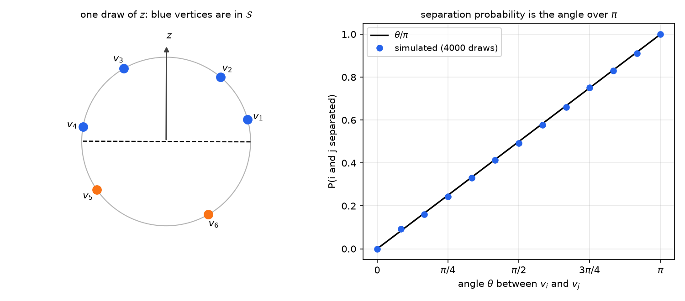
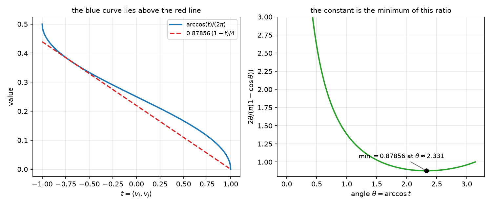
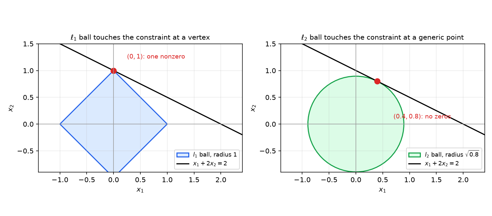
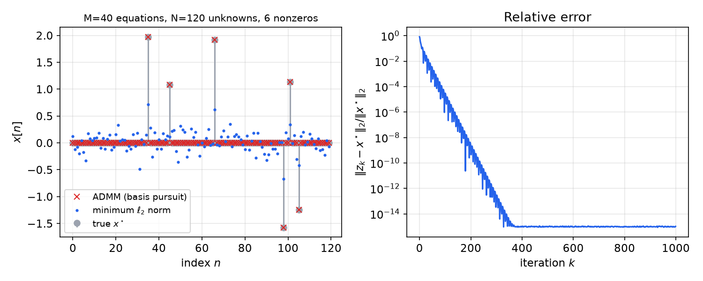

# Convex Relaxations

Many problems that matter in practice are hard because their feasible sets are not convex. Variables must be integers or signs, a matrix must have low rank, a vector must be sparse, or a quadratic expression must equal a fixed value. A **convex relaxation** replaces such a problem by a convex one with a larger feasible set or a smaller objective. The relaxed optimal value bounds the original from one side, and when the relaxed solution happens to be feasible for the original problem it is an optimal solution. This chapter develops the principle and the three relaxations that appear most often: linear programs over the convex hull of a combinatorial set, semidefinite programs obtained by lifting quadratic expressions into matrices, and convex surrogates for cardinality (the \\(\ell\_1\\) norm) and rank (the nuclear norm).

## The Relaxation Principle

Consider a minimization problem \\(p^\star=\min\\{f\_0(x):\ x\in\mathcal X\\}\\). A **relaxation** is a problem
\\[
\tilde p=\min\\{\tilde f(x):\ x\in\tilde{\mathcal X}\\}
\\]
with \\(\mathcal X\subseteq\tilde{\mathcal X}\\) and \\(\tilde f(x)\le f\_0(x)\\) for every \\(x\in\mathcal X\\). The relaxed problem is "looser" in both respects: it allows more points, and on the original points it never reports a larger cost.

**Proposition (Relaxations bound the optimal value).** For any relaxation, \\(\tilde p\le p^\star\\). If the relaxed problem has a minimizer \\(\tilde x\\) with \\(\tilde x\in\mathcal X\\) and \\(f\_0(\tilde x)=\tilde f(\tilde x)\\), then \\(\tilde x\\) solves the original problem.

*Proof.* For every \\(x\in\mathcal X\\), \\(\tilde p\le\tilde f(x)\le f\_0(x)\\); minimizing over \\(x\\) gives \\(\tilde p\le p^\star\\). For the second claim, \\(f\_0(\tilde x)=\tilde f(\tilde x)=\tilde p\le p^\star\\), while \\(\tilde x\in\mathcal X\\) gives \\(f\_0(\tilde x)\ge p^\star\\). Hence \\(f\_0(\tilde x)=p^\star\\). ∎

The difference \\(p^\star-\tilde p\\) is the **gap**, a certified measure of how far the relaxation can be from the truth. For maximization problems the inequalities reverse, and a relaxation gives an upper bound. In practice relaxations fall into three regimes.

- **Exact.** The relaxed optimal value equals \\(p^\star\\), and some relaxed solution is feasible for the original problem. The assignment problem and the minimum cut are of this kind.
- **Provably good.** The relaxed value is within a known factor of \\(p^\star\\). The max-cut relaxation is within a factor \\(0.878\\).
- **Arbitrarily bad.** No useful guarantee holds in general, and the gap can be large.

All relaxations in this chapter arise from two moves. The first **convexifies a discrete set** by replacing it with the convex hull of its points, which turns a combinatorial problem into a linear program. The second **lifts** a problem to a larger variable, typically a matrix \\(X=xx^{T}\\), in which quadratic expressions become linear. The nonconvex constraint that remains, usually a rank condition, is then dropped. The modeling tricks of [Convex Optimization Problems and Modeling](modeling.md), especially the lifting identity \\(x^{T}Rx=\langle R,xx^{T}\rangle\\), are used throughout.

## Linear Relaxations: Assignment and the Birkhoff Polytope

### The assignment problem

Suppose \\(N\\) tasks must be matched one-to-one with \\(N\\) agents. Assigning agent \\(m\\) to task \\(n\\) earns a payout \\(C\_{m,n}\ge0\\), and we want the assignment of maximum total payout. A one-to-one assignment is a **permutation matrix** \\(P\\): a \\(0\\)-\\(1\\) matrix with exactly one \\(1\\) in each row and each column. The payout of \\(P\\) is \\(\langle P,C\rangle=\sum\_{m,n}P\_{m,n}C\_{m,n}\\). Writing \\(\Pi\\) for the set of \\(N\times N\\) permutation matrices, the problem is
\\[
\max\_{P\in\Pi}\ \langle P,C\rangle. \tag{1}
\\]
The set \\(\Pi\\) is finite but enormous: it has \\(N!\\) elements. Relax it to the **Birkhoff polytope** of doubly stochastic matrices,
\\[
\mathcal B=\\{A\in\mathbb{R}^{N\times N}:\ A\_{m,n}\ge0,\ A\mathbf{1}=\mathbf{1},\ \mathbf{1}^{T}A=\mathbf{1}^{T}\\},
\\]
and solve
\\[
\max\_{A\in\mathcal B}\ \langle A,C\rangle. \tag{2}
\\]
Problem (2) is a linear program in \\(N^2\\) variables, and off-the-shelf solvers handle \\(N=18\\) in a fraction of a second. The remaining question is whether its solution is a permutation matrix.

**Proposition (Vertex optimality).** Let \\(\mathcal P=\operatorname{conv}\\{v\_1,\dots,v\_K\\}\\) and let \\(c\in\mathbb{R}^N\\). Then \\(\max\_{x\in\mathcal P}c^{T}x\\) is attained at one of the points \\(v\_k\\).

*Proof.* Every \\(x\in\mathcal P\\) can be written \\(x=\sum\_k\lambda\_kv\_k\\) with \\(\lambda\\) in the probability simplex. Then \\(c^{T}x=\sum\_k\lambda\_kd\_k\\) with \\(d\_k=c^{T}v\_k\\). A convex combination of the numbers \\(d\_k\\) never exceeds their maximum, and the maximum is reached by putting all weight on an index \\(k^\star\\) with \\(d\_{k^\star}=\max\_kd\_k\\). So the maximum over \\(\mathcal P\\) equals \\(c^{T}v\_{k^\star}\\). ∎

**Theorem (Birkhoff–von Neumann).** The Birkhoff polytope is the convex hull of the permutation matrices: \\(\mathcal B=\operatorname{conv}(\Pi)\\).

The inclusion \\(\operatorname{conv}(\Pi)\subseteq\mathcal B\\) is immediate, since \\(\mathcal B\\) is convex and contains \\(\Pi\\). The reverse inclusion is a classical theorem (Birkhoff, 1946; von Neumann, 1953), and a standard proof uses Hall's marriage theorem. We use it without reproducing that argument.

**Theorem (Exactness of the assignment relaxation).** For every payout matrix \\(C\\), the linear program (2) has a solution that is a permutation matrix. Consequently the optimal values of (1) and (2) coincide.

*Proof.* By the Birkhoff–von Neumann theorem, \\(\mathcal B=\operatorname{conv}(\Pi)\\), so by vertex optimality (2) is maximized at a vertex of \\(\mathcal B\\). Every vertex of \\(\operatorname{conv}(\Pi)\\) is an element of \\(\Pi\\), because an extreme point of a convex hull of a finite set belongs to that set. Thus some maximizer of (2) is a permutation matrix, which is feasible for (1). Since \\(\Pi\subseteq\mathcal B\\), the two optimal values are equal. ∎

The theorem says that a linear program, solved by the simplex or an interior-point method, recovers the optimal assignment exactly. Unequal numbers of agents and tasks are handled by padding: if there are \\(M>N\\) agents, add \\(M-N\\) dummy columns with payout \\(0\\) (the minimal payout, since \\(C\ge0\\)), solve, and keep the first \\(N\\) columns. The case \\(M<N\\) is symmetric.

**Example 13.1 (A weekly pick-'em pool).** A player must pick one team per week for 18 weeks, using each team at most once. The payout of picking team \\(m\\) in week \\(n\\) is the team's weight times the probability that it wins that week, with weights chosen so that teams that performed worse last year are worth more. Some entries are zero, because the team has a bye that week. The payout table has 18 rows (teams) and 18 columns (weeks). Its optimal assignment, found by solving (2), is:

| Week | Team | Payout | Week | Team | Payout |
|---|---|---|---|---|---|
| 1 | CAR | 15.39 | 10 | NYG | 19.73 |
| 2 | CLE | 11.90 | 11 | BAL | 14.60 |
| 3 | CHI | 16.62 | 12 | WSH | 15.76 |
| 4 | DET | 17.62 | 13 | MIN | 15.94 |
| 5 | JAX | 19.72 | 14 | SEA | 13.02 |
| 6 | IND | 12.85 | 15 | NO | 11.44 |
| 7 | DEN | 18.21 | 16 | NYJ | 16.19 |
| 8 | ATL | 12.75 | 17 | HOU | 15.93 |
| 9 | LAC | 11.26 | 18 | MIA | 13.45 |

The total payout is \\(272.38\\). The solution is not greedy: Denver's payout in week 2 (18.61) is larger than the 11.90 earned by Cleveland in that week, yet Denver is saved for week 7, where its payout of 18.21 is part of a better overall schedule. Any solver for the assignment problem (for instance the Hungarian algorithm) gives the same total, which is a useful check on an LP implementation.

## Minimum Cut

Consider a directed graph on vertices \\(1,\dots,N\\) with nonnegative capacities \\(C\_{i,j}\ge0\\) (zero when there is no edge). Vertex \\(1\\) is the source and vertex \\(N\\) the sink. A **cut** is a set \\(\mathcal S\\) with \\(1\in\mathcal S\\) and \\(N\notin\mathcal S\\), and its capacity is
\\[
\operatorname{cap}(\mathcal S)=\sum\_{i\in\mathcal S,\ j\notin\mathcal S}C\_{i,j}.
\\]
The minimum cut separates source from sink as cheaply as possible.

Let \\(\nu\_i=1\\) if \\(i\in\mathcal S\\) and \\(\nu\_i=0\\) otherwise. The capacity is \\(\sum\_{i,j}C\_{i,j}\max(\nu\_i-\nu\_j,0)\\), since the term \\(\max(\nu\_i-\nu\_j,0)\\) equals \\(1\\) exactly when \\(i\\) is inside and \\(j\\) outside. Introducing variables \\(\lambda\_{i,j}\\) gives the integer program
\\[
\text{(MINCUT)}\qquad \min\_{\lambda,\nu}\ \sum\_{i,j}\lambda\_{i,j}C\_{i,j}\quad\text{s.t.}\quad \lambda\_{i,j}=\max(\nu\_i-\nu\_j,0),\ \ \nu\_i\in\\{0,1\\},\ \ \nu\_1=1,\ \nu\_N=0 .
\\]
The binary constraints make it nonconvex. Dropping them, and replacing the equality by the two inequalities it implies, gives a linear program:
\\[
\text{(LP-R)}\qquad \min\_{\lambda,\nu}\ \sum\_{i,j}\lambda\_{i,j}C\_{i,j}\quad\text{s.t.}\quad \lambda\_{i,j}\ge\nu\_i-\nu\_j,\ \ \lambda\_{i,j}\ge0,\ \ \nu\_1=1,\ \nu\_N=0 .
\\]

**Theorem (The minimum-cut relaxation is exact).** The optimal values of (MINCUT) and (LP-R) are equal.

*Proof.* Every cut \\(\mathcal S\\) gives a feasible point of (LP-R): take \\(\nu\\) the indicator of \\(\mathcal S\\) and \\(\lambda\_{i,j}=\max(\nu\_i-\nu\_j,0)\\). Its objective is \\(\operatorname{cap}(\mathcal S)\\). Hence the optimal value of (LP-R) is at most the minimum cut.

For the reverse inequality, let \\((\lambda^\star,\nu^\star)\\) be optimal for (LP-R). First we may assume \\(0\le\nu^\star\le1\\). Indeed, let \\(c(t)=\min\\{\max\\{t,0\\},1\\}\\) be the clipping function, which is nondecreasing and 1-Lipschitz, and put \\(\tilde\nu=c(\nu^\star)\\). Then \\(\tilde\nu\_1=1\\) and \\(\tilde\nu\_N=0\\), and \\(\max(\tilde\nu\_i-\tilde\nu\_j,0)\le\max(\nu^\star\_i-\nu^\star\_j,0)\le\lambda^\star\_{i,j}\\), so \\((\lambda^\star,\tilde\nu)\\) with \\(\lambda\_{i,j}\\) replaced by \\(\max(\tilde\nu\_i-\tilde\nu\_j,0)\\) is feasible and has no larger objective, because \\(C\ge0\\).

Now draw \\(Z\\) uniformly from \\([0,1)\\) and let \\(\mathcal S=\\{n:\ \nu^\star\_n>Z\\}\\). Since \\(\nu^\star\_1=1>Z\\) and \\(\nu^\star\_N=0\\le Z\\), \\(\mathcal S\\) is always a cut. For an edge \\(i\to j\\),
\\[
\Pr(i\in\mathcal S,\ j\notin\mathcal S)=\Pr(\nu^\star\_j\le Z<\nu^\star\_i)=\max(\nu^\star\_i-\nu^\star\_j,0)\le\lambda^\star\_{i,j}.
\\]
Therefore \\(\mathbb E\\,\operatorname{cap}(\mathcal S)=\sum\_{i,j}C\_{i,j}\Pr(i\in\mathcal S,\ j\notin\mathcal S)\le\sum\_{i,j}C\_{i,j}\lambda^\star\_{i,j}\\). Some realization of \\(\mathcal S\\) has capacity at most the expectation, so the minimum cut is at most the optimal value of (LP-R). ∎

The rounding step is a *randomized threshold*: the same fractional values \\(\nu^\star\\) are cut at a random level. The expected capacity of the rounded cut matches the relaxed objective, which is why the relaxation costs nothing. The dual of the linear program (LP-R) is the maximum-flow problem, which is why such algorithms are so efficient in practice.

**Example 13.2 (A six-node network).** Take six vertices with source \\(1\\), sink \\(6\\) and directed edges with capacities
\\[
1\to2\ (6),\quad 1\to5\ (6),\quad 2\to3\ (2),\quad 2\to4\ (2),\quad 3\to4\ (2),\quad 3\to6\ (7),\quad 4\to6\ (3),\quad 5\to4\ (5),\quad 5\to6\ (2).
\\]
Let \\(\mathcal S=\\{1,2,4,5\\}\\). The edges leaving \\(\mathcal S\\) are \\(2\to3\\), \\(4\to6\\) and \\(5\to6\\), with capacities \\(2+3+2=7\\), so \\(\operatorname{cap}(\mathcal S)=7\\). This cut is minimum. A flow of value \\(7\\) certifies it: send \\(2\\) units along \\(1\to2\to3\to6\\), \\(2\\) along \\(1\to2\to4\to6\\), \\(2\\) along \\(1\to5\to6\\), and \\(1\\) along \\(1\to5\to4\to6\\). All capacities are respected, and the flow into the sink is \\(2+3+2=7\\). By the max-flow min-cut theorem a cut of capacity \\(7\\) and a flow of value \\(7\\) must both be optimal.

## Maximum Cut and the Semidefinite Relaxation

The maximum-cut problem asks for a partition of the vertices of an undirected graph that cuts as much weight as possible. Let \\(A\\) be symmetric with \\(A\_{i,j}\ge0\\) and \\(A\_{i,i}=0\\). Write \\(x\_i=+1\\) if vertex \\(i\\) is in \\(\mathcal S\\) and \\(x\_i=-1\\) otherwise. An edge is cut exactly when \\(x\_i\ne x\_j\\), and \\((1-x\_ix\_j)/2\\) indicates this, so
\\[
\operatorname{cut}(\mathcal S)=\frac14\sum\_{i,j}A\_{i,j}(1-x\_ix\_j)=\frac14\mathbf 1^{T}A\mathbf 1-\frac14x^{T}Ax .
\\]
Maximizing this over \\(x\in\\{-1,1\\}^N\\) is **MAXCUT**. The objective is a quadratic form, and the integer constraints are nonconvex.

**Example 13.3 (Evaluating a cut).** Take six vertices and edges \\(A\_{1,2},A\_{1,3},A\_{2,4},A\_{3,4},A\_{4,5},A\_{4,6},A\_{5,6}\\), all positive. For \\(\mathcal S=\\{4,5,6\\}\\), the edges between \\(\mathcal S\\) and its complement are \\(\\{2,4\\}\\) and \\(\\{3,4\\}\\), so \\(\operatorname{cut}(\mathcal S)=A\_{2,4}+A\_{3,4}\\). The edges \\(4\\)-\\(5\\), \\(4\\)-\\(6\\) and \\(5\\)-\\(6\\) lie inside \\(\mathcal S\\) and do not count.

To relax, lift the problem: set \\(X=xx^{T}\\). Then \\(x^{T}Ax=\langle X,A\rangle\\), and \\(X\\) is positive semidefinite with unit diagonal. Conversely, every rank-one matrix \\(X=xx^{T}\\) with unit diagonal has \\(x\in\\{-1,1\\}^N\\) up to sign. Dropping the rank constraint gives
\\[
\text{(MAXCUT-R)}\qquad \max\_{X}\ \tfrac14\mathbf 1^{T}A\mathbf 1-\tfrac14\langle X,A\rangle\quad\text{s.t.}\quad X\succeq0,\ \ X\_{i,i}=1 .
\\]
This is a semidefinite program: a linear objective over the set of positive semidefinite matrices with fixed diagonal. Since every cut gives a feasible point, \\(\text{MAXCUT-R}^\star\ge\text{MAXCUT}^\star\\), so the SDP value is an upper bound on the maximum cut. Semidefinite programs are solved to any accuracy in polynomial time by interior-point methods.

**Theorem (Goemans–Williamson).** Let
\\[
\alpha=\min\_{0<\theta\le\pi}\frac{2\theta}{\pi(1-\cos\theta)}\approx0.87856 .
\\]
Then \\(\text{MAXCUT}^\star\ge\alpha\cdot\text{MAXCUT-R}^\star\\).

*Proof.* Let \\(X^\star\\) be an optimal solution of (MAXCUT-R). Factor it as \\(X^\star=V^{T}V\\) (for example by a Cholesky or eigenvalue factorization). The columns \\(v\_1,\dots,v\_N\\) of \\(V\\) are unit vectors with \\(\langle v\_i,v\_j\rangle=X^\star\_{i,j}\\).

*Random hyperplane.* Draw \\(z\\) from a standard Gaussian distribution on \\(\mathbb{R}^N\\) and define \\(\mathcal S=\\{i:\ \langle v\_i,z\rangle\ge0\\}\\). Let \\(\theta\_{i,j}=\arccos X^\star\_{i,j}\in[0,\pi]\\) be the angle between \\(v\_i\\) and \\(v\_j\\). The vertices \\(i\\) and \\(j\\) are separated by \\(\mathcal S\\) with probability \\(\theta\_{i,j}/\pi\\). To see this, project \\(z\\) onto the plane spanned by \\(v\_i\\) and \\(v\_j\\); the projection has a rotationally symmetric distribution, so its direction is uniform on the circle. If \\(v\_i\\) is at angle \\(0\\) and \\(v\_j\\) at angle \\(\theta\\), the signs of \\(\cos\varphi\\) and \\(\cos(\varphi-\theta)\\) differ exactly for directions \\(\varphi\\) in two arcs of total length \\(2\theta\\). The probability is \\(2\theta/(2\pi)=\theta/\pi\\).

*Expected cut.* Since \\(A\\) is symmetric with zero diagonal,
\\[
\mathbb E\\,\operatorname{cut}(\mathcal S)=\sum\_{i<j}A\_{i,j}\frac{\theta\_{i,j}}{\pi}=\sum\_{i,j}A\_{i,j}\frac{\arccos X^\star\_{i,j}}{2\pi}.
\\]

*Scalar inequality.* For \\(t\in[-1,1]\\) we claim \\(\dfrac{\arccos t}{2\pi}\ge\alpha\dfrac{1-t}{4}\\). Put \\(\theta=\arccos t\\). The inequality is \\(\dfrac{2\theta}{\pi(1-\cos\theta)}\ge\alpha\\) for \\(\theta\in(0,\pi]\\), which holds by the definition of \\(\alpha\\). At \\(t=1\\) both sides are zero.

*Combining.* Since \\(A\_{i,j}\ge0\\) and \\(\|X^\star\_{i,j}\|\le1\\),
\\[
\mathbb E\\,\operatorname{cut}(\mathcal S)\ge\alpha\sum\_{i,j}A\_{i,j}\frac{1-X^\star\_{i,j}}{4}=\alpha\\,\text{MAXCUT-R}^\star .
\\]
Some realization of \\(\mathcal S\\) has cut at least the expectation, so \\(\text{MAXCUT}^\star\ge\alpha\\,\text{MAXCUT-R}^\star\\). ∎

The constant \\(\alpha\\) is attained at \\(\theta\approx2.331\\), where \\(\cos\theta\approx-0.689\\); the scalar inequality is tight there. The theorem gives a practical algorithm with a guarantee: solve the SDP, round by a random hyperplane, and keep the best of several draws. The cut is within a factor \\(0.878\\) of the SDP value, which is itself an upper bound on the maximum cut. Under the Unique Games Conjecture no polynomial-time algorithm can do better in the worst case (Khot, Kindler, Mossel and O'Donnell, 2007), so the constant is the best achievable for this relaxation.

The figures below illustrate the rounding. The left panel shows one draw of the hyperplane, which splits six unit vectors into two groups. The right panel verifies the separation probability \\(\theta/\pi\\) by simulation.



*Figure: left, six unit vectors \\(v\_1,\dots,v\_6\\) and one random normal \\(z\\) of a separating hyperplane through the origin. Vertices with \\(\langle v\_i,z\rangle\ge0\\) (blue) form the cut \\(\mathcal S\\), and the others (orange) its complement. Right, the probability that two unit vectors at angle \\(\theta\\) are separated, estimated from \\(4000\\) random hyperplanes per angle (dots), against the exact value \\(\theta/\pi\\) (line).*

The scalar inequality behind the constant is checked in the following figure.



*Figure: left, the two sides of the scalar inequality \\(\arccos(t)/(2\pi)\ge\alpha(1-t)/4\\) with \\(\alpha=0.87856\\) on \\([-1,1]\\); the blue curve lies above the red line and touches it near \\(t\approx-0.69\\). Right, the ratio \\(2\theta/(\pi(1-\cos\theta))\\) as a function of \\(\theta=\arccos t\\); its minimum is \\(\alpha\\), attained at \\(\theta\approx2.331\\).*

## Quadratic Constraints, Lifting and Phase Retrieval

The same lifting works for a general quadratically constrained quadratic program (QCQP):
\\[
\min\_{x}\ x^{T}A\_0x+2b\_0^{T}x+c\_0\quad\text{s.t.}\quad x^{T}A\_mx+2b\_m^{T}x+c\_m=0,\quad m=1,\dots,M,
\\]
where the \\(A\_m\\) are symmetric and need not be positive semidefinite. Define \\(F\_m=\begin{bmatrix}A\_m&b\_m\\\\ b\_m^{T}&c\_m\end{bmatrix}\\) and \\(X\_x=\begin{bmatrix}x\\\\1\end{bmatrix}\begin{bmatrix}x^{T}&1\end{bmatrix}\\). Expanding shows \\(\begin{bmatrix}x\\\\1\end{bmatrix}^{T}F\_m\begin{bmatrix}x\\\\1\end{bmatrix}=x^{T}A\_mx+2b\_m^{T}x+c\_m\\), and the trace identity \\(\operatorname{tr}(F\_mX\_x)=\begin{bmatrix}x\\\\1\end{bmatrix}^{T}F\_m\begin{bmatrix}x\\\\1\end{bmatrix}\\) gives
\\[
x^{T}A\_mx+2b\_m^{T}x+c\_m=\langle F\_m,X\_x\rangle .
\\]
The QCQP is therefore equivalent to
\\[
\min\_{X}\ \langle F\_0,X\rangle\quad\text{s.t.}\quad\langle F\_m,X\rangle=0,\quad X\_{N+1,N+1}=1,\quad X\succeq0,\quad\operatorname{rank}X=1 ,
\\]
where \\(X\\) is \\((N+1)\times(N+1)\\). Dropping the rank constraint gives a semidefinite relaxation whose value is a lower bound. Its solution is exact whenever the optimal \\(X\\) has rank one. This happens in some important cases. For a single quadratic constraint, a mild strict-feasibility condition makes the relaxation exact, a consequence of the S-lemma. In other cases, such as max-cut, the relaxation is provably good but not exact, and in general it can be arbitrarily poor.

**Example 13.4 (Phase retrieval).** A coherent imaging system records only magnitudes: \\(y\_m=\lvert\langle a\_m,x\rangle\rvert^2\\) for \\(m=1,\dots,M\\), with \\(x\\) unknown and \\(a\_m\\) known measurement vectors. The unknown phase is lost, so the problem is nonconvex. But \\(y\_m=x^{H}a\_ma\_m^{H}x=\langle A\_m,X\rangle\\) with \\(A\_m=a\_ma\_m^{H}\\) and \\(X=xx^{H}\\), which is linear in \\(X\\). The **PhaseLift** relaxation drops the rank-one constraint: find \\(X\succeq0\\) with \\(\langle A\_m,X\rangle=y\_m\\) for all \\(m\\). This is a feasibility semidefinite program. For suitably random measurement vectors and a number of measurements mildly larger than the dimension, the feasible set contains a single point, which is \\(xx^{H}\\) up to a global phase (Candès, Strohmer and Voroninski, 2013).

**Remark (Decoding as a relaxation).** Maximum-likelihood decoding over a fading channel with \\(y=Hx+v\\), \\(x\in\\{-1,1\\}^N\\) and Gaussian noise amounts to \\(\min\_{x\in\\{\pm1\\}^N}\lVert y-Hx\rVert\_2^2\\). Since \\(\begin{bmatrix}x\\\\1\end{bmatrix}^{T}F\_0\begin{bmatrix}x\\\\1\end{bmatrix}=\lVert y-Hx\rVert\_2^2\\) with \\(F\_0=\begin{bmatrix}H^{T}H&-H^{T}y\\\\-y^{T}H&y^{T}y\end{bmatrix}\\), the lifting gives an SDP with constraints \\(X\_{i,i}=1\\) (the entries of \\(x\\) are \\(\pm1\\)) and \\(X\succeq0\\). The constraints \\(x\_i^2=1\\) are linear in \\(X\\), which is why the same device handles integer problems.

## Sparse Recovery: The \\(\ell\_1\\) Relaxation

A vector is **sparse** when few of its entries are nonzero. Counting nonzeros, \\(\operatorname{nnz}(x)\\), is not convex. The minimum-cardinality problem \\(\min\operatorname{nnz}(x)\\) subject to \\(Ax=y\\) is NP-hard in general, and so is minimizing \\(\lVert y-Ax\rVert\_2^2+\lambda\operatorname{nnz}(x)\\). The standard convex surrogate replaces the count by the \\(\ell\_1\\) norm \\(\lVert x\rVert\_1=\sum\_n\lvert x\_n\rvert\\). The \\(\ell\_1\\) norm is the convex envelope of \\(\operatorname{nnz}\\) on the box \\(\lVert x\rVert\_\infty\le1\\), which is the precise sense in which it is the best convex stand-in for counting nonzeros. Two problems follow:
\\[
\text{(BP)}\quad\min\_{x}\ \lVert x\rVert\_1\ \ \text{s.t.}\ \ Ax=y,\qquad\qquad \text{(LASSO)}\quad\min\_{x}\ \tfrac12\lVert y-Ax\rVert\_2^2+\lambda\lVert x\rVert\_1 .
\\]
Basis pursuit (BP) is the noiseless version, from signal processing, and LASSO is the regularized regression form from statistics.

Why should the \\(\ell\_1\\) norm recover sparse solutions? The geometry is already visible in two dimensions. The figure below shows the constraint line \\(x\_1+2x\_2=2\\) together with the smallest \\(\ell\_1\\) ball and the smallest \\(\ell\_2\\) ball that touch it.



*Figure: the line \\(x\_1+2x\_2=2\\) (black) with the \\(\ell\_1\\) ball of radius \\(1\\) (left, blue) and the \\(\ell\_2\\) ball of radius \\(\sqrt{0.8}\\) (right, green). The smallest \\(\ell\_1\\) ball touches the line at the vertex \\((0,1)\\), a sparse point, while the smallest \\(\ell\_2\\) ball touches it at \\((0.4,0.8)\\), where both coordinates are nonzero.*

**Example 13.5 (The two-dimensional geometry).** Minimize \\(\lVert x\rVert\_1\\) or \\(\lVert x\rVert\_2\\) subject to \\(x\_1+2x\_2=2\\). For the \\(\ell\_1\\) norm, the triangle inequality gives \\(2\lVert x\rVert\_1\ge\lvert x\_1\rvert+2\lvert x\_2\rvert\ge\lvert x\_1+2x\_2\rvert=2\\) on the constraint line, so \\(\lVert x\rVert\_1\ge1\\). The first inequality in the chain, \\(\lvert x\_1\rvert+2\lvert x\_2\rvert\le2\lvert x\_1\rvert+2\lvert x\_2\rvert\\), is strict whenever \\(x\_1\ne0\\), so equality forces \\(x\_1=0\\), and on the line this gives \\(x\_2=1\\). The minimal \\(\ell\_1\\) value is therefore \\(1\\), attained uniquely at the sparse point \\((0,1)\\). For the \\(\ell\_2\\) norm the minimum-norm point is \\(a(a^{T}a)^{-1}y\\) with \\(a=(1,2)\\), which gives \\((0.4,0.8)\\), of norm \\(\sqrt{0.8}\approx0.894\\), with no zero entry. Note that \\(\lVert(0.4,0.8)\rVert\_1=1.2>1\\): the \\(\ell\_2\\) solution is not sparse and is not the \\(\ell\_1\\) solution.

**Theorem (Dual of basis pursuit).** The dual of (BP) is
\\[
\max\_{\nu}\ b^{T}\nu\quad\text{s.t.}\quad\lVert A^{T}\nu\rVert\_\infty\le1 .
\\]
If \\(x^\star\\) and \\(\nu^\star\\) are optimal, then \\(u^\star=A^{T}\nu^\star\\) satisfies \\(u^\star\_n=\operatorname{sign}(x^\star\_n)\\) whenever \\(x^\star\_n\ne0\\), and \\(\lvert u^\star\_n\rvert\le1\\) otherwise.

*Proof.* Write \\(b=y\\). The Lagrangian is \\(L(x,\nu)=\lVert x\rVert\_1+\nu^{T}(b-Ax)=\lVert x\rVert\_1-\langle A^{T}\nu,x\rangle+b^{T}\nu\\). Its infimum over \\(x\\) is \\(b^{T}\nu-\sup\_x\bigl(\langle A^{T}\nu,x\rangle-\lVert x\rVert\_1\bigr)\\). The supremum is the conjugate of the \\(\ell\_1\\) norm, which is \\(0\\) if \\(\lVert A^{T}\nu\rVert\_\infty\le1\\) and \\(+\infty\\) otherwise, giving the dual. For the second claim, strong duality holds for this feasible linear program, so \\(b^{T}\nu^\star=\lVert x^\star\rVert\_1\\). Also \\(b^{T}\nu^\star=(Ax^\star)^{T}\nu^\star=\langle x^\star,u^\star\rangle\\). Hence \\(\langle x^\star,u^\star\rangle=\sum\_nx^\star\_nu^\star\_n=\sum\_n\lvert x^\star\_n\rvert\\) with \\(\lvert u^\star\_n\rvert\le1\\). Equality in each term forces \\(x^\star\_nu^\star\_n=\lvert x^\star\_n\rvert\\), which gives the sign pattern. ∎

**Theorem (Sparse basic solutions).** Suppose \\(M<N\\). Then some minimizer of (BP) has at most \\(M\\) nonzero entries.

*Proof.* Let \\(x'\\) be a minimizer with support \\(\mathcal S\\), and suppose \\(\lvert\mathcal S\rvert>M\\). The columns of \\(A\\) indexed by \\(\mathcal S\\) are then linearly dependent, so there is \\(h\ne0\\) supported on \\(\mathcal S\\) with \\(Ah=0\\). Replacing \\(h\\) by \\(-h\\) if necessary, we may assume \\(s=\sum\_{i\in\mathcal S}\operatorname{sign}(x'\_i)h\_i\le0\\). For small \\(t\\) the signs of the entries of \\(x'+th\\) in \\(\mathcal S\\) do not change, so \\(\lVert x'+th\rVert\_1=\lVert x'\rVert\_1+ts\\) is linear in \\(t\\). Some \\(i\in\mathcal S\\) has \\(\operatorname{sign}(x'\_i)h\_i<0\\): otherwise every term would be nonnegative with sum \\(s\le0\\), forcing \\(h=0\\). Increase \\(t\\) from zero until the first entry of \\(x'+th\\) in \\(\mathcal S\\) vanishes, at some \\(t^\star>0\\). On \\([0,t^\star]\\) the \\(\ell\_1\\) norm is linear with slope \\(s\le0\\), so \\(\lVert x'+t^\star h\rVert\_1\le\lVert x'\rVert\_1\\). The new point is still feasible, since \\(A(x'+t^\star h)=Ax'=y\\), and it is a minimizer. Its support is strictly smaller. Repeat until the support has at most \\(M\\) elements. ∎

The argument is the basic-solution idea of linear programming: a minimizer can always be moved to a vertex, and a vertex of \\(\\{x:\ Ax=y\\}\\) has at most \\(M\\) nonzeros. The \\(\ell\_1\\) relaxation is therefore exact at the level of sparsity, and the question is when its solution is the sparse vector one wants. The results of Candès, Romberg and Tao (2006) and Donoho (2006) answer this for random matrices: if \\(y=Ax^\star\\) with \\(x^\star\\) having \\(K\\) nonzeros, then basis pursuit returns \\(x^\star\\) exactly when the number of measurements \\(M\\) is a modest multiple of \\(K\\) (up to a logarithmic factor in \\(N/K\\)), even though \\(M\ll N\\). The picture below comes from a numerical experiment with \\(M=40\\) equations and \\(N=120\\) unknowns, where \\(x^\star\\) has six nonzeros. The basis pursuit problem is solved by ADMM (see [ADMM and Primal–Dual Splitting](admm.md)).



*Figure: left, the sparse vector \\(x^\star\\) (gray stems), the basis pursuit solution computed by ADMM (red crosses), which matches \\(x^\star\\) to working precision, and the minimum-\\(\ell\_2\\)-norm solution of \\(Ax=y\\) (blue dots), which is dense and misses the support. Right, the relative error \\(\lVert z\_k-x^\star\rVert\_2/\lVert x^\star\rVert\_2\\) of the ADMM iterates on a log scale, which falls linearly to machine precision by about iteration 400.*

**Example 13.6 (Group testing).** Suppose \\(N=1000\\) people are screened with \\(M=100\\) pooled tests, and each person is placed in exactly \\(K\\) of the pools at random. The test result for each pool is the number of infected people in it, so the measurement is \\(y=Ax\\), where \\(x\in\\{0,1\\}^N\\) marks the infected and \\(A\\) is the \\(0\\)-\\(1\\) pooling matrix. Since \\(x\ge0\\), the \\(\ell\_1\\) norm equals \\(\mathbf 1^{T}x\\), and recovery is the linear program \\(\min\lVert x\rVert\_1\\) s.t. \\(Ax=y\\), \\(x\ge0\\). With \\(10\\) infected people and \\(K=10\\), all \\(10\\) are identified exactly. Over \\(100\\) random trials for each value of \\(K\\), recovery is reliable down to \\(K=4\\) pools per person, and it fails in every trial for \\(K=1\\) or \\(2\\). Fixing \\(K=10\\), recovery is almost always exact when the number of infected people is \\(18\\) or fewer and degrades quickly beyond that. At \\(18\\) infected, small values of \\(K\\) (3 to 4) begin to fail, and a broad middle range of \\(K\\) gives small but nonzero error. This is the compressed-sensing phase transition in a small setting: exact recovery holds on one side of a threshold in sparsity and measurement density, and fails sharply on the other.

## Low-Rank Recovery: The Nuclear Norm

The rank of a matrix is the cardinality of its vector of singular values, so rank is to matrices what \\(\operatorname{nnz}\\) is to vectors. Consider **matrix completion**: recover an \\(M\times N\\) matrix from a subset \\(\mathcal I\\) of its entries. In general this is impossible, but if the matrix has low rank it can be possible. The natural program \\(\min\operatorname{rank}(X)\\) subject to \\(X\_{m,n}=Y\_{m,n}\\) for \\((m,n)\in\mathcal I\\) is NP-hard. Its convex relaxation replaces rank by the **nuclear norm**, the sum of singular values. This is the matrix analogue of the \\(\ell\_1\\) norm: the rank counts nonzero singular values, and the nuclear norm sums them.

Let \\(X=U\Sigma V^{T}\\) be a singular value decomposition with singular values \\(\sigma\_1\ge\dots\ge\sigma\_R>0\\), where \\(R=\operatorname{rank}X\\). The **spectral norm** \\(\lVert X\rVert\\) is \\(\sigma\_1\\), the largest singular value, and the **nuclear norm** is \\(\lVert X\rVert\_\*=\sum\_r\sigma\_r\\). The two are dual to each other.

**Theorem (Duality of nuclear and spectral norms).** For every matrix \\(X\\),
\\[
\lVert X\rVert\_\*=\sup\_{\lVert Y\rVert\le1}\langle X,Y\rangle .
\\]
In particular the nuclear norm is convex, being a supremum of linear functions.

*Proof.* Let \\(X=U\Sigma V^{T}\\) be a compact SVD. For the lower bound take \\(Y'=UV^{T}\\), which has spectral norm one, and compute \\(\langle X,Y'\rangle=\operatorname{tr}(V\Sigma U^{T}UV^{T})=\operatorname{tr}\Sigma=\lVert X\rVert\_\*\\). For the upper bound, \\(\langle X,Y\rangle=\langle\Sigma,U^{T}YV\rangle=\sum\_i\sigma\_i\\,u\_i^{T}Yv\_i\le\sum\_i\sigma\_i\lVert Y\rVert\le\lVert X\rVert\_\*\\), because \\(\lvert u\_i^{T}Yv\_i\rvert\le\lVert Y\rVert\\) for unit vectors \\(u\_i,v\_i\\). ∎

The relaxation of matrix completion is therefore
\\[
\min\_X\ \lVert X\rVert\_\*\quad\text{s.t.}\quad X\_{m,n}=Y\_{m,n},\ (m,n)\in\mathcal I .
\\]
For a noisy version, the **matrix LASSO** \\(\min\_X\ \tfrac\delta2\sum\_{(m,n)\in\mathcal I}(Y\_{m,n}-X\_{m,n})^2+\lVert X\rVert\_\*\\) is solved by proximal gradient descent, which needs the proximal operator of the nuclear norm.

**Theorem (Singular value soft thresholding).** For \\(\alpha>0\\) and \\(Z=U\Sigma V^{T}\\),
\\[
\operatorname{prox}\_{\alpha\lVert\cdot\rVert\_\*}(Z)=\arg\min\_X\ \Bigl(\lVert X\rVert\_\*+\frac1{2\alpha}\lVert X-Z\rVert\_F^2\Bigr)=U\\,(\Sigma-\alpha I)\_+\\,V^{T},
\\]
where \\((\cdot)\_+\\) is applied entrywise to the diagonal matrix.

*Proof.* First we show that the projection of \\(Z\\) onto the spectral ball \\(\\{Y:\ \lVert Y\rVert\le\tau\\}\\) in Frobenius norm is \\(\hat Y=U\min(\Sigma,\tau I)V^{T}\\). For any \\(Y\\) in the ball with singular values \\(\gamma\_i\in[0,\tau]\\), von Neumann's trace inequality gives \\(\langle Z,Y\rangle\le\sum\_i\sigma\_i\gamma\_i\\). Hence
\\[
\lVert Z-Y\rVert\_F^2=\lVert Z\rVert\_F^2-2\langle Z,Y\rangle+\lVert Y\rVert\_F^2\ge\sum\_i\bigl(\sigma\_i^2-2\sigma\_i\gamma\_i+\gamma\_i^2\bigr)=\sum\_i(\sigma\_i-\gamma\_i)^2\ge\sum\_i(\sigma\_i-\min\\{\sigma\_i,\tau\\})^2 ,
\\]
with equality for \\(\hat Y\\). Next, the nuclear norm is dual to the spectral norm, so its conjugate is the indicator of the unit spectral ball. Moreau's decomposition \\(Z=\operatorname{prox}\_{\alpha f}(Z)+\alpha\operatorname{prox}\_{f^\*/\alpha}(Z/\alpha)\\) with \\(f=\lVert\cdot\rVert\_\*\\) then gives \\(\operatorname{prox}\_{\alpha f}(Z)=Z-P\_{\\{\lVert Y\rVert\le\alpha\\}}(Z)\\). Subtracting the clipped singular values gives \\(\sigma\_i-\min\\{\sigma\_i,\alpha\\}=(\sigma\_i-\alpha)\_+\\). ∎

Thus each proximal step shrinks every singular value by \\(\alpha\\) and sets small ones to zero, the matrix analogue of the soft threshold \\(\operatorname{sign}(u)(\lvert u\rvert-\alpha)\_+\\) for the \\(\ell\_1\\) norm.

**Algorithm (Proximal gradient for the matrix LASSO).** Let \\(f(X)=\tfrac\delta2\sum\_{(m,n)\in\mathcal I}(Y\_{m,n}-X\_{m,n})^2\\), whose gradient is \\(\delta(X-Y)\\) on \\(\mathcal I\\) and zero elsewhere. Iterate
\\[
X\_{k+1}=\operatorname{prox}\_{\alpha\lVert\cdot\rVert\_\*}\bigl(X\_k-\alpha\nabla f(X\_k)\bigr),\qquad \alpha=\frac1\delta .
\\]
The step \\(1/\delta\\) is \\(1/L\\) for this quadratic, so the usual proximal gradient theory applies (see [Subgradients and Proximal Algorithms](nonsmooth.md)).

**Example 13.7 (Completing a rank-two matrix).** Eight entries of an \\(8\times8\\) matrix are missing, and the observed entries are shown with dashes below.
```text
10   -   -   6   4   4  12   -
12   -   6   -   6   -  18  12
 -  10   4  10   -   4   -  10
 -   -   2   4   -   2   6   4
 -   4   2   -   -   2   6   4
10   -   4   6   -   4  12   -
10   -   4   -   4   -  12   6
 6  10   -  10   4   -  12   -
```
Solve the matrix LASSO with \\(\delta=100\\) by proximal gradient with \\(\alpha=0.01\\). The iterates converge to a matrix whose entries are within about \\(0.05\\) of the integers below. Rounding gives the completed matrix:
```text
10   6   4   6   4   4  12   6
12  12   6  12   6   6  18  12
 6  10   4  10   4   4  12  10
 4   4   2   4   2   2   6   4
 4   4   2   4   2   2   6   4
10   6   4   6   4   4  12   6
10   6   4   6   4   4  12   6
 6  10   4  10   4   4  12  10
```
The completion has rank two. Rows \\(1\\), \\(6\\) and \\(7\\) equal \\(r\_1=(10,6,4,6,4,4,12,6)\\), and rows \\(3\\) and \\(8\\) equal \\(r\_3=(6,10,4,10,4,4,12,10)\\). Row \\(2\\) is \\(\tfrac34(r\_1+r\_3)\\), and rows \\(4\\) and \\(5\\) are \\(\tfrac14(r\_1+r\_3)\\). Every row is therefore a combination of \\(r\_1\\) and \\(r\_3\\), which are linearly independent, so the rank is exactly two. The completion reproduces every observed entry. Its singular values are approximately \\(58.48\\) and \\(8.23\\), followed by zeros. The step \\(\alpha=0.01\\) equals \\(1/\delta\\), and the threshold it applies to singular values is the same \\(\alpha\\) in each iteration.

## Summary

- **Relaxation principle:** if \\(\mathcal X\subseteq\tilde{\mathcal X}\\) and \\(\tilde f\le f\_0\\) on \\(\mathcal X\\), then the relaxed value \\(\tilde p\\) satisfies \\(\tilde p\le p^\star\\); a relaxed solution in \\(\mathcal X\\) with equal cost is optimal.
- **Assignment:** the LP over the Birkhoff polytope \\(\mathcal B\\) is exact, because \\(\mathcal B=\operatorname{conv}(\Pi)\\) and linear objectives are maximized at vertices.
- **Minimum cut:** the LP relaxation (LP-R) with \\(\lambda\_{i,j}\ge\nu\_i-\nu\_j\\) is exact, by randomized threshold rounding of \\(\nu\\).
- **Max-cut:** lifting \\(X=xx^{T}\\) and dropping the rank constraint gives an SDP; random hyperplane rounding achieves \\(\alpha\approx0.87856\\) times the SDP value.
- **QCQP:** the lifting \\(\langle F\_m,X\_x\rangle=x^{T}A\_mx+2b\_m^{T}x+c\_m\\) gives an SDP relaxation, exact for a single constraint under strict feasibility.
- **\\(\ell\_1\\) relaxation:** basis pursuit \\(\min\lVert x\rVert\_1\\) s.t. \\(Ax=y\\) has a dual with \\(\lVert A^{T}\nu\rVert\_\infty\le1\\), and some minimizer has at most \\(M\\) nonzeros.
- **Nuclear norm:** \\(\lVert X\rVert\_\*=\sup\_{\lVert Y\rVert\le1}\langle X,Y\rangle\\), and its proximal operator is singular value soft thresholding \\(U(\Sigma-\alpha I)\_+V^{T}\\).

## See Also

- [Convex Optimization Problems and Modeling](modeling.md): the lifting identity and the reformulation tricks used throughout, and the SDP and SOCP classes.
- [Lagrange and Fenchel Duality](duality.md): the duals of basis pursuit and of the relaxations here, and conjugate functions.
- [ADMM and Primal–Dual Splitting](admm.md): the solver used for the basis pursuit example.
- [Subgradients and Proximal Algorithms](nonsmooth.md): proximal gradient methods and the Moreau decomposition used for singular value thresholding.
- [Algorithms for Constrained Problems](constrained-algorithms.md) and [Minimax Problems and Matrix Games](minimax.md): related algorithms and the minimax view of duality.
- Regularization and Supervised Learning: the LASSO and ridge penalties in machine learning.
- Singular Value Decomposition and Eigenvalues and Eigenvectors: the SVD, spectral norms and the positive semidefinite cone used in the lifting.
