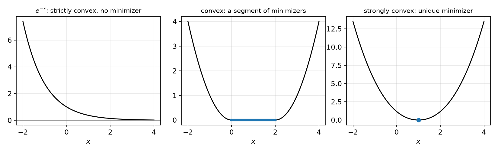
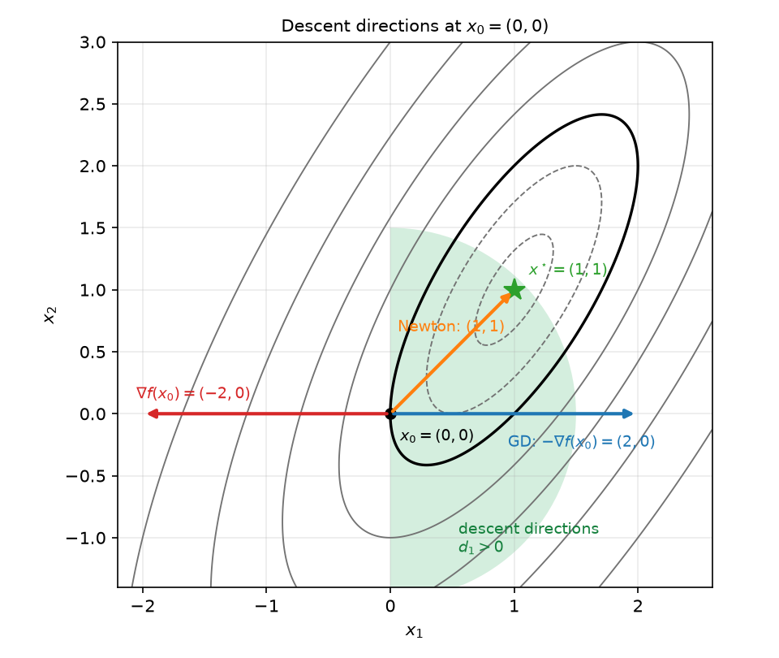
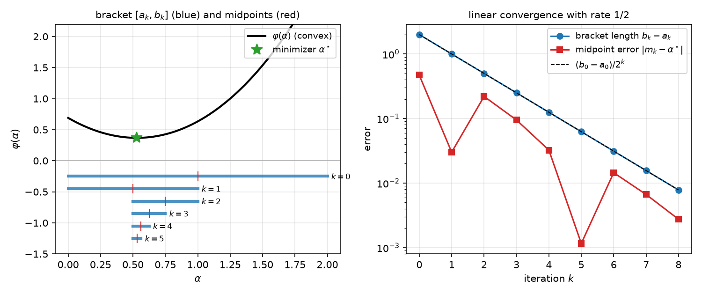
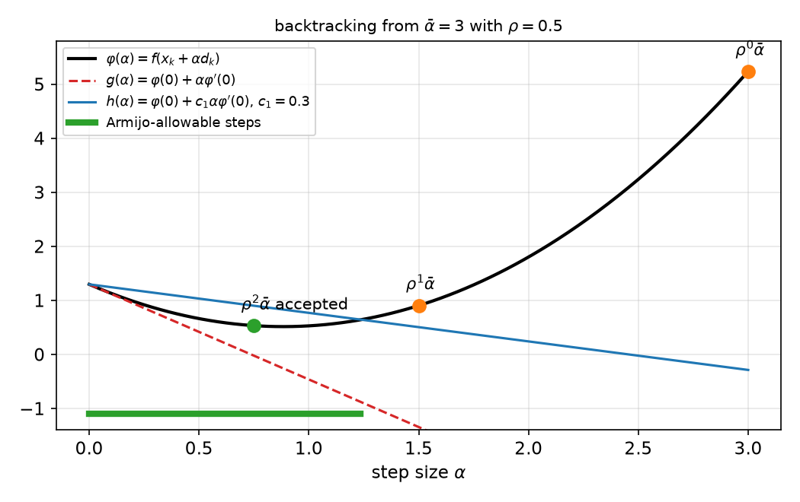
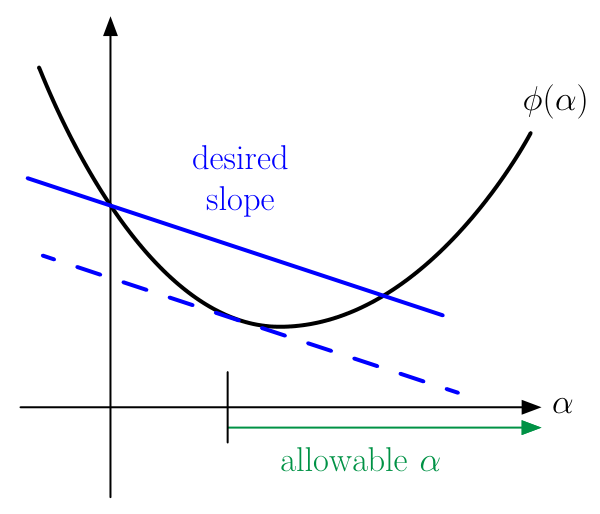
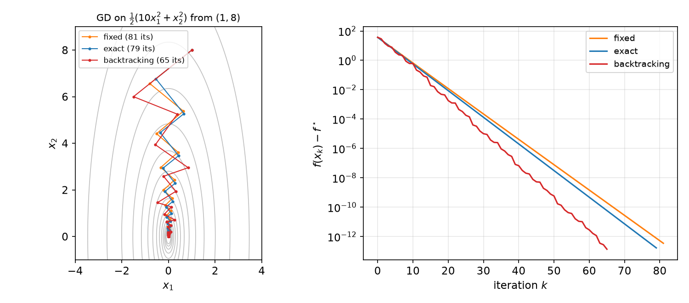

# Unconstrained Optimality and Line Search

Every algorithm in this subsection begins with the same questions: when is a point a solution, does a solution exist and is it unique, and how do we move from a poor point toward a good one? This chapter answers the first three questions for unconstrained convex problems, posed in [Convex Optimization Problems and Modeling](modeling.md). It then introduces the iterative framework shared by all later methods: choose a descent direction, then choose a step size by a line search. The step-size rules (exact search, bisection, the Armijo backtracking rule and the Wolfe curvature condition) are analyzed in full, because they reappear in every chapter that follows.

## Setting

We study
\\[
\min\_{x\in\mathbb{R}^N} f(x), \qquad f:\mathbb{R}^N\to\mathbb{R}\ \text{convex}.
\\]
Every point is feasible, so the solution is determined entirely by the behaviour of \\(f\\). This is what makes the first-order condition below so strong: a stationary point is automatically a global minimizer. Constrained problems, where solutions typically lie on a boundary, are the subject of [Constrained Optimality and the KKT Conditions](constrained-optimality.md). When \\(f\\) is differentiable we write \\(\nabla f\\) for its gradient, and we use the two quadratic bounds of [Convex Functions](convex-functions.md). The function \\(f\\) is \\(L\\)-*smooth* if \\(\lVert\nabla f(x)-\nabla f(y)\rVert\_2\le L\lVert x-y\rVert\_2\\) for all \\(x,y\\), and \\(\mu\\)-*strongly convex* if \\(f-\tfrac\mu2\lVert x\rVert\_2^2\\) is convex. Nonsmooth functions are postponed to [Subgradients and Proximal Algorithms](nonsmooth.md).

## Local Minima Are Global

A point \\(x^\star\\) is a **local minimizer** of \\(f\\) if there is \\(\epsilon>0\\) with \\(f(x^\star)\le f(x)\\) whenever \\(\lVert x-x^\star\rVert\_2\le\epsilon\\). For a general function this notion is weak: a nonconvex function may have several local minima with different values, and gradient methods may stop at any of them. For convex functions the distinction disappears.

**Theorem (Local minima are global).** Let \\(f\\) be convex and let \\(x^\star\\) be a local minimizer. Then \\(f(x^\star)\le f(x)\\) for every \\(x\in\mathbb{R}^N\\).

*Proof.* Let \\(x'\\) satisfy \\(\lVert x'-x^\star\rVert\_2>\epsilon\\). It suffices to show \\(f(x')\ge f(x^\star)\\). Put \\(\theta=\epsilon/\lVert x'-x^\star\rVert\_2\in(0,1)\\) and \\(z=\theta x'+(1-\theta)x^\star\\). Then \\(\lVert z-x^\star\rVert\_2=\theta\lVert x'-x^\star\rVert\_2=\epsilon\\), so \\(z\\) lies in the neighbourhood on which \\(x^\star\\) is optimal. Convexity then gives
\\[
f(x^\star)\le f(z)\le \theta f(x')+(1-\theta)f(x^\star).
\\]
Subtracting \\((1-\theta)f(x^\star)\\) and dividing by \\(\theta>0\\) yields \\(f(x^\star)\le f(x')\\). ∎

## Optimality Conditions

**Theorem (First-order optimality).** Let \\(f\\) be convex and differentiable on \\(\mathbb{R}^N\\). Then \\(x^\star\\) is a global minimizer if and only if \\(\nabla f(x^\star)=0\\).

*Proof.* Suppose \\(x^\star\\) is a minimizer and fix any direction \\(d\\). The function \\(t\mapsto f(x^\star+td)\\) is minimized at \\(t=0\\), so its derivative there vanishes: \\(\langle\nabla f(x^\star),d\rangle=0\\). This step uses no convexity. Since \\(d\\) is arbitrary, \\(\nabla f(x^\star)=0\\). Conversely, if \\(\nabla f(x^\star)=0\\), the first-order inequality of convex functions gives \\(f(y)\ge f(x^\star)+\langle\nabla f(x^\star),y-x^\star\rangle=f(x^\star)\\) for every \\(y\\). ∎

Two remarks put the theorem in context.

1. The equivalence is what makes gradient methods certifiable. A small gradient means a nearly optimal point. For \\(\mu\\)-strongly convex \\(f\\), the Polyak–Łojasiewicz inequality of [Gradient Descent and Accelerated Methods](first-order-methods.md) gives \\(f(x)-f^\star\le\lVert\nabla f(x)\rVert\_2^2/(2\mu)\\), so \\(\lVert\nabla f(x)\rVert\_2\le\epsilon\\) certifies \\(f(x)-f^\star\le\epsilon^2/(2\mu)\\).
2. Without convexity the condition is only necessary. A stationary point may be a local maximum or a saddle, and this is the main reason nonconvex optimization is harder.

## Existence of a Minimizer

A convex function need not attain its infimum. The function \\(e^{-x}\\) on \\(\mathbb{R}\\) is convex with infimum \\(0\\), which no point attains. The affine function \\(a^{T}x+b\\) is unbounded below. The natural tool is the **sublevel set**
\\[
S\_\beta=\\{x\in\mathbb{R}^N:\ f(x)\le\beta\\}.
\\]
If \\(f\\) is convex, every \\(S\_\beta\\) is convex: for \\(x,y\in S\_\beta\\) we have \\(f(\theta x+(1-\theta)y)\le\theta f(x)+(1-\theta)f(y)\le\beta\\). A convex function that is finite on all of \\(\mathbb{R}^N\\) is continuous, a standard fact we use without proof. Hence every \\(S\_\beta\\) is closed.

**Theorem (Existence from a bounded sublevel set).** Let \\(f\\) be convex and finite on \\(\mathbb{R}^N\\). If some nonempty sublevel set \\(S\_\beta\\) is bounded, then \\(f\\) has a global minimizer.

*Proof.* The set \\(S\_\beta\\) is closed and bounded, hence compact. By the Weierstrass theorem the continuous function \\(f\\) attains its minimum over \\(S\_\beta\\) at some \\(\hat x\\). If \\(x\notin S\_\beta\\), then \\(f(x)>\beta\ge f(\hat x)\\), so \\(\hat x\\) minimizes \\(f\\) over all of \\(\mathbb{R}^N\\). ∎

The boundedness hypothesis holds whenever \\(f\\) is **coercive**, that is, \\(f(x\_k)\to\infty\\) whenever \\(\lVert x\_k\rVert\_2\to\infty\\). Coercivity forces every sublevel set to be bounded.

**Theorem (Strong convexity).** Let \\(f\\) be differentiable and \\(\mu\\)-strongly convex with \\(\mu>0\\). Then \\(f\\) has exactly one global minimizer.

*Proof.* Fix any \\(x\_0\\). Strong convexity gives the quadratic lower bound
\\[
f(x)\ge f(x\_0)+\langle\nabla f(x\_0),x-x\_0\rangle+\tfrac\mu2\lVert x-x\_0\rVert\_2^2 .
\\]
The right side tends to infinity as \\(\lVert x\rVert\_2\to\infty\\), so \\(S\_{f(x\_0)}\\) is bounded and nonempty, and the previous theorem gives a minimizer. Uniqueness follows from the next theorem, because strong convexity implies strict convexity. ∎

## Uniqueness and the Set of Minimizers

**Theorem (Strict convexity).** If \\(f\\) is strictly convex and has a global minimizer \\(x^\star\\), then \\(x^\star\\) is unique.

*Proof.* Suppose \\(x'\ne x^\star\\) is also a minimizer, so \\(f(x')=f(x^\star)=f^\star\\). For \\(\theta\in(0,1)\\), strict convexity gives \\(f(\theta x^\star+(1-\theta)x')<\theta f^\star+(1-\theta)f^\star=f^\star\\), which contradicts minimality. ∎

For a general convex function the set of minimizers can be large. Let \\(f^\star\\) be the optimal value. Then the set of minimizers is exactly the sublevel set \\(X^\star=S\_{f^\star}\\), so it is convex by the observation above. Strict convexity is precisely what collapses \\(X^\star\\) to a point.

**Example 4.1 (A segment of minimizers).** Let \\(f(x)=\bigl(\max\\{\lvert x-1\rvert-1,\\,0\\}\bigr)^2\\) on \\(\mathbb{R}\\). This is the squared distance from \\(x\\) to the interval \\([0,2]\\). It is convex, because it is the square of a nonnegative convex function and \\(t\mapsto t^2\\) is convex and nondecreasing on \\([0,\infty)\\). Its minimum is \\(f^\star=0\\), attained exactly on \\(X^\star=[0,2]\\). The minimizer is a convex set but not a point, because \\(f\\) is linear along the segment in the flat region and so is not strictly convex.

**Example 4.2 (Three one-dimensional cases).** The figure below shows three convex functions on \\(\mathbb{R}\\), each illustrating one possible outcome.



*Figure: left, \\(e^{-x}\\) is strictly convex but has no minimizer, since its infimum \\(0\\) is approached as \\(x\to\infty\\). Middle, the function of Example 4.1 has a segment of minimizers. Right, \\(g(x)=(x-1)^2+\tfrac16\lvert x-1\rvert^3\\) has \\(g''(x)=2+\lvert x-1\rvert\ge 2\\) for every \\(x\\), so \\(g\\) is \\(2\\)-strongly convex and its unique minimizer is \\(x=1\\).*

## Descent Methods

Most algorithms in this subsection follow one template:
```text
Initialize x_0. For k = 0, 1, 2, ...:
    choose a direction d_k
    choose a step size alpha_k >= 0
    x_{k+1} = x_k + alpha_k d_k
```
The direction is the algorithm's main design choice. Gradient descent takes \\(d=-\nabla f(x)\\). Newton's method takes \\(d=-[\nabla^2 f(x)]^{-1}\nabla f(x)\\). Quasi-Newton methods replace the inverse Hessian by an approximation, and momentum methods add a fraction of the previous step. The line search chooses \\(\alpha\_k\\).

**Definition (Descent direction).** A vector \\(d\\) is a **descent direction** at \\(x\\) if \\(\langle\nabla f(x),d\rangle<0\\).

For differentiable \\(f\\), \\(f(x+\alpha d)=f(x)+\alpha\langle\nabla f(x),d\rangle+o(\alpha)\\), so a descent direction lowers \\(f\\) for all sufficiently small steps. For convex \\(f\\) the converse also holds. The first-order inequality gives \\(f(x+\alpha d)\ge f(x)+\alpha\langle\nabla f(x),d\rangle\\), so if \\(\langle\nabla f(x),d\rangle\ge0\\) then \\(f(x+\alpha d)\ge f(x)\\) for every \\(\alpha\ge0\\), and no step along \\(d\\) can help. The sign of the inner product is therefore exactly the right test.

The gradient is a descent direction whenever \\(\nabla f(x)\ne0\\), because \\(\langle\nabla f(x),-\nabla f(x)\rangle=-\lVert\nabla f(x)\rVert\_2^2<0\\). The Newton direction is a descent direction whenever \\(\nabla^2 f(x)\succ0\\), because \\(\langle\nabla f(x),-H^{-1}\nabla f(x)\rangle=-\nabla f(x)^{T}H^{-1}\nabla f(x)<0\\) for \\(H=\nabla^2 f(x)\\).

**Example 4.3 (Descent directions of a quadratic).** Let \\(f(x)=2x\_1^2+x\_2^2-2x\_1(x\_2+1)\\). Then
\\[
\nabla f(x)=\begin{bmatrix}4x\_1-2x\_2-2\\\\ 2x\_2-2x\_1\end{bmatrix},\qquad \nabla^2 f(x)=H=\begin{bmatrix}4&-2\\\\-2&2\end{bmatrix}.
\\]
*Solution.* The matrix \\(H\\) has trace 6 and determinant 4, so both eigenvalues are positive; they are \\(3\pm\sqrt5\\). Hence \\(f\\) is strongly convex and smooth with \\(\mu=3-\sqrt5\approx0.764\\) and \\(L=3+\sqrt5\approx5.236\\). Setting \\(\nabla f=0\\) gives \\(x\_2=x\_1\\) and then \\(2x\_1-2=0\\), so the minimizer is \\(x^\star=(1,1)\\) with \\(f^\star=f(1,1)=-1\\).

At \\(x\_0=(0,0)\\) the gradient is \\(\nabla f(x\_0)=(-2,0)\\). Two directions are of interest.

- *Gradient direction.* \\(d=-\nabla f(x\_0)=(2,0)\\), and \\(\langle\nabla f(x\_0),d\rangle=-4<0\\).
- *Newton direction.* Since \\(\det H=4\\), we have \\(H^{-1}=\tfrac14\begin{bmatrix}2&2\\\\2&4\end{bmatrix}\\), so \\(d=-H^{-1}\nabla f(x\_0)=(1,1)\\). Here \\(\langle\nabla f(x\_0),d\rangle=-2<0\\), and \\(x\_0+d=x^\star\\): Newton's method reaches the minimizer in one step, as it must for a quadratic.

The descent directions at \\(x\_0\\) are exactly the vectors with \\(\langle(-2,0),d\rangle<0\\), that is, the half-plane \\(d\_1>0\\). Both directions above lie in it.



*Figure: contour lines of \\(f\\) from Example 4.3. Dashed contours are negative levels; the solid contour is level \\(0\\), which passes through \\(x\_0\\). The shaded half-disk lies in the half-plane \\(d\_1>0\\) of descent directions. The gradient-descent direction \\((2,0)\\) and Newton's direction \\((1,1)\\) both point into it, while the red arrow shows the gradient \\(\nabla f(x\_0)\\) itself, which points out of it.*

## Step Sizes and Exact Line Search

With a direction \\(d\\) fixed, the line search chooses the step \\(\alpha\\) by working with the one-dimensional function
\\[
\varphi(\alpha)=f(x+\alpha d),\qquad \varphi'(\alpha)=\langle\nabla f(x+\alpha d),d\rangle .
\\]
Because \\(f\\) is convex, \\(\varphi\\) is convex and \\(\varphi'\\) is nondecreasing. An **exact line search** solves \\(\min\_{\alpha\ge0}\varphi(\alpha)\\). This is rarely worth its cost for general functions, but it is exact and cheap for quadratics.

**Example (Exact step for a quadratic).** Let \\(f(x)=\tfrac12x^{T}Qx-b^{T}x\\) with \\(Q\succ0\\), and let \\(d=-g\\) where \\(g=\nabla f(x)=Qx-b\ne0\\). Then \\(\nabla f(x-\alpha g)=g-\alpha Qg\\), so
\\[
\varphi'(\alpha)=\langle g-\alpha Qg,\\,-g\rangle=\alpha\\,g^{T}Qg-\lVert g\rVert\_2^2 ,
\\]
which vanishes at
\\[
\alpha^\star=\frac{\lVert g\rVert\_2^2}{g^{T}Qg}.
\\]
For the function of Example 4.3, \\(g=(-2,0)\\) and \\(g^{T}Hg=16\\), so the exact step along the gradient direction is \\(\alpha^\star=4/16=\tfrac14\\). The new point is \\(x\_1=(\tfrac12,0)\\), with \\(f(x\_1)=-\tfrac12\\). Direct substitution confirms this: \\(\varphi(\alpha)=f(2\alpha,0)=8\alpha^2-4\alpha\\), minimized at \\(\alpha=\tfrac14\\).

**Proposition (Successive gradients are orthogonal).** Suppose gradient descent uses an exact line search at every step, and \\(\nabla f(x\_k)\ne0\\). Then \\(\langle\nabla f(x\_{k+1}),\nabla f(x\_k)\rangle=0\\).

*Proof.* At an exact minimizer \\(\alpha\_k>0\\) of \\(\varphi\\) we have \\(\varphi'(\alpha\_k)=0\\), that is, \\(\langle\nabla f(x\_{k+1}),d\_k\rangle=0\\). Since \\(d\_k=-\nabla f(x\_k)\\), the claim follows. ∎

In the example, \\(\nabla f(x\_1)=(0,-1)\\) and \\(\nabla f(x\_0)=(-2,0)\\), which are orthogonal as predicted. The proposition explains the zig-zag seen in the line-search figure below: each new direction is perpendicular to the last, so the iterates bounce across the narrow valleys of \\(f\\) instead of heading straight for the minimizer.

**Bisection.** In one dimension, the derivative \\(\varphi'\\) gives an exact search by bisection. Suppose a bracket \\([a\_0,b\_0]\\) satisfies \\(\varphi'(a\_0)<0<\varphi'(b\_0)\\). At the midpoint \\(m\\), if \\(\varphi'(m)>0\\) the minimizer lies in \\([a,m]\\), and otherwise it lies in \\([m,b]\\). Monotonicity of \\(\varphi'\\) makes this decision correct, so the bracket always contains the minimizer. After \\(k\\) steps the bracket has length \\((b\_0-a\_0)2^{-k}\\), and the midpoint satisfies \\(\lvert m\_k-\alpha^\star\rvert\le(b\_0-a\_0)2^{-k-1}\\). The error is halved at each step: linear convergence with rate \\(\tfrac12\\). Reaching accuracy \\(\epsilon\\) takes \\(\log\_2\bigl((b\_0-a\_0)/\epsilon\bigr)\\) evaluations of \\(\varphi'\\). When no bracket is known, one can search outward from a point \\(x\_s\\) with steps \\(\Delta,2\Delta,4\Delta,\dots\\) in the descent direction until the sign of \\(\varphi'\\) changes.

**Example 4.4 (Bisection on a one-dimensional convex function).** Let \\(\varphi(\alpha)=(\alpha-0.7)^2+0.2e^{\alpha}\\) on \\([0,2]\\). Then \\(\varphi'(0)=-1.2<0\\) and \\(\varphi'(2)\approx4.08>0\\), so \\([0,2]\\) is a valid bracket. The minimizer solves \\(2(\alpha-0.7)+0.2e^{\alpha}=0\\), giving \\(\alpha^\star\approx0.5301\\). After eight bisection steps the bracket is \\([0.52344,\ 0.53125]\\), of length \\(2^{-8}\cdot 2\\). The figure shows the brackets and the error, which halves at every step on the right.



*Figure: left, the convex function \\(\varphi\\) with the minimizer (green star) and the brackets \\([a\_k,b\_k]\\) after each of the first six bisection steps (blue bars, midpoints in red). Right, the bracket length and the midpoint error on a log scale, together with the envelope \\((b\_0-a\_0)2^{-k}\\). The bracket length follows the envelope exactly; the midpoint error oscillates but stays below it.*

## The Armijo Condition and Backtracking

Exact line search is expensive, and a fixed step is fragile. If it is too large, \\(f\\) can increase; if it is too small, progress stalls. The standard remedy is a **sufficient decrease** condition. For a constant \\(c\_1\in(0,1)\\), accept a step \\(\alpha\\) when
\\[
f(x+\alpha d)\le f(x)+c\_1\\,\alpha\\,\langle\nabla f(x),d\rangle .\tag{1}
\\]
This is the **Armijo condition**. In terms of \\(\varphi\\) it reads \\(\varphi(\alpha)\le h(\alpha):=\varphi(0)+c\_1\alpha\varphi'(0)\\). Since \\(\varphi'(0)<0\\) and \\(c\_1<1\\), the line \\(h\\) lies above the tangent \\(g(\alpha)=\varphi(0)+\alpha\varphi'(0)\\) for \\(\alpha>0\\). The function \\(\varphi-h\\) is convex and vanishes at \\(\alpha=0\\), so the accepted steps form an interval starting at zero. Its right end is the point where \\(\varphi\\) crosses \\(h\\) again.

**Backtracking line search** starts from a large trial step and shrinks it until (1) holds:
```text
Input: x, d, alpha_bar > 0, c_1 in (0,1), rho in (0,1)
alpha = alpha_bar
while f(x + alpha d) > f(x) + c_1 alpha <grad f(x), d>:
    alpha = rho alpha
return alpha
```
Typical choices are \\(\bar\alpha=1\\), \\(\rho\in[0.1,0.8]\\) and \\(c\_1\\) between \\(10^{-4}\\) (permissive) and \\(0.3\\). The method is cheap, needs no knowledge of \\(L\\), and in practice is the default. The figure below shows its trial steps.



*Figure: the function \\(\varphi(\alpha)=f(x\_k+\alpha d\_k)\\) (black), its tangent \\(g\\) (dashed red), the Armijo line \\(h\\) with \\(c\_1=0.3\\) (blue), and the Armijo-allowable interval (green bar, from \\(0\\) to where \\(\varphi\\) recrosses \\(h\\)). Backtracking from \\(\bar\alpha=3\\) with \\(\rho=0.5\\) tries \\(3\\) and \\(1.5\\), both rejected, and accepts \\(0.75\\).*

The key fact for analysis is that the Armijo condition holds automatically for short steps when \\(f\\) has a Lipschitz gradient.

**Lemma (Armijo holds for short steps).** Let \\(f\\) be \\(L\\)-smooth and let \\(d\\) be a descent direction at \\(x\\). Then (1) holds for every \\(\alpha\in(0,T]\\), where
\\[
T=\frac{2(c\_1-1)\langle\nabla f(x),d\rangle}{L\lVert d\rVert\_2^2}>0 .
\\]

*Proof.* The quadratic upper bound from smoothness gives \\(f(x+\alpha d)\le f(x)+\alpha\langle\nabla f(x),d\rangle+\tfrac L2\alpha^2\lVert d\rVert\_2^2\\). This is at most \\(f(x)+c\_1\alpha\langle\nabla f(x),d\rangle\\) exactly when \\(\tfrac L2\alpha\lVert d\rVert\_2^2\le(c\_1-1)\langle\nabla f(x),d\rangle\\), that is, when \\(\alpha\le T\\). ∎

**Corollary (Step sizes for gradient descent).** Let \\(f\\) be \\(L\\)-smooth, let \\(d=-\nabla f(x)\ne0\\), and run backtracking from \\(\bar\alpha\\) with factor \\(\rho\\). Put \\(T\_0=2(1-c\_1)/L\\). The accepted step satisfies
\\[
\alpha\ge\min\\{\bar\alpha,\ \rho T\_0\\}.
\\]
If \\(\bar\alpha\le T\_0\\), no backtracking occurs. Otherwise the number of backtracks is at most \\(\lceil\log(T\_0/\bar\alpha)/\log\rho\rceil\\), which depends only on \\(L\\), \\(c\_1\\), \\(\rho\\) and \\(\bar\alpha\\), not on the iterate.

*Proof.* With \\(d=-\nabla f(x)\\), the lemma gives \\(T=T\_0\\), so every trial in \\((0,T\_0]\\) is accepted. If no backtracking occurs, \\(\alpha=\bar\alpha\\). Otherwise the previous trial \\(\alpha'=\alpha/\rho\\) was rejected, so \\(\alpha'>T\_0\\), and hence \\(\alpha=\rho\alpha'>\rho T\_0\\). For the count, the first trial \\(\rho^n\bar\alpha\\) with \\(\rho^n\bar\alpha\le T\_0\\) is accepted, and \\(n=\lceil\log(T\_0/\bar\alpha)/\log\rho\rceil\\) is the smallest such integer. ∎

**Example 4.5 (Counting backtracks).** Take \\(c\_1=0.1\\), \\(L=10\\), \\(\bar\alpha=1\\) and \\(\rho=0.5\\). Then \\(T\_0=2(0.9)/10=0.18\\). The accepted step is at least \\(\min\\{1,0.09\\}=0.09\\), and the number of backtracks is at most \\(\lceil\log0.18/\log0.5\rceil=\lceil2.47\rceil=3\\). Indeed \\(0.5^3=0.125\le0.18<0.25=0.5^2\\).

**Theorem (Gradient descent with backtracking).** Let \\(f\\) be differentiable with an \\(L\\)-Lipschitz gradient and a minimizer \\(x^\star\\). Consider \\(x\_{k+1}=x\_k-\alpha\_k\nabla f(x\_k)\\), with \\(\alpha\_k\\) chosen by backtracking from \\(\bar\alpha\le 1/L\\) with \\(c\_1\le\tfrac12\\). Let \\(\alpha\_{\min}=\min\\{\bar\alpha,\rho T\_0\\}\\).

- (a) The sequence \\(f(x\_k)\\) is nonincreasing and \\(\sum\_{k=0}^\infty\lVert\nabla f(x\_k)\rVert\_2^2\le\dfrac{f(x\_0)-f^\star}{c\_1\alpha\_{\min}}<\infty\\). In particular \\(\nabla f(x\_k)\to0\\).
- (b) If \\(f\\) is \\(\mu\\)-strongly convex, then \\(f(x\_k)-f^\star\le(1-2c\_1\mu\alpha\_{\min})^k\\,(f(x\_0)-f^\star)\\), where the factor lies in \\([0,1]\\).

*Proof.* (a) The Armijo condition (1) with \\(d=-\nabla f(x\_k)\\) and the corollary give
\\[
f(x\_{k+1})\le f(x\_k)-c\_1\alpha\_k\lVert\nabla f(x\_k)\rVert\_2^2\le f(x\_k)-c\_1\alpha\_{\min}\lVert\nabla f(x\_k)\rVert\_2^2 .
\\]
Summing over \\(k=0,\dots,K-1\\) and using \\(f(x\_K)\ge f^\star\\) gives \\(c\_1\alpha\_{\min}\sum\_{k<K}\lVert\nabla f(x\_k)\rVert\_2^2\le f(x\_0)-f^\star\\). Let \\(K\to\infty\\).

(b) Combine the Armijo decrease with the Polyak–Łojasiewicz inequality \\(\lVert\nabla f(x)\rVert\_2^2\ge 2\mu(f(x)-f^\star)\\):
\\[
f(x\_{k+1})-f^\star\le(1-2c\_1\mu\alpha\_k)\\,(f(x\_k)-f^\star)\le(1-2c\_1\mu\alpha\_{\min})\\,(f(x\_k)-f^\star).
\\]
The factor lies in \\([0,1]\\) because \\(2c\_1\mu\alpha\_{\min}\le 2c\_1\mu/L\le 1\\). Iterate. ∎

For a fixed step \\(1/L\\) the strongly convex rate is \\(1-\mu/L\\). Backtracking pays a constant factor, since \\(2c\_1\alpha\_{\min}L\le 1\\), but it needs no knowledge of \\(L\\) beyond what the Armijo test reveals.

**The Wolfe conditions.** The Armijo rule prevents steps that are too long but says nothing about steps that are too short, and a tiny step satisfies (1) trivially. The **curvature condition**
\\[
\langle\nabla f(x+\alpha d),d\rangle\ge c\_2\langle\nabla f(x),d\rangle,\qquad c\_1<c\_2<1,
\\]
requires that the slope \\(\varphi'(\alpha)\\) has risen to at least \\(c\_2\varphi'(0)\\), so the step cannot stop on the steep part of \\(\varphi\\). Together, (1) and the curvature condition are the **Wolfe conditions**. For gradient descent the curvature condition is usually unnecessary, because backtracking from \\(\bar\alpha\\) already keeps the step above \\(\alpha\_{\min}\\). It is essential for quasi-Newton methods. The BFGS update stays positive definite only if \\(y\_k^{T}s\_k>0\\), and the Wolfe conditions guarantee this (see [Newton and Quasi-Newton Methods](newton.md)).



*Figure: a sketch of the Wolfe curvature condition. The solid blue line has slope \\(c\_2\varphi'(0)\\). The dashed tangent marks the point where \\(\varphi\\) has the same slope, and only steps to the right of it, where the slope has increased enough, are allowed (green arrow).*

**Comparing the rules.** The figure below runs gradient descent on \\(f(x)=\tfrac12(10x\_1^2+x\_2^2)\\) from \\((1,8)\\) with three step rules. The fixed step \\(0.18\\) (just below \\(2/L=0.2\\)) needs 81 iterations, the exact line search 79, and backtracking 65. The left panel shows the zig-zag path. The right panel shows that all three converge linearly, and backtracking reaches the same accuracy in the fewest iterations on this problem.



*Figure: left, iterates of gradient descent on \\(\tfrac12(10x\_1^2+x\_2^2)\\) from \\((1,8)\\) with a fixed step (orange), exact line search (blue) and backtracking (red), over light gray level sets. Right, the optimality gap on a log scale for the three methods. All three are linear; the zig-zag of exact search is visible in the left panel.*

**Example 4.6 (Line searches on logistic regression).** For logistic regression on 100 points drawn from two Gaussian blobs (standard deviation 6), gradient descent with three step rules behaves very differently. With a fixed step \\(\alpha=10^{-3}\\) it needs 3863 iterations. With exact line search by bisection (tolerance \\(10^{-3}\\)) it needs 460 gradient steps plus 4660 bisection steps, a total of more than 5000 evaluations of the gradient. With Armijo backtracking (\\(c\_1=0.66\\), \\(\rho=0.8\\)) it needs 196 gradient steps plus 2547 backtracks, about half the bisection total. Exact search is not worth its cost here, and backtracking is the practical choice.

## Summary

- **Local minima are global** for convex \\(f\\), and for differentiable convex \\(f\\), \\(x^\star\\) is optimal if and only if \\(\nabla f(x^\star)=0\\).
- **Existence:** a nonempty bounded sublevel set (equivalently, coercivity for continuous \\(f\\)) guarantees a minimizer. Strong convexity gives existence and uniqueness.
- **Uniqueness:** strict convexity gives at most one minimizer; the set of minimizers of a convex function is always convex.
- **Descent:** \\(d\\) is a descent direction when \\(\langle\nabla f(x),d\rangle<0\\), and this is also necessary for convex \\(f\\).
- **Exact line search:** for \\(f=\tfrac12x^{T}Qx-b^{T}x\\), \\(\alpha^\star=\lVert g\rVert\_2^2/(g^{T}Qg)\\); successive exact-search gradients are orthogonal.
- **Armijo condition:** \\(f(x+\alpha d)\le f(x)+c\_1\alpha\langle\nabla f(x),d\rangle\\). For \\(L\\)-smooth \\(f\\) it holds for \\(\alpha\le 2(1-c\_1)/L\\) when \\(d=-\nabla f\\).
- **Backtracking** returns \\(\alpha\ge\min\\{\bar\alpha,\\,2\rho(1-c\_1)/L\\}\\) and needs only a bounded number of backtracks.
- **Wolfe conditions** add \\(\langle\nabla f(x+\alpha d),d\rangle\ge c\_2\langle\nabla f(x),d\rangle\\), which keeps quasi-Newton updates well defined.
- **Gradient descent with backtracking** satisfies \\(\sum\_k\lVert\nabla f(x\_k)\rVert\_2^2<\infty\\), and converges linearly under strong convexity.

## See Also

- [Convex Functions](convex-functions.md): the quadratic bounds, the first-order condition and the definitions of smoothness and strong convexity used here.
- [Convex Sets](convex-sets.md): the sublevel-set and closedness arguments behind existence.
- [Gradient Descent and Accelerated Methods](first-order-methods.md): the rates of gradient descent, which use the step rules of this chapter.
- [Newton and Quasi-Newton Methods](newton.md): the second-order directions, and the Wolfe conditions in quasi-Newton updates.
- [Stochastic Gradient Methods](stochastic.md): gradient steps with noisy gradients, where a fixed line search is no longer possible.
- [Constrained Optimality and the KKT Conditions](constrained-optimality.md): optimality when the solution lies on a constraint boundary.
- Gradient Descent and Variants and Unconstrained Optimization: shorter survey pages.
- Eigenvalues and Eigenvectors: positive definiteness of the Hessian, used in the Newton direction and in strong convexity.
