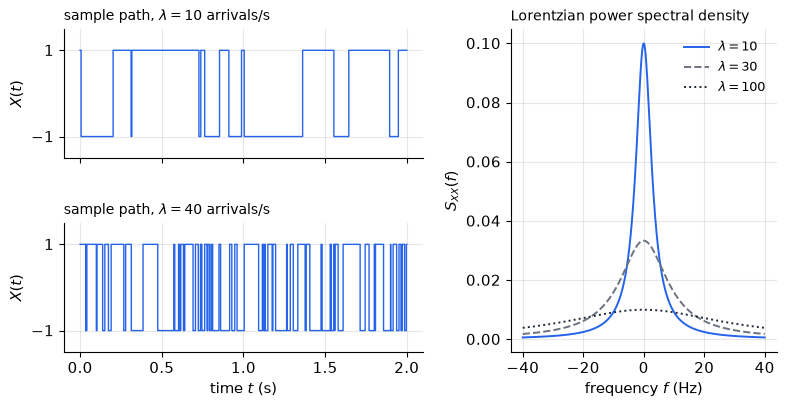
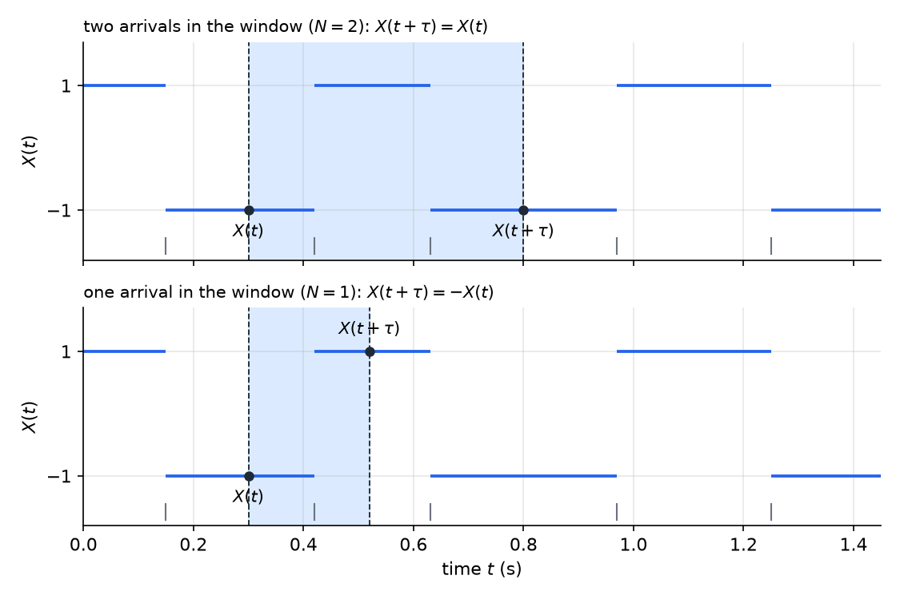
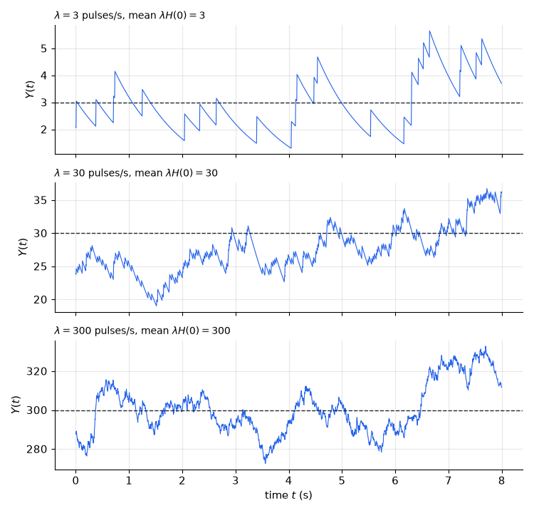
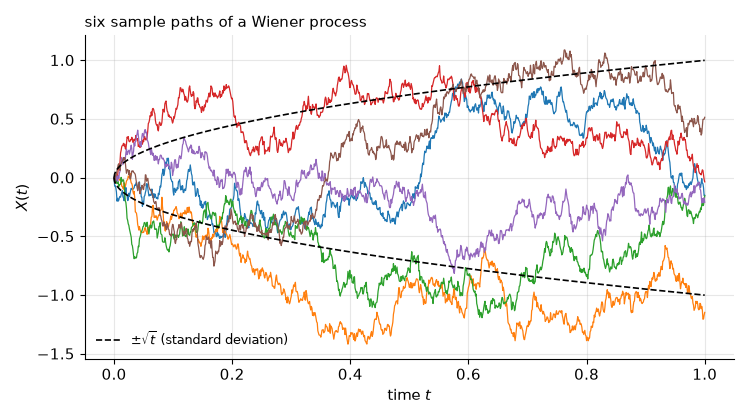
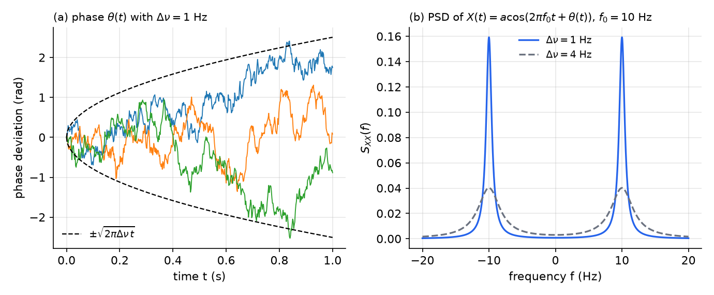
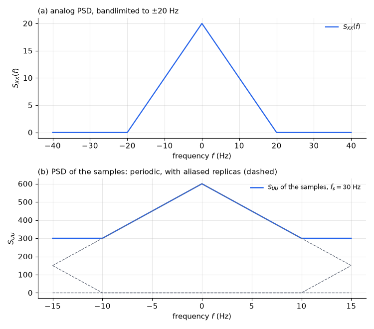

# Continuous-Time Random Processes

A continuous-time random process assigns a random function of time to each outcome of an experiment: the noise voltage in a receiver, the number of photons reaching a detector, the phase of an oscillator. This chapter carries the sequence results of [Random Sequences, Stationarity and Power Spectra](random-sequences.md) over to all real times and asks which tools survive: the mean and autocorrelation, stationarity and ergodicity, and the power spectral density. It then develops the models that engineering practice relies on: the random telegraph signal, shot noise from Poisson pulses, white Gaussian noise, the Wiener process and oscillator phase noise. The chapter ends by linking continuous and discrete time through sampling, where aliasing appears in the spectrum.

## Random Processes in Continuous Time

### Sample functions and the ensemble

A continuous-time random process is a family \\(\\{X(t) : t \in \mathbb{R}\\}\\) of random variables defined on one probability space. Each outcome \\(\omega\\) selects a **sample function** \\(t \mapsto X(t, \omega)\\), so one experiment produces an entire waveform. The collection of sample functions, together with their probabilities, is the **ensemble**. Unless stated otherwise, processes are real valued.

Two examples fix the ideas.

**Example 9.1 (Poisson counting process).** Let \\(t\_1 < t\_2 < \dots\\) be the arrival times of a Poisson process of rate \\(\lambda\\), and set \\(N(t) = \sum\_k u(t - t\_k)\\), where \\(u\\) is the unit step. Each sample function is a staircase that jumps by one at every arrival. For \\(t \ge 0\\), \\(N(t)\\) is Poisson with mean \\(\lambda t\\), so \\(E(N(t)) = \text{var}(N(t)) = \lambda t\\). This is the continuous-time counterpart of the binomial counting process in [Bernoulli and Poisson Processes](bernoulli-poisson.md).

**Example 9.2 (Random sinusoid).** Flip a fair coin. On heads let \\(X(t) = \cos(\omega\_0 t)\\); on tails let \\(X(t) = \sin(\omega\_0 t)\\). Equivalently, \\(X(t) = \cos(\omega\_0 t + \Theta)\\) with \\(\Theta\\) equal to \\(0\\) or \\(-\pi/2\\), each with probability one half. Every sample function is a pure sinusoid, and the randomness sits in its phase.

### Describing a process

The complete description of \\(X\\) is the family of joint distributions of \\((X(t\_1), \dots, X(t\_n))\\) for every \\(n\\) and every choice of times. In practice one works with the second-order description,
\\[
\mu\_X(t) = E(X(t)), \qquad R\_X(t\_1, t\_2) = E\left(X(t\_1)X(t\_2)\right),
\\]
the mean function and the autocorrelation function. The autocovariance is \\(C\_X(t\_1, t\_2) = R\_X(t\_1, t\_2) - \mu\_X(t\_1)\mu\_X(t\_2)\\). A process is **Gaussian** if every finite collection of its samples is jointly Gaussian. Then the mean function and the autocovariance determine all of its distributions, which is why Gaussian models are so convenient.

## Averages and Ergodicity

### Ensemble and time averages

The **ensemble average** \\(E(X(t))\\) is taken across the ensemble at a fixed time \\(t\\). The **time average** of one sample function is
\\[
A\_L = \frac{1}{2L}\int\_{-L}^{L} X(t)\\,dt, \qquad \langle X \rangle = \lim\_{L \to \infty} A\_L,
\\]
whenever the limit exists. Unlike the ensemble average, \\(\langle X \rangle\\) is in general a random variable, because it depends on which sample function occurred.

**Example 9.3 (Battery voltage).** A randomly chosen battery has a voltage of \\(1.51\\) V or \\(1.49\\) V, each with probability one half, and the voltage is constant in time. The ensemble average is \\(E(X(t)) = 1.5\\) V for every \\(t\\). Each sample function is constant, so its time average is the voltage of the chosen battery. That is random, and it never equals \\(1.5\\) V with certainty. The process is therefore not ergodic in the mean.

### Ergodicity

**Definition (Ergodicity).** A process is **ergodic in the mean** if \\(\langle X \rangle = E(X(t))\\) with probability one. It is **ergodic in the autocorrelation** if, for each \\(\tau\\), the time average of \\(X(t)X(t+\tau)\\) equals \\(R\_X(\tau)\\) with probability one. An ergodic process has every relevant time average equal to the corresponding ensemble average: one sample function carries the statistics of the whole ensemble.

The following theorem gives a practical test for ergodicity in the mean.

**Theorem (Mean ergodicity).** Let \\(X\\) be WSS with mean \\(\mu\\) and covariance \\(C(\tau) = R\_X(\tau) - \mu^2\\). If \\(\int\_{-\infty}^{\infty}\lvert C(\tau)\rvert\\,d\tau < \infty\\), then \\(A\_L \to \mu\\) in mean square as \\(L \to \infty\\), and therefore in probability.

*Proof.* Since \\(E(A\_L) = \mu\\), the mean-square error is the variance of \\(A\_L\\):
\\[
E\left[(A\_L - \mu)^2\right] = \frac{1}{4L^2}\int\_{-L}^{L}\int\_{-L}^{L} C(t - s)\\,ds\\,dt = \frac{1}{4L^2}\int\_{-2L}^{2L}(2L - \lvert\tau\rvert)\\,C(\tau)\\,d\tau \le \frac{1}{2L}\int\_{-\infty}^{\infty}\lvert C(\tau)\rvert\\,d\tau.
\\]
In the middle expression, the pairs \\((t, s)\\) in the square with \\(t - s = \tau\\) form a segment of length \\(2L - \lvert\tau\rvert\\). The right side vanishes as \\(L \to \infty\\), and Chebyshev's inequality (see [Iterated Expectation and Limit Theorems](limit-theorems.md)) gives convergence in probability. ∎

The condition is sufficient, not necessary. The battery of Example 9.3 has \\(C(\tau) = 0.0001\\) for every \\(\tau\\), which is not integrable, consistent with its lack of ergodicity. The telegraph signal below has \\(C(\tau) = e^{-2\lambda\lvert\tau\rvert}\\), which is integrable, so it is ergodic in the mean. The uniform-phase sinusoid below has a non-integrable covariance and is ergodic anyway.

## Stationarity

### Strict and wide-sense stationarity

**Definition (Stationarity).** \\(X\\) is **strict-sense stationary (SSS)** if, for every \\(n\\), all times \\(t\_1, \dots, t\_n\\) and every shift \\(s\\), the vectors \\((X(t\_1 + s), \dots, X(t\_n + s))\\) and \\((X(t\_1), \dots, X(t\_n))\\) have the same joint distribution. It is **wide-sense stationary (WSS)** if \\(E(X(t)) = \mu\\) is constant and \\(E(X(t)X(t+\tau)) = R\_X(\tau)\\) depends only on the lag \\(\tau\\), with finite second moments.

Three relations hold. An SSS process with finite second moments is WSS, because the mean and the autocorrelation are functionals of the joint distributions. A WSS process need not be SSS (Example 9.5 below). A WSS Gaussian process is SSS, because a Gaussian law is determined by its mean vector and covariance matrix, and both are unchanged by a shift in time. The inclusion diagram of these classes is the same as in discrete time (see [Random Sequences](random-sequences.md)).

**Example 9.4 (Decaying random amplitude).** Let \\(X(t) = A e^{-\lvert t\rvert}\\) with \\(A \sim \text{Exp}(1)\\). Its mean \\(E(X(t)) = e^{-\lvert t\rvert}\\) changes with \\(t\\), so \\(X\\) is neither WSS nor SSS. Each sample function is integrable, so every sample function has time average zero, while the ensemble mean \\(e^{-\lvert t\rvert}\\) is not zero. The process is not ergodic in the mean.

**Example 9.5 (WSS but not SSS).** Let \\(A\\) and \\(B\\) be independent, each equal to \\(\pm 1\\) with probability one half, and let \\(X(t) = A\cos(\omega\_0 t) + B\sin(\omega\_0 t)\\). The mean is zero. Using \\(E(A^2) = E(B^2) = 1\\) and \\(E(AB) = 0\\),
\\[
E\left(X(t)X(t+\tau)\right) = \cos(\omega\_0 t)\cos(\omega\_0(t+\tau)) + \sin(\omega\_0 t)\sin(\omega\_0(t+\tau)) = \cos(\omega\_0\tau),
\\]
so \\(X\\) is WSS. It is not SSS. At \\(\omega\_0 t = 0\\), \\(X(t) = A\\) takes the values \\(\pm 1\\) with equal probability. At \\(\omega\_0 t = \pi/4\\), \\(X(t) = (A + B)/\sqrt{2}\\) takes the values \\(\sqrt{2}\\), \\(0\\), \\(-\sqrt{2}\\) with probabilities \\(1/4\\), \\(1/2\\), \\(1/4\\). The first-order distribution therefore depends on \\(t\\).

## Autocorrelation and Power Spectral Density

### Properties of the autocorrelation

Let \\(X\\) be real and WSS with mean \\(\mu\\) and autocorrelation \\(R = R\_X\\). Then:

1. \\(R(0) = E(X^2(t))\\) is the power of the process.
2. \\(R(-\tau) = R(\tau)\\), so \\(R\\) is even.
3. \\(\lvert R(\tau)\rvert \le R(0)\\). Indeed \\(0 \le E\left[(X(t+\tau) \mp X(t))^2\right] = 2R(0) \mp 2R(\tau)\\).
4. \\(E\left[(X(t+\tau) - X(t))^2\right] = 2\left[R(0) - R(\tau)\right]\\) for every \\(t\\). If \\(R\\) is continuous at zero, the right side tends to zero as \\(\tau \to 0\\), so \\(X\\) is mean-square continuous.
5. If \\(R(T\_0) = R(0)\\) for some \\(T\_0 > 0\\), then the increment in item 4 vanishes, so \\(X(t + T\_0) = X(t)\\) with probability one, and \\(R\\) is periodic with period \\(T\_0\\).
6. If \\(C(\tau) = R(\tau) - \mu^2\\) tends to zero as \\(\lvert\tau\rvert \to \infty\\), then \\(R(\tau) \to \mu^2\\).

### The power spectral density

**Definition (Power spectral density).** The PSD of a WSS process is the Fourier transform of its autocorrelation,
\\[
S\_X(f) = \int\_{-\infty}^{\infty} R\_X(\tau)\\,e^{-j2\pi f\tau}\\,d\tau,
\\]
with \\(f\\) in hertz. Two transform pairs are used repeatedly. For \\(b > 0\\),
\\[
e^{-b\lvert\tau\rvert} \leftrightarrow \frac{2b}{b^2 + 4\pi^2 f^2}, \qquad \cos(2\pi f\_0\tau) \leftrightarrow \tfrac{1}{2}\left[\delta(f - f\_0) + \delta(f + f\_0)\right].
\\]
The first follows from \\(\int\_0^\infty e^{-(b + j2\pi f)\tau}\\,d\tau + \int\_0^\infty e^{-(b - j2\pi f)\tau}\\,d\tau = \frac{2b}{b^2 + 4\pi^2 f^2}\\). Some texts use angular frequency \\(\omega = 2\pi f\\) and write the same function as \\(S(\omega)\\), with a factor \\(1/2\pi\\) in the inverse transform; check conventions before comparing formulas.

**Theorem (Wiener–Khinchin).** Let \\(X\\) be WSS with \\(R\_X\\) continuous and absolutely integrable. Then \\(S\_X\\) is real, nonnegative and continuous, and
\\[
R\_X(\tau) = \int\_{-\infty}^{\infty} S\_X(f)\\,e^{j2\pi f\tau}\\,df \quad \text{for every } \tau.
\\]
When \\(R\_X\\) contains impulses, as for white noise and for the Poisson impulse train below, the same identities hold in the generalized sense.

For a real WSS process, the PSD has the following properties.

- \\(S\_X(-f) = S\_X(f)\\), since \\(R\_X\\) is even, and \\(S\_X(f) \ge 0\\).
- **Power.** \\(R\_X(0) = E(X^2(t)) = \int\_{-\infty}^{\infty} S\_X(f)\\,df\\).
- **Mean.** If \\(\mu \ne 0\\), then \\(R\_X = \mu^2 + C\_X\\) and \\(S\_X\\) contains the impulse \\(\mu^2\delta(f)\\). A nonzero mean therefore appears as a spectral line at zero frequency.
- **Power per unit frequency.** Let \\(H\\) be a real band-pass filter whose \\(\lvert H\rvert^2\\) has unit integral and is concentrated, as \\(\varepsilon \to 0\\), on two bands of width \\(\varepsilon\\) centred at \\(\pm f\_0\\) with equal heights. By the filtering theorem below, the output power is \\(E(Y^2) = \int S\_X(f)\lvert H(f)\rvert^2\\,df\\), which tends to \\(S\_X(f\_0)\\) when \\(S\_X\\) is continuous and even. So \\(S\_X(f\_0)\\) is the power per unit bandwidth at \\(f\_0\\).

**Example 9.6 (Mean-square increment).** Let \\(X\\) be WSS with \\(S\_X(f) = (1/\pi)/(1 + f^2)\\). Comparing with the first transform pair, with \\(b = 2\pi\\), gives \\(R\_X(\tau) = e^{-2\pi\lvert\tau\rvert}\\). For any \\(t\_0\\), the increment between \\(t\_0 - 1/(4\pi)\\) and \\(t\_0 + 1/(4\pi)\\) spans a time \\(1/(2\pi)\\), so by item 4
\\[
E\left[\left(X\left(t\_0 - \tfrac{1}{4\pi}\right) - X\left(t\_0 + \tfrac{1}{4\pi}\right)\right)^2\right] = 2\left[R\_X(0) - R\_X\left(\tfrac{1}{2\pi}\right)\right] = 2(1 - e^{-1}) \approx 1.26,
\\]
independent of \\(t\_0\\).

**Example 9.7 (Sum and product of independent processes).** Let \\(X\\) and \\(Y\\) be independent WSS processes with means \\(\mu\_X, \mu\_Y\\) and autocorrelations \\(R\_X, R\_Y\\). Then \\(Z = X + Y\\) is WSS with \\(R\_Z = R\_X + R\_Y + 2\mu\_X\mu\_Y\\), and \\(V = XY\\) is WSS with mean \\(\mu\_X\mu\_Y\\) and \\(R\_V = R\_X R\_Y\\). For the product, independence gives \\(E\left(X(t)X(t+\tau)\right)E\left(Y(t)Y(t+\tau)\right) = R\_X(\tau)R\_Y(\tau)\\) directly; the cross terms in \\(R\_Z\\) each equal \\(\mu\_X\mu\_Y\\) for the same reason.

### Filtering a WSS process

**Theorem (Filtering).** Let \\(X\\) be WSS with mean \\(\mu\_X\\) and autocorrelation \\(R\_X\\). Let \\(h\\) be a real, absolutely integrable impulse response with transfer function \\(H(f) = \int h(t)e^{-j2\pi f t}\\,dt\\). Then \\(Y(t) = \int h(u)X(t - u)\\,du\\) is WSS, with
\\[
\mu\_Y = H(0)\mu\_X, \qquad R\_Y = R\_X \* g, \qquad S\_Y(f) = S\_X(f)\lvert H(f)\rvert^2,
\\]
where \\(g(w) = \int h(u)h(u + w)\\,du\\).

*Proof.* The mean is \\(E(Y(t)) = \mu\_X\int h(u)\\,du = \mu\_X H(0)\\). Next,
\\[
E\left(Y(t)Y(t+\tau)\right) = \int\int h(u)h(v)R\_X(\tau + u - v)\\,du\\,dv,
\\]
because \\((t + \tau - v) - (t - u) = \tau + u - v\\). Substituting \\(v = u + w\\) gives
\\[
\int R\_X(\tau - w)\left[\int h(u)h(u + w)\\,du\right]dw = (R\_X \* g)(\tau),
\\]
which depends only on \\(\tau\\). Hence \\(Y\\) is WSS. Finally, \\(g = \tilde h \* h\\) with \\(\tilde h(u) = h(-u)\\). The transform of \\(\tilde h\\) is \\(H^\*(f)\\) for real \\(h\\), so \\(S\_Y = S\_X \lvert H\rvert^2\\). ∎

The filtering rule is the continuous-time analogue of the discrete-time result. It applies to white noise in the generalized sense, as used below.

**Example 9.8 (Square of a Gaussian process).** Let \\(X\\) be a zero-mean, WSS Gaussian process with autocorrelation \\(R\_X\\), and let \\(Y(t) = X^2(t)\\). Set \\(\sigma^2 = R\_X(0)\\) and \\(\rho = R\_X(\tau)/R\_X(0)\\). Fix \\(t\\) and write \\(V = X(t)\\) and \\(W = X(t + \tau)\\). These are jointly Gaussian, each with variance \\(\sigma^2\\) and correlation coefficient \\(\rho\\). Given \\(V\\), the variable \\(W\\) is Gaussian with mean \\(\rho V\\) and variance \\((1 - \rho^2)\sigma^2\\), so \\(E(W^2 \mid V) = (1 - \rho^2)\sigma^2 + \rho^2 V^2\\). By iterated expectation and \\(E(V^4) = 3\sigma^4\\),
\\[
R\_Y(\tau) = E\left(V^2 E(W^2 \mid V)\right) = (1 - \rho^2)\sigma^4 + 3\rho^2\sigma^4 = \sigma^4(1 + 2\rho^2).
\\]
Since \\(\sigma^4\rho^2 = R\_X^2(\tau)\\), this gives
\\[
\boxed{R\_Y(\tau) = R\_X^2(0) + 2R\_X^2(\tau)}.
\\]
The mean of \\(Y\\) is the constant \\(R\_X(0)\\), and \\(R\_Y\\) depends only on \\(\tau\\), so \\(Y\\) is WSS. Its autocovariance is therefore \\(R\_Y(\tau) - R\_X^2(0) = 2R\_X^2(\tau)\\).

## The Random Telegraph Process

### Definition and autocorrelation

Let \\(N\\) be a two-sided Poisson process of rate \\(\lambda\\), with \\(N(t)\\) counting the arrivals in \\((0, t]\\) for \\(t \ge 0\\) and the arrivals in \\((t, 0]\\) with a minus sign for \\(t < 0\\). Let \\(X(0) = \pm 1\\) with equal probability, independent of \\(N\\). The **random telegraph signal** is
\\[
X(t) = X(0)(-1)^{N(t)}, \qquad t \in \mathbb{R},
\\]
which reverses sign at every arrival. The fair initial sign is what makes the mean zero.

**Example 9.9 (Telegraph signal).** The random telegraph signal is SSS, with mean zero and
\\[
\boxed{R\_X(\tau) = e^{-2\lambda\lvert\tau\rvert}}, \qquad \boxed{S\_X(f) = \frac{\lambda}{\lambda^2 + \pi^2 f^2}}.
\\]

*Solution.* Since \\(X(0)\\) is symmetric and independent of \\(N\\), \\(E(X(t)) = E(X(0))E((-1)^{N(t)}) = 0\\). For \\(\tau \ge 0\\),
\\[
X(t)X(t+\tau) = X(0)^2(-1)^{N(t) + N(t+\tau)} = (-1)^{N(t+\tau) - N(t)},
\\]
because \\(X(0)^2 = 1\\) and \\((-1)^{2N(t)} = 1\\). The increment \\(M = N(t+\tau) - N(t)\\) is Poisson with mean \\(\lambda\tau\\), and its law does not depend on \\(t\\). Therefore
\\[
R\_X(\tau) = E\left((-1)^M\right) = e^{-\lambda\tau}\sum\_{k=0}^{\infty}\frac{(-\lambda\tau)^k}{k!} = e^{-\lambda\tau}e^{-\lambda\tau} = e^{-2\lambda\tau}.
\\]
Since \\(R\_X\\) is even, the formula holds for all \\(\tau\\). The mean and autocorrelation are shift invariant, so \\(X\\) is WSS. The transform pair with \\(b = 2\lambda\\) gives \\(S\_X(f) = 4\lambda/(4\lambda^2 + 4\pi^2 f^2) = \lambda/(\lambda^2 + \pi^2 f^2)\\).

The process is in fact SSS. For any \\(s\\), \\(X(t + s) = X(s)(-1)^{N(t+s) - N(s)}\\), where \\(X(s)\\) is a fair random sign independent of the increments after time \\(s\\). The samples \\(X(t\_i + s)\\) are therefore a fair random sign times a vector built from increments after \\(s\\), and that vector has the same law for every \\(s\\). ∎

The telegraph spectrum is Lorentzian. Its peak \\(1/\lambda\\) occurs at \\(f = 0\\), its half-power points lie at \\(f = \pm\lambda/\pi\\), and its area is one, equal to the power \\(R\_X(0)\\). A faster switching rate lowers the peak and widens the spectrum while keeping the power fixed. For \\(\lambda = 10\\) arrivals per second, \\(R\_X(0.05) = e^{-1}\\), the peak is \\(0.1\\), and the half-power frequencies are about \\(\pm 3.18\\) Hz. Because \\(C(\tau) = e^{-2\lambda\lvert\tau\rvert}\\) is integrable, the telegraph signal is ergodic in the mean.

*Figure: left, sample paths of the random telegraph signal on [0, 2] s with λ = 10 (top) and λ = 40 arrivals per second (bottom); faster switching makes the path look more like noise. Right, the PSD λ/(λ² + π²f²) for λ = 10, 30 and 100. The peak falls as 1/λ and the spectrum widens, while the area stays equal to one.*

The sign of the product \\(X(t)X(t+\tau)\\) is \\((-1)^M\\), where \\(M\\) counts the arrivals in the window \\([t, t+\tau]\\). The figure below shows the two cases.

*Figure: the same telegraph path (blue) with Poisson arrivals (gray ticks), under two windows \\(\left[t, t+\tau\right]\\) (shaded). Top: two arrivals fall in the window, so the signs at the two ends agree and the product is +1. Bottom: one arrival falls in the window, the signs disagree, and the product is −1.*

## White Noise

### Definition and power

A WSS process is **white** if its PSD is constant over all frequencies, \\(S\_X(f) = N\_0/2\\). By the Wiener–Khinchin theorem, equivalently, \\(R\_X(\tau) = (N\_0/2)\delta(\tau)\\): values at distinct times are uncorrelated, however close the times. The power is \\(R\_X(0) = \int (N\_0/2)\\,df = \infty\\). No physical process is white over all frequencies. Whiteness is an idealization that holds over the band where a system is sensitive, and white noise is the limit of processes whose correlation time shrinks to zero.

### White Gaussian noise

**Definition (White Gaussian noise).** White Gaussian noise (WGN) \\(n(t)\\) is a Gaussian white process with two-sided PSD \\(N\_0/2\\). Its autocorrelation is \\(R\_n(\tau) = (N\_0/2)\delta(\tau)\\).

Because the autocorrelation is an impulse, WGN is not an ordinary random process. The variance of \\(n(t)\\) is infinite at every \\(t\\), and a statement such as "the values \\(n(t\_i)\\) are i.i.d. normal" has no meaning. WGN is instead defined through its inner products with deterministic functions. For a finite-energy \\(h\\), the variable
\\[
Z\_h = \int n(t)h(t)\\,dt
\\]
is Gaussian with mean zero and variance
\\[
E(Z\_h^2) = \int\int \frac{N\_0}{2}\delta(t - s)h(t)h(s)\\,dt\\,ds = \frac{N\_0}{2}E\_h, \qquad E\_h = \int h^2(t)\\,dt.
\\]
For two filters, \\(Z\_{h\_1}\\) and \\(Z\_{h\_2}\\) are jointly Gaussian with covariance \\((N\_0/2)\int h\_1 h\_2\\,dt\\), so their correlation coefficient is \\(\rho = \int h\_1 h\_2\\,dt / \sqrt{E\_{h\_1}E\_{h\_2}}\\). Filtered WGN is therefore Gaussian, and two outputs are independent exactly when the filters are orthogonal, \\(\int h\_1 h\_2\\,dt = 0\\). For example, the outputs of a low-pass and a high-pass filter with non-overlapping passbands are independent, since by Parseval \\(\int h\_1 h\_2\\,dt = \int H\_1(f)H\_2^\*(f)\\,df = 0\\).

To an engineer, white noise is a process that decorrelates very quickly. To a mathematician, it is a generalized process defined by its action on test functions, much as the impulse \\(\delta(t)\\) is defined by \\(\int \delta(t)x(t)\\,dt = x(0)\\). Both views give the same calculations.

WGN is the standard model of receiver noise for two reasons. Its spectrum is nearly flat over the receiver's band, which makes it white in practice. And the noise is the sum of very many small independent contributions, such as the random motion of electrons in a resistor, so the central limit theorem makes it Gaussian (see [Iterated Expectation and Limit Theorems](limit-theorems.md)).

## Sinusoids with Random Parameters

### Random phase

**Example 9.10 (Uniform random phase).** Let \\(X(t) = a\cos(\omega\_0 t + \Theta)\\), where \\(\Theta\\) is uniform on \\((-\pi, \pi]\\). Shifting time by \\(s\\) replaces \\(\Theta\\) with \\(\Theta + \omega\_0 s\\), which is again uniform modulo \\(2\pi\\). Hence \\(X\\) is SSS. Its moments are
\\[
E(X(t)) = 0, \qquad R\_X(\tau) = \frac{a^2}{2}\cos(\omega\_0\tau),
\\]
and its PSD consists of two impulses, \\(S\_X(f) = \frac{a^2}{4}\left[\delta(f - f\_0) + \delta(f + f\_0)\right]\\), with \\(f\_0 = \omega\_0/2\pi\\). The two weights add to the power \\(a^2/2\\). Every sample function has time average zero, and its time autocorrelation equals \\(\frac{a^2}{2}\cos(\omega\_0\tau)\\), so the process is ergodic in both senses. Its covariance is not integrable, so the sufficient condition of the ergodicity theorem does not apply, but ergodicity holds anyway.

### Random frequency

**Example 9.11 (Random frequency).** Let \\(X(t) = a\cos(\Omega t + \Theta)\\), where \\(\Omega\\) has density \\(f\_\Omega\\), and \\(\Theta\\) is uniform on \\((-\pi, \pi]\\) and independent of \\(\Omega\\). Conditioning on \\(\Omega\\) gives \\(E(X(t)) = 0\\). Using the product-to-sum identity,
\\[
E\left(X(t)X(t+\tau)\right) = \frac{a^2}{2}E\left(\cos(\Omega\tau)\right) + \frac{a^2}{2}E\left(\cos(2\Omega t + \Omega\tau + 2\Theta)\right).
\\]
Given \\(\Omega\\), the angle \\(2\Theta\\) is uniform modulo \\(2\pi\\), so the second term vanishes. Hence \\(R\_X(\tau) = \frac{a^2}{2}E(\cos(\Omega\tau))\\) depends only on \\(\tau\\), and \\(X\\) is WSS. In fact it is SSS, by the same argument as in Example 9.10 applied conditionally on \\(\Omega\\).

If \\(f\_\Omega\\) is even, then substituting \\(\omega = 2\pi f\\) in \\(R\_X(\tau) = \frac{a^2}{2}\int \cos(\omega\tau)f\_\Omega(\omega)\\,d\omega\\) and dropping the odd part gives
\\[
\boxed{S\_X(f) = \pi a^2 f\_\Omega(2\pi f)}.
\\]
For a general density the same substitution gives \\(S\_X(f) = \frac{\pi a^2}{2}\left[f\_\Omega(2\pi f) + f\_\Omega(-2\pi f)\right]\\). Thus the spectrum has the shape of the density of the random frequency. Equivalently, if \\(F = \Omega/2\pi\\) is the frequency in hertz with density \\(f\_F\\), then \\(S\_X(f) = \frac{a^2}{2}f\_F(f)\\) for even \\(f\_\Omega\\). Since \\(f\_F\\) integrates to one, the total power \\(\int S\_X(f)\\,df = a^2/2\\) is the carrier power, as it must be.

**Gaussian frequency.** Suppose \\(\Omega \sim \mathcal{N}(\omega\_0, \sigma^2)\\). Since \\(E(e^{j\Omega\tau}) = e^{j\omega\_0\tau - \sigma^2\tau^2/2}\\),
\\[
R\_X(\tau) = \frac{a^2}{2}e^{-\sigma^2\tau^2/2}\cos(\omega\_0\tau),
\\]
and the PSD consists of two Gaussian-shaped bumps centred at \\(\pm f\_0\\), with standard deviation \\(\sigma/2\pi\\) in hertz. Every sample path has time average zero, which equals the ensemble mean, so the process is ergodic in the mean. It is not ergodic in the autocorrelation. The time autocorrelation of one path is \\(\frac{a^2}{2}\cos(\Omega\tau)\\), which depends on the realized frequency, while \\(R\_X(\tau)\\) averages over all frequencies.

## Poisson Impulses and Shot Noise

### The counting process is not WSS

Let \\(t\_1 \le t\_2\\), and write \\(N(t\_2) = N(t\_1) + M\\), where \\(M\\) counts the arrivals in \\((t\_1, t\_2]\\). Then \\(M\\) is Poisson with mean \\(\lambda(t\_2 - t\_1)\\) and is independent of \\(N(t\_1)\\). Since \\(E(N^2(t\_1)) = \lambda t\_1 + \lambda^2 t\_1^2\\),
\\[
E\left(N(t\_1)N(t\_2)\right) = E\left(N^2(t\_1)\right) + E\left(N(t\_1)\right)E(M) = \lambda t\_1 + \lambda^2 t\_1^2 + \lambda^2 t\_1(t\_2 - t\_1) = \lambda t\_1 + \lambda^2 t\_1 t\_2.
\\]
In general, \\(R\_N(t\_1, t\_2) = \lambda\min\\{t\_1, t\_2\\} + \lambda^2 t\_1 t\_2\\). The mean \\(\lambda t\\) and the variance \\(\lambda t\\) both change with time, so \\(N\\) is not WSS.

### The impulse train is WSS

The derivative of the counting process is the **Poisson impulse train**, \\(X(t) = dN(t)/dt = \sum\_k \delta(t - t\_k)\\). Its mean is \\(\frac{d}{dt}(\lambda t) = \lambda\\). Its autocorrelation is the mixed derivative of \\(R\_N\\), taken formally in the generalized sense:
\\[
R\_X(t\_1, t\_2) = \frac{\partial^2}{\partial t\_1\\,\partial t\_2}R\_N(t\_1, t\_2) = \lambda\delta(t\_2 - t\_1) + \lambda^2.
\\]
This uses \\(\partial\min\\{t\_1, t\_2\\}/\partial t\_1 = u(t\_2 - t\_1)\\) and \\(\partial u(t\_2 - t\_1)/\partial t\_2 = \delta(t\_2 - t\_1)\\). Hence \\(X\\) is WSS, with
\\[
R\_X(\tau) = \lambda^2 + \lambda\delta(\tau), \qquad S\_X(f) = \lambda^2\delta(f) + \lambda.
\\]
The time average of \\(X\\) over \\([-L, L]\\) is \\(\bigl(N(L) - N(-L)\bigr)/2L\\), which tends to \\(\lambda\\) by the law of large numbers for Poisson counts. The impulse train is therefore ergodic in the mean.

### Shot noise

Let \\(h\\) be a deterministic, absolutely and square integrable pulse shape, the response of the detector to one event. The **shot noise** is
\\[
Y(t) = \sum\_k h(t - t\_k) = \int X(s)\\,h(t - s)\\,ds.
\\]
Applying the filtering theorem to the impulse train, with \\(\mu\_X = \lambda\\) and \\(S\_X = \lambda^2\delta(f) + \lambda\\),
\\[
\mu\_Y = \lambda H(0), \qquad S\_Y(f) = \lambda^2\lvert H(0)\rvert^2\delta(f) + \lambda\lvert H(f)\rvert^2.
\\]
Writing \\(Y(t) = \lambda H(0) + Z(t)\\), the fluctuation \\(Z\\) has mean zero and PSD \\(S\_Z(f) = \lambda\lvert H(f)\rvert^2\\). By Parseval its variance is \\(\lambda\int h^2\\,dt\\). Shot noise is thus a constant equal to the mean plus a zero-mean fluctuation.

Two regimes explain when the fluctuation behaves like white Gaussian noise. It is approximately white when \\(\lvert H(f)\rvert^2\\) is nearly constant over the band of interest, which happens when the pulses are short. It is approximately Gaussian when many pulses overlap in the observation window, that is, when \\(\lambda\\) times the pulse duration is large, because then the central limit theorem applies.

*Figure: shot noise Y(t) produced by Poisson pulses h(t) = e^(−t)u(t) at rates λ = 3, 30 and 300 pulses per second. The dashed line is the mean λH(0) = λ. The variance of Y is λ/2, so the relative fluctuation shrinks like λ^(−1/2): the separate decaying pulses merge into a nearly Gaussian wiggle around the mean.*

**Example 9.12 (Rectangular pulses).** Let \\(h(t) = u(t) - u(t - d)\\), so each photon produces a unit current lasting a time \\(d\\). Then \\(Y(t)\\) is the number of arrivals in \\((t - d, t]\\). Therefore \\(Y(t)\\) is Poisson with mean \\(\lambda d\\):
\\[
P\left(Y(t) = k\right) = e^{-\lambda d}\frac{(\lambda d)^k}{k!}, \qquad \mu\_Y = \lambda d, \qquad P\left(Y(t) = 0\right) = e^{-\lambda d}.
\\]
With \\(H(f) = e^{-j\pi f d}\sin(\pi f d)/(\pi f)\\), the PSD of the fluctuation is
\\[
S\_Z(f) = \lambda\left(\frac{\sin(\pi f d)}{\pi f}\right)^2.
\\]
It peaks at \\(\lambda d^2\\) at \\(f = 0\\), has nulls at \\(f = k/d\\) for nonzero integers \\(k\\), and has total power \\(\lambda d\\), which is the variance of the Poisson count.

**Example 9.13 (Photodetector signal-to-noise ratio).** Photons arrive as a Poisson process of rate \\(\lambda\\) per second. Each is detected with probability \\(\eta\\) and then delivers charge \\(q\\) to the output current. The detected photons form a Poisson process of rate \\(\eta\lambda\\), so the mean current is \\(I\_0 = \eta q\lambda\\). For pulses short compared with the band of interest, \\(S\_Z(f) = \eta\lambda\lvert H(f)\rvert^2 \approx \eta\lambda q^2\\), in particular \\(S\_Z(0) = \eta\lambda q^2 = qI\_0\\). Averaging the current over a window of length \\(T\\), much longer than a pulse, leaves the mean \\(I\_0\\) and a noise variance of about \\(S\_Z(0)/T = qI\_0/T\\). Hence
\\[
\text{SNR} = \frac{I\_0^2}{qI\_0/T} = \frac{I\_0 T}{q} = \eta\lambda T.
\\]
The SNR grows linearly with the averaging time. With \\(T = 1/B\\), it equals \\(\eta\lambda/B\\).

## Markov Processes in Continuous Time

A continuous-time process is **Markov** if, for every \\(t\\) and every \\(\tau > 0\\), the conditional law of the future given the whole past depends only on the present:
\\[
P\left(X(t+\tau) \in A \mid X(u),\ u \le t\right) = P\left(X(t+\tau) \in A \mid X(t)\right).
\\]
The Poisson counting process is Markov, because its future increments are independent of the past. The telegraph signal is Markov, because the waiting times between flips are exponential and therefore memoryless. The Wiener process below is Markov, because its increments are independent. The standard taxonomy classifies processes by time and state space:

| | finite state | countably infinite state | continuous state |
|---|---|---|---|
| discrete time | Markov chain ([Markov Chains](markov-chains.md)) | random walk on \\(\mathbb{Z}\\) | not treated here |
| continuous time | telegraph signal | Poisson counting process | Wiener process, Ornstein–Uhlenbeck process |

## The Wiener Process

### Definition and basic properties

**Definition (Wiener process).** A process \\(W(t)\\), \\(t \ge 0\\), is a **Wiener process** (or Brownian motion) if \\(W(0) = 0\\) and

1. its sample paths are continuous;
2. for \\(0 \le s < t\\), the increment \\(W(t) - W(s)\\) is Gaussian with mean zero and variance \\(t - s\\) (the increments are stationary);
3. increments over disjoint intervals are independent.

The consequences are as follows.

- \\(W(t) \sim \mathcal{N}(0, t)\\), so the spread grows like \\(\sqrt{t}\\).
- \\(W(t\_1), \dots, W(t\_n)\\) are jointly Gaussian, since each is a sum of independent Gaussian increments.
- The covariance is
\\[
\boxed{R\_W(t\_1, t\_2) = E\left(W(t\_1)W(t\_2)\right) = \min\\{t\_1, t\_2\\}}.
\\]
For \\(t\_1 \le t\_2\\), write \\(W(t\_1)W(t\_2) = W^2(t\_1) + W(t\_1)\left[W(t\_2) - W(t\_1)\right]\\). The second term has zero mean by independence of increments, and \\(E(W^2(t\_1)) = t\_1\\).
- \\(W\\) is not WSS, because \\(E(W^2(t)) = t\\) changes with time. Its increments are stationary, however: \\(E\left[(W(t+\tau) - W(t))^2\right] = \tau\\).
- The correlation coefficient is \\(\rho = \min(s, t)/\sqrt{st}\\). For \\(W(4)\\) and \\(W(25)\\), \\(\rho = 4/\sqrt{100} = 0.4\\): the earlier value persists into the later one.
- The sample paths are continuous but almost surely nowhere differentiable. The proof is beyond this chapter.

*Figure: six sample paths of a Wiener process on [0, 1]. The dashed curves ±√t mark one standard deviation of W(t). Each path is continuous but wanders irregularly, and the typical spread grows like the square root of time.*

### The Wiener process as integrated white noise

Let \\(n(t)\\) be WGN with \\(R\_n(\tau) = \delta(\tau)\\), that is, \\(S\_n = 1\\). Then
\\[
W(t) = \int\_0^t n(u)\\,du
\\]
has \\(E(W^2(t)) = \int\_0^t\int\_0^t \delta(u - v)\\,du\\,dv = t\\), and more generally \\(E\left(W(t\_1)W(t\_2)\right) = \min\\{t\_1, t\_2\\}\\). The Wiener process is the integral of unit-intensity white noise, and white noise is its derivative in the generalized sense.

**Example 9.14 (Increments of integrated white noise).** Let \\(n\\) be WGN with \\(S\_n = \beta\\), and let \\(X(t) = \int\_{-\infty}^t n(u)\\,du\\). The process \\(X\\) itself has no finite variance, because it integrates white noise over an infinite interval. Its increment \\(Y(t) = X(t) - X(t - d) = \int\_{t-d}^t n(u)\\,du\\) is a well-defined WSS process. It is the output of a filter with impulse response \\(h(u) = 1\\) on \\(0 \le u \le d\\) and zero elsewhere, whose transfer function is \\(H(f) = e^{-j\pi f d}\sin(\pi f d)/(\pi f)\\). By the filtering rule, applied in the generalized sense,
\\[
S\_Y(f) = \beta\left(\frac{\sin(\pi f d)}{\pi f}\right)^2.
\\]
This is the rectangular-pulse shot-noise spectrum of Example 9.12 with \\(\lambda\\) replaced by \\(\beta\\).

## Wiener Phase Noise

An imperfect oscillator has a phase that drifts randomly. Model its output as
\\[
X(t) = a\cos\left(2\pi f\_0 t + \Theta(t)\right), \qquad \Theta(t) = \Theta\_0 + \int\_0^t n(u)\\,du,
\\]
where \\(n\\) is WGN with two-sided PSD \\(S\_n = 2\pi\Delta\nu\\), and \\(\Theta\_0\\) is uniform on \\((-\pi, \pi]\\) and independent of \\(n\\). The increment \\(\Theta(t) - \Theta(s)\\) is \\(\mathcal{N}(0, 2\pi\Delta\nu\lvert t - s\rvert)\\), so the phase is a Wiener process with variance rate \\(2\pi\Delta\nu\\).

To find the autocorrelation, write \\(Y = \Theta(t+\tau) - \Theta(t)\\), which is \\(\mathcal{N}(0, 2\pi\Delta\nu\lvert\tau\rvert)\\). The product-to-sum identity gives
\\[
E\left(X(t)X(t+\tau)\right) = \frac{a^2}{2}E\left[\cos(2\pi f\_0\tau + Y)\right] + \frac{a^2}{2}E\left[\cos\left(4\pi f\_0 t + 2\pi f\_0\tau + 2\Theta\_0 + \Phi\right)\right],
\\]
where \\(\Phi = \int\_0^t n\\,du + \int\_0^{t+\tau} n\\,du\\) is independent of \\(\Theta\_0\\). The second expectation vanishes, because \\(2\Theta\_0\\) is uniform modulo \\(2\pi\\) and independent of \\(\Phi\\). For the first, \\(E\cos Y = e^{-\pi\Delta\nu\lvert\tau\rvert}\\) and \\(E\sin Y = 0\\). Therefore
\\[
\boxed{R\_X(\tau) = \frac{a^2}{2}\cos(2\pi f\_0\tau)\\,e^{-\pi\Delta\nu\lvert\tau\rvert}},
\\]
which does not depend on \\(t\\), so \\(X\\) is WSS.

The transform of \\(e^{-\pi\Delta\nu\lvert\tau\rvert}\\) is \\(\frac{2}{\pi\Delta\nu}\bigl/\bigl(1 + (f/(\Delta\nu/2))^2\bigr)\\), by the first transform pair with \\(b = \pi\Delta\nu\\). Multiplication by \\(\cos(2\pi f\_0\tau)\\) shifts this to \\(\pm f\_0\\) and halves it, so
\\[
\boxed{S\_X(f) = \frac{a^2}{2\pi\Delta\nu}\left[\frac{1}{1 + \left(\frac{f - f\_0}{\Delta\nu/2}\right)^2} + \frac{1}{1 + \left(\frac{f + f\_0}{\Delta\nu/2}\right)^2}\right]}.
\\]
Each carrier line is a Lorentzian with full width at half maximum equal to \\(\Delta\nu\\). This width is the **linewidth** of the oscillator. The total area is \\(a^2/2\\), the carrier power. A narrower linewidth means a more stable oscillator.

*Figure: left, three simulated phase deviations θ(t) − θ(0) of an oscillator with Δν = 1 Hz. Each is a Wiener path with variance 2πΔν t, so the dashed envelope ±√(2πΔν t) is one standard deviation. Right, the output spectrum around f0 = 10 Hz. Each carrier line is a Lorentzian of full width Δν, so the narrower oscillator (blue) has the sharper line.*

## Sampling: Connecting Continuous and Discrete Time

### Sampling a WSS process

Let \\(X\\) be WSS and sample it with period \\(T\\), so the sampling rate is \\(f\_s = 1/T\\). Write \\(U\_k = X(kT)\\).

**Theorem (Aliasing of samples).** Let \\(X\\) be WSS with a continuous PSD \\(S\_X\\) of bounded support. Then \\(U\_k\\) is a WSS sequence with autocorrelation \\(R\_U[m] = R\_X(mT)\\) and power spectrum
\\[
S\_U\left(e^{j2\pi fT}\right) = \sum\_m R\_X(mT)\\,e^{-j2\pi f mT} = \frac{1}{T}\sum\_k S\_X\left(f - \frac{k}{T}\right),
\\]
where the sum over \\(k\\) is finite at each \\(f\\).

*Sketch.* The mean is \\(\mu\_X\\) and \\(E(U\_k U\_{k+m}) = R\_X(mT)\\) does not depend on \\(k\\). The middle sum is the Poisson summation formula applied to \\(g(t) = R\_X(t)e^{-j2\pi f t}\\), whose Fourier transform is \\(\hat g(\nu) = S\_X(f + \nu)\\). Poisson summation gives \\(\sum\_m g(mT) = \frac{1}{T}\sum\_k \hat g(k/T) = \frac{1}{T}\sum\_k S\_X(f + k/T)\\), and reindexing \\(k\\) gives the stated form. ∎

**Example 9.15 (Aliasing).** Let \\(S\_X(f) = 20(1 - \lvert f\rvert/20)\\) for \\(\lvert f\rvert \le 20\\) Hz and zero otherwise, and sample at \\(f\_s = 30\\) Hz. For \\(\lvert f\rvert \le 10\\), only the \\(k = 0\\) term is nonzero, so \\(S\_U(f) = 30(20 - \lvert f\rvert)\\). This falls from \\(600\\) at \\(f = 0\\) to \\(300\\) at \\(\lvert f\rvert = 10\\). For \\(10 \le \lvert f\rvert \le 15\\), the original triangle contributes \\(20 - \lvert f\rvert\\) and the replica at \\(f \mp 30\\) contributes \\(\lvert f\rvert - 10\\). Their sum is \\(10\\), so \\(S\_U(f) = 300\\) on this band. On one period \\([-15, 15]\\) Hz, the spectrum of the samples is therefore a triangle with peak \\(600\\) that becomes a flat shelf at \\(300\\) for \\(10 \le \lvert f\rvert \le 15\\). The components of \\(X\\) between \\(15\\) and \\(20\\) Hz fold back into the band from \\(10\\) to \\(15\\) Hz and fill it in.

*Figure: top, a bandlimited PSD of a WSS process, triangular on ±20 Hz with peak 20. Bottom, the PSD of the samples taken at fs = 30 Hz. It is periodic with period 30 Hz (solid) and is built from the aliased replicas (dashed). Components between 15 and 20 Hz fold back into 10 to 15 Hz, which makes the spectrum flat at 300 there.*

**Example 9.16 (Sampling the telegraph signal).** Sample the telegraph signal of rate \\(\lambda\\) with period \\(T\\), giving \\(X\_k = X(kT) \in \{\pm 1\}\\). The sign changes between \\(X\_k\\) and \\(X\_{k+1}\\) exactly when the number \\(M\\) of arrivals in an interval of length \\(T\\) is odd. Since \\(M\\) is Poisson with mean \\(\lambda T\\),
\\[
p = P(M \text{ odd}) = e^{-\lambda T}\sinh(\lambda T) = \frac{1 - e^{-2\lambda T}}{2}.
\\]
The samples form a two-state Markov chain with flip probability \\(p\\) (see [Markov Chains](markov-chains.md)). Its autocorrelation is \\(E(X\_k X\_{k+m}) = (1 - 2p)^{\lvert m\rvert} = e^{-2\lambda T\lvert m\rvert} = R\_X(mT)\\), as the sampling theorem predicts.

### Ideal reconstruction

The reverse operation is the ideal digital-to-analogue converter. Let \\(g(t) = \text{sinc}(t/T) = \sin(\pi t/T)/(\pi t/T)\\), whose transform is \\(G(f) = T\cdot\text{rect}(fT)\\), where \\(\text{rect}(fT) = 1\\) for \\(\lvert f\rvert < 1/(2T)\\) and zero otherwise.

**Theorem (Ideal DAC).** Let \\(V\_k\\) be a WSS sequence with mean \\(\mu\\), autocorrelation \\(R\_V[m]\\), and \\(\sum\_m \lvert R\_V[m]\rvert < \infty\\). Then \\(Y(t) = \sum\_k V\_k\\,g(t - kT)\\) is WSS with
\\[
\boxed{\mu\_Y = \mu, \qquad R\_Y(\tau) = \sum\_m R\_V[m]\\,g(\tau - mT), \qquad S\_Y(f) = T\cdot\text{rect}(fT)\\,S\_V\left(e^{j2\pi fT}\right)},
\\]
where \\(S\_V(e^{j\theta}) = \sum\_m R\_V[m]e^{-jm\theta}\\).

*Proof.* Two identities about sinc interpolation are needed. First, \\(\sum\_k g(s - kT) = 1\\) for every \\(s\\). Second, \\(\sum\_k g(s - kT)g(u - kT) = g(u - s)\\) for all \\(s\\) and \\(u\\). The second is the sampling theorem applied to the bandlimited function \\(\tau \mapsto g(\tau - s)\\), whose samples at \\(kT\\) are \\(g(s - kT)\\). The mean is \\(E(Y(t)) = \mu\sum\_k g(t - kT) = \mu\\). For the autocorrelation, put \\(n = k + m\\):
\\[
E\left(Y(t)Y(t+\tau)\right) = \sum\_k\sum\_n g(t - kT)g(t + \tau - nT)R\_V[n - k] = \sum\_m R\_V[m]\sum\_k g(t - kT)g(t + \tau - mT - kT).
\\]
By the second identity with \\(s = t\\) and \\(u = t + \tau - mT\\), the inner sum is \\(g(\tau - mT)\\). This does not depend on \\(t\\), so \\(Y\\) is WSS with \\(R\_Y(\tau) = \sum\_m R\_V[m]g(\tau - mT)\\). Taking transforms, \\(g(\tau - mT)\\) has transform \\(e^{-j2\pi f mT}G(f)\\), which gives \\(S\_Y(f) = G(f)\sum\_m R\_V[m]e^{-j2\pi f mT} = G(f)S\_V(e^{j2\pi fT})\\). ∎

The discrete spectrum \\(S\_V\\) repeats with period \\(1/T\\), and the reconstruction keeps exactly one period. The output is bandlimited to \\(\lvert f\rvert < 1/(2T)\\).

### Non-ideal pulses and a random time origin

Practical converters use other pulses. Take the pulse-amplitude-modulated (PAM) waveform \\(Y(t) = \sum\_k V\_k\\,p(t - kT)\\), where \\(p = 1\\) on \\([0, T/2)\\) and zero elsewhere, and let the \\(V\_k\\) be i.i.d. with mean \\(\mu\\) and variance \\(\sigma^2\\). For \\(t\\) in the first half of a period, \\(Y(t) = V\_0\\), so \\(E(Y^2(0.25T)) = \sigma^2 + \mu^2\\). For \\(t\\) in the second half, no pulse is active and \\(Y(t) = 0\\). Thus \\(E(Y^2(0.25T)) \ne E(Y^2(0.75T))\\), and \\(Y\\) is not WSS. Its statistics repeat with period \\(T\\), so it is cyclostationary.

The fix is to model an unknown time origin. Let \\(\Theta\\) be uniform on \\([0, T)\\), independent of the symbols, and set \\(Z(t) = Y(t - \Theta)\\). Then \\(E(Z(t)) = \frac{1}{T}\int\_0^T E(Y(s))\\,ds\\) is constant. The autocorrelation of \\(Z\\) is
\\[
R\_Z(\tau) = \frac{1}{T}\int\_0^T E\left(Y(s)Y(s+\tau)\right)ds,
\\]
which depends only on \\(\tau\\), because the integrand is \\(T\\)-periodic in \\(s\\). Carrying out the same computation as for the DAC, with \\(r\_p(x) = \int p(u)p(u+x)\\,du\\), gives \\(R\_Z(\tau) = \frac{1}{T}\sum\_m R\_V[m]\\,r\_p(\tau - mT)\\). Hence \\(Z\\) is WSS, with
\\[
S\_Z(f) = \frac{1}{T}\lvert P(f)\rvert^2\\,S\_V\left(e^{j2\pi fT}\right).
\\]
For the sinc pulse, \\(\frac{1}{T}\lvert P(f)\rvert^2 = T\cdot\text{rect}(fT)\\), which recovers the ideal DAC result. The random time origin makes PAM analyzable in the frequency domain.

## Summary

- A continuous-time process is a family of random variables indexed by real time. Its mean and autocorrelation give the second-order description. The time average of one path equals the ensemble mean when the covariance is absolutely integrable.
- SSS implies WSS; Gaussian WSS implies SSS; a WSS process need not be SSS, as in Example 9.5.
- For a WSS process, \\(R(0)\\) is the power, \\(R\\) is even with \\(\lvert R(\tau)\rvert \le R(0)\\), and \\(E[(X(t+\tau) - X(t))^2] = 2[R(0) - R(\tau)]\\).
- Wiener–Khinchin: \\(S\_X(f) = \int R\_X(\tau)e^{-j2\pi f\tau}\\,d\tau\\) is nonnegative, with \\(\int S\_X\\,df = R\_X(0)\\). Filtering gives \\(\mu\_Y = H(0)\mu\_X\\), \\(R\_Y = R\_X \* g\\) with \\(g = \tilde h \* h\\), and \\(S\_Y = S\_X\lvert H\rvert^2\\).
- Telegraph signal: \\(R(\tau) = e^{-2\lambda\lvert\tau\rvert}\\) and \\(S(f) = \lambda/(\lambda^2 + \pi^2 f^2)\\), a Lorentzian with peak \\(1/\lambda\\), half-power points \\(\pm\lambda/\pi\\), and unit area.
- Uniform random phase: \\(R(\tau) = \frac{a^2}{2}\cos(\omega\_0\tau)\\), with two impulses in the PSD. Random frequency with even density \\(f\_\Omega\\): \\(S(f) = \pi a^2 f\_\Omega(2\pi f)\\).
- White Gaussian noise with PSD \\(N\_0/2\\): filtered outputs are Gaussian with covariance \\((N\_0/2)\int h\_1 h\_2\\,dt\\). Orthogonal filters give independent outputs.
- Poisson impulse train: \\(R(\tau) = \lambda^2 + \lambda\delta(\tau)\\). Shot noise \\(Y = \lambda H(0) + Z\\) with \\(S\_Z = \lambda\lvert H\rvert^2\\). Rectangular pulses of length \\(d\\) give a Poisson count with mean \\(\lambda d\\). The photodetector SNR is \\(\eta\lambda T\\).
- Wiener process: \\(W(t) \sim \mathcal{N}(0, t)\\) with independent Gaussian increments, \\(R\_W(t\_1, t\_2) = \min\\{t\_1, t\_2\\}\\). It is the integral of unit white noise.
- Oscillator phase noise: \\(R(\tau) = \frac{a^2}{2}\cos(2\pi f\_0\tau)e^{-\pi\Delta\nu\lvert\tau\rvert}\\), with Lorentzian lines of full width \\(\Delta\nu\\) at \\(\pm f\_0\\).
- Sampling: \\(S\_U(e^{j2\pi fT}) = \frac{1}{T}\sum\_k S\_X(f - k/T)\\), which produces aliasing. The ideal DAC gives \\(S\_Y = T\cdot\text{rect}(fT)\\,S\_V(e^{j2\pi fT})\\). PAM with a random time origin gives \\(S\_Z = \frac{1}{T}\lvert P\rvert^2 S\_V(e^{j2\pi fT})\\).

## See Also

- [Random Sequences, Stationarity and Power Spectra](random-sequences.md): the discrete-time versions of stationarity, ergodicity, Wiener–Khinchin and filtering.
- [Bernoulli and Poisson Processes](bernoulli-poisson.md): the Poisson process underlying the telegraph and shot-noise models.
- [Markov Chains](markov-chains.md): discrete-time chains, including the sampled telegraph signal.
- [Iterated Expectation and Limit Theorems](limit-theorems.md): the law of large numbers and the central limit theorem behind Gaussian noise.
- [Pairs and Vectors of Random Variables](random-vectors.md): jointly Gaussian variables, used for filtered noise and for the Gaussian covariance arguments.
- [Optimal Linear Estimation](estimation.md): Wiener filtering and prediction, which use the PSDs of this chapter.
- Fourier Transform: transform conventions and pairs.
- Sampling and Reconstruction: the sampling theorem and aliasing, derived here in spectral form.
- Convolution: the convolution identities behind the filtering rule.
- [Optimal Estimation and the Kalman Filter](../me6401-linear-control/kalman-filter.md): the state-space generalization of Wiener filtering.
