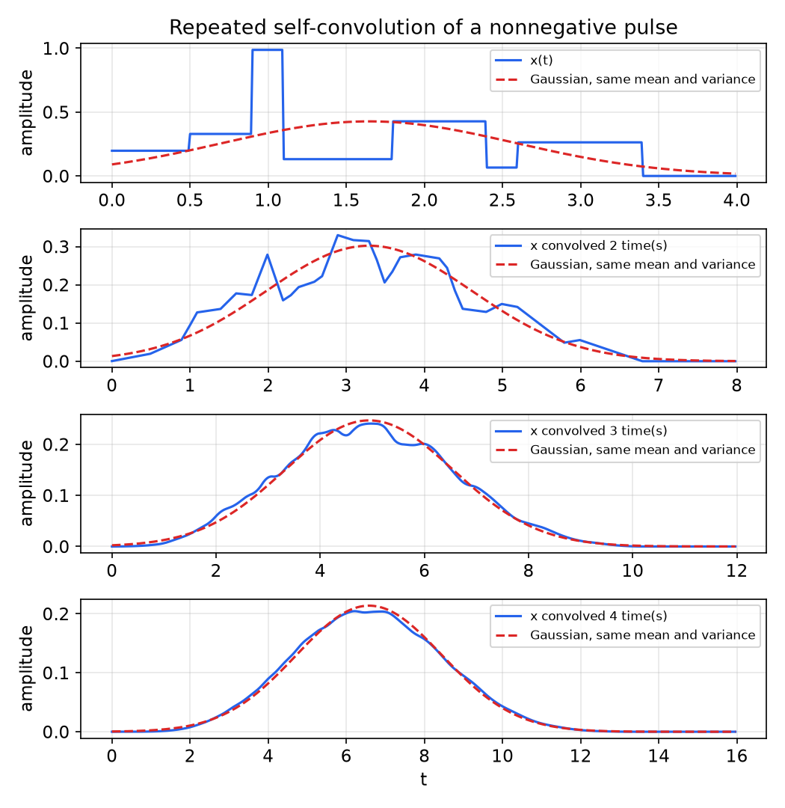
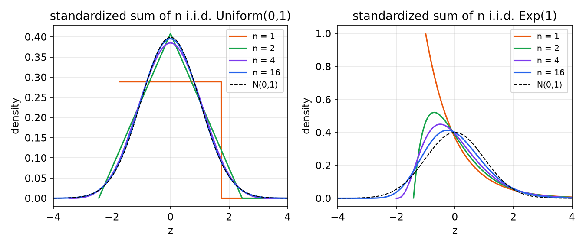
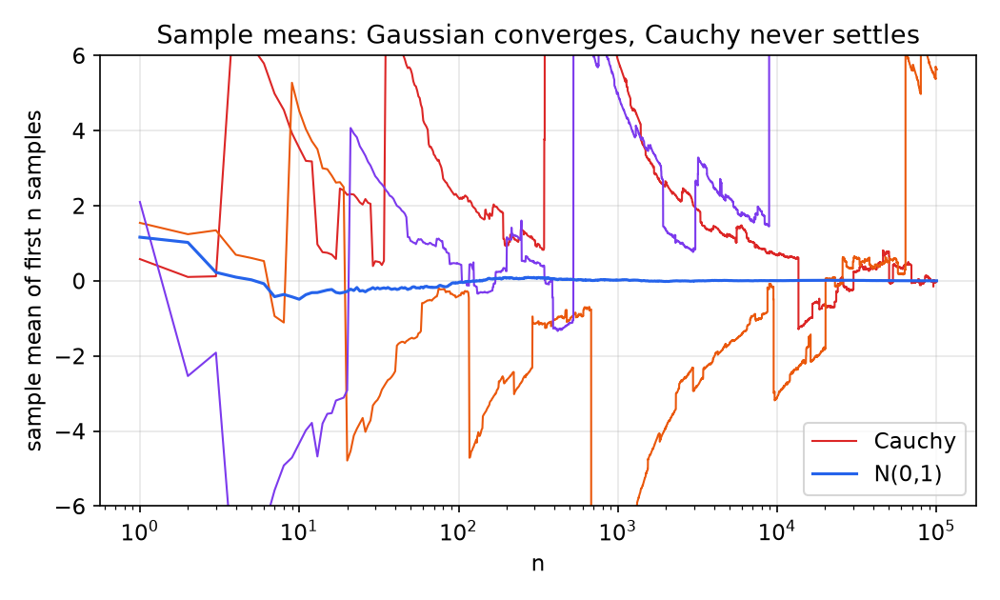
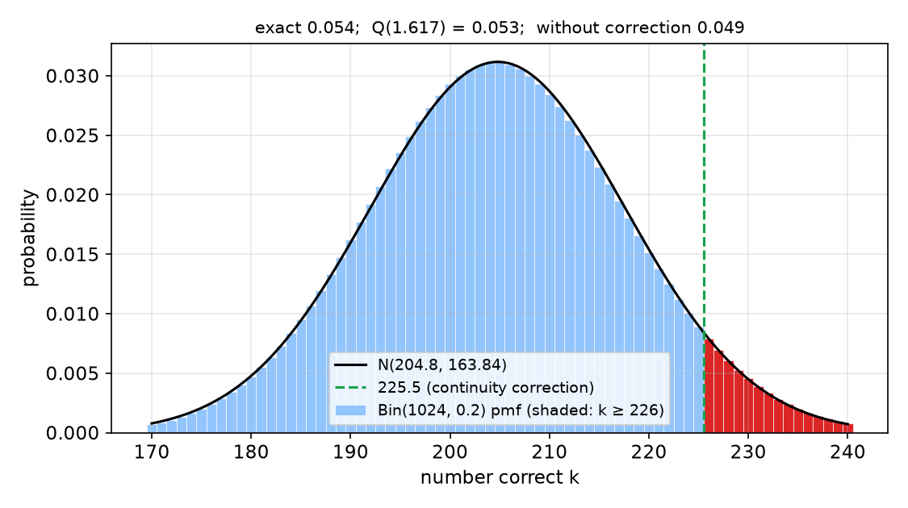
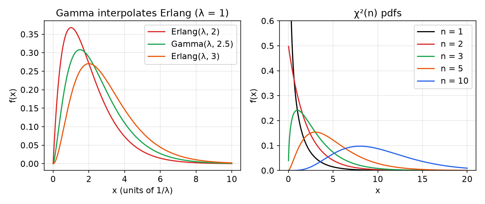

# Iterated Expectation and Limit Theorems

Two ideas tame problems with many random ingredients. The first is conditioning: if a quantity is hard to average directly but easy to average once some other variable is known, condition on that variable and then average over it. This is the law of iterated expectation, together with its companion for variances. The second is aggregation: sums of many independent random variables behave in a highly predictable way. Their average settles down to the mean (the law of large numbers), and their fluctuations take on a Gaussian shape whatever the distribution of the individual terms (the central limit theorem). This chapter proves both, explains the CLT as a statement about repeated convolution, shows with the Cauchy distribution what goes wrong without finite moments, and turns the CLT into a practical approximation tool. It ends with the chi-square and Gamma families, which arise as sums of squared Gaussians and exponentials. The overview page Law of Large Numbers & CLT states the results more briefly.

## Conditional Expectation and the Law of Iterated Expectation

### Conditional expectation as a random variable

For jointly distributed \\(X\\) and \\(Y\\), the conditional mean of \\(Y\\) given \\(X = x\\) is the mean of the conditional distribution:
\\[
h(x) \triangleq E(Y \mid X = x) = \sum\_y y\\,P\_{Y\mid X}(y \mid x) \quad \text{or} \quad \int y\\,f\_{Y\mid X}(y \mid x)\\,dy.
\\]
It is an ordinary deterministic function of \\(x\\). The expression \\(E(Y \mid X)\\) means this function applied to the random variable \\(X\\): \\(E(Y \mid X) = h(X)\\). It is therefore itself a **random variable**, a function of \\(X\\) only. For a jointly Gaussian pair, \\(h(x) = \mu\_Y + \rho\sigma\_Y(x - \mu\_X)/\sigma\_X\\) ([Pairs and Vectors of Random Variables](random-vectors.md)), so \\(E(Y \mid X)\\) is a Gaussian random variable.

### The law of iterated expectation

**Theorem (Iterated expectation).** If \\(E\lvert Y \rvert < \infty\\),
\\[
\boxed{E(Y) = E\left(E(Y \mid X)\right)}
\\]

*Proof (discrete).* Use total probability for \\(P(Y = y)\\) and exchange the order of summation:
\\[
E(Y) = \sum\_y y\\,P(Y = y) = \sum\_y y\sum\_x P(Y = y \mid X = x)P\_X(x) = \sum\_x P\_X(x)\underbrace{\left(\sum\_y y\\,P(Y = y \mid X = x)\right)}\_{h(x)} = E(h(X)).
\\]
*Proof (continuous).* Identically, with \\(f\_Y(y) = \int f\_{Y\mid X}(y \mid x)f\_X(x)\\,dx\\):
\\[
E(Y) = \int y\int f(y \mid x)f(x)\\,dx\\,dy = \int f(x)\left(\int y\\,f(y \mid x)\\,dy\right)dx = E(h(X)). \quad ∎
\\]

The theorem is the expectation counterpart of the law of total probability. In the discrete form it reads \\(E(Y) = \sum\_i E(Y \mid X = x\_i)P\_X(x\_i)\\), the **law of total expectation**: average the conditional means, weighted by how likely each condition is. In continuous form it is \\(E(Y) = \int E(Y \mid X = x)f\_X(x)\\,dx\\); in either case \\(E(E(Y \mid X))\\). Applied to \\(g(Y)\\) it gives \\(E(g(Y)) = E(E(g(Y) \mid X))\\), and in particular \\(E(Y^2) = E(E(Y^2 \mid X))\\).

### The law of total variance

**Theorem (Total variance).**
\\[
\boxed{\text{var}(Y) = E\left(\text{var}(Y \mid X)\right) + \text{var}\left(E(Y \mid X)\right)}
\\]
where \\(\text{var}(Y \mid X) = E(Y^2 \mid X) - (E(Y \mid X))^2\\).

*Proof.* Take the expectation of \\(\text{var}(Y \mid X)\\) and use iterated expectation: \\(E(\text{var}(Y \mid X)) = E(Y^2) - E(h(X)^2)\\). Also \\(\text{var}(h(X)) = E(h(X)^2) - (E(h(X)))^2 = E(h(X)^2) - (E(Y))^2\\). Adding, \\(E(Y^2) - (E(Y))^2 = \text{var}(Y)\\). ∎

The total spread of \\(Y\\) is the average spread *within* each condition plus the spread *between* the conditional means.

### Examples

**Example 4.1 (Chop a pole twice).** A pole of length \\(L = 12\\) is chopped at a uniformly random point and the left piece kept, of length \\(X\\); that piece is chopped again uniformly, leaving length \\(Y\\). Find \\(E(Y)\\) and \\(\text{var}(Y)\\).

*Translation.* \\(X \sim \text{Uniform}(0, L)\\) and \\(Y \mid X = x \sim \text{Uniform}(0, x)\\).

*Hard way.* The joint pdf is \\(f(x, y) = f(y \mid x)f(x) = \frac{1}{x}\cdot\frac{1}{L}\\) on the triangle \\(0 < y < x < L\\), so \\(f\_Y(y) = \int\_y^L \frac{dx}{xL} = \frac{1}{L}\log\frac{L}{y}\\) for \\(0 < y < L\\), after which \\(E(Y)\\) and \\(E(Y^2)\\) require integrals of \\(y\log(L/y)\\) and \\(y^2\log(L/y)\\).

*Easy way.* \\(E(Y \mid X) = X/2\\) and \\(E(Y^2 \mid X) = X^2/3\\), so
\\[
E(Y) = E\left(\frac{X}{2}\right) = \frac{L}{4} = 3, \qquad E(Y^2) = E\left(\frac{X^2}{3}\right) = \frac{1}{3}\cdot\frac{L^2}{3} = \frac{L^2}{9} = 16,
\\]
\\[
\text{var}(Y) = \frac{L^2}{9} - \left(\frac{L}{4}\right)^2 = \frac{7L^2}{144} = 7.
\\]
Total variance gives the same answer by another route: \\(E(\text{var}(Y \mid X)) = E(X^2/12) = L^2/36 = 4\\) and \\(\text{var}(E(Y \mid X)) = \text{var}(X/2) = L^2/48 = 3\\); \\(4 + 3 = 7\\). A simulation confirms it:

```matlab
>> X = 12*rand(1,1e7);
>> Y = X.*rand(1,1e7);
>> mean(Y)
ans =
    2.9992
>> var(Y)
ans =
    7.0006
```

**Example 4.2 (Spin a dial for the rate).** Spin a dial to obtain \\(X \sim \text{Uniform}(2, 3)\\), then draw \\(Y\\) exponential with rate \\(\lambda = X\\). The pdf of \\(Y\\) is a mixture of exponentials that is awkward to compute; the mean is not:
\\[
E(Y) = E(E(Y \mid X)) = E\left(\frac{1}{X}\right) = \int\_2^3 \frac{dx}{x} = \log 1.5 = 0.405.
\\]

**Example 4.3 (Beta given uniform).** \\(X \sim \text{Uniform}(1, 3)\\) and, given \\(X = x\\), \\(Y\\) has pdf \\(c\\,y^{x-1}(1 - y)^{9-x}\\) on \\((0, 1)\\), i.e. \\(Y \mid X = x \sim \text{Beta}(x, 10 - x)\\). The Beta mean \\(\alpha/(\alpha + \beta)\\) gives \\(E(Y \mid X) = X/10\\), so \\(E(Y) = 0.1\\,E(X) = 0.2\\).

**Example 4.4 (Random class size).** The class size \\(N \in \\{1, \dots, 6\\}\\) has \\(P(N = k) = (k + c)/27\\). Given \\(N\\), the \\(N\\) scores \\(X\_1, \dots, X\_N\\) are i.i.d. Uniform(0, 100).

(a) \\(\sum\_{k=1}^6(k + c) = 21 + 6c = 27\\), so \\(c = 1\\).

(b) \\(E(N) = \frac{1}{27}\sum\_{k=1}^6 k(k + 1) = \frac{2 + 6 + 12 + 20 + 30 + 42}{27} = \frac{112}{27} \approx 4.15\\).

(c) The class average \\(Y = \frac{1}{N}\sum\_{i=1}^N X\_i\\) has \\(E(Y \mid N = n) = 50\\) for every \\(n\\), so \\(E(Y) = 50\\).

(d) The top score \\(M = \max\\{X\_1, \dots, X\_N\\}\\). For fixed \\(n\\), \\(P(M \le w) = (w/100)^n\\), so \\(f(w) = nw^{n-1}/100^n\\) and \\(E(M \mid N = n) = \frac{n}{n + 1}100\\). Iterated expectation:
\\[
E(M) = 100\\,E\left(\frac{N}{N + 1}\right) = 100\sum\_{k=1}^6\frac{k}{k + 1}\cdot\frac{k + 1}{27} = \frac{100}{27}\cdot 21 = \frac{700}{9} \approx 77.8.
\\]
The choice \\(P(N = k) \propto k + 1\\) makes the sum telescope neatly.

**Example 4.5 (Chopped baguette).** A baguette of length \\(L = 16\\) in. is cut at \\(U \sim \text{Uniform}(0, L)\\) and the larger piece \\(X\\) kept; \\(X\\) is cut uniformly again and the larger piece \\(Z\\) kept. Find \\(E(Z)\\).

*Solution.* The larger piece is \\(L - U\\) if \\(U < L/2\\) and \\(U\\) otherwise; in either case it is uniform on \\((L/2, L)\\) given the half, so
\\[
E(X) = \tfrac{1}{2}E(L - U \mid U < \tfrac{L}{2}) + \tfrac{1}{2}E(U \mid U \ge \tfrac{L}{2}) = \tfrac{1}{2}\cdot\tfrac{3L}{4} + \tfrac{1}{2}\cdot\tfrac{3L}{4} = \tfrac{3}{4}L.
\\]
By the same argument \\(E(Z \mid X = x) = \frac{3}{4}x\\). Hence \\(E(Z) = E(E(Z \mid X)) = \frac{3}{4}E(X) = \frac{9}{16}L = 9\\) in. Each cut shrinks the expected length by the factor \\(3/4\\).

## Sums of Independent Random Variables

### Transforms multiply, densities convolve

If \\(X\\) and \\(Y\\) are independent and \\(Z = X + Y\\),
\\[
\phi\_Z(s) = E\left(e^{s(X + Y)}\right) = E\left(e^{sX}e^{sY}\right) = E\left(e^{sX}\right)E\left(e^{sY}\right) = \phi\_X(s)\phi\_Y(s),
\\]
using independence to factor the expectation. Multiplication of transforms corresponds to convolution of densities:
\\[
f\_Z(z) = (f\_X \* f\_Y)(z) = \int f\_X(x)f\_Y(z - x)\\,dx,
\\]
which can also be derived directly: given \\(X = x\\), \\(Z = x + Y\\) has pdf \\(f\_Y(z - x)\\), and averaging over \\(x\\) gives the integral. See Convolution for the signal-processing view.

**Example 4.6 (Two uniforms).** For \\(X, Y\\) i.i.d. Uniform(0, 1), \\(f\_Z = \text{rect} \* \text{rect}\\) is the triangle on \\([0, 2]\\) with peak 1 at \\(z = 1\\): \\(f\_Z(z) = z\\) for \\(0 \le z \le 1\\) and \\(2 - z\\) for \\(1 \le z \le 2\\).

**Example 4.7 (Uniform plus exponential).** For \\(X \sim \text{Uniform}(0, 1)\\) and independent \\(Y \sim \text{Exp}(10)\\),
\\[
f\_Z(z) = \int\_{\max(0, z-1)}^{z}10e^{-10(z - x)}dx = \begin{cases}1 - e^{-10z}, & 0 \le z \le 1,\\\\ e^{-10(z - 1)} - e^{-10z}, & z > 1,\end{cases}
\\]
a rectangle with smoothed edges: it rises like \\(1 - e^{-10z}\\) to a plateau near 1 and decays exponentially after \\(z = 1\\).

**i.i.d. sums: raise the transform to a power.** If \\(Y = X\_1 + \dots + X\_n\\) with \\(X\_i\\) i.i.d., \\(\phi\_Y(s) = \prod\_i E(e^{sX\_i}) = \phi\_X(s)^n\\).

**Example 4.8 (Binomial again).** For \\(n\\) i.i.d. Bernoulli\\((p)\\) terms, the binomial theorem gives
\\[
\phi\_Y(s) = (pe^s + 1 - p)^n = \sum\_{k=0}^n\binom{n}{k}(1 - p)^{n-k}(pe^s)^k = \sum\_k \underbrace{\binom{n}{k}p^k(1 - p)^{n-k}}\_{P\_Y(k)}e^{sk},
\\]
and since \\(\phi\_Y(s) = \sum\_k P\_Y(k)e^{sk}\\), uniqueness identifies \\(Y \sim \text{Binomial}(n, p)\\).

**Example 4.9 (Independent Gaussians).** If \\(X\_i \sim \mathcal{N}(\mu\_i, \sigma\_i^2)\\) are independent, \\(\phi\_Y(s) = \prod\_i\exp(\mu\_is + \sigma\_i^2s^2/2) = \exp(\mu s + \sigma^2s^2/2)\\) with \\(\mu = \sum\mu\_i\\) and \\(\sigma^2 = \sum\sigma\_i^2\\): the sum is Gaussian.

### Mean and variance of a sum

Two facts are worth stating carefully.

1. \\(E(X + Y + Z) = E(X) + E(Y) + E(Z)\\) **always**, by linearity.
2. \\(\text{var}(X + Y + Z) = \text{var}(X) + \text{var}(Y) + \text{var}(Z)\\) **only** when the terms are pairwise uncorrelated (for instance, independent). Otherwise covariance terms appear. For \\(Y = X\\), \\(\text{var}(X + Y) = 4\\,\text{var}(X) = 2(\text{var}X + \text{var}Y)\\).

Let \\(X\_1, \dots, X\_n\\) be uncorrelated with common mean \\(\mu\\) and variance \\(\sigma^2\\), and let \\(\bar X = \frac{1}{n}\sum\_{i=1}^n X\_i\\) be the **sample mean**. Then
\\[
E(\bar X) = \mu, \qquad \text{var}(\bar X) = \frac{1}{n^2}\sum\_{i=1}^n\sigma^2 = \frac{\sigma^2}{n}.
\\]
The sample mean is unbiased and its standard deviation shrinks like \\(\sigma/\sqrt{n}\\). Both limit theorems refine this.

## The Laws of Large Numbers

### Markov and Chebyshev inequalities

**Theorem (Markov inequality).** If \\(X \ge 0\\) and \\(a > 0\\), then \\(P(X \ge a) \le E(X)/a\\).

*Proof.* \\(X \ge a\\cdot\mathbb{1}\\{X \ge a\\}\\) pointwise; take expectations. ∎

**Theorem (Chebyshev inequality).** If \\(X\\) has mean \\(\mu\\) and variance \\(\sigma^2\\), then for any \\(\varepsilon > 0\\),
\\[
P(\lvert X - \mu \rvert \ge \varepsilon) \le \frac{\sigma^2}{\varepsilon^2}.
\\]

*Proof.* Apply Markov to the nonnegative RV \\((X - \mu)^2\\) with \\(a = \varepsilon^2\\). ∎

### The weak law

**Theorem (Weak law of large numbers).** Let \\(X\_1, X\_2, \dots\\) be uncorrelated with common mean \\(\mu\\) and finite variance \\(\sigma^2\\). Then for every \\(\varepsilon > 0\\),
\\[
P\left(\lvert \bar X\_n - \mu \rvert \ge \varepsilon\right) \le \frac{\sigma^2}{n\varepsilon^2} \to 0 \quad \text{as } n \to \infty.
\\]

*Proof.* Chebyshev with \\(\text{var}(\bar X\_n) = \sigma^2/n\\). ∎

The sample mean **converges in probability** to \\(\mu\\). This is what "the casino wins 6 cents per game in the long run" means: the average winnings per game over many games are, with high probability, close to the expected value.

**The strong law.** For i.i.d. \\(X\_i\\) with \\(E\lvert X\_i \rvert < \infty\\) (a finite mean suffices; no variance needed), \\(\bar X\_n \to \mu\\) **with probability one**: almost every infinite sequence of outcomes has sample means that converge to \\(\mu\\). Almost-sure convergence is stronger than convergence in probability. (The proof is longer; see Law of Large Numbers & CLT.) The laws of large numbers justify estimating expectations by averages, which is the basis of Monte Carlo simulation and of [ergodicity](random-sequences.md), where time averages along one sample path replace ensemble averages.

## The Central Limit Theorem

### Statement

The law of large numbers says \\(\bar X\_n - \mu \to 0\\). The central limit theorem says how: the fluctuations are of size \\(\sigma/\sqrt{n}\\) and their shape is Gaussian. It explains why the bell curve is everywhere. The sum of many independent random effects is approximately Gaussian, whatever the individual distributions; thermal noise, the sum of tiny current contributions from vast numbers of randomly moving electrons, is the textbook example.

**Theorem (Central limit theorem).** Let \\(X\_1, X\_2, \dots\\) be i.i.d. with mean \\(\mu\\) and finite variance \\(\sigma^2 > 0\\). Then
\\[
Z\_n = \frac{1}{\sqrt{n}}\sum\_{i=1}^n\frac{X\_i - \mu}{\sigma} \ \longrightarrow\ \mathcal{N}(0, 1) \quad \text{in distribution},
\\]
that is, \\(P(Z\_n \le z) \to 1 - Q(z)\\) for every \\(z\\).

Equivalent informal forms, for large \\(n\\):
\\[
\bar X\_n = \frac{1}{n}\sum X\_i \approx \mathcal{N}\left(\mu, \frac{\sigma^2}{n}\right), \qquad \sum\_{i=1}^n\frac{X\_i - \mu}{\sigma} \approx \mathcal{N}(0, n), \qquad \sum\_{i=1}^n X\_i \approx \mathcal{N}(n\mu, n\sigma^2).
\\]

Remarks:

- The \\(X\_i\\) need not be Gaussian; that is the point.
- They need not be identically distributed either. Independent terms with possibly different distributions still give a Gaussian limit provided no single term dominates the total variance; the precise sufficient condition is Lindeberg's (implied, for instance, by uniformly bounded third absolute moments with variances bounded away from zero; see Law of Large Numbers & CLT). Example 4.13 below sums three different distributions.
- The finite-variance assumption cannot be dropped: see the Cauchy distribution below.
- Convergence is of the cdf. A sum of discrete RVs never has a pdf, yet its cdf approaches the Gaussian cdf; the bars of its pmf trace out a Gaussian curve.

### Proof via the moment-generating function

Assume the mgf of \\(X\_i\\) exists near \\(s = 0\\) (the characteristic function gives the same proof with no such assumption).

*Zero mean first.* Let \\(\mu = 0\\) and \\(Z = \frac{1}{\sqrt{n}}\sum X\_i\\). By independence,
\\[
\phi\_Z(s) = E\left(e^{(s/\sqrt{n})\sum X\_i}\right) = \prod\_{i=1}^n E\left(e^{X\_is/\sqrt{n}}\right) = \left[\phi\_X\left(\tfrac{s}{\sqrt{n}}\right)\right]^n.
\\]
Expand each factor in a Taylor series, using \\(E(X\_i) = 0\\) and \\(E(X\_i^2) = \sigma^2\\):
\\[
\phi\_X\left(\tfrac{s}{\sqrt{n}}\right) = E\left(1 + \frac{s}{\sqrt{n}}X\_i + \frac{s^2}{2n}X\_i^2 + \sum\_{k \ge 3}\frac{(s/\sqrt{n})^k}{k!}X\_i^k\right) = 1 + \frac{s^2\sigma^2}{2n} + o\left(\frac{1}{n}\right),
\\]
since every remaining term carries at least \\(n^{-3/2}\\). Then
\\[
\phi\_Z(s) = \left(1 + \frac{s^2\sigma^2}{2n} + o\left(\frac{1}{n}\right)\right)^n \longrightarrow e^{s^2\sigma^2/2},
\\]
by the limit \\((1 + a/n + o(1/n))^n \to e^a\\) (take logarithms: \\(n\log(1 + a/n + o(1/n)) = a + o(1)\\)). The limit is the mgf of \\(\mathcal{N}(0, \sigma^2)\\).

*General mean.* Standardize: \\(U\_i = (X\_i - \mu)/\sigma\\) has mean 0 and variance 1, and \\(Z = \frac{1}{\sqrt{n}}\sum U\_i\\) has
\\[
\phi\_Z(s) = \prod\_i\phi\_{U\_i}\left(\tfrac{s}{\sqrt{n}}\right) = \left(1 + \frac{s^2}{2n} + o\left(\frac{1}{n}\right)\right)^n \to e^{s^2/2},
\\]
the mgf of \\(\mathcal{N}(0, 1)\\). A continuity theorem (pointwise convergence of mgfs near zero, or of characteristic functions everywhere, implies convergence of cdfs) completes the proof. ∎

The proof shows *why* only the mean and variance survive: after scaling by \\(1/\sqrt{n}\\), the first-order term vanishes (zero mean), the second-order term contributes \\(n \times \frac{1}{n}\\), and all higher-order terms contribute \\(n \times n^{-k/2} \to 0\\). Every distribution with finite variance looks the same at second order.

### A deterministic view: repeated convolution

Since adding independent RVs convolves their pdfs, the CLT has a purely deterministic reading:

> The convolution of a large number of nonnegative pulses, each with the same RMS duration, yields a Gaussian pulse shape.

Take an arbitrary nonnegative "skyline" pulse \\(x(t)\\), normalized to unit area so that it is a pdf. \\(x \* x\\) is already a lumpy hump; \\(x \* x \* x\\) is smoother; \\(x \* x \* x \* x\\) is nearly indistinguishable from a Gaussian with the same mean and variance. Under convolution, means add and variances (squared RMS durations) add, which is why the width grows like \\(\sqrt{n}\\) while the centre moves like \\(n\\). Convolution is a smoothing operation, and the Gaussian is its fixed point: the convolution of two Gaussians is Gaussian.



*Figure: a jagged nonnegative pulse x(t) (top) and its 2-, 3- and 4-fold self-convolutions (blue), each overlaid with the Gaussian having the same mean and variance (red dashed). By the fourth convolution the two are nearly identical.*

How fast the convergence happens depends on the starting shape. Symmetric pulses converge quickly; skewed ones slowly, because the skewness of a sum of \\(n\\) i.i.d. terms decays only like \\(1/\sqrt{n}\\).



*Figure: pdfs of the standardized sum of n i.i.d. Uniform(0,1) (left) and Exp(1) (right) variables for n = 1, 2, 4, 16, with the N(0,1) pdf dashed. Uniform sums are nearly Gaussian by n = 4; exponential sums (Erlang) remain visibly skewed at n = 16.*

## No CLT for the Cauchy Distribution

**Example 4.10 (Averaging Cauchy variables).** Let \\(X\_1, X\_2\\) be i.i.d. Cauchy with characteristic function \\(\psi(j\omega) = e^{-\lvert\omega\rvert}\\) ([random vectors](random-vectors.md)). The average \\(\bar X = (X\_1 + X\_2)/2\\) has
\\[
\psi\_{\bar X}(j\omega) = \psi\_{X\_1}\left(\tfrac{j\omega}{2}\right)\psi\_{X\_2}\left(\tfrac{j\omega}{2}\right) = e^{-\lvert\omega\rvert/2}e^{-\lvert\omega\rvert/2} = e^{-\lvert\omega\rvert}:
\\]
still standard Cauchy. In general, for \\(n\\) i.i.d. Cauchy terms,
\\[
\psi\_{\bar X}(j\omega) = \left(\psi\_X\left(\tfrac{j\omega}{n}\right)\right)^n = \left(e^{-\lvert\omega\rvert/n}\right)^n = e^{-\lvert\omega\rvert},
\\]
back to where we started. The average of a million Cauchy samples is exactly as random as a single sample. Neither the law of large numbers nor the CLT applies, because the Cauchy distribution has no mean and infinite variance: occasional enormous outliers dominate every average.

A skeptic can try to measure the mean experimentally:

```matlab
mean(randn(1e7,1)./randn(1e7,1))   % a different "answer" every run, no matter how large n is
```



*Figure: running sample means of 100,000 samples on a log axis. The Gaussian average (blue) settles to 0 as the LLN predicts; three Cauchy averages wander and jump whenever an outlier arrives, never converging.*

## The Gaussian Approximation

### Which distributions are approximately Gaussian

Any RV that can be viewed as a sum of many i.i.d. terms is approximately Gaussian with matching mean and variance:

| RV | Sum of | Approximation | Rule of thumb |
|---|---|---|---|
| Binomial\\((n, p)\\) | \\(n\\) Bernoulli\\((p)\\) | \\(\mathcal{N}(np, npq)\\) | \\(10 < np < n - 10\\) |
| Poisson\\((\mu)\\) | Poisson pieces of a window | \\(\mathcal{N}(\mu, \mu)\\) | \\(\mu > 10\\) |
| \\(\chi^2(n)\\) | \\(n\\) squared \\(\mathcal{N}(0, 1)\\) | \\(\mathcal{N}(n, 2n)\\) | \\(n > 10\\) |
| Erlang\\((\lambda, k)\\) | \\(k\\) Exp\\((\lambda)\\) | \\(\mathcal{N}(k/\lambda, k/\lambda^2)\\) | \\(k > 10\\) |
| NegBin\\((p, k)\\) | \\(k\\) Geometric\\((p)\\) | \\(\mathcal{N}(k/p, kq/p^2)\\) | \\(k > 10\\) |

The binomial condition keeps the mean at least about ten away from both ends of the range, so the pmf is not cut off by the boundary at 0 or \\(n\\). Skewed families (Poisson, Erlang, chi-square) need larger parameters for good accuracy in the tails.

### The continuity correction

When approximating an integer-valued RV \\(X\\) by a continuous Gaussian \\(Y\\), think of each pmf value \\(P\_X(k)\\) as a bar of width one centred at \\(k\\), covering \\((k - \frac{1}{2}, k + \frac{1}{2})\\); the bar graph then has unit area, like a pdf. The event \\(X \ge k\\) corresponds to the bars from \\(k - \frac{1}{2}\\) upward, so
\\[
P(X \ge k) \approx P\left(Y \ge k - \tfrac{1}{2}\right), \qquad P(X \le k) \approx P\left(Y \le k + \tfrac{1}{2}\right).
\\]

**Example 4.11 (Guessing on a long quiz).** A quiz has 1024 multiple-choice questions with 5 options each. A student guesses every answer. What is the probability of at least 226 correct?

*Exact.* \\(X \sim \text{Bin}(1024, 0.2)\\), so \\(P(X \ge 226) = \sum\_{k=226}^{1024}\binom{1024}{k}(0.2)^k(0.8)^{1024-k}\\), a sum of hundreds of terms with enormous binomial coefficients and tiny powers. Evaluated carefully it equals \\(0.054\\).

*Gaussian approximation.* \\(np = 204.8\\) lies well inside \\((10, 1014)\\), so \\(X \approx Y \sim \mathcal{N}(204.8, 163.84)\\) (\\(npq = 163.84\\), standard deviation 12.8). With the continuity correction,
\\[
P(X \ge 226) \approx P(Y \ge 225.5) = P\left(\frac{Y - 204.8}{12.8} \ge \frac{20.7}{12.8}\right) = Q(1.617) = 0.053.
\\]
Without the correction, \\(P(Y \ge 226) = Q(1.656) \approx 0.049\\), about 10% off; with it the error is about 2%.



*Figure: the Bin(1024, 0.2) pmf as unit-width bars (red: k ≥ 226) with the N(204.8, 163.84) pdf. The red bars start at 225.5, which is why the Gaussian tail should be measured from 225.5 rather than 226.*

**Example 4.12 (Tosses needed for 200 heads).** What is the probability that more than 420 tosses of a fair coin are needed to obtain 200 heads?

*Solution.* The number of tosses is \\(Z = W\_1 + \dots + W\_{200}\\), a sum of 200 i.i.d. Geometric(1/2) waiting times, i.e. NegBin(1/2, 200). Exactly, \\(P(Z > 420) = \sum\_{k=421}^\infty\binom{k-1}{199}(0.5)^k \approx 0.153\\). By the CLT, \\(Z \approx \mathcal{N}(200/p, 200q/p^2) = \mathcal{N}(400, 400)\\), so with the continuity correction
\\[
P(Z > 420) = P(Z \ge 421) \approx Q\left(\frac{420.5 - 400}{20}\right) = Q(1.025) \approx 0.153.
\\]

**Example 4.13 (A sum of three different distributions).** Let \\(U\_1, \dots, U\_{300}\\) be i.i.d. Uniform\\((-\sqrt{3}, \sqrt{3})\\), \\(V\_1, \dots, V\_{300}\\) i.i.d. \\(\mathcal{N}(1, 1)\\), and \\(W\_1, \dots, W\_{300}\\) i.i.d. Exp(1), all independent, and \\(S = \sum U\_i + \sum V\_i + \sum W\_i\\). Find \\(t\\) with \\(P(S > t) = 0.2\\).

*Solution.* The means are \\(0, 1, 1\\) and the variances are all 1 (the uniform on \\((-\sqrt{3}, \sqrt{3})\\) has variance \\((2\sqrt{3})^2/12 = 1\\)). So \\(E(S) = 600\\), \\(\text{var}(S) = 900\\), and by the CLT for independent, non-identical terms \\(S \approx \mathcal{N}(600, 900)\\). Then
\\[
P(S > t) = Q\left(\frac{t - 600}{30}\right) = 0.2 \implies t = 600 + 30\\,Q^{-1}(0.2) = 600 + 30(0.8416) \approx 625.25.
\\]

## The Chi-Square and Gamma Distributions

### Chi-square

**Definition.** If \\(U\_1, \dots, U\_n\\) are i.i.d. \\(\mathcal{N}(0, 1)\\), then \\(X = U\_1^2 + \dots + U\_n^2 \sim \chi^2(n)\\), the chi-square distribution with \\(n\\) degrees of freedom.

The mgf follows at once from the rocket-landing computation in [the random-vectors chapter](random-vectors.md), \\(\phi\_{U^2}(s) = (1 - 2s)^{-1/2}\\):
\\[
\phi\_X(s) = (1 - 2s)^{-n/2}, \qquad E(X) = n, \qquad \text{var}(X) = 2n
\\]
(since \\(E(U^2) = 1\\) and \\(\text{var}(U^2) = E(U^4) - 1 = 3 - 1 = 2\\)).

*Even \\(n\\).* Group the squares in pairs: \\(W\_j = U\_{2j-1}^2 + U\_{2j}^2\\) are i.i.d. Exp(1/2) (the rocket-landing result with \\(\sigma^2 = 1\\)). So \\(\chi^2(n)\\) is a sum of \\(k = n/2\\) i.i.d. exponentials, an **Erlang\\((\lambda = 1/2, k = n/2)\\)** RV, with pdf
\\[
f(x) = \frac{(1/2)^k}{(k - 1)!}x^{k-1}e^{-x/2}u(x).
\\]
*Odd \\(n\\)* needs \\((k - 1)!\\) at half-integer \\(k\\), which the gamma function supplies.

### The gamma function

**Definition.**
\\[
\Gamma(k) \triangleq \int\_0^\infty t^{k-1}e^{-t}\\,dt, \qquad k > 0.
\\]
Integration by parts gives the recursion \\(\Gamma(k) = (k - 1)\Gamma(k - 1)\\), and \\(\Gamma(1) = 1\\), so \\(\Gamma(k) = (k - 1)!\\) for positive integers: \\(\Gamma(5) = 4 \cdot 3 \cdot 2 \cdot 1 = 24\\). The gamma function interpolates the factorials smoothly. Substituting \\(t = u^2/2\\) and using the Gaussian integral gives \\(\Gamma(1/2) = \sqrt{\pi}\\), and the recursion then handles every half-integer: \\(\Gamma(4.5) = 3.5 \cdot 2.5 \cdot 1.5 \cdot 0.5 \cdot \sqrt{\pi} \approx 11.63\\). \\(\Gamma(k)\\) blows up as \\(k \to 0^+\\) and has its minimum between 1 and 2 (near \\(k \approx 1.46\\)).

### The Gamma distribution

**Definition.** For shape \\(k > 0\\) and rate \\(\lambda > 0\\), \\(X \sim \text{Gamma}(\lambda, k)\\) has pdf
\\[
f(x) = \frac{\lambda^k}{\Gamma(k)}x^{k-1}e^{-\lambda x}u(x),
\\]
with
\\[
E(X) = \frac{k}{\lambda}, \qquad \text{var}(X) = \frac{k}{\lambda^2}, \qquad \phi(s) = \left(\frac{\lambda}{\lambda - s}\right)^k, \quad s < \lambda.
\\]
*Normalization and mgf.* Substituting \\(t = (\lambda - s)x\\),
\\[
\int\_0^\infty\frac{\lambda^k}{\Gamma(k)}x^{k-1}e^{-(\lambda - s)x}dx = \frac{\lambda^k}{\Gamma(k)(\lambda - s)^k}\int\_0^\infty t^{k-1}e^{-t}dt = \left(\frac{\lambda}{\lambda - s}\right)^k,
\\]
which equals one at \\(s = 0\\). Differentiating, \\(\phi'(0) = k/\lambda\\) and \\(\phi''(0) = k(k + 1)/\lambda^2\\), giving the mean and variance.

The family nests:

- **Erlang\\((\lambda, k)\\)** is Gamma with integer \\(k\\): \\(\frac{\lambda^k}{(k - 1)!}x^{k-1}e^{-\lambda x}u(x)\\), the sum of \\(k\\) i.i.d. Exp\\((\lambda)\\) (its mgf is the \\(k\\)-th power of the exponential mgf). It is the waiting time for the \\(k\\)-th arrival in [a Poisson process](bernoulli-poisson.md); \\(k = 1\\) is the exponential.
- **\\(\chi^2(n)\\)** is Gamma\\((\lambda = 1/2, k = n/2)\\): \\(\frac{1}{2^{n/2}\Gamma(n/2)}x^{n/2-1}e^{-x/2}u(x)\\). Even \\(n\\) lies inside the Erlang family; odd \\(n\\) lies in Gamma but outside Erlang.
- Gamma mgfs multiply by adding shapes: independent Gamma\\((\lambda, k\_1)\\) and Gamma\\((\lambda, k\_2)\\) sum to Gamma\\((\lambda, k\_1 + k\_2)\\). Hence for large \\(k\\) the CLT gives Gamma\\((\lambda, k) \approx \mathcal{N}(k/\lambda, k/\lambda^2)\\), and \\(\chi^2(n) \approx \mathcal{N}(n, 2n)\\).
- **Scaling.** If \\(X \sim \text{Gamma}(\lambda, k)\\) then \\(cX \sim \text{Gamma}(\lambda/c, k)\\) (the mgf \\(\phi\_X(cs) = (\lambda/(\lambda - cs))^k\\)). In particular, if \\(X \sim \text{Erlang}(\lambda, k)\\) then \\(2\lambda X \sim \text{Gamma}(1/2, k) = \chi^2(2k)\\), which is how Erlang and Poisson probabilities are read from chi-square tables.



*Figure: left, Erlang(λ, 2), Gamma(λ, 2.5) and Erlang(λ, 3) pdfs with λ = 1; the non-integer shape interpolates between the integer ones (modes at (k − 1)/λ). Right, χ²(n) pdfs for n = 1, 2, 3, 5, 10; n = 2 is Exp(1/2), and as n grows the pdf drifts right and becomes more symmetric, approaching N(n, 2n).*

## Summary

- \\(E(Y \mid X) = h(X)\\) with \\(h(x) = E(Y \mid X = x)\\) is a random variable. Iterated expectation: \\(E(Y) = E(E(Y \mid X))\\). Total variance: \\(\text{var}(Y) = E(\text{var}(Y \mid X)) + \text{var}(E(Y \mid X))\\).
- Independent sums: \\(\phi\_{X+Y} = \phi\_X\phi\_Y\\), \\(f\_{X+Y} = f\_X \* f\_Y\\); i.i.d. sums raise the mgf to the \\(n\\)-th power. Means always add; variances add for uncorrelated terms.
- Sample mean: \\(E(\bar X) = \mu\\), \\(\text{var}(\bar X) = \sigma^2/n\\). Chebyshev \\(P(\lvert X - \mu\rvert \ge \varepsilon) \le \sigma^2/\varepsilon^2\\) gives the weak LLN; the strong LLN gives almost-sure convergence for i.i.d. terms with finite mean.
- CLT: \\(\frac{1}{\sqrt{n}}\sum(X\_i - \mu)/\sigma \to \mathcal{N}(0, 1)\\) for i.i.d. finite-variance terms (and for non-identical independent terms under Lindeberg's condition). Proof: \\((1 + s^2/2n + o(1/n))^n \to e^{s^2/2}\\). Deterministically: repeated convolution of nonnegative pulses tends to a Gaussian.
- Cauchy: the average of \\(n\\) i.i.d. Cauchy variables is Cauchy; no LLN or CLT.
- Gaussian approximation: Bin \\(\approx \mathcal{N}(np, npq)\\), Poisson \\(\approx \mathcal{N}(\mu, \mu)\\), \\(\chi^2(n) \approx \mathcal{N}(n, 2n)\\), Erlang \\(\approx \mathcal{N}(k/\lambda, k/\lambda^2)\\), NegBin \\(\approx \mathcal{N}(k/p, kq/p^2)\\); use the continuity correction \\(\pm\frac{1}{2}\\) for integer RVs.
- \\(\chi^2(n)\\) = sum of \\(n\\) squared standard normals = Gamma(1/2, n/2), mean \\(n\\), variance \\(2n\\). Gamma\\((\lambda, k)\\): \\(\frac{\lambda^k}{\Gamma(k)}x^{k-1}e^{-\lambda x}\\), mean \\(k/\lambda\\), variance \\(k/\lambda^2\\), mgf \\((\lambda/(\lambda - s))^k\\); Erlang is integer \\(k\\); \\(\Gamma(k) = (k - 1)!\\), \\(\Gamma(1/2) = \sqrt{\pi}\\).

## See Also

- Law of Large Numbers & CLT: modes of convergence and the Lindeberg–Feller theorem.
- [Random Variables and Their Distributions](random-variables.md): mgfs, the Gaussian and the Q function.
- [Pairs and Vectors of Random Variables](random-vectors.md): conditional distributions, the Rayleigh computation behind \\(\chi^2(2)\\), the Cauchy distribution.
- [The Bernoulli and Poisson Processes](bernoulli-poisson.md): binomial, geometric, negative binomial, Poisson and Erlang as random processes.
- [Random Sequences](random-sequences.md): ergodicity, the law of large numbers along a single sample path.
- Convolution: the signal-processing side of adding independent random variables.
