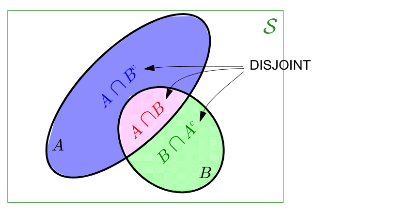
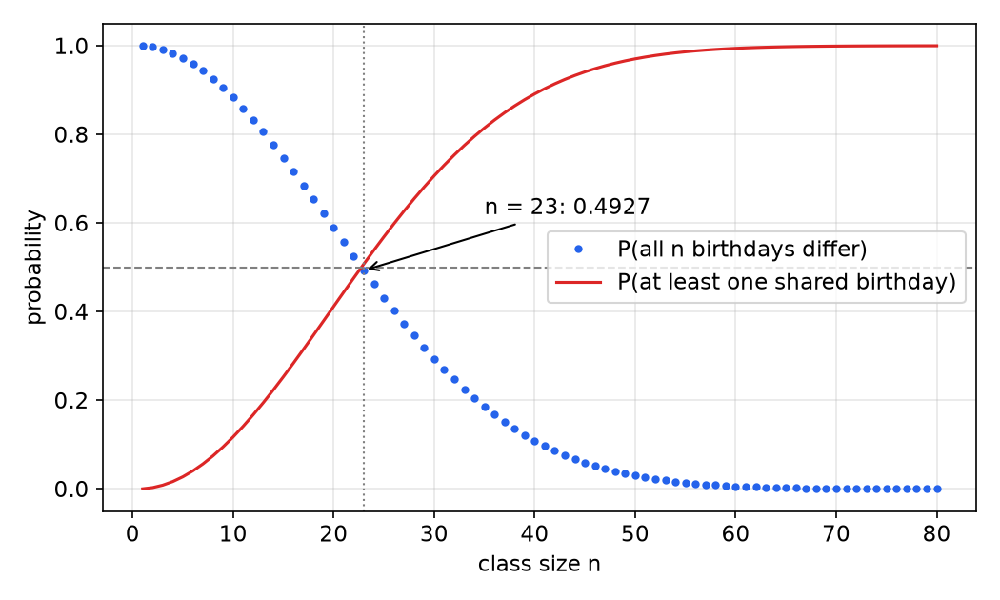
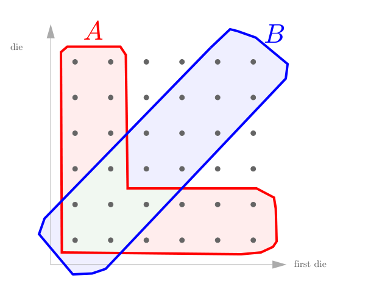
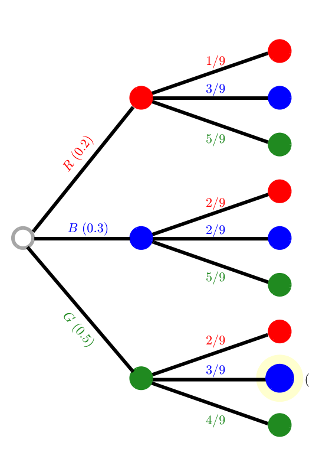
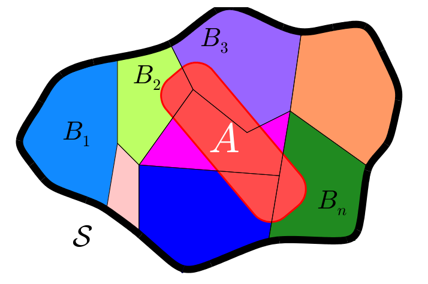

# Probability Foundations

Everything in the study of random processes, from Markov chains to Wiener filters, rests on a small set of rules for assigning and manipulating probabilities. This chapter builds those rules from three axioms and develops the four working tools that solve almost every elementary problem: counting, the chain (multiplication) rule, the law of total probability, and Bayes' rule. Independence, the property that makes long sequences of random experiments tractable, closes the chapter. The treatment complements the shorter overview in Axioms of Probability and Bayesian Inference, with more worked examples and full proofs of the elementary corollaries.

## The Road Ahead

A random process is an indexed family of random variables. To reach it, one climbs a short staircase: probability of events, then a single random variable, then a pair of random variables, then random vectors \\(X = [X\_1, X\_2, \dots, X\_n]^T\\), then random sequences \\(X\_k\\), and finally continuous-time random processes \\(X(t)\\). This chapter and the next three cover the first four steps. Later chapters treat [the Bernoulli and Poisson processes](bernoulli-poisson.md), [Markov chains](markov-chains.md), [stationary random sequences](random-sequences.md), [MMSE estimation](estimation.md) and [continuous-time processes](continuous-time.md).

Why the effort? Information itself is measured in probabilistic terms: the information carried by an event of probability \\(p\\) is \\(-\log p\\). Uncertainty enters every engineering system: a radar or GPS receiver tries to minimize the probability of a miss for a given probability of false alarm; a queueing system (airport security, a checkout line) is sized so that waiting time stays below a target; a self-driving car predicts the motion of other road users; compression, weather forecasting and financial prediction all exploit statistical regularity.

## Sets and Events

### Set operations

A **set** is a collection of objects called elements: \\(F = \\{\text{apple}, \text{banana}\\}\\), \\(\mathbb{Z} = \\{\dots, -2, -1, 0, 1, 2, \dots\\}\\), \\(\mathbb{R}^+ = \\{x : x > 0\\}\\). The **null set** \\(\emptyset\\) has no elements. \\(B \subset A\\) (\\(B\\) is a **subset** of \\(A\\)) when every element of \\(B\\) is in \\(A\\), and \\(A = B\\) if and only if \\(A \subset B\\) and \\(B \subset A\\). All sets in a problem are subsets of a **universal set** \\(\mathcal{S}\\). A set with \\(n\\) elements has \\(2^n\\) subsets; the six faces of a die generate \\(2^6 = 64\\) subsets, from \\(\emptyset\\) through \\(\\{1\\}, \\{2\\}, \dots\\) up to \\(\\{1, \dots, 6\\}\\).

- **Union** \\(A \cup B\\): elements in \\(A\\), in \\(B\\), or in both.
- **Intersection** \\(A \cap B\\) (also written \\(AB\\)): elements common to both.
- **Complement** \\(A^c\\): elements of \\(\mathcal{S}\\) not in \\(A\\). Thus \\(\emptyset^c = \mathcal{S}\\), \\(\mathcal{S}^c = \emptyset\\), \\(A \cap A^c = \emptyset\\), \\(A \cup A^c = \mathcal{S}\\).
- \\(A\\) and \\(B\\) are **disjoint** (mutually exclusive) if \\(A \cap B = \emptyset\\).

The operations obey the following algebra:

| Property | Statement |
|---|---|
| Commutative | \\(A \cup B = B \cup A\\), \\(A \cap B = B \cap A\\) |
| Associative | \\(A \cup (B \cup C) = (A \cup B) \cup C\\) |
| Distributive | \\(A \cap (B \cup C) = (A \cap B) \cup (A \cap C)\\) |
| Double complement | \\((A^c)^c = A\\) |
| Mutual exclusion | \\(A \cap A^c = \emptyset\\) |
| Inclusion | \\(A \cap \mathcal{S} = A\\) |
| De Morgan | \\((A \cup B)^c = A^c \cap B^c\\), \\((A \cap B)^c = A^c \cup B^c\\) |

De Morgan's laws are the ones used most often: "not (A or B)" is "(not A) and (not B)".

**Example 1.1 (Set algebra on a die).** Let \\(\mathcal{S} = \\{1, \dots, 6\\}\\), \\(A = \\{2, 4, 6\\}\\), \\(B = \\{1, 2, 3, 4\\}\\). Then \\(B^c = \\{5, 6\\}\\), \\(A \cap B^c = \\{6\\}\\), and
\\[
(A \cap B^c) \cup B = \\{6\\} \cup \\{1, 2, 3, 4\\} = \\{1, 2, 3, 4, 6\\}.
\\]

### Experiments, sample spaces and events

A **random experiment** is a procedure whose outcome is not known in advance. Its **sample space** \\(\mathcal{S}\\) is the set of possible outcomes, and an **event** is a subset of the sample space. The collection of events must be closed under unions, intersections and complements (an *event algebra*, or \\(\sigma\\)-algebra when countable unions are included); for a finite sample space every subset can be an event.

The sample space is not dictated by nature; it depends on what is observed. Flip a pair of coins. Possible sample spaces include

- the number of heads: \\(\mathcal{S}\_1 = \\{0, 1, 2\\}\\);
- the distance between the coins after landing: \\(\mathcal{S}\_2 = \\{d : d > 0\\}\\);
- ordered faces: \\(\mathcal{S}\_3 = \\{TT, TH, HT, HH\\}\\);
- unordered faces: \\(\mathcal{S}\_4 = \\{\text{both tails}, \text{both heads}, \text{one of each}\\}\\).

A single coin flip could equally be observed as heads/tails, as a number of bounces, or as a settling time. Choosing the sample space well is the first step in every problem; a good choice usually makes outcomes **equally likely** so that probabilities can be found by counting.

## The Axioms of Probability

**Definition (Probability measure).** A probability measure assigns to each event \\(A\\) a number \\(P(A)\\) such that

1. \\(P(A) \ge 0\\) for every event \\(A\\);
2. \\(P(\mathcal{S}) = 1\\);
3. if \\(A \cap B = \emptyset\\), then \\(P(A \cup B) = P(A) + P(B)\\).

(For infinite sample spaces, axiom 3 is strengthened to countable additivity: \\(P(\bigcup\_i A\_i) = \sum\_i P(A\_i)\\) for pairwise disjoint \\(A\_1, A\_2, \dots\\). See Axioms of Probability for the measure-theoretic setting.)

The interpretation: \\(P(A)\\) is the probability that \\(A\\) occurs, \\(P(A \cup B)\\) the probability that \\(A\\) or \\(B\\) occurs, and \\(P(A \cap B)\\) the probability that both occur.

For a finite sample space the axioms are satisfied by any assignment of a value in \\([0, 1]\\) to each outcome such that the values sum to one; the probability of an event is then the sum over the outcomes it contains. If seven outcomes carry probabilities \\(0.2, 0.1, 0.1, 0.1, 0.2, 0.1, 0.2\\) and an event contains the outcomes carrying \\(0.1, 0.1, 0.2\\), its probability is \\(0.4\\).

### Three corollaries

**Corollary 1.** \\(P(A^c) = 1 - P(A)\\), and hence \\(P(A) \le 1\\).

*Proof.* \\(A\\) and \\(A^c\\) are disjoint with union \\(\mathcal{S}\\), so by axioms 2 and 3, \\(1 = P(\mathcal{S}) = P(A \cup A^c) = P(A) + P(A^c)\\). Therefore \\(P(A) = 1 - P(A^c) \le 1\\) by axiom 1. ∎

The axioms only demand that probability be nonnegative; this corollary supplies the upper bound.

**Corollary 2.** \\(P(\emptyset) = 0\\).

*Proof.* \\(\mathcal{S}\\) and \\(\emptyset\\) are disjoint, so \\(P(\mathcal{S}) = P(\mathcal{S} \cup \emptyset) = P(\mathcal{S}) + P(\emptyset)\\). ∎

**Corollary 3 (Inclusion–exclusion for two events).** For any events \\(A, B\\),
\\[
P(A \cup B) = P(A) + P(B) - P(A \cap B).
\\]

*Proof.* Split each event into disjoint pieces (see the figure): \\(A = (A \cap B^c) \cup (A \cap B)\\) and \\(B = (B \cap A^c) \cup (A \cap B)\\). By axiom 3,
\\[
P(A) = P(A \cap B^c) + P(A \cap B), \qquad P(B) = P(B \cap A^c) + P(A \cap B).
\\]
Adding,
\\[
P(A) + P(B) = \underbrace{P(A \cap B^c) + P(B \cap A^c) + P(A \cap B)}\_{P(A \cup B)} + P(A \cap B),
\\]
because the three pieces under the brace are disjoint and their union is \\(A \cup B\\). ∎

*Figure: the union of A and B is the disjoint union of A∩B^c (blue), A∩B (pink) and B∩A^c (green). Adding P(A) and P(B) counts the pink region twice, which is why P(A∩B) is subtracted.*

The same bookkeeping for three events gives
\\[
P(A \cup B \cup C) = P(A) + P(B) + P(C) - P(A \cap B) - P(A \cap C) - P(B \cap C) + P(A \cap B \cap C).
\\]
Pairwise intersections are subtracted because they were counted twice, but then the triple intersection, counted three times and subtracted three times, must be added back once. In general the signs alternate over intersections of \\(1, 2, 3, \dots\\) events.

## Methods for Calculating Probabilities

Four techniques cover most problems:

1. **Counting.** If all outcomes in a finite \\(\mathcal{S}\\) are equally likely, \\(P(A) = \lvert A \rvert / \lvert \mathcal{S} \rvert\\).
2. **The multiplication (chain) rule** for events that happen in sequence.
3. **The law of total probability**, a divide-and-conquer over a partition.
4. **Combinations of these**, notably Bayes' rule.

### Counting

The basic counting facts: an ordered sequence of \\(n\\) choices from \\(m\\) options with replacement can be made in \\(m^n\\) ways; without replacement in \\(m(m-1)\cdots(m-n+1)\\) ways; and an unordered choice of \\(k\\) items from \\(n\\) in \\(\binom{n}{k} = \frac{n!}{k!(n-k)!}\\) ways.

**Example 1.2 (Birthday problem).** In a class of \\(n\\) students, ignoring leap years and twins, with each birthday equally likely among 365 days, what is the probability that all birthdays differ?

*Solution.* Take the sample space to be ordered \\(n\\)-tuples of days; it has \\(365^n\\) equally likely elements. The event \\(A\\) = "all different" contains \\(365 \cdot 364 \cdots (365 - n + 1)\\) tuples. Hence
\\[
P(A) = \frac{\lvert A \rvert}{365^n} = \left(\frac{365}{365}\right)\left(\frac{364}{365}\right)\left(\frac{363}{365}\right)\cdots\left(\frac{365 - n + 1}{365}\right).
\\]

| \\(n\\) | 2 | 5 | 10 | 15 | 20 | 22 | **23** | 25 | 30 | 40 | 50 | 57 | 60 | 70 | 80 |
|---|---|---|---|---|---|---|---|---|---|---|---|---|---|---|---|
| \\(P(A)\\) | 0.9973 | 0.9729 | 0.8831 | 0.7471 | 0.5886 | 0.5243 | **0.4927** | 0.4313 | 0.2937 | 0.1088 | 0.0296 | 0.0099 | 0.0059 | 0.00084 | 0.000086 |

With only 23 students a shared birthday is more likely than not; with 57 it is 99% certain. The surprise comes from the number of *pairs*, \\(\binom{23}{2} = 253\\), each of which could match.

*Figure: probability that all n birthdays differ (dots) and its complement (line). The curves cross 1/2 between n = 22 and n = 23.*

**Example 1.3 (Two pair, no face card).** Five cards are dealt from a 52-card deck. Find the probability of two pair in which neither pair is a face card (J, Q, K; the ace is not a face card), the fifth card having a different rank.

*Solution.* Unordered hands are equally likely, so \\(\lvert \mathcal{S} \rvert = \binom{52}{5} = 2\\,598\\,960\\). Build a favourable hand in stages: choose the two ranks of the pairs among the 10 non-face ranks, \\(\binom{10}{2}\\); choose two of four suits for each pair, \\(\binom{4}{2}\binom{4}{2}\\); choose the fifth card from the \\(48 - 4 = 44\\) cards whose rank differs from both pair ranks. Then
\\[
P(A) = \frac{\binom{10}{2}\binom{4}{2}\binom{4}{2}(44)}{\binom{52}{5}} = \frac{45 \cdot 36 \cdot 44}{2\\,598\\,960} = \frac{71\\,280}{2\\,598\\,960} \approx 2.7\\%.
\\]

**Example 1.4 (Two dice; choosing the sample space).** Roll two dice. If the dice are distinguishable there are 36 outcomes \\((i, j)\\); if not, only 21 unordered outcomes. Prefer the 36-outcome space: its outcomes are equally likely (each has probability \\(1/36\\)), while in the 21-outcome space "a pair of threes" has probability \\(1/36\\) but "a three and a four" has \\(2/36\\). Let \\(A\\) = "the smaller die is at most 2" and \\(B\\) = "bigger minus smaller is at most 1."

*Solution.* \\(A\\) is the L-shaped set of outcomes with a 1 or 2 on either die: \\(36 - 16 = 20\\) outcomes. \\(B\\) is the diagonal band \\(\lvert i - j \rvert \le 1\\): 6 on the diagonal plus 10 adjacent, 16 outcomes. Their intersection contains \\((1,1), (2,2), (1,2), (2,1), (2,3), (3,2)\\): 6 outcomes. Directly counting the union gives 30 outcomes, so \\(P(A \cup B) = 30/36\\). Inclusion–exclusion agrees:
\\[
P(A) + P(B) - P(A \cap B) = \frac{20}{36} + \frac{16}{36} - \frac{6}{36} = \frac{30}{36}.
\\]

*Figure: the 36 equally likely outcomes of two dice (first die horizontal). A (red) is the L-shaped region where the smaller die is at most 2; B (blue) is the band where the dice differ by at most one.*

## Conditional Probability

### Definition and interpretation

**Definition (Conditional probability).** If \\(P(B) > 0\\), the conditional probability of \\(A\\) given \\(B\\) is
\\[
P(A \mid B) = \frac{P(A \cap B)}{P(B)}.
\\]

It is the updated probability of \\(A\\) once we know that \\(B\\) occurred. Knowing \\(B\\) makes every outcome outside \\(B\\) impossible: their probabilities are set to zero, and the probabilities inside \\(B\\) are rescaled so that they again sum to one. In effect \\(B\\) becomes the new sample space. One checks that \\(P(\cdot \mid B)\\) satisfies all three axioms: \\(P(A \mid B) \ge 0\\); \\(P(B \mid B) = 1\\); and if \\(A \cap C = \emptyset\\) then \\(P(A \cup C \mid B) = P(A \mid B) + P(C \mid B)\\), since \\((A \cap B)\\) and \\((C \cap B)\\) are disjoint. Every theorem proved for probabilities therefore holds for conditional probabilities given a fixed \\(B\\).

In Example 1.4, given \\(B\\), each of the 16 outcomes in \\(B\\) is equally likely, six of which lie in \\(A\\):
\\[
P(A \mid B) = \frac{6/36}{16/36} = \frac{6}{16} = \frac{3}{8}.
\\]

Special cases:

- If \\(A\\) and \\(B\\) are disjoint, \\(P(A \mid B) = 0\\): \\(P(\text{head} \mid \text{tail}) = 0\\), \\(P(\text{odd} \mid \text{even}) = 0\\).
- If \\(B \subset A\\), \\(P(A \mid B) = P(B)/P(B) = 1\\).
- If \\(A \subset B\\), \\(P(A \mid B) = P(A)/P(B) \ge P(A)\\).
- If \\(P(B) = 0\\), \\(B\\) is impossible and conditioning on it is not meaningful (for continuous random variables this case is handled by the limiting argument in [the chapter on random vectors](random-vectors.md)).

Conditioning can therefore raise or lower a probability. With partial overlap, \\(P(A \mid B)\\) can be close to one (if the part of \\(B\\) outside \\(A\\) has tiny probability) or close to zero (if \\(A \cap B\\) has tiny probability), whatever \\(P(A)\\) is.

**Example 1.5 (Odd given small).** Two fair dice are rolled and the sum observed. Let \\(A\\) = "the sum is odd" \\(= \\{3, 5, 7, 9, 11\\}\\) and \\(B\\) = "the sum is small" \\(= \\{2, 3\\}\\). Find \\(P(A \mid B)\\).

*Solution.* \\(P(\text{sum} = 2) = 1/36\\), \\(P(\text{sum} = 3) = 2/36\\), so \\(P(B) = 3/36\\) and \\(A \cap B = \\{3\\}\\):
\\[
P(A \mid B) = \frac{P(\text{sum} = 3)}{P(B)} = \frac{2/36}{3/36} = \frac{2}{3}.
\\]
Not \\(1/2\\), as one might first guess by counting the two sums in \\(B\\): the sums are not equally likely.

### The chain (multiplication) rule

Rearranging the definition gives the **multiplication rule**
\\[
\boxed{P(A \cap B) = P(A)\\,P(B \mid A)}
\\]
which is how probabilities of sequential experiments are built. Applying it repeatedly peels off one event at a time:
\\[
P(ABCDE) = P(A)\\,P(B \mid A)\\,P(C \mid AB)\\,P(D \mid ABC)\\,P(E \mid ABCD).
\\]
The same identity for \\(n\\) events is the **chain rule**, \\(P(A\_1 \cdots A\_n) = \prod\_{k=1}^n P(A\_k \mid A\_1 \cdots A\_{k-1})\\). For Markov chains it collapses to a product of one-step transition probabilities.

**Example 1.6 (Two red cards).** Two cards are drawn without replacement. \\(P(\text{both red}) = \frac{26}{52} \cdot \frac{25}{51} = \frac{25}{102} \approx 0.245\\).

**Example 1.7 (Coins without replacement).** A bag holds 10 coins: 2 red, 3 blue, 5 green. Two are drawn without replacement. Find \\(P(\text{first green, then blue})\\).

*Solution.* \\(P(G\_1) = 5/10\\). Given a green coin is gone, 9 coins remain, 3 of them blue: \\(P(B\_2 \mid G\_1) = 3/9\\). Hence \\(P(G\_1 B\_2) = (0.5)(3/9) = 1/6\\). The tree diagram organizes all nine paths; every path probability is the product of the branch probabilities along it.

*Figure: probability tree for two draws without replacement from 2 red, 3 blue and 5 green coins. First-draw branches carry 0.2, 0.3, 0.5; second-draw branches are conditional probabilities given the first draw. The highlighted path (green then blue) has probability (0.5)(3/9) = 1/6.*

**Example 1.8 (Matching socks).** A drawer holds 4 blue and 3 yellow socks. Two are drawn at random. The events "both blue" and "both yellow" are disjoint, so
\\[
P(\text{match}) = P(B\_1)P(B\_2 \mid B\_1) + P(Y\_1)P(Y\_2 \mid Y\_1) = \frac{4}{7}\cdot\frac{3}{6} + \frac{3}{7}\cdot\frac{2}{6} = \frac{2}{7} + \frac{1}{7} = \frac{3}{7}.
\\]

### The law of total probability

**Definition (Partition).** Events \\(\\{B\_1, \dots, B\_n\\}\\) form a **partition** of \\(\mathcal{S}\\) if they are mutually disjoint and \\(\bigcup\_i B\_i = \mathcal{S}\\).

**Theorem (Law of total probability).** If \\(\\{B\_i\\}\\) is a partition with \\(P(B\_i) > 0\\), then for any event \\(A\\)
\\[
\boxed{P(A) = \sum\_i P(A \mid B\_i)\\,P(B\_i)}
\\]

*Proof.* The sets \\(A \cap B\_i\\) are disjoint and their union is \\(A \cap \mathcal{S} = A\\). By additivity \\(P(A) = \sum\_i P(A \cap B\_i)\\), and the multiplication rule gives \\(P(A \cap B\_i) = P(A \mid B\_i)P(B\_i)\\). ∎

The special case with the partition \\(\\{B, B^c\\}\\) is \\(P(A) = P(A \mid B)P(B) + P(A \mid B^c)P(B^c)\\). The law is a divide-and-conquer strategy: if \\(A\\) is hard to evaluate directly but easy once we know which \\(B\_i\\) occurred, condition on the \\(B\_i\\) and average.

*Figure: a partition B_1, ..., B_n of S. The event A is the disjoint union of its pieces A∩B_i, so its probability is the sum of their probabilities.*

**Example 1.9 (Unfair coins).** A bag holds 10 coins: 2 red with head probability 0.5, 3 blue with head probability 0.6, and 5 green with head probability 0.7. Pick a coin at random and flip it. Then
\\[
P(H) = (0.5)(0.2) + (0.6)(0.3) + (0.7)(0.5) = 0.10 + 0.18 + 0.35 = 0.63.
\\]

## Bayes' Rule

Total probability computes the probability of an effect by averaging over causes. Bayes' rule runs the other way: having observed the effect, how probable is each cause?

**Theorem (Bayes).** If \\(\\{B\_1, \dots, B\_n\\}\\) is a partition with \\(P(B\_i) > 0\\) and \\(P(A) > 0\\), then
\\[
\boxed{P(B\_i \mid A) = \frac{P(A \mid B\_i)\\,P(B\_i)}{P(A \mid B\_1)P(B\_1) + \dots + P(A \mid B\_n)P(B\_n)}}
\\]

*Proof.* By definition \\(P(B\_i \mid A) = P(A \cap B\_i)/P(A)\\). Write the numerator with the multiplication rule, \\(P(A \cap B\_i) = P(A \mid B\_i)P(B\_i)\\), and the denominator with the law of total probability. ∎

Bayes' theorem *turns conditional probabilities around*: from \\(P(A \mid B\_i)\\), which a model usually supplies, to \\(P(B\_i \mid A)\\), which a decision needs. \\(P(B\_i)\\) is the **prior**, \\(P(A \mid B\_i)\\) the **likelihood**, and \\(P(B\_i \mid A)\\) the **posterior**. Bayesian Inference extends this to continuous parameters, and the [estimation chapter](estimation.md) uses it for MAP estimation.

**Example 1.10 (Cheater meter).** Every test is scanned by a cheater meter. It flashes with probability 0.9 if the student cheated and 0.2 if not; 1% of students cheat. A randomly chosen test flashes (\\(F\\)). What is the probability that the student cheated (\\(C\\))?

*Solution.*
\\[
P(C \mid F) = \frac{P(F \mid C)P(C)}{P(F \mid C)P(C) + P(F \mid C^c)P(C^c)} = \frac{(0.9)(0.01)}{(0.9)(0.01) + (0.2)(0.99)} = \frac{0.009}{0.207} = 0.043.
\\]
Only 4.3%. This is the **base-rate effect**: because cheaters are rare, the many false alarms among honest students (0.198 of all tests) swamp the true alarms (0.009). A detector's accuracy alone does not determine how much a positive reading means; the prior matters just as much.

**Example 1.11 (Which coin?).** In the bag of Example 1.9 a randomly chosen coin shows heads. What is the probability that it is green?
\\[
P(G \mid H) = \frac{P(H \mid G)P(G)}{P(H \mid R)P(R) + P(H \mid B)P(B) + P(H \mid G)P(G)} = \frac{(0.7)(0.5)}{0.63} = \frac{0.35}{0.63} = \frac{5}{9} \approx 0.556.
\\]
Observing heads raises the probability of green from the prior 0.5 to 0.556, since green coins produce heads most often.

**Example 1.12 (Green candies).** Factory H makes 80% of a brand's candies and factory C makes 20%. One in eight H candies is green, one in four C candies is green. Candies are bagged four at a time, all from one factory.

(a) *Probability that a random candy is green.* By total probability over \\(\\{H, C\\}\\),
\\[
P(G) = \tfrac{1}{8}(0.8) + \tfrac{1}{4}(0.2) = 0.1 + 0.05 = \tfrac{3}{20}.
\\]

(b) *A random candy is green; probability it came from H.*
\\[
P(H \mid G) = \frac{(1/8)(0.8)}{(1/8)(0.8) + (1/4)(0.2)} = \frac{0.1}{0.15} = \frac{2}{3}.
\\]

(c) *Probability that a random bag contains no green candy.* Within a bag the colours are independent given the factory, so
\\[
P(\text{no green}) = \left(\tfrac{7}{8}\right)^4(0.8) + \left(\tfrac{3}{4}\right)^4(0.2) = \frac{2401}{4096}(0.8) + \frac{81}{256}(0.2) = \frac{545}{1024} \approx 0.53.
\\]

(d) *A bag has four green candies; probability it came from H.*
\\[
P(H \mid G\_4) = \frac{(1/8)^4(0.8)}{(1/8)^4(0.8) + (1/4)^4(0.2)} = \frac{0.8}{0.8 + 2^4(0.2)} = \frac{0.8}{4} = \frac{1}{5}.
\\]
One green candy still favours H (2/3), but four reverse the prior: the likelihood ratio \\((1/4)^4/(1/8)^4 = 16\\) compounds with each observation. Evidence accumulates multiplicatively.

## Independence

### Two events

**Definition (Independence).** Events \\(A\\) and \\(B\\) are independent if
\\[
P(A \cap B) = P(A)\\,P(B).
\\]

Since \\(P(A \cap B) = P(A)P(B \mid A)\\), independence is equivalent (when the conditioning events have positive probability) to \\(P(B \mid A) = P(B)\\) or to \\(P(A \mid B) = P(A)\\): knowing that \\(B\\) occurred has no effect on our belief about \\(A\\); \\(B\\) conveys no helpful information about \\(A\\). If \\(A\\) = "a coin lands heads" and \\(B\\) = "it is raining in Paris", then \\(P(\text{head}) = P(\text{head} \mid \text{raining in Paris})\\).

The product definition is preferred because it is symmetric and still makes sense when \\(P(A)\\) or \\(P(B)\\) is zero.

**Example 1.13 (One die).** Roll one die.

- \\(A = \\{2, 4, 6\\}\\) (even) and \\(B = \\{1, 3, 5\\}\\) (odd): **not** independent; \\(P(A \cap B) = 0 \ne \frac{1}{4}\\).
- \\(A\\) (even) and \\(C = \\{1, 2, 3\\}\\) (small): **not** independent; \\(P(A \cap C) = P(\\{2\\}) = \frac{1}{6} \ne P(A)P(C) = \frac{1}{2}\cdot\frac{1}{2}\\).
- \\(A\\) (even) and \\(D = \\{1, 2\\}\\): independent; \\(P(A \cap D) = P(\\{2\\}) = \frac{1}{6} = \frac{1}{2}\cdot\frac{1}{3}\\).

Independence is a numerical coincidence of probabilities, not a geometric property of the sets. In particular, **disjoint events of nonzero probability are never independent**; they are strongly dependent, since knowing one occurred guarantees the other did not. The null event \\(\emptyset\\) and the certain event \\(\mathcal{S}\\) are, technically, independent of every event.

**Example 1.14 (Constructing an independent event).** Two dice are rolled and the sum \\(S \in \\{2, \dots, 12\\}\\) observed, with \\(P(S = s) = (6 - \lvert s - 7 \rvert)/36\\). Let \\(A = \\{2, 8\\}\\). Is there a two-element event \\(B = \\{x, y\\}\\) independent of \\(A\\)?

*Solution.* \\(P(A) = \frac{1}{36} + \frac{5}{36} = \frac{1}{6}\\), so we need \\(P(A \cap B) = \frac{1}{6}P(B)\\). Examine the possibilities for \\(A \cap B\\):

- \\(\emptyset\\): the left side is 0 while the right side is positive. No.
- \\(A\\) itself (\\(B = A\\)): \\(P(A) \ne P(A)^2\\). No.
- \\(\\{8\\}\\): requires \\(P(B) = 6 \cdot \frac{5}{36} = \frac{5}{6}\\), i.e. \\(P(y) = \frac{25}{36}\\), impossible.
- \\(\\{2\\}\\): requires \\(P(B) = 6 \cdot \frac{1}{36} = \frac{6}{36}\\), so \\(P(y) = \frac{5}{36}\\), i.e. \\(y = 6\\) (or \\(y = 8\\), but 8 is in \\(A\\)).

The only such event is \\(B = \\{2, 6\\}\\). Check: \\(P(A \cap B) = \frac{1}{36} = \frac{1}{6}\cdot\frac{6}{36}\\). ✓

The same kind of reasoning answers a conditional-probability design question. Is there an event \\(C\\) with \\(P(D \mid C) = 7/34\\) for \\(D = \\{3, 4, 5\\}\\)? Try \\(P(D \cap C) = 7/36\\) and \\(P(C) = 34/36\\). The first requires \\(D \cap C = \\{4, 5\\}\\) (probabilities \\(3/36 + 4/36\\)); events of probability \\(34/36\\) are the complements of sets of probability \\(2/36\\): \\(\\{2, 12\\}^c\\), \\(\\{11\\}^c\\) and \\(\\{3\\}^c\\). Only \\(C = \\{3\\}^c\\) excludes 3 while containing 4 and 5, so \\(C = \\{2, 4, 5, \dots, 12\\}\\) works.

### Many events: pairwise is not enough

**Definition (Mutual independence).** Events \\(A\_1, \dots, A\_n\\) are mutually independent if for *every* subset \\(K \subseteq \\{1, \dots, n\\}\\)
\\[
P\left(\bigcap\_{i \in K} A\_i\right) = \prod\_{i \in K} P(A\_i).
\\]

For three events this means four conditions: \\(P(A \cap B) = P(A)P(B)\\), \\(P(A \cap C) = P(A)P(C)\\), \\(P(B \cap C) = P(B)P(C)\\), **and** \\(P(A \cap B \cap C) = P(A)P(B)P(C)\\). The last condition is not implied by the first three.

**Example 1.15 (Pairwise but not mutually independent).** Roll two dice. Let \\(A\\) = "first die shows 3", \\(B\\) = "second die shows 4", \\(C\\) = "the sum is 7". Each has probability \\(1/6\\).

- \\(A \cap B = \\{(3, 4)\\}\\): probability \\(1/36 = (1/6)^2\\). Independent.
- \\(B \cap C = \\{(3, 4)\\}\\): probability \\(1/36\\). Independent.
- \\(A \cap C = \\{(3, 4)\\}\\): probability \\(1/36\\). Independent.
- \\(A \cap B \cap C = \\{(3, 4)\\}\\): probability \\(1/36 \ne (1/6)^3 = 1/216\\). **Not** mutually independent.

Any two of the events reveal nothing about each other, but together \\(A\\) and \\(B\\) determine \\(C\\) completely.

Mutual independence of infinitely many events (every finite subfamily mutually independent) is what defines the i.i.d. sequences behind [the Bernoulli process](bernoulli-poisson.md) and the [limit theorems](limit-theorems.md).

### A teaser

Someone finds two coins on the ground and notices that one is face up. What is the probability that the other is face up too? The answer depends on exactly what was observed, which is the lesson of this chapter. If the information is "at least one of the two is heads", the sample space \\(\\{HH, HT, TH\\}\\) of equally likely outcomes gives \\(P(HH \mid \text{at least one } H) = 1/3\\). If instead a specific coin was looked at and found to be heads, the other coin is independent and the answer is \\(1/2\\).

## Summary

- Axioms: \\(P(A) \ge 0\\), \\(P(\mathcal{S}) = 1\\), additivity over disjoint events. Corollaries: \\(P(A^c) = 1 - P(A)\\), \\(P(\emptyset) = 0\\), \\(P(A \cup B) = P(A) + P(B) - P(A \cap B)\\).
- Counting: with equally likely outcomes \\(P(A) = \lvert A \rvert / \lvert \mathcal{S} \rvert\\); choose the sample space so outcomes are equally likely.
- Conditional probability \\(P(A \mid B) = P(A \cap B)/P(B)\\) makes \\(B\\) the new sample space and obeys the axioms.
- Chain rule: \\(P(A\_1 \cdots A\_n) = \prod\_k P(A\_k \mid A\_1 \cdots A\_{k-1})\\).
- Total probability: \\(P(A) = \sum\_i P(A \mid B\_i)P(B\_i)\\) for a partition \\(\\{B\_i\\}\\).
- Bayes: \\(P(B\_i \mid A) = P(A \mid B\_i)P(B\_i) / \sum\_j P(A \mid B\_j)P(B\_j)\\); beware the base rate.
- Independence: \\(P(A \cap B) = P(A)P(B)\\). Disjoint events with positive probability are dependent. Mutual independence of \\(n\\) events needs the product rule for every subfamily; pairwise independence is weaker.

## See Also

- Axioms of Probability: the measure-theoretic probability space.
- Bayesian Inference: priors, likelihoods and posteriors for parameters.
- [Random Variables and Their Distributions](random-variables.md): the next step, numbers attached to outcomes.
- [The Bernoulli and Poisson Processes](bernoulli-poisson.md): independent trials repeated forever.
- Combinatorics: counting techniques.
