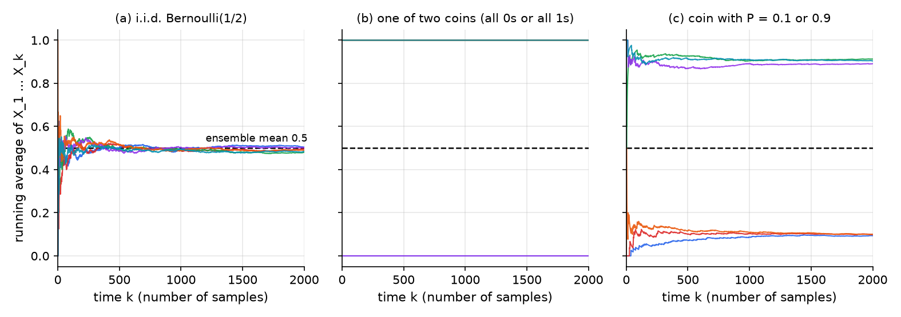
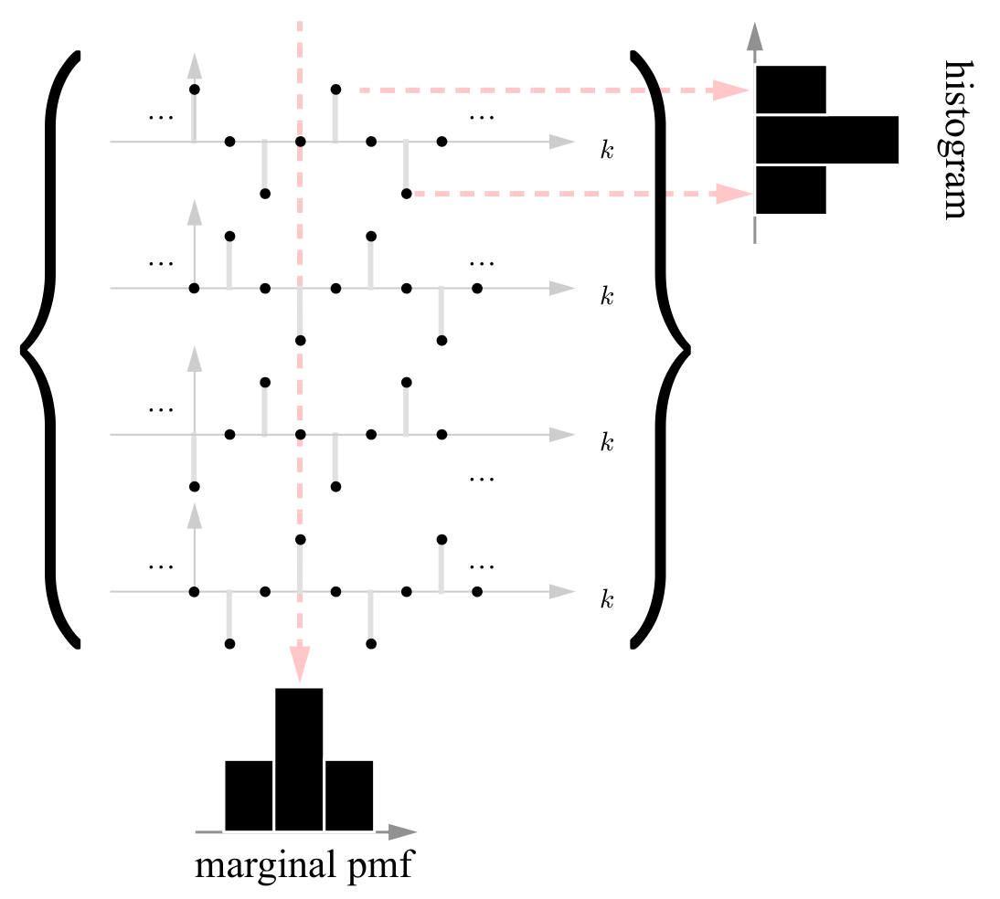
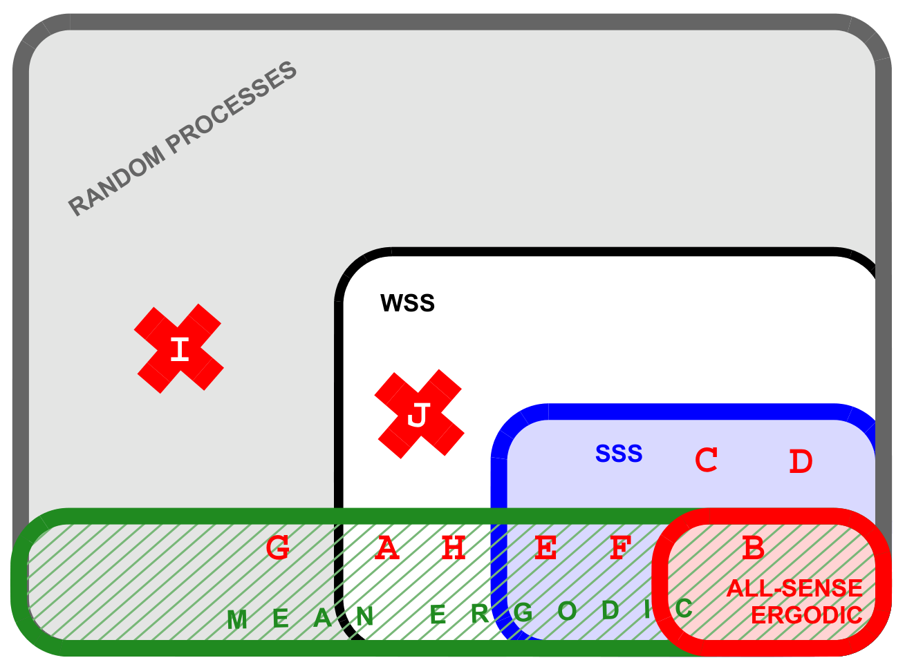
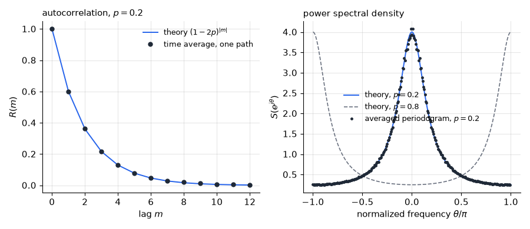
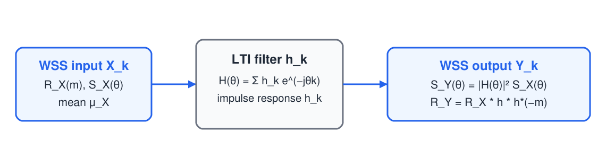

# Random Sequences, Stationarity and Power Spectra

A random sequence \\(\\{X\_k\\}\\) is a discrete-time random process: a family of random variables indexed by integer time. The sequences met so far were specified by a simple rule, such as independent draws or a Markov chain. This chapter treats the general case with three ideas. *Stationarity* asks which statistics survive a shift of the time origin. *Ergodicity* asks when one long realization reveals the ensemble averages. The *power spectral density* asks how the correlation of a stationary sequence is spread across frequency. The chapter ends with the rule for passing a stationary sequence through a linear filter, which links these ideas to linear systems and prepares [optimal linear estimation](estimation.md).

## Random Sequences and Their Two Views

A random sequence is a family \\(\\{X\_k\\}\_{k \in \mathbb{Z}}\\) of random variables on one probability space. Each outcome \\(\omega\\) produces a **realization** (sample path) \\(k \mapsto X\_k(\omega)\\). The set of realizations, with their probabilities, is the **ensemble**. Two viewpoints are useful.

- The **time view** treats the sequence as a list of random variables and asks about their joint distribution across times.
- The **ensemble view** treats it as a collection of sample sequences and asks about averages across realizations at a fixed time, or about averages along one realization over time.

For most processes these two kinds of average differ. They agree only for special processes, and deciding when they do is the subject of ergodicity.

**Example 7.1 (Random delay of a unit step).** Let \\(D \sim \text{Poisson}(1)\\), so \\(P(D = j) = e^{-1}/j!\\), and let \\(X\_k = u\_{k-D}\\) be a unit step delayed by \\(D\\) samples. The realizations are the unit steps that start at \\(k = 0, 1, 2, \dots\\), with probabilities \\(e^{-1}, e^{-1}, e^{-1}/2, e^{-1}/6, \dots\\). The marginal pmf of \\(X\_k\\) is
\\[
P(X\_k = 1) = P(D \le k) = e^{-1}\sum\_{j=0}^{k}\frac{1}{j!},
\\]
so \\(X\_0 \sim \text{Bern}(e^{-1})\\), \\(X\_1 \sim \text{Bern}(2e^{-1})\\), \\(X\_2 \sim \text{Bern}(2.5e^{-1})\\) and \\(X\_3 \sim \text{Bern}(\tfrac{8}{3}e^{-1})\\). The pmf changes with time. The sequence is not i.i.d., because once \\(X\_k = 1\\) every later value is 1. It is Markov, but with time-varying transition probabilities: \\(P(X\_{k+1} = 1 \mid X\_k = 0) = P(D = k+1)/P(D > k)\\) depends on \\(k\\).

## Stationarity

### Strict-sense stationarity

**Definition (Strict-sense stationarity).** The sequence \\(\\{X\_k\\}\\) is **strict-sense stationary** (SSS) if, for every \\(n\\), every set of integer lags \\(0 = m\_0 < m\_1 < \dots < m\_{n-1}\\) and every \\(k\\), the joint pdf (or pmf) of \\((X\_{k+m\_0}, X\_{k+m\_1}, \dots, X\_{k+m\_{n-1}})\\) does not depend on \\(k\\).

In words, sliding the whole comb of sampling instants along the time axis leaves every statistic unchanged. Two special cases carry most of the weight. With \\(n = 1\\), every \\(X\_k\\) has the same marginal, so the mean \\(E(X\_k) = \mu\\) is constant. With \\(n = 2\\), every pair with the same spacing \\(m\\) has the same joint distribution, so \\(E(X\_kX\_{k+m})\\) depends only on \\(m\\).

**Example 7.2 (i.i.d. sequences and Markov chains at balance).** An i.i.d. sequence is SSS, because its joint pmf is a product of identical marginals and shifting the times leaves the product unchanged. A Markov chain is SSS when it starts in a stationary pmf \\(\boldsymbol\pi\\), that is, \\(\boldsymbol\pi\mathbf P = \boldsymbol\pi\\). Then \\(P(X\_k = \pi\_a) = \pi\_a\\) at every time, and for \\(0 \le m\_1 \le m\_2\\),
\\[
P(X\_k = a, X\_{k+m\_1} = b, X\_{k+m\_2} = c) = \pi\_a\\,(\mathbf P^{m\_1})\_{ab}\\,(\mathbf P^{m\_2-m\_1})\_{bc},
\\]
which does not depend on \\(k\\). This holds whether or not the chain is irreducible or aperiodic. The telegraph signal of Example 7.4 is an instance.

### Wide-sense stationarity

**Definition (Wide-sense stationarity).** The sequence is **wide-sense stationary** (WSS) if it has finite second moments, \\(E(X\_k) = \mu\\) for all \\(k\\), and \\(E(X\_kX\_{k+m}) = R(m)\\) depends only on the lag \\(m\\).

The function \\(R\\) is the **autocorrelation**. It is the second-order counterpart of the mean. Because the mean and autocorrelation are functions of the joint distribution, SSS implies WSS whenever second moments exist. The converse fails.

**Example 7.3 (A random-phase cosine: WSS but not SSS).** Let \\(X\_k = \cos(0.1\pi k + \Theta)\\), where \\(\Theta\\) takes the values \\(-\tfrac{\pi}{2}, 0, \tfrac{\pi}{2}, \pi\\) with probability \\(\tfrac14\\) each. The mean is zero, because the four phases are equally spaced by \\(\pi/2\\). Using \\(\cos a \cos b = \tfrac12[\cos(a-b) + \cos(a+b)]\\),
\\[
E(X\_kX\_{k+m}) = \tfrac12\cos(0.1\pi m) + \tfrac12 E\left[\cos(0.2\pi k + 0.1\pi m + 2\Theta)\right] = \tfrac12\cos(0.1\pi m),
\\]
because \\(2\Theta\\) takes the values \\(-\pi, 0, \pi, 2\pi\\), whose cosines average to zero. The process is therefore WSS with \\(R(m) = \tfrac12\cos(0.1\pi m)\\). It is not SSS. The value \\(X\_0 = \cos\Theta\\) equals \\(0\\) with probability \\(\tfrac12\\) and \\(\pm 1\\) with probability \\(\tfrac14\\) each, while \\(X\_1\\) takes four distinct values.

### Gaussian sequences

**Fact.** A WSS Gaussian sequence (every finite collection of samples is jointly Gaussian) is SSS.

*Proof.* The joint pdf of \\((X\_{k+m\_0}, \dots, X\_{k+m\_{n-1}})\\) is determined by its mean vector \\(\mu \mathbf{1}\\) and its covariance matrix, whose \\((i,j)\\) entry is \\(R(m\_j - m\_i) - \mu^2\\). Neither depends on \\(k\\). \\(\blacksquare\\)

Consequently a WSS sequence that is not SSS cannot be Gaussian.

## Autocorrelation

For a real WSS sequence, \\(R(m) = E(X\_kX\_{k+m})\\) has the following properties.

1. \\(R(0) = E(X\_k^2)\\) is the **power** of the sequence.
2. \\(R(-m) = R(m)\\): the autocorrelation is even.
3. \\(\lvert R(m) \rvert \le R(0)\\): the largest magnitude occurs at lag zero. *Proof.* By Cauchy–Schwarz, \\(R(m)^2 = E^2(X\_kX\_{k+m}) \le E(X\_k^2)\\,E(X\_{k+m}^2) = R(0)^2\\).
4. If \\(R(N) = R(0)\\) for some \\(N \ge 1\\), then \\(R\\) is periodic with period \\(N\\). *Proof.* Write \\(R(m) - R(m+N) = E\left(X\_k(X\_{k+m} - X\_{k+m+N})\right)\\). By Cauchy–Schwarz and stationarity,
\\[
\left(R(m) - R(m+N)\right)^2 \le E(X\_k^2)\\,E\left((X\_{k+m} - X\_{k+m+N})^2\right) = R(0)\left(2R(0) - 2R(N)\right) = 0. \quad \blacksquare
\\]
5. The Fourier transform of \\(R\\) is real and nonnegative. This is the basis of the power spectral density below.

Property 4 shows that a periodic correlation never decays. The random-phase cosine of Example 7.3 is the standard case.

### The telegraph signal

**Example 7.4 (Telegraph signal).** Let \\(X\_k \in \\{-1, +1\\}\\) be a Markov chain with transition matrix \\(\mathbf P = \begin{bmatrix} 1-p & p \\\\ p & 1-p\end{bmatrix}\\), started at \\(\boldsymbol\pi = [\tfrac12, \tfrac12]\\). Equivalently, let \\(U\_k\\) be i.i.d. \\(\text{Bern}(p)\\), independent of \\(X\_0\\) (uniform on \\(\\{\pm 1\\}\\)), and set \\(X\_{k+1} = X\_k(-1)^{U\_k}\\). The sign flips at each arrival of the Bernoulli process.

For \\(m > 0\\), the sign flips in the window \\(k, \dots, k+m-1\\) give \\(X\_{k+m} = X\_k(-1)^{N}\\), where \\(N = U\_k + \dots + U\_{k+m-1} \sim \text{Bin}(m, p)\\). The count \\(N\\) is independent of \\(X\_k\\), and \\(X\_k^2 = 1\\), so
\\[
R(m) = E\left((-1)^N\right) = \sum\_{n=0}^{m}\binom{m}{n}(-p)^n(1-p)^{m-n} = (1-2p)^m.
\\]
Hence \\(R(m) = (1-2p)^{\lvert m \rvert}\\) for all \\(m\\). The same result follows from conditioning on the latest sample: \\(E(X\_{k+1} \mid X\_k) = (1-2p)X\_k\\), so \\(R(m+1) = (1-2p)R(m)\\).

The telegraph signal is SSS by Example 7.2, and its correlation depends sharply on \\(p\\). For \\(p = 0.1\\), \\(R(m) = 0.8^{\lvert m \rvert}\\), and the sign rarely changes. For \\(p = 0.5\\), \\(R(m) = \delta\_m\\): the samples are uncorrelated. For \\(p = 0.9\\), \\(R(m) = (-0.8)^{\lvert m \rvert}\\), and the sign alternates almost every step.

**Example 7.5 (A three-state symmetric chain).** Let \\(X\_k \in \\{-1, 0, 1\\}\\) be a Markov chain with
\\[
\mathbf P = \frac13\begin{bmatrix} 2 & 1 & 0 \\\\ 1 & 1 & 1 \\\\ 0 & 1 & 2\end{bmatrix},
\\]
started in its stationary pmf. The chain is irreducible and aperiodic. Since \\(\mathbf P\\) is doubly stochastic, \\(\boldsymbol\pi = [\tfrac13, \tfrac13, \tfrac13]\\), so the sequence is SSS and in particular WSS with \\(\mu = 0\\).

The one-step conditional mean is linear: \\(E(X\_{k+1} \mid X\_k = x) = g(x)\\) with \\(g(-1) = -\tfrac23\\), \\(g(0) = 0\\), \\(g(1) = \tfrac23\\), that is, \\(g(x) = \tfrac23 x\\). By the Markov property, \\(E(X\_{k+m+1} \mid X\_k, \dots, X\_{k+m}) = \tfrac23 X\_{k+m}\\), so
\\[
R(m+1) = E\left(X\_k\\,E(X\_{k+m+1} \mid X\_k, \dots, X\_{k+m})\right) = \tfrac23 R(m).
\\]
With \\(R(0) = E(X\_k^2) = \tfrac23\\),
\\[
\boxed{R(m) = \tfrac23\left(\tfrac23\right)^{\lvert m \rvert}}.
\\]

## Ergodicity

### Ensemble and time averages

The ensemble average \\(E(X\_k)\\) is generally a function of \\(k\\). The **time average** of one realization is
\\[
\langle X\_k \rangle = \lim\_{N \to \infty}\frac{1}{2N+1}\sum\_{k=-N}^{N} X\_k,
\\]
which is generally a random variable, because it depends on the realization. The time-averaged product \\(\langle X\_kX\_{k+m} \rangle\\) is defined in the same way.

**Definition (Ergodicity).** A WSS sequence is

- **ergodic in the mean** if \\(\langle X\_k \rangle = \mu\\) with probability one;
- **ergodic in the autocorrelation** if \\(\langle X\_kX\_{k+m} \rangle = R(m)\\) with probability one, for every \\(m\\);
- **ergodic in every sense** (or simply *ergodic*) if, for every function \\(f\\) of finitely many samples, the time average of \\(f(X\_k, X\_{k+m\_1}, \dots)\\) equals the ensemble expectation \\(E f(X\_k, X\_{k+m\_1}, \dots)\\) with probability one.

The slogan is "seen one, seen 'em all": a single realization carries the statistics of the whole ensemble, so ensemble averages can be estimated from one long record.

**Fact.** A sequence that is ergodic in every sense is SSS. Ergodicity in the mean alone does not imply SSS.

*Proof sketch.* Fix \\(f\\) and the lags. Shifting the starting index of the time average does not change its limit, so the time average of \\(f(X\_k, X\_{k+m\_1}, \dots)\\) is the same random variable for every \\(k\\). Ergodicity identifies it with the ensemble expectation \\(E f(X\_k, X\_{k+m\_1}, \dots)\\). The left side does not depend on \\(k\\), so neither does the right side, for every \\(f\\) and every set of lags. That is the definition of SSS. \\(\blacksquare\\)

**Example 7.6 (Two coins in a box).** A box holds two coins: one is labelled 0 on both faces, the other 1 on both faces. A coin is drawn at random, and \\(X\_k\\) is its outcome on toss \\(k\\). Every realization is the constant sequence \\(\dots, c, c, c, \dots\\), with \\(c \in \\{0, 1\\}\\) equally likely. The sequence is SSS, since the distribution of the constant sequence is unchanged by shifts, and \\(E(X\_k) = \tfrac12\\). But \\(\langle X\_k \rangle = c\\) is 0 or 1 with equal probability. The time average is random, so the sequence is SSS and not ergodic.

**Example 7.7 (A mixture of biased coins).** Choose one of two coins, with \\(P(\text{heads}) = 0.1\\) or \\(0.9\\), each with probability \\(\tfrac12\\), and toss the chosen coin repeatedly. Given \\(P\\), the tosses are i.i.d. \\(\text{Bern}(P)\\). The unconditional process is SSS, being a mixture of i.i.d. sequences over a parameter that does not change with time. Its moments are
\\[
\mu = E(P) = 0.5, \qquad R(m) = E\left(P^2 + P(1-P)\\,\delta\_m\right) = 0.41 + 0.09\\,\delta\_m.
\\]
The correlation never dies out, which is the signature of non-ergodicity. Indeed \\(\langle X\_k \rangle = P\\) is 0.1 or 0.9 and never the ensemble mean 0.5.



*Figure: running averages of six realizations of three processes, against the ensemble mean 0.5 (dashed). (a) i.i.d. Bernoulli(1/2): every path settles at 0.5, so the process is ergodic in the mean. (b) Two coins: each path is constant at 0 or 1 (Example 7.6). (c) Biased coins: each path settles at its own \\(P\\), 0.1 or 0.9 (Example 7.7).*

### Mean ergodicity

Averages of independent samples settle down, and the same idea applies to a WSS sequence once its correlation fades. Write \\(C(m) = R(m) - \mu^2\\) for the autocovariance.

**Theorem 7.1 (Mean ergodicity).** Let \\(\\{X\_k\\}\\) be WSS with mean \\(\mu\\), and let \\(\bar X\_N = \frac{1}{2N+1}\sum\_{k=-N}^{N}X\_k\\). With \\(M = 2N+1\\),
\\[
E\left[(\bar X\_N - \mu)^2\right] = \frac{1}{M}\sum\_{\lvert m \rvert < M}\left(1 - \frac{\lvert m \rvert}{M}\right)C(m).
\\]
If \\(\sum\_m \lvert C(m) \rvert < \infty\\), then \\(\bar X\_N \to \mu\\) in mean square, so the sequence is mean ergodic. More sharply, mean ergodicity holds if and only if the lag average of the autocovariance vanishes, \\(\frac{1}{N}\sum\_{m=0}^{N-1}C(m) \to 0\\), equivalently \\(\frac{1}{N}\sum\_{m=0}^{N-1}R(m) \to \mu^2\\).

*Proof.* The number of pairs \\((k, l)\\) in \\(\\{-N, \dots, N\\}^2\\) with \\(k - l = m\\) is \\(M - \lvert m \rvert\\). Hence
\\[
E\left[(\bar X\_N - \mu)^2\right] = \frac{1}{M^2}\sum\_{k,l}C(k-l) = \frac{1}{M^2}\sum\_{\lvert m \rvert < M}(M - \lvert m \rvert)C(m),
\\]
which is the identity. For the sufficient condition, \\(\left\lvert E[(\bar X\_N - \mu)^2]\right\rvert \le \frac{1}{M}\sum\_m \lvert C(m) \rvert \to 0\\). The sharp Cesàro criterion is a standard refinement of the same identity, and it is the form used for the examples below. \\(\blacksquare\\)

Two consequences are immediate. Uncorrelated samples with constant variance have \\(C(m) = \sigma^2\delta\_m\\), which is summable, so they are mean ergodic. This is the weak law of large numbers for i.i.d. sequences, which the [limit theorems](limit-theorems.md) chapter treats in detail. More generally, if \\(C(m) \to 0\\), so that distant samples decorrelate, the sequence is mean ergodic. Property 5 of the autocorrelation is this case.

**Example 7.8 (Mean ergodic without a limit of correlation).** Let \\(X\_k = \cos(0.1\pi k + \Theta)\\) with \\(\Theta\\) uniform on \\([0, 2\pi)\\). Then \\(E(X\_k) = 0\\) and \\(R(m) = \tfrac12\cos(0.1\pi m)\\), as in Example 7.3. The autocorrelation is periodic, so it does not converge, and \\(C\\) is not summable. Nevertheless the partial sums are bounded:
\\[
\left\lvert \sum\_{m=0}^{N-1}\cos(0.1\pi m)\right\rvert \le \frac{1}{\lvert \sin(0.05\pi)\rvert} \approx 6.4,
\\]
so the lag average of \\(R\\) tends to \\(0 = \mu^2\\). The sequence is mean ergodic. It is not ergodic in every sense. Fix the level \\(x = 0.99\\). The ensemble probability is \\(P(X\_k > 0.99) = \arccos(0.99)/\pi \approx 0.045\\). For a fixed \\(\theta\\), the samples repeat with period 20, and the arc where \\(\cos\\) exceeds 0.99 has width \\(2\arccos(0.99) \approx 0.283\\), which is narrower than the spacing \\(\pi/10 \approx 0.314\\) of the phases. So at most one sample per period exceeds 0.99, and the time fraction of such samples is either 0 or \\(\tfrac{1}{20}\\), depending on \\(\theta\\). It is random and never equals the ensemble probability.

**Example 7.9 (A random amplitude sinusoid).** Let \\(X\_k = A\cos k - B\sin k\\), where \\(A\\) and \\(B\\) are i.i.d. with \\(P(A = q) = q\\) and \\(P(A = -1) = 1 - q\\) for some \\(q \in [0, 1]\\).

(a) \\(E(X\_k) = \mu(\cos k - \sin k)\\) with \\(\mu = E(A) = q^2 + q - 1\\). The sequence is WSS only if \\(\mu = 0\\), that is, \\(q = (\sqrt5 - 1)/2 \approx 0.618\\), the inverse golden ratio.

(b) With \\(\mu = 0\\), \\(E(A^2) = q^3 - q + 1 = q\\) (using \\(q^2 = 1 - q\\)), and \\(E(X\_kX\_{k+m}) = q\\,(\cos k\cos(k+m) + \sin k\sin(k+m)) = q\cos m\\). So \\(R(m) = q\cos m\\).

(c) The process is mean ergodic: \\(\langle X\_k \rangle = A\langle\cos k\rangle - B\langle\sin k\rangle = 0 = \mu\\).

(d) It is not ergodic in the second moment. The time average is \\(\langle X\_k^2 \rangle = \tfrac12(A^2 + B^2)\\), which is random, while \\(E(X\_k^2) = q\\).

(e) It is not SSS, since \\(X\_0 = A\\) takes two values while \\(X\_1\\) takes four.

The example shows that ergodicity is a property with several parts, and that a process can satisfy one part and fail another.

**Example 7.10 (A warm-up with a random gain).** Let \\(X\_k\\) be i.i.d. uniform on \\(\\{\pm 1\\}\\), let \\(A\\) be uniform on \\(\\{1, 2\\}\\) and independent of the \\(X\_k\\), and let \\(Y\_k = AX\_k\\). The sequence is SSS, since given \\(A\\) it is i.i.d. and the mixture does not depend on time. It is WSS with \\(R(m) = E(A^2)\\,\delta\_m = 2.5\\,\delta\_m\\). It is mean ergodic, since \\(\langle Y\_k \rangle = A\langle X\_k \rangle = 0\\). It is not ergodic in power: \\(\langle Y\_k^2 \rangle = A^2\\) is 1 or 4, while \\(E(Y\_k^2) = 2.5\\).



*Figure: four realizations of a ternary sequence. The marginal pmf at one fixed time (the vertical slice, bottom) equals the histogram of the values taken along one realization (dashed arrows, right). When this match holds for all statistics, the process is ergodic in every sense.*

## Classes of Random Sequences

The classes nest. Random sequences contain the WSS sequences, which contain the SSS sequences, which contain the sequences that are ergodic in every sense. Mean ergodicity is a separate property that cuts across these classes, as the Venn diagram shows.



*Figure: the classes of random sequences. WSS contains SSS, which contains the processes ergodic in every sense (red). The green band marks mean ergodicity, which cuts across all the classes. The letters refer to the example processes in the table below.*

The table places the example processes in the diagram.

| Label | Sequence | WSS | SSS | Mean ergodic | Ergodic in every sense |
|---|---|---|---|---|---|
| A | \\(\cos(0.1\pi k + \Theta)\\), \\(\Theta\\) uniform on four phases | yes | no | yes | no |
| B | i.i.d. \\(\text{Bern}(p)\\) | yes | yes | yes | yes |
| C | i.i.d. \\(\text{Bern}(P)\\), \\(P \in \\{0.1, 0.9\\}\\) | yes | yes | no | no |
| D | constant \\(A \in \\{0, 1\\}\\) | yes | yes | no | no |
| E | \\(\cos(0.1\pi k + \Theta)\\), \\(\Theta\\) uniform on \\([0, 2\pi)\\) | yes | yes | yes | no |
| F | \\(U\cos(0.1\pi k) - V\sin(0.1\pi k)\\), \\(U, V\\) i.i.d. \\(\mathcal{N}(0, \sigma^2)\\) | yes | yes | yes | no |
| G | \\(X\_k = U\_{\lfloor k/2 \rfloor}\\), \\(U\_i\\) i.i.d. uniform on \\(\\{\pm 1\\}\\) | no | no | yes | no |
| H | \\(\mathcal{N}(0,1)\\) for even \\(k\\), uniform on \\(\\{\pm 1\\}\\) for odd \\(k\\), independent | yes | no | yes | no |
| I | \\(X\_0 = W \sim \text{Exp}(1)\\), \\(X\_k = 0\\) for \\(k \ne 0\\) | no | no | no | no |
| J | \\(Y\_k = B + V\_k\\), \\(V\_k\\) as in H, \\(B\\) uniform on \\(\\{\pm 1\\}\\) | yes | no | no | no |

Three entries carry lessons. G is mean ergodic but not WSS: its mean is zero, yet its correlation depends on the parity of \\(k\\). E is ergodic in the mean and autocorrelation but not in every sense, as in Example 7.8. J is WSS with a nonzero random mean, so it is not mean ergodic, although its correlation is simple.

## Power Spectral Density

### Deterministic background

For a deterministic finite-energy sequence \\(x\_k\\), with transform \\(X(e^{j\theta}) = \sum\_k x\_k e^{-jk\theta}\\), Parseval's relation says that \\(\sum\_k \lvert x\_k \rvert^2 = \frac{1}{2\pi}\int\_{-\pi}^{\pi}\lvert X(e^{j\theta}) \rvert^2 d\theta\\). The **energy spectral density** \\(\lvert X(e^{j\theta}) \rvert^2\\) is therefore the energy per unit frequency, and its inverse transform is the autocorrelation \\(\sum\_k x\_k x\_{k+m}\\).

A sequence with infinite energy but finite average power, \\(P = \lim\_{N \to \infty}\frac{1}{2N+1}\sum\_{k=-N}^{N}\lvert x\_k\rvert^2\\), has the analogous density \\(\lim\_{N \to \infty}\frac{1}{2N+1}\lvert X\_N(e^{j\theta})\rvert^2\\), where \\(X\_N\\) is the transform of the sequence truncated to \\(\lvert k\rvert \le N\\). The random case replaces the modulus square by its expectation.

### The Wiener–Khinchin theorem

**Definition (Power spectral density).** The **power spectral density** (PSD) of a WSS sequence with autocorrelation \\(R\\) is
\\[
S\_X(e^{j\theta}) = \sum\_{m=-\infty}^{\infty}R(m)\\,e^{-jm\theta}.
\\]
When \\(\mu \ne 0\\) the sum is understood in the sense of distributions and contains the impulse \\(2\pi\mu^2\delta(\theta)\\), as explained below.

**Theorem 7.2 (Wiener–Khinchin).** For a WSS sequence,
\\[
S\_X(e^{j\theta}) = \lim\_{N \to \infty}\frac{1}{2N+1}E\left\lvert X\_N(e^{j\theta})\right\rvert^2, \qquad X\_N(e^{j\theta}) = \sum\_{k=-N}^{N}X\_ke^{-jk\theta}.
\\]
That is, the PSD is the limit of the expected periodogram, and it is the Fourier transform of \\(R\\).

*Proof sketch.* Expanding the modulus square and using stationarity, \\(E\lvert X\_N\rvert^2 = \sum\_{k,n}R(k-n)e^{-j(k-n)\theta}\\). Collecting the pairs with \\(k - n = m\\),
\\[
\frac{1}{2N+1}E\left\lvert X\_N(e^{j\theta})\right\rvert^2 = \sum\_{\lvert m \rvert \le 2N}\left(1 - \frac{\lvert m\rvert}{2N+1}\right)R(m)\\,e^{-jm\theta}.
\\]
The triangular weights are the transform of the Fejér kernel \\(\frac{1}{2\pi(2N+1)}\left(\frac{\sin((2N+1)\theta/2)}{\sin(\theta/2)}\right)^2\\), which has unit area and becomes a delta function as \\(N\\) grows. The expected periodogram is therefore the PSD smoothed by an approximate identity, and the limit is \\(S\_X\\). \\(\blacksquare\\)

Inverting the transform gives \\(R(m) = \frac{1}{2\pi}\int\_{-\pi}^{\pi}S\_X(e^{j\theta})e^{jm\theta}d\theta\\). In particular, the power is
\\[
E(X\_k^2) = R(0) = \frac{1}{2\pi}\int\_{-\pi}^{\pi}S\_X(e^{j\theta})\\,d\theta,
\\]
so \\(S\_X\\) is the power per unit frequency. The power in a band \\([\theta\_1, \theta\_2]\\) is \\(\frac{1}{2\pi}\\) times the area under \\(S\_X\\) over the band and its mirror image \\([-\theta\_2, -\theta\_1]\\).

### Properties of the PSD

For a real WSS sequence, the PSD has the following properties.

1. \\(S\_X\\) is the DTFT of \\(R\\), and \\(R\\) is recovered from \\(S\_X\\) by inversion.
2. The power is \\(R(0) = \frac{1}{2\pi}\int S\_X\\,d\theta\\).
3. \\(S\_X\\) is real and nonnegative. Nonnegativity follows from the expected periodogram in Theorem 7.2.
4. Because \\(R\\) is even, \\(S\_X(e^{-j\theta}) = S\_X(e^{j\theta})\\): the PSD is even.
5. If \\(\mu \ne 0\\), then \\(S\_X\\) contains the impulse \\(2\pi\mu^2\delta(\theta)\\) at zero frequency. This follows from \\(R(m) = (R(m) - \mu^2) + \mu^2\\), since a constant has transform \\(2\pi\delta(\theta)\\). The converse fails in general (Example 7.18), but for a mean-ergodic sequence an impulse at zero frequency can come only from a nonzero mean.
6. If \\(Y\_k = \sum\_i h\_i X\_{k-i}\\), then \\(S\_Y = \lvert H \rvert^2 S\_X\\), as shown in the filtering section below.

### Valid autocorrelations

Not every sequence can be an autocorrelation. The PSD gives the test.

**Theorem 7.3 (Valid autocorrelations).** A real, even, absolutely summable sequence \\(R\\) is the autocorrelation of some WSS sequence if and only if its transform \\(\sum\_m R(m)e^{-jm\theta}\\) is nonnegative for all \\(\theta\\).

*Proof.* If \\(R\\) comes from a WSS sequence, then its transform is nonnegative by Theorem 7.2. Conversely, suppose the transform \\(S\\) is nonnegative. For any finite vector \\(v\\),
\\[
\sum\_{k,l}v\_kv\_lR(k-l) = \frac{1}{2\pi}\int\_{-\pi}^{\pi}S(\theta)\left\lvert\sum\_k v\_ke^{-jk\theta}\right\rvert^2d\theta \ge 0,
\\]
so every covariance matrix built from \\(R\\) is nonnegative definite. A Gaussian sequence with autocorrelation \\(R\\) therefore exists. \\(\blacksquare\\)

**Example 7.11 (Invalid autocorrelations).** Suppose a WSS sequence has \\(R(0) = 3\\) and \\(R(\pm 1) = 2\\). Its transform is \\(3 + 4\cos\theta\\), which equals \\(-1\\) at \\(\theta = \pi\\). So no such sequence exists, although \\(\lvert R(1)\rvert \le R(0)\\) holds. In time, the failure is visible: for \\(n\\) alternating terms, \\(\operatorname{var}\left(\sum\_{i=0}^{n-1}(-1)^iX\_i\right) = 3n - 4(n-1) = 4 - n\\), which is negative for \\(n = 5\\). Similarly, if \\(R(m) = 0\\) for \\(\lvert m\rvert > 1\\), then \\(S = R(0) + 2R(1)\cos\theta \ge 0\\) requires \\(\lvert R(1)\rvert \le R(0)/2\\).

**Example 7.12 (Two filters with one spectrum).** Let \\(X\_k\\) be i.i.d. uniform on \\(\\{\pm 1\\}\\), and let \\(Y\_k = h\_0X\_k + h\_1X\_{k-1}\\). Then \\(R\_Y(0) = h\_0^2 + h\_1^2\\) and \\(R\_Y(\pm 1) = h\_0h\_1\\), and \\(R\_Y(m) = 0\\) otherwise. Requiring \\(R\_Y(0) = 25\\) and \\(R\_Y(\pm 1) = 12\\) gives the circle \\(h\_0^2 + h\_1^2 = 25\\) and the hyperbola \\(h\_0h\_1 = 12\\). Substituting, \\(h\_0^4 - 25h\_0^2 + 144 = 0\\), so \\(h\_0^2 \in \\{9, 16\\}\\). The four solutions are \\((h\_0, h\_1) \in \\{(3,4), (4,3), (-3,-4), (-4,-3)\\}\\). They all give the PSD \\(25 + 24\cos\theta\\). The PSD does not determine the filter. Among the solutions, \\((4,3)\\) has its zero inside the unit circle (minimum phase) and \\((3,4)\\) has it outside (maximum phase). Choosing the minimum-phase factor is the subject of [spectral factorization](estimation.md).

**Example 7.13 (A WSS sequence from a nonlinear map).** Let \\(U\_k\\) be i.i.d. \\(\mathcal{N}(0,1)\\) and \\(X\_k = -2 + (U\_k + U\_{k-1})^2\\). Then \\(E(X\_k) = -2 + 2 = 0\\). Samples two or more apart depend on disjoint noises and are independent, so \\(R(m) = 0\\) for \\(\lvert m\rvert \ge 2\\). With \\(W\_k = U\_k + U\_{k-1} \sim \mathcal{N}(0,2)\\), \\(E(W^4) = 12\\) gives \\(R(0) = E(W^4) - 4E(W^2) + 4 = 8\\). Expanding the product of two such quadratics (the odd-moment terms vanish) gives \\(E(W\_k^2 W\_{k+1}^2) = 6\\) and hence \\(R(1) = 6 - 4 - 4 + 4 = 2\\). So \\(R = 8\delta\_m + 2\delta\_{m\pm1}\\) and \\(S\_X = 8 + 4\cos\theta\\). The process is WSS even though it is a nonlinear function of Gaussian noise.

**Example 7.14 (A nonlinear function of Bernoulli pairs).** Let \\(U\_k\\) be i.i.d. Bernoulli\\((0.5)\\) and \\(X\_k = (8U\_k - 3U\_{k-1} - 3)/(1 + U\_{k-1})\\). The pair \\((U\_k, U\_{k-1})\\) gives the values \\(-3, -3, 5, 1\\) with probabilities \\(\tfrac14\\) each, so the marginal pmf is \\(P(-3) = \tfrac12\\), \\(P(1) = P(5) = \tfrac14\\). The mean is \\(-\tfrac32 + \tfrac14 + \tfrac54 = 0\\), and \\(R(0) = 9(\tfrac12) + \tfrac14 + 25(\tfrac14) = 11\\). Conditioning on \\(U\_k\\) shows \\(E(X\_kX\_{k+1}) = -3\\), and samples two or more apart are independent. So \\(R = -3\delta\_{m\pm1} + 11\delta\_m\\), and \\(S\_X = 11 - 6\cos\theta\\), which lies between 5 and 17.

**Example 7.15 (A comb spectrum).** Let \\(U\_k\\) be i.i.d. uniform on \\((-1, 1)\\), so \\(R\_U(m) = \tfrac13\delta\_m\\), and let \\(X\_k = U\_k + U\_{k-4}\\). Then \\(R\_X(m) = \tfrac23\delta\_m + \tfrac13(\delta\_{m-4} + \delta\_{m+4})\\), so
\\[
S\_X(e^{j\theta}) = \tfrac23 + \tfrac23\cos(4\theta).
\\]
The spectrum oscillates between 0 and \\(\tfrac43\\), with four peaks over \\([-\pi, \pi]\\), as the filter \\(\lvert 1 + e^{-4j\theta}\rvert^2\\) predicts.

### Examples of spectra

**Example 7.16 (PSD of the telegraph signal).** From Example 7.4, \\(R(m) = a^{\lvert m\rvert}\\) with \\(a = 1 - 2p\\), and
\\[
S\_X(e^{j\theta}) = \sum\_m a^{\lvert m\rvert}e^{-jm\theta} = \frac{1 - a^2}{\lvert 1 - ae^{-j\theta}\rvert^2} = \frac{4p(1-p)}{\lvert 1 - (1-2p)e^{-j\theta}\rvert^2}.
\\]
The identity follows from summing the two geometric series and subtracting the double-counted lag zero. For \\(p = 0.2\\) the spectrum is lowpass, with peak \\(4\\) at \\(\theta = 0\\). For \\(p = 0.5\\) it is flat at 1, so the sequence is white. For \\(p = 0.8\\) it is highpass, with peak 4 at \\(\theta = \pm\pi\\). In every case \\(\frac{1}{2\pi}\int S\_X\\,d\theta = R(0) = 1\\), so the total power is the same and only its distribution over frequency changes. Frequent sign flips place the power at high frequencies.



*Figure: left, the autocorrelation \\((1-2p)^{\lvert m\rvert}\\) for \\(p = 0.2\\) (line) and the lag averages of one simulated path (dots). Right, the PSD of the telegraph signal for \\(p = 0.2\\) and \\(p = 0.8\\) (lines) and an averaged periodogram estimate for \\(p = 0.2\\) (dots). The estimate follows the theory, which is the Wiener–Khinchin theorem at work.*

The averaged periodogram can be computed directly from simulated data:

```matlab
p = 0.2;
N = 1e3;
trials = 1e4;
X = (-1).^cumsum(rand(N,trials) < p);   % telegraph paths, one per column
S = mean(abs(fft(X)).^2, 2)/N;          % averaged periodogram
plot(fftshift(S));
```

The equivalent Python computation is `X = (-1.0)**np.cumsum(rng.random((N, trials)) < p, axis=0)` followed by `S = np.mean(np.abs(np.fft.fft(X, axis=0))**2, axis=1)/N`.

**Example 7.17 (Same spectrum, different paths).** Let \\(Y\_k = \sum\_{i \ge 0}\alpha^iV\_{k-i}\\), with \\(V\_k\\) i.i.d. uniform on \\(\\{\pm\beta\\}\\). Then \\(R\_Y(m) = \beta^2\alpha^{\lvert m\rvert}/(1-\alpha^2)\\). Choosing \\(\alpha = 0.8\\) and \\(\beta^2 = 1 - \alpha^2 = 0.36\\) gives \\(R\_Y(m) = 0.8^{\lvert m \rvert}\\), exactly the autocorrelation of the telegraph signal with \\(p = 0.1\\). The two processes share a PSD, yet one is an AR(1) sequence of many distinct values and the other a \\(\pm 1\\) sign sequence. The PSD is a second-order description and says nothing about the shape of the paths.

**Example 7.18 (White sequences).** A WSS sequence is **white** if its PSD is constant, equivalently \\(R(m) = \sigma^2\delta\_m\\). Both i.i.d. uniform \\(\pm 1\\) and i.i.d. \\(\mathcal{N}(0,1)\\) sequences are white, with the same flat PSD. An uncorrelated sequence is not necessarily white: nonzero means or time-varying variances spoil the form \\(\sigma^2\delta\_m\\). White sequences are mean ergodic, since \\(C(m) = \sigma^2\delta\_m\\) is summable.

Property 5 is a one-way street. Let \\(X\_k = S + N\_k\\), where \\(S\\) is uniform on \\(\\{\pm 1\\}\\) and \\(N\_k\\) is i.i.d. \\(\mathcal{N}(0,1)\\), independent of \\(S\\). Then \\(E(X\_k) = 0\\), but \\(R(m) = E(S^2) + \delta\_m = 1 + \delta\_m\\), so \\(S\_X = 1 + 2\pi\delta(\theta)\\). The impulse at zero frequency appears although the mean is zero. The sequence is not mean ergodic, because \\(R(m)\\) tends to 1 rather than to \\(\mu^2 = 0\\).

**Example 7.19 (Modulation).** Three operations change the spectrum in simple ways.

- *Differencing.* Let \\(X\_k\\) be the telegraph signal and \\(V\_k = X\_kU\_k = \tfrac12(X\_k - X\_{k+1})\\), a sequence of alternating-sign arrivals. Then \\(S\_V(e^{j\theta}) = \tfrac14\lvert 1 - e^{-j\theta}\rvert^2 S\_X(e^{j\theta})\\), which vanishes at \\(\theta = 0\\).
- *Alternating sign.* For \\(Z\_k = (-1)^kX\_k\\), \\(S\_Z(e^{j\theta}) = S\_X(e^{j(\theta-\pi)})\\). The spectrum moves by \\(\pi\\); for the telegraph signal this exchanges the roles of \\(p\\) and \\(1-p\\).
- *Random-phase carrier.* Let \\(Y\_k = \cos(\varphi k + \Theta)X\_k\\) with \\(\Theta\\) uniform and independent of \\(X\\). Then \\(R\_Y(m) = \tfrac12\cos(\varphi m)R\_X(m)\\) and \\(S\_Y(e^{j\theta}) = \tfrac14[S\_X(e^{j(\theta-\varphi)}) + S\_X(e^{j(\theta+\varphi)})]\\). With a fixed phase instead, \\(E(Y\_kY\_{k+m})\\) depends on \\(k\\) and \\(Y\\) is not WSS.

The factor \\(\tfrac14\\) in the last result is consistent with the power: \\(R\_Y(0) = \tfrac12R\_X(0)\\), and the spectrum integrates to half the power of \\(X\\).

## Filtering a Stationary Sequence

Passing a WSS sequence through a stable linear filter yields another WSS sequence, and the spectrum is multiplied by the squared magnitude of the frequency response.

**Theorem 7.4 (Filtering).** Let \\(Y\_k = \sum\_i h\_iX\_{k-i}\\) with \\(\sum\_i \lvert h\_i\rvert < \infty\\), and let \\(H(e^{j\theta}) = \sum\_i h\_ie^{-ji\theta}\\). If \\(X\\) is WSS, then so is \\(Y\\), with
\\[
\mu\_Y = H(e^{j0})\\,\mu\_X, \qquad R\_Y(m) = \sum\_{i,j}h\_ih\_jR\_X(m + i - j), \qquad S\_Y(e^{j\theta}) = \lvert H(e^{j\theta})\rvert^2S\_X(e^{j\theta}).
\\]

*Proof.* Taking expectations of the product and using stationarity of \\(X\\) gives \\(E(Y\_kY\_{k+m}) = \sum\_{i,j}h\_ih\_jR\_X(m+i-j)\\), which is independent of \\(k\\). Transforming term by term, \\(\sum\_m R\_X(m+i-j)e^{-jm\theta} = e^{j(i-j)\theta}S\_X(e^{j\theta})\\), so
\\[
S\_Y = \sum\_{i,j}h\_ih\_je^{j(i-j)\theta}S\_X = \Big(\sum\_i h\_ie^{ji\theta}\Big)\Big(\sum\_j h\_je^{-jj\theta}\Big)S\_X = \lvert H\rvert^2S\_X,
\\]
since the filter is real. The mean follows from linearity. \\(\blacksquare\\)

In words, \\(R\_Y = R\_X \* h \* \tilde h\\) with \\(\tilde h\_m = h\_{-m}\\): the autocorrelation is filtered twice, once by \\(h\\) and once by its time reverse. The spectrum sees only \\(\lvert H\rvert^2\\).



*Figure: a WSS input passes through a stable LTI filter. The mean is scaled by \\(H(e^{j0})\\), the autocorrelation is filtered by \\(h\\) and its time reverse, and the spectrum is multiplied by \\(\lvert H\rvert^2\\).*

**Example 7.20 (A two-tap filter).** Let \\(X\_k\\) be i.i.d. uniform on \\(\\{\pm 1\\}\\) and \\(Y\_k = 2X\_k + X\_{k-1}\\). The autocorrelation of \\(X\\) is \\(\delta\_m\\), so \\(R\_Y(m) = 4\delta\_m + 2\delta\_{m-1} + 2\delta\_{m+1} + \delta\_m = 5\delta\_m + 2\delta\_{m\pm1}\\). Then
\\[
S\_Y(e^{j\theta}) = 5 + 4\cos\theta = \lvert 2 + e^{-j\theta}\rvert^2,
\\]
which agrees with the frequency-domain route. The output is WSS with mean zero. It is also mean ergodic, since \\(\langle Y\_k\rangle = 2\langle X\_k\rangle + \langle X\_{k-1}\rangle = 0\\). The same filter applied to a sequence with a nonzero mean scales that mean by \\(H(e^{j0}) = 3\\).

## Summary

- **Stationarity.** SSS means every joint distribution is shift-invariant; SSS implies WSS. A Markov chain started at a stationary pmf is SSS. A WSS Gaussian sequence is SSS. A WSS sequence need not be SSS (Example 7.3).
- **Autocorrelation.** \\(R(0)\\) is the power, \\(R\\) is even, \\(\lvert R(m)\rvert \le R(0)\\), and \\(R(N) = R(0)\\) forces periodicity. The telegraph signal has \\(R(m) = (1-2p)^{\lvert m\rvert}\\).
- **Ergodicity.** The time average of a mean-ergodic sequence equals \\(\mu\\). Summable autocovariance is sufficient, and the Cesàro condition on the lag average is sharp. A sequence ergodic in every sense is SSS. Each part of ergodicity can fail separately.
- **PSD.** \\(S\_X(e^{j\theta}) = \sum\_m R(m)e^{-jm\theta} = \lim\_N \frac{1}{2N+1}E\lvert X\_N(e^{j\theta})\rvert^2\\). It is real, nonnegative and even, with \\(R(0) = \frac{1}{2\pi}\int S\_X\\,d\theta\\). An impulse at zero frequency signals a nonzero mean. A real even summable sequence is a valid autocorrelation exactly when its transform is nonnegative.
- **Filtering.** For \\(Y\_k = \sum\_i h\_iX\_{k-i}\\), \\(\mu\_Y = H(e^{j0})\mu\_X\\) and \\(S\_Y = \lvert H\rvert^2S\_X\\).

## See Also

- [Pairs and Vectors of Random Variables](random-vectors.md): covariance matrices become autocorrelation functions, and the Cholesky factorization reappears in prediction.
- [Iterated Expectation and Limit Theorems](limit-theorems.md): the law of large numbers as mean ergodicity for i.i.d. sequences, and the Cauchy sequence that fails it.
- [Bernoulli and Poisson Processes](bernoulli-poisson.md): i.i.d. arrival processes that generate the telegraph signal.
- [Markov Chains](markov-chains.md): stationary pmfs, the balance equation and the classification used in Example 7.2.
- [Optimal Linear Estimation](estimation.md): Wiener filtering and prediction use the PSD and the cross-spectrum defined here.
- [Continuous-Time Random Processes](continuous-time.md): the continuous-time versions of stationarity, ergodicity and the PSD.
- Convolution and Fourier Transform: the deterministic background for the filtering theorem and the DTFT.
