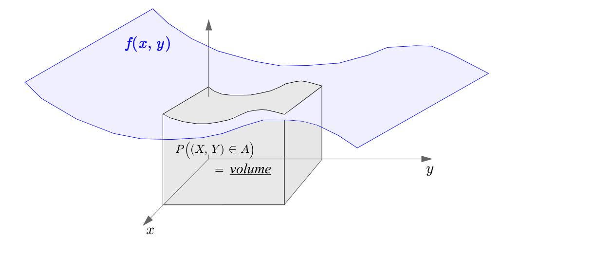
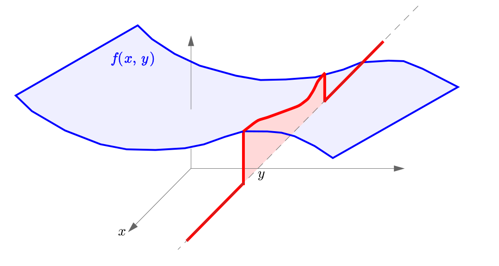
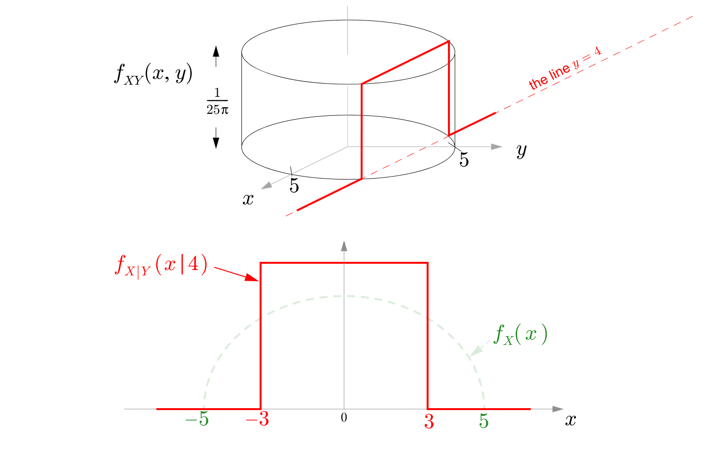
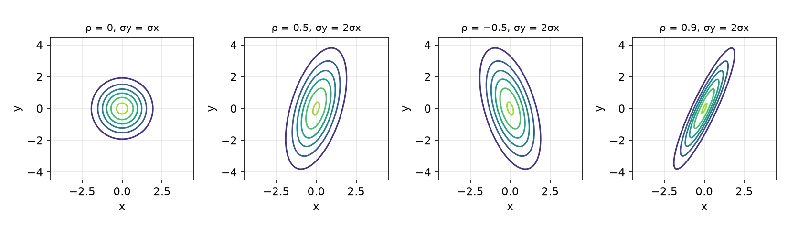
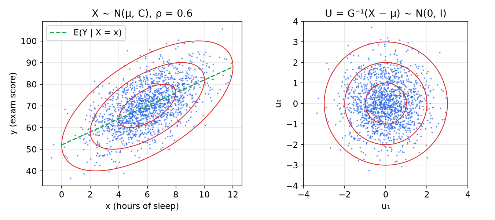
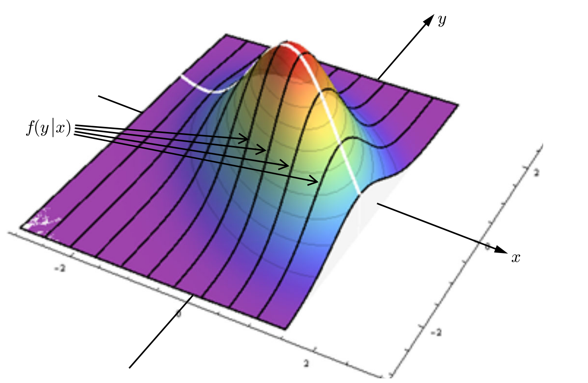
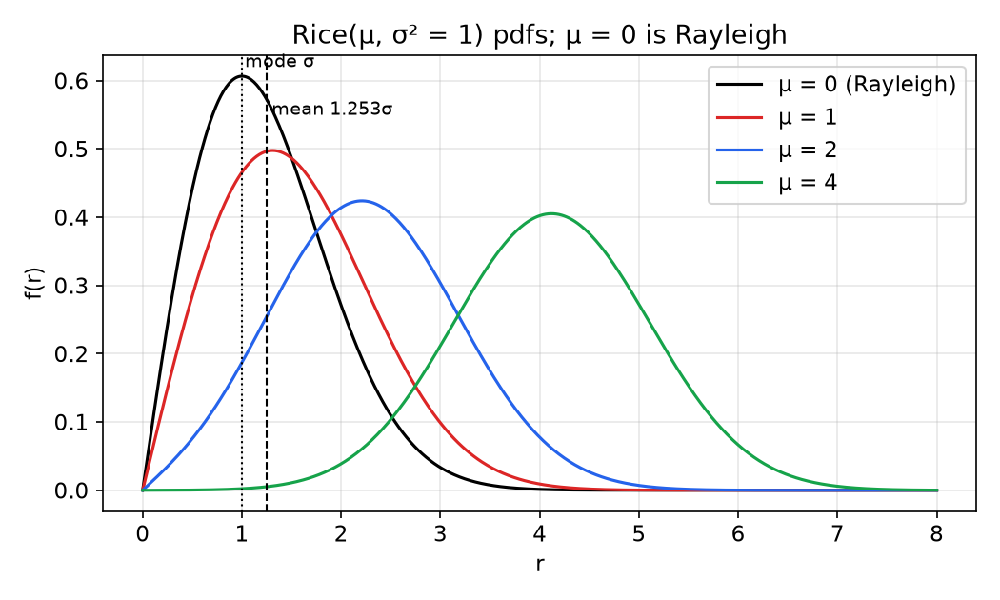
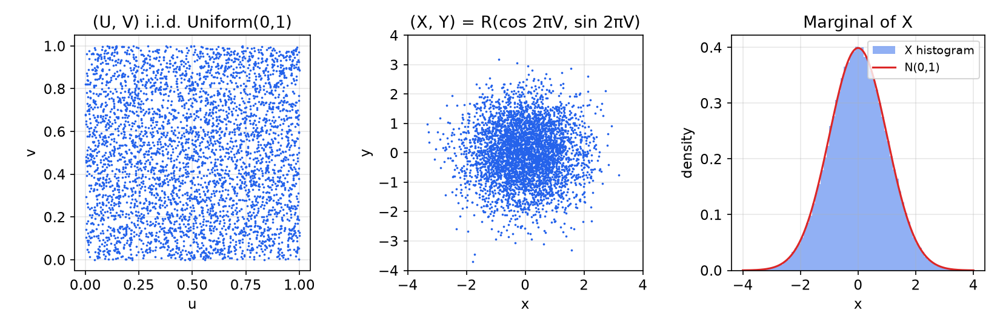

# Pairs and Vectors of Random Variables

A random process is a collection of random variables that must be described *jointly*: the value of a signal now says something about its value a moment later. This chapter develops the tools for describing several random variables at once: joint, marginal and conditional distributions; covariance and the correlation coefficient as measures of linear dependence; and the jointly Gaussian random vector, the one multivariate model in which every marginal, every conditional and every linear transformation stays in the family. Cholesky factorization shows how to build correlated Gaussians from independent ones and how to undo the correlation (whitening); the Schur complement gives the conditional distribution that underlies all of [MMSE estimation](estimation.md). The chapter ends with the distributions that arise from a pair of Gaussians in polar form (Rayleigh, Rice), their ratio (Cauchy), and the Box–Muller method for generating Gaussians.

## Pairs of Discrete Random Variables

### Joint pmf

**Definition (Joint pmf).** For discrete RVs \\(X\\) and \\(Y\\) defined on the same experiment,
\\[
P\_{XY}(x, y) \triangleq P(X = x, Y = y),
\\]
the probability that both events occur. A joint pmf is a **table** of probabilities, possibly with infinitely many rows and columns. Its properties: \\(0 \le P\_{XY}(x, y) \le 1\\); \\(\sum\_x\sum\_y P\_{XY}(x, y) = 1\\); and \\(P((X, Y) \in A) = \sum\sum\_{(x, y) \in A}P\_{XY}(x, y)\\).

**Definition (Marginal and conditional pmfs).**
\\[
P\_X(x) = \sum\_y P\_{XY}(x, y), \qquad P\_{X\mid Y}(x \mid y) = \frac{P\_{XY}(x, y)}{P\_Y(y)}.
\\]
The marginal adds the table along rows or columns (the law of total probability over the values of \\(Y\\)). The conditional pmf, read as a function of \\(x\\) for fixed \\(y\\), is the definition of conditional probability applied to the events \\(\\{X = x\\}\\) and \\(\\{Y = y\\}\\): **extract the row of the table for \\(y\\), and normalize it** so that it sums to one.

**Definition (Independence).** Discrete \\(X\\) and \\(Y\\) are independent if the events \\(\\{X = x\\}\\) and \\(\\{Y = y\\}\\) are independent for all \\(x, y\\):
\\[
P\_{XY}(x, y) = P\_X(x)P\_Y(y) \iff P\_{Y\mid X}(y \mid x) = P\_Y(y) \iff P\_{X\mid Y}(x \mid y) = P\_X(x).
\\]

**Example 3.1 (Drinks in a cooler).** A cooler holds two colas (A, B), two lemonades (C, D) and one water (W). Two drinks are chosen at random. Let \\(X\\) be the number of colas and \\(Y\\) the number of lemonades.

*Solution.* The \\(\binom{5}{2} = 10\\) equally likely pairs are AB, AC, AD, AW, BC, BD, BW, CD, CW, DW. Classifying them: AB gives \\((2, 0)\\); AC, AD, BC, BD give \\((1, 1)\\); AW, BW give \\((1, 0)\\); CD gives \\((0, 2)\\); CW, DW give \\((0, 1)\\). The joint pmf (rows \\(y\\), columns \\(x\\)) with its marginals is

| \\(y \backslash x\\) | 0 | 1 | 2 | \\(P\_Y(y)\\) |
|---|---|---|---|---|
| 2 | 0.1 | 0 | 0 | 0.1 |
| 1 | 0.2 | 0.4 | 0 | 0.6 |
| 0 | 0 | 0.2 | 0.1 | 0.3 |
| \\(P\_X(x)\\) | 0.3 | 0.6 | 0.1 | 1 |

Conditional pmf of \\(X\\) given \\(Y = 1\\): extract the row \\([0.2, 0.4, 0]\\) and divide by \\(P\_Y(1) = 0.6\\):
\\[
P\_{X\mid Y}(x \mid 1) = \left[\tfrac{1}{3}, \tfrac{2}{3}, 0\right], \qquad x = 0, 1, 2.
\\]
\\(X\\) and \\(Y\\) are not independent: \\(P\_{XY}(2, 2) = 0\\) but \\(P\_X(2)P\_Y(2) = 0.01\\). One zero entry in the table where the product of marginals is positive is enough to prove dependence.

## Pairs of Continuous Random Variables

### Joint pdf

**Definition (Joint pdf).** \\(X\\) and \\(Y\\) are jointly continuous with joint pdf \\(f\_{XY}(x, y)\\) if, for every (reasonable) region \\(A\\) of the plane,
\\[
P\left((X, Y) \in A\right) = \iint\_A f\_{XY}(x, y)\\,dx\\,dy.
\\]
The probability is the **volume** under the surface \\(f\_{XY}\\) above \\(A\\). Hence \\(f\_{XY} \ge 0\\) everywhere and \\(\iint f\_{XY} = 1\\). The joint cdf \\(F\_{XY}(x, y) = P(X \le x, Y \le y)\\) satisfies \\(f\_{XY} = \partial^2 F\_{XY}/\partial x\\,\partial y\\).



*Figure: the joint pdf is a surface over the x–y plane; the probability that (X, Y) lands in a region A is the volume of the solid between A and the surface.*

### Marginals

To find \\(P(X \in (x, x + dx))\\), integrate the joint pdf over a thin slab of width \\(dx\\) that extends over all \\(y\\):
\\[
f\_X(x)\\,dx = \left(\int\_{-\infty}^{\infty} f\_{XY}(x, y)\\,dy\right)dx
\quad\Longrightarrow\quad
f\_X(x) = \int\_{-\infty}^{\infty} f\_{XY}(x, y)\\,dy, \qquad f\_Y(y) = \int\_{-\infty}^{\infty} f\_{XY}(x, y)\\,dx.
\\]
This is the continuous analogue of adding a table along its rows or columns.

### Conditional pdfs

There are two types of conditioning.

*Type 1: conditioning on an event involving \\(X\\).* For an event \\(B\\) of positive probability, e.g. \\(\\{X > 1\\}\\),
\\[
f\_X(x \mid X > 1) = \begin{cases} \dfrac{f\_X(x)}{P(X > 1)}, & x > 1,\\\\ 0, & x \le 1.\end{cases}
\\]
The density is zero where the event is impossible, and the remaining tail is scaled up to have unit area.

*Type 2: conditioning on another RV taking a value.* The event \\(\\{Y = y\\}\\) has probability zero for a continuous \\(Y\\), so define \\(f\_{X\mid Y}(x \mid y)\\) as the pdf of \\(X\\) given that \\(Y\\) is *close to* \\(y\\):
\\[
f\_{X\mid Y}(x \mid y)\\,dx = P\left(X \in (x, x + dx) \mid Y \in (y, y + dy)\right) = \frac{P(X \in (x, x + dx), Y \in (y, y + dy))}{P(Y \in (y, y + dy))} = \frac{f\_{XY}(x, y)\\,dx\\,dy}{f\_Y(y)\\,dy},
\\]
so that
\\[
\boxed{f\_{X\mid Y}(x \mid y) = \frac{f\_{XY}(x, y)}{f\_Y(y)}}
\\]
wherever \\(f\_Y(y) > 0\\).

**Slice and scale.** Read with \\(y\\) fixed and \\(x\\) variable, the numerator *slices* the joint-pdf surface along the line of constant \\(y\\), giving a cross-section; the denominator \\(f\_Y(y)\\), which is exactly the area of that cross-section, *scales* it to integrate to one. This is the continuous version of "extract a row and normalize."



*Figure: the red curve is the cross-section of the joint pdf f(x, y) along a fixed value of y. Dividing it by its area f_Y(y) gives the conditional pdf of X given Y = y.*

Rearranging the definition gives the continuous multiplication rule \\(f\_{XY}(x, y) = f\_{X\mid Y}(x \mid y)f\_Y(y)\\), and integrating over \\(y\\) gives continuous total probability, \\(f\_X(x) = \int f\_{X\mid Y}(x \mid y)f\_Y(y)\\,dy\\), and Bayes' rule, \\(f\_{Y\mid X}(y \mid x) = f\_{X\mid Y}(x \mid y)f\_Y(y)/f\_X(x)\\).

### Independence

**Definition.** Jointly continuous \\(X\\) and \\(Y\\) are independent if
\\[
f\_{XY}(x, y) = f\_X(x)f\_Y(y) \iff f\_{Y\mid X}(y \mid x) = f\_Y(y) \iff f\_{X\mid Y}(x \mid y) = f\_X(x).
\\]
If any one of the three conditions holds, all three do; if one fails, all fail.

**Footprints.** The **footprint** (support) of a joint pdf is the region where it is positive. If \\(X\\) and \\(Y\\) are independent, the footprint is the Cartesian product of the supports of \\(f\_X\\) and \\(f\_Y\\): a rectangle, or a union of rectangles arranged in a grid. A triangular or circular footprint therefore proves dependence at a glance: knowing \\(x\\) changes the range of possible \\(y\\). Conversely, a pdf that factors as \\(g(x)h(y)\\) on a rectangle is independent. For example, \\(f\_{XY} = c\\,e^x/\log(1 + y^2)\\) on the square \\([0, 1]^2\\) describes independent (hence uncorrelated) \\(X\\) and \\(Y\\), while the same formula on the unit disk does not.

## Expectation, Covariance and Correlation

### Functions of two random variables

The fundamental theorem of expectation extends directly: \\(E(g(X, Y)) = \sum\_x\sum\_y g(x, y)P\_{XY}(x, y)\\) or \\(\iint g(x, y)f\_{XY}(x, y)\\,dx\\,dy\\). With \\(g = ax + by\\) this gives **linearity**,
\\[
E(aX + bY) = aE(X) + bE(Y),
\\]
for any \\(X, Y\\), independent or not, because the double integral splits and each piece reduces to a marginal.

### Three measures of correlation

1. **Correlation:** \\(E(XY)\\).
2. **Covariance:** \\(\text{cov}(X, Y) \triangleq E\left((X - \mu\_X)(Y - \mu\_Y)\right) = E(XY) - \mu\_X\mu\_Y\\).
3. **Correlation coefficient:**
\\[
\rho \triangleq E\left(\left(\frac{X - \mu\_X}{\sigma\_X}\right)\left(\frac{Y - \mu\_Y}{\sigma\_Y}\right)\right) = \frac{E(XY) - \mu\_X\mu\_Y}{\sigma\_X\sigma\_Y}.
\\]

The covariance has the units of \\(XY\\); the correlation coefficient is dimensionless and is the covariance of the standardized variables.

**Definition (Uncorrelated).** \\(X\\) and \\(Y\\) are uncorrelated if \\(E(XY) = E(X)E(Y)\\), equivalently \\(\text{cov}(X, Y) = 0\\), equivalently \\(\rho = 0\\).

**Variance of a sum.** Expanding the square,
\\[
\text{var}(X + Y) = \text{var}(X) + \text{var}(Y) + 2\\,\text{cov}(X, Y),
\\]
and more generally \\(\text{var}(\sum\_i X\_i) = \sum\_i\sum\_j \text{cov}(X\_i, X\_j)\\). Variances add only for uncorrelated summands. If \\(Y = X\\), \\(\text{var}(X + Y) = 4\\,\text{var}(X) = 2(\text{var}\\,X + \text{var}\\,Y)\\), not \\(\text{var}\\,X + \text{var}\\,Y\\).

### The correlation coefficient is at most one in magnitude

Let \\(U = (X - \mu\_X)/\sigma\_X\\) and \\(V = (Y - \mu\_Y)/\sigma\_Y\\), so \\(E(U^2) = E(V^2) = 1\\) and \\(\rho = E(UV)\\). For any real \\(a\\), \\(E((U - aV)^2) \ge 0\\). Choosing \\(a = \rho\\),
\\[
0 \le E(U^2) - 2\rho E(UV) + \rho^2E(V^2) = 1 - 2\rho^2 + \rho^2 = 1 - \rho^2,
\\]
so \\(\lvert \rho \rvert \le 1\\). Equality holds exactly when \\(E((U - \rho V)^2) = 0\\), i.e. \\(U = \rho V\\) with probability one: \\(\lvert \rho \rvert = 1\\) means \\(Y\\) is an exact affine function of \\(X\\), with positive slope when \\(\rho = 1\\). The correlation coefficient measures *linear* dependence.

**Theorem (Cauchy–Schwarz inequality).** For any RVs with finite second moments,
\\[
\boxed{E^2(XY) \le E(X^2)\\,E(Y^2)}
\\]

*Proof.* For every real \\(a\\), \\(E((X - aY)^2) = E(X^2) - 2aE(XY) + a^2E(Y^2) \ge 0\\). This holds in particular for the \\(a\\) that minimizes the left side. Setting the derivative \\(2aE(Y^2) - 2E(XY)\\) to zero gives \\(a = E(XY)/E(Y^2)\\) (if \\(E(Y^2) = 0\\), then \\(Y = 0\\) almost surely and the inequality is trivial). Substituting,
\\[
E(X^2) + \left(\frac{E(XY)}{E(Y^2)}\right)^2E(Y^2) - 2\frac{E(XY)}{E(Y^2)}E(XY) = E(X^2) - \frac{E^2(XY)}{E(Y^2)} \ge 0. \quad ∎
\\]
Applied to the centred variables \\(X - \mu\_X\\) and \\(Y - \mu\_Y\\), it gives \\(\text{cov}^2(X, Y) \le \sigma\_X^2\sigma\_Y^2\\), i.e. \\(\lvert \rho \rvert \le 1\\) again. Geometrically, \\(E(XY)\\) is an inner product on random variables, and \\(\rho\\) is the cosine of the angle between the centred variables; this viewpoint drives the orthogonality principle of [estimation](estimation.md).

**Example 3.2 (Cooler, continued).** Only the cell \\((1, 1)\\) contributes to \\(E(XY)\\): \\(E(XY) = 1 \cdot 1 \cdot 0.4 = 0.4\\). The marginals give \\(E(X) = E(Y) = 0(0.3) + 1(0.6) + 2(0.1) = 0.8\\). Since \\(0.4 < 0.64\\), \\(\text{cov}(X, Y) = -0.24\\): \\(X\\) and \\(Y\\) are **negatively correlated**, as expected, because each cola chosen leaves less room for a lemonade.

### Independence implies uncorrelated, not conversely

**Theorem.** If \\(X\\) and \\(Y\\) are independent, they are uncorrelated.

*Proof (discrete; continuous is identical with integrals).*
\\[
E(XY) = \sum\_x\sum\_y xy\\,P\_X(x)P\_Y(y) = \left(\sum\_x xP\_X(x)\right)\left(\sum\_y yP\_Y(y)\right) = E(X)E(Y). \quad ∎
\\]
More generally, independence gives \\(E(g(X)h(Y)) = E(g(X))E(h(Y))\\) for all functions \\(g, h\\), while uncorrelatedness only constrains \\(g(x) = x\\), \\(h(y) = y\\). The converse fails: uncorrelated RVs can be dependent.

**Example 3.3 (Four points in a diamond).** \\((X, Y)\\) is uniform on the four points \\((5, 3), (6, 4), (6, 2), (7, 3)\\). Then \\(\mu\_X = 6\\), \\(\mu\_Y = 3\\), and
\\[
\text{cov}(X, Y) = \tfrac{1}{4}\left[(-1)(0) + (0)(1) + (0)(-1) + (1)(0)\right] = 0,
\\]
so \\(\rho = 0\\). Yet \\(X\\) and \\(Y\\) are dependent: \\(X = 5\\) forces \\(Y = 3\\).

**Example 3.4 (Four points with a parameter).** One of the four vectors \\((0, 0), (1, 2), (2, a), (3, b)\\) is chosen uniformly.

(a) \\(a = 2, b = 0\\): \\(X\\) is uniform on \\(\\{0, 1, 2, 3\\}\\) with \\(E(X) = 1.5\\); \\(Y\\) is uniform on \\(\\{0, 2\\}\\) with \\(E(Y) = 1\\); \\(E(XY) = \frac{1}{4}(0 + 2 + 4 + 0) = 1.5 = E(X)E(Y)\\), so \\(\rho = 0\\).

(b) \\(a = 1, b = 3\\): both marginals are uniform on \\(\\{0, 1, 2, 3\\}\\) (\\(\mu = 1.5\\), \\(\sigma^2 = 1.25\\)); \\(E(XY) = \frac{1}{4}(0 + 2 + 2 + 9) = 3.25\\), so \\(\rho = (3.25 - 2.25)/1.25 = 0.8\\).

(c) \\(b = 6\\) and \\(\rho = 1\\): all four points must lie on a line of positive slope through \\((0, 0), (1, 2), (3, 6)\\), i.e. \\(y = 2x\\), so \\(a = 4\\).

**Example 3.5 (Eight points: binomial marginals, uncorrelated, dependent).** One of the eight points \\((1, 0), (2, 0), (0, 1), (1, 1), (2, 1), (3, 1), (1, 2), (2, 2)\\) is chosen uniformly.

- \\(P(X > Y)\\): the points \\((1, 0), (2, 0), (2, 1), (3, 1)\\), so \\(0.5\\).
- \\(P\_{X\mid Y}(x \mid 1)\\): the row \\(y = 1\\) holds four points of probability \\(1/8\\); dividing by \\(P\_Y(1) = 1/2\\) gives \\(1/4\\) on each of \\(x = 0, 1, 2, 3\\).
- \\(P(X^2 + Y^2 > 2\pi)\\): only \\((3, 1)\\) (value 10) and \\((2, 2)\\) (value 8) exceed 6.28, so \\(0.25\\).
- \\(P\_X = [0.125, 0.375, 0.375, 0.125]\\) is Binomial(3, 0.5); \\(P\_Y = [0.25, 0.5, 0.25]\\) is Binomial(2, 0.5).
- \\(E(XY) = \frac{1}{8}(0 + 0 + 0 + 1 + 2 + 3 + 2 + 4) = 1.5 = E(X)E(Y) = (1.5)(1)\\): \\(\rho = 0\\).
- Not independent: \\(P\_{XY}(0, 0) = 0 \ne P\_X(0)P\_Y(0) = (0.125)(0.25)\\).

**Example 3.6 (Uniform point in a disk).** A point \\((X, Y)\\) is uniform in the disk of radius 5 centred at the origin.

(a) *Joint pdf.* The area is \\(25\pi\\), so \\(f\_{XY}(x, y) = \frac{1}{25\pi}\\) inside the disk and 0 outside: a cylinder of height \\(1/(25\pi)\\).

(b) *Distance from the centre, \\(R = \sqrt{X^2 + Y^2}\\).* For \\(0 < r < 5\\), \\(F\_R(r) = P(R \le r) = \frac{1}{25\pi}\cdot\pi r^2 = \frac{r^2}{25}\\), so \\(f\_R(r) = \frac{2r}{25} = 0.08r\\), a ramp rising to 0.4 at \\(r = 5\\). \\(R\\) is not uniform: there is more area, hence more probability, at larger radii.

(c) *Marginal of \\(X\\).* Integrate over the chord at abscissa \\(x\\):
\\[
f\_X(x) = \frac{1}{25\pi}\int\_{-\sqrt{25 - x^2}}^{\sqrt{25 - x^2}}dy = \frac{2}{25\pi}\sqrt{25 - x^2}, \qquad \lvert x \rvert \le 5,
\\]
a semicircle-shaped density. (In a pixelated disk, counting black pixels in each column gives the same semicircular profile.)

(d) *Conditional pdf given \\(Y = 4\\).* Slice the cylinder along \\(y = 4\\): the cross-section is a rectangle over \\(\lvert x \rvert \le \sqrt{25 - 16} = 3\\). Scaling to unit area, \\(X \mid Y = 4\\) is Uniform\\((-3, 3)\\), density \\(1/6\\). (Given \\(Y = 3\\) it would be Uniform\\((-4, 4)\\).)

(e) *Independent?* No: the conditional pdf depends on \\(y\\), as the circular footprint already shows.

(f) *Uncorrelated?* Yes: the pdf is symmetric under \\(x \to -x\\), so \\(E(XY) = 0 = E(X)E(Y)\\).



*Figure: top, the joint pdf of a uniform point in a disk of radius 5 is a cylinder of height 1/(25π); the red cut is the slice along y = 4. Bottom, after scaling, the conditional pdf of X given Y = 4 is uniform on [−3, 3] (red), narrower and taller than the semicircular marginal (dashed green).*

**Example 3.7 (Triangular footprint).** Let \\(f(x, y) = cxy\\) for \\(x > 0\\), \\(y > 0\\), \\(x + y < 1\\), and zero elsewhere.

(a) *Constant.* \\(f\_X(x) = \int\_0^{1-x}cxy\\,dy = \frac{c}{2}x(1 - x)^2\\), and \\(\int\_0^1 x(1 - x)^2dx = \frac{1}{2} - \frac{2}{3} + \frac{1}{4} = \frac{1}{12}\\), so \\(1 = c/24\\) and \\(c = 24\\).

(b) *Marginal.* \\(f\_X(x) = 12x(1 - x)^2\\) on \\((0, 1)\\), the Beta(2, 3) density. Check: \\(E(X) = 12\left(\frac{1}{3} - \frac{1}{2} + \frac{1}{5}\right) = 0.4 = \frac{\alpha}{\alpha + \beta}\\) and \\(E(X^2) = 12\left(\frac{1}{4} - \frac{2}{5} + \frac{1}{6}\right) = 0.2\\), so \\(\text{var}(X) = 0.04 = \frac{\alpha\beta}{(\alpha + \beta)^2(\alpha + \beta + 1)} = \frac{6}{150}\\).

(c) *Independent?* No: the footprint is a triangle.

(d) *Conditional.* \\(f\_{Y\mid X}(y \mid 0.5) = \frac{f(0.5, y)}{f\_X(0.5)} = \frac{12y}{12(0.5)(0.25)} = 8y\\) for \\(0 < y < 0.5\\), zero elsewhere; it integrates to one.

(e) *\\(P(\max\\{X, Y\\} < 0.5)\\).* The square \\([0, 0.5]^2\\) lies inside the triangle, so \\(\int\_0^{0.5}\\!\int\_0^{0.5}24xy\\,dy\\,dx = 24\left(\frac{0.25}{2}\right)^2 = \frac{3}{8}\\).

## Random Vectors

Collect \\(n\\) random variables into a column vector \\(X = [X\_1, \dots, X\_n]^T\\). Its distribution is the joint pdf \\(f\_X(x) = f\_{X\_1 \cdots X\_n}(x\_1, \dots, x\_n)\\); marginals integrate out unwanted components and conditionals divide joint by marginal, exactly as for pairs. The second-order description is

- the **mean vector** \\(\mu = E(X)\\), with entries \\(\mu\_i = E(X\_i)\\);
- the **covariance matrix** \\(C = E\left((X - \mu)(X - \mu)^T\right) = E(XX^T) - \mu\mu^T\\), with entries \\(C\_{ij} = \text{cov}(X\_i, X\_j)\\).

\\(C\\) is symmetric and positive semidefinite: for any \\(a\\), \\(a^TCa = \text{var}(a^TX) \ge 0\\). For an affine map \\(Y = b + AX\\), linearity gives
\\[
E(Y) = b + A\mu, \qquad \text{cov}(Y) = E\left(A(X - \mu)(X - \mu)^TA^T\right) = ACA^T.
\\]
(See Matrices and Eigenvalues for the linear algebra.)

## Jointly Gaussian Random Vectors

### Definition

A single Gaussian is an affine function of a standard normal, \\(X = \mu + \sigma U\\). Two RVs are **jointly Gaussian** if they are affine functions of the *same* independent standard normals:
\\[
X = a + bU + cV, \qquad Y = d + eU + fV, \qquad U, V \text{ i.i.d. } \mathcal{N}(0, 1).
\\]
Each is Gaussian on its own: the mgf of \\(X\\) is \\(e^{as}\phi\_U(bs)\phi\_V(cs) = e^{as + (b^2 + c^2)s^2/2}\\), so \\(X \sim \mathcal{N}(a, b^2 + c^2)\\).

**Definition (Jointly Gaussian vector).** \\(X \sim \mathcal{N}(\mu, C)\\) if \\(X = \mu + GU\\) for some matrix \\(G\\) and a vector \\(U\\) of i.i.d. \\(\mathcal{N}(0, 1)\\) components. Then \\(E(X) = \mu\\) and \\(\text{cov}(X) = G\\,I\\,G^T = GG^T = C\\): think of \\(G\\) as a **square root** of the covariance matrix.

**Equivalent definition.** \\(X\\) is jointly Gaussian if and only if *every* linear combination \\(a^TX + c\\) is a Gaussian RV (allowing the degenerate variance-zero case). The forward direction is immediate (a linear combination of \\(\mu + GU\\) is a constant plus a linear combination of independent normals); the reverse follows from the mgf below.

**Joint pdf.** If \\(\det C \ne 0\\),
\\[
\boxed{f\_X(x) = \frac{1}{\sqrt{(2\pi)^n\det C}}\exp\left(-\tfrac{1}{2}(x - \mu)^TC^{-1}(x - \mu)\right)}
\\]
It follows from \\(U = G^{-1}(X - \mu)\\) (with \\(G\\) square and invertible), the product pdf \\(f\_U(u) = (2\pi)^{-n/2}e^{-u^Tu/2}\\), and the change-of-variables rule \\(f\_X(x) = f\_U(G^{-1}(x - \mu))\lvert\det G^{-1}\rvert\\): then \\(u^Tu = (x - \mu)^TG^{-T}G^{-1}(x - \mu) = (x - \mu)^TC^{-1}(x - \mu)\\) and \\(\lvert\det G\rvert = \sqrt{\det C}\\).

**MGF.** \\(E\left(e^{s^TX}\right) = \exp\left(s^T\mu + \tfrac{1}{2}s^TCs\right)\\). (Apply the scalar result to the Gaussian \\(s^TX\\), which has mean \\(s^T\mu\\) and variance \\(s^TCs\\).) A jointly Gaussian distribution is therefore fully determined by \\(\mu\\) and \\(C\\).

### The bivariate case

For \\(n = 2\\) with variances \\(\sigma\_1^2, \sigma\_2^2\\) and correlation coefficient \\(\rho\\),
\\[
C = \begin{bmatrix}\sigma\_1^2 & \rho\sigma\_1\sigma\_2\\\\ \rho\sigma\_1\sigma\_2 & \sigma\_2^2\end{bmatrix}, \qquad \det C = (1 - \rho^2)\sigma\_1^2\sigma\_2^2.
\\]
When \\(\lvert\rho\rvert < 1\\), inverting the 2 × 2 matrix gives
\\[
f(x, y) = \frac{1}{2\pi\sigma\_x\sigma\_y\sqrt{1 - \rho^2}}\exp\left\\{\frac{-1}{2(1 - \rho^2)}\left[\left(\frac{x - \mu\_x}{\sigma\_x}\right)^2 - 2\rho\left(\frac{x - \mu\_x}{\sigma\_x}\right)\left(\frac{y - \mu\_y}{\sigma\_y}\right) + \left(\frac{y - \mu\_y}{\sigma\_y}\right)^2\right]\right\\}.
\\]
For correlated standard normals (\\(\mu = 0\\), \\(\sigma\_x = \sigma\_y = 1\\), \\(\rho = E(XY)\\)) this is \\(f(x, y) = \frac{1}{2\pi\sqrt{1 - \rho^2}}\exp\left\\{\frac{-(x^2 - 2\rho xy + y^2)}{2(1 - \rho^2)}\right\\}\\).

The contours of constant density are the ellipses \\((x - \mu)^TC^{-1}(x - \mu) = \text{const}\\). With \\(\rho = 0\\) and equal variances they are circles; positive \\(\rho\\) tilts them along a rising line, negative \\(\rho\\) along a falling one; as \\(\lvert\rho\rvert \to 1\\) they collapse onto a line, and \\(\det C \to 0\\).



*Figure: equal-density contours for ρ = 0 with equal variances (circles), and for ρ = 0.5, −0.5 and 0.9 with σ_y = 2σ_x. The sign of ρ sets the tilt; its magnitude sets how thin the ellipses are.*

### Uncorrelated jointly Gaussian variables are independent

If \\(X\\) and \\(Y\\) are jointly Gaussian with \\(\rho = 0\\), the cross term in the exponent vanishes and the pdf factors:
\\[
f(x, y) = \frac{1}{\sqrt{2\pi\sigma\_x^2}}e^{-(x - \mu\_x)^2/2\sigma\_x^2}\cdot\frac{1}{\sqrt{2\pi\sigma\_y^2}}e^{-(y - \mu\_y)^2/2\sigma\_y^2} = f\_X(x)f\_Y(y).
\\]
So for a general pair, independence ⇒ uncorrelated is a one-way street; for **jointly Gaussian** variables, independent ⇔ uncorrelated is a two-way street. The same holds for vectors: if \\(C\\) is diagonal, the components are mutually independent.

### Gaussian marginals are not enough

**Example 3.8 (A random sign).** Let \\(X \sim \mathcal{N}(0, 1)\\) and \\(Y = QX\\), where \\(Q = \pm 1\\) with equal probability, independent of \\(X\\). By symmetry of the Gaussian, \\(P(Y \le y) = \frac{1}{2}P(X \le y) + \frac{1}{2}P(-X \le y) = \Phi(y)\\), so \\(Y \sim \mathcal{N}(0, 1)\\). Also \\(E(XY) = E(Q)E(X^2) = 0\\). Yet \\(X + Y\\) equals 0 with probability 1/2, so it is not Gaussian, and \\(X, Y\\) are **not jointly Gaussian**; they are uncorrelated but obviously dependent (\\(\lvert Y \rvert = \lvert X \rvert\\)). There is more to "jointly" Gaussian than each variable being Gaussian individually.

**Example 3.9 (A Gaussian mixture).** Let \\(U \sim \mathcal{N}(0, 1)\\), \\(X \sim \mathcal{N}(0, 100)\\) and \\(Q \in \\{\pm 1\\}\\) be mutually independent with \\(P(Q = 1) = 0.1\\), and set \\(Y = QX + U\\).

(a) *Marginal of \\(Y\\).* Let \\(V = QX\\). Then \\(F\_V(v) = 0.1F\_X(v) + 0.9P(-X \le v) = F\_X(v)\\) because \\(f\_X\\) is even; so \\(V \sim \mathcal{N}(0, 100)\\), independent of \\(U\\), and \\(Y = V + U \sim \mathcal{N}(0, 101)\\).

(b), (c) *Is \\((X, Y)\\) jointly Gaussian? The pdf of \\(Z = X + Y\\).* Condition on \\(Q\\): if \\(Q = 1\\), \\(Z = 2X + U \sim \mathcal{N}(0, 401)\\); if \\(Q = -1\\), \\(Z = U\\). So
\\[
f\_Z(z) = 0.1\frac{1}{\sqrt{802\pi}}e^{-z^2/802} + 0.9\frac{1}{\sqrt{2\pi}}e^{-z^2/2},
\\]
a tall narrow Gaussian plus a low wide one: a **Gaussian mixture**, not a Gaussian. Since a linear combination of \\(X\\) and \\(Y\\) is not Gaussian, \\(X\\) and \\(Y\\) are not jointly Gaussian, although each is Gaussian.

(d) *An mgf.* For \\(W = -2 + QU + 0.1X\\): \\(QU \sim \mathcal{N}(0, 1)\\) by the same symmetry argument, and it is independent of \\(X\\). Therefore
\\[
\phi\_W(s) = e^{-2s}\\,e^{s^2/2}\\,e^{100(0.01)s^2/2} = e^{-2s + s^2} = e^{-1}e^{(s - 1)^2},
\\]
which has the form \\(ae^{(s - b)^2}\\) with \\(a = e^{-1}\\), \\(b = 1\\). (\\(W \sim \mathcal{N}(-2, 2)\\).)

### Affine maps preserve joint Gaussianity

**Theorem.** If \\(X \sim \mathcal{N}(\mu, C)\\) and \\(Y = b + AX\\), then \\(Y \sim \mathcal{N}(b + A\mu, ACA^T)\\).

*Proof.* \\(Y = b + A(\mu + GU) = (b + A\mu) + (AG)U\\) is again a constant plus a matrix times i.i.d. standard normals, and \\((AG)(AG)^T = ACA^T\\). ∎

Marginals are a special case (\\(A\\) selects components), so every sub-vector of a Gaussian vector is Gaussian.

## Cholesky Factorization and Whitening

### Building correlated Gaussians

To generate \\(X \sim \mathcal{N}(\mu\_1, \sigma\_1^2)\\) and \\(Y \sim \mathcal{N}(\mu\_2, \sigma\_2^2)\\) with correlation coefficient \\(\rho\\) from i.i.d. standard normals \\(U, V\\), set
\\[
X = \mu\_1 + \sigma\_1U, \qquad Y = \mu\_2 + \sigma\_2\rho\\,U + \sigma\_2\sqrt{1 - \rho^2}\\,V.
\\]
Check: \\(\text{var}(Y) = \sigma\_2^2(\rho^2 + 1 - \rho^2) = \sigma\_2^2\\) and \\(\text{cov}(X, Y) = \sigma\_1\sigma\_2\rho\\). In matrix form \\(X = \mu + GU\\) with the **lower-triangular** factor
\\[
G = \begin{bmatrix}\sigma\_1 & 0\\\\ 0 & \sigma\_2\end{bmatrix}\begin{bmatrix}1 & 0\\\\ \rho & \sqrt{1 - \rho^2}\end{bmatrix} = \begin{bmatrix}\sigma\_1 & 0\\\\ \rho\sigma\_2 & \sigma\_2\sqrt{1 - \rho^2}\end{bmatrix}, \qquad GG^T = C.
\\]
This is the **Cholesky factorization** \\(C = GG^T\\), which exists and is unique (with positive diagonal) for every positive-definite \\(C\\). For general \\(n\\) the recursion computes column by column:
\\[
G\_{jj} = \sqrt{C\_{jj} - \sum\_{k<j}G\_{jk}^2}, \qquad G\_{ij} = \frac{1}{G\_{jj}}\left(C\_{ij} - \sum\_{k<j}G\_{ik}G\_{jk}\right), \quad i > j.
\\]
Lower-triangularity has a causal meaning: \\(X\_1\\) uses only \\(U\_1\\); \\(X\_2\\) uses \\(U\_1, U\_2\\); and so on, each new component adding one new independent "innovation." This viewpoint returns in [linear prediction](estimation.md). Any other square root \\(G' = GO\\) with \\(O\\) orthogonal also works, for instance the symmetric root \\(C^{1/2}\\) or \\(V\Lambda^{1/2}\\) from the eigendecomposition \\(C = V\Lambda V^T\\).

```matlab
G = chol(C, 'lower');            % C = G*G'
X = mu + G*randn(n, N);          % N samples of N(mu, C)
```

```python
import numpy as np
G = np.linalg.cholesky(C)        # lower triangular, C = G @ G.T
X = mu[:, None] + G @ np.random.default_rng().standard_normal((n, N))
```

### Whitening

The scalar question "find \\(a, b\\) such that \\(a + bX \sim \mathcal{N}(0, 1)\\) when \\(X \sim \mathcal{N}(\mu, \sigma^2)\\)" has the answer \\(b = 1/\sigma\\), \\(a = -\mu/\sigma\\): standardization. Its vector version asks for \\(a, B\\) with \\(a + BX \sim \mathcal{N}(0, I)\\). Inverting the generator,
\\[
\boxed{U = G^{-1}(X - \mu) \sim \mathcal{N}(0, I)}
\\]
because \\(\text{cov}(U) = G^{-1}CG^{-T} = G^{-1}GG^TG^{-T} = I\\). This is **whitening**: the output components are uncorrelated with unit variance and, being jointly Gaussian, independent. With the Cholesky factor, \\(G^{-1}\\) is again lower triangular, so whitening can be done sequentially.



*Figure: left, 1,500 samples of hours of sleep X and exam score Y with means 6 and 70, standard deviations 2 and 10 and ρ = 0.6, generated as μ + GU; red ellipses are the images of circles of radius 1, 2, 3 under G, and the dashed line is the conditional mean E(Y | X = x). Right, applying G⁻¹(X − μ) maps the ellipses back to circles and the cloud to i.i.d. standard normals.*

## Conditional Distributions of Jointly Gaussian Vectors

### The scalar case

What is \\(f(y \mid x)\\) for a jointly Gaussian pair? Use the generating representation \\(X = \mu\_1 + \sigma\_1U\\), \\(Y = \mu\_2 + \sigma\_2\rho U + \sigma\_2\sqrt{1 - \rho^2}V\\). Knowing \\(X = x\\) is the same as knowing \\(U = (x - \mu\_1)/\sigma\_1\\), while \\(V\\) remains \\(\mathcal{N}(0, 1)\\) and independent of \\(U\\). So, given \\(X = x\\), \\(Y\\) is a constant plus \\(\sigma\_2\sqrt{1 - \rho^2}\\) times a standard normal:
\\[
\boxed{Y \mid X = x \ \sim\ \mathcal{N}\left(\mu\_2 + \rho\sigma\_2\frac{x - \mu\_1}{\sigma\_1},\ \ \sigma\_2^2(1 - \rho^2)\right)}
\\]
Still Gaussian; the mean shifts linearly with \\(x\\); the variance decreases by the factor \\(1 - \rho^2\\) and does not depend on \\(x\\).



*Figure: slices of a bivariate Gaussian surface at fixed x (black curves) are scaled Gaussians f(y | x). The white ridge connecting their peaks is the conditional mean, a straight line in the x–y plane.*

**Regression toward the mean.** Writing the conditional mean in standardized units,
\\[
\frac{E(Y \mid X = x) - \mu\_2}{\sigma\_2} = \rho\\,\frac{x - \mu\_1}{\sigma\_1}.
\\]
If \\(X\\) is two standard deviations above its mean, expect \\(Y\\) to be only \\(2\rho\\) standard deviations above its own. Since \\(\lvert\rho\rvert \le 1\\), predictions are pulled toward the mean.

**Example 3.10 (Sleep and exam scores).** Hours of sleep \\(X\\) (mean 6, standard deviation 2) and final-exam score \\(Y\\) (mean 70, standard deviation 10) are jointly Gaussian with \\(\rho = 0.6\\). Given only 2 hours of sleep, what is the probability of a passing score, \\(Y > 65\\)?

*Solution.* \\(E(Y \mid X = 2) = 70 + 10(0.6)\frac{2 - 6}{2} = 58\\) and \\(\text{var}(Y \mid X = 2) = 100(1 - 0.36) = 64\\). So \\(Y \mid X = 2 \sim \mathcal{N}(58, 64)\\) and
\\[
P(Y > 65 \mid X = 2) = Q\left(\frac{65 - 58}{\sqrt{64}}\right) = Q(7/8) = 0.19.
\\]
(Unconditionally, \\(P(Y > 65) = Q(-0.5) = 0.69\\).)

### The vector case: the Schur complement

**Theorem (Conditional Gaussian).** Partition a jointly Gaussian vector into \\(X\\) (\\(k\\) components) and \\(Y\\) (\\(n - k\\) components):
\\[
\begin{bmatrix}X\\\\ Y\end{bmatrix} \sim \mathcal{N}\left(\begin{bmatrix}\mu\_1\\\\ \mu\_2\end{bmatrix}, \begin{bmatrix}C\_{11} & C\_{12}\\\\ C\_{21} & C\_{22}\end{bmatrix}\right), \qquad C\_{21} = C\_{12}^T,
\\]
with \\(C\_{11}\\) invertible. Then
\\[
\boxed{Y \mid X = x \ \sim\ \mathcal{N}\left(\mu\_2 + C\_{21}C\_{11}^{-1}(x - \mu\_1),\ \ C\_{22} - C\_{21}C\_{11}^{-1}C\_{12}\right)}
\\]
The conditional covariance \\(C\_{22} - C\_{21}C\_{11}^{-1}C\_{12}\\) is the **Schur complement** of \\(C\_{11}\\) in \\(C\\).

*Proof.* Define \\(W = Y - C\_{21}C\_{11}^{-1}X\\), an affine function of the Gaussian vector, so \\((X, W)\\) is jointly Gaussian. Its cross-covariance with \\(X\\) is
\\[
\text{cov}(W, X) = C\_{21} - C\_{21}C\_{11}^{-1}C\_{11} = 0,
\\]
so \\(W\\) and \\(X\\) are uncorrelated and therefore **independent**. Its mean is \\(\mu\_2 - C\_{21}C\_{11}^{-1}\mu\_1\\) and its covariance is
\\[
C\_{22} - C\_{21}C\_{11}^{-1}C\_{12} - C\_{21}C\_{11}^{-1}C\_{12} + C\_{21}C\_{11}^{-1}C\_{11}C\_{11}^{-1}C\_{12} = C\_{22} - C\_{21}C\_{11}^{-1}C\_{12}.
\\]
Now \\(Y = W + C\_{21}C\_{11}^{-1}X\\). Given \\(X = x\\), the second term is the constant \\(C\_{21}C\_{11}^{-1}x\\) and \\(W\\) keeps its unconditional distribution (independence). Adding the constant to \\(W\\)'s mean gives the result. ∎

For \\(k = n - k = 1\\) the formulas reduce to the scalar result: \\(C\_{21}C\_{11}^{-1} = \rho\sigma\_1\sigma\_2/\sigma\_1^2 = \rho\sigma\_2/\sigma\_1\\) and \\(C\_{22} - C\_{21}^2/C\_{11} = \sigma\_2^2(1 - \rho^2)\\).

Two consequences shape the rest of the subject:

- The conditional mean \\(E(Y \mid x) = a + Bx\\) is an **affine** function of the observations \\(X\_1, X\_2, \dots\\). Since the conditional mean is the minimum-mean-square-error estimator, for jointly Gaussian data the best estimator is linear; see [MMSE Estimation](estimation.md).
- The conditional covariance does not depend on the observed value \\(x\\), and it is never larger than the unconditional one (\\(C\_{22} - \text{Schur} = C\_{21}C\_{11}^{-1}C\_{12} \succeq 0\\)): observations always help, by an amount that can be computed before any data arrive. This is what makes the Kalman filter's covariance recursion data-independent.

**Example 3.11 (Overlapping sums of normals).** Let \\(U\_1, \dots, U\_7\\) be i.i.d. \\(\mathcal{N}(0, 1)\\), \\(X = U\_1 + U\_2 + U\_3 + U\_4\\) and \\(Y = U\_3 + U\_4 + U\_5 + U\_6 + U\_7\\).

*Setup.* \\(X\\) and \\(Y\\) are linear combinations of the same independent normals, hence jointly Gaussian, with \\(X \sim \mathcal{N}(0, 4)\\), \\(Y \sim \mathcal{N}(0, 5)\\) and \\(E(XY) = E((U\_3 + U\_4)^2) = 2\\), so \\(\rho = 2/\sqrt{20} = 1/\sqrt{5}\\).

(a) *\\(f\_{Y\mid X}(y \mid 6)\\).* Mean \\(\rho\sigma\_Y x/\sigma\_X = \frac{2}{4}x = x/2\\); variance \\(5(1 - \frac{1}{5}) = 4\\). At \\(x = 6\\): \\(\mathcal{N}(3, 4)\\).

(b) *Find \\(b\\) with \\(E(X \mid Y = b) = E(Y \mid X = 6)\\).* \\(E(X \mid Y = b) = \frac{\text{cov}}{\sigma\_Y^2}b = \frac{2}{5}b\\). Setting \\(\frac{2}{5}b = 3\\) gives \\(b = 7.5\\).

(c) *Find \\(c\\) making \\(Y - cX\\) independent of \\(X\\).* For jointly Gaussian variables uncorrelated suffices: \\(E((Y - cX)X) = 2 - 4c = 0\\), so \\(c = 0.5\\). (This is the \\(W\\) of the Schur-complement proof.)

(d) *Find \\(d\\) with \\(P(2X + 3Y + 4 > d) = 0.5\\).* \\(2X + 3Y + 4\\) is Gaussian, symmetric about its mean 4, so \\(d = 4\\).

(e) *mgf of \\(D = X - Y\\).* \\(D = U\_1 + U\_2 - U\_5 - U\_6 - U\_7 \sim \mathcal{N}(0, 5)\\), so \\(\phi\_D(s) = e^{2.5s^2}\\).

(f) *Correlation of \\(S = X + Y\\) and \\(D\\).* \\(S = U\_1 + U\_2 + 2U\_3 + 2U\_4 + U\_5 + U\_6 + U\_7\\) has variance 13, and \\(E(SD) = E(X^2) - E(Y^2) = -1\\). So \\(\rho\_{SD} = -1/\sqrt{13 \cdot 5} = -1/\sqrt{65} \approx -0.12\\).

**Example 3.12 (A Gaussian vector from two normals).** Let \\(U, V\\) be i.i.d. \\(\mathcal{N}(0, 1)\\), \\(X = 1 + 4\sqrt{3}U - 4V\\) and \\(Y = 2 + \sqrt{3}U + V\\).

(a) \\(E(X) = 1\\), \\(E(Y) = 2\\), \\(\text{var}(X) = 48 + 16 = 64\\), \\(\text{var}(Y) = 3 + 1 = 4\\), \\(\text{cov}(X, Y) = 4\sqrt{3}\cdot\sqrt{3} - 4 \cdot 1 = 8\\) (equivalently \\(E(XY) = 10 = 8 + 1 \cdot 2\\)), so \\(\rho = 8/\sqrt{64 \cdot 4} = 0.5\\).

(b) \\(\mu = [1, 2]^T\\) and \\(C = \begin{bmatrix}64 & 8\\\\ 8 & 4\end{bmatrix}\\).

(c) \\(\text{var}(X + Y) = C\_{11} + C\_{22} + 2C\_{12} = 64 + 4 + 16 = 84\\).

(d) \\(E(X \mid Y = 3)\\): \\(Y = 3\\) is half a standard deviation above its mean, so \\(E(X \mid Y = 3) = 1 + 0.5\\,\rho\\,\sigma\_X = 1 + 0.5(0.5)(8) = 3\\).

(e) *\\(c\\) making \\(S = X + cY\\) and \\(D = X - cY\\) independent.* \\(\text{cov}(X + W, X - W) = \text{var}(X) - \text{var}(W)\\) for \\(W = cY\\), so \\(64 - 4c^2 = 0\\) and \\(c = \pm 4\\). Since \\(S, D\\) are jointly Gaussian, uncorrelated means independent.

## Distributions from a Gaussian Pair

### Rayleigh: the rocket-landing problem

A rocket lands on a circular barge aimed at the origin. Its miss in the two horizontal directions, \\(X\\) and \\(Y\\), is i.i.d. \\(\mathcal{N}(0, \sigma^2)\\). What is the distribution of the squared miss distance \\(W = X^2 + Y^2\\), and of the miss distance \\(R = \sqrt{W}\\)?

**Approach 1: the cdf in polar coordinates.** \\(\\{W \le w\\}\\) is the disk of radius \\(\sqrt{w}\\). With \\(x = r\cos\theta\\), \\(y = r\sin\theta\\), \\(dx\\,dy = r\\,dr\\,d\theta\\):
\\[
P(W \le w) = \frac{1}{2\pi\sigma^2}\iint\_{x^2 + y^2 \le w}e^{-(x^2 + y^2)/2\sigma^2}dx\\,dy = \frac{1}{2\pi\sigma^2}\int\_0^{2\pi}\\!\\!\int\_0^{\sqrt{w}}e^{-r^2/2\sigma^2}r\\,dr\\,d\theta = \frac{1}{\sigma^2}\int\_0^{\sqrt{w}}re^{-r^2/2\sigma^2}dr = 1 - e^{-w/2\sigma^2}.
\\]
Hence \\(f\_W(w) = \frac{1}{2\sigma^2}e^{-w/2\sigma^2}\\): \\(W \sim \text{Exp}(\lambda = \frac{1}{2\sigma^2})\\).

**Approach 2: the mgf.** For \\(X \sim \mathcal{N}(0, \sigma^2)\\), with \\(\hat\sigma^2 = \sigma^2/(1 - 2\sigma^2s)\\) for \\(s < 1/(2\sigma^2)\\),
\\[
\phi\_{X^2}(s) = \frac{1}{\sqrt{2\pi\sigma^2}}\int e^{sx^2}e^{-x^2/2\sigma^2}dx = \frac{1}{\sqrt{2\pi\sigma^2}}\int e^{-(1 - 2\sigma^2s)x^2/2\sigma^2}dx = \frac{\hat\sigma}{\sigma}\underbrace{\frac{1}{\sqrt{2\pi\hat\sigma^2}}\int e^{-x^2/2\hat\sigma^2}dx}\_{= 1} = \frac{1}{\sqrt{1 - 2\sigma^2s}}.
\\]
By independence \\(\phi\_W(s) = \phi\_{X^2}(s)\phi\_{Y^2}(s) = \frac{1}{1 - 2\sigma^2s} = \frac{\lambda}{\lambda - s}\\) with \\(\lambda = 1/(2\sigma^2)\\): the exponential mgf again.

**The Rayleigh distribution.** \\(F\_R(r) = P(W \le r^2) = 1 - e^{-r^2/2\sigma^2}\\), so
\\[
\boxed{f\_R(r) = \frac{d}{dr}F\_W(r^2) = 2r\\,f\_W(r^2) = \frac{r}{\sigma^2}e^{-r^2/2\sigma^2}, \quad r > 0}
\\]
\\(R \sim \text{Rayleigh}(\sigma^2)\\). The pdf rises linearly from zero (small misses are unlikely because there is little area near the target), peaks at the mode \\(r = \sigma\\), and has a Gaussian-like tail.

*Mean.* The integrand \\(r^2e^{-r^2/2\sigma^2}\\) is even, so
\\[
E(R) = \int\_0^\infty \frac{r^2}{\sigma^2}e^{-r^2/2\sigma^2}dr = \frac{1}{2\sigma^2}\int\_{-\infty}^{\infty}r^2e^{-r^2/2\sigma^2}dr = \frac{\sqrt{2\pi\sigma^2}}{2\sigma^2}\cdot\underbrace{\frac{1}{\sqrt{2\pi\sigma^2}}\int r^2e^{-r^2/2\sigma^2}dr}\_{\sigma^2} = \sqrt{\frac{\pi}{2}}\\,\sigma \approx 1.253\sigma.
\\]
This is the expected miss distance.

*Variance.* No integration needed: \\(R^2 = W \sim \text{Exp}(1/2\sigma^2)\\), so \\(E(R^2) = 2\sigma^2\\) and
\\[
\text{var}(R) = 2\sigma^2 - \frac{\pi}{2}\sigma^2 = \left(2 - \frac{\pi}{2}\right)\sigma^2, \qquad \text{std}(R) = \sqrt{2 - \pi/2}\\,\sigma \approx 0.655\sigma.
\\]

**Example 3.13 (Barge size).** The barge has diameter 14 m. How small must \\(\sigma\\) be so that the probability of missing the barge completely is below 0.01?

*Solution.* \\(P(R > 7) = P(W > 49) = e^{-49/2\sigma^2} < 0.01\\) requires \\(49/(2\sigma^2) > \ln 100\\), i.e.
\\[
\sigma < \sqrt{\frac{49}{2\ln 100}} = 2.31\text{ m}.
\\]

### Rice: nonzero means

If \\(X \sim \mathcal{N}(a, \sigma^2)\\) and \\(Y \sim \mathcal{N}(b, \sigma^2)\\) are independent, the distance \\(R = \sqrt{X^2 + Y^2}\\) from the origin to a Gaussian cloud centred at distance \\(\mu = \sqrt{a^2 + b^2}\\) is **Rice** (Ricean) distributed:
\\[
f\_R(r) = \frac{r}{\sigma^2}\exp\left(-\frac{r^2 + \mu^2}{2\sigma^2}\right)I\_0\left(\frac{\mu r}{\sigma^2}\right), \qquad r > 0,
\\]
where \\(I\_0(t) = \frac{1}{\pi}\int\_0^\pi e^{t\cos\theta}d\theta\\) is the modified Bessel function of the first kind and order zero. *Derivation sketch:* in polar coordinates the joint pdf is \\(\frac{r}{2\pi\sigma^2}\exp\left(-\frac{r^2 - 2r\mu\cos(\theta - \theta\_0) + \mu^2}{2\sigma^2}\right)\\); integrating over \\(\theta\\) produces \\(I\_0(\mu r/\sigma^2)\\). For \\(\mu = 0\\), \\(I\_0(0) = 1\\) and the Rayleigh pdf is recovered. As \\(\mu/\sigma\\) grows the pdf shifts right and becomes nearly Gaussian, \\(\approx \mathcal{N}(\mu, \sigma^2)\\). Rayleigh and Rice describe the envelope of a narrowband signal in Gaussian noise without and with a line-of-sight component (fading channels, radar returns).



*Figure: Rice pdfs with σ = 1 for μ = 0 (the Rayleigh pdf, mode σ, mean 1.253σ), 1, 2 and 4. As μ grows the peak moves right and the pdf becomes symmetric.*

### Cauchy: a ratio of Gaussians

Let \\(U, V\\) be i.i.d. \\(\mathcal{N}(0, 1)\\) and \\(X = U/V\\). The event \\(\\{U/V \le x\\}\\) is \\(\\{U \le vx\\}\\) when \\(V = v > 0\\) and \\(\\{U \ge vx\\}\\) when \\(v < 0\\). The two halves have equal probability by the symmetry \\((U, V) \to (-U, -V)\\), so
\\[
F\_X(x) = 2\int\_0^\infty\\!\\!\int\_{-\infty}^{vx}f\_U(u)f\_V(v)\\,du\\,dv = 2\int\_0^\infty f\_V(v)F\_U(vx)\\,dv.
\\]
Differentiating under the integral,
\\[
f\_X(x) = 2\int\_0^\infty f\_V(v)\\,v\\,f\_U(vx)\\,dv = \frac{2}{2\pi}\int\_0^\infty v\\,e^{-v^2(1 + x^2)/2}dv = \frac{1}{\pi}\cdot\frac{1}{1 + x^2}.
\\]
(The last integral is \\(1/(1 + x^2)\\) times the integral of a Rayleigh pdf, which is one.) This is the **Cauchy** distribution:
\\[
\boxed{f\_X(x) = \frac{1/\pi}{1 + x^2}}, \qquad F\_X(x) = \frac{1}{\pi}\arctan x + \frac{1}{2}.
\\]
Properties:

- It looks bell-shaped, but its tails decay only like \\(1/x^2\\): **heavy tails**, so outliers are common.
- Even moments are **infinite** (\\(\int x^2/(1 + x^2)dx\\) diverges) and odd moments, including the mean, are **undefined** (\\(\int\_0^\infty x/(1 + x^2)dx = \infty\\) on each side).
- Its characteristic function is \\(E(e^{j\omega X}) = e^{-\lvert\omega\rvert}\\) (its mgf exists only at \\(s = 0\\)).
- It is **stable**: the average of i.i.d. Cauchy RVs is Cauchy with the same parameter, so there is **no central limit theorem** for it. See [Iterated Expectation and Limit Theorems](limit-theorems.md).

### Box–Muller: Gaussians from uniforms

**Fact.** \\(X, Y\\) are i.i.d. \\(\mathcal{N}(0, 1)\\) if and only if their polar coordinates \\(R = \sqrt{X^2 + Y^2}\\) and \\(\Theta = \text{atan2}(Y, X)\\) are **independent**, with \\(R \sim \text{Rayleigh}(1)\\) and \\(\Theta \sim \text{Uniform}(0, 2\pi)\\).

*Proof.* The joint pdf \\(\frac{1}{2\pi}e^{-(x^2 + y^2)/2}\\) depends only on \\(r\\). Changing variables with Jacobian \\(r\\),
\\[
f\_{R\Theta}(r, \theta) = \frac{1}{2\pi}e^{-r^2/2}\cdot r = \underbrace{re^{-r^2/2}}\_{f\_R(r)}\cdot\underbrace{\frac{1}{2\pi}}\_{f\_\Theta(\theta)}, \qquad r > 0,\ 0 \le \theta < 2\pi,
\\]
which factors into a Rayleigh(1) pdf and a uniform pdf. The steps reverse. ∎

The Gaussian cdf cannot be inverted in closed form, but the Rayleigh cdf can: \\(F\_R(r) = 1 - e^{-r^2/2}\\) gives \\(F\_R^{-1}(u) = \sqrt{-2\ln(1 - u)}\\), and \\(1 - U\\) is as uniform as \\(U\\). This yields an efficient alternative to \\(F^{-1}(U)\\).

**Algorithm (Box–Muller).** Let \\(U, V\\) be i.i.d. Uniform(0, 1). Set \\(R = \sqrt{-2\ln U}\\) (so \\(P(R > r) = P(U < e^{-r^2/2}) = e^{-r^2/2}\\), Rayleigh) and \\(\Theta = 2\pi V\\). Then
\\[
X = R\cos(2\pi V), \qquad Y = R\sin(2\pi V)
\\]
are i.i.d. \\(\mathcal{N}(0, 1)\\). Each pair of uniforms produces two independent Gaussians; a Cholesky factor then makes them correlated with any desired covariance.



*Figure: left, 4,000 pairs (U, V) uniform on the unit square. Middle, the same pairs after the Box–Muller map form a circularly symmetric Gaussian cloud: V sets the angle and U the radius. Right, the histogram of X matches the N(0,1) pdf.*

## Summary

- Joint pmf/pdf; marginals by summing/integrating out; conditional = joint / marginal ("extract a row and normalize", "slice and scale"); independence ⇔ joint = product of marginals. Non-rectangular footprints mean dependence.
- \\(\text{cov}(X, Y) = E(XY) - \mu\_X\mu\_Y\\), \\(\rho = \text{cov}/(\sigma\_X\sigma\_Y)\\), \\(\lvert\rho\rvert \le 1\\) with equality iff affine dependence; Cauchy–Schwarz \\(E^2(XY) \le E(X^2)E(Y^2)\\); \\(\text{var}(X + Y) = \text{var}X + \text{var}Y + 2\\,\text{cov}\\).
- Independent ⇒ uncorrelated, not conversely; for jointly Gaussian variables the two are equivalent.
- \\(X \sim \mathcal{N}(\mu, C)\\): \\(X = \mu + GU\\), \\(C = GG^T\\); pdf \\(\propto \exp(-\frac{1}{2}(x - \mu)^TC^{-1}(x - \mu))\\); every linear combination Gaussian; \\(b + AX \sim \mathcal{N}(b + A\mu, ACA^T)\\). Individually Gaussian does not imply jointly Gaussian.
- Cholesky \\(C = GG^T\\) (lower triangular) generates correlated Gaussians; \\(G^{-1}(X - \mu)\\) whitens.
- \\(Y \mid X = x \sim \mathcal{N}(\mu\_2 + C\_{21}C\_{11}^{-1}(x - \mu\_1),\ C\_{22} - C\_{21}C\_{11}^{-1}C\_{12})\\); scalar: mean \\(\mu\_2 + \rho\sigma\_2(x - \mu\_1)/\sigma\_1\\), variance \\(\sigma\_2^2(1 - \rho^2)\\).
- From two i.i.d. \\(\mathcal{N}(0, \sigma^2)\\): \\(X^2 + Y^2 \sim \text{Exp}(1/2\sigma^2)\\); \\(R\\) is Rayleigh with mean \\(\sqrt{\pi/2}\sigma\\), variance \\((2 - \pi/2)\sigma^2\\); nonzero means give Rice; \\(U/V\\) is Cauchy (\\(\frac{1/\pi}{1 + x^2}\\), no mean); Box–Muller \\(\sqrt{-2\ln U}(\cos 2\pi V, \sin 2\pi V)\\).

## See Also

- [Random Variables and Their Distributions](random-variables.md): single-variable pmfs, pdfs, transforms and the Gaussian.
- [Iterated Expectation and Limit Theorems](limit-theorems.md): conditional expectation as a random variable, sums and the CLT.
- [MMSE Estimation](estimation.md): the conditional mean, linear estimators and the orthogonality principle built on this chapter.
- [Random Sequences](random-sequences.md): covariance matrices become autocorrelation functions.
- Matrices and Eigenvalues and Eigenvectors: positive-definite matrices and factorizations.
- Expectation and Variance: the overview of covariance and correlation.
