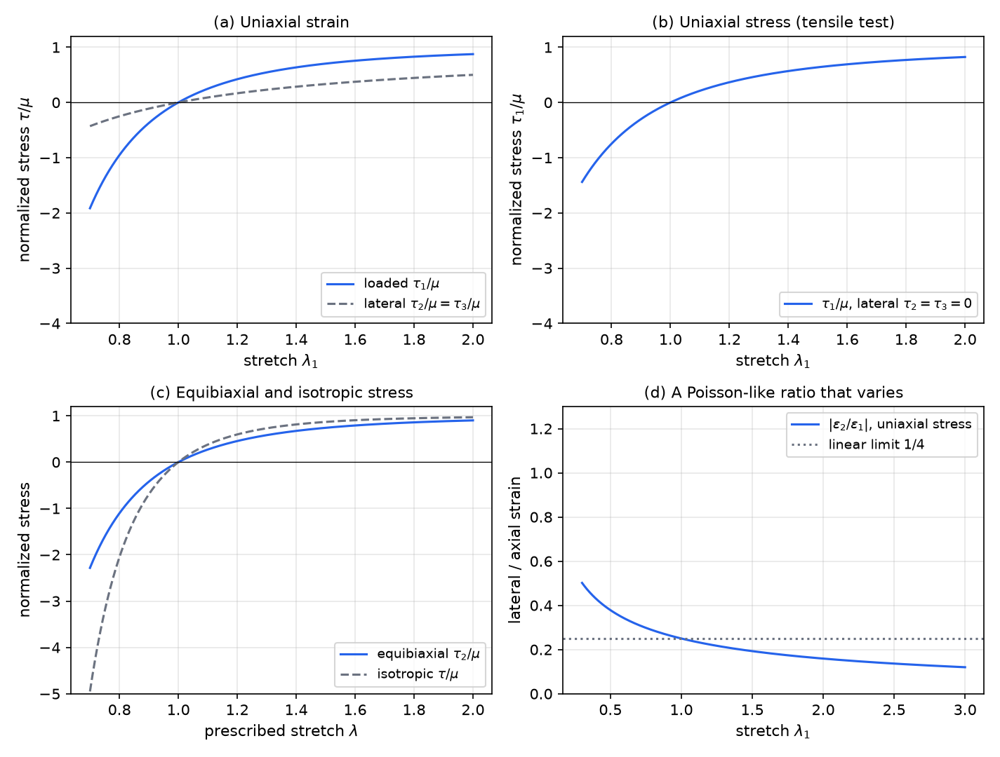
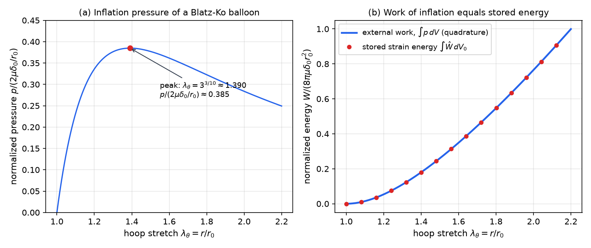

# Hyperelastic Solids

Rubber, elastomers and many soft biological tissues sustain large, highly nonlinear deformations and return to their original shape when unloaded, storing energy on the way. For such materials the stress derives from a stored-energy function. This chapter develops that structure: the restrictions that objectivity and isotropy place on the energy, the stress formulas in invariants and principal stretches, the standard models, homogeneous and balloon examples, and the link to linear elasticity through linearization.

## Notation and the Conservative Response

Throughout, \\(\mathbf X\\) is the reference position, \\(\mathbf x\\) the current position, \\(\mathbf u=\mathbf x-\mathbf X\\) the displacement, and
\\[
\mathbf F=\frac{\partial\mathbf x}{\partial\mathbf X},\qquad J=\det\mathbf F,\qquad \mathbf B=\mathbf F\mathbf F^T,\qquad \mathbf C=\mathbf F^T\mathbf F .
\\]
The Cauchy stress is \\(\boldsymbol\tau\\), the first Piola–Kirchhoff stress is \\(\mathbf P=J\boldsymbol\tau\mathbf F^{-T}\\), and the second Piola–Kirchhoff stress is \\(\mathbf S=\mathbf F^{-1}\mathbf P\\). Equivalently \\(\mathbf P=\mathbf F\mathbf S\\) and \\(\boldsymbol\tau=\tfrac1J\mathbf P\mathbf F^T\\). The first index of \\(P\_{ij}\\) refers to the current direction of the force and the second to the reference plane. Since \\(\mathbf B\\) and \\(\mathbf C\\) have the same eigenvalues, their invariants can be used interchangeably.

**Definition (Hyperelastic material).** A material is hyperelastic (Green-elastic) if there is a scalar function \\(W(\mathbf F,\mathbf X)\\), the strain energy per unit reference volume, such that
\\[
\mathbf P=\nabla W(\mathbf F,\mathbf X),\qquad\text{that is}\qquad P\_{ij}=\frac{\partial W}{\partial F\_{ij}} .
\\]
Here \\(\nabla W\\) is the tensor gradient \\((\nabla W)\_{ij}=\partial W/\partial F\_{ij}\\). The explicit \\(\mathbf X\\)-dependence allows inhomogeneous materials such as composites.

The stress power per unit reference volume is \\(P\_{ij}\dot F\_{ij}\\). For a hyperelastic material it is an exact rate,
\\[
P\_{ij}\dot F\_{ij}=\frac{\partial W}{\partial F\_{ij}}\dot F\_{ij}=\dot W .
\\]
Integrate over a cycle in which the deformation returns to its initial state.

**Theorem (Zero stress work over a cycle).** For a hyperelastic material, the net stress work over any closed deformation cycle, \\(\mathbf F(t\_0)=\mathbf F(t^\*)\\), vanishes:
\\[
\int\_{t\_0}^{t^\*}P\_{ij}\dot F\_{ij}\\,dt=\int\_{t\_0}^{t^\*}\dot W\\,dt=W(t^\*)-W(t\_0)=0 .
\\]

*Proof.* The integrand is a perfect differential, so the integral depends only on the end states. \\(\square\\)

So a hyperelastic material is conservative: whatever work is put in during loading is returned on unloading, and loading and unloading follow the same stress path. Nonlinearity is not the same as conservativeness, and not every simple material without memory is conservative. A stress law \\(P\_{ij}(\mathbf F)\\) derives from a potential only if its mixed derivatives agree, which requires
\\[
\frac{\partial P\_{ij}}{\partial F\_{lk}}=\frac{\partial^2W}{\partial F\_{ij}\partial F\_{lk}}=\frac{\partial P\_{lk}}{\partial F\_{ij}} .
\\]
Nine arbitrary functions \\(P\_{ij}(F\_{11},\dots,F\_{33})\\) will not satisfy these integrability conditions, so they cannot come from a potential and will dissipate energy over some cycles. Viscoelastic polymers under quasi-static loading, and pseudoelastic shape-memory alloys, are dissipative in this sense. The pseudoelastic material recovers its shape but traces a hysteresis loop, so it is not hyperelastic.

*Figure: left, pseudoelastic and viscoelastic response, in which loading and unloading follow different paths and the loop dissipates energy. Right, linear elastic (a straight line), hyperelastic (one curve traced in both directions, so the work is recovered) and elastic–plastic (unloading follows a different path and leaves a permanent strain).*

## Restrictions from Objectivity and Isotropy

### Objectivity

Under a change of observer by a rotation \\(\mathbf Q\\), the deformation gradient becomes \\(\mathbf Q\mathbf F\\). Stored energy cannot depend on the observer, so \\(W(\mathbf Q\mathbf F)=W(\mathbf F)\\) for every rotation \\(\mathbf Q\\). Two consequences follow.

First, the balance of angular momentum holds automatically. Differentiate \\(W(\mathbf Q\mathbf F)=W(\mathbf F)\\) at \\(\mathbf Q=\mathbf I\\) along a skew tensor \\(\mathbf\Omega\\), where \\(\mathbf Q\\) is taken as \\(\exp(t\mathbf\Omega)\\). This gives \\(\sum\_{ij}\frac{\partial W}{\partial F\_{ij}}(\mathbf\Omega\mathbf F)\_{ij}=0\\) for all skew \\(\mathbf\Omega\\). With \\(P\_{ij}=\partial W/\partial F\_{ij}\\), the left side equals \\(\sum\_{ik}\Omega\_{ik}(\mathbf P\mathbf F^T)\_{ik}\\), so the skew part of \\(\mathbf P\mathbf F^T\\) vanishes. Since \\(\mathbf P\mathbf F^T=J\boldsymbol\tau\\), this says that \\(\boldsymbol\tau\\) is symmetric, which is exactly the balance of angular momentum.

Second, setting \\(\mathbf F=\mathbf I\\) gives \\(W(\mathbf Q)=W(\mathbf I)\\): a pure rigid rotation stores no energy.

### Isotropy and principal stretches

Material isotropy means \\(W(\mathbf F\mathbf Q)=W(\mathbf F)\\) for every rotation \\(\mathbf Q\\), so rotating the reference configuration leaves the energy unchanged. Use the polar decomposition \\(\mathbf F=\mathbf R\mathbf U\\), where \\(\mathbf R\\) is a rotation and \\(\mathbf U=\sqrt{\mathbf C}\\) is symmetric positive definite. Objectivity with \\(\mathbf Q=\mathbf R^T\\) gives \\(W(\mathbf F)=W(\mathbf U)\\). Now write \\(\mathbf U=\mathbf Q\_1\boldsymbol\Lambda\mathbf Q\_1^T\\) with \\(\boldsymbol\Lambda=\operatorname{diag}(\lambda\_1,\lambda\_2,\lambda\_3)\\). Objectivity with \\(\mathbf Q=\mathbf Q\_1^T\\) gives \\(W(\mathbf U)=W(\boldsymbol\Lambda\mathbf Q\_1^T)\\), and isotropy then removes \\(\mathbf Q\_1^T\\). Hence
\\[
W(\mathbf F)=\hat W(\lambda\_1,\lambda\_2,\lambda\_3),
\\]
where the \\(\lambda\_i>0\\) are the principal stretches, the eigenvalues of \\(\mathbf U\\) and \\(\mathbf V=\sqrt{\mathbf B}\\). The function \\(\hat W\\) is symmetric in its three arguments. Neither a rotation before nor after the deformation changes the stored energy, and only the amounts of stretch matter, not their directions.

Equivalently, \\(W\\) can be written as a function of three invariants of \\(\mathbf B\\):
\\[
I\_1=\lambda\_1^2+\lambda\_2^2+\lambda\_3^2,\quad I\_2=\lambda\_1^2\lambda\_2^2+\lambda\_2^2\lambda\_3^2+\lambda\_3^2\lambda\_1^2,\quad I\_3=\lambda\_1^2\lambda\_2^2\lambda\_3^2=\det\mathbf B=J^2,
\\]
so \\(W=\bar W(I\_1,I\_2,I\_3)\\). The invariants are the elementary symmetric functions of \\(\lambda\_i^2\\), so they determine the stretches, and the two forms carry the same information. The invariant form is useful when the principal directions are unknown or rotate.

## Stress in Terms of Invariants

### The principal basis

Suppose the principal directions are known and fixed, as in uniaxial tension or balloon inflation. Then \\(\mathbf F=\mathbf U=\mathbf V=\operatorname{diag}(\lambda\_1,\lambda\_2,\lambda\_3)\\). By isotropy the stresses are coaxial with \\(\mathbf F\\), so the off-diagonal components vanish. Since \\(W\\) restricted to diagonal \\(\mathbf F\\) equals \\(\hat W(\lambda\_1,\lambda\_2,\lambda\_3)\\), the diagonal first Piola–Kirchhoff stresses are \\(P\_i=\partial W/\partial F\_{ii}=\partial\hat W/\partial\lambda\_i\\). The Cauchy stress follows from \\(\boldsymbol\tau=\tfrac1J\mathbf P\mathbf F^T\\). Therefore
\\[
\boxed{P\_i=\frac{\partial\hat W}{\partial\lambda\_i},\qquad \tau\_i=\frac{\lambda\_i}{\lambda\_1\lambda\_2\lambda\_3}\\,\frac{\partial\hat W}{\partial\lambda\_i}\quad(\text{no sum on }i)}.
\\]
These two formulas are the simplest route to the stress in an experiment. Fit \\(\hat W\\) to data, then differentiate.

### Derivatives of the invariants

For a general deformation, the chain rule gives \\(\nabla W=\sum\_{i=1}^3\bar W\_{I\_i}\\,\partial I\_i/\partial\mathbf F\\), where \\(\bar W\_{I\_i}=\partial\bar W/\partial I\_i\\). The three derivatives are found in index notation.

- For \\(I\_1=F\_{kl}F\_{kl}\\), \\(\partial I\_1/\partial F\_{ij}=2F\_{kl}\delta\_{ki}\delta\_{lj}=2F\_{ij}\\), so \\(\partial I\_1/\partial\mathbf F=2\mathbf F\\).
- For \\(I\_2=\tfrac12(I\_1^2-\operatorname{tr}\mathbf B^2)\\), the derivative of \\(\operatorname{tr}\mathbf B^2\\) is \\(4\mathbf B\mathbf F\\) (each of the four factors of \\(\mathbf F\\) in \\(\operatorname{tr}\mathbf B^2\\) contributes one term, and the four terms combine to \\(4\mathbf B\mathbf F\\)). Hence \\(\partial I\_2/\partial\mathbf F=2(I\_1\mathbf F-\mathbf B\mathbf F)\\).
- For \\(I\_3=(\det\mathbf F)^2\\), and since \\(\partial(\det\mathbf F)/\partial\mathbf F=(\det\mathbf F)\mathbf F^{-T}\\), we have \\(\partial I\_3/\partial\mathbf F=2I\_3\mathbf F^{-T}\\).

Substituting into the chain rule gives the general isotropic result, valid for any deformation, including rotating principal axes and shear:
\\[
\boxed{\mathbf P=2\left(\bar W\_{I\_1}+I\_1\bar W\_{I\_2}\right)\mathbf F-2\bar W\_{I\_2}\mathbf B\mathbf F+2I\_3\bar W\_{I\_3}\mathbf F^{-T}}.
\\]
Multiplying on the right by \\(\mathbf F^T\\) and dividing by \\(J=\sqrt{I\_3}\\) gives the Cauchy stress,
\\[
\boxed{\boldsymbol\tau=\frac{2}{\sqrt{I\_3}}\left(\bar W\_{I\_1}+I\_1\bar W\_{I\_2}\right)\mathbf B-\frac{2}{\sqrt{I\_3}}\bar W\_{I\_2}\mathbf B^2+2\sqrt{I\_3}\\,\bar W\_{I\_3}\mathbf I}.
\\]
Given \\(\mathbf F\\) at a point, these formulas give the stress directly. The second Piola–Kirchhoff stress can be written as \\(\mathbf S=2\\,\partial\bar W/\partial\mathbf C\\) in terms of the invariants of \\(\mathbf C\\). This form is symmetric by construction, but real forces are obtained by converting to \\(\boldsymbol\tau\\) or \\(\mathbf P\\).

### Elastic fluids

If the energy depends on volume change alone, \\(\bar W=\bar W(I\_3)\\), then \\(\bar W\_{I\_1}=\bar W\_{I\_2}=0\\) and the Cauchy stress is \\(\boldsymbol\tau=2\sqrt{I\_3}\\,\bar W\_{I\_3}\mathbf I=2J\bar W\_{I\_3}\mathbf I\\). This is purely isotropic, with no shear stress, and it recovers its volume when released. It is an elastic fluid in the sense of [Viscous Fluids](fluids.md).

**Example 6.1 (A gas at constant temperature).** A gas at fixed temperature obeys \\(pV=\text{constant}\\). Take \\(\bar W=-p\_0\ln J=-\tfrac{p\_0}{2}\ln I\_3\\), so \\(\bar W\_{I\_3}=-p\_0/(2I\_3)\\). Then
\\[
\boldsymbol\tau=2J\left(-\frac{p\_0}{2J^2}\right)\mathbf I=-\frac{p\_0}{J}\\,\mathbf I .
\\]
The pressure is \\(p=p\_0/J=p\_0V\_0/V\\), which is the isothermal gas law.

### The incompressible limit

An incompressible material has \\(J=1\\) at all times, so \\(I\_3=1\\) and \\(W\\) depends on \\(I\_1\\) and \\(I\_2\\) only. The constraint contributes an arbitrary pressure. With \\(I\_3=1\\), the Cayley–Hamilton theorem \\(\mathbf B^2=I\_1\mathbf B-I\_2\mathbf I+\mathbf B^{-1}\\) reduces the stress formula to
\\[
\boldsymbol\tau=-p\\,\mathbf I+2\bar W\_{I\_1}\mathbf B-2\bar W\_{I\_2}\mathbf B^{-1},
\\]
where \\(-p\\) collects the isotropic terms and is determined by the boundary conditions.

**Example 6.2 (Incompressible neo-Hookean uniaxial stretch).** Take \\(\bar W=C\_{10}(I\_1-3)\\), so \\(\boldsymbol\tau=-p\mathbf I+2C\_{10}\mathbf B\\). For uniaxial stretch, \\(\lambda\_1=\lambda\\) and \\(\lambda\_2=\lambda\_3=\lambda^{-1/2}\\). The lateral stress vanishes when \\(p=2C\_{10}/\lambda\\), and then
\\[
\tau\_1=2C\_{10}\left(\lambda^2-\frac{1}{\lambda}\right).
\\]
Near \\(\lambda=1\\) the derivative is \\(6C\_{10}\\), which is three times the shear modulus \\(2C\_{10}\\), as expected for an incompressible material.

## Standard Isotropic Models

The energy function of a specific material is a model with constants fitted to experiments. Each model below is written in invariant form and in principal stretches, and each is zero at \\(\mathbf F=\mathbf I\\), so the reference configuration is stress-free and energy-free.

**Blatz–Ko.** Blatz and Ko (1962) proposed this model for compressible foam rubber:
\\[
\bar W=\frac{\mu}{2}\left(\frac{I\_2}{I\_3}+2\sqrt{I\_3}-5\right)=\frac{\mu}{2}\left(\lambda\_1^{-2}+\lambda\_2^{-2}+\lambda\_3^{-2}+2\lambda\_1\lambda\_2\lambda\_3-5\right),\qquad \mu>0 .
\\]
It has a single constant \\(\mu\\), which scales the stress–strain curve. It has no \\(I\_1\\) dependence and depends on \\(I\_3\\), so it is compressible. At \\(\mathbf F=\mathbf I\\) we have \\(I\_1=I\_2=3\\) and \\(I\_3=1\\), and the constant \\(-5\\) makes \\(\bar W=0\\). Differentiating gives \\(\bar W\_{I\_1}=0\\), \\(\bar W\_{I\_2}=\mu/(2I\_3)\\), and \\(\bar W\_{I\_3}=(\mu/(2I\_3))(-I\_2/I\_3+\sqrt{I\_3})\\). The general formulas then give
\\[
\boldsymbol\tau=\mu\frac{I\_1}{I\_3^{3/2}}\mathbf B-\mu\frac{1}{I\_3^{3/2}}\mathbf B^2+\mu\left(1-\frac{I\_2}{I\_3^{3/2}}\right)\mathbf I .
\\]
In principal stretches the Cauchy stress is simpler. Using \\(P\_i=\partial\hat W/\partial\lambda\_i\\) and \\(\tau\_i=(\lambda\_i/J)P\_i\\), one finds
\\[
P\_i=\mu\left(\frac{J}{\lambda\_i}-\lambda\_i^{-3}\right),\qquad \tau\_i=\mu\left(1-\frac{1}{J\lambda\_i^2}\right)\quad(\text{no sum on }i).
\\]
The second result follows directly from \\(\tau\_i=(\lambda\_i/J)P\_i\\): \\(\tau\_i=\mu(1-\lambda\_i^{-2}/J)\\).

**Neo-Hookean.** The compressible form is
\\[
\bar W=C\_1\left(I\_1-3-2\ln\sqrt{I\_3}\right)+D\_1\left(\sqrt{I\_3}-1\right)^2 ,
\\]
with no \\(I\_2\\) dependence and constants \\(C\_1\\) and \\(D\_1\\). Its incompressible limit is \\(\bar W=C\_1(I\_1-3)\\), as in Example 6.2.

**Mooney–Rivlin.** The model depends on all three invariants:
\\[
\bar W=C\_{01}\left(I\_3^{-2/3}I\_2-3\right)+C\_{10}\left(I\_3^{-1/3}I\_1-3\right)+\frac{1}{D\_1}\left(\sqrt{I\_3}-1\right)^2 .
\\]
The first two terms are the distortional part, the last is volumetric, and the incompressible form is \\(C\_{10}(I\_1-3)+C\_{01}(I\_2-3)\\).

Other isotropic models, such as the Ogden and Gent forms, follow the same general theory and differ only in the choice of \\(\hat W\\). Working with a model means identifying its constants from test data and then differentiating, which is less elegant than the linear theory but follows the same steps.

## Field Equations

Combining the balance laws with the constitutive relation gives the equations for a hyperelastic body. In the current configuration the balance of linear momentum and the balance of angular momentum read
\\[
\nabla\cdot\boldsymbol\tau+\rho\mathbf b=\rho\\,\mathbf a,\qquad \boldsymbol\tau=\boldsymbol\tau^T ,
\\]
with \\(\boldsymbol\tau=\tfrac1J\mathbf P\mathbf F^T\\) and \\(\mathbf P=\nabla W\\). In reference coordinates they read
\\[
\frac{\partial P\_{ji}}{\partial X\_i}+f\_j=\rho\_0\frac{\partial^2x\_j}{\partial t^2},\qquad \mathbf P\mathbf F^T\ \text{symmetric},
\\]
with \\(P\_{ji}=\partial W/\partial F\_{ji}\\) and \\(f\_j=J\\,b\_j\\). Substituting the constitutive law gives
\\[
\frac{\partial}{\partial X\_i}\left(\frac{\partial W}{\partial F\_{ji}}\right)+f\_j=\rho\_0\frac{\partial^2x\_j}{\partial t^2},\qquad F\_{ji}=\frac{\partial x\_j}{\partial X\_i}.
\\]
These are the Euler–Lagrange equations of the energy, so the static problem is the stationary point of the total potential energy, with prescribed displacements or tractions as boundary conditions. The system is a nonlinear second-order partial differential system for \\(\mathbf x(\mathbf X,t)\\). Initial positions and velocities complete a specific problem. Except for simple geometries, the system is solved numerically, for example by finite elements.

## Homogeneous Deformations

A homogeneous deformation has constant \\(\mathbf F\\), so it is the simplest test of a model. Take the principal stretches along fixed axes and use the Blatz–Ko principal relation \\(\tau\_i=\mu(1-1/(J\lambda\_i^2))\\). Four modes cover the common experiments. In each, a stretch is prescribed in some directions while a stress is prescribed in others.

- **Uniaxial strain** (a rigid die that prevents lateral strain): \\(\lambda\_1\\) is free and \\(\lambda\_2=\lambda\_3=1\\). Then \\(\tau\_1=\mu(1-\lambda\_1^{-3})\\) and \\(\tau\_2=\tau\_3=\mu(1-\lambda\_1^{-1})\\). Lateral stresses are needed to prevent lateral deformation.
- **Uniaxial stress** (a tensile test): \\(\tau\_2=\tau\_3=0\\), so the lateral stretches are fixed by the material. Setting \\(\tau\_2=0\\) with \\(\lambda\_2=\lambda\_3=\lambda\\) gives \\(\lambda=\lambda\_1^{-1/4}\\), and then \\(\tau\_1=\mu(1-\lambda\_1^{-5/2})\\).
- **Equibiaxial stress**: \\(\tau\_1=0\\) and \\(\lambda\_2=\lambda\_3=\lambda\\). Setting \\(\tau\_1=0\\) gives \\(\lambda\_1=\lambda^{-2/3}\\), and then \\(\tau\_2=\tau\_3=\mu(1-\lambda^{-10/3})\\).
- **Isotropic expansion**: \\(\lambda\_1=\lambda\_2=\lambda\_3=\lambda\\) and \\(\tau\_i=\tau=\mu(1-\lambda^{-5})\\), with no shear.

The curves share general features for any model of this type. Stresses vanish at \\(\lambda=1\\), a stretch below one is compression, and the stress grows without bound as the stretch approaches zero, because a body cannot be compressed to zero volume.

**Example 6.3 (A Poisson-like ratio that varies).** In the uniaxial-stress mode, the lateral strain is \\(\varepsilon\_2=\lambda-1=\lambda\_1^{-1/4}-1\\), and the ratio of lateral to axial strain is
\\[
\left\|\frac{\varepsilon\_2}{\varepsilon\_1}\right\|=\frac{1-\lambda\_1^{-1/4}}{\lambda\_1-1}.
\\]
As \\(\lambda\_1\to1\\) this tends to \\(1/4\\), which l'Hôpital's rule gives directly. Away from \\(\lambda\_1=1\\) it changes: it is about \\(0.38\\) at \\(\lambda\_1=0.5\\), about \\(0.16\\) at \\(\lambda\_1=2\\), and about \\(0.07\\) at \\(\lambda\_1=6\\). There is therefore no constant Poisson ratio for this material. A Poisson effect, in which lateral dimensions change as the body is stretched, is still present. The constant ratio of linear elasticity is a special feature of small strains.

*Figure: normalized stress for the four homogeneous modes, with the prescribed stretch on the horizontal axis. (a) Uniaxial strain: loaded and lateral stresses. (b) Uniaxial stress: the loaded stress, with the lateral stresses zero. (c) Equibiaxial and isotropic stress. (d) The ratio of lateral to axial strain in uniaxial stress, which tends to the linear value \\(1/4\\) at \\(\lambda\_1=1\\) and varies elsewhere.*

## Balloon Inflation

**Example 6.4 (A spherical balloon).** A thin-walled spherical balloon has initial mid-surface radius \\(r\_0\\) and wall thickness \\(\delta\_0\\). Under internal pressure \\(p\\) its radius becomes \\(r\\) and its thickness \\(\delta\\). For balloon rubber the ratio \\(r/\delta\\) is typically between 10 and 100, so the wall is thin, but the deformation is clearly finite. The problem is to find \\(p(r)\\) for a Blatz–Ko material.

Spherical symmetry makes the two tangential (hoop) Cauchy stresses \\(\tau\_\theta\\) equal. The radial stress \\(\tau\_r\\) varies from \\(-p\\) at the inner surface to zero at the outer surface, and since \\(\|\tau\_r\|\ll\tau\_\theta\\) across a thin wall, we take \\(\tau\_r\approx 0\\) (plane stress).

Equilibrium of a hemisphere cut through the centre gives the hoop stress directly. The pressure acts on the projected area \\(\pi r^2\\), and the hoop stress acts on the cut annulus of area \\(2\pi r\delta\\):
\\[
(2\pi r\delta)\\,\tau\_\theta=(\pi r^2)\\,p\quad\Longrightarrow\quad\tau\_\theta=\frac{pr}{2\delta},
\\]
which is valid at every stage of inflation.

The stretches are \\(\lambda\_\theta=r/r\_0\\) in both tangential directions and \\(\lambda\_r=\delta/\delta\_0\\) radially, so \\(\mathbf F=\operatorname{diag}(\lambda\_\theta,\lambda\_\theta,\lambda\_r)\\) and \\(J=\lambda\_\theta^2\lambda\_r\\). The material is compressible, so \\(\lambda\_r\\) is not fixed by incompressibility. The radial stress is zero, \\(\tau\_r=\mu(1-1/(J\lambda\_r^2))=0\\), which gives
\\[
\boxed{\lambda\_r=\lambda\_\theta^{-2/3}}.
\\]
The hoop stress is then \\(\tau\_\theta=\mu(1-1/(J\lambda\_\theta^2))=\mu(1-\lambda\_\theta^{-10/3})\\). Substituting \\(\delta=\delta\_0\lambda\_\theta^{-2/3}\\) and \\(r=r\_0\lambda\_\theta\\) into \\(p=2\delta\tau\_\theta/r\\) gives the pressure–stretch relation
\\[
\boxed{p=\frac{2\mu\delta\_0}{r\_0}\left(\lambda\_\theta^{-5/3}-\lambda\_\theta^{-5}\right)}.
\\]
The curve rises from zero at \\(\lambda\_\theta=1\\), reaches a maximum, and then falls. Setting \\(dp/d\lambda\_\theta=0\\) gives \\(\lambda\_\theta^{10/3}=3\\), so the maximum occurs at \\(\lambda\_\theta=3^{3/10}\approx 1.390\\), where \\(p\approx0.385\\,(2\mu\delta\_0/r\_0)\\). Beyond this point less pressure is needed to inflate further, so under controlled pressure the inflation becomes unstable and the balloon snaps to a larger radius. Whether a real balloon peaks at this stretch depends on its rubber, and a balloon maker would fit a richer model to experiments.

**Energy balance.** The work done by the pressure as the balloon inflates from \\(r\_0\\) to \\(r\\) is \\(\int p\\,dV\\) with \\(dV=4\pi r^2\\,dr\\). Writing \\(\lambda=r/r\_0\\) and using the pressure relation gives
\\[
W\_{\rm ext}=\int\_{r\_0}^{r}p\\,4\pi r^2\\,dr=8\pi\mu\delta\_0r\_0^2\left(\frac34\lambda^{4/3}+\frac12\lambda^{-2}-\frac54\right).
\\]
The stored strain energy is \\(\int\hat W\\,dV\_0\\), with \\(dV\_0\\) the reference volume \\(4\pi r\_0^2\delta\_0\\). Using \\(\lambda\_r=\lambda^{-2/3}\\) gives \\(\hat W=\mu\left(\tfrac32\lambda^{4/3}+\lambda^{-2}-\tfrac52\right)\\), and the stored energy is exactly \\(W\_{\rm ext}\\). Because the inflation is quasi-static, with no kinetic energy and no gravity, this equality is the power identity in integrated form. The figure below shows both the pressure curve and the energy balance.

*Figure: left, the normalized pressure \\(p/(2\mu\delta\_0/r\_0)\\) against hoop stretch \\(\lambda\_\theta=r/r\_0\\), with the maximum at \\(\lambda\_\theta=3^{3/10}\\). Right, the external work of the inflation pressure (curve) and the stored strain energy of the Blatz–Ko wall (dots), normalized by \\(8\pi\mu\delta\_0r\_0^2\\); the two coincide at every radius.*

## Linearization and Linear Elasticity

Hyperelasticity is difficult, but for small deformations it reduces to linear elasticity. Take a stress-free reference, \\(\mathbf F=\mathbf I+\nabla\mathbf u\\), with \\(\lVert\nabla\mathbf u\rVert\ll 1\\). Expanding \\(\partial W/\partial F\_{ij}\\) to first order about \\(\mathbf F=\mathbf I\\) gives, using \\(\partial W/\partial F\_{ij}(\mathbf I)=0\\) for a stress-free reference,
\\[
P\_{ij}\approx\mathcal A\_{ijkl}\\,u\_{k,l},\qquad \mathcal A\_{ijkl}=\left.\frac{\partial^2W}{\partial F\_{ij}\partial F\_{kl}}\right\|\_{\mathbf F=\mathbf I}.
\\]
The modulus tensor \\(\mathcal A\\) is the rate of change of stress with deformation at the reference state. Smoothness of \\(W\\) makes the second derivatives commute, which gives the major symmetry \\(\mathcal A\_{ijkl}=\mathcal A\_{klij}\\).

At this order the first and second Piola–Kirchhoff and Cauchy stresses coincide, since \\(\mathbf F\approx\mathbf I\\), \\(J\approx 1\\) and \\(\mathbf F^{-1}\approx\mathbf I\\). The Cauchy stress is symmetric by balance of angular momentum, so the linearized stress is symmetric. This gives the first minor symmetry, and the major symmetry then implies the second. Only the symmetric part \\(\varepsilon\_{kl}=\tfrac12(u\_{k,l}+u\_{l,k})\\) produces stress, and the general linear elastic law is
\\[
P\_{ij}=C\_{ijkl}\varepsilon\_{kl},\qquad C\_{ijkl}=C\_{jikl}=C\_{ijlk}=C\_{klij}.
\\]
Its isotropic form, the Lamé constants and the count of independent constants are developed in [Linear Elasticity](linear-elasticity.md).

The Blatz–Ko model gives a useful check. Its uniaxial-strain stresses have slopes \\(d\tau\_1/d\lambda\_1=3\mu\\) and \\(d\tau\_2/d\lambda\_1=\mu\\) at \\(\lambda\_1=1\\). The linear isotropic law with \\(\varepsilon\_2=\varepsilon\_3=0\\) gives \\(\tau\_1=(\lambda\_L+2\mu\_L)\varepsilon\_1\\) and \\(\tau\_2=\lambda\_L\varepsilon\_1\\), where \\(\lambda\_L\\) and \\(\mu\_L\\) are the Lamé constants of the linearized material. Matching gives \\(\lambda\_L=\mu\\) and \\(\mu\_L=\mu\\). The linear Poisson ratio is then \\(\lambda\_L/(2(\lambda\_L+\mu\_L))=1/4\\) and the Young modulus is \\(\mu\_L(3\lambda\_L+2\mu\_L)/(\lambda\_L+\mu\_L)=5\mu/2\\). These are exactly the \\(\lambda\_1\to1\\) limits of the varying ratio in Example 6.3 and of the uniaxial-stress slope \\(d\tau\_1/d\lambda\_1=5\mu/2\\), which confirms the linearization.

The St. Venant–Kirchhoff model is the most direct large-strain extension of the linear law. It uses the Green–Lagrange strain \\(\mathbf E=\tfrac12(\mathbf C-\mathbf I)\\) and the energy
\\[
W(\mathbf E)=\tfrac12\lambda(\operatorname{tr}\mathbf E)^2+\mu\operatorname{tr}(\mathbf E^2),\qquad \mathbf S=\lambda(\operatorname{tr}\mathbf E)\mathbf I+2\mu\mathbf E .
\\]
Its linearization is exactly the isotropic linear law. It is hyperelastic, but it is known to behave poorly under large compression, so for large strains the Blatz–Ko or Mooney–Rivlin forms are usually preferred.

## Summary

- Hyperelasticity: \\(\mathbf P=\nabla W(\mathbf F)\\), so \\(P\_{ij}=\partial W/\partial F\_{ij}\\). The stress power is an exact rate, and the net work over every closed cycle is zero.
- Objectivity gives \\(W(\mathbf Q\mathbf F)=W(\mathbf F)\\) and the balance of angular momentum. Isotropy gives \\(W=\hat W(\lambda\_1,\lambda\_2,\lambda\_3)=\bar W(I\_1,I\_2,I\_3)\\).
- Principal basis: \\(P\_i=\partial\hat W/\partial\lambda\_i\\) and \\(\tau\_i=(\lambda\_i/J)P\_i\\), with no sum on \\(i\\).
- Invariant form: \\(\boldsymbol\tau=\tfrac{2}{\sqrt{I\_3}}(\bar W\_{I\_1}+I\_1\bar W\_{I\_2})\mathbf B-\tfrac{2}{\sqrt{I\_3}}\bar W\_{I\_2}\mathbf B^2+2\sqrt{I\_3}\\,\bar W\_{I\_3}\mathbf I\\). An elastic fluid has \\(\bar W=\bar W(I\_3)\\). An incompressible material has \\(\boldsymbol\tau=-p\mathbf I+2\bar W\_{I\_1}\mathbf B-2\bar W\_{I\_2}\mathbf B^{-1}\\).
- Blatz–Ko: \\(\hat W=\tfrac\mu2(\lambda\_1^{-2}+\lambda\_2^{-2}+\lambda\_3^{-2}+2\lambda\_1\lambda\_2\lambda\_3-5)\\) and \\(\tau\_i=\mu(1-1/(J\lambda\_i^2))\\).
- Balloon: \\(\lambda\_r=\lambda\_\theta^{-2/3}\\) and \\(p=(2\mu\delta\_0/r\_0)(\lambda\_\theta^{-5/3}-\lambda\_\theta^{-5})\\), with maximum at \\(\lambda\_\theta=3^{3/10}\\) and \\(p\_{\max}\approx0.385\\,(2\mu\delta\_0/r\_0)\\). The external work equals the stored energy.
- Linearization about \\(\mathbf F=\mathbf I\\) gives \\(P\_{ij}=C\_{ijkl}\varepsilon\_{kl}\\) with major and minor symmetries, which is the linear elastic law.

## See Also

- [Kinematics of Deformation](kinematics.md): the deformation gradient, Cauchy–Green tensors and stretches used here.
- [Balance Laws and Stress](balance-laws.md): the balance laws and the stress measures \\(\boldsymbol\tau\\), \\(\mathbf P\\) and \\(\mathbf S\\).
- [Constitutive Theory and Material Symmetry](constitutive.md): simple materials without memory, objectivity and material symmetry.
- [Linear Elasticity](linear-elasticity.md): the small-strain limit, with the isotropic law and its constants.
- [Viscous Fluids](fluids.md): the fluid counterpart, where stress depends on the rate of deformation.
- Stress and Strain and Elasticity: the one-dimensional and beam-level version of this material.
- Eigenvalues and Eigenvectors: principal stretches and principal directions.
- Finite Element Methods: numerical solution of large-deformation problems.
