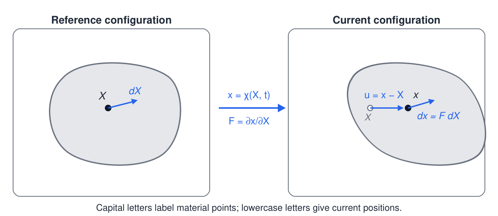
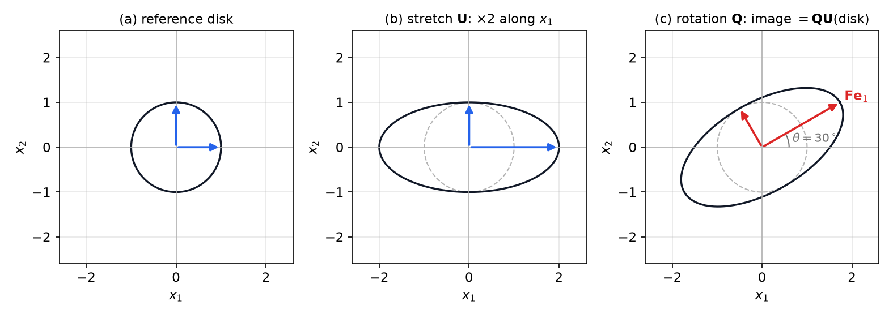
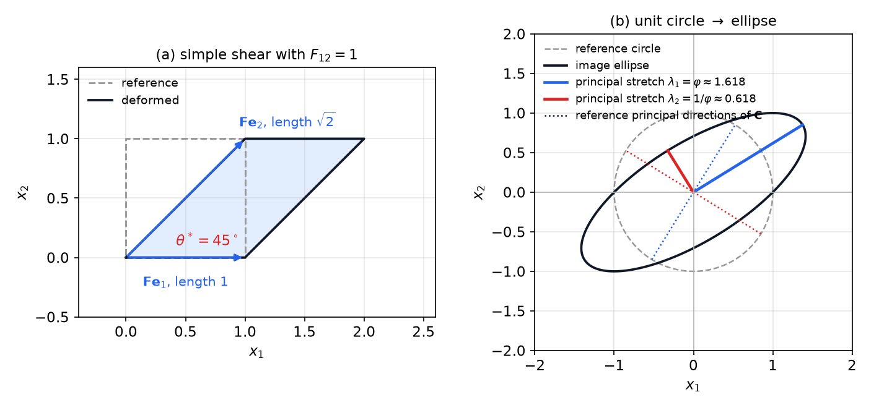
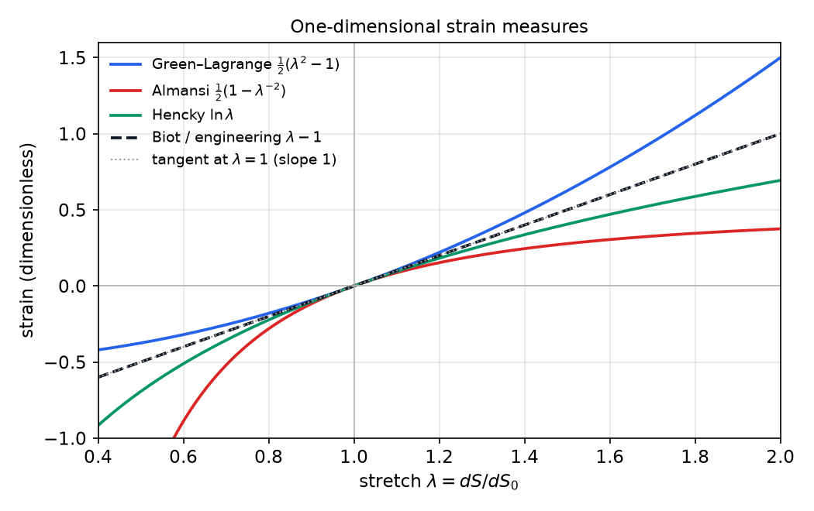

# Kinematics of Deformation

Kinematics describes how a body moves and deforms, without reference to the forces that cause the motion. Its central object is the deformation gradient, which maps material line elements from the reference configuration to the current one. From it follow the changes of volume, length and angle, the strain measures used in different settings, the velocity gradient that governs rates of deformation, and the compatibility conditions that a deformation must satisfy. The chapter relies on the tensor algebra of the previous chapter, especially the polar decomposition.

Throughout, capital indices \\(I,J,K\\) refer to reference coordinates \\(\mathbf X\\) and lowercase indices \\(i,j,k\\) to current coordinates \\(\mathbf x\\). Derivatives carry the index of the variable they are taken with respect to, so \\(F\_{iI}=\partial x\_i/\partial X\_I\\). Summation over repeated indices is implied, as in the previous chapter.

## Motion and Configurations

### Reference and current configurations

The body occupies a region \\(\mathcal B\_0\\) at a reference time, its **reference configuration**, and a region \\(\mathcal B\_t\\) at time \\(t\\), its **current configuration**. Each material point is labelled by its reference position \\(\mathbf X\\), which never changes. Its current position is given by the **motion**
\\[
\mathbf x=\boldsymbol\chi(\mathbf X,t).
\\]
The description in terms of \\(\mathbf X\\) is the **material** or **Lagrangian** description, and it is natural for solids, where one follows each particle. The description in terms of \\(\mathbf x\\) is the **spatial** or **Eulerian** description, and it is natural for fluids, where a fixed location is observed as different particles pass through it. The two descriptions represent the same motion. The velocity field has a physical meaning in both, and the section on velocity below relates them.

*Figure: a body in its reference configuration (left) and at time \\(t\\) (right). The motion \\(\mathbf x=\boldsymbol\chi(\mathbf X,t)\\) carries the material point \\(\mathbf X\\) to \\(\mathbf x\\). The displacement is \\(\mathbf u=\mathbf x-\mathbf X\\), and a material line element \\(d\mathbf X\\) becomes \\(d\mathbf x=\mathbf F\\,d\mathbf X\\).*

### Displacement

The **displacement** is the vector from a particle's reference position to its current position,
\\[
\mathbf u(\mathbf X,t)=\mathbf x-\mathbf X,\qquad u\_i=x\_i-X\_i.
\\]
A rigid translation has a constant displacement, and a rigid rotation has a displacement that varies with position but produces no deformation. The quantity that measures deformation is therefore not the displacement itself, but its spatial variation. The next section makes this precise.

### Admissible deformations

A motion is an admissible model of a continuum only if it satisfies three requirements.

1. **One-to-one.** Distinct material points must occupy distinct positions. A map that sends two points to one would squeeze them together, which a continuum cannot do without interpenetration. Fracture and other tearing are excluded here and treated separately.
2. **Smoothness.** The map \\(\boldsymbol\chi\\) must be at least twice continuously differentiable in \\(\mathbf X\\), because strain measures involve first derivatives and their compatibility conditions involve second derivatives.
3. **Positive Jacobian.** The determinant \\(J=\det\mathbf F\\) must be positive. Its meaning is given below: \\(J\\) is the ratio of current to reference volume, so \\(J=0\\) would collapse a volume element to zero, and \\(J<0\\) would reverse its orientation, like a mirror image.

The second and third requirements are not restrictive in practice, but the first excludes cracks and interpenetration. Each requirement has a counterpart in the tensor theory of the previous chapter. The third is the statement that the deformation gradient is non-singular, which is the hypothesis of the polar decomposition.

## The Deformation Gradient

### Definition and the differential relation

The **deformation gradient** is the tensor
\\[
\mathbf F=\frac{\partial\mathbf x}{\partial\mathbf X},\qquad F\_{iI}=\frac{\partial x\_i}{\partial X\_I}.
\\]
It is the linear part of the motion. Two neighbouring particles separated by \\(d\mathbf X\\) in the reference configuration are separated by
\\[
d\mathbf x=\mathbf F\\,d\mathbf X
\\]
in the current configuration, to first order. This is the chain rule written in index form, \\(dx\_i=(\partial x\_i/\partial X\_I)\\,dX\_I\\), and it is the basic relation from which every other kinematic quantity is built. The deformation gradient carries no information about the rigid translation, which contributes nothing to \\(\partial\mathbf x/\partial\mathbf X\\), and it is generally not symmetric.

For a rigid translation \\(\mathbf x=\mathbf X+\mathbf c\\), \\(\mathbf F=\mathbf I\\). For a rigid rotation \\(\mathbf x=\mathbf Q\mathbf X+\mathbf c\\), \\(\mathbf F=\mathbf Q\\), a proper orthogonal tensor. Both give \\(\mathbf F\\) with unit determinant and no strain, which is why strain must be defined through \\(\mathbf F^T\mathbf F\\) and not through \\(\mathbf F\\) itself.

### The displacement gradient

Writing \\(\mathbf x=\mathbf X+\mathbf u\\) gives
\\[
\mathbf F=\mathbf I+\nabla\_{\mathbf X}\mathbf u,\qquad (\nabla\_{\mathbf X}\mathbf u)\_{iI}=\frac{\partial u\_i}{\partial X\_I}.
\\]
If one knows the displacement gradient one knows \\(\mathbf F\\), and conversely. Most of the strain measures below are written in terms of \\(\nabla\_{\mathbf X}\mathbf u\\), which makes their meaning clearer for solids that deform by small amounts.

### Homogeneous and inhomogeneous deformations

The deformation is **homogeneous** if \\(\mathbf F\\) is the same at every point of the body. Then \\(\mathbf x=\mathbf F\mathbf X+\mathbf c\\) for a constant tensor and vector, and the map is affine. A homogeneous deformation maps straight lines to straight lines and parallel planes to parallel planes. A **pure homogeneous** deformation has \\(\mathbf c=\mathbf 0\\) and \\(\mathbf F\\) symmetric, so it has no rotation.

If \\(\mathbf F\\) varies with \\(\mathbf X\\), the deformation is **inhomogeneous**. Even then, a small region around any point deforms approximately homogeneously. Taylor expansion of \\(\boldsymbol\chi\\) about \\(\mathbf X\_0\\) gives
\\[
\mathbf x=\boldsymbol\chi(\mathbf X\_0)+\mathbf F(\mathbf X\_0)(\mathbf X-\mathbf X\_0)+O(\lvert\mathbf X-\mathbf X\_0\rvert^2).
\\]
A very small circle of material around \\(\mathbf X\_0\\) therefore becomes an ellipse, whose shape is set by \\(\mathbf F(\mathbf X\_0)\\). This is how strains are measured experimentally, by printing a grid of small circles on a sheet and measuring the ellipses after deformation.

### The inverse deformation

When the motion is one-to-one with positive Jacobian, it can be inverted: \\(\mathbf X=\boldsymbol\chi^{-1}(\mathbf x,t)\\). The inverse has gradient
\\[
\frac{\partial\mathbf X}{\partial\mathbf x}=\mathbf F^{-1},\qquad \frac{\partial X\_I}{\partial x\_i}=(F^{-1})\_{Ii},
\\]
by the chain rule applied to \\(\mathbf X=\boldsymbol\chi^{-1}(\boldsymbol\chi(\mathbf X))\\). The inverse of a homogeneous deformation is \\(\mathbf X=\mathbf F^{-1}(\mathbf x-\mathbf c)\\). Explicit formulas for inverses of small tensors come from the previous chapter. In most applications the motion is not known in closed form and is found numerically, but the theory is developed for explicit examples.

## Stretches and Rotations

The polar decomposition of the previous chapter applies directly to \\(\mathbf F\\), which is non-singular because \\(J>0\\). It separates the deformation into a stretch and a rotation.

**Theorem (polar decomposition of the deformation gradient).** Let \\(\mathbf F\\) be a deformation gradient with \\(J>0\\). Then
\\[
\mathbf F=\mathbf Q\mathbf U=\mathbf V\mathbf Q,\qquad \mathbf U=\sqrt{\mathbf C},\qquad \mathbf V=\sqrt{\mathbf B},
\\]
where \\(\mathbf C=\mathbf F^T\mathbf F\\), \\(\mathbf B=\mathbf F\mathbf F^T\\), \\(\mathbf U\\) and \\(\mathbf V\\) are symmetric positive definite, and \\(\mathbf Q\\) is a rotation.

The tensor \\(\mathbf U\\) is the **right stretch**, because it acts on the reference configuration, and \\(\mathbf V\\) is the **left stretch**, because it acts on the current one. The eigenvalues \\(\lambda\_1,\lambda\_2,\lambda\_3\\) of \\(\mathbf U\\) and \\(\mathbf V\\) are the **principal stretches**, and they are the same for both. If \\(\mathbf N\_a\\) are the unit eigenvectors of \\(\mathbf U\\), the eigenvectors of \\(\mathbf V\\) are \\(\mathbf n\_a=\mathbf Q\mathbf N\_a\\). So the principal directions in the current configuration are the rotated principal directions in the reference configuration. The rotation \\(\mathbf Q\\) changes orientation but not length, while the stretches are the true strains.

**Example 2.1 (A planar stretch followed by a rotation).** Let a unit disk in the \\(X\_1\\)–\\(X\_2\\) plane be mapped by
\\[
x\_1=2X\_1\cos\theta-X\_2\sin\theta,\qquad x\_2=2X\_1\sin\theta+X\_2\cos\theta,
\\]
with \\(\theta=30^\circ\\). Find the polar decomposition and the image of the disk.

*Solution.* The map is linear, so \\(\mathbf F\\) is constant and equal to
\\[
\mathbf F=\begin{pmatrix}2\cos\theta&-\sin\theta\\\\2\sin\theta&\cos\theta\end{pmatrix}=\begin{pmatrix}\sqrt3&-\tfrac12\\\\1&\tfrac{\sqrt3}{2}\end{pmatrix}.
\\]
Then \\(\det\mathbf F=2\cos^2\theta+2\sin^2\theta=2>0\\), so \\(J=2\\) and the disk maps to an ellipse of twice the area. The right Cauchy–Green tensor is
\\[
\mathbf C=\mathbf F^T\mathbf F=\begin{pmatrix}4&0\\\\0&1\end{pmatrix}
\\]
for every \\(\theta\\), so \\(\mathbf U=\operatorname{diag}(2,1)\\), already in its principal basis. The rotation is \\(\mathbf Q=\mathbf F\mathbf U^{-1}\\):
\\[
\mathbf Q=\begin{pmatrix}\cos\theta&-\sin\theta\\\\\sin\theta&\cos\theta\end{pmatrix}=\begin{pmatrix}\tfrac{\sqrt3}{2}&-\tfrac12\\\\\tfrac12&\tfrac{\sqrt3}{2}\end{pmatrix}.
\\]
The left stretch is \\(\mathbf V=\mathbf F\mathbf Q^T=\begin{pmatrix}1+\cos^2\theta&\sin\theta\cos\theta\\\\\sin\theta\cos\theta&1+\sin^2\theta\end{pmatrix}=\begin{pmatrix}\tfrac74&\tfrac{\sqrt3}{4}\\\\\tfrac{\sqrt3}{4}&\tfrac54\end{pmatrix}\\). Its eigenvalues are \\(2\\) and \\(1\\), and its eigenvector for \\(2\\) is \\((\cos\theta,\sin\theta)\\), which one checks directly: \\(\mathbf V(\tfrac{\sqrt3}{2},\tfrac12)=(\sqrt3,1)=2(\tfrac{\sqrt3}{2},\tfrac12)\\).

Geometrically, the stretch \\(\mathbf U\\) doubles lengths along \\(X\_1\\) and leaves \\(X\_2\\) alone, giving an ellipse with semi-axes \\(2\\) and \\(1\\) aligned with the coordinate axes. The rotation \\(\mathbf Q\\) then turns the ellipse through \\(30^\circ\\). The left decomposition gives the same ellipse in the other order: rotate the disk by \\(30^\circ\\) first, then stretch by \\(2\\) along the rotated \\(x\_1\\)-axis. Its semi-axes are again \\(2\\) and \\(1\\), but they are aligned with \\((\cos\theta,\sin\theta)\\), exactly as the eigenvector computation shows. \\(\blacksquare\\)

*Figure: the unit disk under \\(\mathbf F=\mathbf Q\mathbf U\\) with \\(\theta=30^\circ\\). Left, the reference disk. Centre, the stretch \\(\mathbf U\\), which doubles lengths along \\(X\_1\\). Right, the rotation \\(\mathbf Q\\) applied to the stretched ellipse. The same final ellipse results from \\(\mathbf V\mathbf Q\\), which rotates first and then stretches along the rotated axes.*

The example shows how the decomposition separates rotation from strain. A rigid rotation of a body leaves every length and angle unchanged, and it changes \\(\mathbf F\\) only through \\(\mathbf Q\\). Any deformation that changes lengths or angles must have a non-trivial stretch, and the stretch is what strain measures describe.

## Volume, Area and Length

### Volume

Let three non-coplanar material line elements \\(d\mathbf X\_1,d\mathbf X\_2,d\mathbf X\_3\\) meet at a point. The reference volume they span is \\(dV\_0=d\mathbf X\_1\cdot(d\mathbf X\_2\times d\mathbf X\_3)\\). After deformation the same elements span \\(dV=d\mathbf x\_1\cdot(d\mathbf x\_2\times d\mathbf x\_3)\\) with \\(d\mathbf x\_\alpha=\mathbf F\\,d\mathbf X\_\alpha\\). The identity behind the Jacobian is the index form of the determinant used for orthogonal tensors in the previous chapter, \\(\varepsilon\_{ijk}F\_{in}F\_{jl}F\_{km}=\det\mathbf F\\,\varepsilon\_{nlm}\\). It gives \\((\mathbf F\mathbf a)\cdot(\mathbf F\mathbf b\times\mathbf F\mathbf c)=J\\,\mathbf a\cdot(\mathbf b\times\mathbf c)\\), and therefore
\\[
dV=J\\,dV\_0,\qquad J=\det\mathbf F=\frac{dV}{dV\_0}.
\\]
Thus \\(J\\) is the local volume ratio. Its value \\(J=1\\) means volume-preserving, or isochoric, deformation, while \\(J>1\\) means local expansion and \\(J<1\\) compression.

The volume ratio gives a change of variables for integrals over the body. For any scalar function \\(f(\mathbf x)\\),
\\[
\int\_{\mathcal B\_t}f(\mathbf x)\\,dV=\int\_{\mathcal B\_0}f(\boldsymbol\chi(\mathbf X,t))\\,J(\mathbf X,t)\\,dV\_0 .
\\]
The integral over the deformed body, which may have a complicated shape, becomes an integral over the reference body, which is usually simpler. The same rule applies to vector and tensor integrands component by component. Conservation laws, which are integrals over material volumes, rely on this change of variables. Their use is developed in the balance-laws chapter.

### Area: Nanson's formula

Let a small material element of area \\(dS\_0\\) have unit normal \\(\mathbf N\\) in the reference configuration. Its two edges are \\(d\mathbf X\_1,d\mathbf X\_2\\), with cross product \\(d\mathbf X\_1\times d\mathbf X\_2=dS\_0\\,\mathbf N\\). After deformation the edges become \\(\mathbf F d\mathbf X\_\alpha\\), and the identity \\(\mathbf F^T(\mathbf F\mathbf a\times\mathbf F\mathbf b)=J(\mathbf a\times\mathbf b)\\), which is equivalent to \\(\mathbf F\mathbf a\times\mathbf F\mathbf b=J\\,\mathbf F^{-T}(\mathbf a\times\mathbf b)\\), gives \\(dS\\,\mathbf n=J\\,\mathbf F^{-T}\mathbf N\\,dS\_0\\). Taking magnitudes gives **Nanson's formula**:
\\[
dS=J\\,\lvert\mathbf F^{-T}\mathbf N\rvert\\,dS\_0 ,
\\]
where \\(\mathbf n=\mathbf F^{-T}\mathbf N/\lvert\mathbf F^{-T}\mathbf N\rvert\\) is the current normal. The formula gives the area of any material surface from its reference area and normal. Note that the current normal is not \\(\mathbf F\mathbf N\\) in general: normals transform by \\(\mathbf F^{-T}\\), and only tangent vectors transform by \\(\mathbf F\\).

**Example 2.2 (Volume and area of a diagonal stretch).** Let \\(\mathbf F=\operatorname{diag}(2,1,\tfrac12)\\). Find \\(J\\), the area ratio for the material plane with normal \\(\mathbf N=(\mathbf e\_1+\mathbf e\_2)/\sqrt2\\), and the stretch of the material line along \\(\mathbf N\\).

*Solution.* The Jacobian is \\(J=2\cdot1\cdot\tfrac12=1\\), so volume is preserved. Since \\(\mathbf F^{-T}=\operatorname{diag}(\tfrac12,1,2)\\),
\\[
\mathbf F^{-T}\mathbf N=\frac{1}{\sqrt2}\left(\tfrac12,1,0\right),\qquad \lvert\mathbf F^{-T}\mathbf N\rvert=\sqrt{\tfrac18+\tfrac12}=\sqrt{\tfrac58}.
\\]
Nanson's formula gives \\(dS/dS\_0=\sqrt{5/8}\approx0.791\\). Check it directly: the plane is spanned by \\(\mathbf e\_3\\) and \\((\mathbf e\_1-\mathbf e\_2)/\sqrt2\\), which map to \\(\tfrac12\mathbf e\_3\\) and \\((2\mathbf e\_1-\mathbf e\_2)/\sqrt2\\). The area factor is \\(\tfrac12\sqrt5/\sqrt2=\sqrt{5/8}\\), in agreement. For the line along \\(\mathbf N\\), the stretch is \\(\sqrt{\mathbf N\cdot\mathbf C\mathbf N}=\sqrt{(4+1)/2}=\sqrt{5/2}\\). \\(\blacksquare\\)

### Length

A material line element \\(d\mathbf X\\) has reference length \\(dS\_0=\lvert d\mathbf X\rvert\\) and current length \\(dS=\lvert\mathbf F\\,d\mathbf X\rvert\\). For a curve \\(\mathbf X(\xi)\\) from \\(A\\) to \\(B\\), the current length is
\\[
s=\int\_A^B\sqrt{F\_{iI}\frac{dX\_I}{d\xi}\\,F\_{iJ}\frac{dX\_J}{d\xi}}\\;d\xi .
\\]
The deformation gradient therefore determines the length of every curve, and the area and volume of every region. This completes the geometric content of \\(\mathbf F\\).

## Cauchy–Green Tensors and Length and Angle Changes

### The right Cauchy–Green tensor

The length change is most conveniently written with \\(\mathbf C=\mathbf F^T\mathbf F\\):
\\[
dS^2=d\mathbf x\cdot d\mathbf x=(\mathbf F\\,d\mathbf X)\cdot(\mathbf F\\,d\mathbf X)=d\mathbf X\cdot\mathbf C\\,d\mathbf X=C\_{IJ}\\,dX\_I\\,dX\_J,\qquad C\_{IJ}=F\_{kI}F\_{kJ}.
\\]
The tensor \\(\mathbf C\\) is symmetric and positive definite, and it is independent of rotation: replacing \\(\mathbf F\\) by \\(\mathbf Q\mathbf F\\) with \\(\mathbf Q\\) orthogonal leaves \\(\mathbf C\\) unchanged, since \\((\mathbf Q\mathbf F)^T\mathbf Q\mathbf F=\mathbf F^T\mathbf F\\). This is the property that makes \\(\mathbf C\\) a measure of deformation rather than of motion. The companion tensor that acts in the current configuration is the left Cauchy–Green tensor
\\[
\mathbf B=\mathbf F\mathbf F^T,\qquad B\_{ij}=F\_{iK}F\_{jK},
\\]
which acts in the current configuration. In general \\(\mathbf B\neq\mathbf C\\). Both have the same eigenvalues \\(\lambda\_a^2\\), since \\(\mathbf C=\mathbf U^2\\) and \\(\mathbf B=\mathbf V^2\\).

The stretch of a material line with unit reference direction \\(\mathbf M\\) is
\\[
\lambda(\mathbf M)=\frac{dS}{dS\_0}=\sqrt{\mathbf M\cdot\mathbf C\mathbf M}.
\\]
In particular, the stretch along a base direction \\(\mathbf E\_I\\) is \\(\sqrt{C\_{II}}\\) with no sum over \\(I\\). The principal directions of \\(\mathbf C\\) give the principal stretches \\(\lambda\_a=\sqrt{\Lambda\_a}\\), where \\(\Lambda\_a\\) are the eigenvalues of \\(\mathbf C\\).

### Angle changes

Let \\(\mathbf M\\) and \\(\mathbf N\\) be unit reference directions with angle \\(\Theta\\) between them, \\(\cos\Theta=\mathbf M\cdot\mathbf N\\). Their images \\(\mathbf F\mathbf M\\) and \\(\mathbf F\mathbf N\\) have lengths \\(\lambda(\mathbf M)\\) and \\(\lambda(\mathbf N)\\), and the cosine of the new angle \\(\theta\\) is
\\[
\cos\theta=\frac{(\mathbf F\mathbf M)\cdot(\mathbf F\mathbf N)}{\lambda(\mathbf M)\lambda(\mathbf N)}=\frac{\mathbf M\cdot\mathbf C\mathbf N}{\sqrt{\mathbf M\cdot\mathbf C\mathbf M}\\,\sqrt{\mathbf N\cdot\mathbf C\mathbf N}} .
\\]
For two base vectors \\(\mathbf E\_I\\) and \\(\mathbf E\_J\\), which are orthogonal in the reference configuration, this becomes
\\[
\cos\theta\_{IJ}=\frac{C\_{IJ}}{\sqrt{C\_{II}C\_{JJ}}}\qquad(I\neq J,\ \text{no sum}).
\\]
Off-diagonal entries of \\(\mathbf C\\) therefore measure changes of angle, and they vanish in the principal basis, where the principal directions remain orthogonal. Length change and angle change are coupled: a deformation that stretches one direction and shears another changes both at once. A tensor description handles this coupling for every pair of directions at once, which is its main advantage over geometric reasoning.

**Example 2.3 (Simple shear).** Let \\(x\_1=X\_1+kX\_2\\), \\(x\_2=X\_2\\), \\(x\_3=X\_3\\). This is a simple shear, where the top face moves by \\(k\\) relative to the bottom face. Find \\(\mathbf C\\), \\(\mathbf B\\), the principal stretches, and the length and angle changes of the base vectors.

*Solution.* The deformation gradient is \\(\mathbf F=\begin{pmatrix}1&k&0\\\\0&1&0\\\\0&0&1\end{pmatrix}\\), with \\(\det\mathbf F=1\\). Then
\\[
\mathbf C=\begin{pmatrix}1&k&0\\\\k&1+k^2&0\\\\0&0&1\end{pmatrix},\qquad \mathbf B=\begin{pmatrix}1+k^2&k&0\\\\k&1&0\\\\0&0&1\end{pmatrix}.
\\]
The direction \\(\mathbf E\_3\\) is principal with \\(\lambda\_3=1\\). In the \\(X\_1\\)–\\(X\_2\\) block, the characteristic equation is \\(\Lambda^2-(2+k^2)\Lambda+1=0\\), giving
\\[
\lambda\_{1,2}=\sqrt{1+\tfrac{k^2}{2}\pm k\sqrt{1+\tfrac{k^2}{4}}},\qquad \lambda\_1\lambda\_2=1 ,
\\]
which agrees with the requirement \\(\det\mathbf F=1\\). The length of \\(\mathbf E\_1\\) is unchanged, \\(\sqrt{C\_{11}}=1\\), while \\(\mathbf E\_2\\) lengthens to \\(\sqrt{1+k^2}\\). The angle between the images of \\(\mathbf E\_1\\) and \\(\mathbf E\_2\\) satisfies \\(\cos\theta\_{12}=k/\sqrt{1+k^2}\\), so the right angle reduces to \\(\pi/2-\arctan k\\).

Take \\(k=1\\), which is a shear of \\(45^\circ\\). Then \\(\lambda\_{1,2}=\varphi\\) and \\(1/\varphi\\), where \\(\varphi=(1+\sqrt5)/2\\) is the golden ratio, since \\(1+\tfrac12\pm\tfrac12\sqrt5\\) are \\(\varphi^2\\) and \\(\varphi^{-2}\\). The principal directions of \\(\mathbf C\\) in the reference configuration are \\((1,\varphi)/\sqrt{1+\varphi^2}\\) and \\((1,-1/\varphi)/\sqrt{1+\varphi^{-2}}\\). The angle between the images of \\(\mathbf E\_1\\) and \\(\mathbf E\_2\\) is \\(\cos\theta\_{12}=1/\sqrt2\\), so \\(\theta\_{12}=45^\circ\\). \\(\blacksquare\\)

*Figure: left, simple shear with \\(F\_{12}=1\\). The unit square becomes a parallelogram, and the angle between the images of the base vectors falls from \\(90^\circ\\) to \\(45^\circ\\). Right, the unit circle maps to an ellipse with semi-axes \\(\varphi\approx1.618\\) and \\(1/\varphi\approx0.618\\), the principal stretches of \\(\mathbf F\\). The dotted lines are the reference principal directions of \\(\mathbf C\\), which lie on the reference circle.*

**Example 2.4 (Pure stretch of a sphere).** The affine map \\(\mathbf x=\operatorname{diag}(2,1,\tfrac12)\mathbf X\\) carries the unit sphere to an ellipsoid with semi-axes \\(2\\), \\(1\\) and \\(\tfrac12\\). Find the Cauchy–Green and strain tensors, and confirm that the volume is unchanged.

*Solution.* The tensor \\(\mathbf F\\) is diagonal and symmetric, so \\(\mathbf U=\mathbf V=\mathbf F\\) and \\(\mathbf Q=\mathbf I\\). Then \\(\mathbf C=\mathbf B=\operatorname{diag}(4,1,\tfrac14)\\), and \\(J=1\\), so the volume of the ball is preserved. The Green–Lagrange strain is
\\[
\mathbf E=\tfrac12(\mathbf C-\mathbf I)=\operatorname{diag}\\!\left(\tfrac32,\\,0,\\,-\tfrac38\right),
\\]
and the Almansi strain, defined in the next section, is
\\[
\mathbf e=\tfrac12(\mathbf I-\mathbf B^{-1})=\operatorname{diag}\\!\left(\tfrac38,\\,0,\\,-\tfrac32\right).
\\]
The axis that doubles has a large positive strain in both measures, and the axis that halves has a negative one. The strains measure the deformation along principal directions, and the principal directions do not rotate. \\(\blacksquare\\)

## Strain Measures

### The Green–Lagrange strain

A strain must vanish for rigid motions and must measure length change. The natural candidate is the change in squared length,
\\[
dS^2-dS\_0^2=d\mathbf X\cdot(\mathbf C-\mathbf I)\\,d\mathbf X=2\\,d\mathbf X\cdot\mathbf E\\,d\mathbf X,\qquad \mathbf E=\tfrac12(\mathbf C-\mathbf I).
\\]
The tensor \\(\mathbf E\\) is the **Green–Lagrange strain**. The factor \\(\tfrac12\\) is a convention that makes \\(\mathbf E\\) agree with the fractional length change to first order. Write \\(d\mathbf X=dS\_0\\,\mathbf N\\). Then \\(dS^2/dS\_0^2-1=2\\,\mathbf N\cdot\mathbf E\mathbf N\\), which factors as
\\[
\left(\frac{dS}{dS\_0}+1\right)\left(\frac{dS}{dS\_0}-1\right)=2\\,\mathbf N\cdot\mathbf E\mathbf N .
\\]
When the stretch is near one, the first bracket is close to two, so \\(dS/dS\_0-1\approx\mathbf N\cdot\mathbf E\mathbf N\\). Without the \\(\tfrac12\\), \\(\mathbf E\\) would be twice the fractional length change.

In terms of the displacement gradient, \\(\mathbf E=\tfrac12(\mathbf F^T\mathbf F-\mathbf I)\\) with \\(\mathbf F=\mathbf I+\nabla\_{\mathbf X}\mathbf u\\) gives
\\[
E\_{IJ}=\tfrac12\left(u\_{I,J}+u\_{J,I}+u\_{K,I}\\,u\_{K,J}\right),
\\]
where \\(u\_{I,J}=\partial u\_I/\partial X\_J\\). The quadratic term is the source of all non-linearity in finite strain. The first two terms are linear in the displacement gradient, and the infinitesimal theory keeps only them.

### The Almansi (Eulerian) strain

Measured from the current configuration, the same change in squared length gives
\\[
dS^2-dS\_0^2=d\mathbf x\cdot d\mathbf x-d\mathbf X\cdot d\mathbf X=2\\,d\mathbf x\cdot\mathbf e\\,d\mathbf x,\qquad \mathbf e=\tfrac12(\mathbf I-\mathbf B^{-1})=\tfrac12(\mathbf I-\mathbf F^{-T}\mathbf F^{-1}).
\\]
The tensor \\(\mathbf e\\) is the **Almansi** or **Eulerian strain**. It is written in spatial derivatives of the displacement,
\\[
e\_{ij}=\tfrac12\left(u\_{i,j}+u\_{j,i}-u\_{k,i}\\,u\_{k,j}\right),
\\]
where \\(u\_{i,j}=\partial u\_i/\partial x\_j\\). The sign of the quadratic term is reversed compared with \\(\mathbf E\\). The two strains are related by an inversion: \\(\mathbf e\\) is the Green–Lagrange strain of the inverse deformation, with its sign changed. Forward strains are usually simpler to compute, while spatial strains are more natural for fluids and for deformed configurations observed in experiments.

### Stretch-based measures

Expressed in the principal basis of \\(\mathbf U\\), the Green–Lagrange strain is \\(\tfrac12(\lambda\_a^2-1)\\). A family of strains is obtained by applying other functions to the stretch, all of which vanish for \\(\mathbf U=\mathbf I\\) and agree to first order:
\\[
\mathbf E\_m=\frac{1}{m}\left(\mathbf U^m-\mathbf I\right)\quad(m\neq0),\qquad \mathbf E\_0=\ln\mathbf U .
\\]
The choice \\(m=2\\) gives \\(\mathbf E\\), the choice \\(m=1\\) gives the **Biot** or conventional engineering strain \\(\mathbf U-\mathbf I\\), whose principal values are \\(\lambda\_a-1\\), and the choice \\(m\to0\\) gives the **logarithmic** (Hencky) strain \\(\ln\mathbf U\\). The logarithm is defined because \\(\mathbf U\\) is symmetric positive definite. In one dimension with stretch \\(\lambda\\) these become \\(\tfrac12(\lambda^2-1)\\), \\(\lambda-1\\) and \\(\ln\lambda\\). The logarithmic strain is singled out by the rate result proved below: the rate of the logarithm of length is exactly the rate of deformation.

*Figure: four one-dimensional strain measures plotted against the stretch \\(\lambda\\). All have slope one at \\(\lambda=1\\), where they agree to first order. They separate for large deformation. The Almansi and Hencky measures become unbounded below as \\(\lambda\to0\\), whereas the Green–Lagrange measure is bounded below by \\(-\tfrac12\\).*

No one measure is correct. Each is a function of the same deformation, and each is convenient in a particular setting. The choice matters when a strain is paired with a stress, because only particular pairs give the correct stress power. That pairing is developed in the balance-laws chapter, and it is why the strain rates in Section 8 play a central role.

## Infinitesimal Strain and Spin

Most solids deform by small amounts, with displacement gradients of a few percent. In that regime the non-linear terms in the finite strain measures are negligible, and the distinction between reference and current configurations disappears to first order.

Suppose \\(\lvert\nabla\_{\mathbf X}\mathbf u\rvert\ll1\\). Then \\(\mathbf E\\), \\(\mathbf e\\) and every stretch-based measure reduce to the same linear tensor, the **infinitesimal strain**
\\[
\boldsymbol\epsilon=\tfrac12\left(\nabla\mathbf u+(\nabla\mathbf u)^T\right),\qquad \epsilon\_{ij}=\tfrac12\left(u\_{i,j}+u\_{j,i}\right).
\\]
The **infinitesimal spin** is the skew part of the displacement gradient,
\\[
\boldsymbol\Omega=\tfrac12\left(\nabla\mathbf u-(\nabla\mathbf u)^T\right),\qquad \Omega\_{ij}=\tfrac12\left(u\_{i,j}-u\_{j,i}\right).
\\]
The deformation gradient splits additively, \\(\mathbf F=\mathbf I+\boldsymbol\epsilon+\boldsymbol\Omega\\), and the change in a line element is \\(d\mathbf x=(\mathbf I+\boldsymbol\epsilon+\boldsymbol\Omega)\\,d\mathbf X\\).

**Normal and shear strain.** The normal strain along a unit direction \\(\mathbf m\\) is
\\[
\varepsilon\_{\mathbf m}=\frac{dS-dS\_0}{dS\_0}=\mathbf m\cdot\boldsymbol\epsilon\\,\mathbf m=\epsilon\_{ij}m\_im\_j .
\\]
To derive it, note that \\(\mathbf F^T\mathbf F=\mathbf I+2\boldsymbol\epsilon\\) to first order, because the cross terms with \\(\boldsymbol\Omega\\) cancel, \\(\boldsymbol\Omega+\boldsymbol\Omega^T=\mathbf 0\\). So \\(dS=dS\_0\sqrt{1+2\\,\mathbf m\cdot\boldsymbol\epsilon\\,\mathbf m}\approx dS\_0(1+\mathbf m\cdot\boldsymbol\epsilon\\,\mathbf m)\\).

For the shear strain between base directions \\(i\neq j\\), the current angle satisfies \\(\cos\theta^\*\_{ij}\approx2\epsilon\_{ij}\\), since the current vectors \\(\mathbf F\mathbf e\_i\\) and \\(\mathbf F\mathbf e\_j\\) have dot product \\(2\epsilon\_{ij}\\) to first order. The reduction of the right angle is therefore
\\[
\frac{\pi}{2}-\theta^\*\_{ij}\approx2\epsilon\_{ij}=\gamma\_{ij}.
\\]
The **engineering shear strain** \\(\gamma\_{ij}=2\epsilon\_{ij}\\) is the change in angle, and the tensor shear strain \\(\epsilon\_{ij}\\) is half of it. The diagonal entries of \\(\boldsymbol\epsilon\\) are normal strains and the off-diagonal entries are half the shear strains. This is the origin of the factor of one-half in the definition of \\(\boldsymbol\epsilon\\).

**Rotation.** The spin \\(\boldsymbol\Omega\\) is a skew tensor, so it has a dual vector
\\[
\boldsymbol\omega=\tfrac12\nabla\times\mathbf u,\qquad \boldsymbol\Omega\mathbf x=\boldsymbol\omega\times\mathbf x .
\\]
The vector \\(\boldsymbol\omega\\) is the infinitesimal rotation vector: the material near a point rotates rigidly about it through the angle \\(\lvert\boldsymbol\omega\rvert\\). The displacement increment splits into a stretch and a rotation,
\\[
d\mathbf u=(\mathbf F-\mathbf I)\\,d\mathbf X=\boldsymbol\epsilon\\,d\mathbf X+\boldsymbol\Omega\\,d\mathbf X .
\\]
In the infinitesimal theory the two contributions add, and their order does not matter. For finite deformation the stretch and rotation multiply, \\(\mathbf F=\mathbf Q\mathbf U=\mathbf V\mathbf Q\\), and their order matters. This is the main conceptual difference between the two theories.

**Example 2.5 (Small simple shear).** Let \\(u\_1=\gamma X\_2\\) and \\(u\_2=u\_3=0\\), with \\(\gamma\\) small. Find \\(\boldsymbol\epsilon\\), \\(\boldsymbol\Omega\\) and \\(\boldsymbol\omega\\).

*Solution.* The only non-zero derivative is \\(u\_{1,2}=\gamma\\). So \\(\epsilon\_{12}=\epsilon\_{21}=\gamma/2\\), and the engineering shear is \\(\gamma\_{12}=\gamma\\). The spin has \\(\Omega\_{12}=\gamma/2=-\Omega\_{21}\\). The dual vector is \\(\omega\_3=\tfrac12(u\_{2,1}-u\_{1,2})=-\gamma/2\\), which satisfies \\(\Omega\_{12}=-\varepsilon\_{123}\omega\_3=\gamma/2\\), as the general formula requires. Compare with Example 2.3: for small \\(k\\), \\(E\_{12}=\tfrac12C\_{12}=k/2\\), which agrees with \\(\epsilon\_{12}=\gamma/2\\) when \\(\gamma=k\\). \\(\blacksquare\\)

## Velocity, Acceleration and Rates of Deformation

### Lagrangian and Eulerian velocity

The motion \\(\mathbf x=\boldsymbol\chi(\mathbf X,t)\\) gives the **material velocity** of each particle, \\(\dot{\mathbf x}(\mathbf X,t)=\partial\boldsymbol\chi/\partial t\\) at fixed \\(\mathbf X\\), and its acceleration \\(\ddot{\mathbf x}\\). Using the inverse map \\(\mathbf X=\boldsymbol\chi^{-1}(\mathbf x,t)\\), the same velocity can be written as a field of the current position,
\\[
\mathbf v(\mathbf x,t)=\dot{\mathbf x}\big(\boldsymbol\chi^{-1}(\mathbf x,t),t\big).
\\]
This is one velocity described in two ways. It is not two different velocities, and the two forms are related by the inverse motion. The Eulerian velocity \\(\mathbf v\\) is the one used for fluids and in the rate measures below.

The acceleration of a particle follows from differentiating its velocity along its path. Since a particle at \\(\mathbf x(t)\\) has \\(d\mathbf x/dt=\mathbf v\\), the chain rule gives
\\[
\mathbf a=\frac{\partial\mathbf v}{\partial t}+\frac{\partial\mathbf v}{\partial\mathbf x}\\,\mathbf v,\qquad a\_i=\frac{\partial v\_i}{\partial t}+v\_{i,j}\\,v\_j .
\\]
The first term is the local rate of change at a fixed point, which is nonzero only in an unsteady flow. The second is the convective change, the velocity change a particle experiences by moving to a place where the velocity differs. This is the **material time derivative** of the velocity, and the same operator acts on any scalar, vector or tensor field \\(f\\),
\\[
\frac{Df}{Dt}=\frac{\partial f}{\partial t}+\mathbf v\cdot\nabla f .
\\]
The material derivative is the time rate of change following a particle. It is the operator needed for the balance of mass, the Reynolds transport theorem and the stress rates of the constitutive chapter.

### The velocity gradient

The **velocity gradient** is the spatial gradient of the Eulerian velocity,
\\[
\mathbf L=\frac{\partial\mathbf v}{\partial\mathbf x},\qquad L\_{ij}=\frac{\partial v\_i}{\partial x\_j}.
\\]
It is related to the deformation gradient by
\\[
\dot{\mathbf F}=\mathbf L\mathbf F,\qquad \mathbf L=\dot{\mathbf F}\mathbf F^{-1}.
\\]
The proof is one line: \\(\dot F\_{iI}=\partial\dot x\_i/\partial X\_I=\partial v\_i/\partial X\_I=(\partial v\_i/\partial x\_k)(\partial x\_k/\partial X\_I)=L\_{ik}F\_{kI}\\). Thus the velocity gradient describes how the deformation changes in time, and it determines \\(\dot{\mathbf F}\\) at every instant.

The velocity gradient decomposes into a symmetric and a skew part, which are the **rate-of-deformation** and **spin** tensors,
\\[
\mathbf D=\tfrac12(\mathbf L+\mathbf L^T),\qquad \mathbf W=\tfrac12(\mathbf L-\mathbf L^T),\qquad \mathbf L=\mathbf D+\mathbf W .
\\]
The spin \\(\mathbf W\\) has dual vector \\(\boldsymbol\omega=\tfrac12\nabla\times\mathbf v\\), which is the angular velocity of the material as seen at that point. The rate of deformation \\(\mathbf D\\) describes how the material is stretched and sheared. The rate of deformation is the rate of the logarithmic strain, as the following result shows.

**Theorem (rate of deformation).** Let \\(d\mathbf x\\) be a material line element of current length \\(s\\) with unit direction \\(\mathbf n\\). Then
\\[
\frac{d}{dt}\ln s=\mathbf n\cdot\mathbf D\mathbf n .
\\]
*Proof.* Two neighbouring particles separated by \\(d\mathbf x\\) move with relative velocity \\(d\mathbf v=\mathbf L\\,d\mathbf x\\). Hence \\(\tfrac{d}{dt}(d\mathbf x\cdot d\mathbf x)=2\\,d\mathbf x\cdot\mathbf L\\,d\mathbf x=2\\,d\mathbf x\cdot\mathbf D\\,d\mathbf x\\), because the skew part contributes zero to a quadratic form. Dividing by \\(2s^2\\) and writing \\(d\mathbf x=s\mathbf n\\) gives \\(\tfrac{d}{dt}\ln s=\mathbf n\cdot\mathbf D\mathbf n\\). \\(\blacksquare\\)

The eigenvalues of \\(\mathbf D\\) therefore give the logarithmic stretch rates along its principal directions, and the trace of \\(\mathbf D\\) gives the rate of volume change, as the next result shows.

### Rate of the Jacobian and rate of strain

Differentiating \\(J=\det\mathbf F\\) with respect to time, Jacobi's formula gives \\(\dot J=J\operatorname{tr}(\dot{\mathbf F}\mathbf F^{-1})\\). With \\(\dot{\mathbf F}\mathbf F^{-1}=\mathbf L\\),
\\[
\dot J=J\operatorname{tr}\mathbf L=J\operatorname{tr}\mathbf D=J\\,\nabla\cdot\mathbf v .
\\]
A flow with \\(\nabla\cdot\mathbf v=0\\) keeps \\(J\\) constant along every particle path, which is the kinematic condition for incompressibility. Mass conservation, which combines this with the density, is derived in the balance-laws chapter.

The Lagrangian strain rate is \\(\dot{\mathbf E}=\tfrac12(\dot{\mathbf F}^T\mathbf F+\mathbf F^T\dot{\mathbf F})\\). Substituting \\(\dot{\mathbf F}=\mathbf L\mathbf F\\) gives
\\[
\dot{\mathbf E}=\mathbf F^T\mathbf D\\,\mathbf F,\qquad \mathbf D=\mathbf F^{-T}\dot{\mathbf E}\\,\mathbf F^{-1} .
\\]
The relation \\(\dot{\mathbf E}=\mathbf F^T\mathbf D\mathbf F\\) is the rate form of the Green–Lagrange strain. It is the Lagrangian counterpart of the logarithmic-rate theorem. The Green–Lagrange rate \\(\dot{\mathbf E}\\) is the rate in the reference configuration, and \\(\mathbf D\\) is the same rate in the current configuration. For small deformations both reduce to the rate of the infinitesimal strain \\(\dot{\boldsymbol\epsilon}\\).

**Example 2.6 (Shear flow between plates).** A layer of fluid of thickness \\(h\\) sits on a fixed plate, and at \\(t=0\\) the upper plate moves at speed \\(V\_0\\). The velocity varies linearly across the layer, and in the Eulerian description it is \\(\mathbf v=\dot\gamma\\,x\_2\\,\mathbf e\_1\\) with \\(\dot\gamma=V\_0/h\\). Find the motion, \\(\mathbf F(t)\\), \\(\mathbf L\\), \\(\mathbf D\\), \\(\mathbf W\\) and the principal stretches.

*Solution.* Since \\(\mathbf v\\) depends only on \\(x\_2\\) and \\(x\_2=X\_2\\) along each particle path, integrating \\(\partial x\_1/\partial t=\dot\gamma X\_2\\) gives the motion
\\[
x\_1=X\_1+\dot\gamma\\,t\\,X\_2,\qquad x\_2=X\_2,\qquad x\_3=X\_3 .
\\]
Then
\\[
\mathbf F=\begin{pmatrix}1&\dot\gamma t&0\\\\0&1&0\\\\0&0&1\end{pmatrix}, \qquad J=1 .
\\]
The velocity gradient has the single non-zero entry \\(L\_{12}=\dot\gamma\\), so
\\[
\mathbf L=\dot\gamma\\,\mathbf e\_1\otimes\mathbf e\_2,\qquad \mathbf D=\tfrac12\dot\gamma\\,(\mathbf e\_1\otimes\mathbf e\_2+\mathbf e\_2\otimes\mathbf e\_1),\qquad \mathbf W=\tfrac12\dot\gamma\\,(\mathbf e\_1\otimes\mathbf e\_2-\mathbf e\_2\otimes\mathbf e\_1).
\\]
Check \\(\dot{\mathbf F}=\mathbf L\mathbf F\\): both sides equal \\(\dot\gamma\\,\mathbf e\_1\otimes\mathbf e\_2\\). The trace of \\(\mathbf D\\) is zero, which agrees with \\(J=1\\) for all time. The spin has dual vector \\(\omega\_3=-\dot\gamma/2\\), so each element rotates clockwise at half the shear rate.

Write \\(k=\dot\gamma t\\) for the accumulated shear. The eigenvalues of \\(\mathbf B=\mathbf F\mathbf F^T\\) satisfy \\((1-\Lambda)(\Lambda^2-(k^2+2)\Lambda+1)=0\\), so the principal stretches are
\\[
\lambda\_{1,2}(t)=\sqrt{1+\tfrac12\left(k^2\pm k\sqrt{k^2+4}\right)},\qquad \lambda\_3=1,\qquad \lambda\_1\lambda\_2=1 .
\\]
They start at one when \\(k=0\\), and \\(\lambda\_1\\) grows like \\(k\\) for large \\(k\\), while \\(\lambda\_2\\) decays like \\(1/k\\). The material is stretched along one diagonal and compressed along the other, the signature of simple shear. \\(\blacksquare\\)

## Compatibility

A deformation gradient is not an arbitrary tensor field. It has nine components, but it comes from only three functions \\(x\_i(\mathbf X)\\). A strain field likewise has six components. The question is when a given field is the deformation or strain of some actual motion. The answer is given by **compatibility conditions**.

**Compatibility of the deformation gradient.** A tensor field \\(\mathbf F(\mathbf X)\\) is the gradient of a motion \\(\mathbf x\\) on a simply connected region if and only if the mixed derivatives commute,
\\[
\frac{\partial F\_{iI}}{\partial X\_K}=\frac{\partial F\_{iK}}{\partial X\_I}.
\\]
The condition is necessary because \\(F\_{iI}=\partial x\_i/\partial X\_I\\) has symmetric second derivatives. It is sufficient on a simply connected region by the tensor form of Stokes' theorem in the previous chapter: each row of \\(\mathbf F\\) is curl-free and so is a gradient of the corresponding \\(x\_i\\). The condition is the basis for constructing deformations from prescribed gradients, for example in numerical modelling.

**Compatibility of the Cauchy–Green tensor.** The right Cauchy–Green tensor \\(\mathbf C\\) has six components, and it determines \\(\mathbf F\\) up to a rotation, so the conditions on \\(\mathbf C\\) are more involved. Let \\(\mathbf C\\) be symmetric positive definite of class \\(C^2\\), and define the Christoffel-type symbols of the second kind
\\[
\Gamma^P\_{JK}=\tfrac12C^{PQ}\left(C\_{QJ,K}+C\_{QK,J}-C\_{JK,Q}\right),
\\]
where \\(C^{PQ}\\) are the components of \\(\mathbf C^{-1}\\). The **Riemann–Christoffel tensor** of \\(\mathbf C\\) is
\\[
R\_{IJKL}=\tfrac12\left(C\_{IL,JK}+C\_{JK,IL}-C\_{IK,JL}-C\_{JL,IK}\right)+C\_{PQ}\left(\Gamma^P\_{JK}\Gamma^Q\_{IL}-\Gamma^P\_{JL}\Gamma^Q\_{IK}\right).
\\]
On a simply connected region, \\(\mathbf C\\) is the right Cauchy–Green tensor of a deformation if and only if \\(R\_{IJKL}=0\\) everywhere. In three dimensions the Riemann–Christoffel tensor has six independent components, and all six must vanish. The condition is independent of sign conventions, since it is a statement that a tensor is zero.
**Compatibility of the infinitesimal strain.** For small deformations the conditions simplify to the **Saint-Venant** compatibility equations. The curl of the infinitesimal strain, \\(\nabla\times\boldsymbol\epsilon\\), is a tensor, and its curl must vanish,
\\[
\nabla\times\nabla\times\boldsymbol\epsilon=\mathbf 0,\qquad \varepsilon\_{mrj}\varepsilon\_{ipq}\\,\epsilon\_{jq,pr}=0 .
\\]
This tensor is symmetric, so it gives six scalar equations. The first of them, for the pair \\((m,i)=(1,2)\\), can be written explicitly as
\\[
\frac{\partial^2\epsilon\_{33}}{\partial X\_1\\,\partial X\_2}=\frac{\partial}{\partial X\_3}\left(-\frac{\partial\epsilon\_{12}}{\partial X\_3}+\frac{\partial\epsilon\_{13}}{\partial X\_2}+\frac{\partial\epsilon\_{23}}{\partial X\_1}\right),
\\]
and the others follow by cyclic permutation of the indices. Each equation is a relation between second derivatives of the strain components, and it is the condition that the six strain components come from three displacement components. These equations do not describe a specific material. They describe what any compatible strain field must satisfy, and they are needed in analyses that solve for a strain or stress field directly rather than for a displacement.

## Summary

- The motion \\(\mathbf x=\boldsymbol\chi(\mathbf X,t)\\) is one-to-one, smooth, and has \\(J=\det\mathbf F>0\\).
- The deformation gradient \\(\mathbf F=\partial\mathbf x/\partial\mathbf X\\) satisfies \\(d\mathbf x=\mathbf F\\,d\mathbf X\\), with \\(\mathbf F=\mathbf I+\nabla\_{\mathbf X}\mathbf u\\).
- Polar decomposition: \\(\mathbf F=\mathbf Q\mathbf U=\mathbf V\mathbf Q\\), with \\(\mathbf U=\sqrt{\mathbf C}\\), \\(\mathbf V=\sqrt{\mathbf B}\\), and the same principal stretches for both.
- Volume: \\(dV=J\\,dV\_0\\), with \\(\int\_{\mathcal B\_t}f\\,dV=\int\_{\mathcal B\_0}fJ\\,dV\_0\\). Area: \\(dS=J\lvert\mathbf F^{-T}\mathbf N\rvert\\,dS\_0\\).
- Length and angle: \\(\lambda(\mathbf M)=\sqrt{\mathbf M\cdot\mathbf C\mathbf M}\\) and \\(\cos\theta=\mathbf M\cdot\mathbf C\mathbf N/(\lambda(\mathbf M)\lambda(\mathbf N))\\).
- Strains: \\(\mathbf E=\tfrac12(\mathbf C-\mathbf I)\\) (Lagrangian), \\(\mathbf e=\tfrac12(\mathbf I-\mathbf B^{-1})\\) (Eulerian), \\(\mathbf E\_m=(\mathbf U^m-\mathbf I)/m\\) and \\(\ln\mathbf U\\) (stretch-based).
- Infinitesimal: \\(\boldsymbol\epsilon=\tfrac12(\nabla\mathbf u+\nabla\mathbf u^T)\\), \\(\boldsymbol\Omega=\tfrac12(\nabla\mathbf u-\nabla\mathbf u^T)\\), engineering shear \\(\gamma\_{ij}=2\epsilon\_{ij}\\), and \\(\boldsymbol\omega=\tfrac12\nabla\times\mathbf u\\).
- Velocity gradient: \\(\mathbf L=\dot{\mathbf F}\mathbf F^{-1}=\mathbf D+\mathbf W\\), with \\(\dot{\mathbf E}=\mathbf F^T\mathbf D\mathbf F\\) and \\(\dot J=J\nabla\cdot\mathbf v\\).
- Logarithmic rate: \\(\tfrac{d}{dt}\ln s=\mathbf n\cdot\mathbf D\mathbf n\\).
- Compatibility: \\(\partial F\_{iI}/\partial X\_K=\partial F\_{iK}/\partial X\_I\\) for \\(\mathbf F\\); \\(R\_{IJKL}=0\\) for \\(\mathbf C\\); the Saint-Venant equations \\(\nabla\times\nabla\times\boldsymbol\epsilon=\mathbf 0\\) for small strain.

## See Also

- [Tensor Algebra and Calculus](tensors.md): the polar decomposition, eigen-decomposition and gradient operators used here.
- [Balance Laws and Stress](balance-laws.md): the change of variables for volume integrals, conservation of mass, and the stress powers conjugate to these strains.
- [Constitutive Theory and Material Symmetry](constitutive.md): objectivity of strain and rate measures under rigid motion.
- [Linear Elasticity](linear-elasticity.md): the small-strain theory built on the infinitesimal strain.
- [Hyperelastic Solids](hyperelasticity.md): finite strain through the Green–Lagrange and stretch-based measures.
- [Viscous Fluids](fluids.md): the rate of deformation \\(\mathbf D\\) as the viscous strain rate.
- Stress and Strain: the one-dimensional and beam-level version of these measures.
- Eigenvalues and Eigenvectors: the principal stretches and principal directions.
