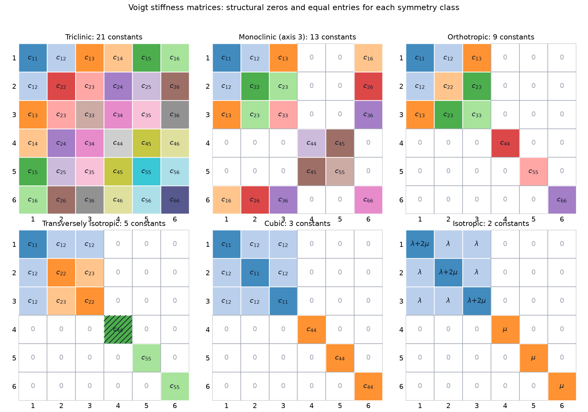
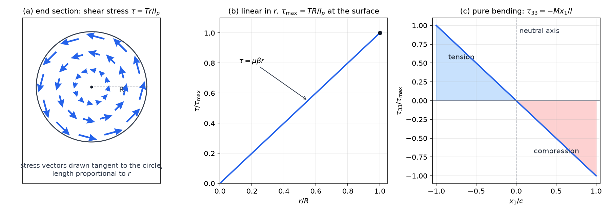

# Linear Elasticity

Most engineering solids carry loads that strain them by a fraction of a percent, and over that range the stress is proportional to the strain. This chapter derives that linear law from the hyperelastic theory of [Hyperelastic Solids](hyperelasticity.md), restricts the stiffness tensor by the symmetry of stress and strain and by the symmetry of the material, and reduces it to the two Lamé constants of an isotropic solid. It then writes the field equations in displacement form and solves two classical problems, torsion of a shaft and bending of a beam, using energy theorems that give the twist and the rotation.

## Linearization of Hyperelasticity

A hyperelastic solid stores strain energy \\(W\\) per unit reference volume. Following the notation of [Hyperelastic Solids](hyperelasticity.md), \\(\mathbf X\\) is the reference position of a material point, \\(\mathbf x\\) its current position and \\(\mathbf u = \mathbf x - \mathbf X\\) its displacement, so that \\(\mathbf F = \partial\mathbf x/\partial\mathbf X\\) and \\(J = \det\mathbf F\\). The first Piola–Kirchhoff stress \\(\mathbf P\\) follows from the energy through

\\[
P\_{ij} = \frac{\partial W}{\partial F\_{ij}} ,
\\]

in which the first index refers to the current direction of the force and the second to the reference direction of the surface normal, as in [Balance Laws and Stress](balance-laws.md). The reference configuration is stress-free, so \\(\mathbf P = \mathbf 0\\) when \\(\mathbf F = \mathbf I\\). Write the deformation gradient in terms of the displacement,

\\[
\mathbf F = \mathbf I + \nabla\mathbf u, \qquad F\_{kl} = \delta\_{kl} + u\_{k,l},
\\]

where \\(\nabla\\) is the gradient with respect to \\(\mathbf X\\).

The deformation is small when \\(\lVert \nabla\mathbf u \rVert \ll 1\\). This is a condition on the displacement gradient, not on the displacement itself: a body may be moved a long way from its reference position, provided neighbouring points stay almost at their reference separations.

Expanding \\(\mathbf P\\) about \\(\mathbf F = \mathbf I\\) is the same first-order argument as \\(f(X+\Delta X) \approx f(X) + f'(X)\Delta X\\) in one dimension:

\\[
P\_{ij} = \left.\frac{\partial P\_{ij}}{\partial F\_{kl}}\right\|\_{\mathbf F=\mathbf I}\\,(F\_{kl}-\delta\_{kl}) + O(\lVert\nabla\mathbf u\rVert^2)
= C\_{ijkl}\\,u\_{k,l} + O(\lVert\nabla\mathbf u\rVert^2),
\\]

where the zero-order term vanishes because the reference state is stress-free, and

\\[
C\_{ijkl} = \left.\frac{\partial^2 W}{\partial F\_{ij}\\,\partial F\_{kl}}\right\|\_{\mathbf F=\mathbf I}
\\]

is the fourth-order tensor of second derivatives of the energy at the reference state. The second derivatives of a smooth \\(W\\) do not depend on the order of differentiation, so \\(C\\) has the **major symmetry** \\(C\_{ijkl} = C\_{klij}\\).

Three further facts reduce this relation to the familiar linear law.

First, the stress measures coincide to first order. The Cauchy stress \\(\boldsymbol\tau\\), the first Piola–Kirchhoff stress \\(\mathbf P\\) and the second Piola–Kirchhoff stress \\(\tilde{\mathbf T} = \mathbf F^{-1}\mathbf P\\) are related by \\(\mathbf P = J\boldsymbol\tau\mathbf F^{-T}\\). Since \\(\boldsymbol\tau\\) vanishes in the reference state, it is itself of first order in \\(\nabla\mathbf u\\), while \\(J\mathbf F^{-T} = \mathbf I + O(\lVert\nabla\mathbf u\rVert)\\). The differences \\(\mathbf P - \boldsymbol\tau\\) and \\(\tilde{\mathbf T} - \boldsymbol\tau\\) are therefore of second order.

Second, the stress is symmetric. The Cauchy stress is symmetric by balance of angular momentum, and it agrees with \\(\mathbf P\\) to first order, so \\(P\_{ij} - P\_{ji} = O(\lVert\nabla\mathbf u\rVert^2)\\). The first-order part of \\(P\_{ij} - P\_{ji}\\) is \\((C\_{ijkl} - C\_{jikl})\\,u\_{k,l}\\). This must vanish for every displacement gradient, because any matrix \\(\nabla\mathbf u\\) can occur at some point, so \\(C\_{jikl} = C\_{ijkl}\\). This is the **first minor symmetry**.

Third, the **second minor symmetry** follows from the other two. Using the major symmetry, then the first minor symmetry on the first pair, then the major symmetry again,

\\[
C\_{ijkl} = C\_{klij} = C\_{lkij} = C\_{ijlk}.
\\]

Because \\(C\_{ijkl}\\) is symmetric in its last two indices, \\(C\_{ijkl}u\_{k,l} = \tfrac12 C\_{ijkl}(u\_{k,l} + u\_{l,k})\\). Writing the symmetric part of the displacement gradient as the infinitesimal strain gives the central result of the theory. The Cauchy stress equals \\(\mathbf P\\) and \\(\tilde{\mathbf T}\\) to first order, so

\\[
\boxed{\tau\_{ij} = C\_{ijkl}\\,\varepsilon\_{kl}, \qquad \varepsilon\_{kl} = \tfrac12\left(u\_{k,l} + u\_{l,k}\right)}
\\]

The strain \\(\boldsymbol\varepsilon\\) is the linear part of the Green–Lagrange strain \\(\mathbf E = \tfrac12(\mathbf C - \mathbf I) = \boldsymbol\varepsilon + \tfrac12\nabla\mathbf u^T\nabla\mathbf u\\), where \\(\mathbf C = \mathbf F^T\mathbf F\\). The two differ only by a quadratic term. The same stiffness tensor appears in the St. Venant–Kirchhoff model, \\(\tilde{\mathbf T} = \mathbb C : \mathbf E\\), which is the simplest large-strain extension of linear elasticity. The linear theory itself applies only where the quadratic terms are negligible.

## Small-Strain Kinematics

Split the displacement gradient into its symmetric and skew parts.

**Definition (infinitesimal strain and rotation).** For a displacement field \\(\mathbf u\\),

\\[
\varepsilon\_{ij} = \tfrac12(u\_{i,j} + u\_{j,i}), \qquad \Omega\_{ij} = \tfrac12(u\_{i,j} - u\_{j,i}), \qquad \nabla\mathbf u = \boldsymbol\varepsilon + \boldsymbol\Omega .
\\]

The skew part \\(\boldsymbol\Omega\\) has the dual vector \\(\boldsymbol\omega = \tfrac12\nabla\times\mathbf u\\), which is the infinitesimal rotation of the material. Only the symmetric part \\(\boldsymbol\varepsilon\\) changes lengths and angles, which is why the stress depends on \\(\boldsymbol\varepsilon\\) alone.

In the linear theory \\(\mathbf X\\) and \\(\mathbf x\\) differ by the small displacement \\(\mathbf u\\), so from here on \\(\mathbf x\\) denotes position without distinction between the two configurations. The meaning of the components follows from the length of a line element. Let \\(d\mathbf X = dS\_0\\,\mathbf m\\) with \\(\lvert\mathbf m\rvert = 1\\). Then \\(\lvert d\mathbf x\rvert^2 = d\mathbf X\cdot\mathbf C\\,d\mathbf X\\), and \\(\mathbf C = \mathbf I + 2\boldsymbol\varepsilon + O(\lVert\nabla\mathbf u\rVert^2)\\). Hence

\\[
\frac{ds}{dS\_0} = \sqrt{1 + 2\\,\mathbf m\cdot\boldsymbol\varepsilon\\,\mathbf m} \approx 1 + \mathbf m\cdot\boldsymbol\varepsilon\\,\mathbf m ,
\\]

where \\(ds = \lvert d\mathbf x\rvert\\) is the current length of the element.

The normal strain in direction \\(\mathbf m\\) is therefore \\(\mathbf m \cdot \boldsymbol\varepsilon\\,\mathbf m\\). In particular \\(\varepsilon\_{11} = \partial u\_1/\partial x\_1\\) is the relative elongation of neighbouring points along \\(x\_1\\). A rigid translation changes nothing, and a uniform stretch \\(\nabla\mathbf u = a\mathbf I\\) gives a normal strain \\(a\\) in every direction.

The shear strain has a similar interpretation. For orthogonal unit vectors \\(\mathbf m\\) and \\(\mathbf n\\), the deformed angle \\(\theta^\*\\) between \\(\mathbf F\mathbf m\\) and \\(\mathbf F\mathbf n\\) satisfies \\(\cos\theta^\* \approx \mathbf m\cdot\mathbf F^T\mathbf F\\,\mathbf n = 2\\,\mathbf m\cdot\boldsymbol\varepsilon\\,\mathbf n\\), so \\(\tfrac{\pi}{2} - \theta^\* \approx 2\\,\mathbf m\cdot\boldsymbol\varepsilon\\,\mathbf n\\). The reduction of the right angle is \\(\gamma\_{mn} = 2\varepsilon\_{mn}\\) radians. The tensorial shear strain \\(\varepsilon\_{mn}\\) is therefore half the angle change, and the **engineering shear strain** \\(\gamma = 2\varepsilon\\) is the angle itself. The overview chapter Elasticity uses \\(\gamma\\) in this sense.

The volume change is \\(J = \det\mathbf F \approx 1 + \operatorname{tr}\boldsymbol\varepsilon\\), so

\\[
\frac{\Delta V}{V\_0} = \varepsilon\_{kk} = \nabla\cdot\mathbf u .
\\]

This relation is used below to define the bulk modulus.

### Compatibility

The six components of \\(\boldsymbol\varepsilon\\) are built from only three displacement components. A symmetric tensor field therefore need not come from any displacement, and the restrictions it must satisfy are the compatibility conditions.

**Theorem (Saint-Venant compatibility).** Let \\(\Omega\\) be a simply connected region and let \\(\boldsymbol\varepsilon\\) be a symmetric tensor field of class \\(C^2\\) on \\(\Omega\\). There exists a displacement \\(\mathbf u\\) with \\(\boldsymbol\varepsilon = \tfrac12(\nabla\mathbf u + \nabla\mathbf u^T)\\) if and only if

\\[
\varepsilon\_{ij,kl} + \varepsilon\_{kl,ij} - \varepsilon\_{ik,jl} - \varepsilon\_{jl,ik} = 0 \qquad \text{for all } i,j,k,l .
\\]

*Proof of necessity.* If \\(\varepsilon\_{ij} = \tfrac12(u\_{i,j}+u\_{j,i})\\), then the four second-derivative terms expand into eight third-derivative terms of \\(\mathbf u\\), namely \\(\tfrac12(u\_{i,jkl} + u\_{j,ikl} + u\_{k,lij} + u\_{l,kij} - u\_{i,kjl} - u\_{k,ijl} - u\_{j,lik} - u\_{l,jik})\\). Partial derivatives commute, so these cancel in pairs, and the left side is zero. *Sufficiency* is the classical converse, obtained from Stokes's theorem in the same way as the compatibility of the deformation gradient in [Kinematics of Deformation](kinematics.md). \\(\square\\)

Only three of the six scalar conditions are independent, which matches the three missing displacement components. In a displacement formulation the conditions are satisfied automatically, because the strain is computed from the displacement. They become essential when stress or strain is the primary unknown, as in the stress-based Beltrami–Michell equations.

## Anisotropic Linear Elasticity

### Symmetries and Voigt notation

The stiffness tensor \\(C\_{ijkl}\\) has \\(3^4 = 81\\) components. Its symmetries reduce the number of independent constants. The major symmetry and the two minor symmetries say that \\(C\\) is determined by its action on the six-dimensional space of symmetric second-order tensors, which is represented by a symmetric \\(6 \times 6\\) matrix.

The **Voigt notation** makes this explicit. The index pairs are mapped as \\(11 \to 1\\), \\(22 \to 2\\), \\(33 \to 3\\), \\(23 \to 4\\), \\(31 \to 5\\), \\(12 \to 6\\). The stress and strain become six-component vectors, using engineering shear strains \\(\varepsilon\_4 = \gamma\_{23} = 2\varepsilon\_{23}\\), \\(\varepsilon\_5 = \gamma\_{31}\\), \\(\varepsilon\_6 = \gamma\_{12}\\). Then

\\[
\tau\_I = C\_{IJ}\\,\varepsilon\_J, \qquad W = \tfrac12\\,\varepsilon\_I C\_{IJ}\\,\varepsilon\_J .
\\]

The entries \\(C\_{IJ}\\) are the components \\(C\_{ijkl}\\) with the corresponding index pairs, so \\(C\_{14} = C\_{1123}\\) and \\(C\_{44} = C\_{2323}\\). A symmetric \\(6\times 6\\) matrix has \\(6 + 5 + 4 + 3 + 2 + 1 = 21\\) independent entries. This is the largest number of constants a linear elastic solid can have.

### Material symmetry

Most materials have fewer constants because their structure is symmetric. A material symmetry is an orthogonal tensor \\(\mathbf Q\\) that leaves the stiffness unchanged, \\(C\_{ijkl} = Q\_{ip}Q\_{jq}Q\_{kr}Q\_{ls}C\_{pqrs}\\) (see [Constitutive Theory and Material Symmetry](constitutive.md)). The group of such \\(\mathbf Q\\) determines the number of independent constants. The classical results are summarized in the table below and in Figure 1.

| Symmetry class | Independent constants | Typical example |
|---|---|---|
| Triclinic | 21 | no symmetry |
| Monoclinic | 13 | one twofold axis |
| Orthotropic | 9 | three mutually perpendicular planes of symmetry |
| Transversely isotropic | 5 | one axis of rotational symmetry (fibre composites, many wood-like materials) |
| Cubic | 3 | single crystals such as copper, aluminium and silicon |
| Isotropic | 2 | polycrystalline metals and amorphous solids |

Single crystals of low symmetry are strongly anisotropic. An engineering metal, however, is an aggregate of randomly oriented grains, and its properties average out to those of an isotropic solid over the size of a part. This is why most structural calculations use the isotropic law.

*Figure: Voigt stiffness matrices for the six classes in the table. Grey zeros are structural: the strain component cannot produce the stress component. Equal labels mark equal entries, and hatching marks an entry fixed by the others. In the transversely isotropic class, \\(c\_{44} = \tfrac12(c\_{22} - c\_{23})\\). The isotropic panel has three distinct entries, \\(\lambda + 2\mu\\), \\(\lambda\\) and \\(\mu\\), built from only two constants.*

For a transversely isotropic material with its symmetry axis along \\(x\_1\\), the plane \\(x\_2 x\_3\\) is isotropic, and the stiffness is

\\[
\mathbf C = \begin{bmatrix} c\_{11} & c\_{12} & c\_{12} & 0 & 0 & 0 \\\\ c\_{12} & c\_{22} & c\_{23} & 0 & 0 & 0 \\\\ c\_{12} & c\_{23} & c\_{22} & 0 & 0 & 0 \\\\ 0 & 0 & 0 & \tfrac12(c\_{22}-c\_{23}) & 0 & 0 \\\\ 0 & 0 & 0 & 0 & c\_{55} & 0 \\\\ 0 & 0 & 0 & 0 & 0 & c\_{55} \end{bmatrix}.
\\]

The shear modulus of the isotropic plane, \\(c\_{44} = \tfrac12(c\_{22} - c\_{23})\\), is fixed by the other constants, which leaves five independent values.

## Isotropic Linear Elasticity

### Reduction to two constants

An isotropic fourth-order tensor, one whose components do not change under rotation, has the form \\(C\_{ijkl} = \alpha\\,\delta\_{ij}\delta\_{kl} + \beta\\,\delta\_{ik}\delta\_{jl} + \gamma\\,\delta\_{il}\delta\_{jk}\\) (see [Constitutive Theory and Material Symmetry](constitutive.md)). The first minor symmetry requires \\(C\_{ijkl} = C\_{jikl}\\). Interchanging \\(i\\) and \\(j\\) exchanges the second and third terms and leaves the first unchanged, so the symmetry holds if and only if \\(\beta = \gamma\\). Writing \\(\lambda = \alpha\\) and \\(\mu = \beta\\),

\\[
C\_{ijkl} = \lambda\\,\delta\_{ij}\delta\_{kl} + \mu\left(\delta\_{ik}\delta\_{jl} + \delta\_{il}\delta\_{jk}\right).
\\]

The stress is therefore

\\[
\tau\_{ij} = \lambda\\,\varepsilon\_{kk}\\,\delta\_{ij} + 2\mu\\,\varepsilon\_{ij}, \qquad \text{or} \qquad \boldsymbol\tau = \lambda\\,(\operatorname{tr}\boldsymbol\varepsilon)\\,\mathbf I + 2\mu\\,\boldsymbol\varepsilon .
\\]

The constants \\(\lambda\\) and \\(\mu\\) are the Lamé constants. The shear modulus is \\(\mu\\) itself, written \\(G\\) in the overview chapter Elasticity.

### Identification from the tensile test

The simplest experiment is uniaxial tension, with \\(\tau\_{11} = \tau\\) and \\(\tau\_{22} = \tau\_{33} = 0\\). The measured strains are \\(\varepsilon\_{11} = \varepsilon\\) and \\(\varepsilon\_{22} = \varepsilon\_{33} = -\nu\varepsilon\\), which defines Young's modulus \\(E\\) and Poisson's ratio \\(\nu\\). Since \\(\operatorname{tr}\boldsymbol\varepsilon = (1-2\nu)\varepsilon\\), the two stress components give

\\[
\tau\_{11} = \lambda(1-2\nu)\varepsilon + 2\mu\varepsilon = E\varepsilon, \qquad \tau\_{22} = \lambda(1-2\nu)\varepsilon - 2\mu\nu\varepsilon = 0 .
\\]

The second equation gives \\(\lambda(1-2\nu) = 2\mu\nu\\). Substituting into the first gives \\(E = 2\mu(1+\nu)\\). Hence

\\[
\mu = \frac{E}{2(1+\nu)}, \qquad \lambda = \frac{\nu E}{(1+\nu)(1-2\nu)} .
\\]

This is the statement, used in the overview chapter, that only two of \\(E\\), \\(\nu\\), \\(G\\) are independent.

### The compliance form

Inverting the stress-strain law gives the generalized Hooke's law. Taking the trace of \\(\boldsymbol\tau = \lambda(\operatorname{tr}\boldsymbol\varepsilon)\mathbf I + 2\mu\boldsymbol\varepsilon\\) gives \\(\operatorname{tr}\boldsymbol\tau = (3\lambda + 2\mu)\operatorname{tr}\boldsymbol\varepsilon\\). Substituting back,

\\[
\boxed{\varepsilon\_{ij} = \frac{1+\nu}{E}\\,\tau\_{ij} - \frac{\nu}{E}\\,\tau\_{kk}\\,\delta\_{ij}}
\\]

In components, \\(\varepsilon\_{11} = [\tau\_{11} - \nu(\tau\_{22} + \tau\_{33})]/E\\) and cyclic permutations, while the shear strains are \\(\gamma\_{12} = \tau\_{12}/\mu\\). Normal and shear components are decoupled. A shear stress produces only shear strain, which is a convenient feature of the isotropic law and not a general property of anisotropic materials.

### Bulk modulus and the constrained modulus

The trace of the stress-strain law gives \\(\operatorname{tr}\boldsymbol\tau = 3K\operatorname{tr}\boldsymbol\varepsilon\\), where

\\[
K = \lambda + \frac{2}{3}\mu = \frac{E}{3(1-2\nu)}
\\]

is the **bulk modulus**. The mean stress \\(\tau\_m = \tfrac13\operatorname{tr}\boldsymbol\tau\\) and the volume change are related by \\(\Delta V/V\_0 = \tau\_m/K\\). A large \\(K\\) means the material resists change of volume.

Another combination appears in wave propagation and in the plate-impact problem of the next chapter. The **constrained modulus** is

\\[
M = \lambda + 2\mu = \frac{E(1-\nu)}{(1+\nu)(1-2\nu)} ,
\\]

the ratio \\(\tau\_{11}/\varepsilon\_{11}\\) when the lateral strains are zero. It is larger than \\(E\\) because the lateral constraint adds stiffness.

The conversion formulas between the elastic constants are collected below. Any two of \\(E\\), \\(\nu\\), \\(\lambda\\), \\(\mu\\), \\(K\\) determine the rest.

| Given | Formulas |
|---|---|
| \\(E, \nu\\) | \\(\lambda = \frac{\nu E}{(1+\nu)(1-2\nu)}\\), \\(\mu = \frac{E}{2(1+\nu)}\\), \\(K = \frac{E}{3(1-2\nu)}\\) |
| \\(\lambda, \mu\\) | \\(E = \frac{\mu(3\lambda+2\mu)}{\lambda+\mu}\\), \\(\nu = \frac{\lambda}{2(\lambda+\mu)}\\), \\(K = \lambda + \frac23\mu\\) |
| \\(K, \mu\\) | \\(E = \frac{9K\mu}{3K+\mu}\\), \\(\nu = \frac{3K-2\mu}{2(3K+\mu)}\\), \\(\lambda = K - \frac23\mu\\) |

### Admissible constants

**Theorem (positive definiteness).** The strain energy is positive for every nonzero symmetric strain if and only if \\(\mu > 0\\) and \\(K > 0\\). Equivalently, \\(E > 0\\) and \\(-1 < \nu < \tfrac12\\).

*Proof.* Split the strain into its trace and its deviatoric part, \\(\boldsymbol\varepsilon = \boldsymbol\varepsilon' + \tfrac13(\operatorname{tr}\boldsymbol\varepsilon)\mathbf I\\), where \\(\operatorname{tr}\boldsymbol\varepsilon' = 0\\). Using \\(\boldsymbol\varepsilon:\boldsymbol\varepsilon = \boldsymbol\varepsilon':\boldsymbol\varepsilon' + \tfrac13(\operatorname{tr}\boldsymbol\varepsilon)^2\\), the energy becomes

\\[
W = \tfrac12\lambda(\operatorname{tr}\boldsymbol\varepsilon)^2 + \mu\\,\boldsymbol\varepsilon:\boldsymbol\varepsilon = \tfrac12 K(\operatorname{tr}\boldsymbol\varepsilon)^2 + \mu\\,\boldsymbol\varepsilon':\boldsymbol\varepsilon' .
\\]

If \\(K > 0\\) and \\(\mu > 0\\), both terms are nonnegative and vanish only when \\(\operatorname{tr}\boldsymbol\varepsilon = 0\\) and \\(\boldsymbol\varepsilon' = 0\\), so \\(W > 0\\) for \\(\boldsymbol\varepsilon \neq 0\\). Conversely, \\(\boldsymbol\varepsilon = \mathbf I\\) gives \\(W = \tfrac92 K\\), which must be positive, and a traceless \\(\boldsymbol\varepsilon'\\) gives \\(W = \mu\\,\boldsymbol\varepsilon':\boldsymbol\varepsilon'\\), which must be positive. Finally, \\(\mu > 0\\) means \\(E = 2\mu(1+\nu) > 0\\) with \\(\nu > -1\\), and \\(K > 0\\) means \\(1 - 2\nu > 0\\). \\(\square\\)

The positivity condition is the stability requirement for an elastic solid. The energy is positive for all strains, so the unstrained state is the unique minimum. The usual range \\(0 < \nu < \tfrac12\\) is a physical convention; the theory admits slightly negative Poisson's ratios, which describe auxetic materials that expand transversely when stretched. As \\(\nu \to \tfrac12\\), the bulk modulus \\(K\\) becomes infinite, which is the incompressible limit.

## Strain Energy and the Uniqueness of Solutions

### Strain energy density

Consider loading from zero strain along the ray \\(\boldsymbol\varepsilon(s) = s\\,\boldsymbol\varepsilon\\), \\(0 \le s \le 1\\). The stress work per unit volume is \\(\int \boldsymbol\tau : d\boldsymbol\varepsilon\\) along this path, and with \\(\boldsymbol\tau(s\boldsymbol\varepsilon) = s\\,\mathbb C\boldsymbol\varepsilon\\),

\\[
W = \int\_0^1 s\\,(\mathbb C\boldsymbol\varepsilon):\boldsymbol\varepsilon\\, ds = \tfrac12\\,\boldsymbol\varepsilon : \mathbb C : \boldsymbol\varepsilon .
\\]

Since \\(\boldsymbol\tau = \mathbb C\boldsymbol\varepsilon\\), this gives the boxed energy relation

\\[
\boxed{W = \tfrac12\\,\tau\_{ij}\varepsilon\_{ij} = \tfrac12\\,C\_{ijkl}\\,\varepsilon\_{ij}\varepsilon\_{kl}}
\\]

and \\(\tau\_{ij} = \partial W/\partial\varepsilon\_{ij}\\). For the isotropic solid, \\(W = \tfrac12\lambda(\operatorname{tr}\boldsymbol\varepsilon)^2 + \mu\\,\boldsymbol\varepsilon:\boldsymbol\varepsilon\\). Under a pure shear stress \\(\tau\_{12} = s\\), the strain is \\(\varepsilon\_{12} = s/(2\mu)\\), and the energy is \\(s^2/(2\mu)\\) per unit volume, which is the familiar area of the triangle under a linear stress-strain line.

### Clapeyron's theorem

**Theorem (Clapeyron).** Let a linear elastic body \\(B\\) with boundary \\(\partial B\\) be in static equilibrium under a body force \\(\mathbf f\\) and surface traction \\(\mathbf t\\), with displacement \\(\mathbf u\\). Then the total strain energy equals half the work of the applied loads,

\\[
U = \int\_B W\\, dV = \tfrac12\int\_B \mathbf f\cdot\mathbf u\\, dV + \tfrac12\int\_{\partial B}\mathbf t\cdot\mathbf u\\, dA .
\\]

*Proof.* Since \\(\boldsymbol\tau\\) is symmetric, \\(\tau\_{ij}\varepsilon\_{ij} = \tau\_{ji}u\_{i,j}\\). Equilibrium gives \\(\tau\_{ji,j} = -f\_i\\), so \\(\tau\_{ji}u\_{i,j} = (\tau\_{ji}u\_i)\_{,j} + f\_i u\_i\\). The divergence theorem turns \\((\tau\_{ji}u\_i)\_{,j}\\) into \\(\tau\_{ji}n\_j u\_i = \mathbf t\cdot\mathbf u\\) on the boundary. Inserting this into \\(U = \tfrac12\int\tau\_{ij}\varepsilon\_{ij}\\,dV\\) gives the result. \\(\square\\)

For a single force or moment that grows in proportion to a displacement, Clapeyron's theorem says that the energy is half the product of the load and the displacement. This is the basis of the energy methods used below.

**Theorem (uniqueness).** Let the displacement be prescribed on the whole boundary \\(\partial B\\) of a linear elastic body with positive definite stiffness. Then the equilibrium displacement is unique.

*Proof.* Suppose \\(\mathbf u\_1\\) and \\(\mathbf u\_2\\) both solve the problem, and let \\(\mathbf w = \mathbf u\_1 - \mathbf u\_2\\). Then \\(\mathbf w\\) satisfies equilibrium with zero body force and zero traction, and it vanishes on \\(\partial B\\). Clapeyron's theorem gives \\(\int\_B W(\boldsymbol\varepsilon(\mathbf w))\\,dV = 0\\). Since \\(W\\) is positive for nonzero strain, \\(\boldsymbol\varepsilon(\mathbf w) = 0\\) everywhere. Then \\(\mathbf w\\) is a rigid displacement, \\(\mathbf w = \mathbf a + \boldsymbol\omega\times\mathbf x\\). It vanishes at three noncollinear points of the boundary, \\(\mathbf x\_1\\), \\(\mathbf x\_2\\), \\(\mathbf x\_3\\). Subtracting these conditions gives \\(\boldsymbol\omega\times(\mathbf x\_2 - \mathbf x\_1) = 0\\) and \\(\boldsymbol\omega\times(\mathbf x\_3 - \mathbf x\_1) = 0\\). These two vectors are independent, so \\(\boldsymbol\omega = 0\\), and then \\(\mathbf a = 0\\). Hence \\(\mathbf w = 0\\). \\(\square\\)

The uniqueness theorem is what makes the static linear problem well posed: any displacement field that satisfies the field equations and the boundary conditions is the solution. Viscous flows, by contrast, can admit more than one steady solution, so the same guarantee cannot be assumed there.

## Field Equations and the Navier Equations

The boundary-value problem of linear elastodynamics consists of the following conditions, with initial conditions added when the motion is time dependent:

1. Balance of linear momentum, \\(\nabla\cdot\boldsymbol\tau + \mathbf f = \rho\ddot{\mathbf u}\\).
2. Balance of angular momentum, which is satisfied because \\(\boldsymbol\tau\\) is symmetric.
3. Strain-displacement relation, \\(\boldsymbol\varepsilon = \tfrac12(\nabla\mathbf u + \nabla\mathbf u^T)\\).
4. Constitutive law, \\(\boldsymbol\tau = \mathbb C : \boldsymbol\varepsilon\\).
5. Boundary conditions, \\(\mathbf u\\) prescribed on part of the boundary and \\(\boldsymbol\tau\mathbf n\\) prescribed on the rest.

For an isotropic body, substituting the constitutive law into the momentum balance eliminates the stress and leaves three equations for the three displacement components. With \\(\tau\_{ij,j} = \lambda u\_{k,ki} + \mu(u\_{i,jj} + u\_{j,ij})\\), the momentum balance becomes

\\[
\boxed{(\lambda+\mu)\\,\nabla(\nabla\cdot\mathbf u) + \mu\nabla^2\mathbf u + \mathbf f = \rho\ddot{\mathbf u}}
\\]

These are the **Navier equations**. In index form, \\((\lambda+\mu)u\_{k,ki} + \mu u\_{i,jj} + f\_i = \rho\ddot u\_i\\). For a homogeneous anisotropic body the same procedure gives \\(C\_{ijkl}u\_{k,lj} + f\_i = \rho\ddot u\_i\\). The displacement formulation is the usual starting point for numerical methods, because the unknowns are only the three displacement components. The stress and strain are recovered afterwards from the displacement.

The Navier equations are the same as the equations of elastic waves in the next chapter, which keep the time derivative. In the static case with no body force they reduce to \\((\lambda+\mu)\nabla(\nabla\cdot\mathbf u) + \mu\nabla^2\mathbf u = \mathbf 0\\), and the boundary conditions select the solution.

## Castigliano's Theorem

Energy methods give displacements directly, without solving the full field equations. The key result is the following.

**Theorem (Castigliano).** Let a linear elastic body, unstressed in its reference state, be loaded by a single generalized force \\(P\\) (a force or a moment), applied quasi-statically, with corresponding displacement \\(q\\) in the direction of \\(P\\). Let \\(U\\) be the strain energy written as a function of \\(P\\). Then

\\[
q = \frac{\partial U}{\partial P} .
\\]

*Proof.* Linearity gives \\(q = kP\\) for some constant \\(k\\). The work done by a load that grows linearly from zero is \\(\tfrac12 Pq\\), and by Clapeyron's theorem this equals \\(U\\). Hence \\(U = \tfrac12 kP^2\\), and \\(\partial U/\partial P = kP = q\\). \\(\square\\)

The same result holds with several loads, using the symmetry of the flexibility matrix from reciprocity. Written in terms of the displacement, the relation reads \\(P = \partial U/\partial q\\). The two forms are often called Castigliano's second and first theorems. The second form is the one used below, because the energy of torsion and bending is most easily written in terms of the torque or the moment.

## Example: Pure Torsion of a Circular Shaft

Consider a solid circular cylinder of radius \\(R\\) and length \\(L\\) along \\(x\_3\\). It is fixed at \\(x\_3 = 0\\), and a torque \\(T\\) about \\(x\_3\\) acts at \\(x\_3 = L\\). The lateral surface is free of traction.

**Kinematic assumption.** Each cross section rotates rigidly about the \\(x\_3\\) axis by an angle \\(\beta x\_3\\), where \\(\beta\\) is the twist per unit length. The rotation of the section at height \\(x\_3\\) is \\(\mathbf R(x\_3)\\), and for small \\(\beta x\_3\\) it is

\\[
\mathbf R(x\_3) \approx \begin{bmatrix} 1 & -\beta x\_3 & 0 \\\\ \beta x\_3 & 1 & 0 \\\\ 0 & 0 & 1\end{bmatrix} .
\\]

The displacement is \\(\mathbf u = (\mathbf R - \mathbf I)\mathbf x\\), which gives

\\[
u\_1 = -\beta x\_2 x\_3, \qquad u\_2 = \beta x\_1 x\_3, \qquad u\_3 = 0 .
\\]

There is no axial displacement, which is consistent with the circular section.

**Strain.** The nonzero displacement gradients are \\(u\_{1,2} = -\beta x\_3\\), \\(u\_{1,3} = -\beta x\_2\\), \\(u\_{2,1} = \beta x\_3\\) and \\(u\_{2,3} = \beta x\_1\\). The normal strains vanish, and

\\[
\varepsilon\_{12} = \tfrac12(u\_{1,2} + u\_{2,1}) = 0, \qquad \varepsilon\_{13} = \tfrac12(u\_{1,3} + u\_{3,1}) = -\tfrac12\beta x\_2, \qquad \varepsilon\_{23} = \tfrac12(u\_{2,3} + u\_{3,2}) = \tfrac12\beta x\_1 .
\\]

The strain is pure shear, \\(\boldsymbol\varepsilon = \tfrac12\beta\begin{bmatrix}0&0&-x\_2\\\\0&0&x\_1\\\\-x\_2&x\_1&0\end{bmatrix}\\).

**Stress.** The trace is zero, so \\(\boldsymbol\tau = 2\mu\boldsymbol\varepsilon\\):

\\[
\boldsymbol\tau = \mu\beta\begin{bmatrix}0&0&-x\_2\\\\0&0&x\_1\\\\-x\_2&x\_1&0\end{bmatrix} .
\\]

The equilibrium equations hold without body force. The first row depends only on \\(x\_2\\) and the second only on \\(x\_1\\), so \\(\tau\_{1j,j} = \partial\tau\_{11}/\partial x\_1 + \partial\tau\_{12}/\partial x\_2 + \partial\tau\_{13}/\partial x\_3 = 0\\), and similarly for the second row. For the third row, \\(\tau\_{3j,j} = \partial(-\mu\beta x\_2)/\partial x\_1 + \partial(\mu\beta x\_1)/\partial x\_2 = 0\\). Check the lateral surface: its outward normal is \\(\mathbf n = (x\_1, x\_2, 0)/R\\), and \\(\boldsymbol\tau\mathbf n = (0,0,\mu\beta(-x\_2x\_1 + x\_1x\_2)/R) = \mathbf 0\\). The surface is traction-free.

**Torque and twist.** At the end \\(x\_3 = L\\), the outward normal is \\(\mathbf e\_3\\), so the traction is \\(\mathbf t = \boldsymbol\tau\mathbf e\_3 = \mu\beta(-x\_2, x\_1, 0)\\). Its magnitude is \\(\mu\beta r\\), where \\(r = \sqrt{x\_1^2 + x\_2^2}\\). The resultant force is zero because the traction circulates. The moment about the axis is

\\[
T = \int\_A (x\_1 t\_2 - x\_2 t\_1)\\,dA = \mu\beta\int\_A (x\_1^2 + x\_2^2)\\,dA = \mu\beta I\_p, \qquad I\_p = \frac{\pi R^4}{2} .
\\]

Thus

\\[
\beta = \frac{T}{\mu I\_p}, \qquad \tau\_{\theta z}(r) = \mu\beta r = \frac{T r}{I\_p},
\\]

which is the classical torsion formula, with the maximum shear stress \\(TR/I\_p\\) at the surface. The shear stress is linear in \\(r\\) (Figure 2, left and centre).

**Energy and Castigliano.** The energy density is \\(w = \tfrac12\boldsymbol\tau:\boldsymbol\varepsilon = \tfrac12\mu\beta^2 r^2\\). Integrating over the shaft, with \\(dV = r\\,dr\\,d\theta\\,dx\_3\\) and \\(\int\_A r^2\\,dA = I\_p\\),

\\[
U = \int\_0^L\\!\\!\int\_A \tfrac12\mu\beta^2 r^2\\,dA\\,dx\_3 = \tfrac12\mu\beta^2 L\\, I\_p = \frac{T^2 L}{2\mu I\_p} ,
\\]

where \\(\beta = T/(\mu I\_p)\\) was inserted in the last step. The total twist angle is \\(\phi = \beta L\\). Castigliano's theorem applied to \\(U = T^2L/(2\mu I\_p)\\) gives

\\[
\phi = \frac{\partial U}{\partial T} = \frac{TL}{\mu I\_p} = \beta L ,
\\]

which agrees with the direct calculation. Clapeyron's theorem gives \\(U = \tfrac12 T\phi\\), which is the same energy because \\(T\phi = T^2L/(\mu I\_p)\\).

**Example 7.1 (Steel shaft).** Take a steel shaft with \\(R = 25\\) mm, \\(L = 1\\) m and \\(T = 1\\) kN·m, with \\(E = 210\\) GPa and \\(\nu = 0.3\\), so \\(\mu = E/(2(1+\nu)) \approx 80.8\\) GPa.

1. The polar moment is \\(I\_p = \pi(0.025)^4/2 \approx 6.14\times10^{-7}\\) m⁴.
2. The maximum shear stress is \\(\tau\_{\theta z}(R) = TR/I\_p \approx 1000 \times 0.025/6.14\times10^{-7} \approx 40.7\\) MPa.
3. The twist angle is \\(\phi = TL/(\mu I\_p) \approx 1000/(80.8\times10^{9} \times 6.14\times10^{-7}) \approx 0.0202\\) rad, or about \\(1.16^\circ\\).

The shear strain at the surface is \\(\gamma = \tau\_{\theta z}(R)/\mu \approx 5.0\times10^{-4}\\), so the linear theory is comfortably valid.

*Figure: Left, the shear-stress vectors on the end section of a torsion shaft are tangent to the circle and grow linearly with radius. Centre, the magnitude \\(\lvert\tau\_{\theta z}\rvert/\lvert\tau\_{\theta z}(R)\rvert = r/R\\). Right, the normal stress \\(\tau\_{33}\\) in pure bending, which varies linearly across the section, with tension on the side \\(x\_1 < 0\\) and compression on the side \\(x\_1 > 0\\).*

## Example: Pure Bending of a Beam

Consider an isotropic beam of length \\(\ell\\) along \\(x\_3\\) and cross-sectional area \\(A\\), with sections parallel to \\(x\_1 x\_2\\). Pure moments \\(M\\) act at its ends, bending it about the \\(x\_2\\) axis. Let \\(I = \int\_A x\_1^2\\,dA\\) be the second moment of area about this axis, with \\(x\_1\\) measured from the centroid. Assume the displacement

\\[
\mathbf u = \frac{M}{EI}\Big[\tfrac12(x\_3^2 + \nu x\_1^2 - \nu x\_2^2)\\,\mathbf e\_1 + \nu x\_1 x\_2\\,\mathbf e\_2 - x\_1 x\_3\\,\mathbf e\_3\Big] ,
\\]

in which the motion is small when \\(M \ll EI\\). The displacement gradients are \\(u\_{1,1} = \nu\kappa\\), \\(u\_{1,2} = -\nu(M/EI)x\_2\\), \\(u\_{1,3} = (M/EI)x\_3\\), \\(u\_{2,1} = \nu(M/EI)x\_2\\), \\(u\_{2,2} = \nu\kappa\\), \\(u\_{2,3} = 0\\), \\(u\_{3,1} = -(M/EI)x\_3\\), \\(u\_{3,2} = 0\\) and \\(u\_{3,3} = -\kappa\\), where \\(\kappa = Mx\_1/(EI)\\) is the curvature of the axis times the distance from the neutral plane.

**Strain.** The symmetric parts give \\(\varepsilon\_{11} = \varepsilon\_{22} = \nu\kappa\\) and \\(\varepsilon\_{33} = -\kappa\\). The off-diagonal strains cancel: \\(\varepsilon\_{12} = \tfrac12(-\nu + \nu)(M/EI)x\_2 = 0\\), \\(\varepsilon\_{13} = \tfrac12(x\_3 - x\_3)(M/EI) = 0\\) and \\(\varepsilon\_{23} = 0\\). So \\(\boldsymbol\varepsilon = \kappa\\,\mathrm{diag}(\nu,\\, \nu,\\, -1)\\).

**Stress.** The trace is \\(\operatorname{tr}\boldsymbol\varepsilon = \kappa(2\nu - 1)\\). Using \\(\lambda(2\nu-1) = -\nu E/(1+\nu)\\) and \\(2\mu\nu = \nu E/(1+\nu)\\),

\\[
\tau\_{11} = \kappa\left[\lambda(2\nu-1) + 2\mu\nu\right] = 0, \qquad \tau\_{22} = 0, \qquad \tau\_{33} = \kappa\left[\lambda(2\nu-1) - 2\mu\right] = -E\kappa = -\frac{Mx\_1}{I} .
\\]

The stress is the uniaxial state \\(\boldsymbol\tau = -(Mx\_1/I)\\,\mathbf e\_3\otimes\mathbf e\_3\\), with the familiar linear distribution across the section.

**Checks.** The stress depends only on \\(x\_1\\) and points along \\(\mathbf e\_3\\), so \\(\tau\_{i3,3} = 0\\) and \\(\tau\_{33,3} = 0\\), and the momentum balance \\(\tau\_{ij,j} = 0\\) holds. The lateral surfaces have normals in the \\(x\_1x\_2\\) plane, and \\(\boldsymbol\tau\mathbf n = 0\\) there. On the end faces the resultant force is \\(-(M/I)\int\_A x\_1\\,dA = 0\\) because the origin is at the centroid, and the moment about \\(x\_2\\) is \\(\int\_A(-x\_1)\tau\_{33}\\,dA = M\\), which is the applied moment.

**Energy and rotation.** The energy density is \\(w = \tfrac12\tau\_{33}\varepsilon\_{33} = M^2x\_1^2/(2EI^2)\\). Integrating over the beam, with \\(\int\_A x\_1^2\\,dA = I\\),

\\[
U = \int\_0^\ell\\!\\!\int\_A \frac{M^2x\_1^2}{2EI^2}\\,dA\\,dx\_3 = \frac{M^2\ell}{2EI} .
\\]

By Castigliano's theorem applied to the moment, the rotation of one end relative to the other is

\\[
\theta = \frac{\partial U}{\partial M} = \frac{M\ell}{EI} ,
\\]

which is the standard result of elementary beam theory. The energy stored in pure bending is therefore \\(\tfrac12 M\theta\\), in agreement with Clapeyron's theorem.

**Example 7.2 (Rectangular beam).** Let the section be \\(b = 50\\) mm wide and \\(h = 100\\) mm deep, with \\(M = 5\\) kN·m. Then \\(I = bh^3/12 \approx 4.17\times10^{-6}\\) m⁴, and the maximum normal stress at the outer fibres, where \\(\lvert x\_1\rvert = h/2 = 50\\) mm, is

\\[
\lvert\tau\_{33}\rvert\_{\max} = \frac{M(h/2)}{I} = \frac{5000\times0.05}{4.17\times10^{-6}} \approx 60 \text{ MPa} .
\\]

The stress is tensile on one face and compressive on the other, with zero at the neutral axis. If \\(E = 210\\) GPa, the outer-fibre strain is \\(60/210\\,000 \approx 2.9\times10^{-4}\\).

## Summary

- The linearized stress-strain law is \\(\tau\_{ij} = C\_{ijkl}\varepsilon\_{kl}\\), with \\(\varepsilon\_{kl} = \tfrac12(u\_{k,l} + u\_{l,k})\\). It follows from the second derivatives of the strain energy at the stress-free state, and it has the major and minor symmetries.
- Only the symmetric part of the displacement gradient produces stress. The skew part is an infinitesimal rotation.
- In Voigt form the stiffness has at most 21 independent constants. Material symmetry reduces this to 13, 9, 5, 3 or 2 for monoclinic, orthotropic, transversely isotropic, cubic and isotropic solids.
- For an isotropic solid, \\(\boldsymbol\tau = \lambda(\operatorname{tr}\boldsymbol\varepsilon)\mathbf I + 2\mu\boldsymbol\varepsilon\\) with \\(\mu = E/(2(1+\nu))\\) and \\(\lambda = \nu E/((1+\nu)(1-2\nu))\\). The bulk modulus is \\(K = \lambda + \tfrac23\mu = E/(3(1-2\nu))\\), and the constrained modulus is \\(M = \lambda + 2\mu\\).
- The energy is \\(W = \tfrac12\tau:\boldsymbol\varepsilon\\), and it is positive definite if and only if \\(\mu > 0\\) and \\(K > 0\\).
- Clapeyron's theorem gives \\(U = \tfrac12\int\mathbf f\cdot\mathbf u\\,dV + \tfrac12\int\mathbf t\cdot\mathbf u\\,dA\\). Castigliano's theorem gives the displacement as \\(q = \partial U/\partial P\\).
- The Navier equations are \\((\lambda+\mu)\nabla(\nabla\cdot\mathbf u) + \mu\nabla^2\mathbf u + \mathbf f = \rho\ddot{\mathbf u}\\).
- In pure torsion, \\(\tau\_{\theta z} = Tr/I\_p\\) and \\(\phi = TL/(\mu I\_p)\\) with \\(I\_p = \pi R^4/2\\). In pure bending, \\(\tau = -Mx\_1/I\\) and \\(\theta = M\ell/(EI)\\).

## See Also

- [Hyperelastic Solids](hyperelasticity.md): the nonlinear theory from which this chapter is linearized.
- [Kinematics of Deformation](kinematics.md): the finite strain measures and the compatibility conditions for the deformation gradient.
- [Constitutive Theory and Material Symmetry](constitutive.md): the general framework for symmetry groups and isotropic tensors.
- [Balance Laws and Stress](balance-laws.md): the momentum and angular momentum balances used in the field equations.
- Elasticity and Stress and Strain: the one-dimensional and overview treatment of the same material.
- Torsion and Bending: the engineering treatments of the two examples.
- [Elastic Waves and Impact](waves.md): the time-dependent form of the Navier equations.
- Partial Differential Equations: the wave and diffusion equations of the next chapter.
