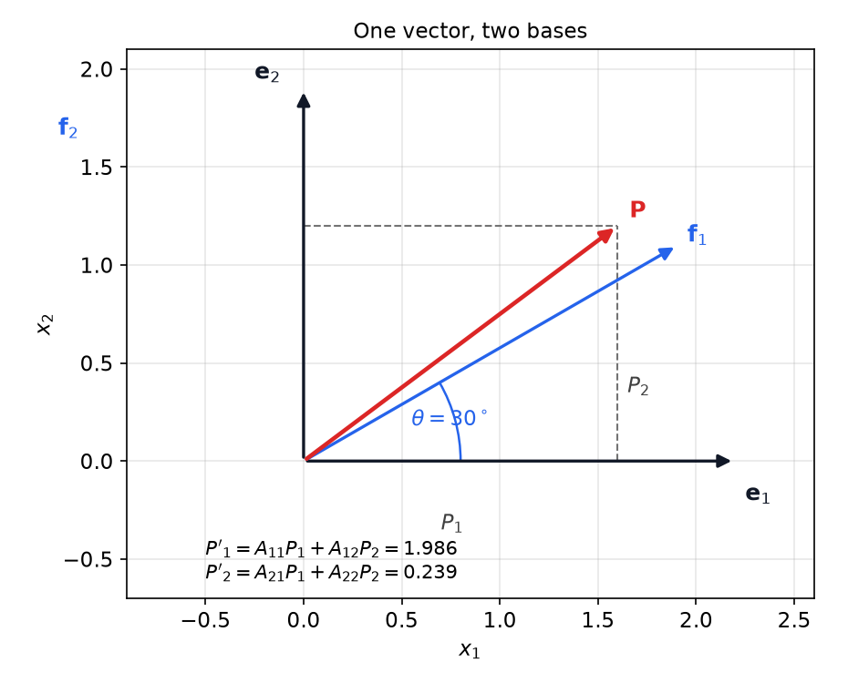
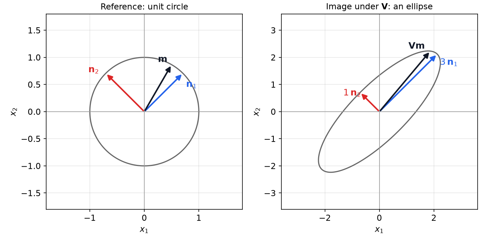
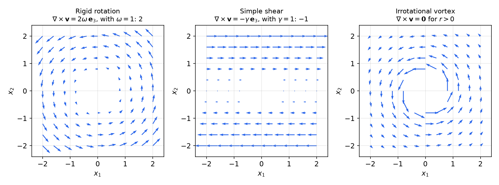

# Tensor Algebra and Calculus

Continuum mechanics describes a deforming body with quantities such as stress, strain and the deformation gradient. The components of these quantities depend on the coordinate system, but the physical content does not, so the components must change under a change of basis by a fixed rule. Tensors are the objects defined by that rule, and index notation is the compact calculus that manipulates them. This chapter develops the algebra and calculus used throughout the subsection: index notation, transformation laws, invariants and the spectral theorem, the polar decomposition, and differential operators on tensor fields with their integral theorems. The next chapter, on kinematics, relies on the polar decomposition and on the gradient operator.

## Index Notation

### Physical quantities by order

A quantity with no direction, such as a mass or a temperature, is a **scalar**. A velocity or a displacement has a magnitude and a direction and is a **vector**. Many physical quantities need more than one direction. The stress at a point acts on a plane with a given normal and points in some direction. The thermal conductivity of an anisotropic crystal relates a temperature gradient to a heat flux that may point in a different direction. Such quantities are **second-order tensors**. Third-order tensors appear as gradients of second-order fields and in piezoelectric materials. Fourth-order tensors, such as the elasticity tensor that relates stress to strain, arise in anisotropic solids.

The number of components of an \\(N\\)-th order tensor in three dimensions is \\(3^N\\): one for a scalar, three for a vector, nine for a second-order tensor and 81 for a fourth-order tensor. Symmetry reduces the count. A symmetric second-order tensor has six independent components, and the elasticity tensor of an anisotropic solid has at most 21.

What distinguishes a tensor from an arbitrary array of numbers is its behaviour under a change of basis.

**Definition (tensor).** Let \\(\\{\mathbf e\_i\\}\\) and \\(\\{\mathbf f\_i\\}\\) be two orthonormal bases and put \\(A\_{ij}=\mathbf f\_i\cdot\mathbf e\_j\\). An array \\(V\_{ij\ldots}\\) with \\(N\\) indices is a **tensor of order \\(N\\)** if its components in the two bases are related by
\\[
V^{f}\_{ij\ldots}=A\_{ip}A\_{jq}\cdots\\,V^{e}\_{pq\ldots}.
\\]

Each index carries its own factor of \\(A\\). A scalar is a tensor of order zero, with \\(V^f=V^e\\): the temperature at a point is the same in every frame. The word "tensor" without qualification usually means a second-order tensor.

### Summation convention and free indices

Lowercase Latin subscripts range over \\(\\{1,2,3\\}\\). A subscript repeated within one term is summed over this range (the **summation convention**). Such a subscript is a **dummy index**. Any other subscript is a **free index**, and every term of an equation must have the same free indices. Three rules follow:

- No index appears more than twice in a single term.
- Free indices are identical on both sides of an equation.
- Dummy indices may be renamed, provided no name is used twice in a term.

For example, \\(\alpha=x\_{ii}=x\_{11}+x\_{22}+x\_{33}\\) is a scalar, and \\(c\_i=a\_i+b\_i\\) stands for three equations. The expression \\(c\_i=a\_{ij}+b\_i\\) is meaningless, because \\(j\\) is free in one term only. The matrix–vector product \\(u\_m=A\_{mn}v\_n\\) is a compact way to write three equations, and the tensor identity \\(\mathbf u=\mathbf A\mathbf v\\) is the same statement in basis-free form.

### The Kronecker delta and the permutation symbol

The **Kronecker delta** is
\\[
\delta\_{ij}=\begin{cases} 1, & i=j \\\\ 0, & i\neq j \end{cases}
\\]
Its key property is substitution: in \\(a\_{ij}\delta\_{jk}\\) the factor vanishes unless \\(j=k\\), so \\(a\_{ij}\delta\_{jk}=a\_{ik}\\). The delta is the identity matrix in index form, \\(I\_{ij}=\delta\_{ij}\\).

The **permutation symbol** (Levi-Civita symbol) is
\\[
\varepsilon\_{ijk}=\begin{cases} +1, & ijk\in\\{123,231,312\\} \\\\ -1, & ijk\in\\{132,213,321\\} \\\\ 0, & \text{two indices equal} \end{cases}
\\]
It is \\(+1\\) for cyclic permutations of \\(123\\), \\(-1\\) for the others, and zero whenever an index repeats.

The product of two permutation symbols is a determinant of deltas.

**Theorem (\\(\varepsilon\\)–\\(\delta\\) identity).** For all indices,
\\[
\varepsilon\_{ijk}\varepsilon\_{pqr}=\begin{vmatrix}\delta\_{ip}&\delta\_{iq}&\delta\_{ir}\\\\ \delta\_{jp}&\delta\_{jq}&\delta\_{jr}\\\\ \delta\_{kp}&\delta\_{kq}&\delta\_{kr}\end{vmatrix}.
\\]

The identity follows by checking all cases. Expanding the determinant gives six products of three deltas, three with positive and three with negative sign, which match the six nonzero terms that arise from the permutations. Four contractions are used constantly:

- \\(\delta\_{ii}=3\\);
- \\(\varepsilon\_{imn}\varepsilon\_{ipq}=\delta\_{mp}\delta\_{nq}-\delta\_{mq}\delta\_{np}\\), obtained by contracting the first index of the identity;
- \\(\varepsilon\_{imn}\varepsilon\_{imq}=2\delta\_{nq}\\), obtained by contracting again;
- \\(\varepsilon\_{imn}\varepsilon\_{imn}=6\\): only the three even and three odd permutations contribute, each with square \\(1\\).

### Worked example: a vector identity

**Example 1.1 (Lagrange identity).** Show that \\(\lvert\mathbf u\times\mathbf v\rvert^2=\lvert\mathbf u\rvert^2\lvert\mathbf v\rvert^2-(\mathbf u\cdot\mathbf v)^2\\).

*Solution.* The cross product has components \\(w\_i=\varepsilon\_{ijk}u\_jv\_k\\). Its squared magnitude needs a second, independent pair of dummy indices, so write \\(w\_i=\varepsilon\_{imn}u\_mv\_n\\) and
\\[
\lvert\mathbf u\times\mathbf v\rvert^2=w\_iw\_i=\varepsilon\_{ijk}\varepsilon\_{imn}u\_jv\_ku\_mv\_n.
\\]
Apply the contraction \\(\varepsilon\_{imn}\varepsilon\_{ipq}=\delta\_{mp}\delta\_{nq}-\delta\_{mq}\delta\_{np}\\) with \\((m,n)\\) replaced by \\((j,k)\\) and \\((p,q)\\) by \\((m,n)\\):
\\[
\varepsilon\_{ijk}\varepsilon\_{imn}=\delta\_{jm}\delta\_{kn}-\delta\_{jn}\delta\_{km}.
\\]
Substitute and use the substitution property:
\\[
(\delta\_{jm}\delta\_{kn}-\delta\_{jn}\delta\_{km})u\_jv\_ku\_mv\_n=u\_ju\_j\\,v\_kv\_k-u\_jv\_j\\,v\_ku\_k=\lvert\mathbf u\rvert^2\lvert\mathbf v\rvert^2-(\mathbf u\cdot\mathbf v)^2.
\\]
The index computation replaces a page of coordinate algebra with four lines. \\(\blacksquare\\)

### Determinant and inverse

The determinant of a \\(3\times3\\) array can be written with permutation symbols,
\\[
\det\mathbf M=\tfrac16\\,\varepsilon\_{ijk}\varepsilon\_{pqr}M\_{ip}M\_{jq}M\_{kr}=\varepsilon\_{ijk}M\_{i1}M\_{j2}M\_{k3},
\\]
where all six indices in the first form are dummies. The inverse of a non-singular tensor follows from the same identity,
\\[
V^{-1}\_{ij}=\frac{1}{2\det\mathbf V}\\,\varepsilon\_{ipq}\varepsilon\_{jrs}V\_{rp}V\_{sq}.
\\]
Both formulas are the cofactor expansions in compact form. They are useful for proofs, and for checking a numerical result by hand, but for large computations one uses the matrix routines directly.

## Bases and Transformation Laws

### Coordinate systems and the change-of-basis matrix

A **coordinate system** is a basis together with an origin. Given a second basis \\(\\{\mathbf f\_i\\}\\), the change-of-basis matrix \\([A]\\) has entries \\(A\_{ij}=\mathbf f\_i\cdot\mathbf e\_j=\cos\theta\_{ij}\\), where \\(\theta\_{ij}\\) is the angle between \\(\mathbf f\_i\\) and \\(\mathbf e\_j\\). The first index refers to the new basis and the second to the old. Since both bases are orthonormal, \\(\mathbf f\_i=A\_{ik}\mathbf e\_k\\), and the rows and columns of \\([A]\\) are orthonormal:
\\[
A\_{ik}A\_{jk}=\delta\_{ij},\qquad [A]^{T}=[A]^{-1}.
\\]
The matrix \\([A]\\) is not symmetric in general, and it is not itself a tensor: it describes one pair of bases, not a physical quantity.

*Figure: a vector \\(\mathbf P\\) and two bases \\(\mathbf e\\) and \\(\mathbf f\\), the second rotated by \\(\theta=30^\circ\\). The components \\(P'\_i=A\_{ik}P\_k\\) in the rotated basis are the projections of \\(\mathbf P\\) onto \\(\mathbf f\_i\\). The length of \\(\mathbf P\\) is the same in both bases.*

### Transformation of vectors and second-order tensors

Since \\(\mathbf f\_i=A\_{ik}\mathbf e\_k\\), the components of a vector \\(\mathbf P=P\_k\mathbf e\_k\\) in the new basis are \\(P'\_i=\mathbf f\_i\cdot\mathbf P=A\_{ik}P\_k\\). For a second-order tensor \\(\mathbf T\\),
\\[
T'\_{ij}=\mathbf f\_i\cdot\mathbf T\mathbf f\_j=(A\_{ik}\mathbf e\_k)\cdot\mathbf T(A\_{jl}\mathbf e\_l)=A\_{ik}A\_{jl}\\,T\_{kl}.
\\]
In matrix form, \\([\mathbf T']=[A][\mathbf T][A]^{T}\\). The transformation law for a vector is the first-order version, \\([\mathbf P']=[A][\mathbf P]\\). A quantity whose components do not transform this way is not a vector.

The stress tensor shows why the law matters. Cut a small cube aligned with the \\(x\\)-axes out of a loaded body: it carries nine stress components. Cut another cube, aligned with rotated axes at the same point, and it carries nine different components. Both describe the same state of stress at the same point, and the transformation law says exactly how the two sets are related. The ultimate reason to rotate is to find a basis in which the stress is as simple as possible, which is the eigenvalue problem of the next section.

### Rotations

If the basis \\(\\{\mathbf f\_i\\}\\) is obtained from \\(\\{\mathbf e\_i\\}\\) by a rigid rotation, there is a proper orthogonal tensor \\(\mathbf Q\\) with \\(\mathbf f\_i=\mathbf Q\mathbf e\_i\\). Then
\\[
Q\_{ij}=\mathbf e\_i\cdot\mathbf Q\mathbf e\_j=\mathbf e\_i\cdot\mathbf f\_j=A\_{ji},\qquad [\mathbf Q]=[A]^{T}.
\\]
For a counterclockwise rotation by \\(\theta\\) about \\(\mathbf e\_3\\), the change-of-basis matrix and the rotation tensor are
\\[
[A]=\begin{pmatrix}\cos\theta&\sin\theta&0\\\\-\sin\theta&\cos\theta&0\\\\0&0&1\end{pmatrix},\qquad
[\mathbf Q]=\begin{pmatrix}\cos\theta&-\sin\theta&0\\\\\sin\theta&\cos\theta&0\\\\0&0&1\end{pmatrix}.
\\]
The matrices about \\(\mathbf e\_1\\) and \\(\mathbf e\_2\\) follow by cyclic permutation of the indices.

### Components of vectors and tensors

A vector \\(\mathbf v\\) has components \\(v\_i=\mathbf v\cdot\mathbf e\_i\\), so \\(\mathbf v=v\_i\mathbf e\_i\\). A second-order tensor has components \\(T\_{ij}=\mathbf e\_i\cdot\mathbf T\mathbf e\_j\\), so \\(\mathbf T=T\_{ij}\\,\mathbf e\_i\otimes\mathbf e\_j\\). Its action on a vector is \\(y\_i=T\_{ij}x\_j\\). A second-order tensor is therefore a linear operation on vectors, and the components are its matrix in the chosen basis.

To define a tensor one must specify two things: how its components are computed and what it does to a vector. A **tensor product** of two vectors is the simplest example:
\\[
\mathbf T=\mathbf a\otimes\mathbf b,\qquad T\_{ij}=a\_ib\_j,\qquad (\mathbf a\otimes\mathbf b)\mathbf x=(\mathbf b\cdot\mathbf x)\\,\mathbf a\quad\text{for all }\mathbf x.
\\]
The outer product raises the order, where the dot product lowers it, and the cross product returns a vector. Three properties follow directly: \\(\mathbf a\otimes\mathbf b\neq\mathbf b\otimes\mathbf a\\) in general, \\((\mathbf a\otimes\mathbf b)^T=\mathbf b\otimes\mathbf a\\), and \\(\det(\mathbf a\otimes\mathbf b)=0\\), since the tensor maps every vector orthogonal to \\(\mathbf b\\) to zero.

## Tensors as Linear Operators

### Products

Two tensors act one after the other: \\(\mathbf y=\mathbf V\mathbf x\\) and \\(\mathbf z=\mathbf U\mathbf y\\) give \\(\mathbf z=\mathbf U\mathbf V\mathbf x\\), so the product is \\(W\_{ij}=U\_{ik}V\_{kj}\\). The second index of the first factor is contracted with the first index of the second. The product is associative and distributive, but \\(\mathbf U\mathbf V\neq\mathbf V\mathbf U\\) in general. Also \\((\mathbf U\mathbf V)^T=\mathbf V^T\mathbf U^T\\) and \\((\mathbf U\mathbf V)^{-1}=\mathbf V^{-1}\mathbf U^{-1}\\), and the identity \\(\mathbf I\\) acts as the unit for all these operations.

Tensor-vector products obey \\(\mathbf A\mathbf x\cdot\mathbf y=\mathbf x\cdot\mathbf A^T\mathbf y\\), which is the defining property of the transpose.

### Projection tensors

**Example 1.2 (Projection onto a direction).** Let \\(\mathbf n\\) be a unit vector. Find tensors that give the component of \\(\mathbf x\\) along \\(\mathbf n\\), and the part of \\(\mathbf x\\) perpendicular to \\(\mathbf n\\).

*Solution.* The component along \\(\mathbf n\\) is \\(\mathbf c=(\mathbf x\cdot\mathbf n)\mathbf n=(n\_jx\_j)n\_i\mathbf e\_i\\), so \\(c\_i=n\_in\_jx\_j\\). Comparing with \\(c\_i=T\_{ij}x\_j\\) gives \\(\mathbf T\_\parallel=\mathbf n\otimes\mathbf n\\) with \\(T\_{ij}=n\_in\_j\\). The perpendicular part is obtained by subtraction from the identity,
\\[
\mathbf T\_\perp=\mathbf I-\mathbf n\otimes\mathbf n,\qquad (\mathbf T\_\perp)\_{ij}=\delta\_{ij}-n\_in\_j.
\\]
For \\(\mathbf n=\mathbf e\_3\\) these reduce to \\(\mathbf e\_3\otimes\mathbf e\_3\\) and \\(\mathbf I-\mathbf e\_3\otimes\mathbf e\_3\\). \\(\blacksquare\\)

### Transpose, symmetry and skew symmetry

The transpose is defined by an operation rather than by a rule for components: \\(\mathbf T^T\\) is the tensor for which
\\[
\mathbf x\cdot\mathbf T\mathbf y=\mathbf y\cdot\mathbf T^T\mathbf x\qquad\text{for all }\mathbf x,\mathbf y.
\\]
Comparing components gives \\(T^T\_{ij}=T\_{ji}\\). A tensor is **symmetric** if \\(\mathbf T=\mathbf T^T\\), and **skew-symmetric** if \\(\mathbf T=-\mathbf T^T\\). Every second-order tensor splits uniquely into a symmetric and a skew part,
\\[
\mathbf T=\tfrac12(\mathbf T+\mathbf T^T)+\tfrac12(\mathbf T-\mathbf T^T).
\\]
The diagonal of a skew tensor vanishes, since \\(T\_{ii}=-T\_{ii}\\). It therefore has only three independent components, which suggests a vector.

### The dual vector of a skew tensor

**Theorem (dual vector).** Let \\(\boldsymbol\Omega\\) be skew-symmetric. There is a unique vector \\(\boldsymbol\omega\\), the **dual** or **axial** vector, such that \\(\boldsymbol\Omega\mathbf x=\boldsymbol\omega\times\mathbf x\\) for every \\(\mathbf x\\). Its components are
\\[
\Omega\_{ij}=-\varepsilon\_{ijk}\omega\_k,\qquad \omega\_i=-\tfrac12\varepsilon\_{ijk}\Omega\_{jk}.
\\]

*Proof.* Write \\((\boldsymbol\omega\times\mathbf x)\_i=\varepsilon\_{ijk}\omega\_jx\_k\\). Comparing with \\(\Omega\_{ik}x\_k\\) for arbitrary \\(\mathbf x\\) gives \\(\Omega\_{ik}=\varepsilon\_{ijk}\omega\_j=-\varepsilon\_{ikj}\omega\_j\\), which after renaming is the first formula. Contract with \\(\varepsilon\_{lik}\\) and use \\(\varepsilon\_{lik}\varepsilon\_{jik}=2\delta\_{lj}\\) to get \\(\varepsilon\_{lik}\Omega\_{ik}=-2\omega\_l\\), which is the second formula. Conversely, the second formula determines \\(\boldsymbol\omega\\) from \\(\boldsymbol\Omega\\), which proves uniqueness. \\(\blacksquare\\)

A rigid rotation with angular velocity \\(\boldsymbol\omega\\) has velocity \\(\mathbf v=\boldsymbol\omega\times\mathbf r\\) at position \\(\mathbf r\\). In the language of this theorem, the velocity is \\(\boldsymbol\Omega\mathbf r\\) with \\(\boldsymbol\Omega\\) the skew tensor dual to \\(\boldsymbol\omega\\). So a rotation can be written either as a cross product with a vector or as a tensor operation with a skew matrix.

### Decomposition and special tensors

The **null tensor** \\(\mathbf 0\\) maps every vector to zero. The **identity** \\(\mathbf I\\) satisfies \\(\mathbf I\mathbf x=\mathbf x\\), with components \\(\delta\_{ij}\\), and \\(\mathbf I=\mathbf e\_i\otimes\mathbf e\_i\\) in any orthonormal basis. A tensor is **isotropic** if it has the same components in every basis. The only isotropic second-order tensors are \\(\alpha\mathbf I\\), because a rotation-invariant matrix must commute with all rotations.

The **inner product** of two second-order tensors is
\\[
\mathbf T:\mathbf U=T\_{ij}U\_{ij},
\\]
and \\(\mathbf T:\mathbf U=\mathbf T:\mathbf U^{T}\\) is the value of the product \\(T\_{ij}U\_{ji}\\) when \\(\mathbf T\\) or \\(\mathbf U\\) is symmetric. The inner product \\(\mathbf T:\mathbf T\\) is positive unless \\(\mathbf T=\mathbf 0\\). In continuum mechanics the quantity \\(\boldsymbol\sigma:\dot{\boldsymbol\epsilon}\\) is a power per unit volume, which is why this product appears in the energy balance.

The algebra of tensors satisfies the usual axioms. Addition is commutative and associative, scalar multiplication distributes over addition, multiplication of tensors is associative and distributes over addition on both sides, and the identity and inverse behave as expected. Multiplication is not commutative.

## Invariants, Eigenvalues and the Inverse

### Invariants

The three **principal invariants** of a second-order tensor \\(\mathbf V\\) are
\\[
I\_1=\operatorname{tr}\mathbf V=V\_{ii},\qquad
I\_2=\tfrac12\big[(\operatorname{tr}\mathbf V)^2-\operatorname{tr}(\mathbf V^2)\big],\qquad
I\_3=\det\mathbf V=\tfrac16\varepsilon\_{ijk}\varepsilon\_{pqr}V\_{ip}V\_{jq}V\_{kr}.
\\]
They are called invariants because they take the same value in every basis. For the trace this is one line from the transformation law: \\(T'\_{ii}=A\_{ik}A\_{il}T\_{kl}=\delta\_{kl}T\_{kl}=T\_{kk}\\). The same argument applies to \\(\operatorname{tr}(\mathbf V^2)\\), because \\(\mathbf V^2\\) transforms as a tensor, and hence to \\(I\_2\\). The determinant is invariant because \\(\det([A][\mathbf V][A]^T)=(\det[A])^2\det[\mathbf V]=\det[\mathbf V]\\), using \\(\det[A]=\pm1\\) for an orthogonal matrix.

### Eigenvalues and the characteristic equation

A nonzero vector \\(\mathbf n\\) is an **eigenvector** of \\(\mathbf V\\) with **eigenvalue** \\(\lambda\\) if \\(\mathbf V\mathbf n=\lambda\mathbf n\\). Scaling \\(\mathbf n\\) keeps it an eigenvector, so we normalize it to \\(\lvert\mathbf n\rvert=1\\). The condition \\((\mathbf V-\lambda\mathbf I)\mathbf n=\mathbf 0\\) has a nonzero solution only if \\(\det(\mathbf V-\lambda\mathbf I)=0\\), which is the **characteristic equation**
\\[
\lambda^3-I\_1\lambda^2+I\_2\lambda-I\_3=0.
\\]
A real cubic always has at least one real root, so every real tensor has at least one real eigenvalue. The equation can also be written in tensor form. The **Cayley–Hamilton theorem** states that every tensor satisfies its own characteristic equation,
\\[
\mathbf V^3-I\_1\mathbf V^2+I\_2\mathbf V-I\_3\mathbf I=\mathbf 0 .
\\]

The eigenvectors of a non-symmetric tensor need not be orthogonal. For \\(\mathbf V\\) with matrix \\([[2,0,0],[1,2,1],[-1,0,1]]\\) the eigenvalues are \\(2\\), \\(2\\) and \\(1\\). The eigenvectors for \\(\lambda=1\\) and \\(\lambda=2\\) are \\((0,1,-1)/\sqrt2\\) and \\((1,0,-1)/\sqrt2\\), whose inner product is \\(1/2\neq0\\). Non-symmetric tensors do not in general have an orthogonal set of principal directions. Symmetric tensors do, which is why they are used almost everywhere in continuum mechanics.

### The inverse

Multiplying the Cayley–Hamilton identity by \\(\mathbf V^{-1}\\) gives an explicit formula for the inverse of a non-singular tensor:
\\[
\mathbf V^{-1}=\frac{1}{I\_3}\big(\mathbf V^2-I\_1\mathbf V+I\_2\mathbf I\big).
\\]
A tensor has an inverse exactly when \\(\det\mathbf V\neq0\\), because \\(\det\mathbf V\det\mathbf V^{-1}=\det\mathbf I=1\\).

## Orthogonal Tensors and Rotations

**Definition (orthogonal tensor).** A tensor \\(\mathbf Q\\) is **orthogonal** if \\(\mathbf Q\mathbf Q^T=\mathbf Q^T\mathbf Q=\mathbf I\\), that is, \\(\mathbf Q^{-1}=\mathbf Q^T\\).

Taking determinants gives \\((\det\mathbf Q)^2=1\\), so \\(\det\mathbf Q=\pm1\\). The two cases are different in kind:

- \\(\det\mathbf Q=+1\\): a **proper** orthogonal tensor, which is a rotation.
- \\(\det\mathbf Q=-1\\): an **improper** orthogonal tensor, which is a reflection composed with a rotation, such as the mirror image of a body.

A translation \\(\mathbf y=\mathbf x+\mathbf d\\) is not a tensor operation, because it does not map the origin to itself. Only the two orthogonal cases are linear.

**Theorem (orthogonal maps preserve geometry).** Let \\(\mathbf x'=\mathbf Q\mathbf x\\) and \\(\mathbf y'=\mathbf Q\mathbf y\\) for an orthogonal \\(\mathbf Q\\). Then
\\[
\mathbf x'\cdot\mathbf y'=\mathbf x\cdot\mathbf y,\qquad (\mathbf x'\times\mathbf y')\cdot\mathbf z'=\det\mathbf Q\\,(\mathbf x\times\mathbf y)\cdot\mathbf z,\quad\text{where }\mathbf z'=\mathbf Q\mathbf z.
\\]
In particular, lengths and angles are preserved, and the orientation (handedness) is preserved if and only if \\(\det\mathbf Q=+1\\).

*Proof.* The dot product identity follows from \\(\mathbf Q\mathbf x\cdot\mathbf Q\mathbf y=\mathbf x\cdot\mathbf Q^T\mathbf Q\mathbf y=\mathbf x\cdot\mathbf y\\). Setting \\(\mathbf x=\mathbf y\\) gives length preservation, and dividing by the lengths gives angle preservation. For the triple product, expand the components \\((\mathbf Q\mathbf x)\_j=Q\_{jl}x\_l\\) and use the index form of the determinant, \\(\varepsilon\_{ijk}Q\_{in}Q\_{jl}Q\_{km}=\det\mathbf Q\\,\varepsilon\_{nlm}\\):
\\[
(\mathbf Q\mathbf x\times\mathbf Q\mathbf y)\cdot\mathbf Q\mathbf z=\det\mathbf Q\\;\varepsilon\_{nlm}x\_ly\_mz\_n=\det\mathbf Q\\,(\mathbf x\times\mathbf y)\cdot\mathbf z .
\\]
The proof is complete. \\(\blacksquare\\)

The triple product is the volume of the parallelepiped spanned by three vectors. A proper orthogonal map keeps positive volumes positive, which is physically the only kind of map a continuum deformation can produce, since a body cannot be turned into its own mirror image without tearing it.

### Rotation about an arbitrary axis

Every proper orthogonal tensor is a rotation about some axis \\(\mathbf n\\), \\(\lvert\mathbf n\rvert=1\\), through some angle \\(\theta\\). In absolute (basis-free) form, **Rodrigues' rotation formula** states
\\[
\mathbf Q=(\cos\theta)\mathbf I+(\sin\theta)\boldsymbol\Omega+(1-\cos\theta)\\,\mathbf n\otimes\mathbf n,
\\]
where \\(\boldsymbol\Omega\\) is the skew tensor dual to \\(\mathbf n\\), so that \\(\boldsymbol\Omega\mathbf x=\mathbf n\times\mathbf x\\). Its action on a vector is
\\[
\mathbf Q\mathbf x=\mathbf n(\mathbf n\cdot\mathbf x)+(\sin\theta)(\mathbf n\times\mathbf x)+(\cos\theta)\\,(\mathbf n\times\mathbf x)\times\mathbf n .
\\]
The vector \\(\mathbf n\\) is unchanged, and the component of \\(\mathbf x\\) perpendicular to \\(\mathbf n\\) turns through \\(\theta\\). Check the formula with \\(\mathbf n=\mathbf e\_3\\): then \\(\boldsymbol\Omega\\) has entries \\(-1\\) and \\(+1\\) in positions \\((1,2)\\) and \\((2,1)\\), and the result is the matrix of rotation about \\(\mathbf e\_3\\) given earlier.

**Example 1.3 (Rotation through a right angle about a body diagonal).** Let \\(\mathbf n=(1,1,1)/\sqrt3\\) and \\(\theta=\pi/2\\). Find \\(\mathbf Q\\).

*Solution.* With \\(\cos\theta=0\\) and \\(\sin\theta=1\\), the formula reduces to \\(\mathbf Q=\boldsymbol\Omega+\mathbf n\otimes\mathbf n\\). The dual tensor has components \\(\Omega\_{ij}=-\varepsilon\_{ijk}n\_k\\), so
\\[
[\boldsymbol\Omega]=\frac{1}{\sqrt3}\begin{pmatrix}0&-1&1\\\\1&0&-1\\\\-1&1&0\end{pmatrix},\qquad
[\mathbf n\otimes\mathbf n]=\frac13\begin{pmatrix}1&1&1\\\\1&1&1\\\\1&1&1\end{pmatrix}.
\\]
Since \\(1/\sqrt3=\sqrt3/3\\), adding the two gives
\\[
[\mathbf Q]=\frac13\begin{pmatrix}1&1-\sqrt3&1+\sqrt3\\\\1+\sqrt3&1&1-\sqrt3\\\\1-\sqrt3&1+\sqrt3&1\end{pmatrix}.
\\]
Each row has length one, for example \\(\tfrac19\big(1+(1-\sqrt3)^2+(1+\sqrt3)^2\big)=1\\), and adjacent rows are orthogonal. The row sums are all \\(3/3=1\\), so \\(\mathbf Q(1,1,1)^T=(1,1,1)^T\\): the diagonal \\(\mathbf n\\) is fixed, as it should be. \\(\blacksquare\\)

### Singular tensors

A tensor is **singular** if \\(\det\mathbf V=0\\). Equivalently, it has no inverse, and there is a nonzero vector \\(\mathbf x\\) with \\(\mathbf V\mathbf x=\mathbf 0\\). Two common examples are a skew tensor, whose kernel contains its own dual vector since \\(\boldsymbol\omega\times\boldsymbol\omega=\mathbf 0\\), and the tensor \\(\mathbf u\otimes\mathbf v\\), which annihilates every vector orthogonal to \\(\mathbf v\\). A singular tensor collapses at least one direction, which is why a physical deformation gradient must be non-singular.

## Eigenvalues and the Spectral Theorem

### Symmetric tensors

The results for symmetric tensors are the most important in this chapter.

**Theorem (spectral representation).** Let \\(\mathbf V\\) be symmetric. Then \\(\mathbf V\\) has three real eigenvalues \\(\lambda\_1,\lambda\_2,\lambda\_3\\) and an orthonormal set of eigenvectors \\(\mathbf n\_1,\mathbf n\_2,\mathbf n\_3\\), and
\\[
\mathbf V=\sum\_{i=1}^{3}\lambda\_i\\,\mathbf n\_i\otimes\mathbf n\_i .
\\]
The vectors \\(\mathbf n\_i\\) are the **principal directions** and the \\(\lambda\_i\\) the **principal values**. In the principal basis the matrix of \\(\mathbf V\\) is diagonal.

The statement is the spectral theorem for real symmetric matrices, which we take as known. Three cases arise, according to how many eigenvalues coincide.

- If the eigenvalues are distinct, the principal directions are unique (up to sign).
- If \\(\lambda\_2=\lambda\_3\neq\lambda\_1\\), then \\(\mathbf n\_1\\) is unique, and any unit vector in the plane orthogonal to \\(\mathbf n\_1\\) is a principal direction. The tensor is **transversely isotropic** about \\(\mathbf n\_1\\): \\(\mathbf V=\lambda\_1\mathbf n\_1\otimes\mathbf n\_1+\lambda\_2(\mathbf I-\mathbf n\_1\otimes\mathbf n\_1)\\), which is the same for every rotation about \\(\mathbf n\_1\\).
- If all three eigenvalues are equal, every vector is an eigenvector, and \\(\mathbf V=\lambda\mathbf I\\) is isotropic.

*Figure: left, the unit circle with the unit eigenvectors \\(\mathbf n\_1\\) (eigenvalue \\(3\\)) and \\(\mathbf n\_2\\) (eigenvalue \\(1\\)) of a symmetric tensor \\(\mathbf V\\), together with a unit vector \\(\mathbf m\\). Right, the image of the circle under \\(\mathbf V\\): an ellipse whose principal axes lie along \\(\mathbf n\_1\\) and \\(\mathbf n\_2\\), with semi-axes \\(3\\) and \\(1\\). The eigenvectors keep their directions and are only scaled.*

**Example 1.4 (Spectral representation of a symmetric tensor).** Let
\\[
[\mathbf V]=\begin{pmatrix}1&0&1\\\\0&2&0\\\\1&0&-1\end{pmatrix}.
\\]
Find its spectral representation.

*Solution.* Expanding along the second row, \\(\det(\mathbf V-\lambda\mathbf I)=(2-\lambda)\big[(1-\lambda)(-1-\lambda)-1\big]=(2-\lambda)(\lambda^2-2)\\). The eigenvalues are \\(\lambda\_1=2\\), \\(\lambda\_2=-\sqrt2\\) and \\(\lambda\_3=\sqrt2\\).

- For \\(\lambda\_1=2\\), the first and third rows of \\(\mathbf V-2\mathbf I\\) give \\(n\_1=n\_3=0\\), so \\(\mathbf n\_1=(0,1,0)\\).
- For \\(\lambda\_2=-\sqrt2\\), the second row gives \\(n\_2=0\\) and the first row gives \\(n\_3=-(1+\sqrt2)\\,n\_1\\). Normalizing gives \\(\mathbf n\_2=(1-\sqrt2,0,1)/\sqrt{4-2\sqrt2}\\), numerically \\((-0.3827,0,0.9239)\\).
- For \\(\lambda\_3=\sqrt2\\), similarly \\(\mathbf n\_3=(1+\sqrt2,0,1)/\sqrt{4+2\sqrt2}\\), numerically \\((0.9239,0,0.3827)\\).

These are orthonormal, and the spectral representation is
\\[
\mathbf V=2\\,\mathbf n\_1\otimes\mathbf n\_1-\sqrt2\\,\mathbf n\_2\otimes\mathbf n\_2+\sqrt2\\,\mathbf n\_3\otimes\mathbf n\_3 .
\\]
As a check, \\(\operatorname{tr}\mathbf V=2-\sqrt2+\sqrt2=2=I\_1\\) and \\(\det\mathbf V=2(-\sqrt2)(\sqrt2)=-4\\). \\(\blacksquare\\)

Writing a tensor in its principal basis makes most questions easy. Powers, inverses and functions are obtained by acting on the eigenvalues alone.

### Application: principal stresses

The stress tensor at a point is symmetric. A plane with normal \\(\mathbf n\\) carries the traction \\(\boldsymbol\sigma\mathbf n\\), and this traction is normal to the plane exactly when \\(\mathbf n\\) is an eigenvector of \\(\boldsymbol\sigma\\). The eigenvalues are the **principal stresses**, the normal stresses on planes free of shear. They are the largest and smallest normal stresses at the point, and they govern failure criteria. When two principal stresses are equal the stress state is transversely isotropic, and when all three are equal it is hydrostatic: the same normal stress acts on every plane, with no shear. The traction law itself is a result of the balance laws and is derived in the balance-laws chapter.

## Positive-Definite Tensors and the Polar Decomposition

### Positive-definite tensors

**Definition.** A tensor \\(\mathbf V\\) is **positive definite** if \\(\mathbf v\cdot\mathbf V\mathbf v>0\\) for every \\(\mathbf v\neq\mathbf 0\\).

Only the symmetric part of a tensor matters for this definition. If \\(\mathbf W=\tfrac12(\mathbf V-\mathbf V^T)\\), then \\(W\_{ij}v\_iv\_j=-W\_{ji}v\_iv\_j\\), and renaming the dummy indices shows that \\(W\_{ij}v\_iv\_j\\) equals its own negative, so it is zero. Hence \\(\mathbf v\cdot\mathbf V\mathbf v=\mathbf v\cdot\mathbf V\_s\mathbf v\\) for the symmetric part \\(\mathbf V\_s\\).

For a symmetric tensor, positive definiteness is equivalent to positive eigenvalues. Indeed, in the principal basis \\(\mathbf v\cdot\mathbf V\mathbf v=\sum\_i\lambda\_i(\mathbf v\cdot\mathbf n\_i)^2\\), which is positive for all \\(\mathbf v\neq\mathbf 0\\) if and only if every \\(\lambda\_i>0\\). Positive definite tensors are therefore non-singular. We abbreviate **symmetric positive definite** as **SPD**.

### Roots and powers

If \\(\mathbf S\\) is SPD with spectral representation \\(\sum\lambda\_i\mathbf n\_i\otimes\mathbf n\_i\\), then for any real \\(k\\),
\\[
\mathbf S^{k}=\sum\_{i=1}^3\lambda\_i^{k}\\,\mathbf n\_i\otimes\mathbf n\_i,\qquad \sqrt{\mathbf S}=\sum\_{i=1}^3\sqrt{\lambda\_i}\\,\mathbf n\_i\otimes\mathbf n\_i,\qquad \ln\mathbf S=\sum\_{i=1}^3\ln\lambda\_i\\,\mathbf n\_i\otimes\mathbf n\_i .
\\]
The square root is well defined because all \\(\lambda\_i>0\\). It is itself SPD, shares the principal basis of \\(\mathbf S\\), and is the unique SPD tensor whose square is \\(\mathbf S\\). We use this uniqueness below. Any function \\(f\\) defined on the eigenvalues gives \\(f(\mathbf S)=\sum f(\lambda\_i)\mathbf n\_i\otimes\mathbf n\_i\\) in the same way.

### The polar decomposition

The polar decomposition is the main structural result for non-singular tensors. It says that any deformation-like linear map is a stretch combined with a rotation, and it gives a precise meaning to each.

**Theorem (polar decomposition).** Let \\(\mathbf F\\) be a non-singular tensor. Then there are unique tensors \\(\mathbf U\\) and \\(\mathbf V\\), both SPD, and an orthogonal \\(\mathbf Q\\) such that
\\[
\mathbf F=\mathbf Q\mathbf U=\mathbf V\mathbf Q,\qquad \mathbf U=\sqrt{\mathbf F^T\mathbf F},\qquad \mathbf V=\sqrt{\mathbf F\mathbf F^T},\qquad \mathbf V=\mathbf Q\mathbf U\mathbf Q^T .
\\]
Moreover \\(\det\mathbf U=\det\mathbf V=\lvert\det\mathbf F\rvert\\), and \\(\mathbf Q\\) is proper orthogonal (a rotation) if \\(\det\mathbf F>0\\).

*Proof.* **Existence.** The tensor \\(\mathbf C=\mathbf F^T\mathbf F\\) is symmetric, and for \\(\mathbf x\neq\mathbf 0\\),
\\[
\mathbf x\cdot\mathbf C\mathbf x=(\mathbf F\mathbf x)\cdot(\mathbf F\mathbf x)=\lvert\mathbf F\mathbf x\rvert^2>0,
\\]
because \\(\mathbf F\\) is non-singular. So \\(\mathbf C\\) is SPD and \\(\mathbf U=\sqrt{\mathbf C}\\) exists. It is invertible, so \\(\mathbf Q=\mathbf F\mathbf U^{-1}\\) is defined. Its orthogonality follows from
\\[
\mathbf Q^T\mathbf Q=\mathbf U^{-1}\mathbf F^T\mathbf F\mathbf U^{-1}=\mathbf U^{-1}\mathbf U^2\mathbf U^{-1}=\mathbf I .
\\]
Next put \\(\mathbf V=\mathbf Q\mathbf U\mathbf Q^T\\). It is SPD, because it is similar to \\(\mathbf U\\) by an orthogonal matrix, and
\\[
\mathbf V^2=\mathbf Q\mathbf U^2\mathbf Q^T=\mathbf Q\mathbf F^T\mathbf F\mathbf Q^T=\mathbf F\mathbf F^T ,
\\]
where the last step uses \\(\mathbf F=\mathbf Q\mathbf U\\) to write \\(\mathbf Q\mathbf U^2\mathbf Q^T=(\mathbf Q\mathbf U)(\mathbf Q\mathbf U)^T=\mathbf F\mathbf F^T\\). Thus \\(\mathbf V=\sqrt{\mathbf F\mathbf F^T}\\), and \\(\mathbf V\mathbf Q=\mathbf Q\mathbf U\mathbf Q^T\mathbf Q=\mathbf Q\mathbf U=\mathbf F\\).

**Uniqueness.** Suppose \\(\mathbf F=\mathbf Q'\mathbf U'\\) with \\(\mathbf U'\\) SPD and \\(\mathbf Q'\\) orthogonal. Then \\(\mathbf F^T\mathbf F=\mathbf U'^T\mathbf Q'^T\mathbf Q'\mathbf U'=\mathbf U'^2\\), so \\(\mathbf U'\\) is the unique SPD square root of \\(\mathbf F^T\mathbf F\\), and \\(\mathbf Q'=\mathbf F\mathbf U'^{-1}\\) is then determined. The same argument applies to \\(\mathbf V\\).

**Determinants.** From \\(\det\mathbf F=\det\mathbf Q\det\mathbf U\\) and \\(\det\mathbf U>0\\), the sign of \\(\det\mathbf Q\\) equals the sign of \\(\det\mathbf F\\). \\(\blacksquare\\)

The two factorizations are the **right** and **left** polar decompositions. Reading \\(\mathbf F\mathbf x=\mathbf Q(\mathbf U\mathbf x)\\), the stretch acts first and the rotation second. Reading \\(\mathbf F\mathbf x=\mathbf V(\mathbf Q\mathbf x)\\), the rotation acts first and the stretch second. The principal stretches are the same in both, while the principal directions of \\(\mathbf V\\) are the rotated principal directions of \\(\mathbf U\\), by \\(\mathbf Q\\). These facts drive the interpretation of deformation in the next chapter.

The singular value decomposition gives a related factorization for rectangular matrices. For square matrices it leads to the polar decomposition, and it is treated in the singular value decomposition page of the mathematics section.

### The isotropic–deviatoric decomposition

Every second-order tensor \\(\mathbf U\\) splits uniquely into an isotropic part and a part with zero trace,
\\[
\mathbf U=\mathbf S+\mathbf D,\qquad \mathbf S=\tfrac13(\operatorname{tr}\mathbf U)\\,\mathbf I,\qquad \operatorname{tr}\mathbf D=0 .
\\]
The isotropic part \\(\mathbf S\\) is the same in every basis. The deviatoric part \\(\mathbf D\\) carries the change of shape without change of volume. Constitutive models often treat the two parts separately, because volume change and shape change respond to different physical mechanisms.

## Tensor Fields and Differential Operators

### Fields and comma notation

A **field** assigns a quantity to every point of a region. A scalar field \\(\phi(\mathbf x)\\), such as a temperature or a density, has one component. A vector field \\(\mathbf u(\mathbf x)\\), such as a velocity or displacement, has three. A tensor field \\(\mathbf V(\mathbf x)\\) has nine components in general.

We write partial derivatives with a comma followed by the coordinate index: any index after a comma denotes differentiation with respect to that coordinate,
\\[
\phi\_{,i}=\frac{\partial\phi}{\partial x\_i},\qquad u\_{i,j}=\frac{\partial u\_i}{\partial x\_j},\qquad V\_{ij,k}=\frac{\partial V\_{ij}}{\partial x\_k}.
\\]
The index \\(k\\) in \\(V\_{ij,k}\\) is free, and the derivative index is always the last one. The Laplacian of a scalar is \\(\phi\_{,ii}\\). The subscript repeated after the comma is summed, which is why \\(\phi\_{,ii}=\partial^2\phi/\partial x\_1^2+\partial^2\phi/\partial x\_2^2+\partial^2\phi/\partial x\_3^2\\).

### Scalar fields: gradient and Laplacian

The **gradient** of a scalar field is the vector \\(\nabla\phi=\phi\_{,i}\mathbf e\_i\\). It points in the direction of greatest increase, and its magnitude is the rate of that increase. The rate of change in an arbitrary unit direction \\(\mathbf n\\) is the directional derivative \\(\mathbf n\cdot\nabla\phi\\). The gradient raises the order of a field by one. The divergence and curl of a scalar are undefined, because they would lower the order below zero. The only operators on scalars are the gradient and the Laplacian \\(\nabla^2\phi=\nabla\cdot\nabla\phi=\phi\_{,ii}\\).

*Heat conduction.* Fourier's law states that the heat flux is proportional to the negative temperature gradient, \\(\mathbf q=-\mathbf k\nabla T\\). For an anisotropic conductor the conductivity is a second-order tensor, and the flux can have components in directions where the gradient is zero. In index form \\(q\_i=-k\_{ij}T\_{,j}\\). For a homogeneous isotropic material, \\(\mathbf k=k\mathbf I\\), and energy conservation then gives the heat equation \\(\rho c\_p\\,\partial T/\partial t=k\nabla^2T+h\\), where \\(h\\) is the heat generated per unit volume.

### Vector fields

For a vector field \\(\mathbf v\\) there are four operations. The **gradient** is a second-order tensor with components \\((\nabla\mathbf v)\_{ij}=v\_{i,j}\\), the derivative of the \\(i\\)-th component in the \\(j\\)-th direction. The **divergence** is a scalar, \\(\nabla\cdot\mathbf v=v\_{i,i}\\), and the **curl** is a vector,
\\[
(\nabla\times\mathbf v)\_i=\varepsilon\_{ijk}v\_{k,j}.
\\]
The **Laplacian** \\(\nabla^2\mathbf v\\) has components \\(v\_{i,jj}\\). Written out, the curl is
\\[
\nabla\times\mathbf v=\left(\frac{\partial v\_3}{\partial x\_2}-\frac{\partial v\_2}{\partial x\_3}\right)\mathbf e\_1+\left(\frac{\partial v\_1}{\partial x\_3}-\frac{\partial v\_3}{\partial x\_1}\right)\mathbf e\_2+\left(\frac{\partial v\_2}{\partial x\_1}-\frac{\partial v\_1}{\partial x\_2}\right)\mathbf e\_3 .
\\]

**Divergence and the velocity gradient.** The velocity gradient \\(\mathbf L=\nabla\mathbf v\\) has a symmetric and a skew part,
\\[
\mathbf D=\tfrac12(\mathbf L+\mathbf L^T),\qquad \mathbf W=\tfrac12(\mathbf L-\mathbf L^T),\qquad \mathbf L=\mathbf D+\mathbf W.
\\]
The trace of \\(\mathbf L\\) is the divergence, \\(\operatorname{tr}\mathbf L=\nabla\cdot\mathbf v\\). A velocity field with zero divergence is volume-preserving, which is the usual description of an incompressible fluid. The skew part \\(\mathbf W\\) has dual vector
\\[
\boldsymbol\omega=\tfrac12\nabla\times\mathbf v ,
\\]
so that \\(\mathbf W\mathbf x=\boldsymbol\omega\times\mathbf x\\). The vector \\(\boldsymbol\omega\\) is the local rate of rotation of the fluid. The **vorticity** \\(\nabla\times\mathbf v\\) is twice this angular velocity. The symmetric part \\(\mathbf D\\) describes stretching and shearing, and it is treated in the kinematics chapter.

**Example 1.5 (Vorticity of three planar flows).** Consider the velocity fields below in the \\(x\_1\\)–\\(x\_2\\) plane.

- Rigid rotation, \\(\mathbf v=\omega(-x\_2,x\_1,0)\\). Its curl is \\(2\omega\\,\mathbf e\_3\\), so the vorticity is constant and equal to twice the angular velocity \\(\omega\\).
- Simple shear, \\(\mathbf v=(\gamma x\_2,0,0)\\). Its curl is \\(-\gamma\\,\mathbf e\_3\\). The streamlines are straight and parallel, yet the vorticity is nonzero: the fluid elements rotate, although the flow does not circulate around any point.
- Irrotational vortex, \\(\mathbf v=\dfrac{\Gamma}{2\pi}\dfrac{(-x\_2,x\_1,0)}{x\_1^2+x\_2^2}\\). Its curl is zero at every point other than the origin, but the circulation around any loop enclosing the origin is \\(\Gamma\\). The fluid circulates without any element rotating about its own centre.

The irrotational vortex shows that zero curl does not guarantee that a field is a gradient on a region with a hole, because the singularity at the origin carries the circulation. The Stokes theorem below makes this precise.

*Figure: three planar velocity fields. Left, rigid rotation, whose vorticity is twice the angular velocity. Centre, simple shear, whose vorticity is nonzero although the streamlines are straight. Right, the irrotational vortex, which has zero vorticity away from its centre although the fluid circulates. Arrow lengths are drawn to scale within each panel.*

### Tensor fields and the differential operators

For a second-order tensor field \\(\mathbf U(\mathbf x)\\), the four operations are defined by contracting the derivative index with a component index. We use the convention
\\[
(\nabla\cdot\mathbf U)\_i=U\_{ij,j},
\\]
which differentiates with respect to the second index. Many books differentiate the first index instead. Their divergence is \\(\nabla\cdot\mathbf U^T\\) in our convention, and the two agree when \\(\mathbf U\\) is symmetric. The operations are:

| Operation | Definition | Result |
|---|---|---|
| gradient | \\(\nabla\mathbf U:\ U\_{ij,k}\\) | third-order tensor |
| divergence | \\(\nabla\cdot\mathbf U:\ U\_{ij,j}\\) | vector |
| curl | \\(\nabla\times\mathbf U:\ \varepsilon\_{ipq}U\_{jq,p}\\) | second-order tensor |
| Laplacian | \\(\nabla^2\mathbf U:\ U\_{ij,kk}\\) | second-order tensor |

The gradient of a tensor field is an array with three indices, and the divergence contracts the last index of the gradient with the second index of \\(\mathbf U\\). These definitions are needed for the divergence theorem below and for the stress equations of motion, where the convention matters for the sign and transpose of the result.

### Identities for second derivatives

Several identities hold for smooth fields, and each follows from the symmetry of mixed partial derivatives and the antisymmetry of the permutation symbol.

**Theorem (second-derivative identities).** For a smooth scalar field \\(\phi\\) and vector field \\(\mathbf v\\):
\\[
\nabla\times\nabla\phi=\mathbf 0,\qquad \nabla\cdot(\nabla\times\mathbf v)=0,\qquad \nabla\cdot\nabla\phi=\nabla^2\phi .
\\]

*Proof.* The curl of a gradient has components \\(\varepsilon\_{ijk}\phi\_{,kj}\\). The second derivatives are symmetric in \\(j\\) and \\(k\\), while \\(\varepsilon\_{ijk}\\) is antisymmetric in \\(j\\) and \\(k\\). A quantity that is symmetric under an exchange of two dummy indices and antisymmetric under the same exchange equals its own negative, so it is zero. The divergence of a curl is \\(\partial\_i(\varepsilon\_{ijk}v\_{k,j})=\varepsilon\_{ijk}v\_{k,ji}\\), which vanishes by the same argument. The last identity is the definition of the Laplacian. \\(\blacksquare\\)

A second identity is needed for the kinematic results later. For a vector field \\(\mathbf v\\),
\\[
\mathbf v\times(\nabla\times\mathbf v)=\tfrac12\nabla(\mathbf v\cdot\mathbf v)-(\nabla\mathbf v)\mathbf v .
\\]

*Proof.* In components, \\([\mathbf v\times(\nabla\times\mathbf v)]\_i=\varepsilon\_{ijk}v\_j\varepsilon\_{kmn}v\_{n,m}\\). Since \\(\varepsilon\_{ijk}=\varepsilon\_{kij}\\), the contraction identity gives \\(\varepsilon\_{kij}\varepsilon\_{kmn}=\delta\_{im}\delta\_{jn}-\delta\_{in}\delta\_{jm}\\). Substituting,
\\[
(\delta\_{im}\delta\_{jn}-\delta\_{in}\delta\_{jm})v\_jv\_{n,m}=v\_jv\_{j,i}-v\_jv\_{i,j}=\tfrac12(v\_jv\_j)\_{,i}-v\_{i,j}v\_j .
\\]
The last step uses the product rule. The term \\(v\_{i,j}v\_j\\) is the \\(i\\)-th component of \\((\nabla\mathbf v)\mathbf v\\). \\(\blacksquare\\)

### The divergence theorem

The divergence theorem converts a volume integral of a divergence into a surface integral.

**Theorem (divergence theorem).** Let \\(R\\) be a bounded region with piecewise smooth boundary \\(S\\) and outward unit normal \\(\mathbf n\\), and let \\(\mathbf W\\) be a continuously differentiable tensor field on \\(R\\). Then
\\[
\int\_S W\_{ij}n\_j\\,dS=\int\_R W\_{ij,j}\\,dV .
\\]
The vector case \\(\int\_S\mathbf v\cdot\mathbf n\\,dS=\int\_R\nabla\cdot\mathbf v\\,dV\\) has the same hypotheses, with \\(\mathbf v\\) in place of \\(\mathbf W\\).

The integral of \\(\mathbf v\cdot\mathbf n\\) over a surface is the net outward flux, and the divergence measures the local sources. Their balance is the statement that a region with no sources has zero net flux. The tensor version is used constantly in continuum mechanics. Surface tractions, which are forces per unit area on a boundary, are converted into volume forces, which are divided by density in Newton's law. The proof of the theorem is standard and is given in the vector calculus chapter of the mathematics section.

### Stokes' theorem and potentials

Stokes' theorem relates the curl over a surface to the circulation around its boundary.

**Theorem (Stokes' theorem).** Let \\(S\\) be a smooth oriented surface with boundary curve \\(\ell\\), oriented by the right-hand rule with respect to the unit normal \\(\mathbf n\\). Let \\(\mathbf v\\) be continuously differentiable on \\(S\\). Then
\\[
\iint\_S(\nabla\times\mathbf v)\cdot\mathbf n\\,dS=\oint\_\ell\mathbf v\cdot d\boldsymbol\ell .
\\]

Three consequences are used repeatedly. If \\(S\\) is closed, the integral of the curl over \\(S\\) vanishes, because the contributions of opposite sides cancel. If \\(\nabla\times\mathbf v=\mathbf 0\\) on a simply connected region \\(D\\), then the line integral \\(\phi(\mathbf x)=\int\_{\mathbf x\_0}^{\mathbf x}\mathbf v\cdot d\boldsymbol\ell\\) is independent of the path, and \\(\mathbf v=\nabla\phi\\). The function \\(\phi\\) is a **potential** for \\(\mathbf v\\). The simple-connectedness hypothesis is essential: the irrotational vortex of Example 1.5 has zero curl on a region with a hole and no potential.

The tensor version follows from the vector one. Let \\(\mathbf F\\) be a tensor field with \\(\varepsilon\_{ipq}F\_{jq,p}=0\\) for all \\(i\\) and \\(j\\). For fixed \\(j\\), the components \\(w\_q=F\_{jq}\\) form a vector field whose curl is \\((\nabla\times\mathbf w)\_i=\varepsilon\_{ipq}w\_{q,p}=\varepsilon\_{ipq}F\_{jq,p}=0\\). On a simply connected region, \\(\mathbf w=\nabla\varphi\_j\\) for some potential \\(\varphi\_j\\). Setting \\(v\_j=\varphi\_j\\) gives \\(F\_{jq}=v\_{j,q}\\), so \\(\mathbf F=\nabla\mathbf v\\) for a vector field \\(\mathbf v\\). This is the statement used in the kinematics chapter to recover a displacement from a deformation gradient.

**Example 1.6 (Gravitational field as a gradient).** Let a mass \\(M\\) sit at the origin and let \\(r=\lvert\mathbf x\rvert=\sqrt{x\_kx\_k}\\). The potential \\(\varphi=GMm/r\\) is chosen so that the force on a mass \\(m\\) is its gradient. Show that \\(\nabla\varphi\\) is the attractive inverse-square force.

*Solution.* Use the chain rule with a new dummy index \\(k\\), since \\(i\\) is already used twice:
\\[
\frac{\partial\varphi}{\partial x\_j}=GMm\\,\frac{\partial}{\partial x\_j}(x\_kx\_k)^{-1/2}=-\tfrac12GMm\\,(x\_kx\_k)^{-3/2}\frac{\partial(x\_kx\_k)}{\partial x\_j}.
\\]
Since \\(\partial(x\_kx\_k)/\partial x\_j=2x\_k\delta\_{kj}=2x\_j\\), this gives \\(\partial\varphi/\partial x\_j=-GMm\\,x\_j/r^3\\). Hence \\(\nabla\varphi=-(GMm/r^2)\\,\mathbf x/r\\). The magnitude is \\(GMm/r^2\\), and the direction points from \\(m\\) toward \\(M\\). The curl of the force vanishes identically, as the identities predict, so the force is conservative and the work done between two points is path-independent. \\(\blacksquare\\)

The same operators appear in the equations of electromagnetism, which provide a familiar application of the divergence and curl. With \\(\mathbf E\\) the electric field, \\(\mathbf B\\) the magnetic field, \\(\rho\\) the charge density, \\(\mathbf J\\) the current density and \\(\varepsilon\_0\\) and \\(\mu\_0\\) the permittivity and permeability of free space:

| Law | Differential form |
|---|---|
| Gauss | \\(\nabla\cdot\mathbf E=\rho/\varepsilon\_0\\) |
| Gauss for magnetism | \\(\nabla\cdot\mathbf B=0\\) |
| Faraday | \\(\nabla\times\mathbf E=-\partial\mathbf B/\partial t\\) |
| Ampère–Maxwell | \\(\nabla\times\mathbf B=\mu\_0(\mathbf J+\varepsilon\_0\\,\partial\mathbf E/\partial t)\\) |

The second identity in the chapter, \\(\nabla\cdot(\nabla\times\mathbf B)=0\\), shows that the Ampère–Maxwell law is consistent only if \\(\nabla\cdot\mathbf J+\varepsilon\_0\\,\partial(\nabla\cdot\mathbf E)/\partial t=0\\), which is charge conservation together with Gauss's law.

## Summary

- Tensors are arrays whose components transform by \\(V'\_{ij\ldots}=A\_{ip}A\_{jq}\cdots V\_{pq\ldots}\\) under a change of orthonormal basis, with \\(A\_{ij}=\mathbf f\_i\cdot\mathbf e\_j\\).
- Index notation with the summation convention and the identity \\(\varepsilon\_{ijk}\varepsilon\_{pqr}=\det[\delta]\\) gives compact proofs of vector and tensor identities.
- The invariants \\(I\_1,I\_2,I\_3\\) are basis-independent, and Cayley–Hamilton gives \\(\mathbf V^3-I\_1\mathbf V^2+I\_2\mathbf V-I\_3\mathbf I=\mathbf 0\\), hence \\(\mathbf V^{-1}=(\mathbf V^2-I\_1\mathbf V+I\_2\mathbf I)/I\_3\\).
- A skew tensor \\(\boldsymbol\Omega\\) has dual vector \\(\boldsymbol\omega\\) with \\(\boldsymbol\Omega\mathbf x=\boldsymbol\omega\times\mathbf x\\) and \\(\Omega\_{ij}=-\varepsilon\_{ijk}\omega\_k\\).
- Proper orthogonal tensors are rotations, \\(\det\mathbf Q=+1\\), and preserve lengths, angles and orientation.
- A symmetric tensor has the spectral representation \\(\mathbf V=\sum\_i\lambda\_i\mathbf n\_i\otimes\mathbf n\_i\\) with orthonormal principal directions.
- A symmetric positive definite tensor has positive eigenvalues, and its roots and powers are \\(\mathbf S^k=\sum\_i\lambda\_i^k\mathbf n\_i\otimes\mathbf n\_i\\).
- Polar decomposition: every non-singular \\(\mathbf F\\) factors as \\(\mathbf F=\mathbf Q\mathbf U=\mathbf V\mathbf Q\\) with \\(\mathbf U=\sqrt{\mathbf F^T\mathbf F}\\), \\(\mathbf V=\sqrt{\mathbf F\mathbf F^T}\\) and \\(\mathbf Q\\) orthogonal.
- Field operators: \\(\operatorname{div}\mathbf v=v\_{i,i}\\), \\((\nabla\times\mathbf v)\_i=\varepsilon\_{ijk}v\_{k,j}\\), and \\(\mathbf L=\mathbf D+\mathbf W\\) with \\(\boldsymbol\omega=\tfrac12\nabla\times\mathbf v\\).
- The divergence theorem \\(\int\_S W\_{ij}n\_j\\,dS=\int\_R W\_{ij,j}\\,dV\\) and Stokes' theorem \\(\iint\_S(\nabla\times\mathbf v)\cdot\mathbf n\\,dS=\oint\_\ell\mathbf v\cdot d\boldsymbol\ell\\) convert between volume, surface and line integrals; a curl-free field on a simply connected region is a gradient.

## See Also

- [Kinematics of Deformation](kinematics.md): the deformation gradient, the polar decomposition applied to deformation, and the strain measures built from it.
- [Balance Laws and Stress](balance-laws.md): the Cauchy traction law and the divergence theorem applied to conservation laws.
- Eigenvalues and Eigenvectors: the general theory behind the spectral representation.
- Singular Value Decomposition: the rectangular analogue of the polar decomposition.
- Vector Calculus: the divergence and Stokes' theorems in general form.
- Stress and Strain: the one-dimensional and beam-level version of these tensors.
