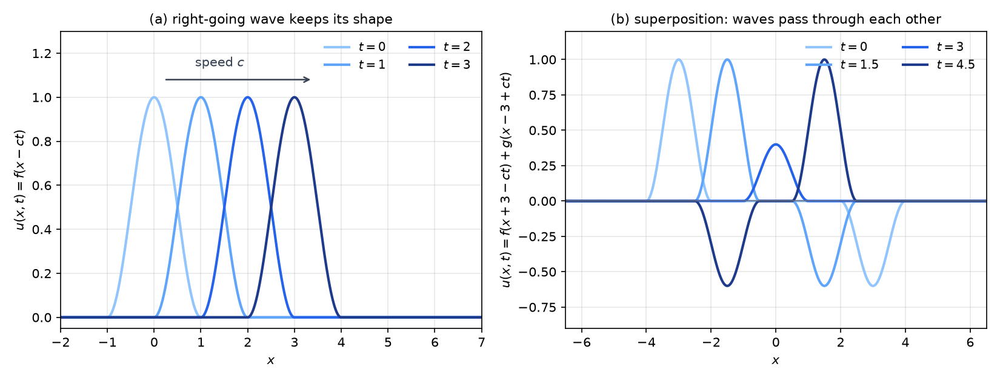
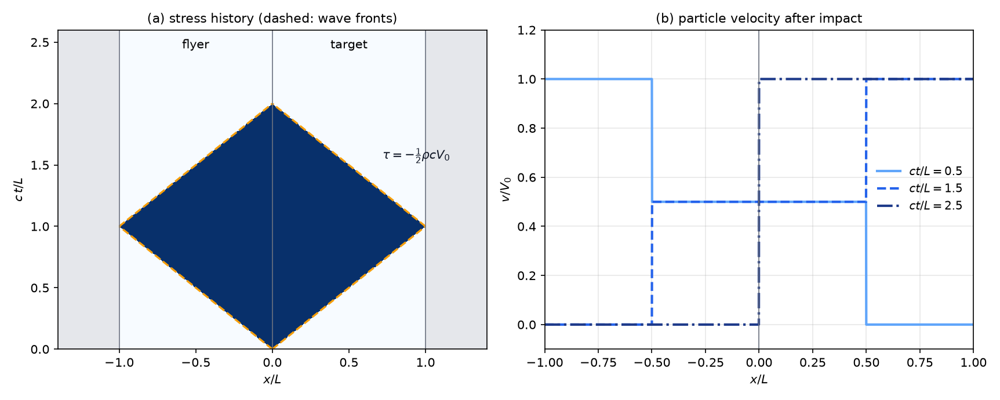
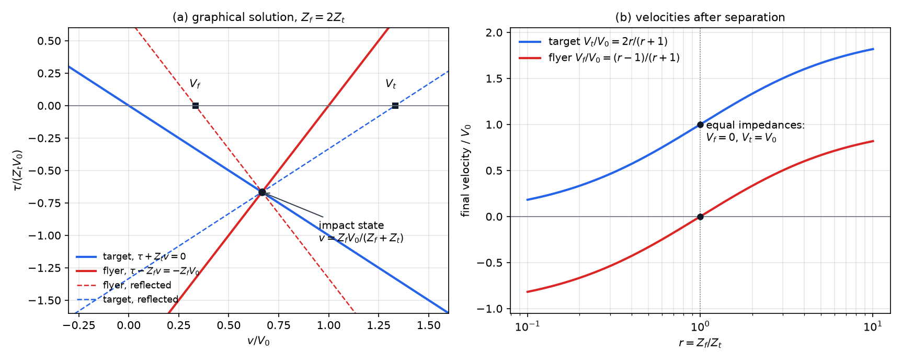

# Elastic Waves and Impact

A disturbance in an elastic solid does not spread instantly. Stress and displacement travel as waves at speeds fixed by the stiffness and the density. This is why an impact at one end of a bar is felt at the other only after a delay, and why the P wave of an earthquake arrives before the more damaging S wave. This chapter takes the Navier equations of [Linear Elasticity](linear-elasticity.md) with the inertia term kept, finds the wave speeds in one and three dimensions, and applies the theory to the impact of two plates, where reflections at the free surfaces set the stress history and the final velocities.

## Equations of Elastic Waves

In a region with no body force, the displacement of a linear elastic solid obeys the homogeneous Navier equations with inertia,

\\[
(\lambda+\mu)\nabla(\nabla\cdot\mathbf u) + \mu\nabla^2\mathbf u = \rho\ddot{\mathbf u}, \qquad \text{or} \qquad (\lambda+\mu)\\,u\_{k,ki} + \mu\\,u\_{i,jj} = \rho\ddot u\_i .
\\]

The stress follows from \\(\boldsymbol\tau = \lambda(\operatorname{tr}\boldsymbol\varepsilon)\mathbf I + 2\mu\boldsymbol\varepsilon\\), as in the static theory. Two combinations of the elastic constants set the wave speeds. The **constrained modulus** \\(M = \lambda + 2\mu\\) governs compression when the lateral strains are zero, and the shear modulus \\(\mu\\) governs distortion without change of volume. Each appears together with the density \\(\rho\\) in the speeds derived below.

The equation is second order in both space and time and has no dissipation term. Its solutions therefore propagate without decay in the linear theory, and disturbances move along well-defined paths at finite speed.

## One-Dimensional Waves

### Longitudinal (P) waves

Take a displacement that depends only on \\(x\\) and points along \\(x\\), \\(\mathbf u = (u(x,t), 0, 0)\\). Then \\(\nabla\cdot\mathbf u = u\_{,x}\\) and \\(\nabla^2\mathbf u = (u\_{,xx}, 0, 0)\\). The second and third components of the Navier equation reduce to \\(0 = 0\\), and the first gives

\\[
(\lambda+2\mu)\\,\frac{\partial^2 u}{\partial x^2} = \rho\\,\frac{\partial^2 u}{\partial t^2} .
\\]

This is a wave equation with speed

\\[
c\_1 = \sqrt{\frac{\lambda+2\mu}{\rho}} = \sqrt{\frac{E(1-\nu)}{(1+\nu)(1-2\nu)\rho}} .
\\]

The **P wave** (primary, or longitudinal) moves the material along the direction of propagation and compresses or stretches it in that direction. The only strain is \\(\varepsilon\_{11} = u\_{,x}\\), because nothing depends on \\(y\\) or \\(z\\) and the lateral displacements vanish. The lateral stresses are therefore not zero:

\\[
\tau\_{11} = (\lambda+2\mu)\\,\varepsilon\_{11}, \qquad \tau\_{22} = \tau\_{33} = \lambda\\,\varepsilon\_{11} = \frac{\nu}{1-\nu}\tau\_{11} .
\\]

This is the **uniaxial strain** state. The material cannot expand sideways, because every point in a plane \\(x = \text{const}\\) moves in the same way. The stress state is triaxial even though only one strain is nonzero. The modulus relating \\(\tau\_{11}\\) to \\(\varepsilon\_{11}\\) is \\(M\\), not \\(E\\), and the chapter's impact analysis depends on this distinction.

### Transverse (S) waves

Take \\(\mathbf u = (0, v(x,t), 0)\\). The divergence is zero, and the second component of the Navier equation gives \\(\mu\\,v\_{,xx} = \rho\\,v\_{,tt}\\). The shear wave speed is therefore

\\[
c\_2 = \sqrt{\frac{\mu}{\rho}} = \sqrt{\frac{E}{2(1+\nu)\rho}} .
\\]

The S wave moves the material perpendicular to the direction of propagation. It carries only the shear stress \\(\tau\_{12} = \mu\\,\partial v/\partial x\\), and no normal stress. Because \\(M > \mu\\), the P wave is always faster: \\(c\_1 > c\_2\\).

## d'Alembert's Solution

The one-dimensional wave equation \\(c^2 u\_{,xx} = u\_{,tt}\\) has a complete general solution in terms of two arbitrary functions.

**Theorem (d'Alembert).** Let \\(u\\) be a \\(C^2\\) solution of \\(c^2 u\_{,xx} = u\_{,tt}\\) on the whole line. Then

\\[
u(x,t) = f(x-ct) + g(x+ct)
\\]

for functions \\(f\\) and \\(g\\) of class \\(C^2\\). Conversely, every such sum is a solution.

*Proof.* Introduce the characteristic variables \\(\eta = x - ct\\) and \\(\xi = x + ct\\). By the chain rule, \\(\partial\_x = \partial\_\xi + \partial\_\eta\\) and \\(\partial\_t = c(\partial\_\xi - \partial\_\eta)\\). Then \\(c^2 u\_{,xx} - u\_{,tt} = 4c^2 u\_{,\xi\eta}\\), so the wave equation becomes \\(u\_{,\xi\eta} = 0\\). Hence \\(u\_{,\eta}\\) depends only on \\(\eta\\), say \\(u\_{,\eta} = h(\eta)\\). Integrating in \\(\eta\\) gives \\(u = F(\eta) + G(\xi)\\), which is the stated form with \\(f = F\\) and \\(g = G\\). For the converse, if \\(u = f(x-ct)\\) then \\(u\_{,xx} = f''\\) and \\(u\_{,tt} = c^2 f''\\), and the same holds for \\(g(x+ct)\\). \\(\square\\)

The function \\(f(x-ct)\\) is a right-going wave: its profile is translated to the right at speed \\(c\\) without any change of shape. The function \\(g(x+ct)\\) is a left-going wave. Because the equation is linear, the two waves superpose, and they pass through each other unchanged.

For a given initial displacement \\(\varphi(x)\\) and initial velocity \\(\psi(x)\\), the solution is

\\[
u(x,t) = \tfrac12\left[\varphi(x-ct) + \varphi(x+ct)\right] + \frac{1}{2c}\int\_{x-ct}^{x+ct}\psi(s)\\,ds .
\\]

At \\(t = 0\\) this returns \\(\varphi(x)\\), and differentiating in \\(t\\) and setting \\(t = 0\\) gives \\(\psi(x)\\). The motion is the initial disturbance split into two halves that move apart at speed \\(c\\), with an additional contribution from the initial velocity.

*Figure: Left, the d'Alembert solution \\(f(x-ct)\\) at four times with \\(c = 1\\). The pulse translates without change of shape. Right, the sum of a pulse of amplitude 1 moving right and one of amplitude \\(-0.6\\) moving left. The two waves pass through each other, and at the crossing time the displacement is their sum.*

## Stress, Characteristics and Impedance

Consider a plane P wave \\(u = f(\eta) + g(\xi)\\). Since \\(\varepsilon\_{11} = u\_{,x}\\), the stress is \\(\tau\_{11} = M\varepsilon\_{11} = \rho c^2(f' + g')\\), and the particle velocity is \\(v = u\_{,t} = c(-f' + g')\\). Combining these,

\\[
\tau - \rho c\\,v = 2\rho c^2 f'(\eta), \qquad \tau + \rho c\\,v = 2\rho c^2 g'(\xi) .
\\]

The quantity \\(\tau - \rho c v\\) is therefore constant along each right-going line \\(x - ct = \text{const}\\), and \\(\tau + \rho c v\\) is constant along each left-going line \\(x + ct = \text{const}\\). These are the **characteristic relations**. For a pure right-going wave (\\(g = 0\\)) the relation \\(\tau = -\rho c v\\) holds: a compressive stress comes with particle motion in the direction of propagation. For a pure left-going wave, \\(\tau = +\rho c v\\).

The product \\(Z = \rho c\\) is the **impedance** of the material for longitudinal waves. It sets the stress produced by a given particle velocity, and it governs what happens when a wave meets an interface. Density by itself does not decide the outcome; the comparison that matters is between impedances.

**Jump conditions.** A front across which stress and velocity are discontinuous, moving with speed \\(s\\) along \\(x\\), satisfies the Rankine–Hugoniot condition

\\[
[\tau] = -\rho s\\,[v],
\\]

where \\([\cdot]\\) is the value on the right minus the value on the left. The condition follows by integrating the momentum balance \\(\rho\\,\partial v/\partial t = \partial\tau/\partial x\\) across a thin layer containing the front. For a right-going front (\\(s = c\\)) it reads \\([\tau + \rho c v] = 0\\); for a left-going front (\\(s = -c\\)) it reads \\([\tau - \rho c v] = 0\\). These are the relations used to join states across the fronts in the impact problem below.

## Three-Dimensional Waves

In three dimensions a displacement field splits into a part that changes volume and a part that rotates. Let \\(\Delta = \nabla\cdot\mathbf u\\) and \\(\boldsymbol\omega = \nabla\times\mathbf u\\). Taking the divergence of the homogeneous Navier equation and using \\(\nabla\cdot\nabla^2\mathbf u = \nabla^2\Delta\\) gives \\((\lambda+2\mu)\nabla^2\Delta = \rho\ddot\Delta\\). Taking the curl and using \\(\nabla\times\nabla\Delta = \mathbf 0\\) gives \\(\mu\nabla^2\boldsymbol\omega = \rho\ddot{\boldsymbol\omega}\\). Hence

\\[
\nabla^2\Delta = \frac{1}{c\_1^2}\ddot\Delta, \qquad \nabla^2\boldsymbol\omega = \frac{1}{c\_2^2}\ddot{\boldsymbol\omega} ,
\\]

so changes of volume travel at \\(c\_1\\) and rotations at \\(c\_2\\). Plane waves of the two types are the P wave, with \\(\mathbf u\\) parallel to the unit normal \\(\mathbf n\\) of the wavefronts, and the S wave, with \\(\mathbf u\\) perpendicular to \\(\mathbf n\\). Each depends on \\(\mathbf n\cdot\mathbf x\\) and \\(t\\) through the same d'Alembert form as above, with the speed \\(c\_1\\) or \\(c\_2\\).

The ratio of the two speeds depends only on Poisson's ratio:

\\[
\frac{c\_1^2}{c\_2^2} = \frac{\lambda+2\mu}{\mu} = \frac{2(1-\nu)}{1-2\nu}, \qquad \text{so} \qquad \frac{c\_1}{c\_2} = \sqrt{\frac{2(1-\nu)}{1-2\nu}} .
\\]

The ratio exceeds 1 for every admissible \\(\nu\\). It is at least \\(\sqrt2\\) when \\(0 \le \nu < \tfrac12\\), and it grows without bound as \\(\nu \to \tfrac12\\), where the solid becomes nearly incompressible and the P wave becomes very fast compared with the S wave. For \\(\nu = \tfrac14\\) the ratio is \\(\sqrt3\\).

Typical values of the speeds, in metres per second, are shown below.

| Material | \\(c\_1\\) (P wave) | \\(c\_2\\) (S wave) |
|---|---|---|
| Mild steel | 5150 | 3230 |
| Aluminium | 5090 | 3110 |
| Glass | 5300 | 3260 |
| Epoxy resin | 1540 | 950 |
| Silicon carbide | 12270 | 7740 |

The \\(c\_1\\) entries are close to the bar speed \\(\sqrt{E/\rho}\\), which is the speed of a long thin rod with free lateral surfaces. The speed \\(\sqrt{M/\rho}\\) that governs a plate, or any body laterally constrained by its surroundings, is larger. For steel with \\(E = 210\\) GPa, \\(\nu = 0.3\\) and \\(\rho = 7850\\) kg/m³, the bar speed is about 5.2 km/s and the constrained speed about 6.0 km/s. The plate analysis below uses the constrained value.

Waves are used in nondestructive testing, where ultrasonic pulses reflected from cracks or voids reveal internal flaws; in medical ultrasound; and in seismology, where the faster P wave reaches a station first and the slower, more damaging S wave arrives later.

## Impact of Two Plates

### Setting and assumptions

Consider two identical plates of thickness \\(L\\), density \\(\rho\\), P-wave speed \\(c = c\_1\\) and impedance \\(Z = \rho c\\). The flyer occupies \\(-L < x < 0\\) and moves to the right at speed \\(V\_0\\). The target occupies \\(0 < x < L\\) and is at rest. The plates touch at \\(t = 0\\). The analysis assumes:

1. linear elasticity, with \\(V\_0 \ll c\\), so that the strains are small;
2. uniaxial strain, the plates being laterally large compared with \\(L\\) and with the wavelength of the disturbance;
3. perfect contact until the plates separate;
4. stress-free outer faces at \\(x = -L\\) and \\(x = L\\).

Only the characteristic relations and the jump conditions are needed.

### The impact stress

The flyer's undisturbed state is \\(\tau = 0\\), \\(v = V\_0\\), and the target's is \\(\tau = 0\\), \\(v = 0\\). At \\(t = 0^+\\) the contact creates a left-going front, which runs into the flyer, and a right-going front, which runs into the target. Let \\((\tau^\*, v^\*)\\) be the state at the contact, between the two fronts. The jump conditions give

\\[
\tau^\* - \rho c\\,v^\* = 0 - \rho c\\,V\_0 \quad \text{(left-going front in the flyer)}, \qquad \tau^\* + \rho c\\,v^\* = 0 \quad \text{(right-going front in the target)} .
\\]

Solving these two equations gives

\\[
\boxed{v^\* = \tfrac12 V\_0, \qquad \tau^\* = -\tfrac12\rho c V\_0}
\\]

The contact stress is compressive, and it is the same on both sides. Each plate moves at half the impact speed. The strain in the compressed region is \\(\varepsilon\_{11} = \tau^\*/M = -V\_0/(2c)\\), since \\(M = \rho c^2\\). Compression exists only behind the fronts, so the material ahead of them is still undisturbed. At the instant of impact the two plates are a single stress discontinuity, and the contact is maintained because the stress presses the two plates together.

### Reflections and the time history

The compressive fronts travel outward at speed \\(c\\), and they reach the free outer faces at \\(t = L/c\\). A free face carries no stress. The compressive state at the face must therefore be cancelled by a reflected release wave, which is tensile. Across the reflected right-going front in the flyer, \\(\tau + \rho c v\\) is continuous. Across the reflected left-going front in the target, \\(\tau - \rho c v\\) is continuous. Behind each reflected front the stress is zero, so the velocities are

\\[
v\_f = v^\* + \frac{\tau^\*}{\rho c} = 0, \qquad v\_t = v^\* - \frac{\tau^\*}{\rho c} = V\_0 .
\\]

The flyer comes to rest, and the free face of the target moves at \\(V\_0\\), twice its velocity in the impact state. The reflected fronts return to the contact at \\(t = 2L/c\\), and the sequence of states is summarized in the table below.

| Time | Between the fronts | Behind the reflected fronts |
|---|---|---|
| \\(0 < t < L/c\\) | \\(\tau = -\tfrac12\rho c V\_0\\), \\(v = V\_0/2\\) | not yet reached |
| \\(L/c < t < 2L/c\\) | \\(\tau = -\tfrac12\rho c V\_0\\), \\(v = V\_0/2\\) | flyer: \\(\tau = 0\\), \\(v = 0\\); target: \\(\tau = 0\\), \\(v = V\_0\\) |
| \\(t > 2L/c\\) | contact stress zero | flyer at rest, target moving at \\(V\_0\\) |

When both reflected fronts reach the contact, the contact stress vanishes and the plates separate. The flyer is at rest and the target moves away at \\(V\_0\\). All of the momentum and energy have been transferred, which is the behaviour of an ideal elastic collision. The stress lasts for the round-trip time \\(2L/c\\).

*Figure: Symmetric impact of two identical plates. Left, the stress history in the \\((x, t)\\) plane, with time in units of \\(L/c\\) and stress in units of \\(\rho c V\_0\\). The compressive stress \\(-\tfrac12\rho c V\_0\\) fills a diamond bounded by the wave fronts (dashed), and it disappears after \\(t = 2L/c\\). Grey regions lie outside the plates. Right, the particle velocity at three times. The flyer stops and the target leaves with \\(V\_0\\).*

**Example 8.1 (Steel plates).** Take steel with \\(E = 210\\) GPa, \\(\nu = 0.3\\) and \\(\rho = 7850\\) kg/m³. The constrained modulus is \\(M = E(1-\nu)/((1+\nu)(1-2\nu)) \approx 2.83\times10^{11}\\) Pa, so \\(c = \sqrt{M/\rho} \approx 6.0\\) km/s. Let the flyer strike the target at \\(V\_0 = 100\\) m/s.

1. The impact stress is \\(\tau^\* = -\tfrac12\rho c V\_0 \approx -\tfrac12 \times 7850 \times 6000 \times 100 \approx -2.36\\) GPa.
2. The strain is \\(\varepsilon\_{11} = -V\_0/(2c) \approx -8.3\times10^{-3}\\). The lateral stresses are \\(\tau\_{22} = \tau\_{33} = \frac{\nu}{1-\nu}\tau^\* \approx -1.0\\) GPa.
3. For plates 10 mm thick the contact lasts \\(2L/c \approx 3.3\\) \\(\mu\\)s.

The compressive stress is roughly ten times the yield strength of mild steel, which is about 250 MPa. The elastic solution therefore describes only the first instant of the impact. Plastic flow would limit the stress in a real collision, and some of the energy would be dissipated.

### Impedance mismatch

The symmetric result depends on the two plates having the same impedance. Now let the flyer have impedance \\(Z\_f = \rho\_f c\_f\\) and the target \\(Z\_t = \rho\_t c\_t\\). Choose the thicknesses so that the release waves return to the contact together, \\(L\_f/c\_f = L\_t/c\_t\\). The same jump conditions as before give the impact state:

\\[
\tau^\* - Z\_f v^\* = -Z\_f V\_0, \qquad \tau^\* + Z\_t v^\* = 0,
\\]

so that

\\[
v^\* = \frac{Z\_f}{Z\_f + Z\_t}\\,V\_0, \qquad \tau^\* = -\frac{Z\_f Z\_t}{Z\_f + Z\_t}\\,V\_0 .
\\]

For the release fronts, \\(\tau + Z\_f v\\) is continuous across the reflected right-going front in the flyer, and \\(\tau - Z\_t v\\) is continuous across the reflected left-going front in the target. With zero stress behind both fronts, the final velocities are

\\[
\boxed{V\_f = \frac{Z\_f - Z\_t}{Z\_f + Z\_t}\\,V\_0, \qquad V\_t = \frac{2Z\_f}{Z\_f + Z\_t}\\,V\_0}
\\]

Several conclusions follow directly from these formulas.

- The relative velocity reverses: \\(V\_t - V\_f = V\_0\\). This is the statement that the impact is perfectly elastic.
- The formulas are those of a one-dimensional elastic collision of two particles, with the masses replaced by impedances. The impedance, not the mass, decides which body is the heavier.
- If \\(Z\_f > Z\_t\\), the flyer continues forward but more slowly than the target. If \\(Z\_f < Z\_t\\), the flyer rebounds with \\(V\_f < 0\\). In both cases the target moves forward.
- For equal impedances, \\(V\_f = 0\\) and \\(V\_t = V\_0\\), which recovers the symmetric result.

If the round-trip times differ, the earlier release wave changes the contact state before the later one arrives. The impact must then be followed through a sequence of such impedance matches, and the simple final velocities no longer describe the state at the first separation. A thin flyer striking a thick target is a useful special case. The target receives a single square compressive pulse of stress \\(\tau^\*\\) and duration \\(2L\_f/c\_f\\), which travels into the target while the flyer stops. For equal impedances the amplitude is \\(-\tfrac12\rho c V\_0\\).

*Figure: Left, graphical solution of the impact for a flyer with twice the impedance of the target, with velocities in units of \\(V\_0\\) and stress in units of \\(Z\_t V\_0\\). The solid lines are the impact waves, and they meet at the contact state. The dashed lines are the reflected release waves, which reach \\(\tau = 0\\) at the final velocities \\(V\_f\\) and \\(V\_t\\). Right, the final velocities against the impedance ratio \\(r = Z\_f/Z\_t\\). Equal impedances give \\(V\_f = 0\\) and \\(V\_t = V\_0\\).*

## Summary

- The P-wave speed is \\(c\_1 = \sqrt{M/\rho}\\) with \\(M = \lambda + 2\mu\\), and the S-wave speed is \\(c\_2 = \sqrt{\mu/\rho}\\). In three dimensions \\(c\_1/c\_2 = \sqrt{2(1-\nu)/(1-2\nu)}\\), so \\(c\_1 > c\_2\\) for all admissible Poisson's ratios.
- A plane P wave under uniaxial strain has \\(\tau\_{22} = \tau\_{33} = \tfrac{\nu}{1-\nu}\tau\_{11}\\). The modulus that relates \\(\tau\_{11}\\) to \\(\varepsilon\_{11}\\) is \\(M\\), not \\(E\\).
- The solution of the one-dimensional wave equation is \\(u = f(x-ct) + g(x+ct)\\). It is a sum of right-going and left-going waves, which pass through each other unchanged.
- The quantity \\(\tau - \rho c v\\) is constant along right-going characteristics, and \\(\tau + \rho c v\\) along left-going ones. Across a front moving with speed \\(s\\), \\([\tau] = -\rho s[v]\\). The impedance is \\(Z = \rho c\\).
- For the impact of two identical plates, the contact state is \\(v = V\_0/2\\) and \\(\tau = -\tfrac12\rho c V\_0\\). The stress lasts \\(2L/c\\), after which the flyer is at rest and the target moves at \\(V\_0\\).
- For plates of different impedance, \\(\tau^\* = -Z\_f Z\_t V\_0/(Z\_f + Z\_t)\\), and the final velocities are \\(V\_f = (Z\_f - Z\_t)V\_0/(Z\_f+Z\_t)\\) and \\(V\_t = 2Z\_f V\_0/(Z\_f+Z\_t)\\). The impedance plays the role of the mass in the elastic collision.

## See Also

- [Linear Elasticity](linear-elasticity.md): the static theory and the Navier equations used here.
- [Balance Laws and Stress](balance-laws.md): the momentum balance from which the jump conditions follow.
- Elasticity and Stress and Strain: the one-dimensional treatment of stress and strain in a bar.
- Vibrations: the analogous oscillation of a single mass and spring.
- Partial Differential Equations: the wave equation and the method of characteristics.
- Numerical PDEs: the numerical solution of wave equations when no closed form is available.
