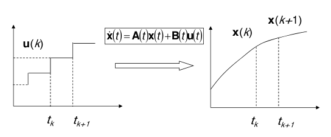
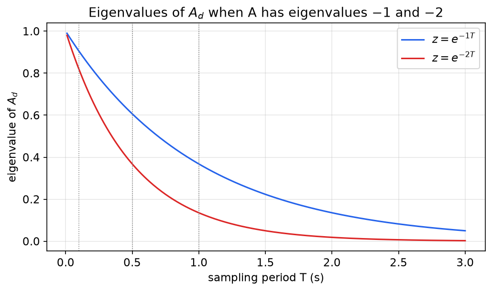
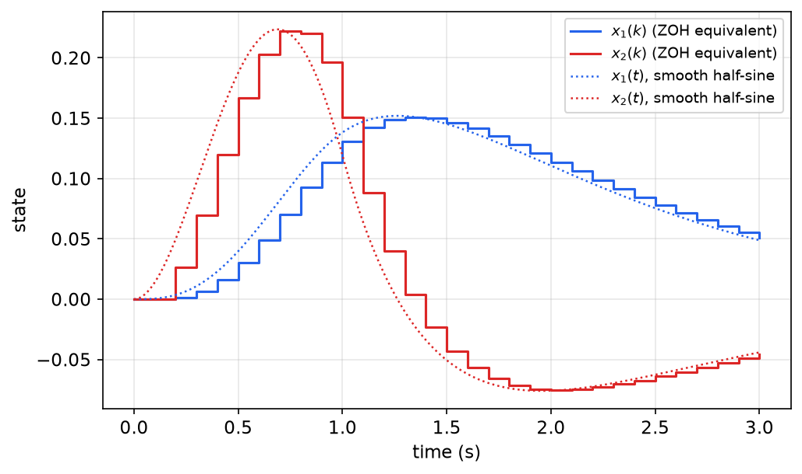
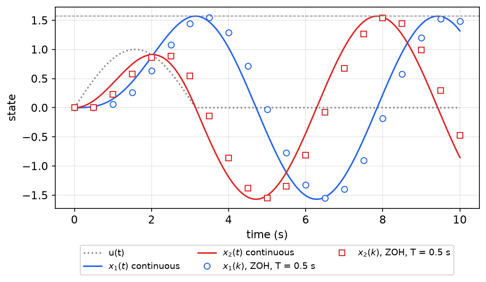

# Discrete-Time Linear Systems

Many systems evolve in steps rather than continuously. Some do so by nature, like a bank balance updated monthly. Most, in control engineering, do so because a microprocessor samples the sensors and updates the actuator command once per sampling period. This chapter introduces **difference state equations**, derives the exact **discrete-time equivalent** of a continuous-time system driven through a zero-order hold, \\(A\_d = e^{AT}\\) and \\(B\_d = \int\_0^Te^{At}B\\,dt\\), solves the difference equations, and defines the discrete transfer function. In linear systems theory discrete-time systems mostly serve to illustrate concepts, because nearly every property of continuous-time systems has a discrete counterpart. The full treatment for digital controller design is in [Digital Control: State-Space Methods](../me6403-digital-control/state-space.md).

## Difference State Equations

A **linear difference state equation** gives the *next* state in terms of the *current* state and input:
\\[
\boxed{x(k+1) = A\_d(k)x(k) + B\_d(k)u(k), \qquad y(k) = C\_d(k)x(k) + D\_d(k)u(k),}
\\]
where \\(k = 0, 1, 2, \dots\\) counts steps. It is linear in the state and the input, and it can model either an inherently discrete process or a sampled (discretized) continuous one. When the matrices do not depend on \\(k\\), the system is **linear time-invariant (LTI)**: \\(x(k+1) = A\_dx(k) + B\_du(k)\\).

The role of the integrator in continuous time is played here by the **unit delay**: \\(x(k)\\) is stored and released one step later. The definition of state carries over unchanged. \\(x(k\_0)\\) and the inputs from \\(k\_0\\) onward determine the future.

**Example 4.1 (Savings account).** Let \\(x(k)\\) be the balance in month \\(k\\), \\(i(k)\\) the annual interest rate in force that month, and \\(u(k)\\) the net amount deposited. Interest is credited monthly, so
\\[
x(k+1) = \underbrace{\Big(1 + \frac{i(k)}{12}\Big)}\_{A(k)}x(k) + u(k).
\\]
This is a first-order LTV system, or LTI if the rate is fixed. With a fixed rate \\(i\\) and no deposits, \\(x(k) = (1 + i/12)^kx(0)\\): compound interest is the discrete exponential.

## Solution of Difference Equations

Unlike differential equations, difference equations can be solved by simply iterating them:
\\[
x(k\_0 + 1) = A\_d(k\_0)x(k\_0) + B\_d(k\_0)u(k\_0), \qquad
x(k\_0 + 2) = A\_d(k\_0 + 1)A\_d(k\_0)x(k\_0) + A\_d(k\_0 + 1)B\_d(k\_0)u(k\_0) + B\_d(k\_0 + 1)u(k\_0 + 1), \quad \dots
\\]
Define the **discrete state-transition matrix**
\\[
\Phi\_d(k,j) = A\_d(k-1)A\_d(k-2)\cdots A\_d(j) \quad (k > j), \qquad \Phi\_d(k,k) = I .
\\]
**Proposition (Discrete variation of constants).** The solution of the LTV difference equation is
\\[
\boxed{x(k) = \Phi\_d(k,k\_0)x(k\_0) + \sum\_{j=k\_0}^{k-1}\Phi\_d(k,j+1)B\_d(j)u(j), \qquad k \ge k\_0 .}
\\]
*Proof.* By induction. The formula holds at \\(k = k\_0\\), where the sum is empty. If it holds at \\(k\\), then
\\[
x(k+1) = A\_d(k)x(k) + B\_d(k)u(k) = \Phi\_d(k+1,k\_0)x(k\_0) + \sum\_{j=k\_0}^{k-1}\Phi\_d(k+1,j+1)B\_d(j)u(j) + \Phi\_d(k+1,k+1)B\_d(k)u(k),
\\]
using \\(A\_d(k)\Phi\_d(k,j) = \Phi\_d(k+1,j)\\). The last term is the \\(j = k\\) term of the sum. ∎

For LTI systems \\(\Phi\_d(k,j) = A\_d^{k-j}\\), and with \\(k\_0 = 0\\)
\\[
\boxed{x(k) = A\_d^kx(0) + \sum\_{j=0}^{k-1}A\_d^{k-1-j}B\_du(j), \qquad y(k) = Cx(k) + Du(k).}
\\]
The sum is a **discrete convolution** of the input with the sequence \\(A\_d^{i}B\_d\\). The output for a unit pulse \\(u(0) = 1\\), \\(u(j) = 0\\) for \\(j > 0\\) (and zero initial state) is the **pulse response** \\(h(0) = D\\), \\(h(k) = CA\_d^{k-1}B\_d\\) for \\(k \ge 1\\).

The discrete STM keeps the semigroup property \\(\Phi\_d(k,j)\Phi\_d(j,i) = \Phi\_d(k,i)\\). There is one important difference from continuous time: \\(\Phi\_d\\) **need not be invertible**, because \\(A\_d(k)\\) may be singular. A discrete system can map two different states to the same state (for instance \\(x(k+1) = 0\cdot x(k)\\)), so it cannot always be run backward. Discretized continuous systems are an exception, as shown next.

## Discrete-Time Equivalent of a Continuous-Time System

### Zero-order hold

A digital controller outputs a number every \\(T\\) seconds. A digital-to-analog converter holds that number constant until the next update. This **zero-order hold (ZOH)** produces a staircase input:
\\[
u(t) = u(k), \qquad t\_k \le t < t\_{k+1}.
\\]



*Figure: a staircase (zero-order-hold) input u(k), held constant between the sampling instants t_k and t_{k+1}, drives the continuous system ẋ = A(t)x + B(t)u. The continuous state is observed only at the samples x(k), x(k+1). Between samples the input is known exactly, so the sample-to-sample map can be computed exactly.*

Apply the variation-of-constants formula of [Time Response of Linear Systems](time-response.md) over one interval, from \\(t\_k\\) to \\(t\_{k+1}\\). The input is constant on that interval, so \\(u(k)\\) comes out of the integral:
\\[
x(t\_{k+1}) = \Phi(t\_{k+1},t\_k)x(t\_k) + \int\_{t\_k}^{t\_{k+1}}\Phi(t\_{k+1},\tau)B(\tau)\\,d\tau\\;u(k).
\\]
Writing \\(x(k) = x(t\_k)\\), this is exactly a difference state equation:
\\[
x(k+1) = \underbrace{\Phi(t\_{k+1},t\_k)}\_{A\_d(k)}x(k) + \underbrace{\Big[\int\_{t\_k}^{t\_{k+1}}\Phi(t\_{k+1},\tau)B(\tau)\\,d\tau\Big]}\_{B\_d(k)}u(k).
\\]
The output equation is sampled directly: \\(C\_d(k) = C(t\_k)\\) and \\(D\_d(k) = D(t\_k)\\). The result is **exact** at the sampling instants. No approximation is made, provided the input really is piecewise constant.

### LTI case

For \\(\dot x = Ax + Bu\\), \\(y = Cx + Du\\), sampled with period \\(T\\) (\\(t\_k = kT\\)), \\(\Phi(t,\tau) = e^{A(t-\tau)}\\), so
\\[
A\_d = e^{AT}, \qquad B\_d = \int\_{kT}^{(k+1)T}e^{A[(k+1)T - \tau]}B\\,d\tau .
\\]
Change the integration variable to \\(t = (k+1)T - \tau\\) (so \\(dt = -d\tau\\), and the limits \\(\tau = kT\\) and \\(\tau = (k+1)T\\) become \\(t = T\\) and \\(t = 0\\)). The dependence on \\(k\\) disappears:
\\[
\boxed{A\_d = e^{AT}, \qquad B\_d = \int\_0^Te^{At}B\\,dt, \qquad C\_d = C, \qquad D\_d = D .}
\\]
A sampled LTI system is a discrete LTI system.

**Computing \\(B\_d\\).**

- If \\(A\\) is invertible, integrating the series term by term gives \\(B\_d = A^{-1}\big(e^{AT} - I\big)B\\).
- In general, including singular \\(A\\) such as a system with integrators, use the block-matrix identity
\\[
\exp\Big(\begin{bmatrix}A & B \\\\ 0 & 0\end{bmatrix}T\Big) = \begin{bmatrix}A\_d & B\_d \\\\ 0 & I\end{bmatrix}.
\\]
It holds because the upper-right block of the \\(k\\)-th power of the block matrix is \\(A^{k-1}B\\), and \\(\sum\_{k\ge 1}A^{k-1}BT^k/k! = \int\_0^Te^{At}B\\,dt\\). This is how numerical software computes ZOH equivalents.

**Properties.** Since \\(A\_d = e^{AT}\\):

- \\(A\_d\\) is always **invertible** (\\(\det A\_d = e^{\operatorname{tr}(A)T} \ne 0\\)). Sampled systems can be run backward.
- The eigenvalues map as \\(z\_i = e^{\lambda\_iT}\\). The left half-plane \\(\operatorname{Re}\lambda < 0\\) maps into the unit disk \\(\lvert z\rvert < 1\\), so an asymptotically stable continuous system has an asymptotically stable discrete equivalent.
- Fast sampling (\\(T\to 0\\)) pushes all eigenvalues toward \\(z = 1\\), and \\(A\_d \approx I + AT\\), \\(B\_d \approx BT\\): Euler's method is the first-order approximation of the exact discretization.



*Figure: eigenvalues of A_d = e^{AT} for a continuous system with eigenvalues −1 and −2, as functions of the sampling period. At T = 0.1 s they are 0.905 and 0.819, close to 1. At T = 1 s they are 0.368 and 0.135. Slower continuous modes always map closer to z = 1.*

### Example with \\(T = 1\\)

**Example 4.2.** Discretize
\\[
\dot x = \begin{bmatrix}0 & 1 \\\\ -2 & -3\end{bmatrix}x + \begin{bmatrix}0 \\\\ 1\end{bmatrix}u
\\]
with \\(T = 1\\) s. The matrix exponential, from Example 3.6 of [Time Response](time-response.md), is
\\[
e^{At} = \begin{bmatrix}2e^{-t} - e^{-2t} & e^{-t} - e^{-2t} \\\\ 2e^{-2t} - 2e^{-t} & 2e^{-2t} - e^{-t}\end{bmatrix}.
\\]
At \\(t = T = 1\\):
\\[
A\_d = e^{A} = \begin{bmatrix}2e^{-1} - e^{-2} & e^{-1} - e^{-2} \\\\ 2e^{-2} - 2e^{-1} & 2e^{-2} - e^{-1}\end{bmatrix} = \begin{bmatrix}0.6004 & 0.2325 \\\\ -0.4651 & -0.0972\end{bmatrix}.
\\]
\\(e^{At}B\\) is the second column of \\(e^{At}\\), so
\\[
B\_d = \int\_0^1\begin{bmatrix}e^{-t} - e^{-2t} \\\\ 2e^{-2t} - e^{-t}\end{bmatrix}dt
= \begin{bmatrix}(1 - e^{-1}) - \tfrac12(1 - e^{-2}) \\\\ (1 - e^{-2}) - (1 - e^{-1})\end{bmatrix}
= \begin{bmatrix}\tfrac12 - e^{-1} + \tfrac12e^{-2} \\\\ e^{-1} - e^{-2}\end{bmatrix}
= \begin{bmatrix}0.1998 \\\\ 0.2325\end{bmatrix}.
\\]
The eigenvalues of \\(A\_d\\) are \\(e^{-1} = 0.3679\\) and \\(e^{-2} = 0.1353\\) (trace \\(0.5032\\), determinant \\(0.0498 = e^{-3}\\)), as the mapping \\(z = e^{\lambda T}\\) predicts. The first component of \\(B\_d\\) is the continuous unit-step response \\(\tfrac12 - e^{-t} + \tfrac12e^{-2t}\\) evaluated at \\(t = T\\), as it should be: \\(B\_d\\) is the state reached after one period of unit input from rest.

### Example with \\(T = 0.1\\): MATLAB and a sampled half-sine

**Example 4.3.** Discretize the same system with \\(T = 0.1\\) s and compute the response to the sampled half-sine \\(u(k) = \sin(\pi k/10)\\) for \\(0 \le k \le 10\\), and \\(u(k) = 0\\) afterward. This is a one-second half-sine pulse held by the ZOH.

```matlab
A=[0 1;-2 -3]; B=[0;1]; C=eye(2); D=zeros(2,1);
csys=ss(A,B,C,D);
dsys=c2d(csys,0.1);                % zero-order-hold equivalent
[Ad,Bd,Cd,Dd]=ssdata(dsys)
% Ad = [0.9909 0.0861; -0.1722 0.7326],  Bd = [0.0045; 0.0861]
U=[sin(pi*[0:10]'/10); zeros(20,1)];
lsim(dsys,U)
```

```python
import numpy as np
from scipy.signal import cont2discrete, dlsim
A = np.array([[0, 1], [-2, -3]]); B = np.array([[0], [1]])
Ad, Bd, Cd, Dd, _ = cont2discrete((A, B, np.eye(2), np.zeros((2, 1))), 0.1, method='zoh')
u = np.r_[np.sin(np.pi*np.arange(11)/10), np.zeros(20)]
t, y = dlsim((Ad, Bd, Cd, Dd, 0.1), u)
```

The response follows by iterating \\(x(k+1) = A\_dx(k) + B\_du(k)\\) from \\(x(0) = 0\\). For instance \\(x(1) = B\_du(0) = 0\\), since \\(u(0) = \sin 0 = 0\\), and \\(x(2) = B\_d\sin(0.1\pi) = [0.0014,\ 0.0266]^T\\).



*Figure: response of the T = 0.1 s discrete equivalent to the sampled half-sine (staircase) compared with the continuous response to the smooth half-sine (dotted). x₁(k) rises to about 0.151 at t = 1.3 s and decays to about 0.051 at t = 3 s. x₂(k) peaks at about 0.222 at t = 0.7 s, crosses zero near t = 1.4 s, and reaches its minimum of about −0.075 at t = 2.0 s. The discrete response lags the continuous one by roughly half a sampling period, the average delay introduced by the hold.*

The discrete states are **exact** samples of the continuous system driven by the *staircase* input. They are only approximations of its response to the *smooth* half-sine, because the ZOH replaces the true input by a staircase. The difference shrinks as \\(T\\) decreases.

### Example: harmonic oscillator with \\(T = 0.5\\)

**Example 4.4.** The undamped oscillator \\(\dot x = \begin{bmatrix}0 & 1 \\\\ -1 & 0\end{bmatrix}x + \begin{bmatrix}0 \\\\ 1\end{bmatrix}u\\) has \\(e^{At} = \begin{bmatrix}\cos t & \sin t \\\\ -\sin t & \cos t\end{bmatrix}\\) (Example 3.11 in [Time Response](time-response.md)). Its ZOH equivalent with \\(T = 0.5\\) s is
\\[
A\_d = \begin{bmatrix}\cos 0.5 & \sin 0.5 \\\\ -\sin 0.5 & \cos 0.5\end{bmatrix} = \begin{bmatrix}0.8776 & 0.4794 \\\\ -0.4794 & 0.8776\end{bmatrix},
\qquad
B\_d = \int\_0^{0.5}\begin{bmatrix}\sin t \\\\ \cos t\end{bmatrix}dt = \begin{bmatrix}1 - \cos 0.5 \\\\ \sin 0.5\end{bmatrix} = \begin{bmatrix}0.1224 \\\\ 0.4794\end{bmatrix}.
\\]
`c2d(ss(A,B,eye(2),0),0.5)` returns the same matrices. \\(A\_d\\) is a rotation by 0.5 rad, with eigenvalues \\(e^{\pm 0.5j}\\) on the unit circle: an undamped continuous mode stays undamped after sampling.



*Figure: the harmonic oscillator driven by the half-sine pulse sin t on [0, π]. Solid: continuous response, which resonates during the pulse and then oscillates forever with amplitude π/2 (dashed line). Markers: the T = 0.5 s ZOH equivalent driven by the sampled half-sine. The samples reach almost the same amplitude (about 1.55) but are shifted by roughly T/2, again the effect of holding each sample for a full period.*

## Discrete Transfer Functions

The **z-transform** \\(X(z) = \sum\_{k=0}^\infty x(k)z^{-k}\\) plays the role of the Laplace transform. Its shift property, \\(\mathcal{Z}\\{x(k+1)\\} = zX(z) - zx(0)\\), replaces the derivative rule (see The Z-Transform). Transforming the state equation:
\\[
zX(z) - zx(0) = A\_dX(z) + B\_dU(z) \quad\Longrightarrow\quad X(z) = (zI - A\_d)^{-1}zx(0) + (zI - A\_d)^{-1}B\_dU(z).
\\]
With zero initial state, the **discrete (pulse) transfer function** is
\\[
\boxed{G(z) = C(zI - A\_d)^{-1}B\_d + D .}
\\]
This is the same formula as in continuous time, with \\(s\\) replaced by \\(z\\). The free part gives \\(A\_d^k = \mathcal{Z}^{-1}\big[z(zI - A\_d)^{-1}\big]\\), the discrete analog of \\(e^{At} = \mathcal{L}^{-1}[(sI - A)^{-1}]\\). Its poles are eigenvalues of \\(A\_d\\), and it is invariant under changes of state coordinates. The canonical realizations of [State Transformations and Canonical Realizations](realizations.md) apply verbatim with \\(1/s\\) replaced by the delay \\(z^{-1}\\).

**Example 4.2 (continued).** With \\(y = x\_1\\) and \\(T = 1\\):
\\[
G(z) = \frac{0.1998z + 0.0735}{z^2 - 0.5032z + 0.0498} = \frac{0.1998z + 0.0735}{(z - 0.3679)(z - 0.1353)} .
\\]
The DC gain \\(G(1) = 0.2733/0.5466 = 0.5\\) equals the continuous DC gain \\(G(0) = 1/2\\), as it must: a constant input is a staircase, so the ZOH equivalent reproduces the continuous steady state exactly. With \\(T = 0.1\\) the same calculation gives \\(G(z) = (0.00453z + 0.00410)/(z^2 - 1.7236z + 0.7408)\\), again with \\(G(1) = 0.5\\). Note that the discrete transfer function has a finite zero (at \\(z = -0.368\\) for \\(T = 1\\)) even though the continuous one has none. Sampling creates zeros.

**Example 4.4 (continued).** For the oscillator with \\(y = x\_1\\) and \\(T = 0.5\\):
\\[
G(z) = \frac{0.1224(z + 1)}{z^2 - 1.7552z + 1},
\\]
with poles \\(e^{\pm 0.5j}\\) on the unit circle and a sampling zero at \\(z = -1\\).

**Powers of \\(A\_d\\).** The response formula needs \\(A\_d^k\\). The tools of the previous chapter carry over: \\(A\_d^k = \mathcal{Z}^{-1}[z(zI - A\_d)^{-1}]\\); diagonalization, \\(A\_d^k = M\Lambda^kM^{-1}\\); Cayley–Hamilton, \\(A\_d^k = \sum\_{i=0}^{n-1}\alpha\_i(k)A\_d^i\\) with \\(\lambda\_j^k = \sum\alpha\_i(k)\lambda\_j^i\\); and for an \\(m\times m\\) Jordan block, \\(\big(J^k\big)\_{i,i+j} = \binom{k}{j}\lambda^{k-j}\\), whose first row is \\(\lambda^k,\ k\lambda^{k-1},\ \tfrac{1}{2!}k(k-1)\lambda^{k-2},\ \dots\\). For a sampled system, \\(A\_d^k = e^{AkT}\\): iterating the discrete model reproduces the continuous free response at the sampling instants.

## Summary

- Difference state equations: \\(x(k+1) = A\_d(k)x(k) + B\_d(k)u(k)\\), \\(y(k) = C\_d(k)x(k) + D\_d(k)u(k)\\). The unit delay replaces the integrator.
- Solution: \\(x(k) = \Phi\_d(k,k\_0)x(k\_0) + \sum\_{j=k\_0}^{k-1}\Phi\_d(k,j+1)B\_d(j)u(j)\\), with \\(\Phi\_d(k,j) = A\_d(k-1)\cdots A\_d(j)\\). For LTI systems, \\(x(k) = A\_d^kx(0) + \sum\_{j=0}^{k-1}A\_d^{k-1-j}B\_du(j)\\). \\(\Phi\_d\\) may be singular.
- ZOH equivalent (exact at the samples for staircase inputs): \\(A\_d(k) = \Phi(t\_{k+1},t\_k)\\), \\(B\_d(k) = \int\_{t\_k}^{t\_{k+1}}\Phi(t\_{k+1},\tau)B(\tau)\\,d\tau\\). For LTI systems: \\(A\_d = e^{AT}\\), \\(B\_d = \int\_0^Te^{At}B\\,dt\\), \\(C\_d = C\\), \\(D\_d = D\\), or both at once from \\(\exp\big(\begin{bmatrix}A & B \\\\ 0 & 0\end{bmatrix}T\big)\\).
- Eigenvalues map as \\(z = e^{\lambda T}\\), so stability is preserved and \\(A\_d\\) is invertible. Sampling preserves the DC gain and can introduce zeros.
- Example (\\(T = 1\\)): \\(A\_d = \begin{bmatrix}0.6004 & 0.2325 \\\\ -0.4651 & -0.0972\end{bmatrix}\\), \\(B\_d = \begin{bmatrix}0.1998 \\\\ 0.2325\end{bmatrix}\\). With \\(T = 0.1\\): \\(A\_d = \begin{bmatrix}0.9909 & 0.0861 \\\\ -0.1722 & 0.7326\end{bmatrix}\\), \\(B\_d = \begin{bmatrix}0.0045 \\\\ 0.0861\end{bmatrix}\\).
- Discrete transfer function: \\(G(z) = C(zI - A\_d)^{-1}B\_d + D\\).

## See Also

- [Time Response of Linear Systems](time-response.md): the continuous solution formula sampled here.
- [Digital Control: State-Space Methods](../me6403-digital-control/state-space.md): discrete state models for digital controller design.
- [Sampling, Reconstruction and Discretization](../me6403-digital-control/sampling.md) and [The Z-Transform in Digital Control](../me6403-digital-control/z-transform.md).
- The Z-Transform and Sampling.
- [Discrete-Time Optimal Control](../ae8803-optimal-learning-control/discrete-optimal-control.md): optimal control of difference equations.
- [Stability](stability.md): discrete-time stability and the unit circle.
