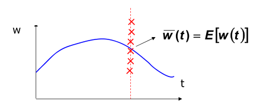
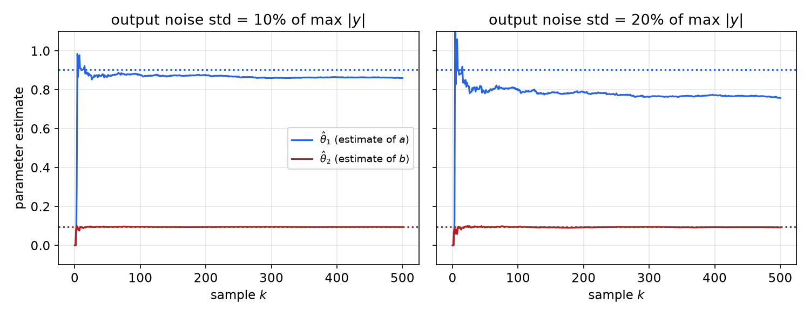
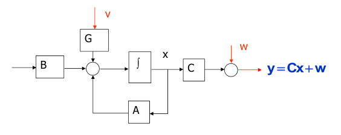
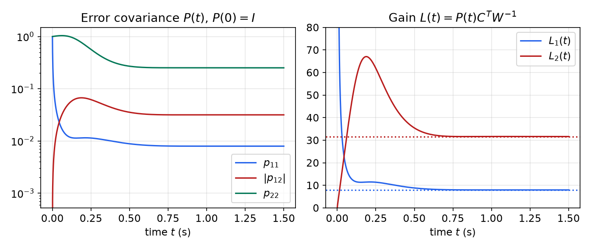
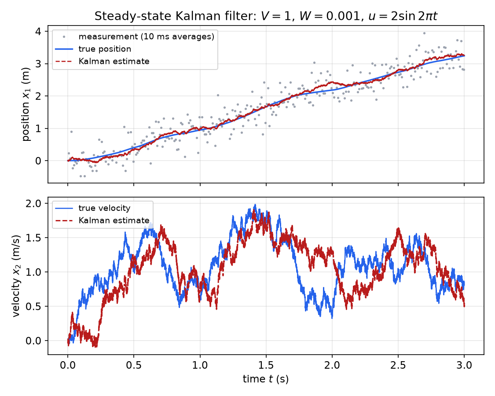

# Optimal Estimation and the Kalman Filter

An observer designed by pole placement reconstructs the state from the output, but the choice of observer poles is arbitrary and takes no account of noise. Fast observer poles reject initial errors quickly but pass measurement noise straight into the estimate; slow poles filter the noise but let process disturbances go uncorrected. The Kalman filter settles that compromise optimally. Given statistical descriptions of the disturbances acting on the plant and of the sensor noise, it is the observer whose estimation error has the smallest covariance, and its gain comes from a Riccati equation that is the exact dual of the LQR equation. This chapter builds up the probability needed (random vectors, Gaussian densities, white noise), solves the static estimation problem by least squares and maximum likelihood, makes it recursive (recursive least squares, used for system identification), and then derives the continuous-time Kalman–Bucy filter, its steady-state form, and its duality with the [Linear Quadratic Regulator](lqr.md).

## Why Optimal Estimation?

The [Observers](observers.md) chapter designs \\(\dot{\hat x} = A\hat x + Bu + L(y - C\hat x)\\) by choosing the eigenvalues of \\(A - LC\\). Three issues remain:

- **Non-uniqueness.** With several outputs, many gains \\(L\\) give the same observer poles.
- **No principled pole locations.** "Two to five times faster than the controller" is a rule of thumb, not a design criterion.
- **Noise is ignored.** In practice the plant is driven by unknown disturbances and the sensors are noisy. The best observer depends on how large each of these is.

The Kalman filter is the observer optimized with respect to the input-noise and measurement-noise properties. Its gain results from solving an optimal control problem, the dual of LQR.

## Random Variables and Random Vectors

### Discrete and continuous random variables

A **discrete random variable** \\(x\\) takes values \\(x\_i\\), \\(i = 1, \dots, N\\), with probabilities \\(p\_i\\). Its mean and variance are
\\[
\bar x = E(x) = \sum\_{i=1}^{N}x\_ip\_i,\qquad P = E\big[(x - \bar x)^2\big] = \sum\_{i=1}^{N}(x\_i - \bar x)^2p\_i .
\\]

**Example 1 (sum of two dice).** Let \\(x\\) be the total number of dots on two dice. It takes the values 2 to 12 with probabilities \\(1/36, 2/36, \dots, 6/36\\) (at \\(x = 7\\)), \\(\dots, 1/36\\), a triangular distribution. By symmetry \\(\bar x = 7\\), and
\\[
P = \frac{2\big(25\cdot1 + 16\cdot2 + 9\cdot3 + 4\cdot4 + 1\cdot5\big) + 0\cdot6}{36} = \frac{210}{36} = 5.83 .
\\]
The sum of just two uniform variables already looks roughly bell-shaped, a first glimpse of the central limit theorem.

A **continuous random variable** takes real values according to a **probability density function** (pdf) \\(p(x)\\), with \\(p(x) \geq 0\\) and \\(\int\_{-\infty}^{\infty}p(x)\\,dx = 1\\). The density itself is not a probability: \\(p(a)\\,dx\\) is the probability that \\(x\\) lies in the small interval \\([a - dx/2,\ a + dx/2]\\). Mean and variance are
\\[
\bar x = E(x) = \int\_{-\infty}^{\infty}x\\,p(x)\\,dx,\qquad \nu = E\big[(x - \bar x)^2\big] = \int\_{-\infty}^{\infty}(x - \bar x)^2p(x)\\,dx .
\\]

**Example 2 (uniform density).** Let \\(p(x) = 1/c\\) for \\(b - c/2 \leq x \leq b + c/2\\) and zero elsewhere, a rectangle of width \\(c\\) and height \\(1/c\\) centred at \\(b\\). Then
\\[
E(x) = \int\_{b - c/2}^{b + c/2}\frac{x}{c}\\,dx = b,\qquad E\big[(x - b)^2\big] = \frac1c\int\_{-c/2}^{c/2}\sigma^2\\,d\sigma = \frac1c\cdot\frac23\Big(\frac c2\Big)^3 = \frac{c^2}{12} .
\\]
(A rounding error uniform over one quantization step \\(c\\) therefore has variance \\(c^2/12\\).)

### The Gaussian density

The **normal** or **Gaussian** density with mean \\(\bar x\\) and variance \\(\sigma^2\\) is
\\[
p(x) = \frac{1}{\sigma\sqrt{2\pi}}\exp\left[-\frac{(x - \bar x)^2}{2\sigma^2}\right],\qquad E(x) = \bar x,\quad E\big[(x - \bar x)^2\big] = \sigma^2 .
\\]
Why is it so common? The **central limit theorem**: the sum or average of a large number of independent random variables, whatever their individual distributions (with finite variance), approaches a normal distribution. Disturbances that result from many small independent causes (thermal noise, turbulence, many small vibrations) are therefore well described by a Gaussian. There is also a mathematical reason: linear systems map Gaussian inputs to Gaussian outputs, so the Gaussian family is closed under everything the Kalman filter does.

### Random vectors

A random vector \\(x = [x\_1\ \cdots\ x\_n]^T\\) has a joint density \\(p:\mathbb{R}^n \to \mathbb{R}^+\\), where \\(p(a)\\,dx\_1\cdots dx\_n\\) is the probability that \\(x\\) lies in the small box centred at \\(a\\), and \\(\int\cdots\int p(x)\\,dx\_1\cdots dx\_n = 1\\). The mean and **covariance matrix** are
\\[
\bar x = E(x) = \int\cdots\int x\\,p(x)\\,dx\_1\cdots dx\_n,\qquad P = E\big[(x - \bar x)(x - \bar x)^T\big] ,
\\]
where the \\((i, j)\\) entry of \\(P\\) is \\(E[(x\_i - \bar x\_i)(x\_j - \bar x\_j)]\\). The covariance is **symmetric and positive semidefinite**, because \\(a^TPa = E\big[(a^T(x - \bar x))^2\big] \geq 0\\) for any vector \\(a\\). Its diagonal holds the variances of the components; the off-diagonal entries measure how they vary together.

The **multivariate Gaussian** with mean \\(\bar x\\) and covariance \\(P > 0\\) is
\\[
p(x) = \frac{1}{(2\pi)^{n/2}\lvert P\rvert^{1/2}}\exp\left[-\tfrac12(x - \bar x)^TP^{-1}(x - \bar x)\right] .
\\]
Its level sets are the ellipsoids \\((x - \bar x)^TP^{-1}(x - \bar x) = c\\). The exponent is a quadratic form, and this is the link to everything that follows: maximizing a Gaussian likelihood means minimizing a quadratic cost.

## Random Processes

A **random process** \\(w(t)\\) is a family of random variables indexed by a continuous parameter, here time. At each fixed \\(t\\), \\(w(t)\\) is a random variable with its own density \\(p\_t(w)\\), mean and covariance:
\\[
\bar w(t) = E[w(t)] = \int\_{-\infty}^{\infty}w\\,p\_t(w)\\,dw,\qquad P(t) = E\big[(w(t) - \bar w(t))(w(t) - \bar w(t))^T\big] .
\\]



*Figure: a random process. The curve is the mean \\(\bar w(t)\\); at a fixed time (dashed line) the value \\(w(t)\\) is a random variable whose realizations (crosses) scatter around the mean.*

How a process at one time relates to itself at another is described by the **autocorrelation** (strictly, the autocovariance), and the relation between two processes by the **cross-correlation**:
\\[
R\_{ww}(t\_1, t\_2) = E\big[(w(t\_1) - \bar w(t\_1))(w(t\_2) - \bar w(t\_2))^T\big],\qquad
R\_{wv}(t\_1, t\_2) = E\big[(w(t\_1) - \bar w(t\_1))(v(t\_2) - \bar v(t\_2))^T\big] .
\\]

**Definition (white noise).** A zero-mean process \\(w(t)\\) is **white** with **intensity** \\(W(t) \geq 0\\) if
\\[
R\_{ww}(t\_1, t\_2) = W(t\_1)\\,\delta(t\_1 - t\_2) .
\\]

Values of white noise at two different times are uncorrelated, however close the times are, so its past says nothing about its future: it is completely unpredictable. Its variance at a single time is infinite (\\(\delta(0)\\)), so white noise is an idealization, the limit of noise whose correlation time is much shorter than any time constant of the system. Its power spectral density is flat (the constant \\(W\\)), which explains the name. Two practical consequences:

- The intensity \\(W\\) has units of (signal)\\(^2\\)·s, not (signal)\\(^2\\). A sampled approximation with sample time \\(\Delta t\\) has independent samples of variance \\(W/\Delta t\\); this is how white noise must be generated in a simulation, and why a white-noise plot looks enormous (hundreds of units for a modest intensity at a fine time step).
- Integrating white noise gives a **random walk** (Brownian motion) whose variance grows linearly: \\(\mathrm{Var}\big[\int\_0^tw\\,d\tau\big] = Wt\\).

## Static Estimation: Least Squares and Maximum Likelihood

Before estimating a state that evolves in time, consider the static problem.

### The linear-Gaussian measurement model

Let
\\[
y = Ax + w ,
\\]
where \\(x\\) (the unknown) and \\(w\\) (the measurement noise) are uncorrelated Gaussian random vectors:
\\[
E[x] = \bar x,\quad E[w] = \bar w,\quad E[\tilde x\tilde x^T] = P\_{xx},\quad E[\tilde w\tilde w^T] = P\_{ww},\quad E[\tilde x\tilde w^T] = 0 ,
\\]
with tildes denoting deviations from the means: \\(\tilde x = x - \bar x\\), \\(\tilde w = w - \bar w\\), \\(\tilde y = y - \bar y\\), \\(\bar y = A\bar x + \bar w\\). The prior \\(\bar x\\), \\(P\_{xx}\\) summarizes what is known about \\(x\\) before measuring. Given an observed \\(y\\), what is the most likely \\(x\\)?

### Maximum likelihood is weighted least squares

Since \\(x\\) and \\(w\\) are independent, their joint density is the product of two Gaussians:
\\[
p(x, w) = \frac{1}{(2\pi)^{(n + p)/2}\lvert P\_{xx}\rvert^{1/2}\lvert P\_{ww}\rvert^{1/2}}\\,e^{-J},\qquad J = \tfrac12\tilde x^TP\_{xx}^{-1}\tilde x + \tfrac12\tilde w^TP\_{ww}^{-1}\tilde w .
\\]
Maximizing the likelihood is minimizing \\(J\\), subject to the constraint \\(\tilde w = \tilde y - A\tilde x\\) imposed by the measurement. Substitute the constraint and set the derivative to zero:
\\[
\frac{\partial J}{\partial\tilde x} = \tilde x^TP\_{xx}^{-1} - (\tilde y - A\tilde x)^TP\_{ww}^{-1}A = 0
\quad\Longrightarrow\quad
\big(P\_{xx}^{-1} + A^TP\_{ww}^{-1}A\big)\tilde x = A^TP\_{ww}^{-1}\tilde y .
\\]

**Theorem (maximum-likelihood estimate).** The maximum-likelihood (equivalently, for Gaussians, the conditional-mean) estimate of \\(x\\) given \\(y\\) is
\\[
\boxed{\hat x = \bar x + \hat P\_{xx}A^TP\_{ww}^{-1}(y - A\bar x - \bar w),\qquad \hat P\_{xx}^{-1} = P\_{xx}^{-1} + A^TP\_{ww}^{-1}A}
\\]
and \\(\hat P\_{xx}\\) is the covariance of the estimation error, \\(E\big[(x - \hat x)(x - \hat x)^T \mid y\big] = \hat P\_{xx}\\).

The formulas are worth reading slowly.

- The correction is proportional to the **innovation** \\(y - A\bar x - \bar w = y - \bar y\\), the part of the measurement that the prior did not predict.
- Large \\(P\_{ww}\\) relative to \\(P\_{xx}\\) means low confidence in the measurement, so the gain is small and \\(\hat x\\) stays near \\(\bar x\\). Conversely, a precise sensor pulls the estimate toward what the measurement says.
- **Information adds.** Inverse covariances are "information". The information after the measurement, \\(\hat P\_{xx}^{-1}\\), is the prior information \\(P\_{xx}^{-1}\\) plus the information in the measurement, \\(A^TP\_{ww}^{-1}A\\). So \\(\hat P\_{xx} \leq P\_{xx}\\): measuring never increases uncertainty.
- With no prior (\\(P\_{xx}^{-1} \to 0\\)) and \\(P\_{ww} = \sigma^2I\\), the estimate reduces to ordinary least squares, \\(\hat x = (A^TA)^{-1}A^Ty\\), the formula of [Linear Algebra for Systems Theory](linear-algebra.md).

The **matrix inversion lemma**
\\[
(P\_{xx}^{-1} + A^TP\_{ww}^{-1}A)^{-1} = P\_{xx} - P\_{xx}A^T(AP\_{xx}A^T + P\_{ww})^{-1}AP\_{xx}
\\]
gives an equivalent **gain form** that needs only the inverse of a matrix the size of \\(y\\):
\\[
\hat x = \bar x + \mathcal K(y - \bar y),\qquad \mathcal K = P\_{xx}A^T(AP\_{xx}A^T + P\_{ww})^{-1},\qquad \hat P\_{xx} = (I - \mathcal KA)P\_{xx} .
\\]
This is exactly the measurement-update step of the discrete-time Kalman filter.

## Recursive Least Squares

### Parameter identification

Consider a process in **regression form**
\\[
y\_k = \varphi\_k^T\theta + w\_k ,
\\]
where \\(y\_k\\) is a scalar measurement at time \\(k\\), \\(\theta\\) an unknown constant parameter vector, \\(\varphi\_k\\) a known **regression vector**, and \\(w\_k\\) zero-mean Gaussian noise. We want the most likely \\(\hat\theta\_k\\) given \\(y\_0, \dots, y\_k\\), updated as each new measurement arrives rather than recomputed from scratch.

The idea is to apply the static maximum-likelihood estimate once per sample, using the current estimate as the prior for the next step. Substitute \\(\bar x \to \hat\theta\_{k-1}\\), \\(\hat x \to \hat\theta\_k\\), \\(P\_{xx} \to P\_{k-1}\\), \\(\hat P\_{xx} \to P\_k\\), \\(A \to \varphi\_k^T\\) and normalize the noise variance to \\(P\_{ww} = 1\\):
\\[
\hat\theta\_k = \hat\theta\_{k-1} + P\_k\varphi\_k\big(y\_k - \varphi\_k^T\hat\theta\_{k-1}\big),\qquad P\_k^{-1} = P\_{k-1}^{-1} + \varphi\_k\varphi\_k^T .
\\]

### The efficient algorithm

Inverting \\(P\_k\\) at every step is unnecessary. The matrix inversion lemma with the rank-one update \\(\varphi\_k\varphi\_k^T\\) gives
\\[
P\_k = P\_{k-1} - \frac{P\_{k-1}\varphi\_k\varphi\_k^TP\_{k-1}}{1 + \varphi\_k^TP\_{k-1}\varphi\_k} ,
\\]
and multiplying by \\(\varphi\_k\\), \\(P\_k\varphi\_k = P\_{k-1}\varphi\_k/(1 + \varphi\_k^TP\_{k-1}\varphi\_k)\\). This is the **recursive least squares (RLS)** algorithm:
\\[
\boxed{\hat\theta\_k = \hat\theta\_{k-1} + \frac{P\_{k-1}\varphi\_k}{1 + \varphi\_k^TP\_{k-1}\varphi\_k}\big(y\_k - \varphi\_k^T\hat\theta\_{k-1}\big),\qquad P\_k = P\_{k-1} - \frac{P\_{k-1}\varphi\_k\varphi\_k^TP\_{k-1}}{1 + \varphi\_k^TP\_{k-1}\varphi\_k}}
\\]
initialized with \\(P\_0 = E\big[(\theta - \hat\theta\_0)(\theta - \hat\theta\_0)^T\big]\\). Only a scalar is divided. The update moves \\(\hat\theta\\) in proportion to the **prediction error** \\(y\_k - \varphi\_k^T\hat\theta\_{k-1}\\) and in the direction \\(P\_{k-1}\varphi\_k\\). A large \\(P\_0\\) (say \\(1000I\\)) expresses ignorance of \\(\theta\\) and makes the first few updates large.

**Theorem (parameter convergence).** At every step \\(P\_k \leq P\_{k-1}\\). If the regressors are **persistently exciting** in the sense that
\\[
\lambda\_{\min}\Big(\sum\_{k=0}^{N}\varphi\_k\varphi\_k^T\Big) \to \infty\quad\text{as } N \to \infty ,
\\]
then \\(P\_k \to 0\\), and (for noise uncorrelated with the regressors) \\(\hat\theta\_k \to \theta\\).

The first claim is visible in the update, which subtracts a positive semidefinite matrix. For the second, \\(P\_N^{-1} = P\_0^{-1} + \sum\varphi\_k\varphi\_k^T\\) grows without bound in every direction. Persistent excitation is a condition on the input: the data must "probe" every direction of parameter space.

### System identification

An ARX model of an \\(n\\)-th order discrete-time system,
\\[
y(k) = \sum\_{i=1}^{n}a\_iy(k - i) + \sum\_{i=1}^{n}b\_iu(k - i) + w(k) ,
\\]
is already in regression form, with \\(\varphi\_k = [y(k-1)\ \cdots\ y(k-n)\ \ u(k-1)\ \cdots\ u(k-n)]^T\\) and \\(\theta = [a\_1\ \cdots\ a\_n\ \ b\_1\ \cdots\ b\_n]^T\\). RLS then identifies the coefficients on line.

**Example 3 (identifying a first-order plant).** The plant \\(G(s) = 1/(s + 1)\\) is sampled with a zero-order hold at \\(T\_s = 0.1\\) s, giving \\(y(k) = ay(k-1) + bu(k-1)\\) with true values \\(a = e^{-0.1} = 0.9048\\) and \\(b = 1 - e^{-0.1} = 0.0952\\). The input is \\(u(k) = \sin(2\pi k/10)\\), \\(k = 0, \dots, 500\\), and the measured output is corrupted by Gaussian noise. Estimate \\(\theta = [a\ \ b]^T\\) with \\(\varphi\_k = [y(k-1)\ \ u(k-1)]^T\\).

```matlab
% Data: G(s)=1/(s+1), ZOH at Ts=0.1
Ts=0.1; Gd=c2d(tf(1,[1 1]),Ts,'zoh'); [num,den]=tfdata(Gd,'v');
K=(0:500)'; U=sin(2*pi*K/10);
Y=filter(num,den,U);
Yn=Y+normrnd(0,0.1*max(abs(Y)),size(Y));   % 10% measurement noise
% RLS
phi=zeros(2,1); P=1000*eye(2); th=zeros(2,1); TH=[];
for k=1:length(K)
  [th,P]=rls(th,P,Yn(k),phi);
  TH=[TH; th'];
  phi=[Yn(k); U(k)];                       % regressor for the next sample
end

function [thn,Pn]=rls(th,P,y,phi)
e=y-phi'*th;              % prediction error
psi=P*phi;
g=1/(1+phi'*psi);
thn=th+g*psi*e;
Pn=P-g*(psi*psi');
end
```



*Figure: RLS estimates with \\(P\_0 = 1000I\\). The output amplitude is about 0.16 in steady state (about 0.25 at the first peak); the noise standard deviation is 10% (left) or 20% (right) of the maximum output. Both estimates move within about ten samples. \\(\hat\theta\_2\\) settles at the true \\(b \approx 0.095\\) in both cases; \\(\hat\theta\_1\\) settles at about 0.86 with 10% noise and about 0.77 with 20% noise, below the true \\(a = 0.905\\) (dotted lines).*

The estimate of \\(a\\) is **biased** low, and the bias grows with the noise. The reason is that the regressor contains the *noisy* past output \\(y(k-1)\\), so the noise appears in \\(\varphi\_k\\) as well as in the equation error, violating the assumption that \\(w\_k\\) is uncorrelated with \\(\varphi\_k\\). This "errors-in-variables" bias is a known limitation of equation-error identification; instrumental-variable methods or output-error models remove it.

## The Continuous-Time Kalman Filter

### The stochastic plant

Consider
\\[
\dot x = Ax + Bu + Gv,\qquad y = Cx + w ,
\\]
where \\(u\\) is a known deterministic input, \\(v\\) is **process noise** (unknown disturbances, entering through \\(G\\)) and \\(w\\) is **measurement noise**. Both are zero-mean white processes, uncorrelated with each other and with the initial state:
\\[
E[v(t)v^T(\tau)] = V\delta(t - \tau),\quad E[w(t)w^T(\tau)] = W\delta(t - \tau),\quad E[v(t)w^T(\tau)] = 0,\qquad V \geq 0,\ W > 0 .
\\]
The initial state is a random vector with mean \\(\hat x\_0\\) and covariance \\(P\_0\\). \\(W > 0\\) means that every measurement channel is noisy; it plays the role of \\(R > 0\\) in LQR.



*Figure: the stochastic plant model for state estimation. Process noise \\(v\\) enters the state equation through \\(G\\); measurement noise \\(w\\) is added to \\(Cx\\).*

**Notation warning.** Here \\(V\\) is the process-noise intensity and \\(W\\) the measurement-noise intensity. MATLAB's `kalman(sys,Qn,Rn)` calls them \\(Q\_n\\) and \\(R\_n\\) and names the noise signals the other way round (its \\(w\\) is process noise, its \\(v\\) measurement noise), so in this notation the call is `kalman(sys,V,W)`.

### The optimal gain

Take an observer of the usual form,
\\[
\dot{\hat x} = A\hat x + Bu + L(t)\big(y - C\hat x\big),
\\]
and ask which gain \\(L(t)\\) makes the estimation error as small as possible. The error \\(e = x - \hat x\\) obeys
\\[
\dot e = (A - LC)e + Gv - Lw ,
\\]
a linear system driven by the white noise \\([v;\ w]\\). Its covariance \\(P(t) = E[ee^T]\\) (the error is zero-mean if \\(\hat x(0) = \hat x\_0\\)) satisfies the standard covariance propagation equation for a linear system driven by white noise:
\\[
\dot P = (A - LC)P + P(A - LC)^T + GVG^T + LWL^T,\qquad P(0) = P\_0 .
\\]
The first two terms describe how the error dynamics shrink (or grow) the uncertainty; the last two add the uncertainty injected by the process noise and by the measurement noise passed through the gain. Collect the terms in \\(L\\) and complete the square, exactly as in the LQR proof:
\\[
LWL^T - LCP - PC^TL^T = \big(L - PC^TW^{-1}\big)W\big(L - PC^TW^{-1}\big)^T - PC^TW^{-1}CP .
\\]
Therefore
\\[
\dot P = AP + PA^T + GVG^T - PC^TW^{-1}CP + \big(L - PC^TW^{-1}\big)W\big(L - PC^TW^{-1}\big)^T .
\\]
The last term is positive semidefinite and vanishes exactly when \\(L = PC^TW^{-1}\\). That choice makes \\(\dot P\\) as small as possible, in the matrix sense, at every instant, and therefore (by a comparison argument for the Riccati equation) makes \\(P(t)\\) itself the smallest achievable error covariance at every time.

**Theorem (Kalman–Bucy filter).** Among all observers of the form above, the error covariance is minimized at every \\(t\\) by
\\[
\boxed{\dot{\hat x} = A\hat x + Bu + L(t)\big(y - C\hat x\big),\qquad L(t) = P(t)C^TW^{-1}}
\\]
where \\(P(t)\\) is the solution of the **filter Riccati equation**
\\[
\boxed{\dot P = AP + PA^T - PC^TW^{-1}CP + GVG^T,\qquad P(0) = P\_0}
\\]
and \\(P(t)\\) is the error covariance \\(E\big[(x - \hat x)(x - \hat x)^T\big]\\). When \\(v\\), \\(w\\) and \\(x(0)\\) are Gaussian, \\(\hat x(t)\\) is the conditional mean of \\(x(t)\\) given the measurements, the best estimate among *all* estimators, linear or not.

Remarks:

- **The Kalman filter is a Luenberger observer with a time-varying gain.** It has the same structure as the observers of [Observers](observers.md); only the gain is chosen differently.
- **The Riccati equation runs forward** from the initial covariance \\(P\_0\\). This is the opposite of LQR, where \\(P\\) runs backward from the terminal weight. The filter can therefore run in real time alongside the plant, and \\(P(t)\\) and \\(L(t)\\) do not depend on the measurements, so they can also be precomputed.
- **The balance of the two noise sources sets the gain.** \\(GVG^T\\) increases \\(P\\) (the model is unreliable, so trust the data more); \\(PC^TW^{-1}CP\\) decreases it (measurements reduce uncertainty, more so when \\(W\\) is small).

### Maximum-likelihood interpretation

The filter can also be derived as the continuous-time version of the maximum-likelihood problem above. Over the interval \\([0, t]\\), the unknowns are the initial state \\(x(0)\\) and the process-noise history \\(v(\cdot)\\); given these, the measurements determine the noise history \\(w = y - Cx\\). For Gaussian noise, the most likely values minimize
\\[
J = (x(0) - \hat x\_0)^TP\_0^{-1}(x(0) - \hat x\_0) + \int\_0^t\big[v^T(\tau)V^{-1}v(\tau) + w^T(\tau)W^{-1}w(\tau)\big]d\tau
\\]
subject to \\(\dot x = Ax + Bu + Gv\\) and \\(w = y - Cx\\). Each term is a "surprise": a deviation of the initial state from its prior, a process disturbance, a measurement error, each weighted by its inverse covariance. The end point \\(x(t)\\) of the minimizing trajectory is the Kalman filter estimate \\(\hat x(t)\\). This is a deterministic LQ problem in which \\(v\\) plays the role of the control, and it explains why the filter and the regulator share the same Riccati structure.

### Steady state

For a time-invariant plant and stationary noise, \\(P(t)\\) usually converges to a constant. The **steady-state Kalman filter** has a constant gain:
\\[
\boxed{\dot{\hat x} = A\hat x + Bu + L(y - C\hat x),\qquad L = PC^TW^{-1},\qquad AP + PA^T - PC^TW^{-1}CP + GVG^T = 0}
\\]
It is an ordinary time-invariant observer with \\(L\\) chosen optimally. It loses only a little performance during the initial transient, when the true time-varying gain would be larger.

**Theorem (existence of the steady-state filter).** Let \\(GVG^T = HH^T\\). If \\((A, C)\\) is detectable and \\((A, H)\\) is stabilizable, the filter ARE has a unique positive semidefinite solution \\(P\\); it is stabilizing (\\(A - LC\\) is Hurwitz), and \\(P(t) \to P\\) for every \\(P\_0 \geq 0\\). If \\((A, C)\\) is observable and \\((A, H)\\) controllable, then \\(P > 0\\).

*Proof.* The filter ARE is the LQR ARE for the pair \\((A^T, C^T)\\) with weights \\(GVG^T\\) and \\(W\\) (see the duality table below). Stabilizability of \\((A^T, C^T)\\) is detectability of \\((A, C)\\), and detectability of \\((A^T, H^T)\\) is stabilizability of \\((A, H)\\). The LQR theorem then gives a unique stabilizing solution with \\(A^T - C^TL^T\\) Hurwitz, which is the same as \\(A - LC\\) Hurwitz. \\(\square\\)

The conditions make sense physically. Detectability: every unstable mode must show up in the measurements, or its error could never be corrected. Stabilizability of \\((A, H)\\): every mode must be excited by process noise; otherwise the filter would become certain about it, its gain for that mode would go to zero, and a marginally stable mode could be left uncorrected.

## Duality with LQR

Transpose the filter ARE: \\(PA^T + AP - PC^TW^{-1}CP + GVG^T = 0\\) is the LQR ARE \\(PA + A^TP + Q - PBR^{-1}B^TP = 0\\) after the substitutions in the table.

| LQR (control) | Kalman filter (estimation) |
|---|---|
| \\(A\\) | \\(A^T\\) |
| \\(B\\) | \\(C^T\\) |
| \\(Q\\) (state weight) | \\(GVG^T\\) (process-noise intensity) |
| \\(R\\) (input weight) | \\(W\\) (measurement-noise intensity) |
| \\(K = R^{-1}B^TP\\) | \\(L^T = W^{-1}CP\\) |
| \\(A - BK\\) | \\((A - LC)^T\\) |
| Riccati equation runs backward from \\(P(t\_f) = P\_f\\) | runs forward from \\(P(0) = P\_0\\) |
| \\((A, B)\\) stabilizable, \\((A, Q^{1/2})\\) detectable | \\((A, C)\\) detectable, \\((A, GV^{1/2})\\) stabilizable |

So any LQR software computes Kalman gains: `L = lqr(A',C',G*V*G',W)'`. Every LQR result has a filter counterpart, including the Hamiltonian solution, the return-difference identity, the symmetric root locus and the guaranteed margins (which the filter has at the plant output).

**Example 4 (scalar filter).** For \\(\dot x = ax + v\\), \\(y = x + w\\), with \\(V = 1\\) and \\(W = r\\), the filter ARE is \\(2ap + 1 - p^2/r = 0\\), the same equation as the scalar LQR. Hence
\\[
p = r\Big(a + \sqrt{a^2 + 1/r}\Big),\qquad L = \frac pr = a + \sqrt{a^2 + \tfrac1r},\qquad a - L = -\sqrt{a^2 + \tfrac1r} .
\\]
- **Noisy sensor (\\(r \to \infty\\)).** For a stable plant (\\(a < 0\\)), \\(L \to 0\\): the filter trusts the model and ignores the data. For an unstable plant, \\(L \to 2a\\) and the filter pole goes to the mirror image \\(-a\\): just enough correction to keep the error bounded.
- **Accurate sensor (\\(r \to 0\\)).** \\(L \to \infty\\): the filter trusts the measurement.
- **Random walk (\\(a = 0\\)).** \\(L = 1/\sqrt r\\) and the steady error variance is \\(p = \sqrt r\\).

## Example: Estimating Velocity from Position

A unit mass is driven by a known force \\(u\\) and an unknown disturbance force \\(v\\); its position is measured with noise:
\\[
\frac{d}{dt}\begin{bmatrix} x\_1 \\\\ x\_2 \end{bmatrix} = \begin{bmatrix} 0 & 1 \\\\ 0 & 0 \end{bmatrix}\begin{bmatrix} x\_1 \\\\ x\_2 \end{bmatrix} + \begin{bmatrix} 0 \\\\ 1 \end{bmatrix}u + \begin{bmatrix} 0 \\\\ 1 \end{bmatrix}v,\qquad y = [1\ \ 0]x + w ,
\\]
with \\(V = 1\\) and \\(W = r\\). The goal is a velocity estimate.

**The ARE.** With \\(P = \begin{bmatrix} p\_1 & p\_2 \\\\ p\_2 & p\_3 \end{bmatrix}\\),
\\[
\begin{bmatrix} 0 & 1 \\\\ 0 & 0 \end{bmatrix}P + P\begin{bmatrix} 0 & 0 \\\\ 1 & 0 \end{bmatrix} - \frac1rP\begin{bmatrix} 1 \\\\ 0 \end{bmatrix}[1\ \ 0]P + \begin{bmatrix} 0 & 0 \\\\ 0 & 1 \end{bmatrix} = 0 .
\\]
The first two terms are \\(\begin{bmatrix} 2p\_2 & p\_3 \\\\ p\_3 & 0 \end{bmatrix}\\) and the third is \\(-\frac1r\begin{bmatrix} p\_1^2 & p\_1p\_2 \\\\ p\_1p\_2 & p\_2^2 \end{bmatrix}\\), so the entries give
\\[
2p\_2 - \frac{p\_1^2}{r} = 0,\qquad p\_3 - \frac{p\_1p\_2}{r} = 0,\qquad 1 - \frac{p\_2^2}{r} = 0 .
\\]
The positive definite solution is
\\[
p\_2 = r^{1/2},\qquad p\_1 = \sqrt2\\,r^{3/4},\qquad p\_3 = \sqrt2\\,r^{1/4} .
\\]

**The gain and the filter poles.**
\\[
L = PC^TW^{-1} = \frac1r\begin{bmatrix} p\_1 \\\\ p\_2 \end{bmatrix} = \begin{bmatrix} \sqrt2\\,r^{-1/4} \\\\ r^{-1/2} \end{bmatrix},\qquad
\det(sI - A + LC) = s^2 + \sqrt2\\,r^{-1/4}s + r^{-1/2} ,
\\]
so \\(\omega\_n = r^{-1/4}\\) and \\(\zeta = \sqrt2/2 = 0.707\\). This is the double-integrator LQR result of [The Linear Quadratic Regulator](lqr.md) with the roles of the entries transposed, as duality predicts. It also has the form of the pole-placed velocity observer, \\(L\_1 = 2\zeta\omega\_n\\), \\(L\_2 = \omega\_n^2\\), but now the bandwidth is chosen by the noise ratio. With small measurement noise (\\(r \to 0\\)) the filter is fast and leans on the data; with large measurement noise (\\(r \to \infty\\)) it is slow and leans on the model. The damping is always 0.707.

**MATLAB.** With \\(W = 0.001\\):

```matlab
A=[0 1;0 0]; B=[0;1]; G=[0;1];
C=[1 0]; W=0.001; V=1;
% MATLAB's kalman expects x' = Ax + Bu + Gw, y = Cx + Du + v
syst=ss(A,[B G],C,zeros(1,2));
[Kest,L,P]=kalman(syst,V,W)     % kalman(sys,Qn,Rn) with Qn=V, Rn=W
% L = [7.9527; 31.6228]
% P = [0.0080 0.0316; 0.0316 0.2515]
```

The formulas give the same numbers at \\(r = 0.001\\): \\(\sqrt2r^{-1/4} = 7.95\\), \\(r^{-1/2} = 31.62\\), \\(p\_1 = \sqrt2r^{3/4} = 0.0080\\), \\(p\_2 = 0.0316\\), \\(p\_3 = \sqrt2r^{1/4} = 0.2515\\). The filter poles have \\(\omega\_n = 0.001^{-1/4} = 5.6\\) rad/s. The steady error standard deviations are \\(\sqrt{p\_1} = 0.089\\) m in position and \\(\sqrt{p\_3} = 0.50\\) m/s in velocity. The equivalent in Python:

```python
import numpy as np
from scipy.linalg import solve_continuous_are
A = np.array([[0, 1], [0, 0.]]); C = np.array([[1, 0.]]); G = np.array([[0], [1.]])
V, W = 1.0, 1e-3
P = solve_continuous_are(A.T, C.T, G @ G.T * V, np.array([[W]]))   # dual ARE
L = P @ C.T / W            # [[7.9527], [31.6228]]
```

**The time-varying filter.** Starting from \\(P(0) = I\\), the filter Riccati equation converges to the steady state within about 0.75 s, a few time constants of the filter.



*Figure: forward solution of the filter Riccati equation for \\(V = 1\\), \\(W = 0.001\\), \\(P(0) = I\\). Left: the position variance \\(p\_{11}\\) collapses almost immediately (position is measured), while the velocity variance \\(p\_{22}\\) decreases more slowly (velocity is inferred). Right: the gain starts at \\(L(0) = P\_0C^T/W = [1000,\ 0]^T\\), and \\(L\_2\\) overshoots to about 67 before both entries settle at the steady values 7.95 and 31.62 (dotted).*

**Simulation.** The steady-state filter is run on the true system with \\(u = 2\sin2\pi t\\) and with simulated white noise of the design intensities (\\(V = 1\\), \\(W = 0.001\\)), generated at a step of \\(10^{-4}\\) s with sample variances \\(V/\Delta t\\) and \\(W/\Delta t\\).



*Figure: steady-state Kalman filter for the noisy unit mass. Top: true position (blue), the measurement averaged over 10 ms windows (grey dots, standard deviation about 0.3 m) and the estimate (red dashed), which removes most of the measurement noise. Bottom: the true velocity, which wanders like a random walk because the process noise is integrated, and its estimate, which is never measured directly. The estimate follows the trend with an error of about the predicted 0.5 m/s standard deviation, lagging the fastest wanderings.*

Running the same simulation for 200 s gives the sample error covariance \\(\begin{bmatrix} 0.0081 & 0.0322 \\\\ 0.0322 & 0.2515 \end{bmatrix}\\), within sampling error of the theoretical \\(P\\). The filter is doing exactly what the Riccati equation says it should. With less process noise (a smoother plant) the same structure, redesigned for the smaller \\(V\\), would give a smoother velocity estimate: the filter's bandwidth always matches the noise it was designed for.

The MATLAB version of the simulation applies the known input and the noise to the plant and feeds \\([u;\ y]\\) to the estimator returned by `kalman`:

```matlab
T=(0:0.01:3)'; U=2*sin(2*pi*T);
v=normrnd(0,1,size(U));                 % process noise samples
[Y,~,X]=lsim(syst,[U v],T);
Yw=Y+normrnd(0,0.001,size(Y));          % measurement noise samples
[Ye,~,Xe]=lsim(Kest,[U Yw],T);          % Xe: estimated states
```

Note that in such a sampled simulation the sample variances, not the intensities, are being set; the intensities seen by the filter are the sample variances times the sample time. Matching them to the design values (as in the figure above) is what makes the comparison with \\(P\\) meaningful.

## The Symmetric Root Locus for the Kalman Filter

The return-difference identity of LQR has a dual for the filter. For a single output with \\(W = r\\) and \\(V = 1\\), let \\(T(s) = C(sI - A)^{-1}G\\) be the transfer function from the process noise to the output, and \\(H\_o(s) = 1 + C(sI - A)^{-1}L\\), whose zeros are the filter poles. Then
\\[
1 + \frac1rT(-s)T(s) = H\_o(-s)H\_o(s) .
\\]
The left side is "gain times open-loop transfer function" and the right side contains the closed-loop characteristic polynomial. The steady-state filter poles are the left-half-plane roots of \\(1 + T(-s)T(s)/r = 0\\), the symmetric root locus of \\(T(-s)T(s)\\) with gain \\(1/r\\).

**Theorem (asymptotic filter poles).** For \\(\dot x = Ax + Bu + Gv\\), \\(y = Cx + w\\) with \\(E(v^2) = 1\\) and \\(E(w^2) = r\\), and \\(T(s) = k\prod\_{i=1}^{m}(s - z\_i)/\prod\_{i=1}^{n}(s - p\_i)\\):

1. As \\(r \to \infty\\) (very noisy sensor), the filter poles approach the open-loop poles \\(p\_i\\), or \\(-p\_i\\) for those in the right half-plane.
2. As \\(r \to 0\\) (very accurate sensor), \\(m\\) filter poles approach the zeros \\(z\_i\\) (or \\(-z\_i\\) when \\(\mathrm{Re}(z\_i) > 0\\)), and the other \\(n - m\\) go to infinity in a Butterworth pattern of radius \\((k^2/r)^{1/(2(n-m))}\\), with the same angles as for LQR.

**Example 5 (DC servo).** For the motor \\(A = \begin{bmatrix} 0 & 1 \\\\ 0 & -5 \end{bmatrix}\\), \\(B = G = \begin{bmatrix} 0 \\\\ 1 \end{bmatrix}\\), \\(y = x\_1 + w\\), with \\(V = 1\\) and \\(W = r\\), the noise-to-output transfer function is \\(T(s) = 1/(s(s + 5))\\). This is the same \\(G(-s)G(s) = 1/(s^2(s^2 - 25))\\) as in the LQR servo example, so the symmetric root locus is the same picture (see [The Linear Quadratic Regulator](lqr.md)). As \\(r \to 0\\) the two filter poles leave \\(0\\) and \\(-5\\), meet at \\(-3.54\\) and head out along the \\(\pm45^\circ\\) asymptotes: a more accurate sensor justifies a faster filter.

## Summary

- **Probability:** mean, variance and covariance (\\(P = E[(x - \bar x)(x - \bar x)^T] \geq 0\\)); the Gaussian \\(p(x) \propto \exp[-\tfrac12(x - \bar x)^TP^{-1}(x - \bar x)]\\); white noise \\(R\_{ww}(t\_1, t\_2) = W\delta(t\_1 - t\_2)\\), simulated with sample variance \\(W/\Delta t\\).
- **Static MLE:** \\(\hat x = \bar x + \hat P\_{xx}A^TP\_{ww}^{-1}(y - \bar y)\\), \\(\hat P\_{xx}^{-1} = P\_{xx}^{-1} + A^TP\_{ww}^{-1}A\\); gain form \\(\mathcal K = P\_{xx}A^T(AP\_{xx}A^T + P\_{ww})^{-1}\\).
- **RLS:** \\(\hat\theta\_k = \hat\theta\_{k-1} + \dfrac{P\_{k-1}\varphi\_k}{1 + \varphi\_k^TP\_{k-1}\varphi\_k}(y\_k - \varphi\_k^T\hat\theta\_{k-1})\\); converges under persistent excitation; biased when the regressor contains noisy outputs.
- **Kalman–Bucy filter:** \\(\dot{\hat x} = A\hat x + Bu + L(y - C\hat x)\\), \\(L = PC^TW^{-1}\\), \\(\dot P = AP + PA^T - PC^TW^{-1}CP + GVG^T\\), \\(P(0) = P\_0\\), integrated forward; \\(P\\) is the error covariance.
- **Steady state:** \\(AP + PA^T - PC^TW^{-1}CP + GVG^T = 0\\); unique stabilizing solution if \\((A, C)\\) detectable and \\((A, GV^{1/2})\\) stabilizable.
- **Duality:** \\((A, B, Q, R, K) \leftrightarrow (A^T, C^T, GVG^T, W, L^T)\\); `L = lqr(A',C',G*V*G',W)'`.
- **Double integrator:** \\(L = [\sqrt2r^{-1/4},\ r^{-1/2}]^T\\), \\(\omega\_n = r^{-1/4}\\), \\(\zeta = 0.707\\); at \\(r = 0.001\\), \\(L = [7.95;\ 31.62]\\).
- **Symmetric root locus:** filter poles are the stable roots of \\(1 + T(-s)T(s)/r = 0\\), \\(T = C(sI - A)^{-1}G\\).

## See Also

- [Observers](observers.md): the Luenberger observer whose gain the Kalman filter optimizes
- [The Linear Quadratic Regulator](lqr.md): the dual control problem and its Riccati equation
- [LQG Control and Loop Transfer Recovery](lqg.md): combining the Kalman filter with LQR
- [Linear Algebra for Systems Theory](linear-algebra.md): least squares and the normal equations
- Probability: random variables, densities and the central limit theorem
- [Observers (digital)](../me6403-digital-control/observers.md): discrete-time observers, where the predict/update form of the filter is natural
- Optimal Control: overview of LQR, LQE and LQG
