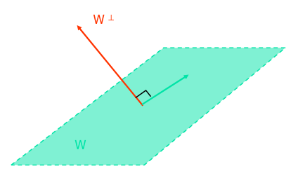
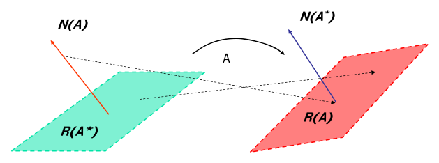
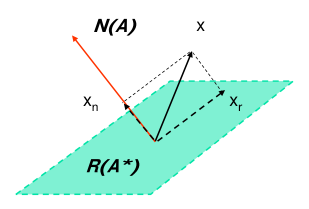
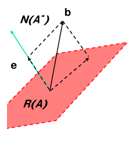

# Linear Algebra for Systems Theory

Almost every result in state-space theory is a statement of linear algebra in disguise. The state equation is a linear map, modal decomposition is an eigenvalue problem, and controllability and observability come down to whether a system of linear equations can be solved, and whether the solution is unique. This chapter collects the tools the rest of the subsection uses: subspaces and their dimensions, the four fundamental subspaces of a matrix and the theorem that ties them together, rank, and the minimum-norm and least-squares solutions of \\(Ax = b\\). The basics (matrix algebra, determinants, eigenvalues, the SVD) are covered in the Linear Algebra section; here the emphasis is on the parts systems theory leans on, and on why.

## Why Systems Theory Needs Linear Algebra

Four connections recur throughout the subsection:

- **The state equation is a linear operation.** For \\(\dot x = Ax + Bu\\) the map from initial state and input to the state at a later time is linear, so questions about reachable states are questions about the range of a linear operator.
- **Modal decomposition is an eigenvalue problem.** Finding coordinates in which \\(A\\) is diagonal (or as nearly diagonal as possible) means finding its eigenvectors and generalized eigenvectors; see [Modal Decomposition and the Jordan Form](modal-decomposition.md).
- **Control and observation are systems of linear equations.** Steering the state from \\(x(t\_0)\\) to \\(x(t\_1)\\) is an *underdetermined* problem: \\(n\\) equations in a continuum of unknowns (the input history). Reconstructing \\(x(t\_0)\\) from an output record is an *overdetermined* problem: \\(n\\) unknowns and a continuum of equations. The minimum-norm and least-squares formulas derived below reappear, unchanged in structure, as the controllability and observability Gramian formulas in [Controllability](controllability.md) and [Observability](observability.md).
- **Stability tests use quadratic forms.** Lyapunov's method for linear systems needs positive definite matrices and norms; see [Stability of Linear Systems](stability.md).

## Vector Spaces

**Definition (linear vector space).** A linear vector space \\(X\\) over a field \\(F\\) (here \\(\mathbb{R}\\) or \\(\mathbb{C}\\)) is a set of elements, called vectors, together with an addition \\(x + y\\) and a scalar multiplication \\(ax\\) (\\(a \in F\\)) that satisfy the usual axioms: closure under both operations, associativity and commutativity of addition, the existence of a zero vector and of additive inverses, and the distributive and associative laws for scalar multiplication.

**Example 1 (\\(\mathbb{R}^3\\)).** Arrows from the origin in three-dimensional space, added by the parallelogram rule and scaled by stretching.

**Example 2 (\\(\mathbb{R}^n\\)).** \\(n\\)-tuples of real numbers with the componentwise operations
\\[
x = \begin{bmatrix} x\_1 \\\\ \vdots \\\\ x\_n \end{bmatrix},\quad
y = \begin{bmatrix} y\_1 \\\\ \vdots \\\\ y\_n \end{bmatrix},\qquad
ax = \begin{bmatrix} ax\_1 \\\\ \vdots \\\\ ax\_n \end{bmatrix},\quad
x + y = \begin{bmatrix} x\_1 + y\_1 \\\\ \vdots \\\\ x\_n + y\_n \end{bmatrix}.
\\]
The zero vector has all elements zero. **Example 3** is \\(\mathbb{C}^n\\), the same construction over the complex field. Complex vectors are unavoidable in systems theory, because a real matrix can have complex eigenvalues and eigenvectors.

**Example 4 (an infinite-dimensional space).** The continuous real functions on a finite interval \\([a, b]\\), with pointwise operations: \\(h = f + g\\) means \\(h(t) = f(t) + g(t)\\), and \\(h = af\\) means \\(h(t) = af(t)\\). The zero vector is the function that vanishes everywhere. Input signals \\(u(\cdot)\\) on \\([t\_0, t\_1]\\) live in a space like this. That is why the control problem has infinitely many unknowns.

A full treatment of the axioms and further examples is in Vector Spaces.

### Linear independence

**Definition.** Vectors \\(\\{x\_1, \dots, x\_n\\}\\) are **linearly independent** if
\\[
\sum\_{i=1}^{n} a\_i x\_i = 0 \quad\Longrightarrow\quad a\_i = 0,\qquad i = 1, \dots, n .
\\]
Otherwise some nontrivial combination vanishes and one of the vectors can be written in terms of the others. Geometrically, three vectors in \\(\mathbb{R}^3\\) are independent when the third sticks out of the plane spanned by the first two, and dependent when it lies in that plane.

**Determinant test.** A set of \\(n\\) vectors in \\(\mathbb{R}^n\\) (or \\(\mathbb{C}^n\\)) is linearly independent if and only if \\(\det [x\_1\ x\_2\ \cdots\ x\_n] \neq 0\\). The test works because the determinant vanishes exactly when the matrix has a nontrivial null vector \\(a\\), and \\([x\_1 \cdots x\_n]\\,a = \sum a\_i x\_i\\).

**Example 1 (a dependent triple).** Are \\([2, -1, 0]^T\\), \\([1, 3, 4]^T\\), \\([0, 7, 8]^T\\) independent? Expanding along the first column,
\\[
\begin{vmatrix} 2 & 1 & 0 \\\\ -1 & 3 & 7 \\\\ 0 & 4 & 8 \end{vmatrix}
= 2(3\cdot 8 - 7\cdot 4) - (-1)(1\cdot 8 - 0\cdot 4)
= 2(-4) + 8 = 0 ,
\\]
so the set is linearly dependent. Indeed \\(x\_3 = 2x\_2 - x\_1\\): \\(2[1,3,4]^T - [2,-1,0]^T = [0, 7, 8]^T\\).

### Subspaces, span, basis and dimension

**Definition (subspace).** A subset \\(M \subseteq X\\) is a **subspace** if it is closed under linear combinations: \\(x, y \in M \Rightarrow \alpha x + \beta y \in M\\) for all scalars \\(\alpha, \beta\\). Every subspace contains the zero vector. In \\(\mathbb{R}^3\\) the subspaces are \\(\\{0\\}\\), lines through the origin, planes through the origin, and \\(\mathbb{R}^3\\) itself. A plane that misses the origin is *not* a subspace.

**Definition (span).** The span of \\(\\{x\_1, \dots, x\_m\\}\\) is the set of all linear combinations,
\\[
\operatorname{span}\\{x\_1, \dots, x\_m\\} = \Big\\{ x \in X : x = \sum\_{i=1}^{m} a\_i x\_i,\ a\_i \in F \Big\\}.
\\]
It is always a subspace. Two non-parallel vectors in \\(\mathbb{R}^3\\) span a plane through the origin.

**Definition (basis).** \\(\\{x\_1, \dots, x\_m\\}\\) is a **basis** for the subspace \\(M\\) if (i) the set is linearly independent and (ii) \\(M = \operatorname{span}\\{x\_1, \dots, x\_m\\}\\).

**Fact (dimension).** Every basis of \\(M\\) has the same number of vectors. This number is the **dimension** \\(m = \dim M\\).

Systems theory names several subspaces of the state space: the *controllable subspace* (states reachable from the origin), the *unobservable subspace* (initial states that produce zero output), and the *eigenspaces* and *generalized eigenspaces* of \\(A\\). Each is computed as the range or null space of some matrix, which is why the next sections matter.

## Inner Products, Norms and Orthogonality

**Definition (inner product).** An inner product on \\(X\\) assigns a scalar \\(\langle x, y\rangle\\) to each pair of vectors so that, for all \\(x, y, y\_1, y\_2\\) and scalars \\(\alpha, \beta\\):

1. \\(\langle y, x\rangle = \overline{\langle x, y\rangle}\\) (conjugate symmetry);
2. \\(\langle x, \alpha y\_1 + \beta y\_2\rangle = \alpha\langle x, y\_1\rangle + \beta\langle x, y\_2\rangle\\) (linearity in the second argument);
3. \\(\langle x, x\rangle \ge 0\\), with \\(\langle x, x\rangle = 0\\) if and only if \\(x = 0\\).

On \\(\mathbb{R}^n\\) and \\(\mathbb{C}^n\\) the standard choice is
\\[
\langle x, y\rangle = x^\* y = \sum\_{i=1}^{n} \bar x\_i y\_i ,
\\]
where \\(x^\*\\) is the conjugate transpose. On the function space of Example 4 the analogous choice is \\(\langle f, g\rangle = \int\_a^b \overline{f(t)}\\,g(t)\\,dt\\). This \\(L^2\\) inner product is the one used for input signals in the minimum-energy control problem.

**Norms.** An inner product induces the **Euclidean norm** \\(\lVert x\rVert = \sqrt{\langle x, x\rangle}\\), the length of the vector. Other vector norms appear in stability analysis: \\(\lVert x\rVert\_1 = \sum \lvert x\_i\rvert\\) and \\(\lVert x\rVert\_\infty = \max\_i \lvert x\_i\rvert\\). All norms on a finite-dimensional space are equivalent (each is bounded above and below by constant multiples of any other), so "bounded" and "tends to zero" do not depend on which norm is used. A matrix norm induced by a vector norm,
\\[
\lVert A\rVert = \max\_{x \neq 0} \frac{\lVert Ax\rVert}{\lVert x\rVert},
\\]
satisfies \\(\lVert Ax\rVert \le \lVert A\rVert\\,\lVert x\rVert\\). For the Euclidean norm, \\(\lVert A\rVert\_2\\) is the largest singular value of \\(A\\) (see Singular Value Decomposition). Because every entry satisfies \\(\lvert a\_{ij}\rvert \le \lVert A\rVert\_2\\), bounding all entries of a matrix and bounding its norm are equivalent statements. The stability definitions in [Stability of Linear Systems](stability.md) are phrased entrywise for this reason.

**Orthogonality.** \\(x \perp y\\) if \\(\langle x, y\rangle = 0\\).

**Definition (orthogonal complement).** For a subspace \\(W \subseteq X\\),
\\[
W^\perp = \\{ x \in X : \langle x, y\rangle = 0 \ \ \forall y \in W \\}.
\\]
\\(W^\perp\\) is itself a subspace. Every vector in it is orthogonal to every vector in \\(W\\). When \\(X = \mathbb{R}^n\\) or \\(\mathbb{C}^n\\),
\\[
\dim W^\perp = n - \dim W, \qquad (W^\perp)^\perp = W ,
\\]
and every \\(x \in X\\) splits uniquely as \\(x = w + w'\\) with \\(w \in W\\), \\(w' \in W^\perp\\). The component \\(w\\) is the **orthogonal projection** of \\(x\\) onto \\(W\\), and it is the point of \\(W\\) closest to \\(x\\). This one geometric fact drives both the minimum-norm and the least-squares solution.



*Figure: a subspace \\(W\\) of \\(\mathbb{R}^3\\) (a plane through the origin) and its orthogonal complement \\(W^\perp\\) (the normal line). The dimensions add to 3.*

### Positive definite matrices and quadratic forms

A Hermitian (real symmetric) matrix \\(P = P^\*\\) defines the quadratic form \\(x^\* P x\\), which is real. \\(P\\) is **positive definite** (\\(P > 0\\)) if \\(x^\* P x > 0\\) for all \\(x \neq 0\\), and **positive semidefinite** (\\(P \ge 0\\)) if \\(x^\* P x \ge 0\\). Three equivalent tests for a Hermitian \\(P\\) are:

- all eigenvalues of \\(P\\) are positive (they are real, as shown in [Modal Decomposition](modal-decomposition.md));
- all leading principal minors are positive (Sylvester's criterion);
- \\(P = R^\* R\\) for some nonsingular \\(R\\).

If \\(P > 0\\) with smallest and largest eigenvalues \\(\lambda\_{\min}\\) and \\(\lambda\_{\max}\\), then
\\[
\lambda\_{\min}\lVert x\rVert^2 \le x^\* P x \le \lambda\_{\max}\lVert x\rVert^2 ,
\\]
which follows by expanding \\(x\\) in the orthonormal eigenvectors of \\(P\\). The level sets of \\(x^T P x\\) are ellipsoids. Gramians \\(\int M(t) M(t)^T dt\\) are always positive semidefinite, and they are positive definite exactly when the corresponding system is controllable or observable.

## Linear Operators and Their Matrices

**Definition (linear operator).** A map \\(A : X \to Y\\) between vector spaces is linear if
\\[
A(\alpha x + \beta y) = \alpha A x + \beta A y \qquad \forall x, y \in X,\ \forall \alpha, \beta .
\\]
If \\(X = \mathbb{C}^n\\) and \\(Y = \mathbb{C}^m\\), every linear operator is represented by an \\(m \times n\\) complex matrix, and \\(y = Ax\\) is ordinary matrix–vector multiplication.

**Matrix representation.** The representation depends on the bases. If \\(\\{e\_1, \dots, e\_n\\}\\) is a basis of \\(X\\) and \\(\\{f\_1, \dots, f\_m\\}\\) a basis of \\(Y\\), the \\(j\\)-th column of the matrix holds the coordinates of \\(A e\_j\\) in the basis \\(\\{f\_i\\}\\). In words, *the columns are the images of the basis vectors*.

**Example 2 (matrix of a map).** Find the matrix of the linear map \\(A : \mathbb{R}^3 \to \mathbb{R}^2\\) that sends \\(e\_1 = [1,0,0]^T \mapsto [1, 2]^T\\), \\(e\_2 = [0,1,0]^T \mapsto [0, 1]^T\\) and \\(e\_3 = [0,0,1]^T \mapsto [-1, 0]^T\\), in the standard bases.

*Solution.* Place the images as columns:
\\[
A = \begin{bmatrix} 1 & 0 & -1 \\\\ 2 & 1 & 0 \end{bmatrix},
\qquad
A\begin{bmatrix} x\_1 \\\\ x\_2 \\\\ x\_3 \end{bmatrix} = x\_1\begin{bmatrix} 1 \\\\ 2 \end{bmatrix} + x\_2\begin{bmatrix} 0 \\\\ 1 \end{bmatrix} + x\_3\begin{bmatrix} -1 \\\\ 0 \end{bmatrix}.
\\]

**Change of basis and similarity.** If the same operator \\(A : \mathbb{C}^n \to \mathbb{C}^n\\) is described in new coordinates \\(\hat x = T x\\) (\\(T\\) nonsingular), then \\(\hat y = T y = T A x = (T A T^{-1})\hat x\\). The matrix in the new basis is \\(\hat A = T A T^{-1}\\), a **similarity transformation**. Similar matrices represent the same operator, so they share eigenvalues, determinant, trace, rank and characteristic polynomial. State transformations (see [State Transformations and Canonical Forms](realizations.md)) and the Jordan form are both choices of a convenient basis.

### Rank

**Definition.** \\(\operatorname{rank}(A)\\) is the size of the largest square submatrix of \\(A\\) with a nonzero determinant.

**Fact.** \\(\operatorname{rank}(A)\\) equals the number of linearly independent columns, which equals the number of linearly independent rows. In particular \\(\operatorname{rank}(A) = \operatorname{rank}(A^T) = \operatorname{rank}(A^\*)\\) and \\(\operatorname{rank}(A) \le \min(m, n)\\). A matrix with \\(\operatorname{rank}(A) = \min(m, n)\\) has **full rank**.

**Example 3 (rank by inspection).**
\\[
A = \begin{bmatrix} 1 & -2 & 0 \\\\ 2 & 1 & 5 \\\\ 3 & -1 & 5 \\\\ 4 & 0 & 8 \end{bmatrix}.
\\]
The columns satisfy \\(\text{col}\_3 = 2\\,\text{col}\_1 + \text{col}\_2\\), and the rows satisfy \\(\text{row}\_3 = \text{row}\_1 + \text{row}\_2\\) and \\(\text{row}\_4 = 0.8\\,\text{row}\_1 + 1.6\\,\text{row}\_2\\). The first two columns are independent, so \\(\operatorname{rank}(A) = 2\\).

```matlab
A = [1 -2 0; 2 1 5; 3 -1 5; 4 0 8];
rank(A)          % ans = 2
```

Numerically, `rank` counts the singular values above a tolerance. That is the only reliable way to decide rank in floating point, because an exactly singular matrix almost never stays exactly singular after rounding.

Two rank facts are used repeatedly: \\(\operatorname{rank}(A^\* A) = \operatorname{rank}(A A^\*) = \operatorname{rank}(A)\\) (proved below), and \\(\operatorname{rank}(TAS) = \operatorname{rank}(A)\\) for nonsingular \\(T, S\\). The second is why controllability and observability survive a change of state coordinates.

### The adjoint operator

**Definition.** The **adjoint** of \\(A : X \to Y\\) is the linear operator \\(A^\* : Y \to X\\) such that
\\[
\langle A x, y\rangle\_Y = \langle x, A^\* y\rangle\_X \qquad \forall x \in X,\ y \in Y .
\\]
For \\(X = \mathbb{R}^n\\), \\(Y = \mathbb{R}^m\\) with the dot product, \\(A^\* = A^T\\). For complex spaces \\(A^\*\\) is the conjugate transpose. The definition also works for operators on function spaces. For the input-to-state map \\(L u = \int\_{t\_0}^{t\_1} \Phi(t\_1, \tau) B(\tau) u(\tau)\\,d\tau\\) with the \\(L^2\\) inner product on inputs, the adjoint is \\((L^\* v)(\tau) = B(\tau)^T \Phi(t\_1, \tau)^T v\\). This is the function that appears in the minimum-energy control law.

## Range, Null Space and the Fundamental Theorem

**Definitions.** For \\(A : X \to Y\\):

- the **range space** \\(\mathcal{R}(A) = \\{ y \in Y : y = A x \text{ for some } x \in X\\}\\);
- the **null space** \\(\mathcal{N}(A) = \\{ x \in X : A x = 0\\}\\).

Both are subspaces. If \\(A\\) is a matrix, \\(\mathcal{R}(A)\\) is the **column space**, the span of the columns, and \\(\dim\mathcal{R}(A) = \operatorname{rank}(A)\\). The range of \\(A^\*\\) is the span of the (conjugated) rows of \\(A\\), the **row space**.

**Theorem (Fundamental Theorem of Linear Algebra).** For a linear operator \\(A : X \to Y\\) between inner-product spaces,
\\[
\mathcal{N}(A) = \mathcal{R}(A^\*)^\perp, \qquad \mathcal{N}(A^\*) = \mathcal{R}(A)^\perp .
\\]
If \\(A\\) is an \\(m \times n\\) matrix (\\(X = \mathbb{C}^n\\), \\(Y = \mathbb{C}^m\\)), then in addition
\\[
\mathcal{R}(A) = \mathcal{N}(A^\*)^\perp, \qquad \mathcal{R}(A^\*) = \mathcal{N}(A)^\perp,
\\]
\\[
\dim\mathcal{N}(A) = n - \operatorname{rank}A, \qquad \dim\mathcal{N}(A^\*) = m - \operatorname{rank}A .
\\]

*Proof.* \\(x \in \mathcal{N}(A)\\) if and only if \\(\langle A x, y\rangle = 0\\) for every \\(y \in Y\\) (take \\(y = Ax\\) for the "if" part). By the definition of the adjoint this is \\(\langle x, A^\* y\rangle = 0\\) for every \\(y\\), which says \\(x\\) is orthogonal to every vector of \\(\mathcal{R}(A^\*)\\). Hence \\(\mathcal{N}(A) = \mathcal{R}(A^\*)^\perp\\). Applying the same argument to \\(A^\*\\) (whose adjoint is \\(A\\)) gives \\(\mathcal{N}(A^\*) = \mathcal{R}(A)^\perp\\). In finite dimensions, taking orthogonal complements and using \\((W^\perp)^\perp = W\\) gives the other two identities. Finally \\(\dim\mathcal{N}(A) = n - \dim\mathcal{R}(A^\*) = n - \operatorname{rank}A^\* = n - \operatorname{rank}A\\), and similarly in \\(Y\\). \\(\square\\)

The theorem splits the domain into two orthogonal pieces: the row space \\(\mathcal{R}(A^\*)\\), which \\(A\\) maps one-to-one onto its range, and the null space \\(\mathcal{N}(A)\\), which \\(A\\) sends to zero. The codomain splits in the same way into the range \\(\mathcal{R}(A)\\), which \\(A\\) can reach, and its complement \\(\mathcal{N}(A^\*)\\), which it cannot.



*Figure: the fundamental theorem of linear algebra. In the domain (left) the row space \\(\mathcal{R}(A^\*)\\) and the null space \\(\mathcal{N}(A)\\) are orthogonal complements. In the codomain (right) the range \\(\mathcal{R}(A)\\) and \\(\mathcal{N}(A^\*)\\) are orthogonal complements. The null-space component of a vector is mapped to zero; the row-space component is mapped into the range.*

**Corollary (rank of Gram matrices).** \\(\mathcal{N}(A^\* A) = \mathcal{N}(A)\\), so \\(\operatorname{rank}(A^\* A) = \operatorname{rank}(A)\\). Likewise \\(\operatorname{rank}(A A^\*) = \operatorname{rank}(A)\\).

*Proof.* If \\(Ax = 0\\) then \\(A^\* A x = 0\\). Conversely, if \\(A^\* A x = 0\\) then \\(0 = x^\* A^\* A x = \lVert A x\rVert^2\\), so \\(Ax = 0\\). The two null spaces are equal, so the ranks are equal by the dimension formula. Apply this to \\(A^\*\\) for the second statement. \\(\square\\)

This corollary is the finite-dimensional version of the Gramian argument used in every controllability and observability proof: "\\(v^T G v = 0\\) implies \\(\int \lVert \cdots v\rVert^2 dt = 0\\), so the integrand vanishes".

### Computing the four subspaces

Gaussian elimination (elementary row operations) does not change the null space or the row space of a matrix. Reduce \\(A\\) to row-echelon form, a staircase of pivots with zero rows at the bottom:

- **Null space of \\(A\\):** solve the echelon system \\(Ux = 0\\) by back substitution, one basis vector per free variable.
- **Row space of \\(A\\)** (\\(\mathcal{R}(A^T)\\) for real \\(A\\)): the span of the nonzero rows of the echelon form.
- Repeating the procedure on \\(A^\*\\) gives \\(\mathcal{N}(A^\*)\\) and \\(\mathcal{R}(A)\\).

**Example 4 (four subspaces by elimination).**
\\[
A = \begin{bmatrix} 1 & 2 & -1 \\\\ 3 & 6 & -3 \\\\ 3 & 9 & 3 \\\\ 2 & 5 & 0 \end{bmatrix}.
\\]
*Solution.* Eliminate below the first pivot with \\(r\_2 \leftarrow r\_2 - 3r\_1\\), \\(r\_3 \leftarrow r\_3 - 3r\_1\\), \\(r\_4 \leftarrow r\_4 - 2r\_1\\). Then swap \\(r\_2 \leftrightarrow r\_4\\) and eliminate with \\(r\_3 \leftarrow r\_3 - 3r\_2\\):
\\[
\begin{bmatrix} 1 & 2 & -1 \\\\ 0 & 0 & 0 \\\\ 0 & 3 & 6 \\\\ 0 & 1 & 2 \end{bmatrix}
\rightarrow
\begin{bmatrix} 1 & 2 & -1 \\\\ 0 & 1 & 2 \\\\ 0 & 3 & 6 \\\\ 0 & 0 & 0 \end{bmatrix}
\rightarrow
\begin{bmatrix} 1 & 2 & -1 \\\\ 0 & 1 & 2 \\\\ 0 & 0 & 0 \\\\ 0 & 0 & 0 \end{bmatrix}.
\\]
There are two pivots, so \\(\operatorname{rank}A = 2\\). The equations \\(x\_1 + 2x\_2 - x\_3 = 0\\) and \\(x\_2 + 2x\_3 = 0\\) have one free variable. Setting \\(x\_3 = 1\\) gives \\(x\_2 = -2\\) and \\(x\_1 = 5\\):
\\[
\mathcal{R}(A^T) = \operatorname{span}\Big\\{\begin{bmatrix} 1 \\\\ 2 \\\\ -1 \end{bmatrix}, \begin{bmatrix} 0 \\\\ 1 \\\\ 2 \end{bmatrix}\Big\\},\qquad
\mathcal{N}(A) = \operatorname{span}\Big\\{\begin{bmatrix} 5 \\\\ -2 \\\\ 1 \end{bmatrix}\Big\\}.
\\]
Check the theorem: \\(\dim\mathcal{N}(A) = 3 - 2 = 1\\), and \\([5, -2, 1]\\) is orthogonal to both row-space vectors (\\(5 - 4 - 1 = 0\\) and \\(-2 + 2 = 0\\)). In the codomain, \\(\dim\mathcal{R}(A) = 2\\) and \\(\dim\mathcal{N}(A^T) = 4 - 2 = 2\\). MATLAB returns an orthonormal basis:

```matlab
A = [1 2 -1; 3 6 -3; 3 9 3; 2 5 0];
null(A)      % ans = [0.9129; -0.3651; 0.1826] = [5; -2; 1]/sqrt(30)
orth(A)      % orthonormal basis of R(A), 4x2
null(A')     % orthonormal basis of N(A^T), 4x2
```

`null` and `orth` use the SVD. The right singular vectors with zero singular value span \\(\mathcal{N}(A)\\), and the left singular vectors with nonzero singular value span \\(\mathcal{R}(A)\\).

**Example 5 (range and null spaces of rectangular matrices).** For
\\[
A\_3 = \begin{bmatrix} 1 & 2 & 3 & 4 \\\\ 0 & -1 & -2 & 2 \\\\ 0 & 0 & 0 & 1 \end{bmatrix},
\\]
columns 1, 2 and 4 are independent, so \\(\operatorname{rank}A\_3 = 3\\) and \\(\mathcal{R}(A\_3) = \mathbb{R}^3\\). The null space has dimension \\(4 - 3 = 1\\). From \\(v\_4 = 0\\), \\(-v\_2 - 2v\_3 + 2v\_4 = 0\\) and \\(v\_1 + 2v\_2 + 3v\_3 + 4v\_4 = 0\\), setting \\(v\_3 = 1\\) gives \\(\mathcal{N}(A\_3) = \operatorname{span}\\{[1, -2, 1, 0]^T\\}\\).

## Systems of Linear Equations

Consider \\(Ax = b\\) with \\(A : X \to Y\\). Such systems arise throughout engineering (finite-element models, for example) and are the basis of controllability and observability. In general a system may have no solution, exactly one, or infinitely many. The fundamental theorem sorts out which:

- a solution exists if and only if \\(b \in \mathcal{R}(A)\\), equivalently \\(b \perp \mathcal{N}(A^\*)\\);
- if \\(x\_p\\) is one solution, the full solution set is \\(x\_p + \mathcal{N}(A)\\), so the solution is unique if and only if \\(\mathcal{N}(A) = \\{0\\}\\).

There are three cases, according to the shape of \\(A\\).

### Case 1: square systems

\\(X = Y = \mathbb{C}^n\\). If \\(\det A \neq 0\\) the unique solution is \\(x = A^{-1} b\\). If \\(\det A = 0\\), there is no solution when \\(b \notin \mathcal{R}(A)\\), and there are infinitely many when \\(b \in \mathcal{R}(A)\\).

### Case 2: underdetermined systems and the minimum-norm solution

Let \\(Y = \mathbb{C}^m\\) with \\(\dim X = n > m\\): fewer equations than unknowns.

- A solution exists for every \\(b\\) if and only if \\(\mathcal{R}(A) = \mathbb{C}^m\\). When it exists it is never unique, because \\(\dim\mathcal{N}(A) \ge n - m > 0\\).
- **Existence rank test:** a solution exists for every \\(b\\) if and only if \\(\operatorname{rank}(A A^\*) = m\\).

*Proof of the test.* If \\(\operatorname{rank}(AA^\*) = m\\), the \\(m \times m\\) matrix \\(AA^\*\\) is invertible, and \\(x = A^\*(AA^\*)^{-1}b\\) satisfies \\(Ax = AA^\*(AA^\*)^{-1}b = b\\). If \\(\operatorname{rank}(AA^\*) < m\\), there is a nonzero \\(z \in \mathbb{C}^m\\) with \\(AA^\* z = 0\\). Then \\(z^\* AA^\* z = \lVert A^\* z\rVert^2 = 0\\), so \\(A^\* z = 0\\) and \\(\mathcal{N}(A^\*) \neq \\{0\\}\\). By the fundamental theorem \\(\mathcal{R}(A) = \mathcal{N}(A^\*)^\perp \neq \mathbb{C}^m\\), and any \\(b\\) with a component along \\(z\\) has no solution. \\(\square\\)

Among the infinitely many solutions, which one is the "smallest"? Write any solution as \\(x = x\_r + x\_n\\) with \\(x\_r \in \mathcal{R}(A^\*)\\) and \\(x\_n \in \mathcal{N}(A)\\), using the orthogonal splitting of the domain. The null-space part does not affect \\(Ax\\), since \\(Ax = Ax\_r\\). It only adds length, \\(\lVert x\rVert^2 = \lVert x\_r\rVert^2 + \lVert x\_n\rVert^2\\). So the minimum-norm solution is the one with \\(x\_n = 0\\), the unique solution that lies in \\(\mathcal{R}(A^\*)\\).

**Theorem (minimum-norm solution).** If \\(\operatorname{rank}(AA^\*) = m\\), the solution of \\(Ax = b\\) with the smallest norm is
\\[
\boxed{x\_{\min} = A^\*(AA^\*)^{-1} b .}
\\]

*Proof.* \\(x\_{\min}\\) solves the equation (shown above) and has the form \\(A^\* v\\) with \\(v = (AA^\*)^{-1}b\\), so it lies in \\(\mathcal{R}(A^\*)\\). Any other solution is \\(x = x\_{\min} + x\_n\\) with \\(x\_n \in \mathcal{N}(A) = \mathcal{R}(A^\*)^\perp\\). By Pythagoras, \\(\lVert x\rVert^2 = \lVert x\_{\min}\rVert^2 + \lVert x\_n\rVert^2 \ge \lVert x\_{\min}\rVert^2\\), with equality only if \\(x\_n = 0\\). \\(\square\\)



*Figure: geometry of the minimum-norm solution. Any solution \\(x\\) decomposes into \\(x\_r \in \mathcal{R}(A^\*)\\) and \\(x\_n \in \mathcal{N}(A)\\). The null component adds length without changing \\(Ax\\), so the minimum-norm solution is \\(x\_r\\), the projection of any solution onto the row space.*

**Example 6 (minimum-norm solution by hand).** Find the minimum-norm solution of
\\[
\begin{bmatrix} 1 & 0 & 1 \\\\ 0 & -1 & 1 \end{bmatrix} x = \begin{bmatrix} 1 \\\\ 1 \end{bmatrix}.
\\]
*Solution.*
\\[
AA^T = \begin{bmatrix} 2 & 1 \\\\ 1 & 2 \end{bmatrix},\quad (AA^T)^{-1} = \frac{1}{3}\begin{bmatrix} 2 & -1 \\\\ -1 & 2 \end{bmatrix},\quad
(AA^T)^{-1}b = \frac{1}{3}\begin{bmatrix} 1 \\\\ 1 \end{bmatrix},
\\]
\\[
x\_{\min} = A^T (AA^T)^{-1} b = \frac{1}{3}\begin{bmatrix} 1 & 0 \\\\ 0 & -1 \\\\ 1 & 1 \end{bmatrix}\begin{bmatrix} 1 \\\\ 1 \end{bmatrix} = \frac{1}{3}\begin{bmatrix} 1 \\\\ -1 \\\\ 2 \end{bmatrix}.
\\]
Check: \\(\tfrac13(1 + 2) = 1\\) and \\(\tfrac13(1 + 2) = 1\\). The null space is spanned by \\([1, 1, -1]^T\\) (because \\(x\_1 = -x\_3\\), \\(x\_2 = x\_3\\)), and indeed \\(x\_{\min} \perp [1, 1, -1]^T\\). The norm is \\(\lVert x\_{\min}\rVert = \sqrt{6}/3 \approx 0.816\\). Any other solution, such as \\([0, -1, 1]^T\\) with norm \\(\sqrt2\\), is longer.

**Example 7 (MATLAB, and a common pitfall).** In MATLAB the backslash operator on an underdetermined system does **not** return the minimum-norm solution. It returns a *basic* solution with at most \\(\operatorname{rank}(A)\\) nonzero entries:

```matlab
A = [1 1 0; 0 -1 1]; b = [1; 1];
x = A\b;  x'          %  2.0000  -1.0000       0     (a basic solution)
xmin = pinv(A)*b;  xmin'   %  1.0000   0.0000  1.0000  (minimum norm)
norm(x), norm(xmin)  %  2.2361, 1.4142
```

Both vectors satisfy \\(Ax = b\\), but only `pinv(A)*b` (or the explicit `A'*((A*A')\b)`) gives \\(x\_{\min}\\). For the matrix of Example 6, `pinv(A)*b` returns \\([0.3333, -0.3333, 0.6667]^T\\). In Python, `numpy.linalg.lstsq` and `numpy.linalg.pinv` both return the minimum-norm solution of an underdetermined system:

```python
import numpy as np
A = np.array([[1, 1, 0], [0, -1, 1.]]); b = np.array([1, 1.])
print(np.linalg.pinv(A) @ b)                 # [1. 0. 1.]
print(np.linalg.lstsq(A, b, rcond=None)[0])  # [1. 0. 1.]
```

**Example 8 (a general solution).** For
\\[
A = \begin{bmatrix} 1 & 2 & 3 & 4 \\\\ 0 & -1 & -2 & 2 \\\\ 0 & 0 & 0 & 1 \end{bmatrix},\qquad b = \begin{bmatrix} 3 \\\\ 2 \\\\ 1 \end{bmatrix},
\\]
\\(A\\) has full row rank 3, so
\\[
x\_{\min} = A^T (AA^T)^{-1} b = \frac{1}{6}\begin{bmatrix} -5 \\\\ -2 \\\\ 1 \\\\ 6 \end{bmatrix},
\\]
and the general solution is \\(x = x\_{\min} + \alpha\\,[1, -2, 1, 0]^T\\), \\(\alpha \in \mathbb{R}\\), using the null space of Example 5. Check: \\(x\_{\min}\\) is orthogonal to \\([1, -2, 1, 0]^T\\) (\\(-5 + 4 + 1 = 0\\)), as it must be.

**Example 9 (rank-deficient but consistent).** For
\\[
A = \begin{bmatrix} 0 & 1 & 1 & 2 \\\\ 1 & 2 & 3 & 4 \\\\ 2 & 0 & 2 & 0 \end{bmatrix},\qquad b = \begin{bmatrix} -4 \\\\ -8 \\\\ 0 \end{bmatrix},
\\]
\\(\operatorname{rank}A = 2 < 3\\), so \\(AA^T\\) is singular and the formula \\(A^T(AA^T)^{-1}b\\) cannot be used. Row-reduce the augmented matrix \\([A \mid b]\\): swap the first two rows, then \\(r\_3 \leftarrow r\_3 - 2r\_1\\) and \\(r\_3 \leftarrow r\_3 + 4r\_2\\). The last row becomes \\(0 = 0\\), so the system is consistent. It reduces to the full-row-rank system
\\[
\begin{bmatrix} 1 & 2 & 3 & 4 \\\\ 0 & 1 & 1 & 2 \end{bmatrix} x = \begin{bmatrix} -8 \\\\ -4 \end{bmatrix},
\\]
which has the same solution set, so the minimum-norm solution can be computed from it:
\\[
x\_{\min} = \frac{1}{11}\begin{bmatrix} 4 \\\\ -8 \\\\ -4 \\\\ -16 \end{bmatrix}.
\\]
The pseudo-inverse handles this case directly: `pinv(A)*b` gives the same vector without any reduction by hand.

**Example 10 (redundant robot arm).** A planar four-link arm with unit link lengths relates joint rates \\(\omega \in \mathbb{R}^4\\) to the end-effector twist \\(v = [\dot x, \dot y, \dot\phi]^T\\) through \\(v = J(\theta)\omega\\). At one configuration
\\[
J = \begin{bmatrix} -3 & -2 & -1 & 0 \\\\ 6 & 4 & 2 & 1 \\\\ 1 & 1 & 1 & 1 \end{bmatrix}.
\\]
(a) *Rank.* Row reduction (\\(r\_2 \leftarrow r\_2 + 2r\_1\\), swap, \\(r\_3 \leftarrow r\_3 + 3r\_1\\)) leaves three pivots, so \\(\operatorname{rank}J = 3\\). The arm can produce any twist, and the one-dimensional null space is a self-motion of the joints that leaves the hand still: one redundant degree of freedom.

(b) *Smallest joint rates for \\(v = [1, 2, 0]^T\\).* The minimum-norm solution is
\\[
\omega = J^T (JJ^T)^{-1} v = \Big[\tfrac{13}{6},\ -\tfrac{4}{3},\ -\tfrac{29}{6},\ 4\Big]^T \approx [2.167,\ -1.333,\ -4.833,\ 4]^T .
\\]

(c) *Static torques.* By the duality between velocities and forces (virtual work), the joint torques that balance an end-effector wrench \\(w = [F\_x, F\_y, M]^T\\) are \\(\tau = J^T w\\). This is the adjoint at work. For a 10 kg payload, \\(w = [0, 98.1\ \text{N}, 0]^T\\), and \\(\tau = [588.6,\ 392.4,\ 196.2,\ 98.1]^T\\) N·m. Each joint torque is the weight times the horizontal distance from that joint to the payload.

(d) *Singular configuration.* With all links aligned along \\(x\\),
\\[
J = \begin{bmatrix} 0 & 0 & 0 & 0 \\\\ 4 & 3 & 2 & 1 \\\\ 1 & 1 & 1 & 1 \end{bmatrix},
\\]
the rank drops to 2 (not 1: the last two rows are still independent). \\(\mathcal{R}(J) = \\{v : \dot x = 0\\}\\), so the hand cannot move along the arm, which is the edge of the workspace. \\(\mathcal{N}(J) = \operatorname{span}\\{[1, -2, 1, 0]^T, [2, -3, 0, 1]^T\\}\\) is now two-dimensional.

### Case 3: overdetermined systems and least squares

Let \\(X = \mathbb{C}^n\\) with \\(\dim Y = m > n\\): more equations than unknowns. For an arbitrary \\(b\\) there is no solution, because \\(\mathcal{R}(A)\\) has dimension at most \\(n < m\\). A solution, when one exists, is unique only if \\(\mathcal{N}(A) = \\{0\\}\\). The rank test is \\(\operatorname{rank}(A^\* A) = n\\) (equivalently \\(\operatorname{rank}A = n\\), by the corollary above), with the same proof as in Case 2.

When no exact solution exists, the natural compromise is to minimize the error norm \\(\lVert e\rVert\\), where \\(e = Ax - b\\). As \\(x\\) varies, \\(Ax\\) sweeps out \\(\mathcal{R}(A)\\), so the best \\(Ax\\) is the point of \\(\mathcal{R}(A)\\) closest to \\(b\\), its orthogonal projection. The error is then orthogonal to the range:
\\[
e \perp \mathcal{R}(A) \iff e \in \mathcal{R}(A)^\perp = \mathcal{N}(A^\*) \iff A^\*(Ax - b) = 0 .
\\]
These are the **normal equations** \\(A^\* A x = A^\* b\\).

**Theorem (least-squares solution).** If \\(\operatorname{rank}(A^\* A) = n\\), the unique minimizer of \\(\lVert Ax - b\rVert\\) is
\\[
\boxed{x\_{ls} = (A^\* A)^{-1} A^\* b .}
\\]

*Proof.* Let \\(x\_{ls}\\) satisfy the normal equations, so \\(e\_{ls} = Ax\_{ls} - b \in \mathcal{N}(A^\*)\\). For any \\(x\\), \\(Ax - b = A(x - x\_{ls}) + e\_{ls}\\). The first term lies in \\(\mathcal{R}(A)\\) and the second in \\(\mathcal{R}(A)^\perp\\), so
\\[
\lVert Ax - b\rVert^2 = \lVert A(x - x\_{ls})\rVert^2 + \lVert e\_{ls}\rVert^2 \ge \lVert e\_{ls}\rVert^2 ,
\\]
with equality if and only if \\(A(x - x\_{ls}) = 0\\), that is \\(x = x\_{ls}\\) when \\(\mathcal{N}(A) = \\{0\\}\\). \\(\square\\)



*Figure: least-squares geometry. The vector \\(b\\) lies off the plane \\(\mathcal{R}(A)\\). The best approximation \\(Ax\_{ls}\\) is its orthogonal projection onto the plane, and the residual \\(e\\) points along \\(\mathcal{N}(A^\*)\\), the normal to the range.*

**Example 11 (least squares in MATLAB).** Solve in the least-squares sense
\\[
\begin{bmatrix} 1 & 1 & 0 \\\\ 0 & -1 & 1 \\\\ 1 & 0 & 1 \\\\ 1 & 1 & 1 \end{bmatrix} x = \begin{bmatrix} 1 \\\\ 0 \\\\ 0 \\\\ 1 \end{bmatrix}.
\\]

```matlab
A = [1 1 0; 0 -1 1; 1 0 1; 1 1 1]; b = [1; 0; 0; 1];
x = A\b;  x'       %  0.0000   0.6667   0.3333
```

For a full-column-rank overdetermined system, backslash *does* return the least-squares solution (computed by QR, which is better conditioned than forming \\(A^T A\\)). Here \\(x\_{ls} = [0, \tfrac23, \tfrac13]^T\\). The residual is \\(e = Ax\_{ls} - b = [-\tfrac13, -\tfrac13, \tfrac13, 0]^T\\) with \\(\lVert e\rVert = 1/\sqrt3 \approx 0.577\\). As the theorem predicts, \\(A^T e = [-\tfrac13 + \tfrac13 + 0,\ -\tfrac13 + \tfrac13 + 0,\ -\tfrac13 + \tfrac13 + 0]^T = 0\\).

**Weighted least squares.** If some equations deserve more trust than others, minimize \\(e^\* W e\\) with \\(W > 0\\). The same projection argument in the inner product \\(\langle y\_1, y\_2\rangle\_W = y\_1^\* W y\_2\\) gives \\(x = (A^\* W A)^{-1} A^\* W b\\). With \\(W\\) the inverse noise covariance, this is the measurement update of the Kalman filter; see [The Kalman Filter](kalman-filter.md).

### Summary: the pseudo-inverse

For a full-rank \\(A : X \to Y\\) (either \\(\mathcal{N}(A) = \\{0\\}\\) or \\(\mathcal{N}(A^\*) = \\{0\\}\\)), with \\(m = \dim Y\\) and \\(n = \dim X\\), the "best" solution of \\(Ax = b\\) is \\(x = A^+ b\\), where
\\[
A^+ = \begin{cases} A^{-1}, & m = n \\\\ A^\*(AA^\*)^{-1}, & n > m \quad \text{(minimum norm)} \\\\ (A^\* A)^{-1} A^\*, & n < m \quad \text{(least squares)} . \end{cases}
\\]
\\(A^+\\) is the **Moore–Penrose pseudo-inverse**. Through the SVD \\(A = U\Sigma V^\*\\) it extends to rank-deficient matrices as \\(A^+ = V\Sigma^+ U^\*\\), where \\(\Sigma^+\\) inverts the nonzero singular values. Then \\(A^+ b\\) is the minimum-norm least-squares solution: of all minimizers of \\(\lVert Ax - b\rVert\\), it is the shortest. This is what MATLAB's `pinv` computes.

## Preview: Control and Observation as Linear Equations

The finite-dimensional results above carry over almost word for word to the operators of linear systems theory.

**Control.** For \\(\dot x = A(t)x + B(t)u\\), the input changes the state at \\(t\_1\\) through
\\[
\Delta x = L u := \int\_{t\_0}^{t\_1} \Phi(t\_1, \tau) B(\tau) u(\tau)\\,d\tau, \qquad \Delta x = x(t\_1) - \Phi(t\_1, t\_0) x(t\_0),
\\]
a map from an infinite-dimensional input space onto \\(\mathbb{R}^n\\): \\(n\\) equations in infinitely many unknowns. It is solvable for every \\(\Delta x\\) if and only if \\(LL^\*\\) is nonsingular, and \\(LL^\*\\) is precisely the controllability Gramian
\\[
G\_c(t\_0, t\_1) = \int\_{t\_0}^{t\_1} \Phi(t\_1, \tau) B(\tau) B(\tau)^T \Phi(t\_1, \tau)^T d\tau .
\\]
The minimum-energy input is the minimum-norm solution \\(u\_{\min} = L^\*(LL^\*)^{-1}\Delta x\\), that is \\(u\_{\min}(t) = B(t)^T \Phi(t\_1, t)^T G\_c^{-1}\Delta x\\).

**Observation.** With zero input, the output is \\(y(t) = C(t)\Phi(t, t\_0)x(t\_0) =: (L\_o x(t\_0))(t)\\), a map from \\(\mathbb{R}^n\\) into an infinite-dimensional output space. Recovering \\(x(t\_0)\\) is an overdetermined problem, and the least-squares solution \\((L\_o^\* L\_o)^{-1} L\_o^\* y\\) involves \\(L\_o^\* L\_o\\), the observability Gramian
\\[
G\_o(t\_0, t\_1) = \int\_{t\_0}^{t\_1} \Phi(t, t\_0)^T C(t)^T C(t) \Phi(t, t\_0)\\,dt .
\\]
These ideas are developed in [Controllability](controllability.md) and [Observability](observability.md).

## Summary

- A subspace is closed under linear combinations. Its dimension is the number of vectors in any basis. \\(\dim W + \dim W^\perp = n\\) in \\(\mathbb{C}^n\\).
- \\(\operatorname{rank}A\\) is the number of independent columns, which equals the number of independent rows. Also \\(\operatorname{rank}(A^\* A) = \operatorname{rank}(AA^\*) = \operatorname{rank}A\\), and rank is invariant under nonsingular transformations.
- The adjoint satisfies \\(\langle Ax, y\rangle = \langle x, A^\* y\rangle\\). For matrices it is \\(A^T\\) (real) or the conjugate transpose.
- **Fundamental theorem:** \\(\mathcal{N}(A) = \mathcal{R}(A^\*)^\perp\\) and \\(\mathcal{N}(A^\*) = \mathcal{R}(A)^\perp\\). For matrices, \\(\dim\mathcal{N}(A) = n - \operatorname{rank}A\\) and \\(\dim\mathcal{N}(A^\*) = m - \operatorname{rank}A\\).
- \\(Ax = b\\) is solvable if and only if \\(b \in \mathcal{R}(A)\\). The solution set is \\(x\_p + \mathcal{N}(A)\\).
- Minimum norm (underdetermined, full row rank): \\(x\_{\min} = A^\*(AA^\*)^{-1}b \in \mathcal{R}(A^\*)\\).
- Least squares (overdetermined, full column rank): \\(x\_{ls} = (A^\* A)^{-1}A^\* b\\), with residual in \\(\mathcal{N}(A^\*)\\).
- MATLAB: `A\b` gives least squares for tall full-rank \\(A\\) but only a basic solution for wide \\(A\\). Use `pinv(A)*b` for the minimum-norm solution.
- The controllability Gramian is \\(LL^\*\\) and the observability Gramian is \\(L\_o^\* L\_o\\). Minimum-energy control and least-squares state reconstruction are the formulas of this chapter.

## See Also

- Vector Spaces, Matrices, Determinants, Singular Value Decomposition
- [Modal Decomposition and the Jordan Form](modal-decomposition.md): the eigenvalue problem and generalized eigenvectors
- [Stability of Linear Systems](stability.md): norms and positive definite matrices in Lyapunov analysis
- [Controllability](controllability.md) and [Observability](observability.md): Gramians as \\(LL^\*\\) and \\(L\_o^\* L\_o\\)
- [State Transformations and Canonical Forms](realizations.md): similarity transformations
- [The Kalman Filter](kalman-filter.md): weighted least squares and recursive estimation
