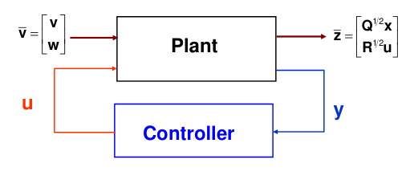
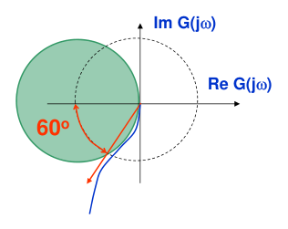
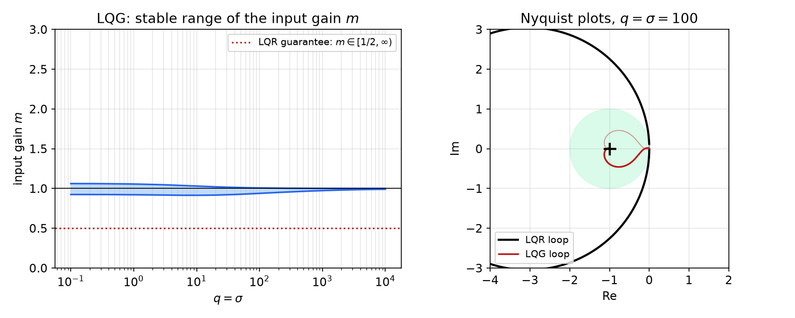
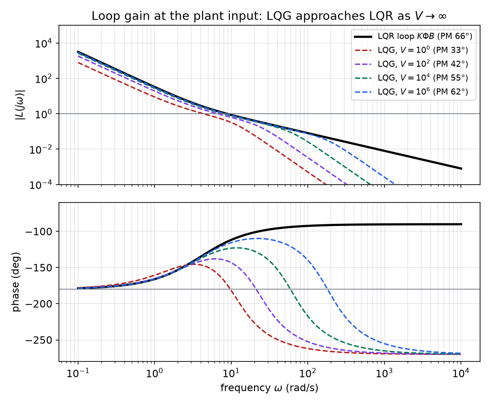
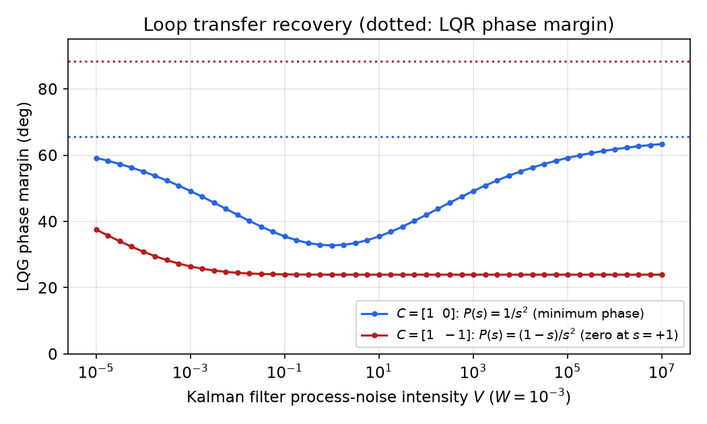
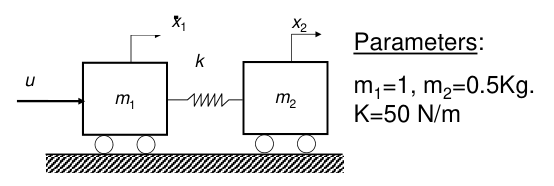
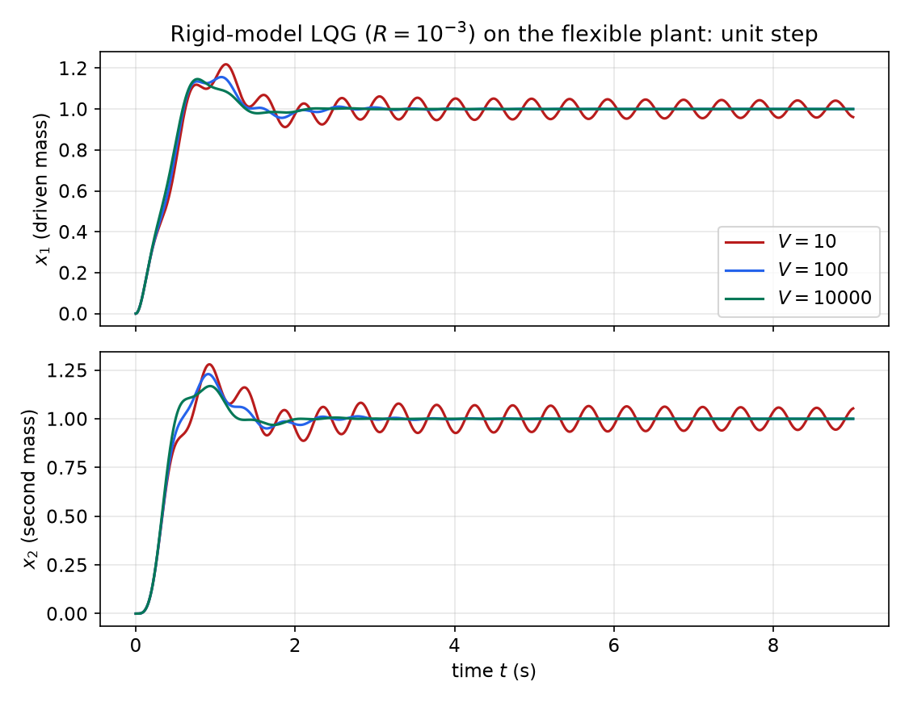
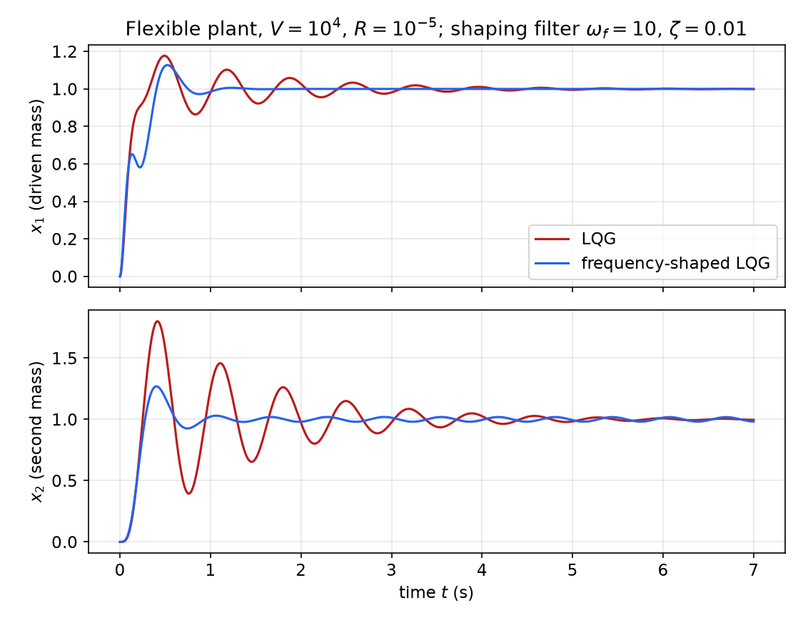

# LQG Control and Loop Transfer Recovery

The [Linear Quadratic Regulator](lqr.md) needs the full state; the [Kalman filter](kalman-filter.md) provides the best estimate of the state from noisy measurements. Connecting the two gives **linear quadratic Gaussian (LQG)** control, the optimal output-feedback controller for a linear plant driven by Gaussian white noise. The separation principle lets the two halves be designed independently, so LQG looks like a free lunch. It is not: LQR has remarkable guaranteed robustness margins, and LQG, despite being optimal, can have arbitrarily small ones. This chapter states the LQG problem and its solution, proves the LQR margins, shows how they can be lost (Doyle's example), and proves that for minimum-phase plants they can be recovered by **loop transfer recovery (LTR)**. It closes with robustness to unmodelled flexible dynamics and with **frequency-shaped LQG**, which adds frequency-dependent weights to the cost.

## The LQG Controller

### Structure

The plant has process noise \\(v\\) and measurement noise \\(w\\):
\\[
\dot x = Ax + Bu + Gv,\qquad y = Cx + w ,
\\]
with \\(v\\), \\(w\\) zero-mean, white, uncorrelated, of intensities \\(V \geq 0\\) and \\(W > 0\\). The LQG controller combines an LQ state-feedback law, applied to the estimate, with a Kalman filter:
\\[
u = -K\hat x + r,\qquad \dot{\hat x} = A\hat x + Bu + L(y - C\hat x),
\\]
where \\(r\\) is an external reference (zero for regulation). The two gains come from two independent Riccati equations:

| | Riccati equation | Gain |
|---|---|---|
| LQ controller | \\(P\_cA + A^TP\_c + Q - P\_cBR^{-1}B^TP\_c = 0\\) | \\(K = R^{-1}B^TP\_c\\) |
| Kalman filter | \\(AP\_o + P\_oA^T - P\_oC^TW^{-1}CP\_o + GVG^T = 0\\) | \\(L = P\_oC^TW^{-1}\\) |

This is the observer-based controller of [Combined Controller–Observer Design](separation.md), with both gains chosen optimally.

### LQG as an optimal output-feedback problem

Define the performance output \\(\bar z = \begin{bmatrix} Q^{1/2}x \\\\ R^{1/2}u \end{bmatrix}\\) and the exogenous input \\(\bar v = \begin{bmatrix} v \\\\ w \end{bmatrix}\\). Then \\(\lVert\bar z\rVert^2 = x^TQx + u^TRu\\).



*Figure: LQG as an \\(H\_2\\) problem. The generalized plant maps the noise \\(\bar v\\) and the control \\(u\\) to the performance output \\(\bar z\\) and the measurement \\(y\\). The controller sees only \\(y\\).*

**Theorem (LQG, separation theorem).** Assume \\((A, B)\\) stabilizable, \\((A, Q^{1/2})\\) detectable, \\((A, C)\\) detectable and \\((A, GV^{1/2})\\) stabilizable. Among **all** causal controllers from \\(y\\) to \\(u\\), linear or nonlinear, the controller above (with \\(r = 0\\)) minimizes
\\[
E\Big\\{\lim\_{T\to\infty}\frac1T\int\_0^T\big[x^TQx + u^TRu\big]dt\Big\\} ,
\\]
the steady-state expected energy of \\(\bar z\\).

That the optimal controller is linear, and that it is simply the deterministic LQR gain applied to the Kalman estimate (**certainty equivalence**), are non-trivial consequences of the linear-quadratic-Gaussian structure. The optimal cost splits into a control part and an estimation part, each determined by its own Riccati equation. In the language of robust control this is the \\(H\_2\\)-optimal controller for the generalized plant above.

### Closed-loop poles: separation

Use the state \\(x\\) and the estimation error \\(\tilde x = x - \hat x\\). Then \\(u = -K(x - \tilde x) + r\\) and \\(\dot{\tilde x} = (A - LC)\tilde x + Gv - Lw\\), so
\\[
\frac{d}{dt}\begin{bmatrix} x \\\\ \tilde x \end{bmatrix} = \begin{bmatrix} A - BK & BK \\\\ 0 & A - LC \end{bmatrix}\begin{bmatrix} x \\\\ \tilde x \end{bmatrix} + \begin{bmatrix} B \\\\ 0 \end{bmatrix}r + \begin{bmatrix} G & 0 \\\\ G & -L \end{bmatrix}\begin{bmatrix} v \\\\ w \end{bmatrix} .
\\]
The matrix is block triangular, so the closed-loop poles are \\(\lambda(A - BK) \cup \lambda(A - LC)\\): the LQR poles and the Kalman filter poles. Both are stable by construction. The reference does not excite the error dynamics, so the transfer function from \\(r\\) to \\(y\\) is the same as with full state feedback.

### The compensator as a transfer function

Eliminating \\(\hat x\\) gives two equivalent descriptions of the controller ([Combined Controller–Observer Design](separation.md)). With \\(\underline A = A - LC\\), the observer is \\(\dot{\hat x} = \underline A\hat x + Bu + Ly\\), and the control law \\(u = -K\hat x + r\\) becomes
\\[
u = F\_1(s)\big[r - F\_2(s)y\big],\qquad F\_1(s) = \big[I + K(sI - \underline A)^{-1}B\big]^{-1},\qquad F\_2(s) = K(sI - \underline A)^{-1}L .
\\]
For regulation (\\(r = 0\\)) this is the single output-feedback compensator \\(u = -C\_{\mathrm{LQG}}(s)y\\) with
\\[
C\_{\mathrm{LQG}}(s) = F\_1(s)F\_2(s) = K(sI - A + BK + LC)^{-1}L ,
\\]
where the last equality is the push-through identity. Breaking the loop at the plant input, the LQG **loop gain** is
\\[
L\_{\mathrm{LQG}}(s) = F\_1(s)F\_2(s)P(s),\qquad P(s) = C(sI - A)^{-1}B ,
\\]
to be compared with the LQR loop gain \\(L\_{\mathrm{LQR}}(s) = K(sI - A)^{-1}B\\).

## Robustness: Gain and Phase Margins

For a SISO loop with loop gain \\(L(s)\\) in negative feedback, the characteristic equation is \\(1 + L(s) = 0\\), and the Nyquist plot of \\(L(j\omega)\\) shows how close the loop is to instability, the point \\(-1\\) (see Frequency Response).

- **Gain margin:** the factor by which the loop gain can be multiplied before instability, \\(GM = 1/\lvert L(j\omega\_{180})\rvert\\) (or \\(-20\log\_{10}\lvert L(j\omega\_{180})\rvert\\) dB) at the frequency where \\(\angle L = -180^\circ\\).
- **Phase margin:** the extra phase lag that would bring the loop to instability, \\(PM = 180^\circ + \angle L(j\omega\_c)\\) at the crossover frequency where \\(\lvert L\rvert = 1\\).

A more complete single number is the distance from the Nyquist plot to \\(-1\\), \\(\min\_\omega\lvert 1 + L(j\omega)\rvert = 1/\lVert S\rVert\_\infty\\), the reciprocal of the peak sensitivity. A large distance implies both a good gain margin and a good phase margin.

## The Guaranteed Margins of LQR

**Theorem (LQR robustness).** Let \\(u = -Kx\\) be a steady-state LQR for a single-input plant, with any \\(Q \geq 0\\) and \\(r > 0\\) satisfying the existence conditions. Break the loop at the plant input, so the loop gain is \\(H(s) = K(sI - A)^{-1}B\\). Then:

1. \\(\lvert 1 + H(j\omega)\rvert \geq 1\\) for all \\(\omega\\): the Nyquist plot never enters the unit disk centred at \\(-1\\);
2. the closed loop stays stable if the loop gain is multiplied by any constant \\(m \in (1/2, \infty)\\): the gain margin is infinite upward and at least \\(1/2\\) (\\(-6\\) dB) downward;
3. the closed loop stays stable for any phase lag \\(e^{-j\phi}\\) inserted in the loop with \\(\lvert\phi\rvert < 60^\circ\\): the phase margin is at least \\(60^\circ\\).

*Proof.* (1) The return-difference identity of [The Linear Quadratic Regulator](lqr.md), with \\(Q = C^TC\\) (any \\(Q \geq 0\\) can be factored this way) and \\(P(s) = C(sI - A)^{-1}B\\), reads
\\[
\big(1 + H(-s)\big)\big(1 + H(s)\big) = 1 + \frac1rP^T(-s)P(s) .
\\]
At \\(s = j\omega\\), \\(H(-j\omega) = \overline{H(j\omega)}\\), so the left side is \\(\lvert 1 + H(j\omega)\rvert^2\\) and the right side is \\(1 + \lVert P(j\omega)\rVert^2/r \geq 1\\).

(2) The nominal loop (\\(m = 1\\)) is stable, so the Nyquist plot of \\(H\\) encircles \\(-1\\) the number of times required by the Nyquist criterion. With gain \\(m\\), the closed loop is stable if and only if the plot of \\(mH\\) encircles \\(-1\\) the same number of times, i.e. if the plot of \\(H\\) encircles \\(-1/m\\) as often as it encircles \\(-1\\). For \\(m \in (1/2, \infty)\\), the point \\(-1/m\\) lies in the open interval \\((-2, 0)\\), inside the open disk \\(\lvert z + 1\rvert < 1\\). The Nyquist plot never enters that disk, so it cannot separate \\(-1\\) from \\(-1/m\\); both points are encircled equally often.

(3) Similarly, the phase-perturbed loop \\(e^{-j\phi}H\\) is stable if \\(H\\) encircles \\(-e^{j\phi}\\) as often as \\(-1\\). The point \\(-e^{j\phi}\\) lies on the unit circle, at distance \\(\lvert 1 - e^{j\phi}\rvert = 2\lvert\sin(\phi/2)\rvert\\) from \\(-1\\), which is less than 1 exactly when \\(\lvert\phi\rvert < 60^\circ\\). For such \\(\phi\\), \\(-e^{j\phi}\\) lies inside the forbidden disk, and the argument of (2) applies. Equivalently: the unit circle and the circle \\(\lvert 1 + z\rvert = 1\\) intersect at \\(z = e^{\pm j120^\circ}\\), so any crossover point of \\(H\\) lies at least \\(60^\circ\\) away from the negative real axis. \\(\square\\)



*Figure: the Nyquist plot of an LQR loop gain (blue) stays outside the shaded unit disk centred at \\(-1\\). The disk meets the unit circle (dashed) \\(60^\circ\\) from the negative real axis, which bounds the phase margin. Every point of \\(-1/m\\) with \\(m > 1/2\\) lies inside the disk, giving the gain margin \\([1/2, \infty)\\).*

For multi-input LQR with **diagonal** \\(R\\), the same guarantees hold channel by channel and simultaneously: each input channel tolerates an independent gain in \\([1/2, \infty)\\) or an independent phase lag of up to \\(60^\circ\\). These margins are a property of the optimization itself, independent of the weights. Two caveats are important:

- The margins are at the **plant input**, where the loop is broken. They say nothing about perturbations at the output.
- They require the **full state** to be measured. A Kalman filter in the loop changes the loop gain, and with it the margins.

## LQG Has No Guaranteed Margins

Is the LQG loop gain \\(F\_1F\_2P\\) as robust as the LQR loop gain \\(K\Phi B\\)? In general, no. The LQG compensator is a dynamic system designed for a nominal model, and nothing in the separate optimizations protects the loop against model error.

**Example 1 (Doyle's example).** Consider
\\[
\dot x = \begin{bmatrix} 1 & 1 \\\\ 0 & 1 \end{bmatrix}x + \begin{bmatrix} 0 \\\\ 1 \end{bmatrix}u + \begin{bmatrix} 1 \\\\ 1 \end{bmatrix}v,\qquad y = [1\ \ 0]x + w ,
\\]
with LQR weights \\(Q = q\begin{bmatrix} 1 \\\\ 1 \end{bmatrix}[1\ \ 1]\\), \\(R = 1\\), and noise intensities \\(V = \sigma\\), \\(W = 1\\). The plant is unstable (a double pole at \\(+1\\)) but controllable and observable.

Both Riccati equations have closed-form solutions, and the gains have the same simple structure:
\\[
K = f\\,[1\ \ 1],\quad f = 2 + \sqrt{4 + q};\qquad L = d\begin{bmatrix} 1 \\\\ 1 \end{bmatrix},\quad d = 2 + \sqrt{4 + \sigma} .
\\]
(For instance \\(q = 1\\) gives \\(f = 4.236\\), and \\(q = 100\\) gives \\(f = 12.198\\), as a numerical ARE solver confirms.) Now insert a gain \\(m\\) at the plant input, \\(u\_{\mathrm{plant}} = mu\\), and ask for which \\(m\\) the LQG closed loop stays stable. The full-state LQR would tolerate any \\(m \in (1/2, \infty)\\). For the LQG loop, the stable range is found from the eigenvalues of
\\[
\begin{bmatrix} A & -mBK \\\\ LC & A - BK - LC \end{bmatrix} .
\\]

| \\(q = \sigma\\) | stable range of \\(m\\) |
|---|---|
| 1 | \\(0.921\\) to \\(1.056\\) |
| 10 | \\(0.915\\) to \\(1.030\\) |
| 100 | \\(0.939\\) to \\(1.007\\) |
| 1000 | \\(0.973\\) to \\(1.0005\\) |



*Figure: Doyle's example. Left: the range of input gains \\(m\\) for which the LQG loop is stable shrinks to the single point \\(m = 1\\) as \\(q = \sigma\\) grows, whereas LQR guarantees \\([1/2, \infty)\\). Right: for \\(q = \sigma = 100\\), the LQR loop gain (black) stays outside the unit disk at \\(-1\\) (shaded), while the LQG loop gain (red) passes within 0.007 of \\(-1\\).*

As the weights grow, an arbitrarily small gain error destabilizes the optimal LQG loop. Both halves are individually robust (the LQR loop at the plant input, the filter loop at the plant output), and yet their combination has essentially no margin. LQG designs therefore have to be checked for robustness, and if necessary modified.

**Example 2 (a two-mass positioning stage).** Two unit masses (\\(M\_1 = M\_2 = 1\\)) are joined by a stiff spring \\(K\_s = 2 \times 10^4\\) N/m; the force acts on the first mass, an encoder measures \\(x\_1\\), and an accelerometer measures \\(\ddot x\_2 = K\_s(x\_1 - x\_2)/M\_2\\). With state \\([x\_1, \dot x\_1, x\_2, \dot x\_2]^T\\),
\\[
A = \begin{bmatrix} 0 & 1 & 0 & 0 \\\\ -K\_s/M\_1 & 0 & K\_s/M\_1 & 0 \\\\ 0 & 0 & 0 & 1 \\\\ K\_s/M\_2 & 0 & -K\_s/M\_2 & 0 \end{bmatrix},\quad B = \begin{bmatrix} 0 \\\\ 1/M\_1 \\\\ 0 \\\\ 0 \end{bmatrix},\quad C = \begin{bmatrix} 1 & 0 & 0 & 0 \\\\ K\_s/M\_2 & 0 & -K\_s/M\_2 & 0 \end{bmatrix} .
\\]
The cost is \\(E\int(x\_2^2 + ru^2)\\,dt\\), the process noise enters with the input (\\(G = B\\), \\(V = \sigma^2\\)), and \\(W = \mathrm{diag}(0.01, 1)\\). The requirement is that the loop stay stable when the load mass varies over \\(0.5 \leq M\_2 \leq 2\\).

With \\(\sigma = r = 1\\) the LQR gain is \\(K = [0.5025,\ 1.0025,\ 0.4975,\ 0.9975]\\). The controller places the rigid-body poles at \\(-0.5 \pm 0.5j\\) but leaves the resonance at \\(\sqrt{2K\_s} = 200\\) rad/s almost undamped (\\(-0.0012 \pm 200j\\)); the filter poles are \\(-1.495 \pm 1.495j\\) and \\(-48.6 \pm 205.8j\\). The nominal closed loop is stable, but only just (slowest real part \\(-0.00125\\)). With the same compensator, the loop is **unstable** both for \\(M\_2 = 0.5\\) (largest real part \\(+0.056\\)) and for \\(M\_2 = 2\\) (\\(+0.022\\)). The compensator relies on an accurate model of a lightly damped resonance, and when the resonance moves, the loop fails. Recovering robustness requires retuning: more process noise on the input channel (the LTR idea below), a weight that damps the resonance, or a larger \\(r\\).

## Loop Transfer Recovery

### The idea

Since the margins of LQR are guaranteed at the plant input, one can try to choose the Kalman filter so that the LQG loop gain at the plant input approaches the LQR loop gain. The trick is to pretend that there is a large amount of process noise entering **at the plant input** (\\(G = B\\)), with intensity \\(V = q\\) growing. A filter that believes the input is heavily disturbed relies more and more on the measurements and, in the limit, effectively inverts the plant.

**Theorem (loop transfer recovery).** Let the plant be SISO (or square), with \\((A, B)\\) stabilizable and \\((A, C)\\) observable, and let \\(P(s) = C(sI - A)^{-1}B\\) be **minimum phase**. Design the Kalman filter with \\(G = B\\), \\(W = 1\\) and \\(V = q\\). Then as \\(q \to \infty\\), at every frequency,
\\[
\boxed{F\_1(s)F\_2(s)P(s) \to K(sI - A)^{-1}B} ,
\\]
so the LQG loop gain at the plant input converges to the LQR loop gain, and its margins approach the LQR margins.

*Proof.* Write \\(\Phi(s) = (sI - A)^{-1}\\).

*Step 1: the filter gain approaches a multiple of \\(B\\).* The filter version of the return-difference identity, with \\(G = B\\), is
\\[
\big(1 + H\_o(-s)\big)\big(1 + H\_o(s)\big) = 1 + qP(-s)P(s),\qquad H\_o(s) = C\Phi(s)L .
\\]
Here \\(1 + H\_o(s) = \det(sI - A + LC)/\det(sI - A)\\) has all its zeros (the filter poles) in the left half-plane, so it is the stable **spectral factor** of the right side. For large \\(q\\) the right side is dominated by \\(qP(-s)P(s)\\). If \\(P\\) is minimum phase, then \\(\sqrt q\\,P(s)\\) itself has all its zeros in the left half-plane, so it is (asymptotically) the stable spectral factor, and
\\[
H\_o(s) = C\Phi(s)L \approx \pm\sqrt q\\,C\Phi(s)B .
\\]
Because \\((A, C)\\) is observable, \\(C\Phi(s)x = 0\\) for all \\(s\\) forces \\(x = 0\\), so the gains themselves satisfy \\(L/\sqrt q \to \pm B\\). (The sign is the one that makes the filter stable; it is the sign of the high-frequency gain of \\(P\\).) If \\(P\\) has a right-half-plane zero \\(z\\), the stable spectral factor must reflect it to \\(-z\\), so \\(H\_o\\) cannot approach \\(\sqrt q\\,P\\), and the argument fails.

*Step 2: \\(F\_1 \to 1\\).* By the matrix inversion lemma,
\\[
(sI - A + LC)^{-1} = \Phi - \Phi L\big(1 + C\Phi L\big)^{-1}C\Phi .
\\]
Multiply on the right by \\(B\\) and substitute \\(L \approx \sqrt q\\,B\\) (taking the + sign), so \\(C\Phi L \approx \sqrt qP\\):
\\[
(sI - A + LC)^{-1}B \approx \Phi B - \Phi B\frac{\sqrt qP}{1 + \sqrt qP} = \frac{\Phi B}{1 + \sqrt q\\,P} \to 0 .
\\]
Hence \\(K(sI - \underline A)^{-1}B \to 0\\) and \\(F\_1 = \big[1 + K(sI - \underline A)^{-1}B\big]^{-1} \to 1\\).

*Step 3: \\(F\_2 \to K\Phi BP^{-1}\\).* By the push-through identity, \\((sI - A + LC)^{-1}L = \Phi L(1 + C\Phi L)^{-1}\\), so
\\[
(sI - A + LC)^{-1}L \approx \frac{\sqrt q\\,\Phi B}{1 + \sqrt q\\,P} = \frac{\Phi B}{q^{-1/2} + P} \to \Phi B\\,P^{-1} .
\\]
Therefore \\(F\_2 = K(sI - \underline A)^{-1}L \to K\Phi BP^{-1}\\).

*Step 4.* Combining, \\(F\_1F\_2P \to 1\cdot K\Phi BP^{-1}\cdot P = K\Phi B\\). \\(\square\\)

The proof shows what the observer is doing: the compensator \\(F\_1F\_2 \to K\Phi BP^{-1}\\) cancels the plant and replaces it by the LQR loop. That is why minimum phase is essential. A right-half-plane zero of \\(P\\) would have to be cancelled by an unstable compensator pole, which is impossible in a stable closed loop. The convergence is pointwise in frequency; at any finite \\(q\\) the LQG loop matches the LQR loop up to a frequency that grows with \\(q\\), and rolls off faster beyond it.

There is a price. Large \\(q\\) means a fast filter with large gains, so measurement noise is amplified, and high-frequency unmodelled dynamics see a larger loop gain. LTR recovers margins at the plant input in exchange for noise sensitivity. The dual procedure, **LTR at the plant output**, makes the controller fast (\\(R \to 0\\) with \\(Q = C^TC\\)) and recovers the Kalman filter's loop \\(C\Phi(s)L\\), which by duality has the same guaranteed margins at the output.

### Example: position control of a single mass

A unit mass with position output is controlled by LQG designed for \\(J = \int\_0^\infty(y^2 + 0.001u^2)\\,dt\\). The filter has \\(W = 10^{-3}\\) and input process noise \\(V\\) swept over many decades.

```matlab
% Model
A=[0 1;0 0]; B=[0;1]; G=[0;1]; C=[1 0];
plantm=ss(A,B,C,0);
% LQR
Q=C'*C; R=0.001; K=lqr(A,B,Q,R);
% Kalman filters for increasing input-noise intensity
kalsys=ss(A,[B G],C,[0 0]);
W=1e-3; V=logspace(-5,5,11);
for i=1:length(V)
  [Kest,L]=kalman(kalsys,V(i),W);
  Ao=A-L*C;
  ff=feedback(1,ss(Ao,B,K,0));    % F1 = [1 + K(sI-Ao)^-1 B]^-1
  fb=ss(Ao,L,K,0);                % F2 = K(sI-Ao)^-1 L
  olsys=minreal(ff*plantm*fb);    % loop gain at the plant input
  [Gm(i),Pm(i)]=margin(olsys);
end
```

(Writing the output matrix as `C=[1 -1]` instead would model \\(y = x\_1 - x\_2\\), whose transfer function \\((1 - s)/s^2\\) has a zero at \\(s = +1\\); that case is shown for contrast below.)

The LQR gain is \\(K = [31.62\ \ 7.95]\\), and the LQR loop has a phase margin of \\(65.5^\circ\\).



*Figure: loop gain at the plant input. The LQR loop \\(K\Phi B\\) (black) rolls off at \\(-20\\) dB/decade with phase returning to \\(-90^\circ\\). The LQG loop gains (dashed) agree with it up to a frequency that rises with \\(V\\), then roll off at \\(-60\\) dB/decade with phase heading to \\(-270^\circ\\). The phase margin grows from \\(33^\circ\\) at \\(V = 1\\) to \\(62^\circ\\) at \\(V = 10^6\\).*



*Figure: phase margin of the LQG loop as a function of the filter's input-noise intensity \\(V\\) (dotted: LQR phase margins). Blue, \\(C = [1\ 0]\\) (minimum phase): the curve is V-shaped, about \\(59^\circ\\) at both \\(V = 10^{-5}\\) and \\(V = 10^5\\) with a minimum of about \\(33^\circ\\) at \\(V = 1\\), and it approaches the LQR value \\(65.5^\circ\\) as \\(V \to \infty\\). Red, \\(C = [1\ -1]\\) (zero at \\(+1\\)): the margin stalls at \\(24^\circ\\), far from the LQR value of \\(88^\circ\\). There is no recovery for a non-minimum-phase plant.*

Two details of the blue curve are worth explaining. The minimum sits at \\(V = 1\\), where \\(V/W = Q/R = 1000\\): the filter problem is then the exact dual of the control problem, and the filter poles coincide with the controller poles. The curve is symmetric about that point, and for small \\(V\\) the margin also rises. There the filter is slow compared with the controller, and the loop approaches the Kalman filter loop \\(C\Phi L\\), which has the dual guarantee. This is LTR at the output happening by accident. In summary: LQR controllers have \\(60^\circ\\) of phase margin and infinite gain margin; LQG controllers have no guaranteed margins; for minimum-phase plants the LQR margins are recovered by increasing the input-noise intensity \\(V\\) in the filter design.

## Robustness to Unmodelled Dynamics

LQG designed on a simplified model must work on the real plant. Consider the same rigid-body design applied to a plant that is actually flexible.



*Figure: the actual plant. The force acts on \\(m\_1 = 1\\) kg, which is coupled through a spring \\(k = 50\\) N/m to \\(m\_2 = 0.5\\) kg. The controller is designed for a single rigid mass and measures \\(x\_1\\).*

The flexible plant has state \\([x\_1, x\_2, \dot x\_1, \dot x\_2]^T\\):
\\[
A\_a = \begin{bmatrix} 0 & 0 & 1 & 0 \\\\ 0 & 0 & 0 & 1 \\\\ -50 & 50 & 0 & 0 \\\\ 100 & -100 & 0 & 0 \end{bmatrix},\qquad B\_a = \begin{bmatrix} 0 \\\\ 0 \\\\ 1 \\\\ 0 \end{bmatrix},\qquad C\_a = [1\ \ 0\ \ 0\ \ 0] ,
\\]
with a vibration mode at \\(\sqrt{k(1/m\_1 + 1/m\_2)} = \sqrt{150} \approx 12.2\\) rad/s. The rigid-model LQG compensator (\\(R = 10^{-3}\\), \\(W = 10^{-3}\\), several \\(V\\)) is connected to it, and the reference is scaled so that the steady-state output is 1.

```matlab
Aa=[0 0 1 0;0 0 0 1;-50 50 0 0;100 -100 0 0];
Ba=[0;0;1;0]; Ca=[1 0 0 0;0 1 0 0];
planta=ss(Aa,Ba,Ca,0);
clsys=feedback(ff*planta,[1 0]*fb);   % feed back x1 only; ff, fb from the rigid design
g=-(K/Ao)*L;                          % DC gain of F2: unit steady-state output
step(g*clsys)
```



*Figure: rigid-model LQG (\\(R = 10^{-3}\\)) on the flexible plant. All three loops stay stable. With \\(V = 10\\) a lightly damped oscillation persists (slowest closed-loop pole at real part \\(-0.053\\)); \\(V = 10^2\\) and \\(V = 10^4\\) settle in about 2 s, with peaks of about 1.15 on \\(x\_1\\) and 1.17 to 1.23 on \\(x\_2\\).*

The LQG controller is robust in the sense that the unmodelled mode doesn't destabilize the loop. But the second mass is not in the model, so nothing in the cost asks for its vibration to be damped. Making the design more aggressive makes this worse: with the cheaper control \\(R = 10^{-5}\\) and \\(V = 10^4\\) (the red curves in the next figure), \\(x\_2\\) overshoots to 1.8 and rings for about 5 s, while \\(x\_1\\) looks acceptable. The cost function has to be changed to penalize the vibration. That is the purpose of frequency shaping.

## Frequency-Shaped LQG

### Idea

The quadratic cost treats all frequencies alike. To penalize the response near a particular frequency, here the flexible mode, add a term in a **filtered** output:
\\[
J = J\_{LQ} + \int\_0^\infty y\_f^TQ\_yy\_f\\,dt,\qquad Y\_f(s) = \frac{\omega\_f^2}{s^2 + 2\zeta\omega\_fs + \omega\_f^2}Y(s) .
\\]
A lightly damped filter (\\(\zeta\\) small) has a large resonant peak \\(1/(2\zeta)\\) at \\(\omega\_f\\), so \\(y\_f\\) is large exactly when \\(y\\) contains energy near \\(\omega\_f\\). By Parseval's theorem the added term is \\(\frac{1}{2\pi}\int\lvert W\_f(j\omega)\rvert^2Q\_y\lvert Y(j\omega)\rvert^2d\omega\\), a frequency-dependent weight on the output. The problem becomes a standard LQ problem by **augmenting the plant with the filter states**.

### Formulation

For the rigid model with measured position \\(y = x\_{p1}\\):

- Plant: \\(\dot x\_p = \begin{bmatrix} 0 & 1 \\\\ 0 & 0 \end{bmatrix}x\_p + \begin{bmatrix} 0 \\\\ 1 \end{bmatrix}u\\), \\(y = [1\ \ 0]x\_p\\).
- Filter: \\(\dot x\_f = \begin{bmatrix} 0 & 1 \\\\ -\omega\_f^2 & -2\zeta\omega\_f \end{bmatrix}x\_f + \begin{bmatrix} 0 \\\\ \omega\_f^2 \end{bmatrix}y\\), \\(y\_f = [1\ \ 0]x\_f\\).
- Augmented plant, with \\(x = [x\_f;\ x\_p]\\):
\\[
\dot x = \begin{bmatrix} 0 & 1 & 0 & 0 \\\\ -\omega\_f^2 & -2\zeta\omega\_f & \omega\_f^2 & 0 \\\\ 0 & 0 & 0 & 1 \\\\ 0 & 0 & 0 & 0 \end{bmatrix}x + \begin{bmatrix} 0 \\\\ 0 \\\\ 0 \\\\ 1 \end{bmatrix}u,\qquad
J = \int\_0^\infty\big[\alpha x\_1^2 + x\_3^2 + ru^2\big]dt,\quad \alpha, r > 0 .
\\]

Solving the LQR problem for the augmented system gives a gain \\(K = [K\_f\ \ K\_p]\\). The filter states are not estimated: the filter is driven by the measured \\(y\\) and implemented inside the controller. The plant states come from the same Kalman filter as before. The control is \\(u = -K\_p\hat x\_p - K\_fx\_f\\), which adds the filter dynamics \\(K\_f(sI - A\_f)^{-1}B\_f\\) to the feedback path:

```matlab
% Shaping filter and augmented plant
zeta=0.01; wf=10;
filt=tf(wf^2,[1 2*zeta*wf wf^2]); [Af,Bf]=ssdata(filt);
Aaug=[Af Bf*C; zeros(2) A]; Baug=[zeros(2,1); B];
alpha=1; R=1e-5;
Kaug=lqr(Aaug,Baug,diag([alpha 0 1 0]),R);   % (state order of ssdata(filt) assumed [y_f; y_f'])
Kf=Kaug(:,1:2); Kp=Kaug(:,3:4);
% Feedback-feedforward LQG with the shaping filter in the loop
Ao=A-L*C;
ff=feedback(1,ss(Ao,B,Kp,0));
fb=ss(Ao,L,Kp,0)+ss(Af,Bf,Kf,0);
clsysaf=minreal(feedback(ff*planta,[1 0]*fb));
```

(`tf2ss` and `ssdata` may return the filter in a different state basis; building \\(A\_f\\), \\(B\_f\\) directly from the formula above avoids the ambiguity.)

**Example 3 (frequency-shaped LQG for the flexible plant).** Design on the rigid model with \\(\omega\_f = 10\\) rad/s (near the flexible mode), \\(\zeta = 0.01\\), \\(\alpha = 1\\), \\(r = 10^{-5}\\), and the Kalman filter with \\(V = 10^4\\), \\(W = 10^{-3}\\). Compare with the plain LQG design with the same \\(r\\) and filter. The augmented gain is \\(K = [-112.7,\ 28.4,\ 560.0,\ 33.5]\\) (filter states first), against \\(K = [316.2,\ 25.1]\\) for plain LQG.



*Figure: unit step responses on the flexible plant. Plain LQG (red): \\(x\_1\\) overshoots to 1.18 with an oscillation that lasts about 4 s, and the second mass \\(x\_2\\) peaks at 1.8 and rings for about 5 s. Frequency-shaped LQG (blue): \\(x\_1\\) rises with a small dip near 0.2 s, peaks at 1.13 and settles in about 1 s; \\(x\_2\\) peaks at 1.27 and the large vibration is gone. A small residual ripple near 10 rad/s remains, from the lightly damped shaping filter in the controller.*

Frequency shaping improves the response of the second mass dramatically, while the response of the first mass changes only slightly (a slower initial rise). The method needs only approximate knowledge of the natural frequency: the filter must put its weight near the mode, but it need not be exact. The same idea (augmenting the plant with weighting filters on outputs, inputs or errors) is the basis of loop shaping in \\(H\_2\\) and \\(H\_\infty\\) design.

## Summary

- **LQG** = LQR gain on the Kalman estimate: \\(u = -K\hat x\\), \\(\dot{\hat x} = A\hat x + Bu + L(y - C\hat x)\\); it minimizes \\(E\int(x^TQx + u^TRu)\\) over all output-feedback controllers. Closed-loop poles: \\(\lambda(A - BK) \cup \lambda(A - LC)\\).
- **Compensator:** \\(C\_{\mathrm{LQG}}(s) = K(sI - A + BK + LC)^{-1}L = F\_1F\_2\\), \\(F\_1 = [I + K(sI - A + LC)^{-1}B]^{-1}\\), \\(F\_2 = K(sI - A + LC)^{-1}L\\).
- **LQR margins (SISO, or diagonal \\(R\\)):** \\(\lvert 1 + K\Phi(j\omega)B\rvert \geq 1\\) implies gain margin \\([1/2, \infty)\\) and phase margin \\(\geq 60^\circ\\) at the plant input.
- **LQG has no guaranteed margins:** in Doyle's example the stable gain range shrinks to \\(\\{1\\}\\) as \\(q = \sigma \to \infty\\).
- **LTR:** with \\(G = B\\), \\(V = q \to \infty\\) and a minimum-phase plant, \\(L/\sqrt q \to \pm B\\), \\(F\_1 \to 1\\), \\(F\_2 \to K\Phi BP^{-1}\\), and \\(F\_1F\_2P \to K\Phi B\\). The price is a fast, noise-sensitive filter; there is no recovery with right-half-plane zeros.
- **Frequency shaping:** augment the plant with a weighting filter (e.g. \\(\omega\_f^2/(s^2 + 2\zeta\omega\_fs + \omega\_f^2)\\) at a flexible mode) and solve an ordinary LQR on the augmented state; the filter becomes part of the controller.

## See Also

- [The Linear Quadratic Regulator](lqr.md): the return-difference identity behind the margins
- [Optimal Estimation and the Kalman Filter](kalman-filter.md): the filter Riccati equation and its symmetric root locus
- [Combined Controller–Observer Design](separation.md): the separation principle and the \\(F\_1\\), \\(F\_2\\) compensator structure
- Frequency Response: gain margin, phase margin and the Nyquist criterion
- Optimal Control: overview of LQR, LQE and LQG
- [Model Predictive Control](../ae8803-optimal-learning-control/mpc.md): optimal control with constraints, usually combined with a state estimator
