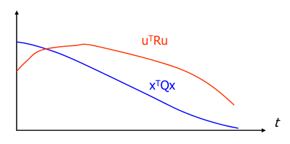
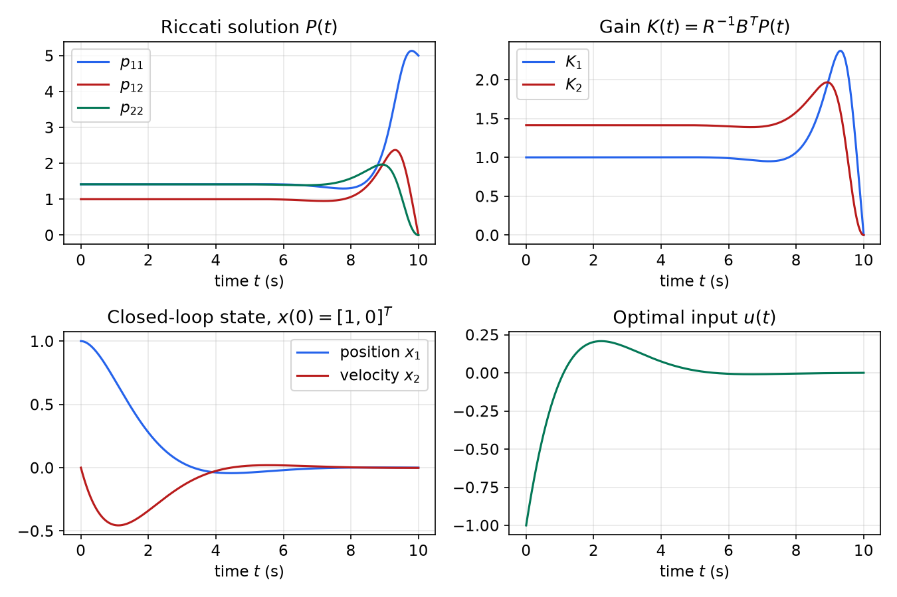
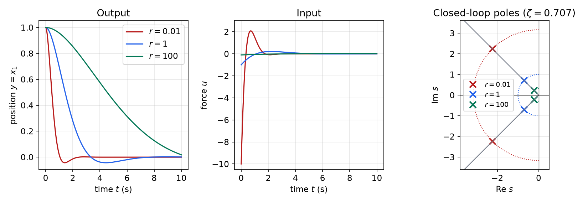
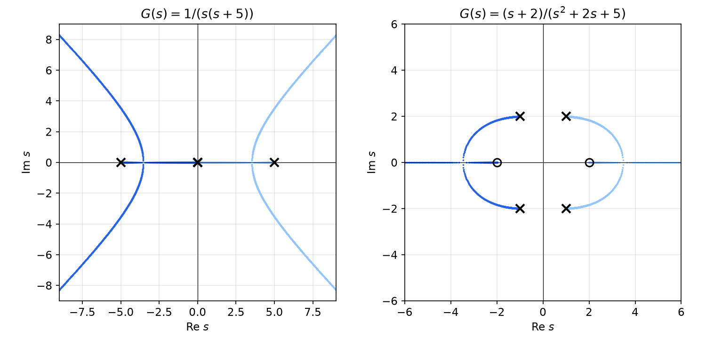
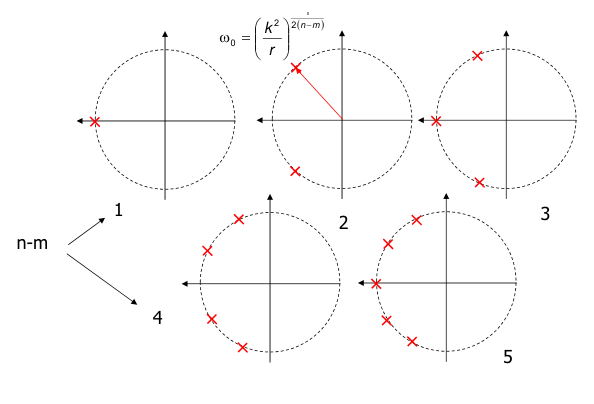
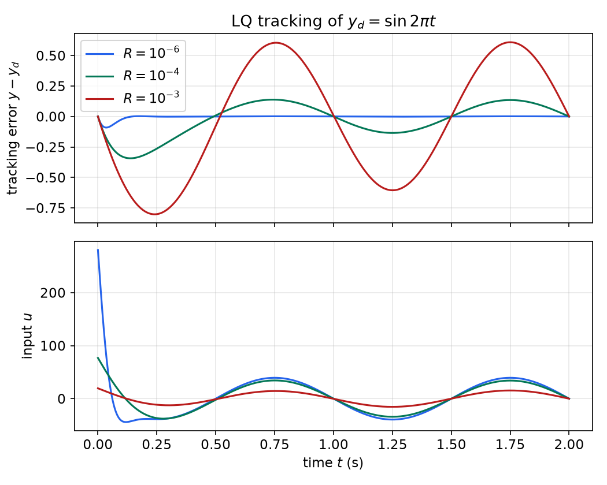

# The Linear Quadratic Regulator

Pole placement can put the closed-loop eigenvalues of a controllable system anywhere, but it doesn't say where they *should* go. For a multi-input system the gain that achieves a given set of poles isn't even unique. The linear quadratic regulator (LQR) replaces the choice of poles with the choice of a cost: a quadratic penalty on the state error and on the control effort, integrated over the response. Minimizing that cost gives a linear state-feedback law, \\(u = -Kx\\), with the gain computed from a Riccati equation. This chapter derives the finite-horizon solution by completing the square, passes to the infinite horizon and the algebraic Riccati equation (ARE), shows how to solve the ARE through the Hamiltonian matrix, and studies the closed loop in the frequency domain through the return-difference identity and the symmetric root locus. It ends with LQ tracking and practical advice on choosing the weights. The variational derivation (costates and the two-point boundary-value problem) is in [Continuous-Time LQR and Its Extensions](../ae8803-optimal-learning-control/continuous-lqr.md) and [Calculus of Variations](../ae8803-optimal-learning-control/calculus-of-variations.md).

## Why Optimal Control?

[State Feedback and Pole Placement](state-feedback.md) solves the regulation problem whenever \\((A,B)\\) is controllable, but it leaves three questions open:

- **Non-uniqueness.** With \\(m > 1\\) inputs, \\(K\\) has \\(mn\\) entries and only \\(n\\) eigenvalues to place. Infinitely many gains give the same poles, and they differ greatly in robustness and in control effort.
- **Where to put the poles.** Faster poles mean faster responses but larger inputs, more noise amplification and more sensitivity to unmodelled dynamics. The best compromise is hard to see from the pole locations alone.
- **Time-domain intent.** Specifications are usually about the response itself ("keep the position error small without saturating the actuator"), not about eigenvalues.

LQ design addresses all three. It minimizes a quadratic **performance index** built from the time response, and the solution is a state-feedback law that is unique, always stabilizing under mild conditions, and has guaranteed robustness margins (proved in [LQG Control and Loop Transfer Recovery](lqg.md)).

## Quadratic Forms and Positive Definiteness

A quadratic function of \\(n\\) variables is
\\[
q(x) = \sum\_{i=1}^{n}\sum\_{j=1}^{n} m\_{ij}x\_ix\_j = x^TMx .
\\]
Only the symmetric part of \\(M\\) matters, because \\(x^TMx = x^T\tfrac12(M + M^T)x\\), so \\(M\\) can always be taken symmetric. For example
\\[
q(x) = x\_1^2 + 2x\_2^2 - 3x\_1x\_2 = x^T\begin{bmatrix} 1 & -1.5 \\\\ -1.5 & 2 \end{bmatrix}x ,
\\]
with the cross-term coefficient split equally between the two off-diagonal entries.

**Definition (positive definite).** A symmetric matrix \\(P\\) is **positive definite**, \\(P > 0\\), if \\(x^TPx > 0\\) for every \\(x \neq 0\\). It is **positive semidefinite**, \\(P \geq 0\\), if \\(x^TPx \geq 0\\) for all \\(x\\).

**Theorem (tests for definiteness).** For a symmetric \\(P\\) the following are equivalent: (i) \\(P > 0\\); (ii) all eigenvalues of \\(P\\) are positive; (iii) all leading principal minors are positive (**Sylvester's test**):
\\[
p\_{11} > 0,\qquad \begin{vmatrix} p\_{11} & p\_{12} \\\\ p\_{21} & p\_{22} \end{vmatrix} > 0,\qquad \dots,\qquad \det P > 0 .
\\]

The level sets \\(x^TPx = c\\) of a positive definite form are nested ellipsoids centred at the origin, with axes along the eigenvectors of \\(P\\) and semi-axis lengths \\(\sqrt{c/\lambda\_i}\\). For \\(P = \begin{bmatrix} 2 & -1 \\\\ -1 & 1 \end{bmatrix}\\) the eigenvalues are \\((3 \pm \sqrt5)/2 \approx 2.62,\ 0.38\\). The ellipses are long in the direction of the eigenvector for 0.38, which is tilted about 30° above the \\(x\_1\\)-axis. More on quadratic forms is in [Linear Algebra for Systems Theory](linear-algebra.md).

**Example 1 (minimizing a quadratic).** Minimize \\(f(x) = x\_1^2 + 2x\_2^2 - 2x\_1x\_2 - 2x\_1\\).

Write \\(f = x^TQx + b^Tx\\) with \\(Q = \begin{bmatrix} 1 & -1 \\\\ -1 & 2 \end{bmatrix}\\) and \\(b = [-2\ \ 0]^T\\). The gradient (as a row vector) is \\(\partial f/\partial x = 2x^TQ + b^T\\). Setting it to zero gives \\(2Qx + b = 0\\), so
\\[
x^\* = -\tfrac12 Q^{-1}b = -\tfrac12\begin{bmatrix} 2 & 1 \\\\ 1 & 1 \end{bmatrix}\begin{bmatrix} -2 \\\\ 0 \end{bmatrix} = \begin{bmatrix} 2 \\\\ 1 \end{bmatrix}.
\\]
The Hessian is \\(2Q = \begin{bmatrix} 2 & -2 \\\\ -2 & 4 \end{bmatrix}\\), whose leading minors \\(2\\) and \\(4\\) are positive, so \\(x^\*\\) is the global minimizer, with \\(f(x^\*) = 4 + 2 - 4 - 4 = -2\\). LQR is this calculation carried out over a space of functions: the cost will be a positive quadratic in the input history, and completing the square will expose its minimizer.

## The Finite-Horizon LQ Problem

### Problem statement

Given the linear system \\(\dot x = A(t)x + B(t)u\\) with initial state \\(x(t\_0)\\), find the input \\(u(t)\\), \\(t \in [t\_0, t\_f]\\), that minimizes
\\[
J = x^T(t\_f)P\_fx(t\_f) + \int\_{t\_0}^{t\_f}\big[x^T(t)Q(t)x(t) + u^T(t)R(t)u(t)\big]\\,dt ,
\\]
where \\(P\_f \geq 0\\), \\(Q(t) \geq 0\\) and \\(R(t) > 0\\) are symmetric. In the scalar case, \\(J = p\_fx^2(t\_f) + \int\_{t\_0}^{t\_f}(qx^2 + ru^2)\\,dt\\) with \\(p\_f, q \geq 0\\) and \\(r > 0\\).

The three terms have clear roles. \\(x^TQx\\) penalizes deviation of the state from zero during the transient, \\(x^T(t\_f)P\_fx(t\_f)\\) penalizes what is left at the end, and \\(u^TRu\\) penalizes control effort. \\(R\\) must be positive definite: if some input direction were free, the optimizer would use infinite control in it. The cost is a compromise: driving the state to zero faster costs more input energy.



*Figure: the LQ performance index trades the state penalty \\(x^TQx\\) (blue), which the controller tries to drive down quickly, against the control penalty \\(u^TRu\\) (red), which grows when it does. The weights \\(Q\\) and \\(R\\) set the exchange rate.*

Many texts write the cost with a factor \\(\tfrac12\\) in front. The factor changes \\(J\\) but not the minimizer, and the optimal gain is the same; only the value function differs by the factor.

### Solution by completing the square

**Theorem (LQ cost identity).** Let \\(P(t)\\) be a symmetric solution on \\([t\_0, t\_f]\\) of the **Riccati differential equation**
\\[
\dot P + PA + A^TP + Q - PBR^{-1}B^TP = 0,\qquad P(t\_f) = P\_f .
\\]
Then for every input \\(u\\) and the resulting trajectory,
\\[
J = x^T(t\_0)P(t\_0)x(t\_0) + \int\_{t\_0}^{t\_f}(B^TPx + Ru)^TR^{-1}(B^TPx + Ru)\\,dt .
\\]

*Proof.* By the fundamental theorem of calculus,
\\[
\int\_{t\_0}^{t\_f}\frac{d}{dt}\big(x^TPx\big)\\,dt = x^T(t\_f)P(t\_f)x(t\_f) - x^T(t\_0)P(t\_0)x(t\_0) .
\\]
With \\(P(t\_f) = P\_f\\), the terminal penalty can be traded for the initial value plus an integral:
\\[
J = x^T(t\_0)P(t\_0)x(t\_0) + \int\_{t\_0}^{t\_f}\underbrace{\Big[\frac{d}{dt}(x^TPx) + x^TQx + u^TRu\Big]}\_{F(t)}dt .
\\]
Now expand the derivative along the trajectory \\(\dot x = Ax + Bu\\):
\\[
\frac{d}{dt}(x^TPx) = \dot x^TPx + x^T\dot Px + x^TP\dot x = x^T(\dot P + A^TP + PA)x + 2u^TB^TPx .
\\]
So
\\[
F = x^T(\dot P + A^TP + PA + Q)x + 2u^TB^TPx + u^TRu .
\\]
The last two terms are the start of a square in \\(u\\). Since
\\[
(B^TPx + Ru)^TR^{-1}(B^TPx + Ru) = x^TPBR^{-1}B^TPx + 2u^TB^TPx + u^TRu ,
\\]
we can write
\\[
F = x^T\big(\dot P + PA + A^TP + Q - PBR^{-1}B^TP\big)x + (B^TPx + Ru)^TR^{-1}(B^TPx + Ru) .
\\]
The first term vanishes because \\(P\\) solves the Riccati equation, which proves the identity. \\(\square\\)

**Theorem (finite-horizon LQR).** Under the hypotheses above, the unique optimal control is the linear time-varying state feedback
\\[
\boxed{u(t) = -K(t)x(t),\qquad K(t) = R^{-1}(t)B^T(t)P(t)}
\\]
and the minimum cost is \\(J^\*(x(t\_0), t\_0) = x^T(t\_0)P(t\_0)x(t\_0)\\).

*Proof.* The first term of the cost identity does not depend on \\(u\\). The integrand of the second is a positive definite quadratic form in \\(B^TPx + Ru\\) (since \\(R^{-1} > 0\\)), so it is nonnegative, and it is zero exactly when \\(Ru = -B^TPx\\). That choice is admissible (it yields a well-defined linear closed loop), so it is optimal, and any other input gives a strictly larger cost. \\(\square\\)

Three facts complete the picture.

- **The Riccati solution exists on the whole interval.** The Riccati equation is nonlinear and could in principle escape to infinity in finite time. It doesn't here: \\(x^TP(t)x\\) is the optimal cost-to-go from state \\(x\\) at time \\(t\\), which is at least 0 and at most the cost of applying \\(u = 0\\). So \\(P(t)\\) stays bounded, \\(0 \leq P(t)\\), and it is symmetric because the equation is invariant under transposition.
- **\\(P\\) is integrated backward.** The boundary condition sits at the final time. The gain is computed off line, before the motion starts, and stored as a function of time.
- **The gain is time-varying, but usually only near the end.** For \\(t\_f - t\\) large compared with the closed-loop time constants, \\(P(t)\\) settles to a constant, the solution of the algebraic Riccati equation below.

### The same result from dynamic programming

Bellman's principle of optimality says that every tail of an optimal trajectory is itself optimal. Applying it over a short interval \\([t, t + \Delta t]\\) and letting \\(\Delta t \to 0\\) gives the Hamilton–Jacobi–Bellman equation for the optimal cost-to-go \\(V(x, t)\\):
\\[
-\frac{\partial V}{\partial t} = \min\_u\Big\\{x^TQx + u^TRu + \frac{\partial V}{\partial x}(Ax + Bu)\Big\\},\qquad V(x, t\_f) = x^TP\_fx .
\\]
Try \\(V = x^TP(t)x\\), so \\(\partial V/\partial x = 2x^TP\\) and \\(\partial V/\partial t = x^T\dot Px\\). The bracket is a convex quadratic in \\(u\\), minimized where \\(2Ru + 2B^TPx = 0\\), that is \\(u = -R^{-1}B^TPx\\). Substituting back,
\\[
-x^T\dot Px = x^T\big(Q + PBR^{-1}B^TP + 2PA - 2PBR^{-1}B^TP\big)x = x^T\big(Q + PA + A^TP - PBR^{-1}B^TP\big)x ,
\\]
where \\(2x^TPAx = x^T(PA + A^TP)x\\) was symmetrized. Since this holds for all \\(x\\), it is the Riccati differential equation again. The general theory is in [Dynamic Programming](../ae8803-optimal-learning-control/dynamic-programming.md). The costate (Pontryagin) derivation, which leads to the same equation through the "sweep" \\(\lambda = Px\\), is in [Continuous-Time LQR and Its Extensions](../ae8803-optimal-learning-control/continuous-lqr.md).

### Computing \\(P(t)\\): backward integration

Standard ODE solvers integrate forward from an initial condition. Define the time-reversed matrix \\(P\_b(\tau) = P(t\_f - \tau)\\). Then \\(P\_b(0) = P\_f\\), \\(P\_b(t\_f - t\_0) = P(t\_0)\\) and \\(dP\_b/d\tau = -\dot P\\), so
\\[
\frac{dP\_b}{d\tau} = P\_bA + A^TP\_b + Q - P\_bBR^{-1}B^TP\_b,\qquad P\_b(0) = P\_f ,
\\]
which can be integrated forward in \\(\tau\\) and then flipped in time. (For time-varying \\(A, B, Q, R\\), evaluate them at \\(t\_f - \tau\\).) Getting the direction wrong is a common error: integrating the Riccati equation forward from \\(P(t\_0) = P\_f\\) produces a gain that has no relation to the problem.

**Example 2 (finite-horizon control of a unit mass).** A unit mass \\(M = 1\\) is pushed by a force \\(u\\); the output is its position \\(y\\). Find the control minimizing
\\[
J = 5y^2(10) + \int\_0^{10}\big[y^2(t) + u^2(t)\big]dt,\qquad x(0) = [1\ \ 0]^T .
\\]

With \\(x\_1 = y\\) (position) and \\(x\_2 = \dot y\\) (velocity), the state equation and weights are
\\[
A = \begin{bmatrix} 0 & 1 \\\\ 0 & 0 \end{bmatrix},\quad B = \begin{bmatrix} 0 \\\\ 1 \end{bmatrix},\quad P\_f = \begin{bmatrix} 5 & 0 \\\\ 0 & 0 \end{bmatrix},\quad Q = \begin{bmatrix} 1 & 0 \\\\ 0 & 0 \end{bmatrix},\quad R = 1 .
\\]
The Riccati equation is integrated backward and the system simulated with the stored gain:

```matlab
% System matrices
A=[0 1;0 0]; B=[0;1]; tf=10;
% Performance index matrices
Pf=[5 0;0 0]; Q=[1 0;0 0]; R=1;
% Integrate Pb(tau)=P(tf-tau) forward with ode45
T=(0:0.1:10)'; XP0=Pf(:);
[T,XPb]=ode45(@(t,x) ricfun(t,x,A,B,Q,R),T,XP0);
XP=flipud(XPb);                 % back to forward time
for k=1:length(T)
  Pk=reshape(XP(k,:)',2,2);
  K(k,:)=R\B'*Pk;               % K(t) = R^-1 B' P(t)
end
% Simulate the closed loop with the time-varying gain
[T,X]=ode45(@(t,x) sysfun(t,x,A,B,K,T),T,[1;0]);

function dx=ricfun(t,x,A,B,Q,R)
Pb=reshape(x,2,2);
dPb=Pb*A+A'*Pb+Q-Pb*B*(R\B')*Pb;
dx=dPb(:);
end
function dx=sysfun(t,x,A,B,K,T)
k=find(t>=T,1,'last');          % gain at the current sample
dx=(A-B*K(k,:))*x;
end
```

The same computation in Python:

```python
import numpy as np
from scipy.integrate import solve_ivp
A = np.array([[0, 1], [0, 0.]]); B = np.array([[0], [1.]])
Q = np.diag([1, 0.]); R = 1.0; Pf = np.diag([5, 0.]); tf = 10
ric = lambda tau, p: (lambda P: (P@A + A.T@P + Q - P@B@B.T@P/R).ravel())(p.reshape(2, 2))
sol = solve_ivp(ric, [0, tf], Pf.ravel(), dense_output=True, rtol=1e-10)
P = lambda t: sol.sol(tf - t).reshape(2, 2)          # P(t) = Pb(tf - t)
K = lambda t: B.T @ P(t) / R
```



*Figure: finite-horizon LQR of the unit mass. Top: the entries of \\(P(t)\\) and of \\(K(t)\\) are constant for most of the horizon and change only in the last 3 s. At \\(t\_f = 10\\), \\(P = P\_f\\), so \\(K(t\_f) = B^TP\_f = 0\\): the end-point penalty contains no velocity term, so it is not worth pushing at the last instant. Bottom: the closed-loop response from \\(x(0) = [1, 0]^T\\) and the optimal force.*

The numbers read off the solution are worth checking by hand.

- For \\(t \lesssim 6\\) the solution is constant at \\(P = \begin{bmatrix} \sqrt2 & 1 \\\\ 1 & \sqrt2 \end{bmatrix}\\), so \\(K = [1\ \ \sqrt2] \approx [1\ \ 1.414]\\). This is the infinite-horizon solution derived in Example 6 below with \\(r = 1\\).
- Near the end the gains first rise (\\(K\_1\\) peaks near 2.4 at \\(t \approx 9.3\\), \\(K\_2\\) near 2.0 at \\(t \approx 9\\)), as \\(p\_{11}\\) grows towards the terminal weight 5, and then fall to zero at \\(t = 10\\).
- The position decays smoothly to zero in about 4 s, undershooting slightly to about \\(-0.04\\). The force starts at \\(u(0) = -K(0)x(0) = -1\\), crosses zero near 1 s, peaks at about \\(+0.21\\) near 2 s to brake the mass, and decays to zero. Because the state is essentially zero long before \\(t = 9\\), the end transient of the gain has almost no effect on the motion.

The cost can also be written with a factor \\(\tfrac12\\), \\(J = \tfrac12x^T(10)Sx(10) + \tfrac12\int(x^TQx + u^TRu)dt\\). Matching it to the problem above requires \\(S = \mathrm{diag}(10, 0)\\), \\(Q = \mathrm{diag}(2, 0)\\), \\(R = 2\\). Then \\(P\\) doubles (its steady value has \\(p\_{11} = p\_{22} = 2\sqrt2 \approx 2.83\\), \\(p\_{12} = 2\\)), but \\(K = R^{-1}B^TP\\) is unchanged. Scaling \\(Q\\), \\(R\\) and \\(P\_f\\) by a common factor never changes the optimal control.

**Example 3 (penalizing only the final output).** For the plant \\(Y(s)/U(s) = (s + 2)/(s^2 + 2s + 5)\\), find the input that minimizes
\\[
J = y^2(5) + \int\_0^5 ru^2\\,dt
\\]
for \\(r = 10^{-6},\ 0.01,\ 10\\), starting from \\(x(0) = [1\ \ 0]^T\\).

An observer-canonical realization is \\(A = \begin{bmatrix} -2 & 1 \\\\ -5 & 0 \end{bmatrix}\\), \\(B = \begin{bmatrix} 1 \\\\ 2 \end{bmatrix}\\), \\(C = [1\ \ 0]\\). There is no running state cost, so \\(Q = 0\\), \\(R = r\\) and \\(P\_f = C^TC\\). Since the horizon is finite and only the end point matters, there is no steady state, and the ARE is of no use. The Riccati equation must be integrated backward from \\(P(5) = C^TC\\).

Because \\(Q = 0\\) this problem also has a closed-form solution, which is a good check on the numerics. Write the output at the final time as the free response plus the convolution of the input with the impulse response \\(h(t) = Ce^{At}B = e^{-t}\big(\cos2t + \tfrac12\sin2t\big)\\):
\\[
y(5) = y\_{\mathrm{free}}(5) + \int\_0^5 h(5 - t)u(t)\\,dt .
\\]
Minimizing \\(y^2(5) + r\int u^2\\,dt\\) over \\(u\\) is a minimum-norm problem; setting the variation to zero gives \\(ru(t) = -h(5 - t)y(5)\\). Substituting this back into the expression for \\(y(5)\\),
\\[
y(5) = \frac{y\_{\mathrm{free}}(5)}{1 + g/r},\qquad g = \int\_0^5 h^2(\sigma)\\,d\sigma = 0.450,\qquad u^\*(t) = -\frac1r h(5 - t)\\,y(5) .
\\]
With \\(y\_{\mathrm{free}}(5) = -0.00382\\):

| \\(r\\) | \\(y(5)\\) | \\(u(5)\\) (largest input) |
|---|---|---|
| \\(10^{-6}\\) | \\(-8.5 \times 10^{-9}\\) | \\(8.49 \times 10^{-3}\\) |
| \\(0.01\\) | \\(-8.3 \times 10^{-5}\\) | \\(8.31 \times 10^{-3}\\) |
| \\(10\\) | \\(-3.66 \times 10^{-3}\\) | \\(3.66 \times 10^{-4}\\) |

The backward Riccati integration reproduces these numbers (at \\(t = 5\\), \\(K = B^TC^TC/r = [1\ \ 0]/r\\), so \\(u(5) = -y(5)/r\\), matching the closed form since \\(h(0) = CB = 1\\)). Small \\(r\\) effectively enforces \\(y(5) = 0\\), while large \\(r\\) leaves the free response almost untouched. In every case the control is "lazy": it is the time-reversed impulse response, so it acts mostly near the end of the interval, because only \\(y(5)\\) is penalized and an input applied early would be wasted on transients that decay anyway.

## The Infinite-Horizon Problem

### The algebraic Riccati equation

For regulation we usually care about the whole future and want a constant gain. Let \\(A, B, Q, R\\) be constant and minimize
\\[
J = \int\_0^\infty\big[x^TQx + u^TRu\big]dt,\qquad Q \geq 0,\ R > 0 .
\\]
The solution is the limit of the finite-horizon solution as \\(t\_f \to \infty\\) with \\(P\_f = 0\\). If that limit exists it is a constant matrix with \\(\dot P = 0\\), which gives:

\\[
\boxed{PA + A^TP + Q - PBR^{-1}B^TP = 0,\qquad u = -Kx,\quad K = R^{-1}B^TP,\qquad J^\* = x^T(0)Px(0)}
\\]

The first equation is the **algebraic Riccati equation (ARE)**. It is a quadratic matrix equation and usually has many symmetric solutions; the one we want is singled out by the following theorem.

**Theorem (existence and stability of the steady-state LQR).** Suppose \\((A, B)\\) is stabilizable and \\((A, Q^{1/2})\\) is detectable, where \\(Q = Q^{T/2}Q^{1/2}\\) is any factorization (for \\(Q = C^TC\\), take \\(Q^{1/2} = C\\)). Then:

1. the ARE has a unique positive semidefinite solution \\(P\\);
2. this \\(P\\) is **stabilizing**: \\(A - BK\\) is Hurwitz;
3. \\(u = -Kx\\) minimizes \\(J\\) among all inputs, with \\(J^\* = x^T(0)Px(0)\\), and the finite-horizon solution with \\(P\_f = 0\\) converges to \\(P\\) as \\(t\_f \to \infty\\);
4. if \\((A, Q^{1/2})\\) is observable, then \\(P > 0\\).

The two hypotheses have simple meanings. **Stabilizability** makes the optimal cost finite: if an unstable mode could not be influenced by \\(u\\), every input would leave the state growing and \\(J = \infty\\). **Detectability** makes every unstable mode visible in the cost. If an unstable mode produced no \\(x^TQx\\), the cheapest policy would be to leave it alone (zero input, zero cost from that mode), and the "optimal" closed loop would be unstable.

*Why the closed loop is stable (proof sketch with observability).* Write \\(A\_c = A - BK\\). Since \\(PBR^{-1}B^TP = K^TRK\\) and \\(PBK = K^TRK\\), the ARE can be rearranged as a Lyapunov equation:
\\[
A\_c^TP + PA\_c = -\big(Q + K^TRK\big) .
\\]
Take \\(V(x) = x^TPx\\) as a Lyapunov function for \\(\dot x = A\_cx\\). Then \\(\dot V = -x^TQx - x^TK^TRKx \leq 0\\). If \\(\dot V \equiv 0\\) along a solution, then \\(Kx \equiv 0\\) and \\(Q^{1/2}x \equiv 0\\). The first means the solution also satisfies \\(\dot x = Ax\\); the second, with observability of \\((A, Q^{1/2})\\), forces \\(x \equiv 0\\). By the invariance argument of [Stability of Linear Systems](stability.md), \\(A\_c\\) is Hurwitz. (With only detectability the same argument applies to the unobservable part, which is stable by assumption.)

**Example 4 (why detectability matters).** Take \\(\dot x = x + u\\) with \\(J = \int\_0^\infty ru^2\\,dt\\), so \\(Q = 0\\) and \\((A, Q^{1/2}) = (1, 0)\\) is not detectable. The ARE \\(2p - p^2/r = 0\\) has two nonnegative solutions, \\(p = 0\\) and \\(p = 2r\\). The first gives \\(u = 0\\): zero cost, but the state grows like \\(e^t\\). The second gives \\(K = 2\\) and the stable closed loop \\(\dot x = -x\\), the mirror image of the open-loop pole. Uniqueness fails, and the minimum-cost solution is the destabilizing one. Adding any \\(q > 0\\) restores detectability and makes the stabilizing solution the unique one.

**Example 5 (scalar LQR in closed form).** For \\(\dot x = ax + u\\) and \\(J = \int\_0^\infty(x^2 + ru^2)\\,dt\\), the ARE is \\(2ap + 1 - p^2/r = 0\\), whose positive root is \\(p = r\big(a + \sqrt{a^2 + 1/r}\big)\\). Hence
\\[
k = \frac pr = a + \sqrt{a^2 + \tfrac1r},\qquad a - k = -\sqrt{a^2 + \tfrac1r} .
\\]
The closed loop is stable for every \\(a\\) and every \\(r > 0\\). The limiting cases show the general pattern:

- \\(a = 0\\): \\(k = 1/\sqrt r\\), pole at \\(-1/\sqrt r\\).
- \\(a > 0\\) (unstable plant), \\(r \to \infty\\) (expensive control): \\(k \to 2a\\) and the pole moves to \\(-a\\), the mirror image of the unstable pole. This is the least control that stabilizes the plant.
- \\(a < 0\\) (stable plant), \\(r \to \infty\\): \\(k \to 0\\) and the pole stays at \\(a\\). When control is expensive and the plant is already stable, it is left alone.
- \\(r \to 0\\) (cheap control): \\(k \to \infty\\) and the pole goes to \\(-\infty\\) like \\(-1/\sqrt r\\).

**Example 6 (double integrator: the input weight sets the speed, not the damping).** For the unit mass with \\(J = \int\_0^\infty(y^2 + ru^2)\\,dt\\), take \\(Q = \mathrm{diag}(1, 0)\\), \\(R = r\\) and \\(P = \begin{bmatrix} p\_1 & p\_2 \\\\ p\_2 & p\_3 \end{bmatrix}\\). The ARE
\\[
\begin{bmatrix} p\_1 & p\_2 \\\\ p\_2 & p\_3 \end{bmatrix}\begin{bmatrix} 0 & 1 \\\\ 0 & 0 \end{bmatrix} + \begin{bmatrix} 0 & 0 \\\\ 1 & 0 \end{bmatrix}\begin{bmatrix} p\_1 & p\_2 \\\\ p\_2 & p\_3 \end{bmatrix} + \begin{bmatrix} 1 & 0 \\\\ 0 & 0 \end{bmatrix} - \frac1r\begin{bmatrix} p\_2^2 & p\_2p\_3 \\\\ p\_2p\_3 & p\_3^2 \end{bmatrix} = 0
\\]
gives three scalar equations (the (1,1), (1,2) and (2,2) entries):
\\[
1 - \frac{p\_2^2}{r} = 0,\qquad p\_1 - \frac{p\_2p\_3}{r} = 0,\qquad 2p\_2 - \frac{p\_3^2}{r} = 0 .
\\]
For \\(P > 0\\) we need \\(p\_2 > 0\\) and \\(p\_3 > 0\\), so
\\[
p\_2 = r^{1/2},\qquad p\_3 = \sqrt2\\,r^{3/4},\qquad p\_1 = \sqrt2\\,r^{1/4} .
\\]
The gain is \\(K = R^{-1}B^TP = \frac1r[p\_2\ \ p\_3]\\):
\\[
\boxed{K = \big[r^{-1/2}\ \ \ \sqrt2\\,r^{-1/4}\big]}
\\]
and the closed-loop characteristic polynomial is
\\[
\det(sI - A + BK) = s^2 + \sqrt2\\,r^{-1/4}s + r^{-1/2},\qquad \omega\_n = r^{-1/4},\quad \zeta = \frac{\sqrt2}{2} = 0.707 .
\\]
As \\(r \to 0\\) the natural frequency grows without bound and the settling time goes to zero; as \\(r \to \infty\\) the response becomes arbitrarily slow. The damping ratio is 0.707 for **every** \\(r\\). The weight sets the bandwidth and the control effort; the shape of the response is fixed by the structure of the problem. At \\(r = 1\\) the gain is \\(K = [1\ \ 1.414]\\), the steady value seen in Example 2.



*Figure: the effect of the input weight on the double-integrator LQR. Left and centre: responses from \\(x(0) = [1, 0]^T\\) for \\(r = 0.01, 1, 100\\). Smaller \\(r\\) gives a faster response at the price of a larger initial force (\\(u(0) = -r^{-1/2}\\): \\(-10\\), \\(-1\\), \\(-0.1\\)). Right: the closed-loop poles lie on the 45° lines (\\(\zeta = 0.707\\)) at radius \\(r^{-1/4}\\).*

**Example 7 (aircraft lateral dynamics, two inputs).** The lateral motion of an aircraft has states \\(x = [p,\ r,\ \beta,\ \phi]^T\\) (roll rate, yaw rate, sideslip angle, bank angle) and inputs \\(u = [\delta\_a,\ \delta\_r]^T\\) (aileron and rudder deflections):
\\[
A = \begin{bmatrix} -10 & 0 & -10 & 0 \\\\ 0 & -0.7 & 9 & 0 \\\\ 0 & -1 & -0.7 & 0 \\\\ 1 & 0 & 0 & 0 \end{bmatrix},\qquad B = \begin{bmatrix} 20 & 2.8 \\\\ 0 & -3.13 \\\\ 0 & 0 \\\\ 0 & 0 \end{bmatrix} .
\\]
Minimize \\(J = \int\_0^\infty(\phi^2 + \beta^2 + \delta\_a^2 + \delta\_r^2)\\,dt\\), so \\(Q = \mathrm{diag}(0, 0, 1, 1)\\) and \\(R = I\_2\\). With `[K,P] = lqr(A,B,Q,R)`:
\\[
K = \begin{bmatrix} 0.0915 & 0.0641 & -0.1584 & 0.9992 \\\\ 0.0028 & -0.1074 & 0.0838 & 0.0400 \end{bmatrix} .
\\]
The open-loop eigenvalues are \\(0\\) (the bank-angle integrator), \\(-10\\) (roll subsidence) and \\(-0.7 \pm 3j\\) (the lightly damped Dutch roll). The closed-loop eigenvalues are \\(-9.786\\), \\(-2.043\\) and \\(-0.873 \pm 3.039j\\). The pure integrator has been moved to about \\(-2\\), and the Dutch-roll damping improves slightly. Pole placement would have needed eight gain entries chosen by hand; LQR chose them all and the structure makes physical sense: the aileron feeds back mainly bank angle (\\(K\_{14} \approx 1\\)), and the rudder mainly yaw rate (\\(K\_{22} \approx -0.11\\)), acting as a yaw damper. From \\(x(0) = [0.2, 0, 1, 1]^T\\) both \\(\beta\\) and \\(\phi\\) decay to zero in about 4 s.

## Solving the ARE: The Hamiltonian Matrix

The ARE can be solved by linear algebra alone, through the \\(2n \times 2n\\) **Hamiltonian matrix**
\\[
H = \begin{bmatrix} A & -BR^{-1}B^T \\\\ -Q & -A^T \end{bmatrix} .
\\]
It is the system matrix of the state–costate equations of the variational solution ([Continuous-Time LQR](../ae8803-optimal-learning-control/continuous-lqr.md)).

**Property 1 (eigenvalue symmetry).** If \\(\lambda\\) is an eigenvalue of \\(H\\), so is \\(-\lambda\\).

*Proof.* Let \\(\mathcal J = \begin{bmatrix} 0 & I \\\\ -I & 0 \end{bmatrix}\\), so \\(\mathcal J^{-1} = -\mathcal J\\). A direct multiplication shows \\(\mathcal J^{-1}H\mathcal J = -H^T\\). So \\(H\\) is similar to \\(-H^T\\), which has the eigenvalues of \\(-H\\). \\(\square\\)

The eigenvalues of \\(H\\) are therefore symmetric about the imaginary axis (and, since \\(H\\) is real, about the real axis too).

**Property 2 (invariant subspace).** A symmetric \\(P\\) solves the ARE if and only if
\\[
H\begin{bmatrix} I \\\\ P \end{bmatrix} = \begin{bmatrix} I \\\\ P \end{bmatrix}(A - BR^{-1}B^TP) .
\\]

*Proof.* The left side is \\(\begin{bmatrix} A - BR^{-1}B^TP \\\\ -Q - A^TP \end{bmatrix}\\); the right side is \\(\begin{bmatrix} A - BR^{-1}B^TP \\\\ PA - PBR^{-1}B^TP \end{bmatrix}\\). The top blocks agree identically; the bottom blocks agree exactly when \\(PA + A^TP + Q - PBR^{-1}B^TP = 0\\). \\(\square\\)

So the columns of \\(\begin{bmatrix} I \\\\ P \end{bmatrix}\\) span an \\(n\\)-dimensional invariant subspace of \\(H\\), and the restriction of \\(H\\) to it is the closed-loop matrix \\(A\_c = A - BK\\). For the stabilizing solution, \\(A\_c\\) is Hurwitz, so this subspace is the **stable invariant subspace** of \\(H\\): the span of the eigenvectors (and generalized eigenvectors) belonging to its \\(n\\) eigenvalues in the open left half-plane. This gives an algorithm.

**Procedure (eigenvector solution of the ARE).**

1. Compute the eigenvalues of \\(H\\) and select the \\(n\\) with negative real part.
2. Stack the corresponding eigenvectors into a \\(2n \times n\\) matrix and partition it into \\(n \times n\\) blocks: \\([v\_1\ \cdots\ v\_n] = \begin{bmatrix} V \\\\ W \end{bmatrix}\\).
3. Then \\(P = WV^{-1}\\), and the closed-loop poles are the selected eigenvalues.

The procedure works whenever \\(H\\) has no eigenvalues on the imaginary axis and \\(V\\) is invertible. Under the stabilizability and detectability hypotheses of the existence theorem both conditions hold. (A purely imaginary eigenvalue of \\(H\\) would correspond to an undamped mode that is either uncontrollable or invisible in the cost.) Any basis of the stable subspace can be used, since replacing \\([V; W]\\) by \\([VT; WT]\\) leaves \\(WV^{-1}\\) unchanged; numerically robust codes use an ordered Schur basis instead of eigenvectors. In MATLAB, `[K,P] = lqr(A,B,Q,R)` or `P = icare(A,B,Q,R)` (older releases: `care`, `are`); in Python, `scipy.linalg.solve_continuous_are(A, B, Q, R)`.

**Example 8 (Hamiltonian solution for the double integrator).** With \\(Q = \mathrm{diag}(1, 0)\\) and \\(r = 1\\),
\\[
H = \begin{bmatrix} 0 & 1 & 0 & 0 \\\\ 0 & 0 & 0 & -1 \\\\ -1 & 0 & 0 & 0 \\\\ 0 & -1 & -1 & 0 \end{bmatrix} .
\\]

```matlab
[M,D] = eig(H)
% D = diag(-0.7071+0.7071i, -0.7071-0.7071i, 0.7071+0.7071i, 0.7071-0.7071i)
V = M(1:2,1:2);  W = M(3:4,1:2);   % eigenvectors of the two stable eigenvalues
P = W/V
% P =  1.4142  1.0000
%      1.0000  1.4142
```

The eigenvalues come in the quadruple \\(\pm0.7071 \pm 0.7071j\\), as Property 1 predicts. \\(P\\) is real even though the eigenvectors are complex, and it matches the analytic \\(p\_1 = p\_3 = \sqrt2\\), \\(p\_2 = 1\\). The stable eigenvalues \\(-0.7071 \pm 0.7071j\\) are the closed-loop poles, \\(\omega\_n = 1\\), \\(\zeta = 0.707\\).

## Frequency-Domain Properties

### The return-difference identity

Let \\(Q = C^TC\\), write \\(\Phi(s) = (sI - A)^{-1}\\), and define the open-loop transfer function \\(G(s) = C\Phi(s)B\\) from \\(u\\) to the "cost output" \\(y = Cx\\). Breaking the state-feedback loop at the plant input gives the loop gain \\(K\Phi(s)B\\) and the **return difference**
\\[
H\_c(s) = I + K\Phi(s)B .
\\]
Its determinant gives the closed-loop poles:
\\[
\det\big(I + K\Phi(s)B\big) = \frac{\det(sI - A + BK)}{\det(sI - A)} .
\\]

**Theorem (Kalman's equation / return-difference identity).** For the steady-state LQR,
\\[
\boxed{H\_c^T(-s)RH\_c(s) = R + G^T(-s)G(s)} .
\\]

*Proof.* Start from the ARE with \\(Q = C^TC\\), and use \\(PB = K^TR\\) (from \\(K = R^{-1}B^TP\\)) to write \\(PBR^{-1}B^TP = K^TRK\\). Add and subtract \\(sP\\):
\\[
P(sI - A) + (-sI - A)^TP = C^TC - K^TRK .
\\]
Multiply on the left by \\(B^T\Phi^T(-s)\\) and on the right by \\(\Phi(s)B\\). Since \\((-sI - A)^T\Phi^T(-s) = I\\) and \\((sI - A)\Phi(s) = I\\):
\\[
B^T\Phi^T(-s)PB + B^TP\Phi(s)B = G^T(-s)G(s) - B^T\Phi^T(-s)K^TRK\Phi(s)B .
\\]
Replace \\(PB = K^TR\\) and \\(B^TP = RK\\), move the last term to the left and add \\(R\\) to both sides:
\\[
R + B^T\Phi^T(-s)K^TR + RK\Phi(s)B + B^T\Phi^T(-s)K^TRK\Phi(s)B = R + G^T(-s)G(s) .
\\]
The left side factors as \\(\big[I + K\Phi(-s)B\big]^TR\big[I + K\Phi(s)B\big]\\). \\(\square\\)

On the imaginary axis \\(G^T(-j\omega)G(j\omega) = G^\*(j\omega)G(j\omega) \geq 0\\), so the identity says \\(H\_c^\*(j\omega)RH\_c(j\omega) \geq R\\) at every frequency. In the single-input case this is the inequality \\(\lvert 1 + K\Phi(j\omega)B\rvert \geq 1\\): the Nyquist plot of the LQR loop gain never enters the unit disk centred at \\(-1\\). This one fact gives LQR its guaranteed gain and phase margins, as proved in [LQG Control and Loop Transfer Recovery](lqg.md).

### The symmetric root locus

For a single input with \\(R = r\\), divide the identity by \\(r\\):
\\[
1 + \frac1rG(-s)G(s) = H\_c(-s)H\_c(s) .
\\]
Write \\(G(s) = N(s)/\phi\_o(s)\\) with \\(\phi\_o(s) = \det(sI - A)\\), and let \\(\phi\_c(s) = \det(sI - A + BK)\\), so \\(H\_c(s) = \phi\_c(s)/\phi\_o(s)\\). Multiplying through by \\(\phi\_o(-s)\phi\_o(s)\\),
\\[
\boxed{\phi\_c(-s)\phi\_c(s) = \phi\_o(-s)\phi\_o(s) + \frac1rN(-s)N(s)} .
\\]
The right side is a polynomial in \\(s\\) whose \\(2n\\) roots are symmetric about the imaginary axis. Its left-half-plane roots are the roots of \\(\phi\_c\\), the LQR closed-loop poles; the right-half-plane roots are their mirror images. Equivalently, the LQR poles are the stable roots of
\\[
1 + \frac1rG(-s)G(s) = 0 ,
\\]
which is an ordinary root-locus problem with open-loop "transfer function" \\(G(-s)G(s)\\) and gain \\(1/r\\). Its locus, the **symmetric root locus**, is symmetric about both axes, and only the left-half-plane branches matter. (Because of the sign pattern in \\(G(-s)G(s)\\), the relevant locus is sometimes the \\(0^\circ\\) rather than the \\(180^\circ\\) locus; computing the roots directly, as in the figure below, sidesteps that bookkeeping.)

As a check, for the double integrator \\(\phi\_o = s^2\\), \\(N = 1\\), and the equation is \\(\phi\_c(-s)\phi\_c(s) = s^4 + 1/r\\). Its roots satisfy \\(s^4 = -1/r\\): four points at radius \\(r^{-1/4}\\) and angles \\(\pm45^\circ, \pm135^\circ\\). The two in the left half-plane are exactly the poles of Example 6.

**Example 9 (DC servo).** For the motor \\(A = \begin{bmatrix} 0 & 1 \\\\ 0 & -5 \end{bmatrix}\\), \\(B = \begin{bmatrix} 0 \\\\ 1 \end{bmatrix}\\) with \\(J = \int\_0^\infty(x\_1^2 + ru^2)\\,dt\\), we have \\(Q = C^TC\\) with \\(C = [1\ \ 0]\\) and
\\[
G(s) = \frac{1}{s(s + 5)},\qquad G(-s)G(s) = \frac{1}{s^2(s + 5)(s - 5)} = \frac{1}{s^4 - 25s^2} .
\\]
In MATLAB, `rlocus(tf(1,[1 0 -25 0 0]))` draws the locus. The open-loop poles of \\(G(-s)G(s)\\) are \\(0\\) (double) and \\(\pm5\\). In the left half-plane, the branches from \\(0\\) and \\(-5\\) move toward each other along the real axis, meet at the break-away point \\(s = -\sqrt{12.5} = -3.54\\) (where \\(\tfrac{d}{ds}(s^4 - 25s^2) = 0\\)), and leave along asymptotes at \\(\pm45^\circ\\) from the negative real axis. Some values: \\(r = 1\\) gives poles at \\(-0.200\\) and \\(-4.996\\); \\(r = 0.01\\) gives \\(-2.236\\) and \\(-4.472\\); \\(r = 0.001\\) gives \\(-4.70 \pm 3.09j\\).

**Example 10 (a plant with a zero).** For \\(G(s) = (s + 2)/(s^2 + 2s + 5)\\) with \\(J = \int\_0^\infty(y^2 + ru^2)\\,dt\\), the symmetric root-locus equation is
\\[
1 + \frac1rG(-s)G(s) = 0 \iff r\\,(s^4 + 6s^2 + 25) + (4 - s^2) = 0 ,
\\]
using \\((s^2 + 2s + 5)(s^2 - 2s + 5) = s^4 + 6s^2 + 25\\) and \\((s + 2)(-s + 2) = 4 - s^2\\). The locus has poles at \\(\pm1 \pm 2j\\) and zeros at \\(\pm2\\). Along the stable branch:

| \\(r\\) | closed-loop poles |
|---|---|
| 100 | \\(-1.002 \pm 2.000j\\) |
| 1 | \\(-1.201 \pm 1.986j\\) |
| 0.1 | \\(-2.243 \pm 1.741j\\) |
| 0.01 | \\(-2.182,\ -9.447\\) |
| \\(10^{-4}\\) | \\(-2.0016,\ -99.95\\) |

The complex pair leaves the open-loop poles, reaches the real axis at the break-away point \\(s = -3.473\\), and splits: one pole approaches the zero at \\(-2\\), the other runs off to \\(-\infty\\) like \\(-1/\sqrt r\\). In MATLAB: `rlocus(tf([1 2],[1 2 5])*tf([-1 2],[1 -2 5]))`.



*Figure: symmetric root loci of Examples 9 and 10, traced by solving \\(\phi\_o(-s)\phi\_o(s) + N(-s)N(s)/r = 0\\) for \\(r\\) from \\(10^{6}\\) down to \\(10^{-8}\\). Crosses: roots of \\(\phi\_o(-s)\phi\_o(s)\\); circles: roots of \\(N(-s)N(s)\\). Dark blue: left-half-plane branches (the LQR poles); light blue: their mirror images. Both loci are symmetric about the imaginary axis.*

### Expensive and cheap control: the asymptotic pole locations

The symmetric root locus makes the limiting behaviour of the LQR poles easy to state.

**Theorem (asymptotic LQR poles).** Consider a single-input system with \\(J = \int\_0^\infty(y^2 + ru^2)\\,dt\\) and
\\[
G(s) = \frac{Y(s)}{U(s)} = \frac{k\prod\_{i=1}^{m}(s - z\_i)}{\prod\_{i=1}^{n}(s - p\_i)} .
\\]

1. **Expensive control, \\(r \to \infty\\).** The \\(i\\)-th closed-loop pole approaches \\(p\_i\\) if \\(\mathrm{Re}(p\_i) < 0\\), and \\(-p\_i\\) otherwise. Stable poles are left where they are; unstable poles are reflected into the left half-plane.
2. **Cheap control, \\(r \to 0\\).** \\(m\\) closed-loop poles approach the zeros \\(z\_i\\) if \\(\mathrm{Re}(z\_i) < 0\\), and their mirror images \\(-z\_i\\) otherwise.
3. The remaining \\(n - m\\) poles go to infinity along straight lines through the origin, in a **Butterworth pattern**: they approach the left-half-plane roots of
\\[
s^{2(n - m)} = (-1)^{n - m + 1}\frac{k^2}{r},
\\]
which lie on a circle of radius
\\[
\omega\_0 = \left(\frac{k^2}{r}\right)^{\frac{1}{2(n - m)}}
\\]
at angles, measured from the negative real axis, of \\(\pm l\cdot180^\circ/(n - m)\\), \\(l = 0, 1, \dots, (n - m - 1)/2\\) when \\(n - m\\) is odd, and \\(\pm(l + \tfrac12)\cdot180^\circ/(n - m)\\), \\(l = 0, 1, \dots, (n - m)/2 - 1\\) when \\(n - m\\) is even.

*Proof sketch.* As \\(r \to \infty\\) the root-locus equation becomes \\(\phi\_c(-s)\phi\_c(s) = \phi\_o(-s)\phi\_o(s)\\), whose roots are \\(\pm p\_i\\); \\(\phi\_c\\) takes the left-half-plane one of each pair. As \\(r \to 0\\), the finite roots approach the roots \\(\pm z\_i\\) of \\(N(-s)N(s)\\). For the roots that grow without bound, only the leading terms matter: \\(\phi\_o(-s)\phi\_o(s) \approx (-1)^ns^{2n}\\) and \\(N(-s)N(s) \approx (-1)^mk^2s^{2m}\\), so \\((-1)^ns^{2n} + (-1)^mk^2s^{2m}/r \approx 0\\), which is the equation in item 3. \\(\square\\)



*Figure: the cheap-control Butterworth patterns for pole excess \\(n - m = 1, \dots, 5\\). The left-half-plane roots lie on a circle of radius \\(\omega\_0 = (k^2/r)^{1/(2(n-m))}\\): one real pole for \\(n - m = 1\\); \\(\pm45^\circ\\) for 2; a real pole and \\(\pm60^\circ\\) for 3; \\(\pm22.5^\circ, \pm67.5^\circ\\) for 4; a real pole, \\(\pm36^\circ, \pm72^\circ\\) for 5.*

Butterworth patterns are a good compromise between speed and damping: for \\(n - m = 2\\) the poles have \\(\zeta = 0.707\\), as the double integrator showed for every \\(r\\). The theorem also carries a warning. Non-minimum-phase zeros cannot be cancelled: as \\(r \to 0\\) a closed-loop pole approaches the mirror image \\(-z\_i\\), and the zero itself remains in the closed loop, so cheap control cannot make the response arbitrarily fast. The same theorem, by duality, governs the Kalman filter poles as the measurement noise goes to zero ([Optimal Estimation and the Kalman Filter](kalman-filter.md)).

## LQ Tracking

### The tracking problem

To make the output follow a desired trajectory \\(y\_d(t)\\), penalize the tracking error \\(e = Cx - y\_d\\) instead of the state:
\\[
J = \int\_0^\infty\big[e^TQe + u^TRu\big]dt,\qquad Q \geq 0,\ R > 0 .
\\]

**Theorem (infinite-horizon LQ tracking).** Assume \\((A, B)\\) stabilizable and \\((A, Q^{1/2}C)\\) detectable. The optimal control is
\\[
u = -Kx + r(t),\qquad K = R^{-1}B^TP,\qquad r(t) = -R^{-1}B^Tv(t),
\\]
where \\(P\\) solves the regulator ARE with state weight \\(C^TQC\\),
\\[
PA + A^TP + C^TQC - PBR^{-1}B^TP = 0,
\\]
and \\(v(t)\\) solves the **feedforward equation**
\\[
\dot v = -A\_c^Tv + C^TQy\_d,\qquad v(\infty) = 0,\qquad A\_c = A - BK .
\\]

*Derivation.* Introduce a costate \\(\lambda\\) for the constraint \\(\dot x = Ax + Bu\\), with Hamiltonian \\(\mathcal H = e^TQe + u^TRu + \lambda^T(Ax + Bu)\\). The necessary conditions are \\(\partial\mathcal H/\partial u = 0\\), so \\(u = -\tfrac12R^{-1}B^T\lambda\\), and \\(\dot\lambda = -(\partial\mathcal H/\partial x)^T = -2C^TQ(Cx - y\_d) - A^T\lambda\\). Look for \\(\lambda\\) in the affine form \\(\lambda = 2(Px + v)\\) with constant \\(P\\). Then \\(u = -R^{-1}B^TPx - R^{-1}B^Tv\\), which is the stated control law, and
\\[
\tfrac12\dot\lambda = P(Ax + Bu) + \dot v = \big(PA - PBR^{-1}B^TP\big)x - PBR^{-1}B^Tv + \dot v .
\\]
Equate this to \\(\tfrac12\dot\lambda = -C^TQCx + C^TQy\_d - A^TPx - A^Tv\\). The terms in \\(x\\) give the ARE; the remaining terms give \\(\dot v = -(A - BR^{-1}B^TP)^Tv + C^TQy\_d\\). \\(\square\\)

The feedback gain \\(K\\) is the regulator gain; tracking changes only the feedforward signal \\(r(t)\\). Note that the feedforward equation is **anti-causal**: \\(A\_c\\) is Hurwitz, so \\(-A\_c^T\\) is anti-Hurwitz, and the equation is stable only when integrated *backward* from \\(t = \infty\\). Its solution,
\\[
v(t) = -\int\_t^\infty e^{A\_c^T(\tau - t)}C^TQy\_d(\tau)\\,d\tau ,
\\]
depends on the **future** of \\(y\_d\\), which is why optimal tracking anticipates the reference. (One can verify the formula by differentiating: \\(\dot v = C^TQy\_d(t) - A\_c^Tv\\).) When \\(y\_d\\) is a known signal of infinite duration (a constant, ramp or sinusoid), \\(v\\) is simply the particular solution of the feedforward equation and no integration is needed.

### Standard references

- **Constant \\(y\_d\\).** Set \\(\dot v = 0\\): \\(v = A\_c^{-T}C^TQy\_d\\), so
\\[
r = -R^{-1}B^TA\_c^{-T}C^TQy\_d .
\\]
For the double integrator with \\(Q = 1\\), \\(R = r\\), one finds \\(CA\_c^{-1}B = -r^{1/2}\\), and the steady-state output is exactly \\(y\_d\\): the plant has an integrator, so no steady input is needed and the optimal policy tracks perfectly.
- **Ramp \\(y\_d = a\_dt\\).** Try \\(v = at + b\\). Matching the coefficients of \\(t\\) and of \\(1\\) in \\(a = -A\_c^T(at + b) + C^TQa\_dt\\) gives \\(a = A\_c^{-T}C^TQa\_d\\) and \\(b = -A\_c^{-T}a\\). Hence
\\[
r(t) = -R^{-1}B^TA\_c^{-T}\big(C^TQa\_d\\,t - A\_c^{-T}C^TQa\_d\big) .
\\]
- **Sinusoid \\(y\_d = \bar y\_de^{j\omega t}\\).** Try \\(v = \bar ve^{j\omega t}\\): \\(j\omega\bar v = -A\_c^T\bar v + C^TQ\bar y\_d\\), so \\(\bar v = (j\omega I + A\_c^T)^{-1}C^TQ\bar y\_d\\). Define the feedforward transfer function
\\[
h(s) = -R^{-1}B^T(sI + A\_c^T)^{-1}C^TQ .
\\]
Then \\(y\_d = \bar y\_d\sin\omega t\\) gives \\(r(t) = \lvert h(j\omega)\rvert\bar y\_d\sin(\omega t + \varphi)\\) and \\(y\_d = \bar y\_d\cos\omega t\\) gives \\(r(t) = \lvert h(j\omega)\rvert\bar y\_d\cos(\omega t + \varphi)\\), with \\(\varphi = \angle h(j\omega)\\). The poles of \\(h\\) are those of \\(-A\_c^T\\), in the right half-plane, confirming that \\(h\\) is an anti-causal filter; for a sinusoid this is harmless because its future is known.

**Example 11 (tracking a sinusoid with a unit mass).** For the double integrator with \\(y = [1\ \ 0]x\\), minimize \\(J = \int\_0^\infty\big[(y - \sin\omega t)^2 + Ru^2\big]dt\\) with \\(\omega = 2\pi\\) rad/s, for \\(R = 10^{-6}, 10^{-4}, 10^{-3}\\).

```matlab
% LQ optimal tracking control of a double integrator
A=[0 1;0 0]; B=[0;1]; C=[1 0];
Q=1; R=[1e-6 1e-4 1e-3];
T=(0:0.01:2)'; w=2*pi; Yd=sin(w*T);
for ii=1:length(R)
  Ri=R(ii);
  [K,P]=lqr(A,B,C'*Q*C,Ri);
  Ac=A-B*K;                                  % closed-loop matrix
  Hjw=-(1/Ri)*B'*((1j*w*eye(2)+Ac')\(C'*Q)); % feedforward h(jw)
  V=abs(Hjw)*sin(w*T+angle(Hjw));            % r(t)
  [Yi,T,X]=lsim(ss(Ac,B,C,0),V,T);           % starts from x(0)=0
  U(:,ii)=-X*K'+V;  Y(:,ii)=Yi;
end
subplot(211); plot(T,Y-Yd); ylabel('Tracking error')
subplot(212); plot(T,U);    ylabel('Input'); xlabel('Time (s)')
legend('R=1e-6','R=1e-4','R=1e-3')
```



*Figure: LQ tracking of \\(y\_d = \sin2\pi t\\) from rest. With \\(R = 10^{-6}\\) (\\(\lvert h(j\omega)\rvert \approx 999\\)) the error is gone after about 0.15 s and the steady error amplitude is below 0.002, but the input starts with a spike of about 280 and settles to a sinusoid of amplitude about 39. With \\(R = 10^{-4}\\) the steady error amplitude is about 0.13 (input amplitude 34); with \\(R = 10^{-3}\\) it is about 0.6 (input amplitude 15). The initial transient comes from starting at \\(x(0) = 0\\) while \\(\dot y\_d(0) = 2\pi\\).*

The lesson is the same trade-off as in regulation: a smaller \\(R\\) buys better tracking with more control effort, most visibly in the initial peak. Note also that at \\(\omega = 2\pi\\) the required steady input for perfect tracking is \\(u = -\omega^2\sin\omega t\\), amplitude \\(4\pi^2 \approx 39.5\\); the cheapest design approaches exactly that.

## Choosing \\(Q\\) and \\(R\\)

The weights are design knobs, not data. Some guidelines:

- **Only ratios matter.** Multiplying \\(Q\\), \\(R\\) (and \\(P\_f\\)) by the same constant scales \\(P\\) and \\(J\\) but leaves \\(K\\) unchanged. With a single input it is enough to fix \\(Q\\) and sweep the scalar \\(r\\), watching the poles move along the symmetric root locus.
- **Weight outputs, not states.** Usually \\(Q = C\_z^TC\_z\\) for a vector of "performance outputs" \\(z = C\_zx\\) that matter physically (position error, a deflection, an angle). The detectability condition then has a direct meaning: every unstable mode must show up in \\(z\\).
- **Bryson's rule** is a good starting point: make the weights diagonal with
\\[
Q\_{ii} = \frac{1}{\text{maximum acceptable } z\_i^2},\qquad R\_{jj} = \frac{1}{\text{maximum acceptable } u\_j^2} ,
\\]
so that each term of the cost is normalized to about one when its variable reaches its allowed limit. Then iterate in simulation.
- **What the weights do.** Lowering \\(R\\) relative to \\(Q\\) speeds up the response and raises the input and the bandwidth (Example 6). Adding a weight on a rate (for example \\(Q = \mathrm{diag}(1, \gamma^2)\\) on an angle and its rate) adds damping and reduces overshoot at the cost of a slower rise. Penalizing a lightly damped mode directly (for example the relative deflection of a flexible structure) damps it, as the frequency-shaped design in [LQG Control and Loop Transfer Recovery](lqg.md) shows.
- **Beyond diagonal weights.** Cross terms \\(2x^TNu\\) in the cost, a prescribed degree of stability (all closed-loop poles left of \\(-\alpha\\)), and integral action for constant disturbances are standard extensions; see [Continuous-Time LQR and Its Extensions](../ae8803-optimal-learning-control/continuous-lqr.md).

Whatever the weights, the resulting design inherits the robustness guarantees of LQR: at least \\(60^\circ\\) of phase margin and gain margin \\([1/2, \infty)\\) at the plant input (with \\(R\\) diagonal). These are the reason LQR is the usual starting point for multivariable design, and their partial loss when the state must be estimated is the subject of the LQG chapter.

## Summary

- **Finite horizon:** \\(u = -R^{-1}B^TP(t)x\\), with \\(\dot P + PA + A^TP + Q - PBR^{-1}B^TP = 0\\), \\(P(t\_f) = P\_f\\), integrated backward; \\(J^\* = x^T(t\_0)P(t\_0)x(t\_0)\\). Proof by completing the square: \\(J = x\_0^TP(t\_0)x\_0 + \int(B^TPx + Ru)^TR^{-1}(B^TPx + Ru)\\,dt\\).
- **Infinite horizon:** \\(PA + A^TP + Q - PBR^{-1}B^TP = 0\\), \\(K = R^{-1}B^TP\\). If \\((A, B)\\) is stabilizable and \\((A, Q^{1/2})\\) detectable, the PSD solution is unique and \\(A - BK\\) is Hurwitz; \\(P > 0\\) under observability.
- **Hamiltonian:** \\(H = \begin{bmatrix} A & -BR^{-1}B^T \\\\ -Q & -A^T \end{bmatrix}\\) has eigenvalues symmetric about the imaginary axis; \\(P = WV^{-1}\\) from the stable eigenvectors \\([V; W]\\); the stable eigenvalues are the closed-loop poles.
- **Return difference:** \\(H\_c^T(-s)RH\_c(s) = R + G^T(-s)G(s)\\), \\(H\_c = I + K\Phi B\\); for SISO, \\(\lvert 1 + K\Phi(j\omega)B\rvert \geq 1\\).
- **Symmetric root locus:** \\(\phi\_c(-s)\phi\_c(s) = \phi\_o(-s)\phi\_o(s) + N(-s)N(s)/r\\); LQR poles are its left-half-plane roots. Expensive control: poles go to the stable open-loop poles or mirror images of unstable ones. Cheap control: poles go to (mirrored) zeros and a Butterworth pattern of radius \\((k^2/r)^{1/(2(n-m))}\\).
- **Double integrator:** \\(K = [r^{-1/2}\ \ \sqrt2r^{-1/4}]\\), \\(\omega\_n = r^{-1/4}\\), \\(\zeta = 0.707\\) for all \\(r\\).
- **Tracking:** \\(u = -Kx - R^{-1}B^Tv\\), \\(\dot v = -A\_c^Tv + C^TQy\_d\\), \\(v(\infty) = 0\\) (anti-causal); for sinusoids \\(h(s) = -R^{-1}B^T(sI + A\_c^T)^{-1}C^TQ\\).

## See Also

- [State Feedback and Pole Placement](state-feedback.md): the non-optimal alternative LQR improves on
- [Optimal Estimation and the Kalman Filter](kalman-filter.md): the dual Riccati equation
- [LQG Control and Loop Transfer Recovery](lqg.md): LQR's guaranteed margins, and what an observer does to them
- [Continuous-Time LQR and Its Extensions](../ae8803-optimal-learning-control/continuous-lqr.md) and [Calculus of Variations](../ae8803-optimal-learning-control/calculus-of-variations.md): the variational derivation, cross terms, \\(\alpha\\)-shift and servo problems
- [Dynamic Programming](../ae8803-optimal-learning-control/dynamic-programming.md): Bellman's principle and the HJB equation
- [Discrete-Time LQR](../me6403-digital-control/lqr.md) and [Discrete-Time Optimal Control](../ae8803-optimal-learning-control/discrete-optimal-control.md): the sampled-data counterpart
- [Stability of Linear Systems](stability.md): Lyapunov equations used in the stability proof
- Optimal Control: a short overview of LQR, the Kalman filter and LQG
