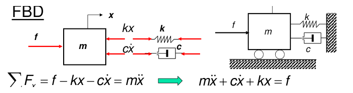
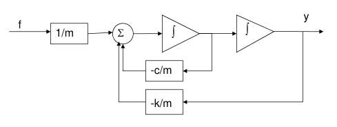
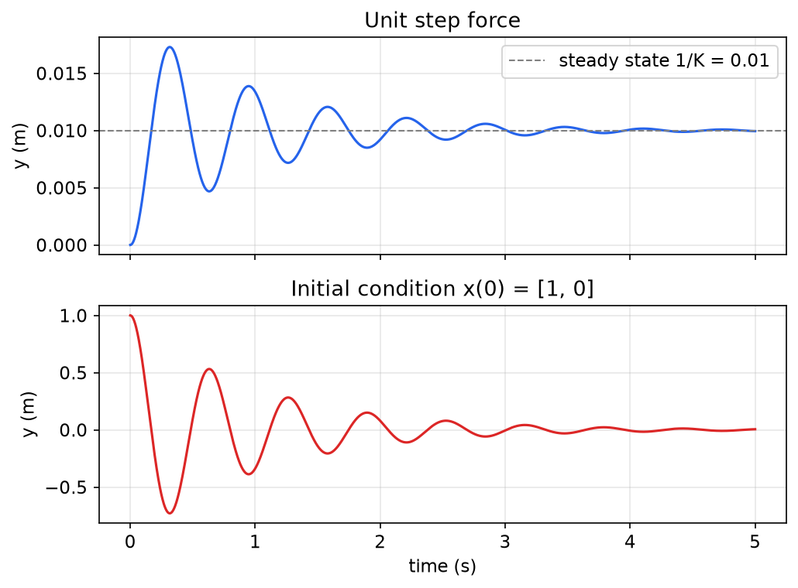
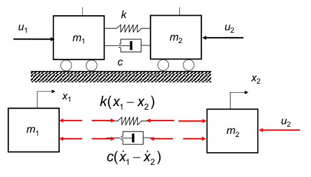
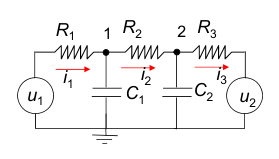
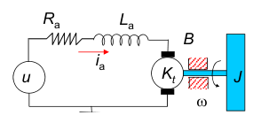
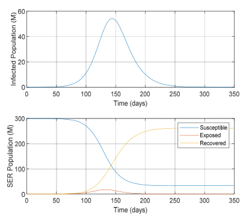
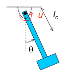
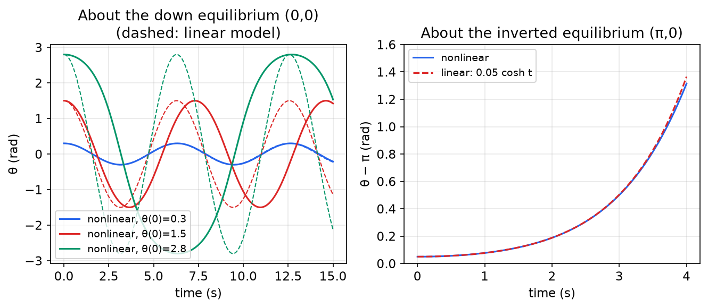
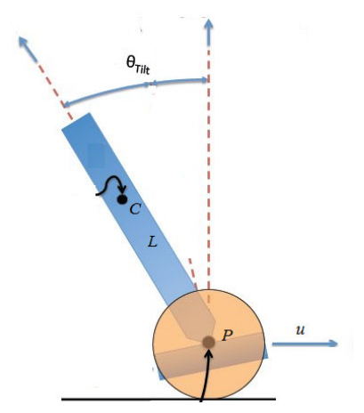

# Modeling and Linearization of Dynamic Systems

Every method in linear systems theory starts from a model: a set of equations that predicts how a system's variables evolve when inputs act on it. This chapter builds such models in **state-space form**, a set of first-order differential equations, for mechanical, electrical, fluid, electromechanical and epidemiological systems. It then connects the state-space model to the classical transfer function through \\(G(s) = C(sI-A)^{-1}B + D\\), and shows how a nonlinear model is approximated by a linear one near a nominal operating trajectory (**Jacobian linearization**). Linearization is what makes the linear theory of the following chapters useful for real, nonlinear machines.

## Dynamic Systems and Mathematical Models

A **mathematical model** of a dynamic system is a set of equations, usually differential equations, that describes the system's input–output behavior. Models are used mainly to *simulate* the system: to predict its response to inputs before building it or before applying a controller to it. Two separate tasks go into a model:

- The **structure** of the model (which variables appear, the order of the equations) usually comes from physical laws: Newton's laws, Kirchhoff's and Ohm's laws, conservation of mass.
- The **numerical values** of the parameters (masses, stiffnesses, resistances) are often estimated from experimental data by curve fitting.

**Example 1.1 (Mass–spring–damper).** A block of mass \\(m\\) rolls on a horizontal surface. A force \\(f\\) pushes it to the right, and a spring \\(k\\) and a viscous damper \\(c\\) connect it to a wall. Let \\(x\\) be the displacement from the position where the spring is relaxed.



*Figure: mass–spring–damper. Left: free-body diagram, with the applied force f to the right and the spring and damper forces kx and cẋ opposing the motion. Right: the physical system. Newton's second law gives the equation of motion at the bottom.*

The free-body diagram shows the applied force \\(f\\) to the right and the restoring forces \\(kx\\) and \\(c\dot x\\) to the left. Newton's second law gives
\\[
\sum F\_x = f - kx - c\dot x = m\ddot x
\quad\Longrightarrow\quad
m\ddot x + c\dot x + kx = f .
\\]
This one equation already raises the questions a model must answer. What is the input (the force \\(f\\)) and what is the output (the position \\(x\\), perhaps the velocity)? How can the output be predicted from the input? Which alternative models describe the same physics? And how would \\(m\\), \\(c\\), \\(k\\) be measured? The rest of this chapter answers these questions systematically.

### System variables

In engineering, a **system** is an interconnection of components that act together to perform a task: an automobile, a machine tool, a robot, an aircraft, a living cell. Three kinds of variables describe it:

- **Input variables** \\(u\\) originate outside the system and are not affected by what happens inside it (applied forces, voltages, valve commands, disturbances).
- **State variables** \\(x\\) form a *minimal* set of internal variables that completely describes the condition of the system at a given time.
- **Output variables** \\(y\\) are the variables we monitor or regulate. They are functions of the states (and sometimes of the inputs).

### Static and dynamic systems

A system is **static** if its output at time \\(t\\) depends only on the input at the same instant, \\(y(t) = f(u(t))\\). A change in input produces an instantaneous change in output. A gear train (output rotation proportional to input rotation), a four-bar linkage (rocker angle a fixed function of crank angle) and an ideal transformer (secondary voltage proportional to primary voltage) are static.

A system is **dynamic** if its present output can depend on the past history of the input as well as its present value:
\\[
y(t) = f\big[u(\tau),\ 0 \le \tau \le t\big].
\\]
An automobile is dynamic. Its inputs are the throttle position \\(u\\), the steering-wheel angle \\(\theta\\) and the road profile \\(p\\). Its outputs are the speed \\(v\\) and heading \\(\alpha\\), and these depend on everything the driver has done up to now.

**Example 1.2 (Linear automobile motion).** Assume the traction force is proportional to the throttle position, \\(F = ku\\). Newton's law gives \\(m\\,dv/dt = ku\\). Integrating,
\\[
v(t) = v(0) + \frac{k}{m}\int\_0^t u(\tau)\\,d\tau ,
\\]
so the speed depends on the whole history of the input: the system has memory. With a linear drag force \\(F\_D = bv\\), the input–output model becomes the first-order linear differential equation
\\[
m\dot v + bv = ku .
\\]
Here \\(v\\) itself is the state: knowing \\(v(t\_0)\\) and the throttle input after \\(t\_0\\) is enough to predict \\(v(t)\\) for all \\(t \ge t\_0\\).

## State and State Equations

**Definition (State).** The **state** of a system is the smallest set of variables \\(x\_1,\dots,x\_n\\) (the **state variables**) such that knowledge of these variables at any time \\(t\_0\\), together with knowledge of the inputs for \\(t \ge t\_0\\), completely determines the behavior of the system for \\(t \ge t\_0\\). They are collected in the **state vector** \\(x = [x\_1,\dots,x\_n]^T\\), and \\(n\\) is the **order** of the system.

The definition captures the idea of memory. Everything about the past that matters for the future is summarized in \\(x(t\_0)\\). In mechanical systems the states are typically positions and velocities (potential and kinetic energy storage). In circuits they are capacitor voltages and inductor currents (electric and magnetic energy storage). The state is not unique: any invertible function of a state vector is again a state vector, a fact exploited in [State Transformations and Canonical Realizations](realizations.md).

### State-space model

A **state model** is a set of first-order differential equations giving the rate of change of each state variable in terms of the present values of the states and of the inputs \\(u\_1,\dots,u\_m\\):
\\[
\dot x\_i = f\_i(x\_1,\dots,x\_n,u\_1,\dots,u\_m,t), \qquad i = 1,\dots,n .
\\]
Each state equation can be pictured as an **integrator**, a memory element whose output is \\(x\_i\\) and whose input is \\(f\_i\\), computed from the present state (fed back) and the present input. The outputs are given by **output equations**
\\[
y\_j = h\_j(x\_1,\dots,x\_n,u\_1,\dots,u\_m,t), \qquad j = 1,\dots,p ,
\\]
and the output vector contains the variables of interest. With \\(x\in\mathbb{R}^n\\), \\(u\in\mathbb{R}^m\\), \\(y\in\mathbb{R}^p\\), \\(f = [f\_1,\dots,f\_n]^T\\) and \\(h = [h\_1,\dots,h\_p]^T\\), the model is written compactly as
\\[
\boxed{\dot x = f(x,u,t), \qquad y = h(x,u,t).}
\\]

### Classification

- **Time-invariant** (also called autonomous when there is no explicit time dependence): \\(\dot x = f(x,u)\\), \\(y = h(x,u)\\). The rules do not change with time, so shifting the input in time shifts the response by the same amount. (Some texts reserve "autonomous" for systems that also have no input.)
- **Linear time-varying (LTV)**: \\(f\\) and \\(h\\) are linear in \\(x\\) and \\(u\\),
\\[
\dot x = A(t)x + B(t)u, \qquad y = C(t)x + D(t)u,
\\]
with \\(A(t)\in\mathbb{R}^{n\times n}\\), \\(B(t)\in\mathbb{R}^{n\times m}\\), \\(C(t)\in\mathbb{R}^{p\times n}\\), \\(D(t)\in\mathbb{R}^{p\times m}\\).
- **Linear time-invariant (LTI)**: the four matrices are constant,
\\[
\boxed{\dot x = Ax + Bu, \qquad y = Cx + Du .}
\\]

\\(A\\) is the **system** (or dynamics) matrix, \\(B\\) the **input** matrix, \\(C\\) the **output** matrix and \\(D\\) the **direct feedthrough** matrix. When \\(D = 0\\) the system is **strictly proper**: the input reaches the output only through the integrators.

### Linearity and causality of the state model

The name "linear" is justified by the solution formula derived in [Time Response of Linear Systems](time-response.md):
\\[
y(t) = C(t)\Phi(t,t\_0)x\_0 + \int\_{t\_0}^{t} C(t)\Phi(t,\tau)B(\tau)u(\tau)\\,d\tau + D(t)u(t),
\\]
where \\(\Phi(t,\tau)\\) is the state-transition matrix.

**Proposition (Linearity and causality).** The LTV model \\(\dot x = A(t)x + B(t)u\\), \\(y = C(t)x + D(t)u\\) is (i) linear in the pair (initial state, input), and (ii) causal.

*Proof.* (i) Let \\((x\_{0,1},u\_1)\\) produce \\(y\_1\\) and \\((x\_{0,2},u\_2)\\) produce \\(y\_2\\). Each of the three terms in the formula above is linear in \\((x\_0,u)\\), so \\((\alpha x\_{0,1}+\beta x\_{0,2},\ \alpha u\_1+\beta u\_2)\\) produces \\(\alpha y\_1+\beta y\_2\\) (superposition). (ii) If two inputs agree on \\([t\_0,T]\\) and the initial states agree, then for any \\(t\le T\\) the integral uses only \\(u(\tau)\\) with \\(\tau \le t\\), so the outputs agree on \\([t\_0,T]\\): the output cannot anticipate future inputs. ∎

A common slip is to write the kernel of the integral as \\(\Phi(\tau,t\_0)\\). The correct kernel is \\(\Phi(t,\tau)\\): an input applied at time \\(\tau\\) is propagated from \\(\tau\\) to \\(t\\).

### Example: the mass–spring–damper in state form

**Example 1.3 (State model of the mass–spring–damper).** Rename the position \\(y\\), so that the equation of motion reads \\(m\ddot y + c\dot y + ky = f\\). It is second order, so two states are needed. Choose the position and the velocity, \\(x\_1 = y\\), \\(x\_2 = \dot y\\). Then
\\[
\dot x\_1 = x\_2, \qquad \dot x\_2 = \frac{1}{m}\big(-kx\_1 - cx\_2 + f\big),
\\]
or in matrix form
\\[
\begin{bmatrix}\dot x\_1 \\\\ \dot x\_2\end{bmatrix}
= \underbrace{\begin{bmatrix}0 & 1 \\\\ -k/m & -c/m\end{bmatrix}}\_{A}
\begin{bmatrix}x\_1 \\\\ x\_2\end{bmatrix} + \underbrace{\begin{bmatrix}0 \\\\ 1/m\end{bmatrix}}\_{B} f,
\qquad
y = \underbrace{\begin{bmatrix}1 & 0\end{bmatrix}}\_{C} x + \underbrace{0}\_{D}\\, f .
\\]

**Simulation block diagram.** Writing each state equation in integral form, \\(x\_i = \int f\_i(x,u,t)\\,dt\\), gives a diagram built from integrators, gains and summers. This is the way analog computers, and today block-diagram simulators such as Simulink, solve the equations.



*Figure: simulation diagram of the mass–spring–damper. The force passes through the gain 1/m into a summer whose output is the acceleration. Two integrators produce the velocity and then the position, and the velocity and position are fed back through −c/m and −k/m. The outputs of the integrators are exactly the state variables.*

In MATLAB the model is defined as a state-space object and simulated directly:

```matlab
% Mass-spring-damper system
K=100; b=2; M=1;                 % system parameters
A=[0,1;-K/M -b/M]; B=[0;1/M];    % system matrices
C=[1 0]; D=0;
msdsys=ss(A,B,C,D);              % state-space object
subplot(211); step(msdsys);      % unit step response
subplot(212); initial(msdsys,[1;0]);   % free response from x(0)=[1;0]
```

The Python equivalent with `scipy.signal`:

```python
import numpy as np
from scipy import signal
K, b, M = 100, 2, 1
A = np.array([[0, 1], [-K/M, -b/M]]); B = np.array([[0], [1/M]])
C = np.array([[1, 0]]); D = np.array([[0]])
sys = signal.StateSpace(A, B, C, D)
t, y = signal.step(sys)                          # step response
t, y, x = signal.lsim(sys, 0*t, t, X0=[1, 0])    # initial-condition response
```

With these numbers the natural frequency is \\(\omega\_n = \sqrt{K/M} = 10\\) rad/s and the damping ratio is \\(\zeta = b/(2\sqrt{KM}) = 0.1\\), so both responses oscillate with a period of about \\(2\pi/\omega\_n \approx 0.63\\) s and decay with time constant \\(1/(\zeta\omega\_n) = 1\\) s.



*Figure: responses of the mass–spring–damper with K = 100, b = 2, M = 1. Top: the unit step force produces an underdamped rise with a first peak near 0.017 m, settling to the static deflection 1/K = 0.01 m within about 4–5 s. Bottom: the free response from x(0) = [1, 0] is a decaying cosine whose first trough is about −0.73.*

**Example 1.4 (Closed-loop state equations with PI control).** Suppose the mass–spring–damper is controlled by a proportional–integral (PI) controller
\\[
u(t) = -K\_p e(t) - K\_i\int\_0^t e(\tau)\\,d\tau, \qquad e = y - r ,
\\]
where \\(r\\) is the reference input and \\(u = f\\) is the force. Find state equations from \\(r\\) to \\(y\\).

The controller has its own memory, the integral of the error, so the closed loop needs a third state. Let \\(x\_3 = \int\_0^t e(\tau)\\,d\tau\\), so that \\(\dot x\_3 = x\_1 - r\\). Substituting \\(u = -K\_p(x\_1 - r) - K\_ix\_3\\) into the plant equations:
\\[
\frac{d}{dt}\begin{bmatrix}x\_1 \\\\ x\_2 \\\\ x\_3\end{bmatrix}
= \begin{bmatrix}0 & 1 & 0 \\\\ -\dfrac{k+K\_p}{m} & -\dfrac{c}{m} & -\dfrac{K\_i}{m} \\\\ 1 & 0 & 0\end{bmatrix}
\begin{bmatrix}x\_1 \\\\ x\_2 \\\\ x\_3\end{bmatrix} + \begin{bmatrix}0 \\\\ K\_p/m \\\\ -1\end{bmatrix} r,
\qquad y = \begin{bmatrix}1 & 0 & 0\end{bmatrix}x .
\\]
The integral state is what removes the steady-state error: at an equilibrium \\(\dot x\_3 = 0\\) forces \\(y = r\\). The same closed loop can be found in the frequency domain. The plant is \\(G(s) = 1/(ms^2+cs+k)\\) and the controller is \\(K\_p + K\_i/s\\), so in unity negative feedback
\\[
\frac{Y(s)}{R(s)} = \frac{(K\_p/m)s + K\_i/m}{s^3 + (c/m)s^2 + \big((k+K\_p)/m\big)s + K\_i/m}.
\\]
Any canonical realization of this third-order transfer function (see [State Transformations and Canonical Realizations](realizations.md)) is an equally valid answer. A variant integrates \\(y\\) rather than \\(e\\), \\(u = -K\_pe - K\_i\int\_0^t y\\,d\tau\\). Then \\(\dot x\_3 = x\_1\\) and the second row becomes \\(\dot x\_2 = \frac{1}{m}\big[-(k+K\_p)x\_1 - cx\_2 - K\_ix\_3 + K\_pr\big]\\). That loop does not drive \\(y\\) to \\(r\\), because the integrator now forces \\(y\to 0\\) at equilibrium, which is why the integral of the *error* is the usual choice.

## State Models of Physical Systems

For physical systems it is usually best to choose **physically motivated state variables**: one state for each independent energy-storage element. The procedure is the same in every domain: (1) identify the independent storage elements and assign a state to each; (2) write the constitutive equation of every element; (3) eliminate auxiliary variables using the interconnection laws (force balance, KCL/KVL, continuity); (4) arrange the result in matrix form.

### Mechanical systems

**Example 1.5 (Two-mass system).** Two carts \\(m\_1\\) and \\(m\_2\\), at positions \\(x\_1\\) and \\(x\_2\\), are connected by a spring \\(k\\) and a damper \\(c\\) in parallel. A force \\(u\_1\\) pushes \\(m\_1\\) to the right and a force \\(u\_2\\) pushes \\(m\_2\\) to the left.



*Figure: two carts coupled by a spring k and damper c, with external forces u₁ (on m₁, to the right) and u₂ (on m₂, to the left). The free-body diagrams show the coupling forces k(x₁ − x₂) and c(ẋ₁ − ẋ₂) acting to the left on m₁ and to the right on m₂.*

When \\(x\_1 > x\_2\\) the spring is compressed, so it pushes \\(m\_1\\) back to the left and \\(m\_2\\) forward to the right. The damper acts the same way with the relative velocity. Newton's law for each mass:
\\[
m\_1\ddot x\_1 = u\_1 - k(x\_1-x\_2) - c(\dot x\_1-\dot x\_2), \qquad
m\_2\ddot x\_2 = k(x\_1-x\_2) + c(\dot x\_1-\dot x\_2) - u\_2 .
\\]
There are three energy stores (two masses and one spring), but because both absolute positions are of interest we keep both positions and both velocities, so the order is four. With states \\(x\_1, x\_2, x\_3 = \dot x\_1, x\_4 = \dot x\_2\\):
\\[
\begin{bmatrix}\dot x\_1 \\\\ \dot x\_2 \\\\ \dot x\_3 \\\\ \dot x\_4\end{bmatrix}
= \begin{bmatrix}
0 & 0 & 1 & 0 \\\\
0 & 0 & 0 & 1 \\\\
-\frac{k}{m\_1} & \frac{k}{m\_1} & -\frac{c}{m\_1} & \frac{c}{m\_1} \\\\
\frac{k}{m\_2} & -\frac{k}{m\_2} & \frac{c}{m\_2} & -\frac{c}{m\_2}
\end{bmatrix}
\begin{bmatrix}x\_1 \\\\ x\_2 \\\\ x\_3 \\\\ x\_4\end{bmatrix} + \begin{bmatrix}0 & 0 \\\\ 0 & 0 \\\\ \frac{1}{m\_1} & 0 \\\\ 0 & -\frac{1}{m\_2}\end{bmatrix}
\begin{bmatrix}u\_1 \\\\ u\_2\end{bmatrix}.
\\]

**Example 1.6 (Motor–shaft–load drive train).** A motor rotor of inertia \\(J\_m\\) with viscous friction \\(B\_m\\) is driven by a torque \\(\tau\\) and connected through a torsional shaft of stiffness \\(K\\) to a load of inertia \\(J\_L\\) with friction \\(B\_L\\). The equations of motion are
\\[
J\_m\ddot\theta\_m + B\_m\dot\theta\_m + K(\theta\_m-\theta\_L) = \tau, \qquad
J\_L\ddot\theta\_L + B\_L\dot\theta\_L + K(\theta\_L-\theta\_m) = 0 .
\\]
A natural state choice is the two speeds \\(\omega\_m = \dot\theta\_m\\), \\(\omega\_L = \dot\theta\_L\\) and the shaft twist \\(\theta\_r = \theta\_L - \theta\_m\\). The twist alone stores the spring energy, so only three states are needed even though there are two second-order equations. The absolute angle does not affect the dynamics (it would be needed only if an angle were an output). Then \\(K(\theta\_m-\theta\_L) = -K\theta\_r\\), and
\\[
J\_m\dot\omega\_m = -B\_m\omega\_m + K\theta\_r + \tau, \qquad
J\_L\dot\omega\_L = -B\_L\omega\_L - K\theta\_r, \qquad
\dot\theta\_r = \omega\_L - \omega\_m ,
\\]
\\[
\frac{d}{dt}\begin{bmatrix}\omega\_m \\\\ \omega\_L \\\\ \theta\_r\end{bmatrix}
= \begin{bmatrix}-B\_m/J\_m & 0 & K/J\_m \\\\ 0 & -B\_L/J\_L & -K/J\_L \\\\ -1 & 1 & 0\end{bmatrix}
\begin{bmatrix}\omega\_m \\\\ \omega\_L \\\\ \theta\_r\end{bmatrix} + \begin{bmatrix}1/J\_m \\\\ 0 \\\\ 0\end{bmatrix}\tau .
\\]
The signs in the third column follow from the definition \\(\theta\_r = \theta\_L - \theta\_m\\). Defining the twist the other way round, \\(\theta\_m - \theta\_L\\), flips both signs, and mixing the two conventions is a frequent source of error. The transfer function to the load angle is computed in Example 1.15 below.

### Electrical systems

Power is voltage times current. The three passive elements are summarized below.

| Element | Constitutive law | Stored energy | State variable |
|---|---|---|---|
| Resistor \\(R\\) | \\(v\_R = Ri\_R\\) | none (dissipates \\(P = Ri\_R^2\\)) | none |
| Capacitor \\(C\\) | \\(\dfrac{dv\_C}{dt} = \dfrac{1}{C}i\_C\\) | \\(\tfrac12 Cv\_C^2\\) | \\(v\_C\\) |
| Inductor \\(L\\) | \\(\dfrac{di\_L}{dt} = \dfrac{1}{L}v\_L\\) | \\(\tfrac12 Li\_L^2\\) | \\(i\_L\\) |

**Procedure (state model of a circuit).** (1) Select every *independent* capacitor voltage and inductor current as a state. (2) Write the constitutive law of each storage and dissipative element. (3) Use KVL and KCL to eliminate all other voltages and currents, so that each \\(\dot v\_C\\) and \\(\dot i\_L\\) is expressed in terms of states and sources. (4) Put the result in matrix form.

**Example 1.7 (RC ladder with two sources).** A source \\(u\_1\\) drives node 1 through \\(R\_1\\). Node 1 connects to node 2 through \\(R\_2\\), and node 2 connects to a second source \\(u\_2\\) through \\(R\_3\\). Capacitors \\(C\_1\\) and \\(C\_2\\) connect nodes 1 and 2 to ground. Currents \\(i\_1, i\_2, i\_3\\) flow left to right through \\(R\_1, R\_2, R\_3\\).



*Figure: RC ladder with two voltage sources. The capacitor voltages v₁ and v₂ at nodes 1 and 2 are the state variables.*

KCL at the two nodes and Ohm's law for the resistors:
\\[
i\_1 = C\_1\dot v\_1 + i\_2, \quad i\_2 = C\_2\dot v\_2 + i\_3, \qquad
i\_1 = \frac{u\_1 - v\_1}{R\_1}, \quad i\_2 = \frac{v\_1 - v\_2}{R\_2}, \quad i\_3 = \frac{v\_2 - u\_2}{R\_3}.
\\]
Solving for the derivatives:
\\[
C\_1\dot v\_1 = \frac{u\_1 - v\_1}{R\_1} - \frac{v\_1 - v\_2}{R\_2}, \qquad
C\_2\dot v\_2 = \frac{v\_1 - v\_2}{R\_2} - \frac{v\_2 - u\_2}{R\_3},
\\]
\\[
\begin{bmatrix}\dot v\_1 \\\\ \dot v\_2\end{bmatrix}
= \begin{bmatrix}
-C\_1^{-1}(R\_1^{-1}+R\_2^{-1}) & C\_1^{-1}R\_2^{-1} \\\\
C\_2^{-1}R\_2^{-1} & -C\_2^{-1}(R\_2^{-1}+R\_3^{-1})
\end{bmatrix}
\begin{bmatrix}v\_1 \\\\ v\_2\end{bmatrix} + \begin{bmatrix} C\_1^{-1}R\_1^{-1} & 0 \\\\ 0 & C\_2^{-1}R\_3^{-1}\end{bmatrix}
\begin{bmatrix}u\_1 \\\\ u\_2\end{bmatrix}.
\\]
Note that \\(u\_2\\) enters node 2 through \\(R\_3\\), so the (2,2) entry of \\(B\\) is \\(1/(C\_2R\_3)\\), not \\(1/(C\_2R\_2)\\). The matrix \\(A\\) is symmetric after scaling by the capacitances, a reflection of the reciprocity of passive networks.

**Example 1.8 (Circuit with direct feedthrough).** A source \\(x(t)\\) is in series with a parallel \\(R\\)–\\(C\\) branch. That branch feeds an inductor \\(L\\) in parallel with a load resistor \\(R\\). The output is the voltage \\(v\_x\\) across the inductor and load, and the states are \\(v\_C\\) and \\(i\_L\\). KVL around the loop gives \\(x = v\_C + v\_x\\), so \\(v\_x = x - v\_C\\) and \\(L\\,di\_L/dt = v\_x\\). The current through the series branch is the inductor current plus the load current, \\(i = i\_L + v\_x/R\\), and it splits between the capacitor and its parallel resistor: \\(i\_C = i - v\_C/R\\). Therefore
\\[
\frac{di\_L}{dt} = \frac{x - v\_C}{L}, \qquad
\frac{dv\_C}{dt} = \frac{1}{C}\Big(i\_L + \frac{x - v\_C}{R} - \frac{v\_C}{R}\Big) = \frac{i\_L}{C} + \frac{x}{RC} - \frac{2v\_C}{RC},
\\]
\\[
\begin{bmatrix}\dot v\_C \\\\ \dot i\_L\end{bmatrix}
= \begin{bmatrix}-\frac{2}{RC} & \frac{1}{C} \\\\ -\frac{1}{L} & 0\end{bmatrix}
\begin{bmatrix}v\_C \\\\ i\_L\end{bmatrix} + \begin{bmatrix}\frac{1}{RC} \\\\ \frac{1}{L}\end{bmatrix}x,
\qquad
v\_x = \begin{bmatrix}-1 & 0\end{bmatrix}\begin{bmatrix}v\_C \\\\ i\_L\end{bmatrix} + 1\cdot x .
\\]
Here \\(D = 1\\): a sudden change in the source appears instantly across the load, because the capacitor voltage cannot jump. Eliminating the states gives the single ODE \\(\ddot v\_x + \frac{2}{RC}\dot v\_x + \frac{1}{LC}v\_x = \ddot x + \frac{1}{RC}\dot x\\), whose numerator and denominator have the same degree (relative degree zero).

### Fluid systems

Fluid systems have the same structure as circuits, with pressure \\(P\\) playing the role of voltage and volumetric flow rate \\(q\\) the role of current (power is still pressure times flow).

| Element | Law | State variable |
|---|---|---|
| Fluid resistor (valve, orifice, pipe friction) | \\(P\_R = Rq\_R\\) | none |
| Fluid capacitor (tank, accumulator) | \\(\dfrac{dP\_C}{dt} = \dfrac{1}{C}q\_C\\) | \\(P\_C\\) |
| Fluid inertor (long pipe) | \\(\dfrac{dq\_I}{dt} = \dfrac{1}{I}P\_I\\) | \\(q\_I\\) |

**Tank capacitance.** The net inflow equals the rate of change of stored volume: \\(q\_c = \frac{d}{dt}(Ah\_c)\\), where \\(A\\) is the cross-sectional area and \\(h\_c\\) the liquid height. The pressure at the bottom is \\(p\_c = \rho gh\_c\\), so \\(q\_c = \frac{d}{dt}\big(Ap\_c/(\rho g)\big)\\). For constant \\(A\\),
\\[
\dot p\_c = \frac{\rho g}{A}q\_c, \qquad C = \frac{A}{\rho g}.
\\]

**Fluid inertance.** In a long pipe, accelerating the fluid column requires a pressure difference. Newton's law on a slug of length \\(L\\) and area \\(A\\) (mass \\(\rho LA\\), velocity \\(q/A\\)) gives \\(\rho LA\\,\frac{d}{dt}(q/A) = AP\_I\\), so
\\[
\dot q\_I = \frac{1}{I}P\_I, \qquad I = \frac{\rho L}{A}.
\\]
Inertance is the pressure difference per unit rate of change of flow.

**Example 1.9 (Two interacting tanks).** Tank 1 (capacitance \\(C\_1\\), inflow \\(u\_1\\)) drains to the atmosphere through \\(R\_1\\) (flow \\(q\_1\\)) and into tank 2 through \\(R\_2\\) (flow \\(q\_2\\)). Tank 2 (capacitance \\(C\_2\\), inflow \\(u\_2\\)) drains through \\(R\_3\\) (flow \\(q\_3\\)). All flows and pressures are deviations from an equilibrium, which makes the linear resistance laws reasonable. Continuity for each tank:
\\[
C\_1\dot P\_1 = u\_1 - q\_1 - q\_2, \qquad C\_2\dot P\_2 = u\_2 + q\_2 - q\_3,
\\]
with \\(q\_1 = P\_1/R\_1\\), \\(q\_2 = (P\_1 - P\_2)/R\_2\\) and \\(q\_3 = P\_2/R\_3\\). Hence
\\[
\begin{bmatrix}\dot P\_1 \\\\ \dot P\_2\end{bmatrix}
= \begin{bmatrix}
-C\_1^{-1}(R\_1^{-1}+R\_2^{-1}) & C\_1^{-1}R\_2^{-1} \\\\
C\_2^{-1}R\_2^{-1} & -C\_2^{-1}(R\_2^{-1}+R\_3^{-1})
\end{bmatrix}
\begin{bmatrix}P\_1 \\\\ P\_2\end{bmatrix} + \begin{bmatrix}C\_1^{-1} & 0 \\\\ 0 & C\_2^{-1}\end{bmatrix}
\begin{bmatrix}u\_1 \\\\ u\_2\end{bmatrix}.
\\]
The \\(A\\) matrix is identical to that of the RC ladder in Example 1.7. This is the **electrical–fluid analogy** at work: the same mathematics describes both systems, so intuition and results transfer between them.

**Example 1.10 (Tanks connected by an inertive pipe).** Replace the resistance \\(R\_2\\) between the tanks by a long pipe of inertance \\(I\\) carrying flow \\(q\_I\\). Tank 1 now drains to the atmosphere through \\(R\_1\\) and tank 2 through \\(R\_2\\). The pipe is an independent storage element (like an inductor), so its flow becomes a third state, governed by \\(I\\,dq\_I/dt = p\_1 - p\_2\\). The model is
\\[
C\_1\dot p\_1 = u\_1 - \frac{p\_1}{R\_1} - q\_I, \qquad
C\_2\dot p\_2 = u\_2 + q\_I - \frac{p\_2}{R\_2}, \qquad
I\dot q\_I = p\_1 - p\_2 ,
\\]
\\[
\frac{d}{dt}\begin{bmatrix}p\_1 \\\\ p\_2 \\\\ q\_I\end{bmatrix}
= \begin{bmatrix}-\frac{1}{R\_1C\_1} & 0 & -\frac{1}{C\_1} \\\\ 0 & -\frac{1}{R\_2C\_2} & \frac{1}{C\_2} \\\\ \frac{1}{I} & -\frac{1}{I} & 0\end{bmatrix}
\begin{bmatrix}p\_1 \\\\ p\_2 \\\\ q\_I\end{bmatrix} + \begin{bmatrix}\frac{1}{C\_1} & 0 \\\\ 0 & \frac{1}{C\_2} \\\\ 0 & 0\end{bmatrix}
\begin{bmatrix}u\_1 \\\\ u\_2\end{bmatrix}.
\\]
The fluid can now slosh back and forth between the tanks, and the eigenvalues of \\(A\\) can be complex.

**Example 1.11 (Three-tank network with an algebraic node).** Two pumps with pressures \\(P\_{s1}, P\_{s2}\\) feed tanks \\(C\_1\\) and \\(C\_2\\) through resistances \\(R\_1\\) and \\(R\_3\\). The tanks drain through \\(R\_2\\) and \\(R\_4\\) into a junction at pressure \\(P\_4\\), which feeds tank \\(C\_3\\) through \\(R\_5\\). Tank 3 discharges the product flow \\(Q\_f\\) through \\(R\_6\\). Use the conductances \\(G\_i = 1/R\_i\\).

The tank balances are \\(C\_1\dot P\_1 = Q\_1 - Q\_3\\), \\(C\_2\dot P\_2 = Q\_2 - Q\_4\\) and \\(C\_3\dot P\_3 = Q\_5 - Q\_f\\), with \\(Q\_1 = G\_1(P\_{s1}-P\_1)\\), \\(Q\_2 = G\_3(P\_{s2}-P\_2)\\) and \\(Q\_f = G\_6P\_3\\). The junction stores no fluid, so it contributes no state. Instead it imposes an **algebraic constraint**, inflow equals outflow:
\\[
G\_2(P\_1 - P\_4) + G\_4(P\_2 - P\_4) = G\_5(P\_4 - P\_3)
\quad\Longrightarrow\quad
P\_4 = \frac{G\_2P\_1 + G\_4P\_2 + G\_5P\_3}{\bar G}, \qquad \bar G = G\_2 + G\_4 + G\_5 .
\\]
Substituting \\(P\_4\\) into \\(Q\_3 = G\_2(P\_1 - P\_4)\\), \\(Q\_4 = G\_4(P\_2-P\_4)\\) and \\(Q\_5 = Q\_3 + Q\_4\\):
\\[
\frac{d}{dt}\begin{bmatrix}P\_1 \\\\ P\_2 \\\\ P\_3\end{bmatrix}
= \frac{1}{\bar G}\begin{bmatrix}
-\frac{G\_1\bar G + G\_2(G\_4+G\_5)}{C\_1} & \frac{G\_2G\_4}{C\_1} & \frac{G\_2G\_5}{C\_1} \\\\
\frac{G\_2G\_4}{C\_2} & -\frac{G\_3\bar G + G\_4(G\_2+G\_5)}{C\_2} & \frac{G\_4G\_5}{C\_2} \\\\
\frac{G\_2G\_5}{C\_3} & \frac{G\_4G\_5}{C\_3} & -\frac{G\_6\bar G + G\_5(G\_2+G\_4)}{C\_3}
\end{bmatrix}
\begin{bmatrix}P\_1 \\\\ P\_2 \\\\ P\_3\end{bmatrix} + \begin{bmatrix}G\_1/C\_1 & 0 \\\\ 0 & G\_3/C\_2 \\\\ 0 & 0\end{bmatrix}
\begin{bmatrix}P\_{s1} \\\\ P\_{s2}\end{bmatrix},
\\]
with output \\(Q\_f = \begin{bmatrix}0 & 0 & G\_6\end{bmatrix}[P\_1\ P\_2\ P\_3]^T\\). The lesson is general: a node without storage is eliminated algebraically. It couples all three tanks, but it adds no state.

### Electromechanical systems: the DC motor

**Example 1.12 (Armature-controlled DC motor).** A voltage \\(u\\) drives the armature circuit (resistance \\(R\_a\\), inductance \\(L\_a\\), current \\(i\_a\\)). The motor turns a rotor of inertia \\(J\\) with bearing damping \\(B\\) at speed \\(\omega\\).



*Figure: DC motor. The armature circuit (u, R_a, L_a) drives the motor, an ideal transducer with constant K_t, which turns the inertia J against the bearing damping B.*

Treat the motor as an ideal electromechanical transducer: it converts electrical power \\(e\_bi\_a\\) into mechanical power \\(T\_m\omega\\) without loss. The governing equations are:

- Armature loop (KVL): \\(u = R\_ai\_a + L\_a\dfrac{di\_a}{dt} + e\_b\\), where \\(e\_b\\) is the back-emf.
- Rotor (Newton): \\(T\_m = J\dot\omega + B\omega\\).
- Transducer: \\(T\_m = K\_ti\_a\\), \\(e\_b = K\_t\omega\\). Power conservation, \\(e\_bi\_a = T\_m\omega\\), forces the same constant in both relations (in SI units).

With states \\(i\_a\\) (inductor current) and \\(\omega\\) (rotor speed):
\\[
\frac{d}{dt}\begin{bmatrix}i\_a \\\\ \omega\end{bmatrix}
= \begin{bmatrix}-R\_a/L\_a & -K\_t/L\_a \\\\ K\_t/J & -B/J\end{bmatrix}
\begin{bmatrix}i\_a \\\\ \omega\end{bmatrix} + \begin{bmatrix}1/L\_a \\\\ 0\end{bmatrix}u .
\\]
The off-diagonal terms \\(\mp K\_t\\) are the two-way coupling: current produces torque, and speed produces a voltage that opposes the current.

## Transfer Functions

### The Laplace transform

The (one-sided) **Laplace transform** of a function \\(f(t)\\), \\(t\ge 0\\), and its inverse are
\\[
F(s) = \mathcal{L}\\{f(t)\\} = \int\_0^\infty f(t)e^{-st}\\,dt, \quad s = \sigma + j\omega, \qquad
f(t) = \mathcal{L}^{-1}\\{F(s)\\} = \frac{1}{2\pi j}\int\_{\gamma - j\infty}^{\gamma + j\infty} F(s)e^{st}\\,ds .
\\]
The properties used most in this book are:

1. Linearity: \\(\mathcal{L}\\{af \pm bg\\} = aF(s) \pm bG(s)\\).
2. Exponential shift: \\(\mathcal{L}\\{e^{-at}f(t)\\} = F(s+a)\\).
3. Time delay: \\(\mathcal{L}\\{f(t-\alpha)\\,1(t-\alpha)\\} = e^{-\alpha s}F(s)\\), where \\(1(\cdot)\\) is the unit step.
4. Differentiation: \\(\mathcal{L}\\{\dot f\\} = sF(s) - f(0)\\).
5. Integration: \\(\mathcal{L}\\{\int\_0^t f(\tau)\\,d\tau\\} = F(s)/s\\).

A full treatment is in The Laplace Transform and Laplace Transform Methods for ODEs.

### From state space to transfer function

The **transfer function** of a SISO LTI system is the ratio of the Laplace transforms of output and input with **zero initial conditions**. For MIMO systems it is a \\(p\times m\\) matrix of such ratios. Transform \\(\dot x = Ax + Bu\\) term by term:
\\[
sX(s) - x(0) = AX(s) + BU(s)
\quad\Longrightarrow\quad
(sI - A)X(s) = x(0) + BU(s)
\quad\Longrightarrow\quad
X(s) = (sI-A)^{-1}x(0) + (sI-A)^{-1}BU(s).
\\]
The matrix \\(sI - A\\) is invertible for every \\(s\\) that is not an eigenvalue of \\(A\\). The first term is the free response and the second the forced response. Setting \\(x(0) = 0\\) and substituting into \\(Y(s) = CX(s) + DU(s)\\):
\\[
\boxed{G(s) = C(sI-A)^{-1}B + D .}
\\]

Several facts follow directly from this formula.

- Since \\((sI-A)^{-1} = \operatorname{adj}(sI-A)/\det(sI-A)\\), every entry of \\(G(s)\\) is a rational function whose denominator divides the **characteristic polynomial** \\(\det(sI-A)\\). The poles of \\(G\\) are therefore eigenvalues of \\(A\\). They may be fewer than \\(n\\) if numerator factors cancel; when and why this happens is the subject of [Kalman Decomposition and Minimal Realizations](structure.md).
- \\((sI-A)^{-1}\to 0\\) as \\(s\to\infty\\), so \\(G(\infty) = D\\). A state model always gives a **proper** transfer function, and a strictly proper one if \\(D = 0\\).
- \\(G(s)\\) is unchanged by any change of state coordinates: the map from \\((A,B,C,D)\\) to \\(G\\) is unique, but the reverse map is not (see [realizations](realizations.md)).

The transfer function expresses the dynamics as an algebraic relation. It depends only on the system's parameters, not on the input, and it corresponds one-to-one to the input–output differential equation.

**Example 1.13 (Mass–spring–damper).** From \\(m\ddot x + c\dot x + kx = f\\) with zero initial conditions, \\((ms^2 + cs + k)X(s) = F(s)\\), so
\\[
G(s) = \frac{X(s)}{F(s)} = \frac{1}{ms^2 + cs + k}.
\\]
The formula \\(C(sI-A)^{-1}B\\) with the matrices of Example 1.3 gives the same result.

**Example 1.14 (DC motor speed).** With the output \\(\omega\\), \\(C = [0\ \ 1]\\), \\(D = 0\\):
\\[
\frac{\Omega(s)}{U(s)} = \begin{bmatrix}0 & 1\end{bmatrix}
\begin{bmatrix}s + \frac{R\_a}{L\_a} & \frac{K\_t}{L\_a} \\\\ -\frac{K\_t}{J} & s + \frac{B}{J}\end{bmatrix}^{-1}
\begin{bmatrix}\frac{1}{L\_a} \\\\ 0\end{bmatrix}.
\\]
The determinant is \\(\Delta(s) = (s + R\_a/L\_a)(s + B/J) + K\_t^2/(L\_aJ)\\). Only the (2,1) entry of the inverse is needed, and it equals \\(\frac{K\_t}{J}/\Delta(s)\\). Multiplying it by \\(1/L\_a\\) and clearing fractions by \\(L\_aJ\\):
\\[
\boxed{\frac{\Omega(s)}{U(s)} = \frac{K\_t}{L\_aJs^2 + (JR\_a + BL\_a)s + BR\_a + K\_t^2}.}
\\]
(The middle coefficient multiplies \\(s\\). Writing \\(JR\_a + BL\_a\\) without the \\(s\\), as is sometimes seen, is dimensionally inconsistent.)

**Model reduction.** The electrical time constant \\(L\_a/R\_a\\) is usually much shorter than the mechanical one. Setting \\(L\_a\approx 0\\):
\\[
\frac{\Omega(s)}{U(s)} = \frac{K\_t/R\_a}{Js + \big(B + K\_t^2/R\_a\big)} .
\\]
This is a rotor \\(J\\) driven by the torque \\(K\_tu/R\_a\\) and damped by the bearing \\(B\\) *plus* an extra damper \\(K\_t^2/R\_a\\). The DC motor therefore provides an input torque and an additional damping effect known as **back-emf damping**: a spinning motor generates a voltage that drives a current opposing the motion.

**Example 1.15 (Drive train to load angle).** For the motor–shaft–load system of Example 1.6, transform the two equations of motion with zero initial conditions:
\\[
(J\_ms^2 + B\_ms + K)\Theta\_m - K\Theta\_L = T, \qquad (J\_Ls^2 + B\_Ls + K)\Theta\_L - K\Theta\_m = 0 .
\\]
The second gives \\(\Theta\_m = \frac{J\_Ls^2 + B\_Ls + K}{K}\Theta\_L\\). Substituting into the first:
\\[
\frac{\Theta\_L(s)}{T(s)} = \frac{K}{(J\_ms^2+B\_ms+K)(J\_Ls^2+B\_Ls+K) - K^2}
= \frac{K}{s\big[J\_mJ\_Ls^3 + (J\_mB\_L + J\_LB\_m)s^2 + \big(K(J\_m+J\_L) + B\_mB\_L\big)s + K(B\_m + B\_L)\big]} .
\\]
The \\(K^2\\) terms cancel and leave a factor \\(s\\). The resulting free integrator (pole at \\(s = 0\\)) is the **rigid-body mode** of the drive train: a constant torque eventually spins both inertias at a constant speed \\(\tau/(B\_m+B\_L)\\), so the angle grows without bound. The cross term \\(B\_mB\_Ls\\) in the cubic is easy to drop when expanding by hand.

## Nonlinear Systems and Simulation

Most systems of practical interest are nonlinear: aircraft and drones (aerodynamic forces depend on the square of airspeed and on angles through trigonometric functions), robot arms (configuration-dependent inertia), chemical processes, financial and biological systems. Their state models \\(\dot x = f(x,u,t)\\) cannot in general be solved in closed form, so they are **simulated**: the state ODEs are integrated numerically with a Runge–Kutta method (MATLAB's `ode45`, Simulink, or `scipy.integrate.solve_ivp`). Numerical integration is discussed in [Time Response of Linear Systems](time-response.md#numerical-solution).

**Example 1.16 (SEIR epidemic model).** The SEIR model divides a population of size \\(N\\) into the Susceptible \\(S\\), Exposed (infected, not yet infectious) \\(E\\), Infectious \\(I\\) and Recovered \\(R\\):
\\[
\dot S = \varepsilon N - \varepsilon S - \beta\frac{I}{N}S, \qquad
\dot E = \beta\frac{I}{N}S - (\mu + a)E, \qquad
\dot I = aE - (\gamma + \mu)I, \qquad
\dot R = \gamma I - \varepsilon R .
\\]
Here \\(\varepsilon\\) is the birth and (natural) death rate, \\(\mu\\) the disease death rate, \\(a\\) the rate at which exposed people become infectious, \\(\gamma\\) the recovery rate, and \\(\beta = R\_0(\mu + \gamma)\\) the transmission rate, with \\(R\_0\\) the basic reproductive number. The product \\(IS\\) makes the model nonlinear: new infections require contact between an infectious and a susceptible person.



*Figure: one-year simulation of the SEIR model with constant parameters and R₀ = 2.5 for a population of about 300 million. Top: the infectious population peaks near 54 million around day 145 and has nearly vanished by day 250. Bottom: the susceptible population falls sigmoidally to about 35 million, the exposed population shows a small hump (about 18 million near day 130), and the recovered population rises to about 265 million.*

The same model, with time-varying parameters (a reproductive number that drifts between about 1.4 and 1.7, and an identification-and-isolation rate) estimated from daily test data, reproduces the two waves of COVID-19 infections observed in the United States in spring and summer 2020. Fitting parameters of a nonlinear state model to data is the "curve fitting" step of modeling in its modern form.

## Linearization

Linear models are much easier to analyze and to design controllers for, and many nonlinear systems are well approximated by linear ones near their normal operating regime. Even when linearization is not possible globally, linear controllers designed for the linearized model are often at the core of the feedback system.

### Linearization about a nominal trajectory

Consider \\(\dot x = f(x,u)\\), \\(y = h(x,u)\\) with \\(f\\) and \\(h\\) continuously differentiable. A **nominal trajectory** is a pair \\((\bar x(t), \bar u(t))\\) that satisfies the model exactly:
\\[
\dot{\bar x}(t) = f(\bar x(t),\bar u(t)), \qquad \bar y(t) = h(\bar x(t),\bar u(t)).
\\]
The goal is to describe the actual trajectory \\((x(t),u(t))\\) when it stays close to the nominal one. Expand \\(f\\) in a Taylor series about \\((\bar x,\bar u)\\):
\\[
f(x,u) = f(\bar x,\bar u) + \left.\frac{\partial f}{\partial x}\right\|\_{\bar x,\bar u}(x - \bar x) + \left.\frac{\partial f}{\partial u}\right\|\_{\bar x,\bar u}(u - \bar u) + \text{h.o.t.},
\\]
and similarly for \\(h\\). The **Jacobian matrices** collect the partial derivatives:
\\[
\frac{\partial f}{\partial x} = \begin{bmatrix}
\frac{\partial f\_1}{\partial x\_1} & \cdots & \frac{\partial f\_1}{\partial x\_n} \\\\
\vdots & \ddots & \vdots \\\\
\frac{\partial f\_n}{\partial x\_1} & \cdots & \frac{\partial f\_n}{\partial x\_n}
\end{bmatrix}\in\mathbb{R}^{n\times n},
\qquad
\frac{\partial f}{\partial u} = \begin{bmatrix}
\frac{\partial f\_1}{\partial u\_1} & \cdots & \frac{\partial f\_1}{\partial u\_m} \\\\
\vdots & \ddots & \vdots \\\\
\frac{\partial f\_n}{\partial u\_1} & \cdots & \frac{\partial f\_n}{\partial u\_m}
\end{bmatrix}\in\mathbb{R}^{n\times m}.
\\]
Define the **deviation variables** \\(\tilde x = x - \bar x\\), \\(\tilde u = u - \bar u\\), \\(\tilde y = y - \bar y\\). Subtracting the nominal equations and dropping the higher-order terms:
\\[
\boxed{\dot{\tilde x}(t) = A(t)\tilde x(t) + B(t)\tilde u(t), \qquad \tilde y(t) = C(t)\tilde x(t) + D(t)\tilde u(t),}
\\]
\\[
A(t) = \left.\frac{\partial f}{\partial x}\right\|\_{\bar x(t),\bar u(t)},\quad
B(t) = \left.\frac{\partial f}{\partial u}\right\|\_{\bar x(t),\bar u(t)},\quad
C(t) = \left.\frac{\partial h}{\partial x}\right\|\_{\bar x(t),\bar u(t)},\quad
D(t) = \left.\frac{\partial h}{\partial u}\right\|\_{\bar x(t),\bar u(t)} .
\\]

**Remarks.**

- The linearized equations are valid only **near the nominal trajectory**. The neglected terms are of second order in \\(\lVert \tilde x \rVert\\) and \\(\lVert \tilde u \rVert\\), so the approximation is good when the deviations are small relative to the scale on which \\(f\\) curves.
- In general the linearization is **time-varying**, because the Jacobians are evaluated along a moving trajectory.
- If the nominal trajectory is an **equilibrium**, \\(f(\bar x,\bar u) = 0\\) with \\(\bar x\\), \\(\bar u\\) constant, the Jacobians are constant and the linearized model is LTI. Some non-equilibrium trajectories also give constant Jacobians (Example 1.19).
- The nominal input \\(\bar u\\) matters. Holding a system away from its rest position usually requires a nonzero steady input, and the linear model describes deviations from it.

### The pendulum

**Example 1.17 (Revolving pendulum).** A pendulum of inertia \\(I\\) about its pivot, mass \\(m\\), and center of mass at distance \\(l\_c\\) from the pivot is driven by a torque \\(u\\) at the pivot. The angle \\(\theta\\) is measured from the downward vertical.



*Figure: revolving pendulum with pivot torque u and angle θ measured from the hanging position.*

The equation of motion is \\(I\ddot\theta + mgl\_c\sin\theta = u\\). With unity parameters (\\(I = mgl\_c = 1\\)) and states \\(x\_1 = \theta\\), \\(x\_2 = \dot\theta\\):
\\[
\dot x\_1 = f\_1 = x\_2, \qquad \dot x\_2 = f\_2 = -\sin x\_1 + u .
\\]
The Jacobians are
\\[
\frac{\partial f}{\partial x} = \begin{bmatrix}0 & 1 \\\\ -\cos x\_1 & 0\end{bmatrix}, \qquad
\frac{\partial f}{\partial u} = \begin{bmatrix}0 \\\\ 1\end{bmatrix}.
\\]

1. **Hanging equilibrium** \\(\bar x = (0,0)\\), \\(\bar u = 0\\): \\(A = \begin{bmatrix}0 & 1 \\\\ -1 & 0\end{bmatrix}\\), \\(B = \begin{bmatrix}0 \\\\ 1\end{bmatrix}\\). The eigenvalues are \\(\pm j\\): an undamped oscillator.
2. **Inverted equilibrium** \\(\bar x = (\pi,0)\\), \\(\bar u = 0\\): \\(A = \begin{bmatrix}0 & 1 \\\\ 1 & 0\end{bmatrix}\\), \\(B = \begin{bmatrix}0 \\\\ 1\end{bmatrix}\\). The eigenvalues are \\(\pm 1\\), and the eigenvalue \\(+1\\) makes it unstable.
3. **Rotating trajectory** \\(\bar x(t) = (t, 1)\\), \\(\bar u(t) = \sin t\\). This is a valid nominal trajectory: \\(\dot{\bar x}\_1 = 1 = \bar x\_2\\) and \\(\dot{\bar x}\_2 = 0 = -\sin t + \sin t\\). The pendulum spins at a constant rate of 1 rad/s while the torque exactly cancels gravity. The linearization
\\[
A(t) = \begin{bmatrix}0 & 1 \\\\ -\cos t & 0\end{bmatrix}, \qquad B(t) = \begin{bmatrix}0 \\\\ 1\end{bmatrix}
\\]
is LTV, because the effect of gravity on a small deviation changes as the pendulum goes around.

The Jacobians can be computed symbolically:

```matlab
% Linearization of the pendulum dx/dt = [x2; -sin(x1)+u]
syms x1 x2 u
x=[x1;x2]; f=[x2;-sin(x1)+u];
Axu=jacobian(f,x); B=jacobian(f,u);
A0=double(subs(Axu,{x1,x2,u},{0,0,0}));  B0=double(B);   % hanging
Ap=double(subs(Axu,{x1,x2,u},{pi,0,0})); Bp=double(B);   % inverted
s0=ss(A0,B0,[1 0],0); sp=ss(Ap,Bp,[1 0],0);
subplot(211); step(s0); subplot(212); step(sp);
% [A0 B0] = [0 1 0; -1 0 1],  [Ap Bp] = [0 1 0; 1 0 1]
```

```python
import sympy as sp
x1, x2, u = sp.symbols('x1 x2 u')
f = sp.Matrix([x2, -sp.sin(x1) + u])
A = f.jacobian([x1, x2]); B = f.jacobian([u])
print(A.subs({x1: 0, x2: 0}), A.subs({x1: sp.pi, x2: 0}), B)
```

The unit step responses of the two LTI models are easy to find by hand. Hanging: \\(\theta(t) = 1 - \cos t\\), an undamped oscillation between 0 and 2 with period \\(2\pi\\). Inverted: \\(\theta(t) = \cosh t - 1\\), which reaches about 73 rad by \\(t = 5\\) s. The second response clearly leaves the region where the linear model applies within a fraction of a second.

How good is the approximation? The figure compares the nonlinear pendulum with its linearizations.



*Figure: nonlinear pendulum (solid) versus linearized model (dashed). Left: free swings about the hanging equilibrium. For θ(0) = 0.3 rad the curves are almost indistinguishable. For 1.5 rad the true period is about 18 % longer than 2π and the curves drift apart. For 2.8 rad, near the inverted position, the linear model is useless. Right: departure from the inverted equilibrium starting 0.05 rad off. The linear prediction 0.05 cosh t tracks the true motion until the deviation is about 0.5 rad.*

Two general lessons follow. Near a stable equilibrium the linear model predicts the *qualitative* behavior well and the *quantitative* behavior only for small amplitudes (nonlinear oscillators have amplitude-dependent frequency). Near an unstable equilibrium the linear model correctly predicts that small deviations grow, which is exactly what is needed to design a stabilizing controller that keeps the deviations small.

### Further linearization examples

**Example 1.18 (Mass with a nonlinear spring and damper).** A mass \\(m\\) is attached to ground by a hardening spring \\(F\_s = k\_1\delta + k\_2\delta^3\\) and a damper \\(F\_d = b\_1\dot\delta + b\_2\dot\delta^2\\), and driven by a force \\(F\\). Linearize about \\((\delta,\dot\delta) = (1,0)\\).

The equation of motion is \\(m\ddot\delta + b\_1\dot\delta + b\_2\dot\delta^2 + k\_1\delta + k\_2\delta^3 = F\\). To be an equilibrium, \\(\delta = 1\\) requires the constant force \\(\bar F = k\_1 + k\_2\\). With \\(\delta = 1 + \tilde\delta\\) and \\(F = \bar F + \tilde F\\), the local stiffness and damping are the slopes of the force laws at the operating point:
\\[
\left.\frac{\partial F\_s}{\partial\delta}\right\|\_{\delta = 1} = k\_1 + 3k\_2, \qquad
\left.\frac{\partial F\_d}{\partial\dot\delta}\right\|\_{\dot\delta = 0} = b\_1 + 2b\_2\cdot 0 = b\_1 .
\\]
Hence
\\[
m\ddot{\tilde\delta} + b\_1\dot{\tilde\delta} + (k\_1 + 3k\_2)\tilde\delta = \tilde F,
\qquad
\frac{d}{dt}\begin{bmatrix}\tilde\delta \\\\ \dot{\tilde\delta}\end{bmatrix}
= \begin{bmatrix}0 & 1 \\\\ -\frac{k\_1+3k\_2}{m} & -\frac{b\_1}{m}\end{bmatrix}
\begin{bmatrix}\tilde\delta \\\\ \dot{\tilde\delta}\end{bmatrix} + \begin{bmatrix}0 \\\\ \frac{1}{m}\end{bmatrix}\tilde F .
\\]
The linearized spring is stiffer than \\(k\_1\\) because the spring hardens with deflection. The quadratic damping term vanishes entirely, because its slope at zero velocity is zero.

**Example 1.19 (Segway: inverted pendulum on an accelerating pivot).** The wheel axle \\(P\\) of a Segway-type vehicle is driven with horizontal acceleration \\(u\\). The body has mass \\(m\\), inertia \\(I\_P\\) about \\(P\\), and its center of mass \\(C\\) lies at distance \\(L\\) from \\(P\\). The tilt \\(\theta\\) is measured from the vertical.



*Figure: Segway model. The body (center of mass C at distance L from the axle P) tilts by θ from the vertical while the axle accelerates horizontally with u.*

*Nonlinear model.* For a pivot that accelerates, the moment equation about \\(P\\) contains an inertial term: \\(\sum M\_P = I\_P\ddot\theta + (\mathbf{r}\_{PC}\times m\mathbf{a}\_P)\cdot\mathbf{k}\\). With \\(\mathbf{r}\_{PC} = -L\sin\theta\\,\mathbf{i} + L\cos\theta\\,\mathbf{j}\\) and \\(\mathbf{a}\_P = u\\,\mathbf{i}\\), the inertial term is \\((\mathbf{r}\_{PC}\times mu\\,\mathbf{i})\cdot\mathbf{k} = -muL\cos\theta\\). Gravity contributes \\(mgL\sin\theta\\). Therefore
\\[
I\_P\ddot\theta = mgL\sin\theta + muL\cos\theta .
\\]
Accelerating the pivot forward tips the body backward, like a passenger in an accelerating bus. Add the vehicle speed \\(v = \int u\\,dt\\) as a third state, \\(x = [\theta,\ \dot\theta,\ v]^T\\):
\\[
f(x,u) = \begin{bmatrix}x\_2 \\\\ \frac{mL}{I\_P}\big(g\sin x\_1 + u\cos x\_1\big) \\\\ u\end{bmatrix},
\qquad
\frac{\partial f}{\partial x} = \begin{bmatrix}0 & 1 & 0 \\\\ \frac{mL}{I\_P}(g\cos x\_1 - u\sin x\_1) & 0 & 0 \\\\ 0 & 0 & 0\end{bmatrix},
\qquad
\frac{\partial f}{\partial u} = \begin{bmatrix}0 \\\\ \frac{mL}{I\_P}\cos x\_1 \\\\ 1\end{bmatrix}.
\\]

*(a) Upright equilibrium* \\(\bar x = 0\\), \\(\bar u = 0\\), output \\(y = \theta\\):
\\[
A = \begin{bmatrix}0 & 1 & 0 \\\\ \frac{mgL}{I\_P} & 0 & 0 \\\\ 0 & 0 & 0\end{bmatrix}, \quad
B = \begin{bmatrix}0 \\\\ \frac{mL}{I\_P} \\\\ 1\end{bmatrix}, \quad
C = \begin{bmatrix}1 & 0 & 0\end{bmatrix}, \quad D = 0 .
\\]
The eigenvalues are \\(0\\) and \\(\pm\sqrt{mgL/I\_P}\\). The positive one shows that the upright Segway is unstable, as an inverted pendulum must be.

*(b) Constant acceleration*, nominal speed \\(\bar v(t) = t\\), so \\(\bar u = 1\\) m/s². For a constant tilt, \\(\ddot\theta = 0\\) requires \\(g\sin\bar\theta + \cos\bar\theta = 0\\):
\\[
\tan\bar\theta = -\frac{1}{g}, \qquad \bar\theta = -\tan^{-1}(1/g) = -0.1016\ \text{rad} = -5.8^\circ \quad (g = 9.81\ \text{m/s}^2).
\\]
The rider leans *into* the acceleration. The nominal state \\(\bar x(t) = [-\tan^{-1}(1/g),\ 0,\ t]^T\\) is a moving trajectory, not an equilibrium, because \\(v\\) grows. The Jacobians do not depend on \\(v\\), however, so they are constant. Using \\(\cos\bar\theta = g/\sqrt{1+g^2}\\) and \\(\sin\bar\theta = -1/\sqrt{1+g^2}\\):
\\[
A\_{21} = \frac{mL}{I\_P}\big(g\cos\bar\theta - \bar u\sin\bar\theta\big) = \frac{mL}{I\_P}\sqrt{1+g^2} \approx 9.861\\,\frac{mL}{I\_P},
\qquad
B\_2 = \frac{mL}{I\_P}\cos\bar\theta = \frac{mL}{I\_P}\frac{g}{\sqrt{1+g^2}} \approx 0.9948\\,\frac{mL}{I\_P},
\\]
\\[
\dot{\tilde x} = \begin{bmatrix}0 & 1 & 0 \\\\ A\_{21} & 0 & 0 \\\\ 0 & 0 & 0\end{bmatrix}\tilde x + \begin{bmatrix}0 \\\\ B\_2 \\\\ 1\end{bmatrix}\tilde u, \qquad \tilde y = \begin{bmatrix}1 & 0 & 0\end{bmatrix}\tilde x,
\\]
with \\(\tilde x = x - \bar x(t)\\) and \\(\tilde u = u - 1\\). Physically, the body feels an effective gravity of magnitude \\(\sqrt{g^2 + \bar u^2}\\) per unit mass, tilted from the vertical, and the linearization is the inverted pendulum about that tilted "up" direction. The example shows three things: linearization about a non-equilibrium trajectory, the role of the nominal input, and the fact that a trajectory can still produce an LTI model.

## Summary

- The **state** is the smallest set of variables whose present values, together with future inputs, determine the future. State models are first-order ODEs \\(\dot x = f(x,u,t)\\), \\(y = h(x,u,t)\\).
- LTV: \\(\dot x = A(t)x + B(t)u\\), \\(y = C(t)x + D(t)u\\). LTI: constant \\(A, B, C, D\\). Both are linear in (initial state, input) and causal.
- Physical modeling: one state per independent energy store (positions and velocities, capacitor voltages and inductor currents, tank pressures and pipe flows). Storage-free nodes give algebraic constraints, not states. Electrical and fluid systems are analogous (\\(C = A/\rho g\\), \\(I = \rho L/A\\)).
- DC motor: \\(T\_m = K\_ti\_a\\), \\(e\_b = K\_t\omega\\); back-emf adds damping \\(K\_t^2/R\_a\\).
- Transfer function: \\(G(s) = C(sI-A)^{-1}B + D\\). Its poles are eigenvalues of \\(A\\), \\(G(\infty) = D\\), and it is invariant under changes of state coordinates.
- Linearization about a nominal trajectory: \\(A = \partial f/\partial x\\), \\(B = \partial f/\partial u\\), \\(C = \partial h/\partial x\\), \\(D = \partial h/\partial u\\), evaluated on \\((\bar x(t),\bar u(t))\\). The model is LTI about an equilibrium and LTV in general, and it is valid only for small deviations.
- Pendulum: hanging \\(A = \begin{bmatrix}0 & 1 \\\\ -1 & 0\end{bmatrix}\\) (oscillatory), inverted \\(A = \begin{bmatrix}0 & 1 \\\\ 1 & 0\end{bmatrix}\\) (unstable).

## See Also

- Modeling of Dynamic Systems and State-Space Representation: the overview chapters.
- Transfer Functions and The Laplace Transform.
- [State Transformations and Canonical Realizations](realizations.md): changing state coordinates, and building state models from transfer functions.
- [Time Response of Linear Systems](time-response.md): solving the linear state equations.
- Systems of Differential Equations and Numerical Methods for ODEs.
- [Phenomena of Nonlinear Systems](../me6402-nonlinear-control/phenomena.md): what linearization misses.
- Feedback Control in Robotics: nonlinear manipulator models and their linearization.
