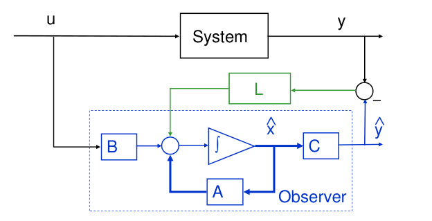
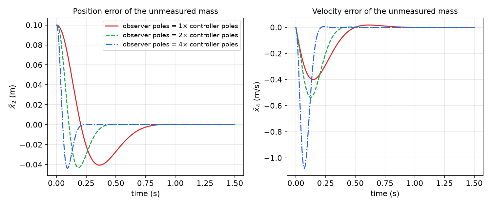
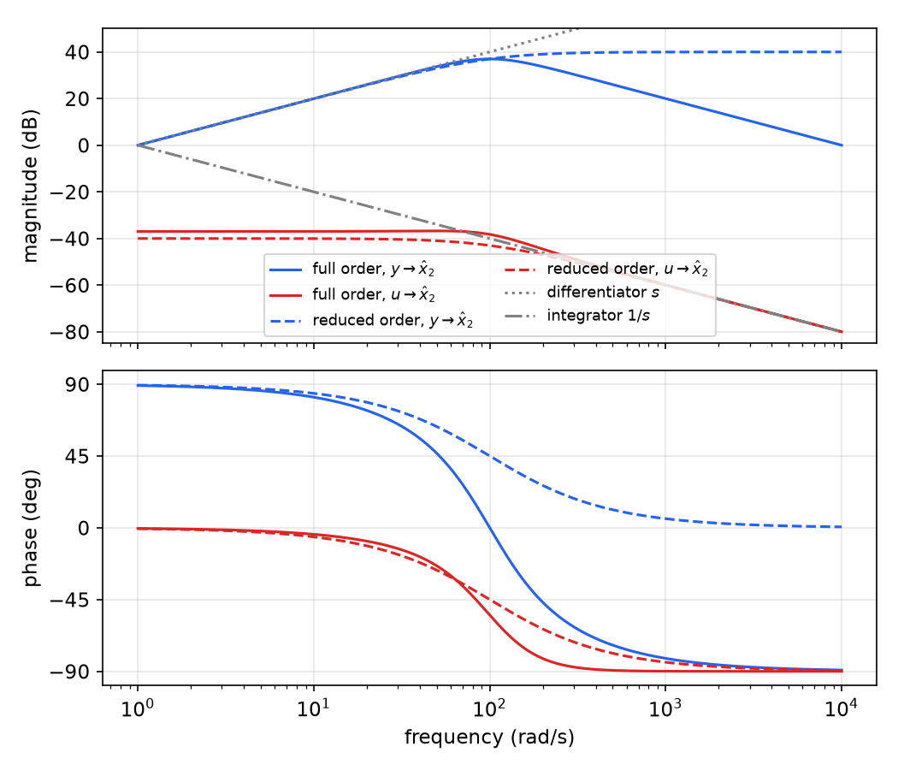
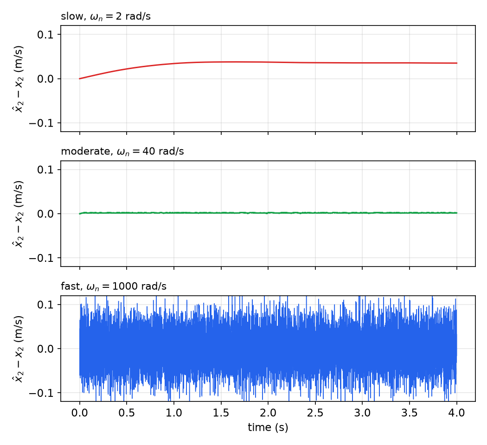

# Observers

State feedback, developed in [State Feedback and Pole Placement](state-feedback.md), assumes that every state variable is measured. In practice most are not: velocities, internal temperatures, currents in inaccessible windings, or the deflection of a flexible link are expensive or impossible to sense. An **observer** is a dynamic system that reconstructs the state from the measured input and output. This chapter develops the Luenberger observer, shows that its design is the mathematical dual of pole placement, explains how to choose its poles by viewing it as a filter, and derives the reduced-order observer, which estimates only the states that are not measured. The [next chapter](separation.md) closes the loop with the estimated state.

## Why Estimate the State?

Consider the plant
\\[
\dot x = Ax + Bu, \qquad y = Cx, \qquad x \in \mathbb{R}^n,\ y \in \mathbb{R}^p .
\\]
If \\((A,C)\\) is observable (see [Observability](observability.md)), the initial state, and therefore the whole state trajectory, is determined by the input and output over any interval. The observability proof reconstructs \\(x\\) from \\(y\\) and its first \\(n - 1\\) derivatives, but that is not a practical algorithm: repeated differentiation of a noisy signal amplifies the noise without bound. Two simpler ideas also fail.

- **Run a model in parallel.** Simulate \\(\dot{\hat x} = A\hat x + Bu\\). The error \\(\tilde x = x - \hat x\\) then obeys \\(\dot{\tilde x} = A\tilde x\\): it never shrinks if \\(A\\) has eigenvalues on the imaginary axis, grows if \\(A\\) is unstable, and in any case decays only at the plant's own rate. The model ignores the information in \\(y\\).
- **Invert the output map.** If \\(C\\) is square and invertible, \\(x = C^{-1}y\\). Usually \\(p < n\\) and there is nothing to invert.

The observer combines the two: run a model, and continuously correct it with the measured output.

## The Luenberger Observer

**Definition (Full-order observer).** A **Luenberger observer** for the plant is the system
\\[
\boxed{\dot{\hat x} = A\hat x + Bu + L(y - C\hat x)}
\\]
with state \\(\hat x \in \mathbb{R}^n\\) and **observer gain** \\(L \in \mathbb{R}^{n \times p}\\). The term \\(y - C\hat x = y - \hat y\\) is the **output prediction error** (also called the innovation); the observer injects it into the model through \\(L\\).



*Figure: the Luenberger observer. The blue dashed box is a copy of the plant model (B, integrator, A, C) driven by the same input u. Its predicted output ŷ is compared with the measured y, and the difference is fed back into the model through the gain L (green).*

Define the **estimation error** \\(\tilde x = x - \hat x\\). Subtracting the observer equation from the plant equation,
\\[
\dot{\tilde x} = Ax + Bu - A\hat x - Bu - L(Cx - C\hat x) = (A - LC)\tilde x .
\\]
The input cancels exactly, so the error dynamics are autonomous:
\\[
\boxed{\dot{\tilde x} = (A - LC)\tilde x, \qquad \tilde x(t) = e^{(A - LC)t}\tilde x(0).}
\\]
If every eigenvalue of \\(A - LC\\) lies in the open left half-plane, then \\(\tilde x(t) \to 0\\), that is, \\(\hat x(t) \to x(t)\\), for every input and every initial error, at a rate set by the **observer poles**, the eigenvalues of \\(\underline{A} := A - LC\\). The observer does not need to know the initial state; it forgets its initial guess.

**Observer pole-placement problem.** Choose \\(L\\) so that the eigenvalues of \\(A - LC\\) are at specified locations \\(\lambda\_1^{des},\dots,\lambda\_n^{des}\\).

### Duality with state feedback

A matrix and its transpose have the same eigenvalues, so
\\[
\operatorname{eig}(A - LC) = \operatorname{eig}(A - LC)^T = \operatorname{eig}(A^T - C^TL^T).
\\]
The right-hand side is a state-feedback problem: place the poles of \\(\mathcal{A} - \mathcal{B}\mathcal{K}\\) with
\\[
\mathcal{A} = A^T, \qquad \mathcal{B} = C^T, \qquad \mathcal{K} = L^T .
\\]
The controllability matrix of \\((A^T, C^T)\\) is \\([C^T\ \ A^TC^T\ \cdots\ (A^T)^{n-1}C^T] = Q^T\\), the transpose of the observability matrix \\(Q = [C;\ CA;\ \dots;\ CA^{n-1}]\\). The eigenvalue-assignment theorem of the previous chapter therefore transfers directly.

**Theorem (Observer eigenvalue assignment).** The eigenvalues of \\(A - LC\\) can be placed arbitrarily (in conjugate pairs) by a real \\(L\\) if and only if \\((A,C)\\) is observable. An \\(L\\) making \\(A - LC\\) Hurwitz exists if and only if \\((A,C)\\) is **detectable**, that is, every unobservable eigenvalue lies in the open left half-plane.

Any pole-placement routine computes observer gains: `L=acker(A',C',Pd)'` for a single output, `L=place(A',C',Pd)'` in general.

### Observer Bass–Gura and Ackermann formulas

Let \\(\Phi(s) = \det(sI - A) = s^n + a\_1s^{n-1} + \cdots + a\_n\\) and \\(\Phi^{des}(s) = \prod\_i(s - \lambda\_i^{des}) = s^n + d\_1s^{n-1} + \cdots + d\_n\\). For a single output, the state-feedback Bass–Gura formula applied to \\((A^T, C^T)\\) gives \\(L^T = (d - a)^T(Q^TW)^{-1}\\), with the same Toeplitz matrix \\(W\\) (the characteristic polynomials of \\(A\\) and \\(A^T\\) coincide). Transposing,
\\[
\boxed{L = \left(W^TQ\right)^{-1}(d - a) = \left(\begin{bmatrix} 1 & a\_1 & \cdots & a\_{n-1} \\\\ 0 & 1 & \cdots & a\_{n-2} \\\\ \vdots & & \ddots & \vdots \\\\ 0 & 0 & \cdots & 1 \end{bmatrix}^T Q\right)^{-1}\begin{bmatrix} d\_1 - a\_1 \\\\ \vdots \\\\ d\_{n-1} - a\_{n-1} \\\\ d\_n - a\_n \end{bmatrix}.}
\\]
Similarly, Ackermann's formula becomes
\\[
L = \Phi^{des}(A)\\,Q^{-1}\begin{bmatrix} 0 \\\\ \vdots \\\\ 0 \\\\ 1 \end{bmatrix}.
\\]
The matrix \\(W^TQ\\) transforms the system to **observable canonical form**; in those coordinates, as in the controller case, each observer gain shifts one coefficient of the characteristic polynomial, \\(l\_i = d\_i - a\_i\\).

**Example 12.1 (Observer for a DC servomotor).** A DC motor with negligible armature inductance has \\(P(s) = Y(s)/U(s) = k/(s(Js + b))\\), with \\(y\\) the shaft angle and \\(u\\) the armature voltage. With \\(k/J = 1\\) and \\(b/J = 5\\),
\\[
A = \begin{bmatrix} 0 & 1 \\\\ 0 & -5 \end{bmatrix}, \qquad B = \begin{bmatrix} 0 \\\\ 1 \end{bmatrix}, \qquad C = [1\ \ 0], \qquad \Phi(s) = s^2 + 5s .
\\]
The controller in the next chapter is designed for \\(\zeta = 0.8\\), \\(\omega\_n = 500\\) rad/s. Design an observer twice as fast: \\(\zeta = 0.8\\), \\(\omega\_n = 1000\\) rad/s.

*Solution.* The desired observer polynomial is \\(s^2 + 1600s + 10^6\\), so \\(d - a = [1600 - 5,\ 10^6 - 0]^T = [1595,\ 10^6]^T\\). Here \\(Q = \begin{bmatrix} C \\\\ CA \end{bmatrix} = I\\) and \\(W^T = \begin{bmatrix} 1 & 0 \\\\ 5 & 1 \end{bmatrix}\\), so
\\[
L = \begin{bmatrix} 1 & 0 \\\\ 5 & 1 \end{bmatrix}^{-1}\begin{bmatrix} 1595 \\\\ 10^6 \end{bmatrix} = \begin{bmatrix} 1 & 0 \\\\ -5 & 1 \end{bmatrix}\begin{bmatrix} 1595 \\\\ 10^6 \end{bmatrix} = \begin{bmatrix} 1595 \\\\ 992025 \end{bmatrix}.
\\]
As a check, \\(\det(sI - A + LC) = s^2 + (5 + l\_1)s + (5l\_1 + l\_2) = s^2 + 1600s + (7975 + 992025)\\). The observer equations are
\\[
\dot{\hat x}\_1 = \hat x\_2 + 1595(y - \hat x\_1), \qquad \dot{\hat x}\_2 = -5\hat x\_2 + u + 992025(y - \hat x\_1).
\\]
(The correction enters the second equation with a plus sign; writing \\(-992025\\) there would produce the characteristic polynomial \\(s^2 + 1600s - 984050\\), an unstable observer.)

**Example 12.2 (Tracking an evasive target).** A target moves along each axis with velocity \\(\dot x = c\_1 + c\_2\sin\omega t\\), so that \\(\dddot x + \omega^2\dot x = 0\\). Only position is measured. Design an observer for position, velocity and acceleration.

*Solution.* The axes are decoupled, so one third-order observer per axis suffices. With state \\([x,\ \dot x,\ \ddot x]\\),
\\[
A = \begin{bmatrix} 0 & 1 & 0 \\\\ 0 & 0 & 1 \\\\ 0 & -\omega^2 & 0 \end{bmatrix}, \qquad C = [1\ \ 0\ \ 0], \qquad \Phi(s) = s^3 + \omega^2 s .
\\]
The observability matrix is \\(Q = I\\), so the pair is observable. The observer is driven by the output alone, \\(\dot{\hat x} = A\hat x + L(y - C\hat x)\\), with
\\[
\det(sI - A + LC) = s^3 + L\_1s^2 + (\omega^2 + L\_2)s + (L\_3 + L\_1\omega^2).
\\]
Choose the observer poles at \\(-6\omega\\) and \\(-\sqrt2\omega(1 \pm j)\\), that is, \\(\Phi^{des}(s) = s^3 + 8.828\omega s^2 + 20.9668\omega^2s + 23.9928\omega^3\\). Matching coefficients,
\\[
L = \begin{bmatrix} 8.828\\,\omega \\\\ 19.9668\\,\omega^2 \\\\ 15.1648\\,\omega^3 \end{bmatrix}.
\\]
The third entry is \\(23.9928\omega^3 - L\_1\omega^2 = (23.9928 - 8.828)\omega^3\\). It is easy to drop the coupling term \\(L\_1\omega^2\\) or its sign; the Bass–Gura form \\(L = (W^TQ)^{-1}(d - a)\\) with \\(a = [0,\ \omega^2,\ 0]^T\\) does the bookkeeping automatically.

**Example 12.3 (Full-order observer for a two-mass speed-control system).** For the two-mass system of Example 11.7 (states \\(v\_1\\), \\(v\_2\\), spring deflection; output \\(y = v\_1\\)),
\\[
A = \begin{bmatrix} 0 & 0 & -\omega^2/2 \\\\ 0 & 0 & \omega^2/2 \\\\ 1 & -1 & 0 \end{bmatrix}, \qquad C = [1\ \ 0\ \ 0],
\\]
place the observer poles at \\(-10\omega\\) and \\(-10\omega \pm 10\omega j\\), ten times faster than the controller poles.

*Solution.* With \\(L = [l\_1,\ l\_2,\ l\_3]^T\\),
\\[
\det(sI - A + LC) = s^3 + l\_1s^2 + \left(\omega^2 - \tfrac{\omega^2}{2}l\_3\right)s + \tfrac{\omega^2}{2}(l\_1 + l\_2).
\\]
The desired polynomial is \\((s + 10\omega)(s^2 + 20\omega s + 200\omega^2) = s^3 + 30\omega s^2 + 400\omega^2s + 2000\omega^3\\), so
\\[
L = \begin{bmatrix} 30\omega \\\\ 3970\omega \\\\ -798 \end{bmatrix}, \qquad A - LC = \begin{bmatrix} -30\omega & 0 & -\omega^2/2 \\\\ -3970\omega & 0 & \omega^2/2 \\\\ 799 & -1 & 0 \end{bmatrix}.
\\]
The third gain is dimensionless because it multiplies the deflection equation, whose coefficients carry no \\(\omega\\).

## Choosing the Observer Poles

The observer poles can be placed anywhere, so where should they go? The standard rule is that **observer poles should be faster than the controller poles**, typically by a factor of 2 to 6. Once the observer has converged, a controller that uses \\(\hat x\\) behaves like one that uses \\(x\\); if the observer were slower than the controller, the closed-loop transient would be dominated by estimation error. There is no actuator cost to fast observer poles, because the observer is software. The limits are elsewhere.

- **Measurement noise.** A fast observer uses large gains \\(L\\) and trusts the measurement; it passes high-frequency noise into the estimate.
- **Model error and unmodelled inputs.** A slow observer trusts the model; biases in the input, unknown disturbances and parameter errors accumulate in the estimate.
- **Sampling.** In a digital implementation the observer poles must stay well inside the bandwidth that the sample rate supports.



*Figure: estimation error of the unmeasured second cart of the flexible two-mass system (output y = x₁) after an initial error of 0.1 m in x₂, for observer poles equal to 1×, 2× and 4× the controller poles −10, −10, −7.07 ± 7.07j. Faster poles shorten the transient (from about 0.8 s to 0.2 s) but produce larger peak errors in the velocity estimate, and the gains grow quickly: the largest entry of L rises from 383 to 1831 to 43 575.*

The best compromise depends on the noise and disturbance levels. Making that trade-off optimal, rather than by rule of thumb, is the subject of [Optimal Estimation and the Kalman Filter](kalman-filter.md), whose steady-state gain is a Luenberger gain chosen from the noise intensities.

## The Observer as a Filter

The observer is a linear system with two inputs, \\(u\\) and \\(y\\), and output \\(\hat x\\). Taking Laplace transforms of the observer equation with zero initial state, \\((sI - A + LC)\hat X = BU + LY\\), so
\\[
\boxed{\hat X(s) = G\_u(s)U(s) + G\_y(s)Y(s), \qquad G\_u(s) = (sI - \underline{A})^{-1}B, \quad G\_y(s) = (sI - \underline{A})^{-1}L, \quad \underline{A} = A - LC .}
\\]
Both transfer functions share the observer poles. The frequency responses of \\(G\_u\\) and \\(G\_y\\) show what the observer does with each signal, and therefore how it trades noise against model error.

**Example 12.4 (Velocity observer from position and acceleration).** Estimate velocity from a position measurement \\(y\\) and an acceleration measurement \\(u\\) (for example an encoder and an accelerometer). Treat the measured acceleration as the input:
\\[
\frac{d}{dt}\begin{bmatrix} x\_1 \\\\ x\_2 \end{bmatrix} = \begin{bmatrix} 0 & 1 \\\\ 0 & 0 \end{bmatrix}\begin{bmatrix} x\_1 \\\\ x\_2 \end{bmatrix} + \begin{bmatrix} 0 \\\\ 1 \end{bmatrix}u, \qquad y = x\_1 ,
\\]
with \\(x\_1\\) the position and \\(x\_2\\) the velocity.

*Solution.* The observer is
\\[
\frac{d}{dt}\begin{bmatrix} \hat x\_1 \\\\ \hat x\_2 \end{bmatrix} = \begin{bmatrix} 0 & 1 \\\\ 0 & 0 \end{bmatrix}\begin{bmatrix} \hat x\_1 \\\\ \hat x\_2 \end{bmatrix} + \begin{bmatrix} 0 \\\\ 1 \end{bmatrix}u + \begin{bmatrix} L\_1 \\\\ L\_2 \end{bmatrix}(y - \hat x\_1), \qquad A - LC = \begin{bmatrix} -L\_1 & 1 \\\\ -L\_2 & 0 \end{bmatrix}.
\\]
Its characteristic polynomial is \\(s^2 + L\_1s + L\_2\\). Specifying a natural frequency and damping ratio, \\(\Phi^{des} = s^2 + 2\zeta\omega\_ns + \omega\_n^2\\), gives
\\[
\boxed{L\_1 = 2\zeta\omega\_n, \qquad L\_2 = \omega\_n^2 .}
\\]
The transfer functions follow from
\\[
G\_u = \begin{bmatrix} s + 2\zeta\omega\_n & -1 \\\\ \omega\_n^2 & s \end{bmatrix}^{-1}\begin{bmatrix} 0 \\\\ 1 \end{bmatrix}, \qquad
G\_y = \begin{bmatrix} s + 2\zeta\omega\_n & -1 \\\\ \omega\_n^2 & s \end{bmatrix}^{-1}\begin{bmatrix} 2\zeta\omega\_n \\\\ \omega\_n^2 \end{bmatrix},
\\]
and the inverse of the \\(2 \times 2\\) matrix is \\(\frac{1}{s^2 + 2\zeta\omega\_ns + \omega\_n^2}\begin{bmatrix} s & 1 \\\\ -\omega\_n^2 & s + 2\zeta\omega\_n \end{bmatrix}\\). Hence
\\[
\hat X\_1(s) = \frac{U(s) + (2\zeta\omega\_ns + \omega\_n^2)Y(s)}{s^2 + 2\zeta\omega\_ns + \omega\_n^2}, \qquad
\hat X\_2(s) = \frac{(s + 2\zeta\omega\_n)U(s) + \omega\_n^2s\\,Y(s)}{s^2 + 2\zeta\omega\_ns + \omega\_n^2}.
\\]
If the measurements are perfect, \\(Y = U/s^2\\), and then
\\[
\hat X\_2 = \frac{(s + 2\zeta\omega\_n)s + \omega\_n^2}{s(s^2 + 2\zeta\omega\_ns + \omega\_n^2)}U = \frac{U}{s},
\\]
the exact velocity, whatever \\(\omega\_n\\) is. The observer is a **complementary filter**: the two paths sum to the identity on consistent data, and \\(\omega\_n\\) only decides which sensor is trusted at which frequency. The extreme cases make this explicit.

- **Fast observer, \\(\omega\_n \to \infty\\):** \\(\hat X\_1 \to Y\\) and \\(\hat X\_2 \to sY\\). The velocity is obtained by differentiating the position. A differentiator amplifies high-frequency noise.
- **Slow observer, \\(\omega\_n \to 0\\):** \\(\hat X\_1 \to U/s^2\\) and \\(\hat X\_2 \to U/s\\). The velocity is obtained by integrating the acceleration. An integrator turns any offset into a ramp.

In general the observer estimates each state by combining a **low-pass-filtered** version of one sensor with a **high-pass-filtered** version of the other.

```matlab
A=[0 1;0 0]; B=[0;1];
C1=[1 0]; C2=[0 1];                 % measured output, estimated output
zeta=0.707; wn=100;
wd=sqrt(1-zeta^2)*wn;
L=acker(A',C1',[-zeta*wn+j*wd;-zeta*wn-j*wd])';
Gu=ss(A-L*C1,B,C2,0);               % Xhat2 = Gu*U + Gy*Y
Gy=ss(A-L*C1,L,C2,0);
bode(Gu,Gy);
```



*Figure: frequency response from each sensor to the velocity estimate, for the full-order observer with ζ = 0.707, ω_n = 100 rad/s (solid) and the first-order reduced-order observer of Example 12.5 with pole at −100 (dashed). Blue: from position y; red: from acceleration u. Below about 100 rad/s the position path follows the differentiator s (gray dotted); above it the acceleration path follows the integrator 1/s (gray dash-dot). The full-order observer rolls the position path off at high frequency; the reduced-order observer passes it with a constant gain of 100 (40 dB), so position noise reaches the estimate unattenuated.*

The time-domain consequence is shown below with realistic sensor imperfections: white position noise of standard deviation 0.2 mm (sampled at 10 kHz) and an accelerometer bias \\(b = 0.05\\) m/s². With a constant input bias, the error equation \\(\dot{\tilde x} = (A - LC)\tilde x - Bb\\) has the steady state \\(\tilde x = (A - LC)^{-1}Bb\\), which gives
\\[
\hat x\_2 - x\_2 \to \frac{2\zeta}{\omega\_n}\\,b .
\\]
The bias error falls as \\(1/\omega\_n\\), while the noise passed by the position path grows with \\(\omega\_n\\).



*Figure: velocity estimation error for the full-order velocity observer at three bandwidths, with position noise and an accelerometer bias of 0.05 m/s². Slow (ω_n = 2 rad/s): almost no noise, but a steady bias error of 2ζb/ω_n ≈ 0.035 m/s. Moderate (ω_n = 40): bias error 0.0018 m/s and noise of standard deviation 0.0003 m/s. Fast (ω_n = 1000): no visible bias, but noise of standard deviation 0.037 m/s, as bad as the slow observer's bias.*

## Reduced-Order Observers

A full-order observer estimates all \\(n\\) states, including those that are measured. If the measurements are accurate, that is wasteful: \\(p\\) states are already known, and only \\(n - p\\) need to be estimated. A **reduced-order observer** (ROO) estimates just these.

### Partitioned form

Suppose first that the measured outputs are the first \\(q\\) states. Partition the state as \\(x = (x\_1, x\_2)\\), with \\(x\_1 \in \mathbb{R}^q\\) measured and \\(x\_2 \in \mathbb{R}^{n-q}\\) unmeasured:
\\[
\frac{d}{dt}\begin{bmatrix} x\_1 \\\\ x\_2 \end{bmatrix} = \begin{bmatrix} A\_{11} & A\_{12} \\\\ A\_{21} & A\_{22} \end{bmatrix}\begin{bmatrix} x\_1 \\\\ x\_2 \end{bmatrix} + \begin{bmatrix} B\_1 \\\\ B\_2 \end{bmatrix}u, \qquad y = [I\_{q \times q}\ \ 0]\begin{bmatrix} x\_1 \\\\ x\_2 \end{bmatrix} = x\_1 .
\\]
Any system with \\(C\\) of full row rank \\(q\\) can be brought to this form: choose \\(R \in \mathbb{R}^{(n-q) \times n}\\) so that
\\[
T = \begin{bmatrix} C \\\\ R \end{bmatrix}
\\]
is invertible and use the new state \\(Tx = (y, Rx)\\). The reduced-order observer then estimates the \\((n - q)\\)-dimensional vector \\(x\_2\\).

### The reduced system

Rewrite the two block rows so that \\(x\_2\\) looks like the state of a smaller system:
\\[
\dot x\_2 = A\_{22}x\_2 + \underbrace{(A\_{21}x\_1 + B\_2u)}\_{\text{known}}, \qquad \underbrace{\dot x\_1 - A\_{11}x\_1 - B\_1u}\_{\text{known}} = A\_{12}x\_2 .
\\]
Define the known signals
\\[
\bar u = A\_{21}y + B\_2u, \qquad \bar y = \dot y - A\_{11}y - B\_1u .
\\]
Then \\(x\_2\\) is the state of the \\((n - q)\\)-dimensional system
\\[
\dot x\_2 = A\_{22}x\_2 + \bar u, \qquad \bar y = A\_{12}x\_2 ,
\\]
whose "output" \\(\bar y\\) is the part of \\(\dot y\\) that the unmeasured states produce.

**Proposition.** \\((A,C)\\) with \\(C = [I\ \ 0]\\) is observable if and only if \\((A\_{22}, A\_{12})\\) is observable.

*Proof.* Use the PBH test. \\((A,C)\\) is unobservable if and only if there are \\(\lambda\\) and \\(v = (v\_1, v\_2) \ne 0\\) with \\(Av = \lambda v\\) and \\(Cv = 0\\). The second condition gives \\(v\_1 = 0\\), so \\(v\_2 \ne 0\\), and the first becomes \\(A\_{12}v\_2 = 0\\) (first block row) and \\(A\_{22}v\_2 = \lambda v\_2\\) (second block row). These are exactly the PBH conditions for \\(v\_2\\) to be an unobservable eigenvector of \\((A\_{22}, A\_{12})\\). \\(\square\\)

### The observer and the removal of the derivative

A Luenberger observer for the reduced system is
\\[
\dot{\hat x}\_2 = A\_{22}\hat x\_2 + \bar u + L(\bar y - A\_{12}\hat x\_2),
\\]
and its error obeys \\(\dot{\tilde x}\_2 = (A\_{22} - LA\_{12})\tilde x\_2\\). By the proposition, \\(L\\) can place the eigenvalues of \\(A\_{22} - LA\_{12}\\) anywhere when \\((A,C)\\) is observable.

The difficulty is that \\(\bar y\\) contains \\(\dot y\\), and differentiating the measurement is exactly what we wanted to avoid. Substituting \\(\bar y\\),
\\[
\dot{\hat x}\_2 = A\_{22}\hat x\_2 + \bar u + L\left(\dot y - A\_{11}y - B\_1u - A\_{12}\hat x\_2\right).
\\]
The derivative appears only in the term \\(L\dot y\\), so move it to the left-hand side by defining the new state
\\[
z = \hat x\_2 - Ly .
\\]
Then \\(\dot z = \dot{\hat x}\_2 - L\dot y\\), and with \\(\hat x\_2 = z + Ly\\),
\\[
\dot z = A\_{22}(z + Ly) + A\_{21}y + B\_2u - L\left[A\_{11}y + B\_1u + A\_{12}(z + Ly)\right].
\\]
Collecting the terms in \\(z\\), \\(u\\) and \\(y\\) gives the implementable form.

**Theorem (Reduced-order observer).** If \\((A,C)\\) is observable and \\(L\\) places the eigenvalues of \\(A\_{22} - LA\_{12}\\) in the open left half-plane, then the system
\\[
\boxed{\dot z = A\_rz + B\_uu + B\_yy, \qquad \hat x\_2 = z + Ly,}
\\]
\\[
\boxed{A\_r = A\_{22} - LA\_{12}, \qquad B\_u = B\_2 - LB\_1, \qquad B\_y = A\_rL + A\_{21} - LA\_{11},}
\\]
of order \\(n - q\\), uses only \\(u\\) and \\(y\\), and its estimate satisfies \\(\hat x\_2(t) \to x\_2(t)\\) with error dynamics \\(\dot{\tilde x}\_2 = A\_r\tilde x\_2\\).

*Proof of the error dynamics.* Differentiate \\(\hat x\_2 = z + Ly\\) and use \\(\dot y = A\_{11}y + A\_{12}x\_2 + B\_1u\\) and \\(z = \hat x\_2 - Ly\\):
\\[
\dot{\hat x}\_2 = A\_r(\hat x\_2 - Ly) + (B\_2 - LB\_1)u + (A\_rL + A\_{21} - LA\_{11})y + L(A\_{11}y + A\_{12}x\_2 + B\_1u) = A\_r\hat x\_2 + A\_{21}y + B\_2u + LA\_{12}x\_2 .
\\]
Subtracting from \\(\dot x\_2 = A\_{21}y + A\_{22}x\_2 + B\_2u\\) gives \\(\dot{\tilde x}\_2 = (A\_{22} - LA\_{12})x\_2 - A\_r\hat x\_2 = A\_r\tilde x\_2\\). \\(\square\\)

The full state estimate is \\(\hat x = (y,\ z + Ly)\\) in the partitioned coordinates, or \\(T^{-1}(y,\ z + Ly)\\) in the original ones.

**Example 12.5 (Reduced-order velocity observer).** For the position–acceleration problem of Example 12.4, position is measured and only the velocity is unknown. The partition is
\\[
A\_{11} = 0,\quad A\_{12} = 1,\quad A\_{21} = 0,\quad A\_{22} = 0,\quad B\_1 = 0,\quad B\_2 = 1 ,
\\]
so \\(A\_r = -L\\), \\(B\_u = 1\\), \\(B\_y = -L^2\\), and the observer is the first-order system
\\[
\dot z = -Lz + u - L^2y, \qquad \hat x\_2 = z + Ly .
\\]
Its transfer function is
\\[
\boxed{\hat X\_2(s) = \frac{1}{s + L}U(s) + \frac{Ls}{s + L}Y(s).}
\\]
With perfect data (\\(Y = U/s^2\\)), \\(\hat X\_2 = \frac{U}{s + L} + \frac{LU}{s(s + L)} = \frac{U}{s}\\), the exact velocity. This is a first-order complementary filter: integrated acceleration passed through a low-pass filter plus differentiated position passed through a high-pass filter, both with corner frequency \\(L\\). As \\(L \to \infty\\), \\(\hat x\_2 \to \dot y\\); as \\(L \to 0\\), \\(\hat x\_2 \to \int\_0^t u(\tau)\\,d\tau\\). Compared with the full-order observer (dashed versus solid curves in the Bode figure), the reduced-order observer has one pole fewer and therefore no roll-off of the position path at high frequency.

**Example 12.6 (Reduced-order observer for the DC servomotor).** For a servo \\(G(s) = b/(s(s + a))\\) in the form \\(\dot x\_1 = x\_2\\), \\(\dot x\_2 = -ax\_2 + bu\\), \\(y = x\_1\\), estimate the velocity with a first-order observer whose pole is at \\(-p\\).

*Solution.* Now \\(A\_{11} = 0\\), \\(A\_{12} = 1\\), \\(A\_{21} = 0\\), \\(A\_{22} = -a\\), \\(B\_1 = 0\\), \\(B\_2 = b\\). The observer pole is \\(A\_r = -a - L = -p\\), so \\(L = p - a\\). Then \\(B\_u = b\\) and \\(B\_y = A\_rL = -p(p - a)\\):
\\[
\dot z = -pz - p(p - a)y + bu, \qquad \hat x\_2 = z + (p - a)y .
\\]
With \\(a = 5\\), \\(b = 1\\) and \\(p = 1000\\) (the same speed as the full-order observer of Example 12.1), \\(L = 995\\). The full-order observer needs two states and the gains 1595 and 992025; the reduced-order one needs one state.

**Example 12.7 (Reduced-order observer for the two-mass speed system).** In Example 12.3 the velocity \\(v\_1\\) is measured, so only \\(x\_b = [v\_2,\ \delta]^T\\) (velocity of the second mass and spring deflection) must be estimated. Place the two observer poles at \\(10\omega(-1 \pm j)\\).

*Solution.* The partition is
\\[
A\_{11} = 0,\quad A\_{12} = [0\ \ -\omega^2/2],\quad A\_{21} = \begin{bmatrix} 0 \\\\ 1 \end{bmatrix},\quad A\_{22} = \begin{bmatrix} 0 & \omega^2/2 \\\\ -1 & 0 \end{bmatrix},\quad B\_1 = 0,\quad B\_2 = \begin{bmatrix} 1 \\\\ 0 \end{bmatrix}.
\\]
With \\(L = [L\_1,\ L\_2]^T\\), \\(\det(sI - A\_{22} + LA\_{12}) = s^2 - \tfrac{\omega^2}{2}L\_2\\,s + \tfrac{\omega^2}{2}(1 + L\_1)\\). Matching \\(s^2 + 20\omega s + 200\omega^2\\),
\\[
L\_1 = 399, \qquad L\_2 = -\frac{40}{\omega},
\\]
\\[
A\_r = \begin{bmatrix} 0 & 200\omega^2 \\\\ -1 & -20\omega \end{bmatrix}, \qquad B\_u = \begin{bmatrix} 1 \\\\ 0 \end{bmatrix}, \qquad B\_y = A\_rL + A\_{21} = \begin{bmatrix} -8000\omega \\\\ 402 \end{bmatrix}.
\\]
Since \\(B\_1 = 0\\), \\(B\_u = B\_2\\) exactly; the input enters the estimate of \\(v\_2\\), not the deflection. The [next chapter](separation.md) combines this observer with the controller of Example 11.7.

**Example 12.8 (Inverted pendulum with three sensors: which outputs suffice?).** A pendulum on a driven cart has state \\([\theta,\ \dot\theta,\ x\_c,\ \dot x\_c]\\) and
\\[
A = \begin{bmatrix} 0 & 1 & 0 & 0 \\\\ 30 & 0 & 0 & 20 \\\\ 0 & 0 & 0 & 1 \\\\ -2 & 0 & 0 & -10 \end{bmatrix}, \quad B = \begin{bmatrix} 0 \\\\ -25 \\\\ 0 \\\\ 10 \end{bmatrix}, \quad C = \begin{bmatrix} 40 & 0 & 0 & 0 \\\\ 0 & 0 & 10 & 0 \\\\ 0 & 0 & 0 & -5 \end{bmatrix},
\\]
with sensors for the angle, the cart position and the cart velocity (with gains 40, 10 and −5). The open-loop eigenvalues are \\(0,\ 5.232,\ -4.733,\ -10.499\\).

*Solution.* Three of the four states are measured; only \\(\dot\theta\\) is not. Take \\(T = \begin{bmatrix} C \\\\ [0\ 1\ 0\ 0] \end{bmatrix}\\). In the new coordinates the unmeasured state is \\(\dot\theta\\); its only appearance in the measured equations is \\(\dot y\_1 = 40\dot\theta\\), so \\(A\_{12} = [40,\ 0,\ 0]^T\\), and \\(A\_{22} = 0\\) (\\(\ddot\theta\\) does not depend on \\(\dot\theta\\)). The observer pole is \\(A\_r = -40L\_1\\) for \\(L = [L\_1\ \ L\_2\ \ L\_3]\\); choosing it at \\(-80\\) gives \\(L = [2\ \ 0\ \ 0]\\): the estimate of \\(\dot\theta\\) is a filtered derivative of the angle measurement, corrected by the model.

Could a single sensor do? Computing the rank of \\([c;\ cA;\ cA^2;\ cA^3]\\) for each row \\(c\\) of \\(C\\):

- angle only: rank 3;
- cart velocity only: rank 3;
- cart position only: rank 4.

Only the cart position makes the system observable by itself. Angle and velocity sensors cannot detect the integrator mode at \\(s = 0\\): a constant offset of the cart position changes neither the angle nor the velocity.

### Full-order or reduced-order?

The reduced-order observer has lower order, so the resulting compensator is simpler (order \\(n - q\\) instead of \\(n\\)), and it passes the measured states through without lag. Its estimates of the *unmeasured* states, however, contain the term \\(Ly\\) with no filtering: measurement noise reaches \\(\hat x\_2\\) directly, as the flat high-frequency asymptote in the Bode figure shows. The full-order observer filters every measurement through the observer dynamics. When the measurements are clean, the reduced-order observer is attractive; when they are noisy, a full-order observer (or a Kalman filter) is usually preferred. With fast observer poles the two behave almost identically, as the simulations in the [next chapter](separation.md) show.

## Computation

| Task | MATLAB | Python |
|---|---|---|
| Observer gain, single output | `L=acker(A',C',p)'` | `control.acker(A.T,C.T,p).T` |
| Observer gain, general | `L=place(A',C',p)'` | `scipy.signal.place_poles(A.T,C.T,p).gain_matrix.T` |
| Observability matrix | `obsv(A,C)` | `control.obsv(A,C)` |
| Observer as a system | `ss(A-L*C,[B L],eye(n),0)` | `control.ss(A-L@C, np.hstack([B,L]), np.eye(n), 0)` |

The discrete-time observers (prediction and current observers, and the deadbeat observer that converges in \\(n\\) steps) are developed in [Digital Observers](../me6403-digital-control/observers.md).

## Summary

- The **Luenberger observer** \\(\dot{\hat x} = A\hat x + Bu + L(y - C\hat x)\\) has error dynamics \\(\dot{\tilde x} = (A - LC)\tilde x\\), independent of the input.
- **Duality:** \\(\operatorname{eig}(A - LC) = \operatorname{eig}(A^T - C^TL^T)\\), so observer design is pole placement for \\((A^T, C^T)\\). The observer poles can be placed arbitrarily iff \\((A,C)\\) is observable; a convergent observer exists iff \\((A,C)\\) is detectable.
- **Observer Bass–Gura:** \\(L = (W^TQ)^{-1}(d - a)\\); **Ackermann:** \\(L = \Phi^{des}(A)Q^{-1}e\_n\\).
- Observer poles are usually 2–6 times faster than the controller poles. Fast observers amplify measurement noise; slow observers accumulate model error and input bias (for the velocity observer the bias error is \\(2\zeta b/\omega\_n\\)).
- As a filter, \\(\hat X = (sI - A + LC)^{-1}(BU + LY)\\). The velocity observer is a **complementary filter**: differentiated position at low frequency, integrated acceleration at high frequency, with \\(L\_1 = 2\zeta\omega\_n\\), \\(L\_2 = \omega\_n^2\\).
- The **reduced-order observer** estimates only the \\(n - q\\) unmeasured states: \\(\dot z = A\_rz + B\_uu + B\_yy\\), \\(\hat x\_2 = z + Ly\\), with \\(A\_r = A\_{22} - LA\_{12}\\), \\(B\_u = B\_2 - LB\_1\\), \\(B\_y = A\_rL + A\_{21} - LA\_{11}\\); it exists iff \\((A\_{22}, A\_{12})\\), equivalently \\((A,C)\\), is observable.
- DC-servo numbers: observer poles \\(s^2 + 1600s + 10^6\\) give \\(L = [1595;\ 992025]\\).

## See Also

- [Observability](observability.md): the rank and PBH tests used here.
- [State Feedback and Pole Placement](state-feedback.md): the dual problem.
- [Combined Controller–Observer Design](separation.md): feedback of the estimated state and the separation principle.
- [Optimal Estimation and the Kalman Filter](kalman-filter.md): choosing \\(L\\) from noise statistics.
- [Digital Observers](../me6403-digital-control/observers.md): the discrete-time version.
- Modern Control: the overview chapter.
- Probability: background for the stochastic view of estimation.
