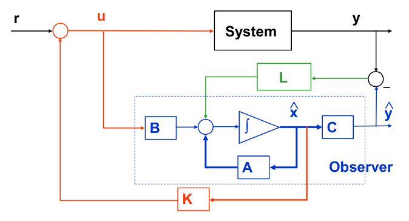
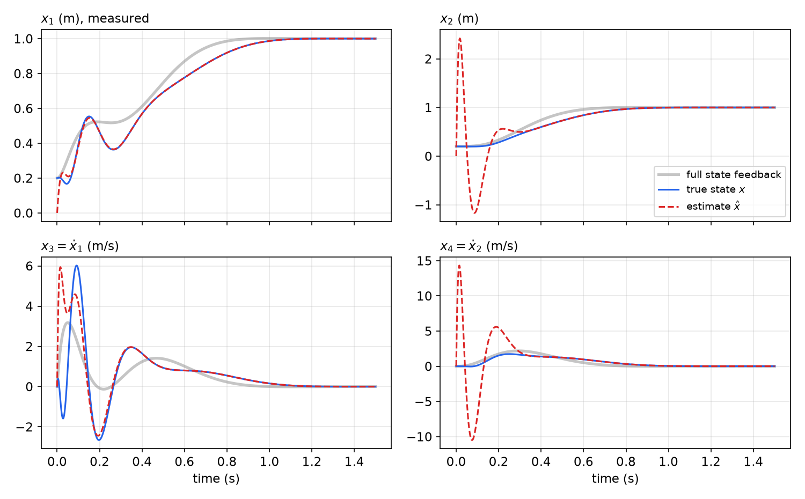
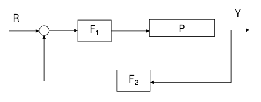
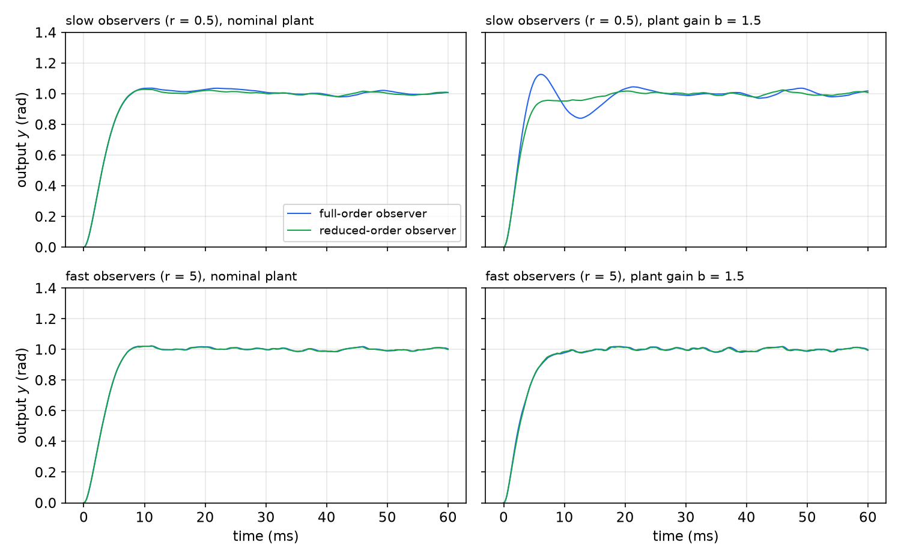

# Combined Controller–Observer Design

The two previous chapters solved two halves of one problem. [State feedback](state-feedback.md) places the closed-loop poles if the whole state is measured; an [observer](observers.md) reconstructs the state from the input and output. This chapter puts them together: the controller feeds back the *estimated* state. The central result, the **separation principle**, says that the two designs do not interfere: the closed-loop poles are the controller poles together with the observer poles, and the reference-to-output transfer function is the same as with full state feedback. We then rewrite the combined system as an ordinary output-feedback compensator with a feedforward block \\(F\_1\\) and a feedback block \\(F\_2\\), work through a DC-servo example with full- and reduced-order observers, compare them under noise and model error, and finally derive the same compensators directly from polynomial (Diophantine) equations.

## Observer-Based State Feedback

In most applications not all state variables are measured. A full-order or reduced-order observer can supply the missing ones, and the controller then uses the estimate:
\\[
\begin{aligned}
\text{plant:}&\quad \dot x = Ax + Bu, \qquad y = Cx, \\\\
\text{controller:}&\quad u = -K\hat x + r, \\\\
\text{observer:}&\quad \dot{\hat x} = A\hat x + Bu + L(y - C\hat x).
\end{aligned}
\\]



*Figure: observer-based state feedback. The observer (blue dashed box) runs a model of the plant driven by the same control u, corrects it with L times the output prediction error y − ŷ (green), and the estimate x̂ is fed back through the gain K (red) to form u = −Kx̂ + r.*

The compensator, the map from \\(y\\) and \\(r\\) to \\(u\\), is a dynamic system of order \\(n\\) (or \\(n - q\\) with a reduced-order observer). Its design involves two gains, \\(K\\) and \\(L\\), each chosen by pole placement.

## The Separation Principle

Write the estimate as \\(\hat x = x - \tilde x\\). The plant equation becomes
\\[
\dot x = Ax + B(-K(x - \tilde x) + r) = (A - BK)x + BK\tilde x + Br,
\\]
and the error obeys \\(\dot{\tilde x} = (A - LC)\tilde x\\) as before, because the observer receives the same \\(u\\) as the plant. Together,
\\[
\boxed{\frac{d}{dt}\begin{bmatrix} x \\\\ \tilde x \end{bmatrix} = \begin{bmatrix} A - BK & BK \\\\ 0 & A - LC \end{bmatrix}\begin{bmatrix} x \\\\ \tilde x \end{bmatrix} + \begin{bmatrix} B \\\\ 0 \end{bmatrix}r, \qquad y = [C\ \ 0]\begin{bmatrix} x \\\\ \tilde x \end{bmatrix}.}
\\]
(With the error defined instead as \\(\hat x - x\\), the upper-right block is \\(-BK\\); the structure is the same.)

**Theorem (Separation principle).** The closed-loop eigenvalues of observer-based state feedback are the eigenvalues of \\(A - BK\\) (the controller poles) together with the eigenvalues of \\(A - LC\\) (the observer poles), counting multiplicities:
\\[
\det\begin{bmatrix} sI - A + BK & -BK \\\\ 0 & sI - A + LC \end{bmatrix} = \det(sI - A + BK)\\,\det(sI - A + LC).
\\]
Consequently \\(K\\) and \\(L\\) may be designed independently: if \\((A,B)\\) is controllable and \\((A,C)\\) observable, all \\(2n\\) closed-loop poles can be placed arbitrarily.

*Proof.* The closed-loop matrix is block upper triangular in the coordinates \\((x, \tilde x)\\), and the determinant of a block-triangular matrix is the product of the determinants of its diagonal blocks. The coordinates \\((x, \tilde x)\\) are related to the natural coordinates \\((x, \hat x)\\) of the implemented system by the invertible map \\(\begin{bmatrix} x \\\\ \tilde x \end{bmatrix} = \begin{bmatrix} I & 0 \\\\ I & -I \end{bmatrix}\begin{bmatrix} x \\\\ \hat x \end{bmatrix}\\), and in those coordinates the closed-loop matrix is
\\[
\begin{bmatrix} A & -BK \\\\ LC & A - BK - LC \end{bmatrix},
\\]
which is similar to the triangular one and has the same eigenvalues. \\(\square\\)

### The observer is invisible from the reference

Take Laplace transforms with zero initial conditions:
\\[
(sI - A + BK)X(s) - BK\tilde X(s) = BR(s), \qquad (sI - A + LC)\tilde X(s) = 0 .
\\]
The second equation gives \\(\tilde X = 0\\), so
\\[
\boxed{G\_{closed}(s) = \frac{Y(s)}{R(s)} = C(sI - A + BK)^{-1}B ,}
\\]
**the same transfer function as with full state feedback**. The \\(n\\) observer poles do not appear. In the language of [Structural Decompositions](structure.md), the error states are uncontrollable from \\(r\\): the input \\(r\\) drives the plant and the observer identically, so it cannot create a difference between them. The observer poles therefore cancel in \\(G\_{closed}\\).

They are not irrelevant. They govern the response to initial estimation errors, to disturbances that act on the plant but not on the observer, to measurement noise, and to model error, none of which is captured by \\(G\_{closed}\\). The separation principle is a statement about the nominal model; it guarantees nothing about robustness. Observer-based controllers can have arbitrarily small stability margins even when the state-feedback design is very robust, a fact that motivates loop transfer recovery in [LQG Control and Loop Transfer Recovery](lqg.md).

**Example 13.1 (The flexible two-mass system with an observer).** Return to the flexible system of the state-feedback chapter, with the gain \\(K = [382.8\ \ -182.8\ \ 34.14\ \ 34.14]\\) placing the controller poles at \\(-10, -10, 5\sqrt2(-1 \pm j)\\). Suppose only the position of the first cart is measured, \\(y = x\_1\\). The pair \\((A,C)\\) is observable (the transfer function \\((s^2 + 50)/(s^2(s^2 + 100))\\) has no pole–zero cancellation), so an observer can be placed. Choose the observer poles three times faster, at \\(-30, -30, -21.2 \pm 21.2j\\); Ackermann's formula for \\((A^T, C^T)\\) gives
\\[
L = [102.4\ \ 1741\ \ 4246\ \ 11954]^T .
\\]
The eight closed-loop eigenvalues are exactly the four controller poles and the four observer poles. To see the role of the observer, start the plant displaced, \\(x(0) = [0.2,\ 0.2,\ 0,\ 0]^T\\), and the observer at \\(\hat x(0) = 0\\), and command \\(r = 200\\) (so that \\(y\_d = 1\\)).



*Figure: observer-based control of the flexible system with only x₁ measured. Blue: true states; red dashed: observer estimates; gray: the response with full state feedback from the same initial state. The estimate of the measured position x₁ converges almost at once; the unmeasured position x₂ and both velocities show large estimation transients (x̂₄ swings to +14 and −10 m/s) that die out in about 0.25 s, three times faster than the controller modes. While the estimate is wrong the control is wrong too, so the true response departs from the full-state-feedback response during the first 0.3 s; after the estimate converges the two responses differ only by the leftover controller transient, and both settle at x₁ = x₂ = 1.*

Had the observer started with the correct state, the red, blue and gray curves would coincide: \\(r\\) alone cannot excite the error modes.

## Transfer-Function Form of the Compensator

An observer-based controller is a linear, time-invariant output-feedback compensator, and it is useful to write it as one. With zero initial conditions the observer gives
\\[
\hat X(s) = (sI - \underline{A})^{-1}(BU + LY), \qquad \underline{A} = A - LC,
\\]
and the control law becomes
\\[
U = -K(sI - \underline{A})^{-1}(BU + LY) + R .
\\]
Collecting the terms in \\(U\\),
\\[
\left[I + K(sI - \underline{A})^{-1}B\right]U = R - K(sI - \underline{A})^{-1}L\\,Y ,
\\]
so
\\[
\boxed{U(s) = F\_1(s)\left[R(s) - F\_2(s)Y(s)\right], \qquad F\_1(s) = \left[I + K(sI - \underline{A})^{-1}B\right]^{-1}, \quad F\_2(s) = K(sI - \underline{A})^{-1}L .}
\\]



*Figure: the observer-based controller as a two-block compensator. The output Y is filtered by F₂ and subtracted from the reference; the difference passes through F₁ to the plant P. F₁ sits in both the forward and the feedback path, so the loop gain is F₁F₂P.*

With \\(P(s) = C(sI - A)^{-1}B\\),
\\[
G\_{closed}(s) = \left(I + PF\_1F\_2\right)^{-1}PF\_1 = C(sI - A + BK)^{-1}B .
\\]
The second equality is the separation result of the previous section, expressed for the equivalent block diagram.

For a SISO plant \\(P = B\_p(s)/A\_p(s)\\) the structure is transparent. Both \\(F\_1\\) and \\(F\_2\\) have the observer polynomial \\(\Lambda(s) = \det(sI - A + LC)\\) in common: \\(F\_1 = \Lambda/\alpha\\) and \\(F\_2 = \beta/\Lambda\\) for some polynomials \\(\alpha\\) and \\(\beta\\). Then
\\[
\frac{Y}{R} = \frac{(B\_p/A\_p)(\Lambda/\alpha)}{1 + (B\_p/A\_p)(\Lambda/\alpha)(\beta/\Lambda)} = \frac{B\_p\Lambda}{\alpha A\_p + \beta B\_p},
\\]
and the separation principle says \\(\alpha A\_p + \beta B\_p = \Lambda\\,\Phi^{des}\\), where \\(\Phi^{des} = \det(sI - A + BK)\\). The observer polynomial cancels between numerator and denominator. This observation is the starting point of the polynomial design method at the end of the chapter.

**Reference scaling.** When the plant contains an integrator, as servo plants do, the DC gain from \\(r\\) to \\(y\\) equals \\(1/F\_2(0)\\). A unit set point therefore needs \\(r = g\\,y\_d\\) with \\(g = F\_2(0) = -K\underline{A}^{-1}L\\).

## Example: DC Servomotor with a Full-Order Observer

**Example 13.2 (DC servo, full-order observer).** The servo of Example 12.1 has
\\[
P(s) = \frac{1}{s(s + 5)}, \qquad A = \begin{bmatrix} 0 & 1 \\\\ 0 & -5 \end{bmatrix}, \quad B = \begin{bmatrix} 0 \\\\ 1 \end{bmatrix}, \quad C = [1\ \ 0],
\\]
with \\(y\\) the shaft angle and \\(u\\) the armature voltage (the motor parameters are \\(k/J = 1\\), \\(b/J = 5\\), armature inductance neglected). Design a controller with \\(\zeta = 0.8\\) and \\(\omega\_n = 500\\) rad/s (overshoot below 3%, settling time about 0.01 s) and a full-order observer twice as fast. Find \\(F\_1\\), \\(F\_2\\) and the closed-loop transfer function.

*Solution.*

1. **Controller.** The desired polynomial is \\(s^2 + 2(0.8)(500)s + 500^2 = s^2 + 800s + 250000\\). With \\(A - BK = \begin{bmatrix} 0 & 1 \\\\ -k\_1 & -5 - k\_2 \end{bmatrix}\\) the characteristic polynomial is \\(s^2 + (5 + k\_2)s + k\_1\\), so
\\[
K = [250000\ \ \ 795].
\\]
2. **Observer.** As in Example 12.1, \\(\zeta = 0.8\\), \\(\omega\_n = 1000\\) give \\(\Lambda(s) = s^2 + 1600s + 10^6\\) and
\\[
L = \begin{bmatrix} 1595 \\\\ 992025 \end{bmatrix}, \qquad \underline{A} = A - LC = \begin{bmatrix} -1595 & 1 \\\\ -992025 & -5 \end{bmatrix}.
\\]
3. **Compensator.** Since \\(\det(sI - \underline{A}) = \Lambda(s)\\) and \\((sI - \underline{A})^{-1} = \frac{1}{\Lambda(s)}\begin{bmatrix} s + 5 & 1 \\\\ -992025 & s + 1595 \end{bmatrix}\\),
\\[
K(sI - \underline{A})^{-1}B = \frac{795s + 1.518 \times 10^6}{s^2 + 1600s + 10^6}, \qquad
K(sI - \underline{A})^{-1}L = \frac{1.187 \times 10^9s + 2.5 \times 10^{11}}{s^2 + 1600s + 10^6}.
\\]
Hence
\\[
F\_1(s) = \frac{s^2 + 1600s + 10^6}{s^2 + 2395s + 2.518 \times 10^6}, \qquad F\_2(s) = \frac{1.187 \times 10^9s + 2.5 \times 10^{11}}{s^2 + 1600s + 10^6}.
\\]
4. **Closed loop.** Substituting into \\(G\_{closed} = PF\_1/(1 + PF\_1F\_2)\\),
\\[
G\_{closed}(s) = \frac{s^2 + 1600s + 10^6}{s(s + 5)(s^2 + 2395s + 2.518 \times 10^6) + 1.187 \times 10^9s + 2.5 \times 10^{11}} .
\\]
The denominator expands to \\(s^4 + 2400s^3 + 2.53 \times 10^6s^2 + 1.2 \times 10^9s + 2.5 \times 10^{11} = (s^2 + 800s + 250000)(s^2 + 1600s + 10^6)\\): controller polynomial times observer polynomial, as the separation principle predicts. The observer factor cancels the numerator, a **pole–zero cancellation**, and
\\[
\boxed{G\_{closed}(s) = \frac{1}{s^2 + 800s + 250000},}
\\]
exactly the full-state-feedback result. The reference gain for a unit set point is \\(g = F\_2(0) = 2.5 \times 10^{11}/10^6 = 250000 = k\_1\\).

```matlab
% Plant G(s)=b/(s^2+a s) in the form dx1/dt=x2, dx2/dt=-a x2+b u
b=1; a=5;
A=[0 1;0 -a]; B=[0;b]; C=[1 0]; D=0;
plant=ss(A,B,C,D);
% Controller: desired damping and natural frequency
zeta=0.8; wn=500;
pd=-zeta*wn+sqrt(zeta^2-1)*wn;          % desired closed-loop pole
K=acker(A,B,[pd;conj(pd)]);             % [250000 795]
% Full-order observer, r times faster
r=2;
pdo=-r*zeta*wn+r*sqrt(zeta^2-1)*wn;
L=(acker(A',C',[pdo;conj(pdo)]))';      % [1595; 992025]
Ao=A-L*C;
ff=ss(Ao,B,K,0);    % K(sI-Ao)^-1 B, so that F1 = 1/(1+ff)
fb=ss(Ao,L,K,0);    % F2 = K(sI-Ao)^-1 L
g=-(K/Ao)*L;        % F2(0): reference gain
```

## Controller with a Reduced-Order Observer

With a reduced-order observer the measured states are used directly. In the partitioned coordinates of the [observer chapter](observers.md) (\\(y = x\_1\\), unmeasured \\(x\_2\\)), the observer is \\(\dot z = A\_rz + B\_uu + B\_yy\\), \\(\hat x\_2 = z + Ly\\). Partition the state-feedback gain conformally, \\(K = [K\_1\ \ K\_2]\\):
\\[
u = -[K\_1\ \ K\_2]\begin{bmatrix} y \\\\ \hat x\_2 \end{bmatrix} + r = -K\_1y - K\_2(z + Ly) + r .
\\]

**Separation still holds.** With \\(\tilde x\_2 = x\_2 - \hat x\_2\\), the control is \\(u = -Kx + K\_2\tilde x\_2 + r\\), so \\(\dot x = (A - BK)x + BK\_2\tilde x\_2 + Br\\), while \\(\dot{\tilde x}\_2 = A\_r\tilde x\_2\\). The closed-loop matrix is again block triangular, and its \\(2n - q\\) eigenvalues are those of \\(A - BK\\) together with those of \\(A\_r = A\_{22} - LA\_{12}\\). The reference-to-output transfer function is again \\(C(sI - A + BK)^{-1}B\\).

**Transfer-function form.** From \\(Z(s) = (sI - A\_r)^{-1}(B\_uU + B\_yY)\\),
\\[
U = R - (K\_1 + K\_2L)Y - K\_2(sI - A\_r)^{-1}(B\_uU + B\_yY),
\\]
and solving for \\(U\\) gives \\(U = F\_1(R - F\_2Y)\\) with
\\[
\boxed{F\_1(s) = \left[I + K\_2(sI - A\_r)^{-1}B\_u\right]^{-1}, \qquad F\_2(s) = K\_2(sI - A\_r)^{-1}B\_y + K\_1 + K\_2L .}
\\]
The block diagram and the closed-loop formula \\(G\_{closed} = (I + PF\_1F\_2)^{-1}PF\_1 = C(sI - A + BK)^{-1}B\\) are unchanged, but **\\(F\_1\\) and \\(F\_2\\) now have order \\(n - q\\)**, lower than with the full-order observer.

**Example 13.3 (DC servo with a reduced-order observer).** For \\(G(s) = b/(s(s + a))\\), with \\(\dot x\_1 = x\_2\\), \\(\dot x\_2 = -ax\_2 + bu\\), \\(y = x\_1\\), Example 12.6 gave the first-order observer with pole \\(-p\\):
\\[
\dot z = -pz - p(p - a)y + bu, \qquad \hat x\_2 = z + (p - a)y .
\\]
With the controller \\(u = -k\_1y - k\_2\hat x\_2 + r\\), the formulas above (with \\(A\_r = -p\\), \\(B\_u = b\\), \\(B\_y = -p(p - a)\\), \\(L = p - a\\)) give
\\[
F\_1(s) = \frac{1}{1 + \frac{bk\_2}{s + p}} = \frac{s + p}{s + p + bk\_2}, \qquad
F\_2(s) = \frac{-k\_2p(p - a)}{s + p} + k\_1 + k\_2(p - a) = \frac{\left(k\_1 + k\_2(p - a)\right)s + pk\_1}{s + p} .
\\]
The closed loop is
\\[
G\_c(s) = \frac{b(s + p)}{s(s + a)(s + p + bk\_2) + b\left(k\_1 + k\_2(p - a)\right)s + bpk\_1} = \frac{b}{s^2 + 2\zeta\omega\_ns + \omega\_n^2},
\\]
where the cubic denominator factors as \\((s + p)(s^2 + 2\zeta\omega\_ns + \omega\_n^2)\\) and the observer pole \\(-p\\) cancels. For the numbers of Example 13.2 (\\(a = 5\\), \\(b = 1\\), \\(K = [250000\ \ 795]\\)) and an observer pole at \\(-p = -1000\\),
\\[
F\_1(s) = \frac{s + 1000}{s + 1795}, \qquad F\_2(s) = \frac{1041025\\,s + 2.5 \times 10^8}{s + 1000} .
\\]
Both blocks are first order, compared with second order for the full-order design.

```matlab
% Reduced-order observer with pole pr = -r*wn
pr=-r*wn;
A11=A(1,1); A12=A(1,2); B1=B(1);
A21=A(2,1); A22=A(2,2); B2=B(2);
K1=K(1); K2=K(2);
Lr=(A22-pr)/A12;
Ar=A22-Lr*A12;
By=A21-Lr*A11+Ar*Lr;
Bu=B2-Lr*B1;
ffr=ss(Ar,Bu,K2,0);            % F1 = 1/(1+ffr)
fbr=ss(Ar,By,K2,K1+K2*Lr);     % F2
gr=-(K2/Ar)*By+K1+K2*Lr;       % F2(0)
```

**Example 13.4 (Two-mass speed control with a reduced-order observer).** Combine the controller of Example 11.7, \\(K = [\omega,\ 3\omega,\ -3\omega^2]\\) (so \\(K\_1 = \omega\\), \\(K\_2 = [3\omega,\ -3\omega^2]\\)), with the reduced-order observer of Example 12.7 (\\(L = [399,\ -40/\omega]^T\\), observer poles \\(10\omega(-1 \pm j)\\)). The compensator blocks are
\\[
F\_1(s) = \frac{s^2 + 20\omega s + 200\omega^2}{s^2 + 23\omega s + 263\omega^2}, \qquad
F\_2(s) = \frac{2\omega\left(659s^2 + 577\omega s + 400\omega^2\right)}{s^2 + 20\omega s + 200\omega^2},
\\]
and, with \\(P(s) = \dfrac{\omega^2/2}{s(s^2 + \omega^2)}\\),
\\[
\frac{PF\_1}{1 + PF\_1F\_2} = \frac{\omega^2}{2s^3 + 6\omega s^2 + 8\omega^2s + 4\omega^3},
\\]
which is the state-feedback transfer function of Example 11.7. The observer polynomial \\(s^2 + 20\omega s + 200\omega^2\\) appears in the numerator of \\(F\_1\\) and the denominator of \\(F\_2\\), and cancels.

## Full- Versus Reduced-Order Observers in Practice

Under ideal conditions the full- and reduced-order designs give identical reference responses. Their differences appear with noise and model error, which the separation principle does not cover. A simulation of the DC servo of Examples 13.2 and 13.3 makes the comparison concrete. The compensator is implemented in the \\(F\_1\\)/\\(F\_2\\) form, with:

- random input noise added to the control voltage after the compensator (so the observer does not see it) and random measurement noise added to the angle before it enters \\(F\_2\\);
- slow observers (\\(r = 0.5\\): observer poles at half the controller speed, \\(\omega\_n = 250\\) rad/s for the full-order observer and a pole at \\(-250\\) for the reduced-order one) and fast observers (\\(r = 5\\));
- a model mismatch: the plant gain is \\(b = 1.5\\) while the compensator is designed for \\(b = 1\\);
- the reference scaled by \\(g = F\_2(0) = 250000\\) for a unit step.



*Figure: unit step responses of the DC servo with full-order (blue) and reduced-order (green) observer-based controllers, with input and measurement noise. Top row: slow observers (r = 0.5). With the nominal plant both rise in about 8 ms, but the full-order design wanders more (output standard deviation 0.015 after 20 ms versus 0.009). With the plant gain 50% too high, the slow full-order design overshoots to 1.13 and dips to 0.84, while the reduced-order design stays well behaved. Bottom row: fast observers (r = 5): the two designs are practically indistinguishable, with or without mismatch.*

Two observations follow.

- **The slow reduced-order observer performs better than the slow full-order observer.** The mismatch makes the observer error equation \\(\dot{\tilde x} = (A - LC)\tilde x + \Delta B\\,u\\) forced by the large initial control voltage; a slow full-order observer lets this error build up in both state estimates, while the reduced-order observer uses the measured angle directly and only its velocity estimate is affected.
- **Fast observers of either kind behave alike**, because the estimation error is suppressed before it affects the loop. The price, as in the previous chapter, is a larger gain on the measurement and therefore more sensitivity to high-frequency measurement noise.

In practice the observer speed is set by this trade-off between model error and noise; the [Kalman filter](kalman-filter.md) makes it optimal for given noise statistics, and [LQG with loop transfer recovery](lqg.md) restores robustness margins that the observer may have destroyed.

## Polynomial (Diophantine) Design

The two-block structure suggests designing \\(F\_1\\) and \\(F\_2\\) directly in the \\(s\\)-domain, without state-space matrices or observer partitions. For a SISO plant
\\[
P(s) = \frac{B(s)}{A(s)}, \qquad A(s) = a\_0s^n + a\_1s^{n-1} + \cdots + a\_n, \quad B(s) = b\_0s^n + b\_1s^{n-1} + \cdots + b\_n,
\\]
(with \\(b\_0 = 0\\) for a strictly proper plant) seek compensator blocks of the reduced-observer order \\(n - 1\\):
\\[
F\_1(s) = \frac{\Lambda(s)}{\alpha(s)} = \frac{s^{n-1} + \lambda\_1s^{n-2} + \cdots + \lambda\_{n-1}}{\alpha\_0s^{n-1} + \cdots + \alpha\_{n-2}s + \alpha\_{n-1}}, \qquad
F\_2(s) = \frac{\beta(s)}{\Lambda(s)} = \frac{\beta\_0s^{n-1} + \cdots + \beta\_{n-2}s + \beta\_{n-1}}{s^{n-1} + \lambda\_1s^{n-2} + \cdots + \lambda\_{n-1}} .
\\]
As computed above, the closed loop is
\\[
\frac{Y}{R} = \frac{B\Lambda}{\alpha A + \beta B} .
\\]

**Design procedure.**

1. Choose the observer characteristic polynomial \\(\Lambda(s)\\), monic of degree \\(n - 1\\) (the reduced-order observer poles).
2. Choose the desired closed-loop polynomial \\(\Phi^{des}(s)\\), monic of degree \\(n\\).
3. Solve the **Diophantine (Bezout) equation**
\\[
\boxed{\alpha(s)A(s) + \beta(s)B(s) = D(s) := \Lambda(s)\Phi^{des}(s)}
\\]
for \\(\alpha\\) and \\(\beta\\). Then \\(Y/R = B\Lambda/(\Lambda\Phi^{des}) = B/\Phi^{des}\\): the observer polynomial cancels, exactly as in the state-space design.

### The Sylvester matrix equation

Both sides of the Diophantine equation have degree \\(2n - 1\\). Equating coefficients of \\(s^{2n-1}, s^{2n-2}, \dots, s^0\\):
\\[
\begin{aligned}
s^{2n-1}:&\quad a\_0\alpha\_0 + b\_0\beta\_0 = d\_0, \\\\
s^{2n-2}:&\quad a\_1\alpha\_0 + a\_0\alpha\_1 + b\_1\beta\_0 + b\_0\beta\_1 = d\_1, \\\\
s^{2n-3}:&\quad a\_2\alpha\_0 + a\_1\alpha\_1 + a\_0\alpha\_2 + b\_2\beta\_0 + b\_1\beta\_1 + b\_0\beta\_2 = d\_2, \\\\
&\ \ \vdots
\end{aligned}
\\]
These \\(2n\\) linear equations in the \\(2n\\) unknowns form the matrix equation
\\[
E\begin{bmatrix} \alpha\_0 \\\\ \vdots \\\\ \alpha\_{n-1} \\\\ \beta\_0 \\\\ \vdots \\\\ \beta\_{n-1} \end{bmatrix} = \begin{bmatrix} d\_0 \\\\ d\_1 \\\\ \vdots \\\\ d\_{2n-1} \end{bmatrix}, \qquad
E = \left[\begin{array}{cccc\|cccc} a\_0 & 0 & \cdots & 0 & b\_0 & 0 & \cdots & 0 \\\\ a\_1 & a\_0 & & \vdots & b\_1 & b\_0 & & \vdots \\\\ \vdots & a\_1 & \ddots & 0 & \vdots & b\_1 & \ddots & 0 \\\\ a\_n & \vdots & \ddots & a\_0 & b\_n & \vdots & \ddots & b\_0 \\\\ 0 & a\_n & & a\_1 & 0 & b\_n & & b\_1 \\\\ \vdots & & \ddots & \vdots & \vdots & & \ddots & \vdots \\\\ 0 & \cdots & 0 & a\_n & 0 & \cdots & 0 & b\_n \end{array}\right],
\\]
where the \\(2n \times 2n\\) **Sylvester matrix** \\(E\\) has \\(n\\) shifted copies of the coefficient vector of \\(A\\) in its first \\(n\\) columns and \\(n\\) shifted copies of that of \\(B\\) in its last \\(n\\) columns.

**Theorem (Solvability).** The Sylvester matrix \\(E\\) is nonsingular if and only if \\(A(s)\\) and \\(B(s)\\) are coprime (have no common root). In that case the Diophantine equation has a unique solution with \\(\deg\alpha, \deg\beta \le n - 1\\) for every \\(D\\) of degree at most \\(2n - 1\\).

*Proof sketch.* \\(E\\) is singular if and only if there are polynomials \\(\alpha, \beta\\) of degree at most \\(n - 1\\), not both zero, with \\(\alpha A + \beta B = 0\\), that is, \\(\alpha A = -\beta B\\). If \\(A\\) and \\(B\\) are coprime, every root of \\(A\\) (\\(n\\) of them, with multiplicity, when \\(a\_0 \ne 0\\)) must be a root of \\(\beta\\), which has degree less than \\(n\\); so \\(\beta = 0\\), hence \\(\alpha = 0\\). Conversely, if \\(A\\) and \\(B\\) share a factor \\(c(s)\\) of positive degree, \\(\alpha = B/c\\) and \\(\beta = -A/c\\) is a nonzero null vector. \\(\square\\)

Coprimeness of \\(A\\) and \\(B\\) means that the transfer function has no pole–zero cancellation, which is the same as controllability and observability of a minimal realization: the polynomial method needs exactly the conditions that the state-space method needs.

```matlab
function [numc,denc,E,ND]=fbcp(nump,denp,dend,lamd)
% Feedforward/feedback compensator from the Diophantine equation
% alpha*A + beta*B = lambda*Phi_des.
% nump, denp: plant numerator and denominator (same length n+1)
% dend: desired closed-loop polynomial, lamd: observer polynomial
n=length(denp)-1;
E=zeros(2*n,2*n);
for jj=1:n
  E(jj:jj+n,jj)=denp';
  E(jj:jj+n,jj+n)=nump';
end
dent=conv(dend,lamd);
Ei=inv(E); ND=Ei(:,1:n+1);
x=Ei*dent';
denc=x(1:n).';      % alpha
numc=x(n+1:2*n).';  % beta
```

**Example 13.5 (DC servo by polynomial design).** For \\(P = 1/(s^2 + 5s)\\), \\(\Phi^{des} = s^2 + 800s + 250000\\) and the first-order observer polynomial \\(\Lambda = s + 1000\\), solve the Diophantine equation with \\(\alpha = \alpha\_0s + \alpha\_1\\), \\(\beta = \beta\_0s + \beta\_1\\).

*Solution.* The right-hand side is \\((s + 1000)(s^2 + 800s + 250000) = s^3 + 1800s^2 + 1.05 \times 10^6s + 2.5 \times 10^8\\), and
\\[
(\alpha\_0s + \alpha\_1)(s^2 + 5s) + \beta\_0s + \beta\_1 = \alpha\_0s^3 + (5\alpha\_0 + \alpha\_1)s^2 + (5\alpha\_1 + \beta\_0)s + \beta\_1 .
\\]
Matching from the top: \\(\alpha\_0 = 1\\); \\(\alpha\_1 = 1800 - 5 = 1795\\); \\(\beta\_0 = 1.05 \times 10^6 - 5(1795) = 1041025\\); \\(\beta\_1 = 2.5 \times 10^8\\). Thus
\\[
F\_1 = \frac{s + 1000}{s + 1795}, \qquad F\_2 = \frac{1041025\\,s + 2.5 \times 10^8}{s + 1000},
\\]
identical to the reduced-order-observer compensator of Example 13.3, obtained without any observer partitioning.

**Example 13.6 (Two-mass speed control by polynomial design).** For the plant of Example 13.4, \\(A(s) = s^3 + \omega^2s\\) and \\(B(s) = \omega^2/2\\), with \\(\Lambda(s) = s^2 + 20\omega s + 200\omega^2\\) and \\(\Phi^{des}(s) = (s + \omega)(s^2 + 2\omega s + 2\omega^2)\\), the Diophantine right-hand side is
\\[
D(s) = s^5 + 23\omega s^4 + 264\omega^2s^3 + 682\omega^3s^2 + 840\omega^4s + 400\omega^5 .
\\]
Solving the \\(6 \times 6\\) Sylvester system gives
\\[
\alpha(s) = s^2 + 23\omega s + 263\omega^2, \qquad \beta(s) = 1318\omega s^2 + 1154\omega^2s + 800\omega^3 = 2\omega\left(659s^2 + 577\omega s + 400\omega^2\right),
\\]
so \\(F\_1 = \Lambda/\alpha\\) and \\(F\_2 = \beta/\Lambda\\) are exactly the blocks found in Example 13.4. The two routes agree because, for a given set of closed-loop poles and a compensator of this order, the solution of the Diophantine equation is unique.

### Polynomial design with integral action

The integral-action idea of the state-feedback chapter carries over. Close an outer loop around the polynomial controller: the error \\(y\_d - y\\) is integrated, multiplied by \\(K\_i\\) and used as the reference of the inner \\(F\_1\\)/\\(F\_2\\) loop (a direct feedforward term \\(y\_d/g\\) may be added to speed up the response). Let the inner closed loop be \\(N(s)/\Phi(s)\\) with \\(N = B\\) after the observer cancellation. The overall transfer function is
\\[
\frac{Y}{Y\_d} = \frac{(K\_i/s)(B/\Phi)}{1 + (K\_i/s)(B/\Phi)} = \frac{K\_iB(s)}{s\Phi(s) + K\_iB(s)} .
\\]
To make the overall characteristic polynomial equal a desired \\(C(s)\\) of degree \\(n + 1\\), set
\\[
\boxed{K\_i = \frac{C(0)}{B(0)}, \qquad \Phi(s) = \frac{C(s) - K\_iB(s)}{s},}
\\]
where the choice of \\(K\_i\\) makes \\(C - K\_iB\\) vanish at \\(s = 0\\), so the division is exact. Then solve the Diophantine equation with this \\(\Phi\\) in place of \\(\Phi^{des}\\) for the inner \\(F\_1\\), \\(F\_2\\). The overall DC gain is \\(K\_iB(0)/C(0) = 1\\) regardless of disturbances, and \\(B(0) \ne 0\\) is again the requirement that the plant have no zero at the origin.

**Example 13.7 (DC servo with integral action).** For the DC servo (\\(B = 1\\)), add a pole at \\(-500\\): \\(C(s) = (s^2 + 800s + 250000)(s + 500) = s^3 + 1300s^2 + 650000s + 1.25 \times 10^8\\). Then
\\[
K\_i = 1.25 \times 10^8, \qquad \Phi(s) = s^2 + 1300s + 650000 .
\\]
With \\(\Lambda = s + 1000\\), the Diophantine equation \\(\alpha(s^2 + 5s) + \beta = (s + 1000)\Phi\\) gives \\(\alpha = s + 2295\\) and \\(\beta = 1938525\\,s + 6.5 \times 10^8\\), and the closed loop from \\(y\_d\\) to \\(y\\) is \\(1.25 \times 10^8/C(s)\\), with unit DC gain.

## Summary

- Observer-based state feedback \\(u = -K\hat x + r\\) gives the closed loop \\(\begin{bmatrix} A - BK & BK \\\\ 0 & A - LC \end{bmatrix}\\) in \\((x, \tilde x)\\) coordinates.
- **Separation principle:** the closed-loop poles are \\(\operatorname{eig}(A - BK) \cup \operatorname{eig}(A - LC)\\) (or \\(\cup\ \operatorname{eig}(A\_r)\\) with a reduced-order observer), so \\(K\\) and \\(L\\) are designed independently.
- The observer modes are uncontrollable from \\(r\\): \\(G\_{closed} = C(sI - A + BK)^{-1}B\\), the same as full state feedback. They still govern the response to initial errors, disturbances, noise and model error, and separation gives no robustness guarantee.
- **Compensator form:** \\(U = F\_1(R - F\_2Y)\\) with \\(F\_1 = [I + K(sI - A + LC)^{-1}B]^{-1}\\), \\(F\_2 = K(sI - A + LC)^{-1}L\\); with a reduced-order observer \\(F\_1 = [I + K\_2(sI - A\_r)^{-1}B\_u]^{-1}\\), \\(F\_2 = K\_2(sI - A\_r)^{-1}B\_y + K\_1 + K\_2L\\), of order \\(n - q\\).
- DC servo: \\(K = [250000\ \ 795]\\), \\(L = [1595;\ 992025]\\), \\(F\_1 = \frac{s^2 + 1600s + 10^6}{s^2 + 2395s + 2.518 \times 10^6}\\), \\(F\_2 = \frac{1.187 \times 10^9s + 2.5 \times 10^{11}}{s^2 + 1600s + 10^6}\\), and the observer polynomial cancels to give \\(1/(s^2 + 800s + 250000)\\).
- Slow reduced-order observers tolerate model mismatch better than slow full-order observers; fast observers of either type behave alike.
- **Polynomial design:** with \\(F\_1 = \Lambda/\alpha\\), \\(F\_2 = \beta/\Lambda\\), solve \\(\alpha A + \beta B = \Lambda\Phi^{des}\\) (a Sylvester linear system, solvable iff \\(A\\) and \\(B\\) are coprime); integral action uses \\(K\_i = C(0)/B(0)\\), \\(\Phi = (C - K\_iB)/s\\).

## See Also

- [State Feedback and Pole Placement](state-feedback.md) and [Observers](observers.md): the two halves combined here.
- [Structural Decompositions and Minimal Realizations](structure.md): why uncontrollable modes cancel in the transfer function.
- [LQG Control and Loop Transfer Recovery](lqg.md): optimal choice of \\(K\\) and \\(L\\), and the robustness that separation does not provide.
- [Optimal Estimation and the Kalman Filter](kalman-filter.md): observer gains from noise statistics.
- [Digital State Feedback](../me6403-digital-control/state-feedback.md), [Digital Observers](../me6403-digital-control/observers.md) and [Digital Controller–Observer Design](../me6403-digital-control/controller-observer.md): the discrete-time versions.
- Transfer Functions and Feedback Control and PID: the classical view of the two-degree-of-freedom compensator.
