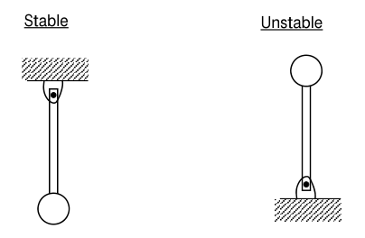
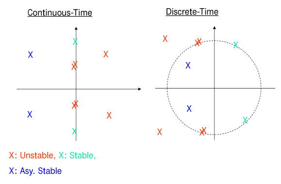
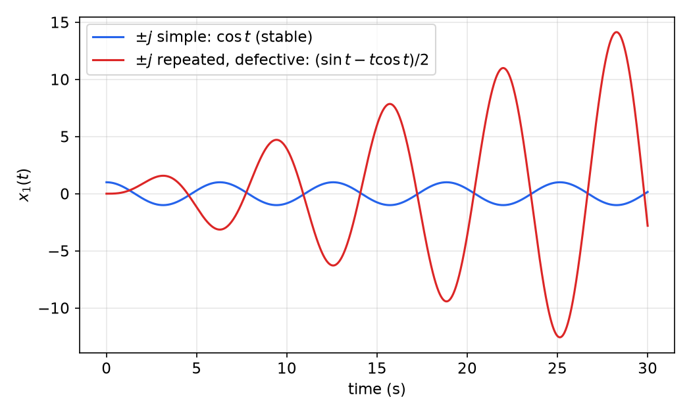
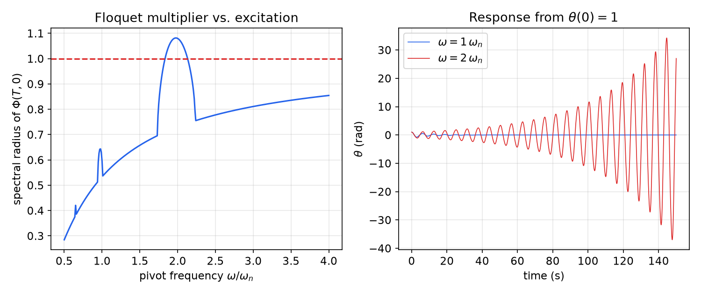
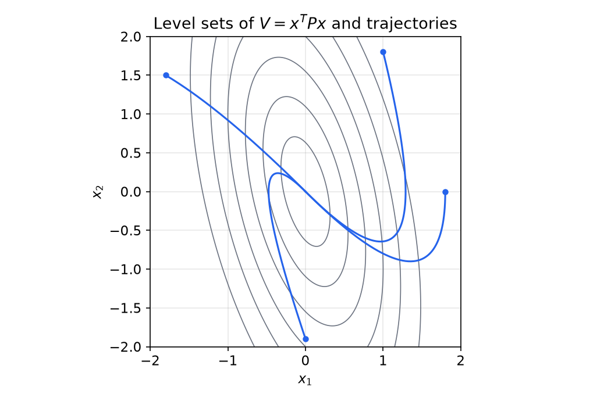
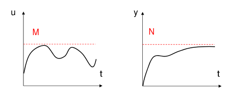
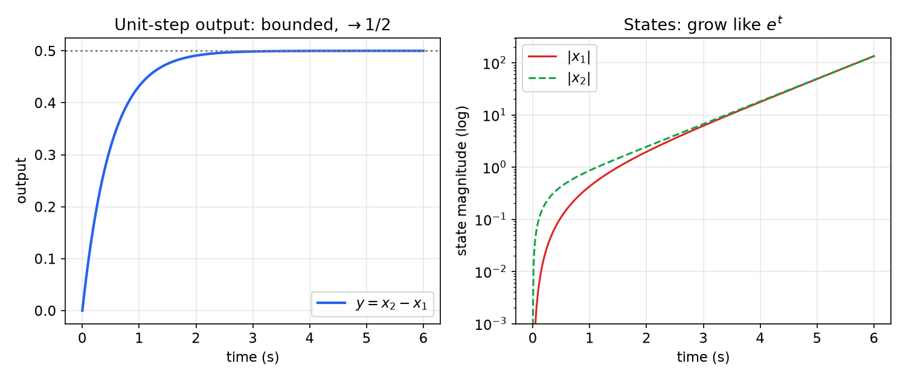

# Stability of Linear Systems

Stability is the minimum requirement for any control system, and improving it is the first job of feedback. Many physical systems that are unstable on their own, such as the inverted pendulum, rockets and some aircraft, can be stabilized by feedback. Designing that feedback requires a systematic way to analyze stability. This chapter defines stability for linear systems in terms of the state-transition matrix, reduces it to eigenvalue conditions for time-invariant systems (with the Jordan-block subtleties made explicit), shows why eigenvalues fail for time-varying systems, introduces the Lyapunov matrix equations, and then treats the input–output notion of bounded-input bounded-output (BIBO) stability. A pole–zero-cancellation example shows that the two notions are different. The classical frequency-domain tests (Routh–Hurwitz, Nyquist) are summarized in Stability Analysis. Lyapunov's method for nonlinear systems is developed in [Lyapunov Stability](../me6402-nonlinear-control/lyapunov.md).



*Figure: the two equilibria of a pendulum. Hanging (left), small disturbances produce bounded oscillations, and with friction they die out. Inverted (right), any small disturbance grows. Linearizing about each equilibrium gives a system matrix whose eigenvalues show the difference.*

## Internal Stability of Linear Systems

### Definitions

Consider the unforced linear time-varying (LTV) system
\\[
\dot x(t) = A(t)x(t), \qquad x(t) = \Phi(t, t\_0)x(t\_0),
\\]
where \\(\Phi(t, t\_0)\\) is the state-transition matrix (see [Time Response and the State-Transition Matrix](time-response.md)). Every solution is a linear function of the initial state, so the behaviour of all solutions is captured by \\(\Phi\\).

**Definition (stability).** The system \\(\dot x = A(t)x\\) is **stable** if there is a finite constant \\(\kappa\\) such that
\\[
\lvert\Phi\_{ij}(t, t\_0)\rvert < \kappa \qquad \forall t \ge t\_0,
\\]
for every element \\(\Phi\_{ij}\\) of the state-transition matrix. It is **asymptotically stable** if, in addition,
\\[
\lim\_{t \to \infty}\lvert\Phi\_{ij}(t, t\_0)\rvert = 0 \qquad \text{for all } i, j .
\\]

Because all norms on \\(\mathbb{R}^{n \times n}\\) are equivalent, bounding every entry is the same as bounding \\(\lVert\Phi(t, t\_0)\rVert\\) (see [Linear Algebra for Systems Theory](linear-algebra.md)). The definition is therefore equivalent to the following statements about solutions:

- *stable* if and only if every solution is bounded, \\(\lVert x(t)\rVert \le \kappa'\lVert x(t\_0)\rVert\\). This is Lyapunov stability of the equilibrium \\(x = 0\\): given \\(\varepsilon > 0\\), take \\(\delta = \varepsilon/\kappa'\\);
- *asymptotically stable* if and only if, in addition, every solution tends to zero.

For a linear system, local and global properties coincide: scaling \\(x(t\_0)\\) scales the whole solution. Stability is a property of the system, not of a particular equilibrium or of a region of initial conditions.

**Uniformity.** For time-varying systems the constant \\(\kappa\\) may depend on \\(t\_0\\). The system is **uniformly stable** if one \\(\kappa\\) works for all \\(t\_0\\), and **uniformly asymptotically stable** if, in addition, the decay to zero happens at a rate that does not depend on \\(t\_0\\). For linear systems, uniform asymptotic stability is equivalent to **exponential stability**: there exist \\(k, \alpha > 0\\) with
\\[
\lVert\Phi(t, t\_0)\rVert \le k\\,e^{-\alpha(t - t\_0)} \qquad \forall t \ge t\_0,\ \forall t\_0 .
\\]
For LTI systems all of these notions collapse. \\(\Phi(t, t\_0) = e^{A(t - t\_0)}\\) depends only on \\(t - t\_0\\), so stability is automatically uniform, and asymptotic stability is automatically exponential (as the Jordan form shows below).

**Discrete-time systems.** For \\(x(k+1) = A(k)x(k)\\) with \\(x(k) = \Phi(k, k\_0)x(k\_0)\\), the definitions are identical with continuous time \\(t\\) replaced by the integer time \\(k\\).

### Stability of LTI systems

For LTI systems the transition matrix is computed through the Jordan form (see [Modal Decomposition and the Jordan Form](modal-decomposition.md)):

- continuous time, \\(\dot x = Ax\\): \\(\Phi(t, t\_0) = e^{A(t - t\_0)} = Me^{J(t - t\_0)}M^{-1}\\);
- discrete time, \\(x(k+1) = Ax(k)\\): \\(\Phi(k, k\_0) = A^{k - k\_0} = MJ^{k - k\_0}M^{-1}\\).

\\(M\\) and \\(M^{-1}\\) are constant, so \\(\Phi\\) is bounded (or tends to zero) if and only if \\(e^{Jt}\\) (or \\(J^k\\)) is. For an elementary Jordan block of size \\(m\\) with eigenvalue \\(\lambda\\), the entries of \\(e^{Jt}\\) are
\\[
\frac{t^j}{j!}e^{\lambda t},\qquad j = 0, 1, \dots, m - 1,
\\]
and the entries of \\(J^k\\) are \\(\binom{k}{j}\lambda^{k-j}\\). Each such term is bounded or decays according to a short list of facts:

| Term | \\(\operatorname{Re}\lambda < 0\\) / \\(\lvert\lambda\rvert < 1\\) | \\(\operatorname{Re}\lambda = 0\\) / \\(\lvert\lambda\rvert = 1\\) | \\(\operatorname{Re}\lambda > 0\\) / \\(\lvert\lambda\rvert > 1\\) |
|---|---|---|---|
| \\(j = 0\\): \\(e^{\lambda t}\\), \\(\lambda^k\\) | \\(\to 0\\) | bounded, not \\(\to 0\\) | unbounded |
| \\(j \ge 1\\): \\(t^je^{\lambda t}\\), \\(k^j\lambda^{k}\\) | \\(\to 0\\) (exponential beats polynomial) | unbounded | unbounded |

The middle column is the crux. On the stability boundary, a \\(1 \times 1\\) block gives a bounded term, but any larger block adds \\(t\\), \\(t^2, \dots\\) (or \\(k, k^2, \dots\\)) factors that grow without bound.

**Theorem (continuous-time LTI stability).** The system \\(\dot x = Ax\\) is

- **stable** if and only if all eigenvalues of \\(A\\) have nonpositive real parts, and every eigenvalue on the imaginary axis has only \\(1 \times 1\\) Jordan blocks (equivalently, its geometric multiplicity equals its algebraic multiplicity). In particular, it suffices that imaginary-axis eigenvalues be distinct;
- **asymptotically stable** if and only if all eigenvalues of \\(A\\) have negative real parts. Such an \\(A\\) is called **Hurwitz**.

*Proof.* By the table, every entry of \\(e^{Jt}\\) is bounded under the first set of conditions and decays under the second, and so do the entries of \\(Me^{Jt}M^{-1}\\). Conversely, if some eigenvalue has \\(\operatorname{Re}\lambda > 0\\), or \\(\operatorname{Re}\lambda = 0\\) with a block of size \\(\ge 2\\), then \\(e^{Jt}\\) has an unbounded entry. Taking \\(x(0) = Me\_j\\) for the corresponding column produces an unbounded solution \\(x(t) = Me^{Jt}e\_j\\). Likewise, an eigenvalue with \\(\operatorname{Re}\lambda = 0\\) gives a solution \\(e^{\lambda t}v\\) that does not tend to zero. \\(\square\\)

Since \\(\lVert t^je^{\lambda t}\rVert \le c\_\epsilon e^{(\operatorname{Re}\lambda + \epsilon)t}\\) for any \\(\epsilon > 0\\), an asymptotically stable LTI system satisfies \\(\lVert e^{At}\rVert \le k e^{-\alpha t}\\) for any \\(\alpha\\) smaller than \\(\min\_i\lvert\operatorname{Re}\lambda\_i\rvert\\). Asymptotic stability is exponential, and the slowest eigenvalue sets the rate.

**Theorem (discrete-time LTI stability).** The system \\(x(k+1) = Ax(k)\\) is

- **stable** if and only if all eigenvalues of \\(A\\) satisfy \\(\lvert\lambda\rvert \le 1\\), and every eigenvalue on the unit circle has only \\(1 \times 1\\) Jordan blocks (in particular, it suffices that unit-circle eigenvalues be distinct);
- **asymptotically stable** if and only if all eigenvalues of \\(A\\) satisfy \\(\lvert\lambda\rvert < 1\\). Such an \\(A\\) is called **Schur** stable.

The proof is the same, using \\(\binom{k}{j}\lambda^{k-j}\\), which behaves like \\(k^j\lvert\lambda\rvert^k\\). The discrete-time version is developed further in [Discrete-Time Systems](discrete-time.md) and [The z-Plane](../me6403-digital-control/z-plane.md).



*Figure: eigenvalue locations and stability. Continuous time (left): blue eigenvalues in the open left half-plane are asymptotically stable. A simple conjugate pair on the imaginary axis (green) is stable but not asymptotically stable. Eigenvalues in the right half-plane, or repeated non-diagonalizable pairs on the imaginary axis (red, doubled), are unstable. Discrete time (right): the same classification with the unit circle in place of the imaginary axis.*

**A note on "distinct".** The boundary condition is often stated as "imaginary-axis eigenvalues must be distinct". That is sufficient but not necessary. What matters is the Jordan structure, not the multiplicity. Compare
\\[
A\_1 = \begin{bmatrix} 0 & 0 \\\\ 0 & 0 \end{bmatrix},\qquad A\_2 = \begin{bmatrix} 0 & 1 \\\\ 0 & 0 \end{bmatrix}.
\\]
Both have the double eigenvalue \\(0\\). \\(A\_1\\) is diagonal: \\(e^{A\_1t} = I\\), every state stays put, and the system is stable. \\(A\_2\\) is a \\(2 \times 2\\) Jordan block: \\(e^{A\_2t} = \begin{bmatrix} 1 & t \\\\ 0 & 1 \end{bmatrix}\\), and the double integrator drifts without bound from any nonzero initial velocity. It is unstable.

**Example 1 (oscillators with repeated imaginary eigenvalues).** The harmonic oscillator \\(\ddot y + y = 0\\) has simple eigenvalues \\(\pm j\\) and is stable: \\(y = \cos t\\) from \\(y(0) = 1\\). The fourth-order system \\(y^{(4)} + 2\ddot y + y = 0\\), whose characteristic polynomial is \\((s^2 + 1)^2\\), has \\(\pm j\\) each with multiplicity 2. In companion form, \\(A - jI\\) has rank 3, so \\(g = 1 < m = 2\\): each eigenvalue has a \\(2 \times 2\\) Jordan block. From \\(y = \dot y = \ddot y = 0\\) and \\(\dddot y(0) = 1\\), the solution is
\\[
y(t) = \tfrac12(\sin t - t\cos t),
\\]
which grows linearly. This is resonance: one oscillator driving an identical one.



*Figure: free responses with eigenvalues on the imaginary axis. Simple eigenvalues \\(\pm j\\) (blue) give a bounded oscillation. The same eigenvalues with \\(2 \times 2\\) Jordan blocks (red) give a response with envelope proportional to \\(t\\). The system is unstable even though no eigenvalue lies in the right half-plane.*

**Example 2 (stability of the course examples).**

- *Three tanks with outlets:* \\(\lambda = -1, -2, -4\\). Asymptotically stable.
- *Three tanks without outlets:* \\(\lambda = 0, -1, -3\\). The zero eigenvalue is simple (eigenvector \\([1,1,1]^T\\), conservation of liquid), so the system is stable but not asymptotically stable. An equal rise in all levels persists.
- *2-DOF mass–spring–damper:* all four cases of [Modal Decomposition](modal-decomposition.md) have eigenvalues with real parts \\(-5\\) or \\(-10\\). All are asymptotically stable, including case (d) with its \\(4 \times 4\\) Jordan block at \\(-10\\). Defective blocks in the open left half-plane do not destroy asymptotic stability, though they can cause transient growth.
- *Two masses with no spring to ground* (\\(\lambda = -2.15 \pm 13.07j,\ 0,\ -5.70\\)): the zero eigenvalue is simple, so the system is stable but not asymptotically stable. The rigid-body displacement does not decay.
- *A free mass* \\(\ddot x = 0\\): double zero eigenvalue with one Jordan block. Unstable.
- *The symmetric matrix* \\(A = \begin{bmatrix} 1 & 0 & 1 & 0 & -6 \\\\ 0 & 2 & 2 & 1 & 0 \\\\ 1 & 2 & 3 & 0 & 0 \\\\ 0 & 1 & 0 & 2 & 0 \\\\ -6 & 0 & 0 & 0 & 1 \end{bmatrix}\\) has real, distinct eigenvalues \\(\approx -5.067,\ 0.104,\ 2.188,\ 4.625,\ 7.151\\) (symmetric matrices have no complex eigenvalues), so it is diagonalizable with five independent eigenvectors. As a system \\(\dot x = Ax\\) it is unstable, because four of the eigenvalues are positive.

**Comments on stability.**

- A single "unstable" eigenvalue makes the system unstable, however many stable ones there are. Generic initial conditions excite every mode, and the unstable one eventually dominates.
- The eigenvalues of a **time-varying** system do not in general determine its stability.
- The eigenvalues of a **slowly varying** system may be used to determine stability. If \\(A(t)\\) is bounded, its frozen-time eigenvalues satisfy \\(\operatorname{Re}\lambda\_i(A(t)) \le -\sigma < 0\\) uniformly, and \\(\lVert\dot A(t)\rVert\\) is sufficiently small, then the system is exponentially stable. This is a standard result proved with a time-varying Lyapunov function.

### Why eigenvalues fail for time-varying systems

**Example 3 (stable frozen eigenvalues, growing solutions).** A classical example is
\\[
A(t) = \begin{bmatrix} -1 + 1.5\cos^2 t & 1 - 1.5\sin t\cos t \\\\ -1 - 1.5\sin t\cos t & -1 + 1.5\sin^2 t \end{bmatrix}.
\\]
For every fixed \\(t\\), \\(\operatorname{tr}A(t) = -0.5\\) and \\(\det A(t) = 0.5\\) (expand and use \\(\sin^2 t + \cos^2 t = 1\\)). So the frozen eigenvalues are the constants \\(\lambda = -0.25 \pm 0.661j\\), safely in the left half-plane. Yet direct substitution shows that
\\[
x(t) = e^{t/2}\begin{bmatrix} -\cos t \\\\ \sin t \end{bmatrix}
\\]
is a solution, and it grows exponentially. The eigenvectors of \\(A(t)\\) rotate with time, and the rotation keeps feeding the growing direction. Eigenvalues describe the system only if the coordinates in which they act are fixed.

**Example 4 (parametric resonance: the Mathieu pendulum).** A pendulum whose pivot is shaken vertically with acceleration \\(a(t) = 0.5\sin\omega t\\) (in units of \\(g\\)) obeys, for small angles,
\\[
\ddot\theta + 2\zeta\omega\_n\dot\theta + \omega\_n^2\big(1 + 0.5\sin\omega t\big)\theta = 0 .
\\]
For which pivot frequencies \\(\omega \in [0, 10)\\) is it asymptotically stable, with \\(\omega\_n = 1\\) and \\(\zeta = 0.1\\)?

*Solution.* (a) With \\(x = [\theta,\ \dot\theta]^T\\),
\\[
\dot x = \begin{bmatrix} 0 & 1 \\\\ -\omega\_n^2(1 + 0.5\sin\omega t) & -2\zeta\omega\_n \end{bmatrix}x .
\\]
At every frozen \\(t\\) the stiffness \\(\omega\_n^2(1 + 0.5\sin\omega t)\\) lies between \\(0.5\\) and \\(1.5\\), and the damping is positive. Every frozen matrix is therefore Hurwitz.

(b) The fundamental matrix \\(\Phi(t, 0)\\) is computed by integrating from \\(x(0) = e\_1\\) and \\(x(0) = e\_2\\):

```matlab
wn = 1; zeta = 0.1; w = 2;
f = @(t,x) [x(2); -(1+0.5*sin(w*t))*wn^2*x(1) - 2*zeta*wn*x(2)];
[t,x1] = ode45(f, 0:0.1:150, [1 0]);   % first column of Phi(t,0)
[t,x2] = ode45(f, 0:0.1:150, [0 1]);   % second column
```

(c) *Floquet test.* Because \\(A(t)\\) is periodic with period \\(T = 2\pi/\omega\\), \\(\Phi(t + T, 0) = \Phi(t, 0)\Phi(T, 0)\\). The state sampled once per period evolves as the discrete-time LTI system \\(x((k+1)T) = \Phi(T, 0)x(kT)\\). So the periodic system is asymptotically stable if and only if all eigenvalues of the **monodromy matrix** \\(\Phi(T, 0)\\) (the Floquet multipliers) lie inside the unit circle. Computed values of the spectral radius \\(\rho\\) are \\(\rho = 0.596\\) at \\(\omega = \omega\_n\\), \\(\rho = 1.080\\) at \\(\omega = 2\omega\_n\\), and \\(\rho = 0.924\\) at \\(\omega = 8\omega\_n\\). Scanning \\(\omega\\) shows \\(\rho > 1\\) only for \\(\omega \approx 1.84\\) to \\(2.13\\,\omega\_n\\). Simulation agrees: at \\(\omega = 1.82\omega\_n\\) and \\(2.15\omega\_n\\) the response decays very slowly (just outside the band), while at \\(\omega = 2\omega\_n\\) it grows to an amplitude of about 40 by \\(t = 150\\).



*Figure: left, the spectral radius of the monodromy matrix \\(\Phi(T, 0)\\) against the pivot frequency. It exceeds 1 (dashed) only in a band around \\(\omega = 2\omega\_n\\). The smaller bumps near \\(\omega\_n\\) and \\(2\omega\_n/3\\) are higher-order resonance tongues that the damping keeps below 1. Right, the response from \\(\theta(0) = 1\\): it decays when \\(\omega = \omega\_n\\) and grows when \\(\omega = 2\omega\_n\\).*

*Conclusion.* This is **parametric resonance**. Pumping the stiffness at twice the natural frequency injects energy every half cycle, as a child does on a swing. The pendulum is unstable for \\(\omega\\) in a band around \\(2\omega\_n\\) and asymptotically stable elsewhere on \\([0, 10)\\), even though every frozen-time matrix is stable.

## Lyapunov Equations for Linear Systems

Eigenvalues answer the stability question for LTI systems, but Lyapunov's direct method gives a second answer with several advantages. It produces a quadratic "energy" that decreases along every trajectory. It extends to time-varying and nonlinear systems. It underlies robustness bounds and the Riccati equations of optimal control ([Linear Quadratic Regulator](lqr.md)). The general theory is in [Lyapunov Stability](../me6402-nonlinear-control/lyapunov.md). Here we need only quadratic functions and positive definite matrices (see [Linear Algebra for Systems Theory](linear-algebra.md)).

### Continuous time

Take a candidate \\(V(x) = x^TPx\\) with \\(P = P^T > 0\\). Along solutions of \\(\dot x = Ax\\),
\\[
\dot V = \dot x^TPx + x^TP\dot x = x^T(A^TP + PA)x .
\\]
If we can arrange \\(A^TP + PA = -Q\\) with \\(Q > 0\\), then \\(V\\) decreases strictly along every nonzero solution.

**Theorem (Lyapunov equation).** The following are equivalent for a real matrix \\(A\\):

1. \\(A\\) is Hurwitz (all eigenvalues have negative real parts);
2. for some \\(Q = Q^T > 0\\), the **Lyapunov equation**
\\[
\boxed{A^TP + PA = -Q}
\\]
has a solution \\(P = P^T > 0\\);
3. for every \\(Q = Q^T > 0\\), the Lyapunov equation has a unique solution, and that solution is positive definite.

When \\(A\\) is Hurwitz, the solution is
\\[
P = \int\_0^\infty e^{A^Tt}Qe^{At}\\,dt .
\\]

*Proof.* (2 ⇒ 1) Let \\(\lambda\_{\min}(\cdot)\\) and \\(\lambda\_{\max}(\cdot)\\) be extreme eigenvalues. With \\(V = x^TPx\\),
\\[
\dot V = -x^TQx \le -\lambda\_{\min}(Q)\lVert x\rVert^2 \le -\frac{\lambda\_{\min}(Q)}{\lambda\_{\max}(P)}V =: -2\alpha V .
\\]
Hence \\(V(x(t)) \le e^{-2\alpha t}V(x(0))\\), and since \\(\lambda\_{\min}(P)\lVert x\rVert^2 \le V\\),
\\[
\lVert x(t)\rVert \le \sqrt{\frac{\lambda\_{\max}(P)}{\lambda\_{\min}(P)}}\\,e^{-\alpha t}\lVert x(0)\rVert .
\\]
Every solution decays exponentially, so \\(A\\) is Hurwitz.

(1 ⇒ 3) If \\(A\\) is Hurwitz, \\(\lVert e^{At}\rVert \le ke^{-\alpha t}\\), so the integral converges. It is symmetric, and it is positive definite because \\(x^TPx = \int\_0^\infty (e^{At}x)^TQ(e^{At}x)\\,dt > 0\\) for \\(x \neq 0\\) (the integrand is positive near \\(t = 0\\)). It satisfies the equation:
\\[
A^TP + PA = \int\_0^\infty \frac{d}{dt}\Big(e^{A^Tt}Qe^{At}\Big)dt = \Big[e^{A^Tt}Qe^{At}\Big]\_0^\infty = 0 - Q .
\\]
For uniqueness, if \\(P\_1\\) and \\(P\_2\\) both solve it, then \\(D = P\_1 - P\_2\\) satisfies \\(A^TD + DA = 0\\). Hence \\(\frac{d}{dt}(e^{A^Tt}De^{At}) = e^{A^Tt}(A^TD + DA)e^{At} = 0\\), so \\(e^{A^Tt}De^{At}\\) is constant. Its value at \\(t = 0\\) is \\(D\\), and it tends to \\(0\\) as \\(t \to \infty\\), so \\(D = 0\\).

(3 ⇒ 2) is immediate. \\(\square\\)

**Remarks.**

- The Lyapunov equation is linear in \\(P\\): \\(n(n+1)/2\\) equations for the entries of a symmetric \\(P\\). It has a unique solution for every \\(Q\\) whenever no two eigenvalues of \\(A\\) satisfy \\(\lambda\_i + \lambda\_j = 0\\).
- \\(Q\\) need only be positive semidefinite if the system "sees" all of it: with \\(Q = C^TC\\) and \\((A, C)\\) observable, \\(A\\) is Hurwitz if and only if the equation has a solution \\(P > 0\\). Then \\(P\\) is the infinite-horizon observability Gramian (see [Observability](observability.md)). The dual equation \\(AP + PA^T = -BB^T\\) gives the controllability Gramian.
- The decay-rate bound \\(\alpha = \lambda\_{\min}(Q)/(2\lambda\_{\max}(P))\\) from the proof is usually conservative. Its value lies in the fact that it survives perturbations: if \\(A\\) is replaced by \\(A + \Delta\\) with \\(\lVert\Delta\rVert < \lambda\_{\min}(Q)/(2\lambda\_{\max}(P))\\), the same \\(V\\) still decreases. This is a robustness margin.
- \\(\int\_0^\infty x(t)^TQx(t)\\,dt = x(0)^TPx(0)\\): the Lyapunov solution evaluates quadratic cost integrals. This is the basis of LQR theory.

**Example 5 (a second-order system).** Let \\(A = \begin{bmatrix} 0 & 1 \\\\ -2 & -3 \end{bmatrix}\\) (eigenvalues \\(-1, -2\\)) and \\(Q = I\\). Write \\(P = \begin{bmatrix} p\_1 & p\_2 \\\\ p\_2 & p\_3 \end{bmatrix}\\). Then
\\[
A^TP = \begin{bmatrix} -2p\_2 & -2p\_3 \\\\ p\_1 - 3p\_2 & p\_2 - 3p\_3 \end{bmatrix},\qquad PA = (A^TP)^T ,
\\]
and \\(A^TP + PA = -I\\) gives three equations:
\\[
(1,1):\ -4p\_2 = -1,\qquad (1,2):\ p\_1 - 3p\_2 - 2p\_3 = 0,\qquad (2,2):\ 2p\_2 - 6p\_3 = -1 .
\\]
So \\(p\_2 = \tfrac14\\), \\(p\_3 = \tfrac14\\), \\(p\_1 = \tfrac54\\), and
\\[
P = \begin{bmatrix} 5/4 & 1/4 \\\\ 1/4 & 1/4 \end{bmatrix}.
\\]
Sylvester's test confirms \\(P > 0\\): \\(\tfrac54 > 0\\) and \\(\det P = \tfrac{5}{16} - \tfrac{1}{16} = \tfrac14 > 0\\). Its eigenvalues are \\(1.309\\) and \\(0.191\\), so the guaranteed decay rate is \\(\alpha = 1/(2 \times 1.309) \approx 0.38\\), compared with the true slowest rate of 1.



*Figure: level sets of \\(V = x^TPx\\) (ellipses) for Example 5, with trajectories of \\(\dot x = Ax\\). Every trajectory crosses each ellipse from outside to inside, because \\(\dot V = -\lVert x\rVert^2 < 0\\). The trajectories need not follow the ellipses' axes, and they need not cross the level sets at right angles.*

In MATLAB, note the argument order: `lyap(A,Q)` solves \\(AX + XA^T + Q = 0\\), so pass the transpose:

```matlab
A = [0 1; -2 -3];
P = lyap(A', eye(2))     % [1.25 0.25; 0.25 0.25]
eig(P)                   % 0.1910, 1.3090  -> P > 0, A is Hurwitz
```

```python
import numpy as np
from scipy.linalg import solve_continuous_lyapunov
A = np.array([[0, 1], [-2, -3.]])
P = solve_continuous_lyapunov(A.T, -np.eye(2))   # solves A' P + P A = -I
```

**Example 6 (three tanks).** For the three-tank matrix \\(A = \begin{bmatrix} -2 & 1 & 0 \\\\ 1 & -3 & 1 \\\\ 0 & 1 & -2 \end{bmatrix}\\) with \\(Q = I\\), the solution is
\\[
P = \begin{bmatrix} 5/16 & 1/8 & 1/16 \\\\ 1/8 & 1/4 & 1/8 \\\\ 1/16 & 1/8 & 5/16 \end{bmatrix} > 0 .
\\]
Since \\(A\\) is symmetric and Hurwitz, \\(P = -\tfrac12A^{-1}\\) (substitute: \\(A^TP + PA = -\tfrac12 - \tfrac12 = -I\\)), which matches the inverse \\(A^{-1} = -\tfrac18\begin{bmatrix} 5 & 2 & 1 \\\\ 2 & 4 & 2 \\\\ 1 & 2 & 5 \end{bmatrix}\\) computed by Cayley–Hamilton in [Modal Decomposition](modal-decomposition.md).

### Discrete time

For \\(x(k+1) = Ax(k)\\) and \\(V = x^TPx\\), the change in one step is
\\[
V(x(k+1)) - V(x(k)) = x(k)^T(A^TPA - P)x(k).
\\]

**Theorem (discrete Lyapunov equation).** \\(A\\) is Schur stable (all \\(\lvert\lambda\_i\rvert < 1\\)) if and only if, for any \\(Q = Q^T > 0\\), the **discrete Lyapunov equation**
\\[
\boxed{A^TPA - P = -Q}
\\]
has a unique solution \\(P = P^T > 0\\). The solution is \\(P = \sum\_{k=0}^{\infty}(A^T)^kQA^k\\).

The proof parallels the continuous case, with sums in place of integrals: \\(A^T P A - P = \sum\_{k \ge 1}(A^T)^kQA^k - \sum\_{k \ge 0}(A^T)^kQA^k = -Q\\).

**Example 7 (a defective discrete system).** \\(A = \begin{bmatrix} 0.5 & 1 \\\\ 0 & 0.5 \end{bmatrix}\\) has a double eigenvalue \\(0.5\\) in a single Jordan block. It is Schur stable, although \\(A^k = \begin{bmatrix} 0.5^k & k\\,0.5^{k-1} \\\\ 0 & 0.5^k \end{bmatrix}\\) shows a transient rise in the off-diagonal entry (\\(1, 1, 0.75, 0.5, \dots\\)). With \\(Q = I\\),
\\[
P = \begin{bmatrix} 4/3 & 8/9 \\\\ 8/9 & 116/27 \end{bmatrix} > 0 .
\\]
In MATLAB, `dlyap(A',eye(2))` solves \\(A^TPA - P + I = 0\\).

**Time-varying systems.** For \\(\dot x = A(t)x\\), a time-varying quadratic \\(V = x^TP(t)x\\) with \\(c\_1I \le P(t) \le c\_2I\\) and \\(\dot P + A^TP + PA \le -c\_3I\\) proves exponential stability. This is the route to the slowly-varying result quoted earlier. See [Advanced Lyapunov Theory](../me6402-nonlinear-control/lyapunov-advanced.md).

## BIBO Stability

Internal stability concerns the state with no input. Input–output stability asks whether a bounded input always produces a bounded output.

**Definition (BIBO stability).** The linear system
\\[
\dot x = A(t)x + B(t)u, \qquad y = C(t)x + D(t)u,
\\]
with zero initial state, is **bounded-input bounded-output (BIBO) stable** if every bounded input produces a bounded output. That is, for every \\(M\\) there is an \\(N\\) such that \\(\lvert u(t)\rvert \le M\\) for all \\(t\\) implies \\(\lvert y(t)\rvert \le N\\) for all \\(t\\).



*Figure: BIBO stability. An input that never exceeds \\(M\\) (left) produces an output that never exceeds some finite \\(N\\) (right).*

The zero-state response is a convolution with the impulse response. For an LTI SISO system \\(Y(s) = G(s)U(s)\\),
\\[
y(t) = (g \* u)(t) = \int\_{t\_0}^{t} g(t - \tau)u(\tau)\\,d\tau, \qquad g(t) = Ce^{At}B + D\delta(t).
\\]

**Theorem (BIBO stability, LTI).** An LTI SISO system with impulse response \\(g\\) is BIBO stable if and only if \\(g\\) is absolutely integrable,
\\[
\int\_0^\infty \lvert g(t)\rvert\\,dt < \infty
\\]
(apart from a direct feedthrough term \\(D\delta(t)\\), which maps bounded inputs to bounded outputs). For a proper rational transfer function \\(G(s)\\), this holds if and only if **all poles of \\(G(s)\\) lie in the open left half-plane**. A MIMO system is BIBO stable if and only if every entry of \\(G(s)\\) is.

*Proof.* (Sufficiency of absolute integrability.) If \\(\lvert u(\tau)\rvert \le M\\), then
\\[
\lvert y(t)\rvert \le \int\_{t\_0}^{t}\lvert g(t - \tau)\rvert\\,\lvert u(\tau)\rvert\\,d\tau \le M\int\_{0}^{t - t\_0}\lvert g(s)\rvert\\,ds \le M\int\_0^\infty\lvert g(s)\rvert\\,ds =: N .
\\]

(Necessity.) Suppose \\(\int\_0^\infty\lvert g\rvert = \infty\\). Given any \\(N\\), choose \\(T\\) with \\(\int\_0^T\lvert g(s)\rvert ds > N\\), and apply the bounded input \\(u(\tau) = \operatorname{sgn}g(T - \tau)\\) (with \\(t\_0 = 0\\)). Then \\(y(T) = \int\_0^T\lvert g(T - \tau)\rvert d\tau > N\\). No bound \\(N\\) works, so the system is not BIBO stable.

(Poles.) Partial fractions write the strictly proper part of \\(G\\) as a sum of terms \\(c/(s - p)^{j+1}\\), whose inverse transforms are \\(c\\,t^je^{pt}/j!\\). If every pole has \\(\operatorname{Re}p < 0\\), then \\(\lvert g(t)\rvert \le ce^{-\alpha t}\\) for some \\(c, \alpha > 0\\), and \\(\int\_0^\infty\lvert g\rvert \le c/\alpha\\). Conversely, a pole with \\(\operatorname{Re}p \ge 0\\) contributes a term that does not decay. Its integral diverges, and it cannot be cancelled by the other terms, because functions \\(t^je^{pt}\\) with distinct \\((p, j)\\) are linearly independent. \\(\square\\)

With the exponential bound \\(\lvert g(t)\rvert \le ce^{-\alpha t}\\), the sufficiency estimate reads explicitly
\\[
\lvert y(t)\rvert \le M\int\_0^{t - t\_0} ce^{-\alpha s}\\,ds \le \frac{cM}{\alpha}.
\\]

**Boundary poles are not BIBO stable.** Unlike internal stability, simple poles on the imaginary axis are *not* allowed. For \\(G(s) = 1/(s^2 + 9)\\), with \\(g(t) = \tfrac13\sin 3t\\), the bounded input \\(u = \sin 3t\\) at the resonant frequency gives \\(Y(s) = 3/(s^2 + 9)^2\\) and
\\[
y(t) = \frac{1}{18}\big(\sin 3t - 3t\cos 3t\big),
\\]
which grows without bound. A system with simple imaginary-axis poles is called **marginally stable**. It is stable in the internal (Lyapunov) sense but not BIBO stable.

**Time-varying systems.** For \\(y(t) = \int\_{t\_0}^t g(t, \tau)u(\tau)\\,d\tau\\) with \\(g(t, \tau) = C(t)\Phi(t, \tau)B(\tau)\\), the same argument shows that the system is BIBO stable if and only if \\(\sup\_t\int\_{t\_0}^t\lvert g(t, \tau)\rvert\\,d\tau < \infty\\).

**Example 8 (BIBO stability from denominators).**

- \\(G\_1(s) = \dfrac{s}{s^3 + 4s^2 + 5s + 2}\\): \\(s^3 + 4s^2 + 5s + 2 = (s + 1)^2(s + 2)\\). All poles are in the left half-plane, so \\(G\_1\\) is BIBO stable.
- \\(G\_2(s) = \dfrac{2s + 1}{s^3 + 4s^2 + 5s + 2}\\): same denominator, no cancellation. BIBO stable.
- \\(G\_3(s) = \dfrac{2s + 1}{s^3 + 2s^2 - s - 2}\\): \\(s^3 + 2s^2 - s - 2 = (s - 1)(s + 1)(s + 2)\\). The pole at \\(+1\\) makes \\(G\_3\\) unstable.
- \\(G\_4(s) = \dfrac{16s + 7}{s^3 + 2s^2 + 9s + 18}\\): \\(s^3 + 2s^2 + 9s + 18 = (s + 2)(s^2 + 9)\\), with poles \\(-2, \pm 3j\\) and a zero at \\(-7/16\\). The simple poles at \\(\pm 3j\\) make it marginally stable: not BIBO stable, since \\(\sin 3t\\) excites a growing response.

## Relationships Between the Stability Notions

For an LTI realization \\((A, B, C, D)\\),
\\[
G(s) = C(sI - A)^{-1}B + D = \frac{C\\,\operatorname{adj}(sI - A)\\,B}{\det(sI - A)} + D ,
\\]
so every pole of \\(G\\) is an eigenvalue of \\(A\\). The converse fails when a factor of \\(\det(sI - A)\\) cancels against the numerator. Hence:

- **Asymptotic (internal) stability ⇒ BIBO stability.** More generally, uniform exponential stability of \\(\dot x = A(t)x\\), together with bounded \\(B(t)\\) and \\(C(t)\\), implies BIBO stability.
- **BIBO stability ⇏ internal stability.** An unstable mode can be hidden from the transfer function by a pole–zero cancellation.
- The two coincide when the realization is **minimal** (controllable and observable). Then no cancellations occur and the poles of \\(G\\) are exactly the eigenvalues of \\(A\\). See [Structural Properties](structure.md).

**Example 9 (BIBO stable but internally unstable).** Consider
\\[
\dot x = \begin{bmatrix} 0 & 1 \\\\ 2 & -1 \end{bmatrix}x + \begin{bmatrix} 0 \\\\ 1 \end{bmatrix}u,\qquad y = \begin{bmatrix} -1 & 1 \end{bmatrix}x .
\\]
*Eigenvalues.* \\(\det(\lambda I - A) = \lambda(\lambda + 1) - 2 = \lambda^2 + \lambda - 2 = (\lambda - 1)(\lambda + 2)\\), so \\(\lambda\_{1,2} = 1, -2\\). The system is internally unstable.

*Transfer function.*
\\[
(sI - A)^{-1}B = \frac{1}{(s - 1)(s + 2)}\begin{bmatrix} s + 1 & 1 \\\\ 2 & s \end{bmatrix}\begin{bmatrix} 0 \\\\ 1 \end{bmatrix} = \frac{1}{(s - 1)(s + 2)}\begin{bmatrix} 1 \\\\ s \end{bmatrix},
\\]
\\[
\frac{Y(s)}{U(s)} = \frac{-1 + s}{(s - 1)(s + 2)} = \frac{1}{s + 2}.
\\]
The unstable factor \\((s - 1)\\) cancels. The only pole is \\(-2\\), so the system is BIBO stable.

*What happens inside.* The eigenvector of \\(\lambda = 1\\) is \\(v = [1, 1]^T\\), and \\(Cv = -1 + 1 = 0\\). The unstable mode is invisible at the output (unobservable). It is still excited by the input, since \\(B\\) is not orthogonal to the left eigenvector. For a unit step input, partial fractions give
\\[
x\_1(t) = -\tfrac12 + \tfrac13e^{t} + \tfrac16e^{-2t},\qquad x\_2(t) = \tfrac13e^{t} - \tfrac13e^{-2t},\qquad y(t) = x\_2 - x\_1 = \tfrac12\big(1 - e^{-2t}\big).
\\]
The output settles at \\(\tfrac12\\), while both states grow like \\(e^t\\). In a physical system, some internal variable would saturate or break while the measured output looked perfectly well behaved.



*Figure: Example 9 under a unit step. Left: the output \\(y = x\_2 - x\_1\\) rises smoothly to \\(1/2\\), like a stable first-order system. Right: on a logarithmic scale, both states grow like \\(e^t\\) (a straight line). The growth cancels exactly in the output combination.*

```matlab
A = [0 1; 2 -1]; B = [0; 1]; C = [-1 1];
syst = ss(A, B, C, 0);
pole(syst)            % ans = 1, -2   (eigenvalues of A)
pole(minreal(syst))   % "1 state removed"; ans = -2
```

`minreal` removes the hidden mode and returns a first-order system with the same transfer function. This is the same phenomenon that the Kalman decomposition explains in general: the transfer function describes only the controllable and observable part of a system ([Structural Properties](structure.md)).

**Example 10 (no cancellation: unstable both ways).** For
\\[
\dot x = \begin{bmatrix} -2 & 0 & 0 \\\\ 0 & 1 & 1 \\\\ 0 & 0 & -1 \end{bmatrix}x + \begin{bmatrix} 1 \\\\ 0 \\\\ -1 \end{bmatrix}u,\qquad y = \begin{bmatrix} 1 & 1 & 0 \end{bmatrix}x + u ,
\\]
the triangular structure gives \\(X\_1 = \frac{1}{s + 2}U\\), \\(X\_3 = \frac{-1}{s + 1}U\\) and \\((s - 1)X\_2 = X\_3\\), so \\(X\_2 = \frac{-1}{(s - 1)(s + 1)}U\\). Then
\\[
G(s) = \frac{1}{s + 2} - \frac{1}{(s - 1)(s + 1)} + 1 = \frac{(s^2 - 1) - (s + 2) + (s + 2)(s^2 - 1)}{(s + 2)(s - 1)(s + 1)} = \frac{s^3 + 3s^2 - 2s - 5}{s^3 + 2s^2 - s - 2}.
\\]
\\(A\\) has eigenvalues \\(-2, 1, -1\\), so it is unstable. The numerator at \\(s = 1\\) is \\(1 + 3 - 2 - 5 = -3 \neq 0\\), so the pole at \\(+1\\) survives in \\(G\\), and the system is not BIBO stable either. Here the unstable mode is both excited by the input (through \\(x\_3 \to x\_2\\)) and visible in the output (through \\(x\_2\\)).

## Summary

- \\(\dot x = A(t)x\\) is stable if \\(\Phi(t, t\_0)\\) is bounded, and asymptotically stable if also \\(\Phi \to 0\\). For linear systems, uniform asymptotic stability is the same as exponential stability: \\(\lVert\Phi(t, t\_0)\rVert \le ke^{-\alpha(t - t\_0)}\\).
- LTI, continuous time: asymptotically stable if and only if all \\(\operatorname{Re}\lambda\_i < 0\\) (Hurwitz). Stable if and only if all \\(\operatorname{Re}\lambda\_i \le 0\\) and imaginary-axis eigenvalues have only \\(1 \times 1\\) Jordan blocks.
- LTI, discrete time: the same with \\(\lvert\lambda\_i\rvert < 1\\) (Schur), and the unit circle in place of the imaginary axis.
- A Jordan block of size \\(m\\) contributes \\(t^je^{\lambda t}\\) (\\(j < m\\)), or \\(k^j\lambda^k\\) in discrete time. These are harmless inside the stable region but unstable on its boundary.
- Frozen-time eigenvalues do not determine LTV stability (Example 3, the Mathieu pendulum). Periodic systems are judged by the Floquet multipliers, the eigenvalues of \\(\Phi(T, 0)\\).
- Lyapunov: \\(A\\) is Hurwitz if and only if \\(A^TP + PA = -Q\\) has \\(P > 0\\) for \\(Q > 0\\), with \\(P = \int\_0^\infty e^{A^Tt}Qe^{At}dt\\). Discrete time: \\(A^TPA - P = -Q\\). MATLAB: `lyap(A',Q)`, `dlyap(A',Q)`.
- BIBO stable if and only if \\(\int\_0^\infty\lvert g\rvert < \infty\\), if and only if all poles of \\(G(s)\\) are in the open left half-plane. Simple imaginary-axis poles are not BIBO stable.
- Internal asymptotic stability implies BIBO stability, but not conversely. Pole–zero cancellations can hide unstable modes. For minimal realizations the two are equivalent.

## See Also

- Stability Analysis: Routh–Hurwitz, root locus, Nyquist and stability margins
- [Lyapunov Stability](../me6402-nonlinear-control/lyapunov.md): Lyapunov's direct method for nonlinear systems
- [Advanced Lyapunov Theory](../me6402-nonlinear-control/lyapunov-advanced.md): non-autonomous systems and converse theorems
- [Modal Decomposition and the Jordan Form](modal-decomposition.md): \\(e^{Jt}\\) and \\(J^k\\)
- [Time Response and the State-Transition Matrix](time-response.md): \\(\Phi(t, t\_0)\\) for LTV systems
- [Discrete-Time Systems](discrete-time.md) and [The z-Plane](../me6403-digital-control/z-plane.md)
- [Structural Properties](structure.md): Kalman decomposition, minimal realizations, stabilizability and detectability
- [Linear Quadratic Regulator](lqr.md): from Lyapunov equations to Riccati equations
- [Linear Algebra for Systems Theory](linear-algebra.md): norms and positive definite matrices
