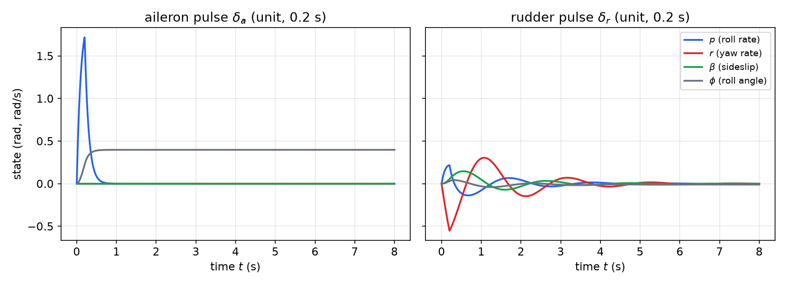
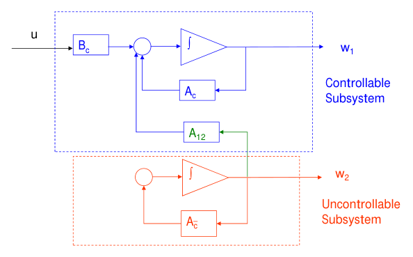
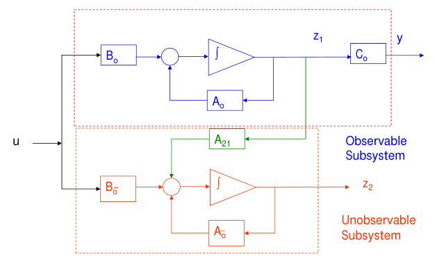
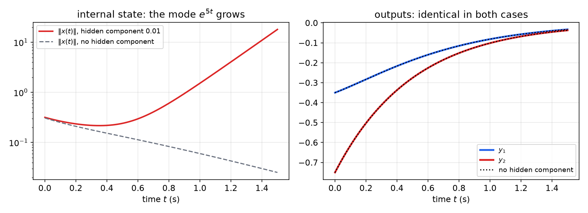

# Structural Decompositions and Minimal Realizations

The rank tests of [Controllability](controllability.md) and [Observability](observability.md) answer a yes-or-no question. When the answer is no, a designer needs more: *which* modes are lost, whether the loss matters for stability, and what is left once the invisible and unreachable parts are removed. This chapter supplies those tools. The Popov–Belevitch–Hautus (PBH) test checks controllability and observability one eigenvalue at a time. The Kalman decomposition finds coordinates in which a system splits into controllable and uncontrollable, or observable and unobservable, subsystems. Together they explain pole–zero cancellations, identify minimal realizations, and lead to the weaker but often sufficient properties of stabilizability and detectability. Canonical forms, the coordinates used for controller and observer design, close the chapter.

## Rank Tests Recap and a Motivating Example

For \\(\dot x = Ax + Bu\\), \\(y = Cx + Du\\) with \\(x \in \mathbb{R}^n\\):
\\[
(A,B)\ \text{controllable} \iff \operatorname{rank}\begin{bmatrix} B & AB & \cdots & A^{n-1}B \end{bmatrix} = n,
\qquad
(A,C)\ \text{observable} \iff \operatorname{rank}\begin{bmatrix} C \\\\ CA \\\\ \vdots \\\\ CA^{n-1} \end{bmatrix} = n .
\\]
These tests say nothing about *what* is uncontrollable. The following example shows why that matters.

**Example 1 (aircraft lateral dynamics).** The linearized lateral-directional motion of an aircraft has four states: roll rate \\(p\\), yaw rate \\(r\\), sideslip angle \\(\beta\\) (the angle between the velocity vector and the aircraft's longitudinal axis) and roll angle \\(\phi\\), with \\(\dot\phi = p\\). There are two control surfaces: the ailerons (\\(\delta\_a\\)), deflected differentially on the wings to roll the aircraft, and the rudder (\\(\delta\_r\\)) on the vertical tail, which yaws it. A representative model (from Brogan's *Modern Control Theory*) is
\\[
\frac{d}{dt}\begin{bmatrix} p \\\\ r \\\\ \beta \\\\ \phi \end{bmatrix} =
\begin{bmatrix} -10 & 0 & -10 & 0 \\\\ 0 & -0.7 & 9 & 0 \\\\ 0 & -1 & -0.7 & 0 \\\\ 1 & 0 & 0 & 0 \end{bmatrix}
\begin{bmatrix} p \\\\ r \\\\ \beta \\\\ \phi \end{bmatrix} +
\begin{bmatrix} 20 & 2.8 \\\\ 0 & -3.13 \\\\ 0 & 0 \\\\ 0 & 0 \end{bmatrix}
\begin{bmatrix} \delta\_a \\\\ \delta\_r \end{bmatrix}.
\\]
The eigenvalues of \\(A\\) are \\(0\\) (roll angle, a pure integrator), \\(-10\\) (roll subsidence) and \\(-0.7 \pm 3j\\) (the lightly damped yaw–sideslip oscillation called **Dutch roll**, the eigenvalues of the \\((r, \beta)\\) block \\(\begin{bmatrix} -0.7 & 9 \\\\ -1 & -0.7 \end{bmatrix}\\)). Is the aircraft controllable with the ailerons alone? With the rudder alone?

*Aileron only*, \\(b\_a = [20,\ 0,\ 0,\ 0]^T\\):
```matlab
A = [-10 0 -10 0; 0 -0.7 9 0; 0 -1 -0.7 0; 1 0 0 0];
B = [20; 0; 0; 0];
P = ctrb(A,B)
%  P =   20   -200   2000  -20000
%         0      0      0       0
%         0      0      0       0
%         0     20   -200    2000
rank(P)   % 2  -> uncontrollable
```
Rows 2 and 3 of \\(P\\), the yaw-rate and sideslip rows, are identically zero. The reason is visible in \\(A\\): the \\((r, \beta)\\) rows have zeros in the \\(p\\) and \\(\phi\\) columns. Sideslip drives the roll rate (through \\(A\_{13} = -10\\)), but nothing in the roll channel feeds back into yaw or sideslip. The aileron moves \\(p\\), \\(p\\) moves \\(\phi\\), and that is all: the controllable subspace is the \\((p, \phi)\\) plane.

*Rudder only*, \\(b\_r = [2.8,\ -3.13,\ 0,\ 0]^T\\):
```matlab
B = [2.8; -3.13; 0; 0];
P = ctrb(A,B)
%  P = 1.0e+003 *
%      0.0028  -0.0280   0.2487  -2.4432
%     -0.0031   0.0022   0.0266  -0.0581
%           0   0.0031  -0.0044  -0.0236
%           0   0.0028  -0.0280   0.2487
rank(P)   % 4  -> controllable
```
The rudder excites yaw directly, yaw couples into sideslip, sideslip into roll, and roll into roll angle: every state is reached.



*Figure: response to a unit control pulse of 0.2 s. Left: aileron. Only \\(p\\) and \\(\phi\\) move; yaw rate and sideslip stay exactly zero, so the Dutch-roll oscillation is never excited. Right: rudder. All four states respond, and the Dutch-roll mode is clearly visible as the decaying oscillation of \\(r\\) and \\(\beta\\) with period \\(2\pi/3 \approx 2.1\\) s.*

The rank test told us the aileron-only system is uncontrollable. What we really want to know is *which motion* the aileron cannot influence: here, the Dutch-roll pair \\(-0.7 \pm 3j\\). The PBH test answers that directly.

## The PBH Test

**Theorem (Popov–Belevitch–Hautus rank test).** For the LTI system \\(\dot x = Ax + Bu\\), \\(y = Cx + Du\\):
\\[
(A,B)\ \text{controllable} \iff \operatorname{rank}\begin{bmatrix} sI - A & B \end{bmatrix} = n \quad \text{for all } s \in \mathbb{C};
\\]
\\[
(A,C)\ \text{observable} \iff \operatorname{rank}\begin{bmatrix} sI - A \\\\ C \end{bmatrix} = n \quad \text{for all } s \in \mathbb{C}.
\\]

For \\(s\\) not an eigenvalue of \\(A\\), \\(sI - A\\) alone is nonsingular and the rank is \\(n\\) automatically. Only the eigenvalues of \\(A\\) need to be checked.

*Proof (controllability).* The rank of \\([sI - A\ \ B]\\) drops at some \\(s = \lambda\\) if and only if there is a nonzero row vector \\(w^T\\) (possibly complex) with \\(w^T[\lambda I - A\ \ B] = 0\\), that is
\\[
w^TA = \lambda w^T \quad\text{and}\quad w^TB = 0 :
\\]
a **left eigenvector of \\(A\\) orthogonal to every column of \\(B\\)**. We show this happens if and only if \\((A,B)\\) is uncontrollable.

(\\(\Leftarrow\\) of the theorem, i.e. rank drop \\(\Rightarrow\\) uncontrollable.) If such a \\(w\\) exists, then \\(w^TA^kB = \lambda^kw^TB = 0\\) for every \\(k\\), so \\(w^TP = 0\\) and \\(\operatorname{rank}P < n\\).

(\\(\Rightarrow\\), uncontrollable \\(\Rightarrow\\) rank drop.) Suppose \\(\operatorname{rank}P < n\\). The controllable subspace \\(\mathcal{R}(P)\\) is \\(A\\)-invariant, so its orthogonal complement \\(\mathcal{N}(P^T)\\) is \\(A^T\\)-invariant: if \\(w^TP = 0\\) then \\(w^TAP = 0\\), since the columns of \\(AP\\) lie in \\(\mathcal{R}(P)\\). A nonzero \\(A^T\\)-invariant subspace contains an eigenvector of \\(A^T\\) (restrict \\(A^T\\) to it and take any eigenvector of the restriction). So there is \\(w \neq 0\\) with \\(A^Tw = \lambda w\\) and \\(w \in \mathcal{N}(P^T)\\); in particular \\(w^TB = 0\\). That \\(w\\) makes \\([\lambda I - A\ \ B]\\) rank deficient.

The observability statement follows by duality, applied to \\((A^T, C^T)\\). \\(\square\\)

The proof gives the PBH test in its **eigenvector form**, which is how it is usually applied:

- \\((A,B)\\) is uncontrollable iff some left eigenvector \\(w\\) of \\(A\\) satisfies \\(w^TB = 0\\). The corresponding eigenvalue \\(\lambda\\) is an **uncontrollable mode**: the quantity \\(z = w^Tx\\) obeys \\(\dot z = w^TAx + w^TBu = \lambda z\\), independent of the input.
- \\((A,C)\\) is unobservable iff some right eigenvector \\(v\\) of \\(A\\) satisfies \\(Cv = 0\\). Then \\(\lambda\\) is an **unobservable mode**: the free response from \\(x(0) = v\\) is \\(e^{\lambda t}v\\), and its output \\(Ce^{\lambda t}v\\) is zero.

So the PBH test does more than the rank test. It names the offending eigenvalues, and with them the modes that a controller cannot move or an observer cannot see. Compare the vectors \\(w\\) found in the examples of [Controllability](controllability.md): each was a left eigenvector orthogonal to \\(B\\).

**Example 1 continued (PBH for the aircraft).** With the aileron alone, \\(\operatorname{rank}[sI - A\ \ b\_a] = 4\\) at \\(s = 0\\) and \\(s = -10\\), but only 3 at \\(s = -0.7 \pm 3j\\). The uncontrollable modes are exactly the Dutch-roll pair. A left eigenvector for these eigenvalues has zero first and fourth components (the roll rows do not feed the \\((r,\beta)\\) block), so it is orthogonal to \\(b\_a = [20,\ 0,\ 0,\ 0]^T\\). With the rudder, the rank is 4 at all four eigenvalues.

**Corollary (diagonal systems).** If \\(A = \operatorname{diag}(\lambda\_1, \dots, \lambda\_n)\\) with **distinct** \\(\lambda\_i\\), the left eigenvectors are the unit vectors \\(e\_i\\). Then \\((A,B)\\) is controllable iff no row of \\(B\\) is zero, and \\((A,C)\\) is observable iff no column of \\(C\\) is zero. In modal coordinates (see [Modal Decomposition and the Jordan Form](modal-decomposition.md)) controllability means every mode is touched by some input, and observability that every mode appears in some output. If an eigenvalue is repeated, this is no longer enough: the rows of \\(B\\) belonging to the repeated eigenvalue must be linearly independent.

**Example 2 (PBH on a Jordan block).** Let \\(A\\) be a single \\(n \times n\\) Jordan block with eigenvalue \\(\lambda\\) (ones on the superdiagonal), \\(B = [b\_1,\ \dots,\ b\_n]^T\\), \\(C = [c\_1,\ \dots,\ c\_n]\\). Then
\\[
\begin{bmatrix} sI - A & B \end{bmatrix} =
\begin{bmatrix}
s - \lambda & -1 & 0 & \cdots & 0 & b\_1 \\\\
0 & s - \lambda & -1 & \cdots & 0 & b\_2 \\\\
\vdots & & \ddots & \ddots & \vdots & \vdots \\\\
0 & 0 & \cdots & s - \lambda & -1 & b\_{n-1} \\\\
0 & 0 & \cdots & 0 & s - \lambda & b\_n
\end{bmatrix}.
\\]
For \\(s \neq \lambda\\) the left \\(n \times n\\) block is nonsingular. At \\(s = \lambda\\) it becomes the matrix with \\(-1\\) on the superdiagonal and zeros elsewhere, which has rank \\(n - 1\\): its first column and its last row are zero. Appending \\(B\\) restores rank \\(n\\) iff the last row is rescued, so
\\[
\operatorname{rank}\begin{bmatrix} sI - A & B \end{bmatrix} =
\begin{cases} n, & s \neq \lambda, \\\\ n, & s = \lambda \text{ and } b\_n \neq 0, \\\\ n - 1, & s = \lambda \text{ and } b\_n = 0. \end{cases}
\\]
Hence \\((A,B)\\) is controllable iff \\(b\_n \neq 0\\). For observability, \\(\begin{bmatrix} \lambda I - A \\\\ C \end{bmatrix}\\) has zero **first column** in the upper block, so \\((A,C)\\) is observable iff \\(c\_1 \neq 0\\). (The dual condition is on the first entry of \\(C\\), not the last; it is easy to get this backwards.)

The intuition is the chain structure \\(\dot x\_1 = \lambda x\_1 + x\_2 + b\_1u,\ \dots,\ \dot x\_n = \lambda x\_n + b\_nu\\). Each state is driven by the next one down. An input entering the *last* state propagates up through the whole chain; one that misses the last state can never reach it. Dually, the *first* state is influenced by all the others, so a sensor that sees \\(x\_1\\) sees everything.

## Kalman Decompositions

When a system is uncontrollable or unobservable, the Kalman decomposition finds coordinates that display the structure: which part responds to the input and which part is seen at the output. It is useful for partial control and partial observation, and it explains exactly when transfer functions lose poles.

### Decomposition I: controllable and uncontrollable parts

**Theorem (Kalman decomposition, controllability form).** Suppose \\(\dot x = Ax + Bu\\), \\(y = Cx\\) is uncontrollable, with \\(n\_c = \operatorname{rank}P < n\\). There is a state transformation \\(w = Tx\\) that puts it in the form
\\[
\begin{bmatrix} \dot w\_1 \\\\ \dot w\_2 \end{bmatrix} = \begin{bmatrix} A\_c & A\_{12} \\\\ 0 & A\_{\bar c} \end{bmatrix}\begin{bmatrix} w\_1 \\\\ w\_2 \end{bmatrix} + \begin{bmatrix} B\_c \\\\ 0 \end{bmatrix}u,
\qquad
y = \begin{bmatrix} C\_c & C\_{\bar c} \end{bmatrix}\begin{bmatrix} w\_1 \\\\ w\_2 \end{bmatrix},
\\]
where \\(A\_c\\) is \\(n\_c \times n\_c\\) and \\((A\_c, B\_c)\\) is controllable. Moreover the transfer function involves only the controllable part:
\\[
G(s) = C(sI - A)^{-1}B = C\_c(sI - A\_c)^{-1}B\_c ,
\\]
so its denominator has degree at most \\(n\_c\\): \\(n - n\_c\\) pole–zero cancellations occur.

*Proof.* Choose a basis \\(v\_1, \dots, v\_{n\_c}\\) of \\(\mathcal{R}(P)\\), complete it to a basis of \\(\mathbb{R}^n\\) with \\(v\_{n\_c+1}, \dots, v\_n\\), and set \\(V = [v\_1\ \cdots\ v\_n]\\), \\(T = V^{-1}\\). In the new coordinates \\(\hat A = V^{-1}AV\\), \\(\hat B = V^{-1}B\\), \\(\hat C = CV\\).

- Column \\(j \le n\_c\\) of \\(\hat A\\) holds the coordinates of \\(Av\_j\\). Since \\(\mathcal{R}(P)\\) is \\(A\\)-invariant, \\(Av\_j\\) is a combination of \\(v\_1, \dots, v\_{n\_c}\\) only, so the lower-left block is zero.
- The columns of \\(B\\) lie in \\(\mathcal{R}(P)\\), so their coordinates beyond \\(n\_c\\) are zero: \\(\hat B = [B\_c;\ 0]\\).
- The controllability matrix in the new coordinates is \\(V^{-1}P = \begin{bmatrix} B\_c & A\_cB\_c & \cdots \\\\ 0 & 0 & \cdots \end{bmatrix}\\), which has rank \\(n\_c\\) (a similarity transformation does not change rank). Its nonzero rows are the controllability matrix of \\((A\_c, B\_c)\\) extended to \\(n\\) blocks, and by Cayley–Hamilton the first \\(n\_c\\) blocks already have rank \\(n\_c\\). So \\((A\_c,B\_c)\\) is controllable.
- Transfer function: \\((sI - \hat A)^{-1}\\) is block upper triangular with diagonal blocks \\((sI - A\_c)^{-1}\\) and \\((sI - A\_{\bar c})^{-1}\\). Multiplying by \\(\hat B = [B\_c;\ 0]\\) keeps only the first block column, whose top block is \\((sI - A\_c)^{-1}B\_c\\) and bottom block is zero. Hence \\(G(s) = \hat C(sI - \hat A)^{-1}\hat B = C\_c(sI - A\_c)^{-1}B\_c\\). \\(\square\\)



*Figure: the controllability Kalman decomposition as a block diagram. The controllable subsystem (blue) is driven by the input through \\(B\_c\\) and by the uncontrollable state through the coupling \\(A\_{12}\\). The uncontrollable subsystem (red) evolves on its own, \\(\dot w\_2 = A\_{\bar c}w\_2\\): no path leads from \\(u\\) to \\(w\_2\\).*

The block structure makes the meaning of uncontrollability concrete. Whatever the input, \\(w\_2(t) = e^{A\_{\bar c}t}w\_2(0)\\). The eigenvalues of \\(A\_{\bar c}\\) are the **uncontrollable modes**, the same ones the PBH test identifies, and they are the same for every admissible choice of \\(V\\). The eigenvalues of \\(A\\) split as \\(\sigma(A) = \sigma(A\_c) \cup \sigma(A\_{\bar c})\\). State feedback \\(u = -Kx\\) can move the eigenvalues of \\(A\_c\\) but not those of \\(A\_{\bar c}\\), since \\(\hat A - \hat B\hat K\\) keeps its zero lower-left block and its \\(A\_{\bar c}\\) block.

**Computing \\(V\\) with the QR decomposition.** \\(V\\) is not unique; any basis of \\(\mathcal{R}(P)\\) followed by any completion will do. Numerically the convenient choice is an orthonormal one, obtained from the QR decomposition.

*QR decomposition.* An \\(n \times m\\) matrix \\(M\\) of rank \\(r\\) can be factored as \\(M = QR\\), with \\(Q\\) an \\(n \times n\\) orthogonal matrix (\\(Q^{-1} = Q^T\\)) and \\(R = \begin{bmatrix} R\_1 \\\\ 0 \end{bmatrix}\\), \\(R\_1\\) an \\(r \times m\\) matrix of full row rank. Partition \\(Q = [Q\_1\ \ Q\_2]\\) with \\(Q\_1\\) the first \\(r\\) columns. Then \\(M = Q\_1R\_1\\), so the columns of \\(Q\_1\\) form an orthonormal basis of \\(\mathcal{R}(M)\\). Since \\(Q\_2^TQ\_1 = 0\\), the columns of \\(Q\_2\\) form an orthonormal basis of \\(\mathcal{R}(M)^\perp = \mathcal{N}(M^T)\\).

Applying this to \\(M = P\\) gives \\(V = Q\\) with \\(T = V^{-1} = V^T\\): in MATLAB, `[V,R] = qr(P); Ah = V'*A*V; Bh = V'*B; Ch = C*V`. One caution: plain QR (Householder, no column pivoting) puts a basis of \\(\mathcal{R}(M)\\) in the first \\(r\\) columns only if the first \\(r\\) columns of \\(M\\) are linearly independent. That holds in the examples below, but in general use pivoted QR (`[Q,R,E] = qr(P)`), `orth(P)` (based on the SVD), or MATLAB's `ctrbf`, which computes a staircase form directly.

### Decomposition II: observable and unobservable parts

**Theorem (Kalman decomposition, observability form).** Suppose the system is unobservable, with \\(n\_o = \operatorname{rank}Q < n\\). There is a transformation \\(z = Tx\\) that puts it in the form
\\[
\begin{bmatrix} \dot z\_1 \\\\ \dot z\_2 \end{bmatrix} = \begin{bmatrix} A\_o & 0 \\\\ A\_{21} & A\_{\bar o} \end{bmatrix}\begin{bmatrix} z\_1 \\\\ z\_2 \end{bmatrix} + \begin{bmatrix} B\_o \\\\ B\_{\bar o} \end{bmatrix}u,
\qquad
y = \begin{bmatrix} C\_o & 0 \end{bmatrix}\begin{bmatrix} z\_1 \\\\ z\_2 \end{bmatrix},
\\]
where \\(A\_o\\) is \\(n\_o \times n\_o\\) and \\((A\_o, C\_o)\\) is observable. The transfer function is
\\[
G(s) = C(sI - A)^{-1}B = C\_o(sI - A\_o)^{-1}B\_o ,
\\]
so \\(n - n\_o\\) pole–zero cancellations occur.

*Proof.* Apply Decomposition I to the dual pair \\((A^T, C^T)\\) and transpose. Concretely, let the columns of \\(U = [U\_1\ \ U\_2]\\) be an orthonormal basis with \\(U\_1\\) spanning the row space \\(\mathcal{R}(Q^T)\\) and \\(U\_2\\) spanning \\(\mathcal{N}(Q)\\), and set \\(x = Uz\\). Because \\(\mathcal{N}(Q)\\) is \\(A\\)-invariant, \\(AU\_2\\) lies in the span of \\(U\_2\\), so \\(U\_1^TAU\_2 = 0\\): the upper-right block vanishes. Because \\(CU\_2 = 0\\), the output does not see \\(z\_2\\). The rest is as before. \\(\square\\)



*Figure: the observability Kalman decomposition. The observable subsystem (top) produces the output through \\(C\_o\\) and drives the unobservable subsystem (bottom) through \\(A\_{21}\\). Both subsystems receive the input, but no path leads from \\(z\_2\\) back to \\(z\_1\\) or to \\(y\\).*

Numerically, `[U,R] = qr(Q')` gives \\(U\\) (with the same caveat about pivoting), and \\(\tilde A = U^TAU\\), \\(\tilde B = U^TB\\), \\(\tilde C = CU\\). MATLAB's `obsvf` computes an equivalent staircase form. The eigenvalues of \\(A\_{\bar o}\\) are the **unobservable modes**.

### A worked example: a hidden unstable mode

**Example 3 (two inputs, two outputs, one hidden mode).** This example is from Brogan:
\\[
A = \begin{bmatrix} 3 & 6 & 4 \\\\ 9 & 6 & 10 \\\\ -7 & -7 & -9 \end{bmatrix},\qquad
B = \begin{bmatrix} -2/3 & 1/3 \\\\ 1/3 & -2/3 \\\\ 1/3 & 1/3 \end{bmatrix},\qquad
C = \begin{bmatrix} 1 & 2 & 3 \\\\ 3 & 3 & 6 \end{bmatrix}.
\\]
Test controllability and observability, compute both Kalman decompositions, and relate them to the transfer function.

*Step 1: controllability.*
```matlab
A = [3 6 4; 9 6 10; -7 -7 -9];
B = [-2/3 1/3; 1/3 -2/3; 1/3 1/3];
C = [1 2 3; 3 3 6];
P = ctrb(A,B)
%   -0.6667  0.3333  1.3333 -1.6667 -2.6667  6.3333
%    0.3333 -0.6667 -0.6667  2.3333  1.3333 -7.6667
%    0.3333  0.3333 -0.6667 -0.6667  1.3333  1.3333
rank(P)   % 2 -> uncontrollable, n_c = 2
```
Every column of \\(P\\) has entries summing to zero: \\(\mathcal{R}(P)\\) is the plane orthogonal to \\([1,\ 1,\ 1]^T\\).

*Step 2: controllability decomposition by QR.* The first two columns of \\(P\\) are independent, so plain QR is safe:
```matlab
[V,R] = qr(P);
%  V = -0.8165        0   0.5774
%       0.4082  -0.7071   0.5774
%       0.4082   0.7071   0.5774
Ah = V'*A*V; Bh = V'*B;
%  [Ah Bh] =
%   -2.0000   1.7321   -5.6569 |  0.8165  -0.4082
%    0.0000  -3.0000  -19.5959 |       0   0.7071
%    0.0000   0.0000    5.0000 |  0.0000   0.0000
```
Reading off the blocks:
\\[
A\_c = \begin{bmatrix} -2 & 1.7321 \\\\ 0 & -3 \end{bmatrix},\quad A\_{12} = \begin{bmatrix} -5.6569 \\\\ -19.5959 \end{bmatrix},\quad A\_{\bar c} = 5,\quad B\_c = \begin{bmatrix} 0.8165 & -0.4082 \\\\ 0 & 0.7071 \end{bmatrix},\quad B\_{\bar c} = 0 .
\\]
The controllable part has eigenvalues \\(-2, -3\\). The uncontrollable mode is \\(\lambda = 5\\), and it is **unstable**. The third column of \\(V\\), \\(\frac{1}{\sqrt3}[1,\ 1,\ 1]^T\\), spans \\(\mathcal{R}(P)^\perp\\). It is also a left eigenvector of \\(A\\): \\([1,\ 1,\ 1]A = 5[1,\ 1,\ 1]\\) and \\([1,\ 1,\ 1]B = 0\\), which is exactly the PBH certificate for the uncontrollable mode.

*Step 3: observability.*
\\[
Q = \begin{bmatrix} C \\\\ CA \\\\ CA^2 \end{bmatrix} = \begin{bmatrix} 1 & 2 & 3 \\\\ 3 & 3 & 6 \\\\ 0 & -3 & -3 \\\\ -6 & -6 & -12 \\\\ -6 & 3 & -3 \\\\ 12 & 12 & 24 \end{bmatrix},\qquad \operatorname{rank}Q = 2 .
\\]
Every row satisfies \\(q\_1 + q\_2 - q\_3 = 0\\), so \\(\mathcal{N}(Q) = \operatorname{span}\\{[1,\ 1,\ -1]^T\\}\\). This vector is a right eigenvector of \\(A\\) for \\(\lambda = 5\\), and \\(C[1,\ 1,\ -1]^T = 0\\): the same mode is also unobservable.
```matlab
Q = [C; C*A; C*A^2];
rank(Q)                 % 2 -> unobservable, n_o = 2
[U,R] = qr(Q');
Ah = U'*A*U, Ch = C*U
%  Ah = -1.0714  -0.3712   0.0000
%        4.8250  -3.9286   0.0000
%       19.4422  -3.7417   5.0000
%  Ch = -3.7417   0.0000        0
%       -7.2161   1.3887   0.0000
```
So \\(A\_o = \begin{bmatrix} -1.0714 & -0.3712 \\\\ 4.8250 & -3.9286 \end{bmatrix}\\) (trace \\(-5\\), determinant \\(6\\), eigenvalues \\(-2, -3\\)), \\(A\_{21} = [19.4422\ \ -3.7417]\\), \\(A\_{\bar o} = 5\\), and the last column of \\(\tilde C\\) is zero.

*Step 4: transfer function.*
```matlab
syst = ss(A,B,C,zeros(2,2));
pole(syst)    %  5.0000  -2.0000  -3.0000
tzero(syst)   %  5.0000
```
The system has a transmission zero at \\(s = 5\\) that cancels the pole at \\(s = 5\\). The \\(2 \times 2\\) transfer matrix \\(G(s) = C(sI - A)^{-1}B\\) has only the poles \\(-2, -3\\) and equals \\(C\_c(sI - A\_c)^{-1}B\_c\\) with the \\(2 \times 2\\) blocks above (here \\((A\_c, C\_c)\\) is also observable). Its DC gain is \\(G(0) = \begin{bmatrix} 0.5 & 0.1667 \\\\ 0.5 & 0.5 \end{bmatrix}\\).

*Conclusion.* \\(\operatorname{rank}P = \operatorname{rank}Q = 2\\). The mode \\(\lambda = 5\\) is both uncontrollable and unobservable. Seen from its terminals the system is a stable second-order system, BIBO stable with poles \\(-2\\) and \\(-3\\). Internally it carries an unstable mode that no input can influence and no output can reveal.



*Figure: the hidden mode of Example 3. Two initial states are compared: one in the span of the stable eigenvectors, and the same state plus a component of size 0.01 along the hidden eigenvector \\([1,\ 1,\ -1]^T\\). Left: the internal state of the second grows as \\(e^{5t}\\), from 0.3 to about 20 in 1.5 s. Right: the outputs of the two are identical (to \\(10^{-12}\\)), so no measurement could ever detect the divergence.*

```python
import numpy as np
from scipy.linalg import qr

A = np.array([[3., 6, 4], [9, 6, 10], [-7, -7, -9]])
B = np.array([[-2, 1], [1, -2], [1, 1]]) / 3
C = np.array([[1., 2, 3], [3, 3, 6]])
P = np.hstack([B, A @ B, A @ A @ B]); Q = np.vstack([C, C @ A, C @ A @ A])
V, _ = qr(P);   print(np.round(V.T @ A @ V, 4), np.round(V.T @ B, 4))
U, _ = qr(Q.T); print(np.round(U.T @ A @ U, 4), np.round(C @ U, 4))
```

### The four-part decomposition

Decompositions I and II can be combined. Choose a basis adapted to four subspaces: the part of the state that is controllable and observable (\\(co\\)), controllable but unobservable (\\(c\bar o\\)), uncontrollable but observable (\\(\bar c o\\)), and neither (\\(\bar c\bar o\\)). In such coordinates (the **canonical structure theorem**, also due to Kalman)
\\[
\begin{bmatrix} \dot x\_{co} \\\\ \dot x\_{c\bar o} \\\\ \dot x\_{\bar co} \\\\ \dot x\_{\bar c\bar o} \end{bmatrix} =
\begin{bmatrix}
A\_{co} & 0 & A\_{13} & 0 \\\\
A\_{21} & A\_{c\bar o} & A\_{23} & A\_{24} \\\\
0 & 0 & A\_{\bar co} & 0 \\\\
0 & 0 & A\_{43} & A\_{\bar c\bar o}
\end{bmatrix}
\begin{bmatrix} x\_{co} \\\\ x\_{c\bar o} \\\\ x\_{\bar co} \\\\ x\_{\bar c\bar o} \end{bmatrix} +
\begin{bmatrix} B\_{co} \\\\ B\_{c\bar o} \\\\ 0 \\\\ 0 \end{bmatrix}u,
\qquad
y = \begin{bmatrix} C\_{co} & 0 & C\_{\bar co} & 0 \end{bmatrix}x ,
\\]
and the transfer function depends on the \\(co\\) part alone:
\\[
G(s) = C\_{co}(sI - A\_{co})^{-1}B\_{co} .
\\]
Only modes that are both controllable and observable appear as poles of \\(G(s)\\). Every other mode is cancelled.

**Example 4 (rank 2 is not order 2).** Consider the four-state, two-input, two-output system
\\[
A = \begin{bmatrix} -5 & -3 & -1 & 4 \\\\ 1 & -5 & 1 & -1 \\\\ 1 & -4 & -3 & 2 \\\\ 1 & -7 & 1 & 1 \end{bmatrix},\qquad
B = \begin{bmatrix} 1 & 0 \\\\ 0 & 1 \\\\ 1 & 1 \\\\ 2 & 1 \end{bmatrix},\qquad
C = \begin{bmatrix} 0 & -1 & 0 & 1 \\\\ 1 & 0 & 1 & -1 \end{bmatrix}.
\\]
*Eigenvalues.* \\(\sigma(A) = \\{2,\ -5,\ -5,\ -4\\}\\). Since \\(\operatorname{rank}(A + 5I) = 3\\), the eigenvalue \\(-5\\) has only one eigenvector: there is a \\(2 \times 2\\) Jordan block at \\(-5\\).

*Controllability.* \\(AB = \begin{bmatrix} 2 & 0 \\\\ 0 & -5 \\\\ 2 & -5 \\\\ 4 & -5 \end{bmatrix}\\): the first column of \\(B\\) is an eigenvector for \\(2\\) and the second an eigenvector for \\(-5\\), so \\(A^kb\_1 = 2^kb\_1\\) and \\(A^kb\_2 = (-5)^kb\_2\\). The controllability matrix
\\[
P = \begin{bmatrix} 1 & 0 & 2 & 0 & 4 & 0 & 8 & 0 \\\\ 0 & 1 & 0 & -5 & 0 & 25 & 0 & -125 \\\\ 1 & 1 & 2 & -5 & 4 & 25 & 8 & -125 \\\\ 2 & 1 & 4 & -5 & 8 & 25 & 16 & -125 \end{bmatrix}
\\]
has rank 2. QR of \\(P\\) gives
\\[
\hat A = V^TAV = \begin{bmatrix} 2 & -7 & 5.5 & 1.5 \\\\ 0 & -5 & -1.5 & 2.5 \\\\ 0 & 0 & -5 & 1 \\\\ 0 & 0 & 0 & -4 \end{bmatrix},\qquad
\hat B = \begin{bmatrix} -2.4495 & -1.2247 \\\\ 0 & -1.2247 \\\\ 0 & 0 \\\\ 0 & 0 \end{bmatrix}:
\\]
controllable modes \\(\\{2,\ -5\\}\\), uncontrollable modes \\(\\{-5,\ -4\\}\\).

*Observability.* The rows of \\(Q\\) are \\([0,-1,0,1]\\), \\([1,0,1,-1]\\), \\([0,-2,0,2]\\), \\([-5,0,-5,5]\\), \\(\dots\\), and \\(\operatorname{rank}Q = 2\\). QR of \\(Q^T\\) gives
\\[
\tilde A = U^TAU = \begin{bmatrix} 2 & 0 & 0 & 0 \\\\ 3.1305 & -5 & 0 & 0 \\\\ -3.8341 & 1.2247 & -4 & 0 \\\\ -7.3485 & -3.2863 & -0.4472 & -5 \end{bmatrix},\qquad
\tilde C = \begin{bmatrix} -1.4142 & 0 & 0 & 0 \\\\ 0.7071 & -1.5811 & 0 & 0 \end{bmatrix}:
\\]
observable modes \\(\\{2,\ -5\\}\\), unobservable modes \\(\\{-4,\ -5\\}\\).

*PBH.* \\(\operatorname{rank}[\lambda I - A\ \ B] = 3, 4, 3\\) and \\(\operatorname{rank}\begin{bmatrix} \lambda I - A \\\\ C \end{bmatrix} = 3, 4, 3\\) at \\(\lambda = -5, 2, -4\\).

*Four-way split.* Combining, the modes sort as \\(co = \\{2\\}\\), \\(c\bar o = \\{-5\\}\\), \\(\bar co = \\{-5\\}\\), \\(\bar c\bar o = \\{-4\\}\\). (The Jordan block at \\(-5\\) is split between the \\(c\bar o\\) and \\(\bar c o\\) parts.) The transfer matrix is
\\[
G(s) = C(sI - A)^{-1}B = \begin{bmatrix} \dfrac{2}{s - 2} & 0 \\\\ 0 & 0 \end{bmatrix};
\\]
before cancellation the (1,1) entry is \\(\frac{2(s+5)^2(s+4)}{(s+5)^2(s-2)(s+4)}\\). Although \\(P\\) and \\(Q\\) both have rank 2, only **one** mode is both controllable and observable, and the minimal realization is first order: \\(\dot z = 2z + [\\,\cdot\\,]u\\). Rank 2 for each of \\(P\\) and \\(Q\\) does not mean minimal order 2. The minimal order is the dimension of the \\(co\\) part, which equals the rank of the block Hankel matrix \\(H = QP\\) of Markov parameters \\(CA^{i+j}B\\), here 1.

## Pole–Zero Cancellations

The Kalman decomposition gives the precise meaning of a pole–zero cancellation in \\(C(sI - A)^{-1}B\\):

> An eigenvalue of \\(A\\) fails to appear as a pole of the transfer function if and only if it is uncontrollable, unobservable, or both.

The transfer function describes only the \\(co\\) part. Whatever else is inside the box is invisible from the terminals, and that includes unstable modes. This is the structural explanation of the gap between BIBO stability and internal stability in [Stability of Linear Systems](stability.md).

**Example 5 (lost modes cancel).** The three-compartment system of [Controllability](controllability.md) (Example 10) and [Observability](observability.md) (Example 5),
\\[
A = \begin{bmatrix} -a & 1 & 0 \\\\ 1 & -3 & 1 \\\\ 0 & 1 & -2 \end{bmatrix},\qquad B = \begin{bmatrix} 1 \\\\ 0 \\\\ 1 \end{bmatrix},\qquad C = \begin{bmatrix} 0 & 1 & 0 \end{bmatrix},
\\]
is uncontrollable for \\(a \in \\{2, 4\\}\\) and unobservable for \\(a = 2\\). The characteristic polynomial is \\((s + a)(s^2 + 5s + 5) - (s + 2)\\).

- \\(a = 4\\) (observable, uncontrollable mode \\(-3\\)):
\\[
G(s) = \frac{2(s + 3)}{s^3 + 9s^2 + 24s + 18} = \frac{2(s + 3)}{(s + 3)(s^2 + 6s + 6)} = \frac{2}{s^2 + 6s + 6},
\\]
with the remaining poles \\(-3 \pm \sqrt3 = -1.268,\ -4.732\\).
- \\(a = 2\\) (neither; the mode \\(-2\\) is both uncontrollable and unobservable):
\\[
G(s) = \frac{2s + 4}{s^3 + 7s^2 + 14s + 8} = \frac{2(s + 2)}{(s + 1)(s + 2)(s + 4)} = \frac{2}{s^2 + 5s + 4}.
\\]
A check: with \\(z = x\_1 + x\_3\\), the equations become \\(\dot z = -2z + 2x\_2 + 2u\\) and \\(\dot x\_2 = z - 3x\_2\\), a second-order system with \\(X\_2/U = 2/\big((s+2)(s+3) - 2\big) = 2/(s^2 + 5s + 4)\\). The mode \\(x\_1 - x\_3\\) has dropped out entirely.

In both cases the cancelled mode is stable, so nothing dangerous is hidden. Contrast this with a system whose unstable mode is both controllable and observable, such as
\\[
\dot x = \begin{bmatrix} -2 & 0 & 0 \\\\ 0 & 1 & 1 \\\\ 0 & 0 & -1 \end{bmatrix}x + \begin{bmatrix} 1 \\\\ 0 \\\\ -1 \end{bmatrix}u,\qquad y = \begin{bmatrix} 1 & 1 & 0 \end{bmatrix}x + u ,
\\]
whose transfer function \\(G(s) = \frac{s^3 + 3s^2 - 2s - 5}{(s + 2)(s - 1)(s + 1)}\\) keeps the pole at \\(+1\\) (the numerator equals \\(-3\\) there). The mode at \\(+1\\) is reached through \\(x\_3 \to x\_2\\) and seen through \\(y\\), so the internal instability shows up as BIBO instability.

## Canonical Forms

For controller and observer design it is convenient to transform a single-input or single-output system to a **canonical form** whose matrices display the characteristic polynomial. Write
\\[
\lvert\lambda I - A\rvert = \lambda^n + a\_1\lambda^{n-1} + \cdots + a\_{n-1}\lambda + a\_n,
\qquad
G(s) = \frac{b\_1s^{n-1} + b\_2s^{n-2} + \cdots + b\_n}{s^n + a\_1s^{n-1} + \cdots + a\_n}.
\\]
How canonical forms are written down from a transfer function is covered in [State Transformations and Canonical Realizations](realizations.md). Here the question is when an arbitrary state model can be transformed into one, and how.

**Theorem (controllable canonical form).** If the single-input pair \\((A, b)\\) is controllable, the transformation \\(\hat x = Tx\\) with
\\[
T^{-1} = P\\,W,\qquad
P = \begin{bmatrix} b & Ab & \cdots & A^{n-1}b \end{bmatrix},\qquad
W = \begin{bmatrix}
a\_{n-1} & a\_{n-2} & \cdots & a\_1 & 1 \\\\
a\_{n-2} & a\_{n-3} & \cdots & 1 & 0 \\\\
\vdots & & & & \vdots \\\\
a\_1 & 1 & \cdots & 0 & 0 \\\\
1 & 0 & \cdots & 0 & 0
\end{bmatrix}
\\]
brings it to
\\[
A\_c = TAT^{-1} = \begin{bmatrix}
0 & 1 & 0 & \cdots & 0 \\\\
0 & 0 & 1 & \cdots & 0 \\\\
\vdots & & & \ddots & \vdots \\\\
0 & 0 & \cdots & 0 & 1 \\\\
-a\_n & -a\_{n-1} & \cdots & -a\_2 & -a\_1
\end{bmatrix},\qquad
B\_c = Tb = \begin{bmatrix} 0 \\\\ \vdots \\\\ 0 \\\\ 1 \end{bmatrix},\qquad
C\_c = CT^{-1} = \begin{bmatrix} b\_n & b\_{n-1} & \cdots & b\_1 \end{bmatrix}.
\\]
The matrix \\(W\\) is the Hankel matrix whose first row is \\([a\_{n-1},\ \dots,\ a\_1,\ 1]\\), with each later row shifted one place left. Both \\(P\\) and \\(W\\) are nonsingular, so \\(T\\) exists.

*Proof sketch.* Let \\(q\_1, \dots, q\_n\\) be the columns of \\(T^{-1} = PW\\). Reading \\(PW\\) column by column from the right: \\(q\_n = b\\), \\(q\_{n-1} = Ab + a\_1b = Aq\_n + a\_1q\_n\\), and in general \\(q\_{k-1} = Aq\_k + a\_{n-k+1}q\_n\\). Also \\(Aq\_1 = (A^n + a\_1A^{n-1} + \cdots + a\_{n-1}A)b = -a\_nb = -a\_nq\_n\\) by Cayley–Hamilton. These relations say \\(Aq\_k = q\_{k-1} - a\_{n-k+1}q\_n\\) (with \\(q\_0 := 0\\)), which are the columns of \\(AT^{-1} = T^{-1}A\_c\\). Finally \\(b = q\_n = T^{-1}e\_n\\), so \\(Tb = e\_n\\). \\(\square\\)

**Theorem (observable canonical form).** If the single-output pair \\((A, c)\\) is observable, the transformation \\(\hat x = Tx\\) with
\\[
T = L\\,Q,\qquad
Q = \begin{bmatrix} c \\\\ cA \\\\ \vdots \\\\ cA^{n-1} \end{bmatrix},\qquad
L = \begin{bmatrix}
1 & 0 & \cdots & 0 \\\\
a\_1 & 1 & \ddots & \vdots \\\\
\vdots & \ddots & \ddots & 0 \\\\
a\_{n-1} & \cdots & a\_1 & 1
\end{bmatrix}
\\]
brings it to
\\[
A\_o = TAT^{-1} = \begin{bmatrix}
-a\_1 & 1 & 0 & \cdots & 0 \\\\
-a\_2 & 0 & 1 & \cdots & 0 \\\\
\vdots & \vdots & & \ddots & \vdots \\\\
-a\_{n-1} & 0 & \cdots & 0 & 1 \\\\
-a\_n & 0 & \cdots & 0 & 0
\end{bmatrix},\qquad
C\_o = cT^{-1} = \begin{bmatrix} 1 & 0 & \cdots & 0 \end{bmatrix},\qquad
B\_o = TB = \begin{bmatrix} b\_1 \\\\ b\_2 \\\\ \vdots \\\\ b\_n \end{bmatrix}.
\\]
\\(L\\) is the lower-triangular Toeplitz matrix built from \\(1, a\_1, \dots, a\_{n-1}\\). (It is the inverse of the observability matrix of the pair \\((A\_o, C\_o)\\) itself.) The proof is the dual of the CCF proof, since \\((A\_o, C\_o)\\) is \\((A\_c^T, B\_c^T)\\) with the states in reverse order. These formulas were verified numerically on random third-order systems. The arrangement of the \\(a\_i\\) in \\(W\\) and \\(L\\) is easy to get wrong, and a quick numerical check is always worthwhile.

**Example 6 (canonical forms of the two-tank system).** Take \\(A = \begin{bmatrix} -2 & 1 \\\\ 1 & -2 \end{bmatrix}\\), \\(b = [1,\ 0]^T\\), \\(c = [1\ \ 0]\\) (inflow to tank 1, measure tank 1). Then \\(\lvert\lambda I - A\rvert = \lambda^2 + 4\lambda + 3\\), so \\(a\_1 = 4\\), \\(a\_2 = 3\\), and \\(G(s) = \frac{s + 2}{s^2 + 4s + 3}\\), so \\(b\_1 = 1\\), \\(b\_2 = 2\\).

*CCF.* \\(P = [b\ \ Ab] = \begin{bmatrix} 1 & -2 \\\\ 0 & 1 \end{bmatrix}\\), \\(W = \begin{bmatrix} a\_1 & 1 \\\\ 1 & 0 \end{bmatrix} = \begin{bmatrix} 4 & 1 \\\\ 1 & 0 \end{bmatrix}\\), so
\\[
T^{-1} = PW = \begin{bmatrix} 2 & 1 \\\\ 1 & 0 \end{bmatrix},\qquad T = \begin{bmatrix} 0 & 1 \\\\ 1 & -2 \end{bmatrix},
\\]
\\[
TAT^{-1} = \begin{bmatrix} 0 & 1 \\\\ -3 & -4 \end{bmatrix},\qquad Tb = \begin{bmatrix} 0 \\\\ 1 \end{bmatrix},\qquad cT^{-1} = \begin{bmatrix} 2 & 1 \end{bmatrix} = \begin{bmatrix} b\_2 & b\_1 \end{bmatrix}.
\\]

*OCF.* \\(Q = \begin{bmatrix} c \\\\ cA \end{bmatrix} = \begin{bmatrix} 1 & 0 \\\\ -2 & 1 \end{bmatrix}\\), \\(L = \begin{bmatrix} 1 & 0 \\\\ 4 & 1 \end{bmatrix}\\), so
\\[
T = LQ = \begin{bmatrix} 1 & 0 \\\\ 2 & 1 \end{bmatrix},\qquad
TAT^{-1} = \begin{bmatrix} -4 & 1 \\\\ -3 & 0 \end{bmatrix},\qquad cT^{-1} = \begin{bmatrix} 1 & 0 \end{bmatrix},\qquad Tb = \begin{bmatrix} 1 \\\\ 2 \end{bmatrix} = \begin{bmatrix} b\_1 \\\\ b\_2 \end{bmatrix}.
\\]

**Canonical forms are always controllable or observable.** The controllability matrix of \\((A\_c, B\_c)\\) is anti-triangular: \\(B\_c = e\_n\\), \\(A\_cB\_c\\) has a 1 in position \\(n-1\\) and zeros above it, \\(A\_c^2B\_c\\) a 1 in position \\(n-2\\), and so on, giving ones on the anti-diagonal and zeros above it. Its determinant is \\(\pm 1\\), so a system in CCF is always controllable. Dually, a system in OCF is always observable. A CCF realization of a transfer function with a pole–zero cancellation is therefore controllable but **unobservable**, and an OCF realization of it is observable but uncontrollable: the cancellation has to hide somewhere.

The CCF is the basis of the Bass–Gura and Ackermann pole-placement formulas in [State Feedback and Pole Placement](state-feedback.md), and the OCF plays the same role for observers. For multi-input systems there are block canonical forms built on the controllability indices.

## Minimal Realizations

**Definition (minimal realization).** A state-space realization \\((A, B, C, D)\\) of a transfer matrix \\(G(s)\\) is **minimal** if no realization of \\(G(s)\\) has a smaller state dimension.

**Theorem (minimality).** A realization is minimal if and only if \\((A, B)\\) is controllable and \\((A, C)\\) is observable. Any two minimal realizations of the same \\(G(s)\\) are related by a unique similarity transformation, and the minimal order equals the rank of the block Hankel matrix of Markov parameters.

*Proof sketch.* If the realization is uncontrollable or unobservable, the Kalman decomposition produces a realization of the same \\(G(s)\\) of lower order (the \\(co\\) part), so it was not minimal. Conversely, suppose \\((A,B,C)\\) of order \\(n\\) is controllable and observable, and \\((A',B',C')\\) of order \\(n' < n\\) realizes the same \\(G\\). Equal transfer functions have equal Markov parameters \\(CA^kB = C'A'^kB'\\) (the coefficients of the expansion \\(G(s) = D + \sum\_{k \ge 0}CA^kBs^{-k-1}\\)). The \\(n\\)-block Hankel matrix then factors both as \\(QP\\) and as \\(Q'P'\\). Here \\(Q\\) (full column rank \\(n\\)) times \\(P\\) (full row rank \\(n\\)) has rank \\(n\\), while \\(Q'P'\\) has rank at most \\(n' < n\\), a contradiction. \\(\square\\)

The examples of this chapter illustrate the theorem:

- Example 3: the third-order model has a second-order minimal realization \\((A\_c, B\_c, C\_c)\\) with poles \\(-2, -3\\).
- Example 4: the fourth-order model has a **first-order** minimal realization.
- Example 5: at \\(a = 2\\) or \\(a = 4\\) the third-order model has a second-order minimal realization.
- The parallel RC circuit of [Controllability](controllability.md) with \\(R\_1C\_1 = R\_2C\_2\\): the two-state model of the vector transfer function \\([V\_1;\ V\_2]/V\_g\\) is not minimal; one state suffices.

In MATLAB, `minreal(sys)` removes uncontrollable and unobservable modes (with a numerical tolerance, which matters for near-cancellations). A non-minimal model is not wrong: the extra states can be physically real, as the hidden mode of Example 3 shows. Removing them from the model does not remove them from the plant.

## Stabilizability and Detectability

For many purposes, full controllability and observability are more than needed. A stable mode that cannot be influenced decays anyway; a stable mode that cannot be seen does not need to be estimated, because its estimation error decays by itself.

**Definitions.**

- A system is **stabilizable** if its uncontrollable modes, if any, are asymptotically stable.
- A system is **detectable** if its unobservable modes, if any, are asymptotically stable.

In terms of the Kalman decomposition, \\((A,B)\\) is stabilizable iff \\(A\_{\bar c}\\) is Hurwitz, and \\((A,C)\\) is detectable iff \\(A\_{\bar o}\\) is Hurwitz. In PBH form:
\\[
(A,B)\ \text{stabilizable} \iff \operatorname{rank}\begin{bmatrix} sI - A & B \end{bmatrix} = n \ \text{ for all } s \text{ with } \operatorname{Re}s \ge 0;
\\]
\\[
(A,C)\ \text{detectable} \iff \operatorname{rank}\begin{bmatrix} sI - A \\\\ C \end{bmatrix} = n \ \text{ for all } s \text{ with } \operatorname{Re}s \ge 0 .
\\]
These are exactly the conditions for the existence of a stabilizing state feedback (\\(A - BK\\) Hurwitz for some \\(K\\)) and of a convergent observer (\\(A - LC\\) Hurwitz for some \\(L\\)). The feedback places the controllable eigenvalues and leaves the stable uncontrollable ones alone. Stabilizability and detectability are also the standing assumptions of the LQR and the Kalman filter; see [The Linear Quadratic Regulator](lqr.md) and [Optimal Estimation and the Kalman Filter](kalman-filter.md).

**Example 7 (a stabilizable Jordan-form system).** Consider
\\[
\dot x = \begin{bmatrix} 2 & 1 & 0 & 0 \\\\ 0 & 2 & 0 & 0 \\\\ 0 & 0 & -1 & 0 \\\\ 0 & 0 & 0 & -1 \end{bmatrix}x + \begin{bmatrix} 0 \\\\ 1 \\\\ 1 \\\\ 1 \end{bmatrix}u .
\\]
Can the eigenvalues be assigned arbitrarily? Can the system be stabilized?

- The Jordan block at \\(2\\) is controllable: the input enters its last row (\\(b = 1\\)), as Example 2 requires.
- The two \\(1 \times 1\\) blocks at \\(-1\\) share an eigenvalue and both receive the same scalar input. Their rows of \\(B\\), \\([1]\\) and \\([1]\\), are linearly dependent, so they are not both controllable. At \\(s = -1\\), rows 3 and 4 of \\([sI - A\ \ B]\\) are both \\([0\ \ 0\ \ 0\ \ 0\ \ 1]\\), and the rank drops to 3.
- The change of variable \\(\hat x\_4 = x\_4 - x\_3\\), i.e. \\(T = \begin{bmatrix} 1 & 0 & 0 & 0 \\\\ 0 & 1 & 0 & 0 \\\\ 0 & 0 & 1 & 0 \\\\ 0 & 0 & -1 & 1 \end{bmatrix}\\), gives \\(\dot{\hat x} = \operatorname{diag}\left(\begin{bmatrix} 2 & 1 \\\\ 0 & 2 \end{bmatrix}, -1, -1\right)\hat x + [0,\ 1,\ 1,\ 0]^Tu\\): the three-dimensional subsystem with eigenvalues \\(\\{2, 2, -1\\}\\) is controllable, and \\(\dot{\hat x}\_4 = -\hat x\_4\\) is not.

So not all eigenvalues can be assigned (the uncontrollable \\(-1\\) stays put), but the system **can** be stabilized: the unstable eigenvalues at 2 are controllable, and the uncontrollable one is stable. The system is stabilizable.

**Examples revisited.**

- Example 3 (Brogan) is **neither stabilizable nor detectable**. Its hidden mode \\(\lambda = 5\\) is unstable, and no controller using these inputs and outputs, static or dynamic, can stabilize it.
- Example 4 is **stabilizable and detectable**. The only unstable mode, \\(\lambda = 2\\), is both controllable and observable, and the uncontrollable modes (\\(-5, -4\\)) and unobservable modes (\\(-4, -5\\)) are all stable.
- Example 5 is stabilizable and detectable for every \\(a\\) considered, since the lost modes \\(-3\\) (at \\(a = 4\\)) and \\(-2\\) (at \\(a = 2\\)) are stable.
- The aircraft with ailerons alone (Example 1) is stabilizable, because the uncontrollable Dutch-roll pair \\(-0.7 \pm 3j\\) is stable. Stabilizable is not the same as well behaved, though: the Dutch roll's light damping (\\(\zeta \approx 0.23\\)) cannot be improved without the rudder.

## Summary

- **PBH test.** \\((A,B)\\) controllable iff \\(\operatorname{rank}[sI - A\ \ B] = n\\) at every eigenvalue \\(s\\) of \\(A\\); \\((A,C)\\) observable iff \\(\operatorname{rank}[sI - A;\ C] = n\\) at every eigenvalue.
- **Eigenvector form.** An uncontrollable mode has a left eigenvector with \\(w^TB = 0\\); an unobservable mode has a right eigenvector with \\(Cv = 0\\).
- **Jordan block.** Controllable iff \\(b\_n \neq 0\\) (input reaches the bottom of the chain); observable iff \\(c\_1 \neq 0\\) (output sees the top). Repeated blocks need independent rows of \\(B\\) (columns of \\(C\\)).
- **Kalman decomposition I.** \\(\hat A = \begin{bmatrix} A\_c & A\_{12} \\\\ 0 & A\_{\bar c} \end{bmatrix}\\), \\(\hat B = \begin{bmatrix} B\_c \\\\ 0 \end{bmatrix}\\), with \\(V\\) from QR of \\(P\\).
- **Kalman decomposition II.** \\(\tilde A = \begin{bmatrix} A\_o & 0 \\\\ A\_{21} & A\_{\bar o} \end{bmatrix}\\), \\(\tilde C = [C\_o\ \ 0]\\), with \\(U\\) from QR of \\(Q^T\\).
- **Transfer function.** \\(G(s) = C\_{co}(sI - A\_{co})^{-1}B\_{co}\\). Exactly the uncontrollable or unobservable modes cancel.
- **Hidden instability.** The Brogan example hides \\(\lambda = 5\\): BIBO stable with poles \\(-2, -3\\), internally unstable.
- **Canonical forms.** CCF via \\(T^{-1} = PW\\), OCF via \\(T = LQ\\). CCF is always controllable, OCF always observable.
- **Minimality.** Minimal iff controllable and observable. The minimal order is the Hankel rank, which can be less than \\(\operatorname{rank}P\\) and \\(\operatorname{rank}Q\\).
- **Stabilizable / detectable.** Lost modes, if any, are stable. These are the exact conditions for stabilizing feedback and convergent observers.

## See Also

- [Controllability](controllability.md) and [Observability](observability.md): Gramians, rank tests and the subspaces used here
- [Modal Decomposition and the Jordan Form](modal-decomposition.md): eigenvectors, Jordan chains and Cayley–Hamilton
- [State Transformations and Canonical Realizations](realizations.md): similarity transformations and realizations from transfer functions
- [Stability of Linear Systems](stability.md): BIBO versus internal stability
- [State Feedback and Pole Placement](state-feedback.md) and [Observers](observers.md): designs that use the canonical forms
- [The Linear Quadratic Regulator](lqr.md): stabilizability and detectability as standing assumptions
- [Linear Algebra for Systems Theory](linear-algebra.md): orthonormal bases, QR and the four fundamental subspaces
- Transfer Functions: poles, zeros and cancellations from the classical viewpoint
