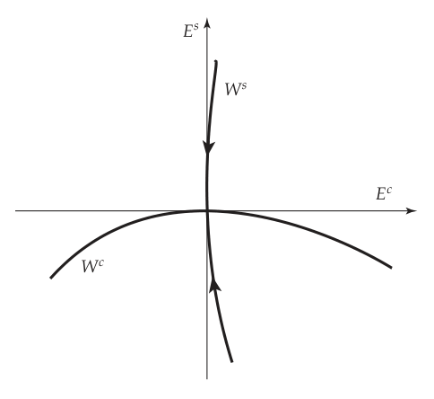
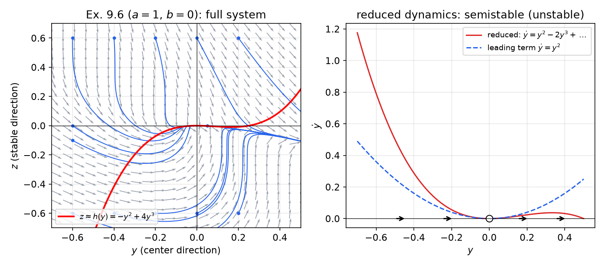
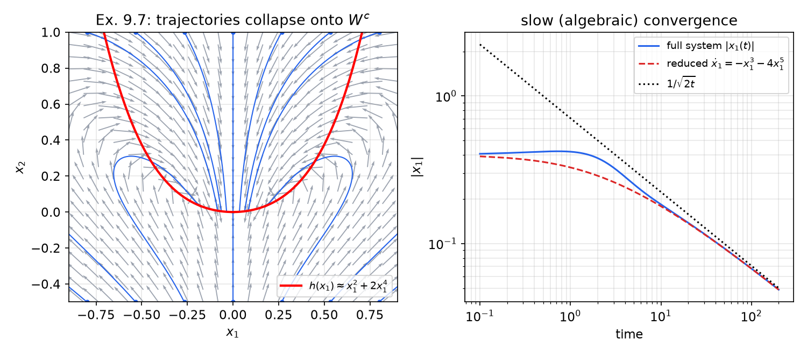
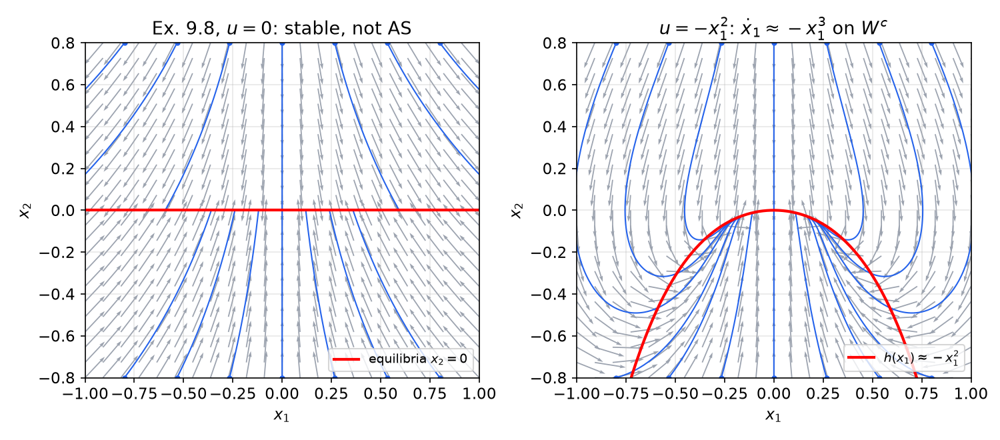
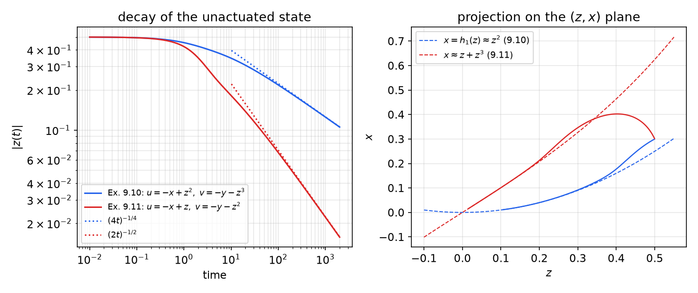

# Center Manifold Theory

When the linearization of a nonlinear system at an equilibrium has eigenvalues on the imaginary axis and none in the right half-plane, Lyapunov's indirect method is silent: stability depends on the nonlinear terms. Center manifold theory resolves such *critical cases* by a dimension reduction. The stable modes decay exponentially onto an invariant manifold tangent to the critical eigenspace, and the stability of the full system is the stability of a lower-dimensional *reduced system* living on that manifold. The same idea turns into a design method for systems whose linearization cannot be stabilized: choose nonlinear feedback terms that shape the center manifold so the reduced dynamics become asymptotically stable.

## The Critical Case

Consider
\\[
\dot x = f(x), \qquad f \in C^1(D),\ 0 \in D \subset \mathbb R^n,\ f(0) = 0, \qquad A = \frac{\partial f}{\partial x}(0). \tag{9.1}
\\]
By Lyapunov's indirect method (see [Lyapunov Stability](lyapunov.md)): if all eigenvalues of \\(A\\) have negative real parts the origin is locally asymptotically stable (in fact exponentially stable), and if some eigenvalue has positive real part it is unstable. The **critical case** is the remaining one: some eigenvalues have zero real part and none has positive real part. The linearization is then inconclusive, and stability is decided by the nonlinearities it neglects. For example, \\(\dot x = -x^3\\) and \\(\dot x = x^3\\) have the same linearization \\(\dot x = 0\\) but opposite stability properties.

### Block form

Assume \\(f \in C^2\\) and separate the linear part:
\\[
\dot x = Ax + \tilde f(x), \qquad \tilde f(x) = f(x) - \frac{\partial f}{\partial x}(0)\\,x, \qquad \tilde f(0) = 0,\quad \frac{\partial \tilde f}{\partial x}(0) = 0 .
\\]
Suppose \\(A\\) has \\(k\\) eigenvalues with zero real part and \\(m = n - k\\) eigenvalues with negative real part. By a real block-diagonalization (see [Modal Decomposition](../me6401-linear-control/modal-decomposition.md)) there is a nonsingular \\(T\\) with
\\[
TAT^{-1} = \begin{bmatrix} A\_1 & 0 \\\\ 0 & A\_2 \end{bmatrix}, \qquad A\_1 \in \mathbb R^{k\times k} \text{ (all eigenvalues on } j\mathbb R),\quad A\_2 \in \mathbb R^{m\times m} \text{ Hurwitz}.
\\]
In the coordinates \\(Tx = (y, z)\\), \\(y \in \mathbb R^k\\), \\(z \in \mathbb R^m\\),
\\[
\dot y = A\_1 y + g\_1(y, z), \qquad \dot z = A\_2 z + g\_2(y, z), \tag{9.4}
\\]
where \\((g\_1, g\_2) = T\tilde f\big(T^{-1}(y,z)\big)\\) are \\(C^2\\) and vanish to second order:
\\[
g\_i(0,0) = 0, \qquad \frac{\partial g\_i}{\partial y}(0,0) = 0, \qquad \frac{\partial g\_i}{\partial z}(0,0) = 0, \qquad i = 1,2. \tag{9.6}
\\]
The variables \\(y\\) carry the critical (center) modes, \\(z\\) the exponentially stable ones.

## Center Manifolds

**Definition 9.1 (Invariant and center manifolds).** Let \\(h : \mathbb R^k \to \mathbb R^m\\) be smooth. The graph \\(z = h(y)\\) is an **invariant manifold** of (9.4) if
\\[
z(0) = h\big(y(0)\big) \ \Longrightarrow\ z(t) = h\big(y(t)\big) \quad \text{for all } t \ge 0
\\]
(for as long as the solution stays in the domain of \\(h\\)). It is a **center manifold** if, in addition,
\\[
h(0) = 0, \qquad \frac{\partial h}{\partial y}(0) = 0 . \tag{9.7}
\\]

Condition (9.7) says that the manifold passes through the equilibrium and is tangent there to the center eigenspace.

**Geometry.** Let \\(E^s\\) be the span of the (generalized) eigenvectors of the stable eigenvalues (dimension \\(m\\)) and \\(E^c\\) the span of those of the critical eigenvalues (dimension \\(k\\)). In the \\((y,z)\\) coordinates, \\(E^c\\) is the \\(y\\)-subspace and \\(E^s\\) the \\(z\\)-subspace. The **center manifold** \\(W^c = \\{z = h(y)\\}\\) is tangent to \\(E^c\\) at the origin. The **stable manifold** \\(W^s\\) is an invariant manifold of dimension \\(m\\), tangent to \\(E^s\\) at the origin, made of the points whose trajectories converge to the origin exponentially fast. The two manifolds cross transversally at the origin. Near the equilibrium, every trajectory is attracted exponentially to \\(W^c\\) along directions roughly parallel to \\(E^s\\), and the long-term behavior is governed by the flow on \\(W^c\\).

*Figure: stable and center eigenspaces \\(E^s\\) (vertical) and \\(E^c\\) (horizontal), and the corresponding manifolds. \\(W^c\\) is tangent to \\(E^c\\) at the origin but curves away from it; \\(W^s\\) is tangent to \\(E^s\\) and its points flow into the origin, as the arrows indicate.*

**Theorem 9.2 (Existence).** Suppose \\(g\_1, g\_2 \in C^2\\) satisfy (9.6), all eigenvalues of \\(A\_1\\) have zero real part, and all eigenvalues of \\(A\_2\\) have negative real part. Then there exist \\(\delta > 0\\) and a \\(C^1\\) function \\(h\\), defined for \\(\lVert y \rVert < \delta\\), such that \\(z = h(y)\\) is a center manifold of (9.4).

The theorem is local: \\(h\\) need only exist near \\(y = 0\\). It is proved by a contraction-mapping argument on a modified system in which the nonlinearities are cut off outside a small ball (see Khalil, *Nonlinear Systems*, for a full proof). The center manifold need not be unique, and need not be analytic even when \\(f\\) is (see the examples below).

### The invariance equation

On a center manifold, \\(z(t) = h(y(t))\\), so the \\(y\\) dynamics close on themselves:
\\[
\boxed{\dot y = A\_1 y + g\_1\big(y, h(y)\big).} \tag{9.8}
\\]
This \\(k\\)-dimensional system is the **reduced system**. To find \\(h\\), measure the distance from the manifold with
\\[
w = z - h(y).
\\]
Differentiating, and using (9.4),
\\[
\dot w = A\_2 z + g\_2(y, z) - \frac{\partial h}{\partial y}(y)\\,\dot y = A\_2\big(w + h(y)\big) + g\_2\big(y, w + h(y)\big) - \frac{\partial h}{\partial y}(y)\Big(A\_1 y + g\_1\big(y, w + h(y)\big)\Big). \tag{9.10}
\\]
The graph \\(z = h(y)\\) is invariant exactly when \\(w = 0\\) implies \\(\dot w = 0\\). Setting \\(w = 0\\) in (9.10) gives the **invariance condition**, a first-order PDE for \\(h\\):
\\[
\boxed{\mathcal N(h)(y) \overset{\text{def}}{=} \frac{\partial h}{\partial y}(y)\Big(A\_1 y + g\_1\big(y, h(y)\big)\Big) - A\_2 h(y) - g\_2\big(y, h(y)\big) = 0,} \tag{9.11}
\\]
together with the boundary conditions \\(h(0) = 0\\), \\(\partial h/\partial y(0) = 0\\). Its meaning is simple: the velocity of \\(z\\) on the manifold must equal the velocity obtained by moving along the manifold with the \\(y\\) dynamics.

### Exact form of the dynamics near the manifold

To see why the reduced system governs stability, write the full dynamics in the coordinates \\((y, w)\\). Adding and subtracting \\(g\_1(y, h(y))\\),
\\[
\begin{aligned}
\dot y &= A\_1 y + g\_1\big(y, h(y)\big) + N\_1(y, w), \\\\
\dot w &= A\_2 w + N\_2(y, w),
\end{aligned}
\\]
with
\\[
N\_1(y,w) = g\_1\big(y, w + h(y)\big) - g\_1\big(y, h(y)\big), \qquad N\_2(y, w) = g\_2\big(y, w + h(y)\big) - g\_2\big(y, h(y)\big) - \frac{\partial h}{\partial y}(y)\\,N\_1(y, w),
\\]
where the invariance equation (9.11) was used to cancel the terms of \\(\dot w\\) that do not vanish with \\(w\\). The functions \\(N\_i\\) are continuously differentiable, \\(N\_i(y, 0) = 0\\), and \\(\partial N\_i/\partial w(0,0) = 0\\) (because \\(\partial g\_i/\partial z(0,0) = 0\\) and \\(\partial h/\partial y(0) = 0\\)). By the mean value theorem, in a ball \\(\lVert (y,w) \rVert < \delta\\),
\\[
\lVert N\_i(y, w) \rVert \le k\_i \lVert w \rVert ,
\\]
with constants \\(k\_i\\) that can be made arbitrarily small by shrinking \\(\delta\\). So the \\(w\\) dynamics are a Hurwitz linear system with a small perturbation proportional to \\(\lVert w \rVert\\), and \\(w\\) decays exponentially, while the \\(y\\) dynamics are the reduced system plus a perturbation that is small and decaying. This strongly suggests that the reduced system decides stability, which is the content of the next theorem.

## The Reduction Principle

**Theorem 9.3 (Reduction principle).** Under the hypotheses of Theorem 9.2, if the origin \\(y = 0\\) of the reduced system (9.8) is asymptotically stable (respectively, unstable), then the origin of the full system (9.4) is asymptotically stable (respectively, unstable).

*Proof sketch (asymptotic stability).* By the converse Lyapunov theorem (see [Advanced Lyapunov Theory](lyapunov-advanced.md)) there is a \\(C^1\\) function \\(V(y)\\) with \\(\alpha\_1(\lVert y \rVert) \le V(y) \le \alpha\_2(\lVert y \rVert)\\), \\(\frac{\partial V}{\partial y}(A\_1y + g\_1(y,h(y))) \le -\alpha\_3(\lVert y \rVert)\\) and \\(\lVert \partial V/\partial y \rVert \le k\\) near the origin, with class \\(\mathcal K\\) functions \\(\alpha\_i\\). Let \\(P = P^\top > 0\\) solve \\(PA\_2 + A\_2^\top P = -I\\) and take the composite function \\(\nu(y, w) = V(y) + \sqrt{w^\top Pw}\\). Along the \\((y,w)\\) dynamics,
\\[
\dot\nu \le -\alpha\_3(\lVert y \rVert) + k k\_1\lVert w \rVert - \frac{w^\top w}{2\sqrt{w^\top Pw}} + \frac{\lVert P \rVert k\_2\lVert w \rVert^2}{\sqrt{w^\top Pw}} \le -\alpha\_3(\lVert y \rVert) - \left(\frac{1}{2\sqrt{\lambda\_{\max}(P)}} - kk\_1 - \frac{\lVert P \rVert k\_2}{\sqrt{\lambda\_{\min}(P)}}\right)\lVert w \rVert ,
\\]
and the bracket is positive once \\(\delta\\) (hence \\(k\_1, k\_2\\)) is small enough. So \\(\dot\nu\\) is negative definite and the origin is asymptotically stable. Instability is shown similarly using an instability (Chetaev-type) function for the reduced system. \\(\blacksquare\\)

When the reduced system is only *stable*, a Lyapunov function has to be assumed rather than produced by a converse theorem.

**Corollary 9.4.** Suppose the origin of the reduced system (9.8) is stable and there is a \\(C^1\\) positive definite \\(V : \mathbb R^k \to \mathbb R\\) with
\\[
\frac{\partial V}{\partial y}\Big(A\_1 y + g\_1\big(y, h(y)\big)\Big) \le 0 \tag{9.12}
\\]
in a neighborhood of \\(y = 0\\). Then the origin of the full system is stable.

The function \\(V\\) must be imposed explicitly because, for systems that are stable but not asymptotically stable, converse theorems only guarantee a *time-varying* Lyapunov function \\(V(t, y)\\), which does not fit the composite construction above.

**Corollary 9.5.** The origin of the reduced system (9.8) is asymptotically stable **if and only if** the origin of the full system (9.4) is asymptotically stable.

*Proof.* "If" follows from Theorem 9.3. Conversely, solutions starting on the center manifold stay on it and obey (9.8), so if the reduced origin were not asymptotically stable, neither would the full origin be. \\(\blacksquare\\)

The reduction principle also predicts *how fast* solutions converge: exponentially to \\(W^c\\), and then at the (typically algebraic) rate of the reduced system. A reduced system \\(\dot y = -cy^3\\) gives \\(y(t) \sim 1/\sqrt{2ct}\\), not an exponential.

## Computing the Center Manifold

The PDE (9.11) is usually impossible to solve exactly, but the reduction principle only needs \\(h\\) to the order that determines the stability of (9.8). The following approximation theorem justifies truncated power series.

**Theorem (Approximation of the center manifold).** Let \\(\phi : \mathbb R^k \to \mathbb R^m\\) be \\(C^1\\) with \\(\phi(0) = 0\\) and \\(\partial\phi/\partial y(0) = 0\\). If \\(\mathcal N(\phi)(y) = O(\lVert y \rVert^p)\\) for some \\(p > 1\\), where \\(\mathcal N\\) is the operator in (9.11), then for \\(\lVert y \rVert\\) small enough
\\[
h(y) - \phi(y) = O(\lVert y \rVert^p),
\\]
and the reduced system can be written as \\(\dot y = A\_1 y + g\_1(y, \phi(y)) + O(\lVert y \rVert^{p+1})\\).

**Procedure.** Write \\(h(y) = h\_2(y) + h\_3(y) + \cdots\\) with \\(h\_j\\) homogeneous of degree \\(j\\) (no constant or linear terms, by (9.7)). Substitute into (9.11), expand, and equate coefficients of each power of \\(y\\) to zero, order by order, until the leading term of the reduced system is decided. If the reduced system's lowest-order term is of "odd degree with the stable sign" (e.g. \\(\dot y = -cy^3\\), \\(c > 0\\)), or of even degree (e.g. \\(\dot y = ay^2\\), \\(a \ne 0\\), which is always unstable), stability is decided; otherwise compute the next order.

The coefficients matter: a quadratic approximation \\(h \approx h\_2\\) gives the reduced system to third order, which is often all that is needed.

**Example 9.6 (An unstable critical equilibrium).** Consider
\\[
\dot x\_1 = x\_2, \qquad \dot x\_2 = -x\_2 + a x\_1^2 + b x\_1x\_2, \qquad a \ne 0 .
\\]
*Linearization.* \\(A = \begin{bmatrix} 0 & 1 \\\\ 0 & -1 \end{bmatrix}\\), with eigenvalues \\(0\\) and \\(-1\\): a critical case.

*Block form.* With
\\[
T = \begin{bmatrix} 1 & 1 \\\\ 0 & -1 \end{bmatrix}, \qquad TAT^{-1} = \begin{bmatrix} 0 & 0 \\\\ 0 & -1 \end{bmatrix},
\\]
set \\(y = x\_1 + x\_2\\), \\(z = -x\_2\\), so \\(x\_1 = y + z\\), \\(x\_2 = -z\\). Then
\\[
\dot y = \dot x\_1 + \dot x\_2 = a x\_1^2 + bx\_1x\_2 = a(y + z)^2 - b(yz + z^2),
\\]
\\[
\dot z = -\dot x\_2 = -z - a(y+z)^2 + b(yz + z^2).
\\]
*Invariance equation.* With \\(A\_1 = 0\\), \\(A\_2 = -1\\), (9.11) reads
\\[
h'(y)\Big[a\big(y + h\big)^2 - b\big(yh + h^2\big)\Big] + h + a\big(y + h\big)^2 - b\big(yh + h^2\big) = 0, \qquad h(0) = h'(0) = 0 .
\\]
*Series solution.* Substitute \\(h = h\_2y^2 + h\_3y^3 + \cdots\\).

- Order \\(y^2\\): the first bracket is \\(O(y^2)\\) and \\(h' = O(y)\\), so the first product is \\(O(y^3)\\). The remaining terms give \\(h\_2 + a = 0\\), so \\(h\_2 = -a\\).
- Order \\(y^3\\): \\(h'\cdot[\cdot]\\) contributes \\(2h\_2y\cdot ay^2 = -2a^2y^3\\); \\(a(y + h)^2\\) contributes \\(2ah\_2y^3 = -2a^2y^3\\); \\(-b(yh + h^2)\\) contributes \\(-bh\_2y^3 = aby^3\\); and \\(h\\) contributes \\(h\_3y^3\\). Hence \\(h\_3 - 4a^2 + ab = 0\\), \\(h\_3 = a(4a - b)\\).

So
\\[
h(y) = -ay^2 + a(4a - b)y^3 + O(y^4).
\\]
*Reduced system.*
\\[
\dot y = a\big(y + h(y)\big)^2 - b\big(yh(y) + h(y)^2\big) = ay^2 + O(y^3).
\\]
The leading term \\(ay^2\\) has even degree, so the origin of the reduced system is unstable for every \\(a \ne 0\\) (solutions on one side approach it, on the other side they leave), and by Theorem 9.3 the origin of the original system is unstable. Only the quadratic term of \\(h\\) was actually needed; in fact the first-order guess \\(h = 0\\) already gives \\(\dot y = ay^2 + O(y^3)\\).

*Figure: Example 9.6 with \\(a = 1\\), \\(b = 0\\), in the \\((y, z)\\) coordinates. Left: trajectories (blue) drop quickly in the stable direction \\(z\\) onto the approximate center manifold \\(z = -y^2 + 4y^3\\) (red), then drift slowly along it to the right. Those starting with \\(y < 0\\) approach the origin, those with \\(y > 0\\) leave it. Right: the reduced vector field; \\(\dot y \ge 0\\) on both sides, so the origin is semistable, hence unstable.*

**Example 9.7 (An asymptotically stable critical equilibrium).** Consider
\\[
\dot x\_1 = -2x\_1x\_2 + x\_1^3, \qquad \dot x\_2 = -x\_2 + x\_1^2,
\\]
which is already in the form (9.4) with \\(y = x\_1\\), \\(z = x\_2\\), \\(A\_1 = 0\\), \\(A\_2 = -1\\).

*Invariance equation.* With \\(x\_2 = h(x\_1)\\):
\\[
-h(x\_1) + x\_1^2 = h'(x\_1)\Big(-2x\_1h(x\_1) + x\_1^3\Big).
\\]
*Series solution.* Try \\(h = c\_2x\_1^2 + c\_3x\_1^3 + c\_4x\_1^4 + \cdots\\). The right side is \\((2c\_2x\_1 + \cdots)\big((1 - 2c\_2)x\_1^3 + \cdots\big) = 2c\_2(1 - 2c\_2)x\_1^4 + O(x\_1^5)\\). Matching:

- \\(x\_1^2\\): \\(1 - c\_2 = 0\\), so \\(c\_2 = 1\\);
- \\(x\_1^3\\): \\(-c\_3 = 0\\), so \\(c\_3 = 0\\);
- \\(x\_1^4\\): \\(-c\_4 = 2c\_2(1 - 2c\_2) = -2\\), so \\(c\_4 = 2\\).

Hence \\(h(x\_1) = x\_1^2 + 2x\_1^4 + O(x\_1^5)\\).

*Reduced system.*
\\[
\dot x\_1 = -2x\_1h(x\_1) + x\_1^3 = -2x\_1^3 + x\_1^3 - 4x\_1^5 + O(x\_1^6) = -x\_1^3 - 4x\_1^5 + O(x\_1^6),
\\]
which is asymptotically stable (\\(V = x\_1^2\\) gives \\(\dot V = -2x\_1^4 + O(x\_1^6)\\)). By Theorem 9.3 the origin of the full system is asymptotically stable. Note that the quadratic term \\(h\_2 = x\_1^2\\) was essential: the naive guess \\(x\_2 \approx 0\\) would give \\(\dot x\_1 \approx +x\_1^3\\) and the wrong conclusion. (With the sign \\(+2x\_1x\_2\\) instead, the reduced system would be \\(\dot x\_1 = 3x\_1^3 + \cdots\\), unstable.)

*Figure: Example 9.7. Left: trajectories are attracted to the center manifold \\(x\_2 \approx x\_1^2 + 2x\_1^4\\) (red) and then creep along it to the origin; far from the origin some trajectories escape, because the result is local. Right: \\(\lvert x\_1(t) \rvert\\) on log-log axes from \\((0.4, 0)\\); after a short transient the full system follows the reduced system \\(\dot x\_1 = -x\_1^3 - 4x\_1^5\\), and both approach the algebraic rate \\(1/\sqrt{2t}\\), not an exponential.*

### Non-uniqueness and divergent series

Two cautions apply to the computations above.

**Center manifolds are not unique.** For \\(\dot y = -y^3\\), \\(\dot z = -z\\), the invariance equation is \\(h'(y)(-y^3) = -h(y)\\), i.e. \\(h' = h/y^3\\). Its solutions
\\[
h(y) = \begin{cases} c\_1 e^{-1/(2y^2)}, & y > 0, \\\\ 0, & y = 0, \\\\ c\_2 e^{-1/(2y^2)}, & y < 0, \end{cases}
\\]
are \\(C^\infty\\) with all derivatives zero at the origin, so every choice of \\(c\_1, c\_2\\) gives a center manifold. All of them share the same Taylor series (here identically zero), which is why the series computation, and hence the stability conclusion, is unaffected by the non-uniqueness.

**The series need not converge.** For \\(\dot y = y^2\\), \\(\dot z = -z + y^2\\), the invariance equation \\(h'(y)y^2 = -h + y^2\\) with \\(h = \sum\_{j \ge 2} a\_jy^j\\) gives \\(a\_2 = 1\\) and \\(a\_{j+1} = -j\\,a\_j\\), so
\\[
h(y) \sim \sum\_{j \ge 2} (-1)^j (j-1)!\\, y^j ,
\\]
which diverges for every \\(y \ne 0\\). Center manifolds nevertheless exist. Viewing \\(z\\) as a function of \\(y\\), the invariance equation is the linear ODE \\(h' + h/y^2 = 1\\), and for \\(y > 0\\) the solution with \\(h(0^+) = 0\\) is
\\[
h(y) = e^{1/y}\int\_0^y e^{-1/s}\\,ds ,
\\]
a smooth function whose asymptotic expansion as \\(y \to 0^+\\) is the divergent series above; it is not analytic at the origin. Truncated series remain valid asymptotic approximations by the approximation theorem, which is all that the stability analysis requires.

## Stabilization Using the Center Manifold

### Weakly stabilizable systems

Consider a control system
\\[
\dot x = f(x, u), \qquad f(0,0) = 0, \tag{9.21}
\\]
whose linearization is **weakly stabilizable**: every linear feedback leaves one or more closed-loop eigenvalues on the imaginary axis, and the rest can be placed in the open left half-plane. Such systems arise when the linearization has uncontrollable modes on the imaginary axis (see [Controllability](../me6401-linear-control/controllability.md) and [Structure](../me6401-linear-control/structure.md) for the linear notions).

Two consequences follow immediately.

- If a critical system is stabilizable, the closed loop **cannot be exponentially stable** with any \\(C^1\\) control vanishing at the origin: exponential stability of a \\(C^1\\) system would require a Hurwitz linearization, and the linearization keeps its critical eigenvalues whatever \\(u\\) does.
- Nonetheless, linear feedback may still work, because the nonlinear terms of \\(f\\) interact with the feedback. For the scalar system \\(\dot x = ux^2\\) the linearization \\(\dot x = 0\\) is critical for every \\(u\\), yet the *linear* feedback \\(u = -x\\) gives \\(\dot x = -x^3\\), asymptotically stable.

### Shaping the center manifold

Expand the feedback in homogeneous terms (standard dilation),
\\[
u(x) = u\_0 + u\_1(x) + u\_2(x) + \cdots, \tag{9.23}
\\]
with \\(u\_j\\) homogeneous of degree \\(j\\). (Non-standard dilations, as in [Homogeneous Systems](homogeneity.md), can be used as well.) The simplest strategy is to take
\\[
u\_0 = 0, \qquad u\_1 = 0, \tag{9.24}
\\]
so that the linear part of the closed loop, and with it the block form (9.4), is unchanged. The higher-order terms \\(u\_2, u\_3, \dots\\) do not move any eigenvalue, but they change \\(g\_1, g\_2\\), hence the center manifold \\(h\\), hence the reduced dynamics. The design problem becomes: choose \\(u\_2, u\_3, \ldots\\) so that the reduced system is asymptotically stable.

**Example 9.8 (Quadratic feedback).** Consider
\\[
\dot x\_1 = x\_1x\_2, \qquad \dot x\_2 = -x\_2 + u .
\\]
*No linear feedback works.* With \\(u = k\_1x\_1 + k\_2x\_2\\) the linearization \\(\begin{bmatrix} 0 & 0 \\\\ k\_1 & k\_2 - 1 \end{bmatrix}\\) always has the eigenvalue 0. If \\(k\_1 \ne 0\\), the center manifold is tangent to the eigenvector of the zero eigenvalue, \\(x\_2 \approx k\_1x\_1/(1 - k\_2)\\), and the reduced system \\(\dot x\_1 \approx \frac{k\_1}{1 - k\_2}x\_1^2\\) is unstable. If \\(k\_1 = 0\\), the axis \\(x\_2 = 0\\) consists of equilibria and nothing converges.

*Quadratic feedback.* Take \\(u = ax\_1^2 + bx\_1x\_2 + cx\_2^2\\), so (9.24) holds and the system is in block form with \\(y = x\_1\\), \\(z = x\_2\\), \\(A\_1 = 0\\), \\(A\_2 = -1\\). With \\(x\_2 = h(x\_1) = h\_2x\_1^2 + h\_3x\_1^3 + \cdots\\), the invariance equation is
\\[
-h + ax\_1^2 + bx\_1h + ch^2 = h'(x\_1)\\,x\_1h(x\_1).
\\]
The right side is \\(O(x\_1^4)\\), so the \\(x\_1^2\\) terms give \\(h\_2 = a\\) (and the \\(x\_1^3\\) terms \\(h\_3 = ab\\)). The reduced system is
\\[
\dot x\_1 = x\_1h(x\_1) = ax\_1^3 + O(x\_1^4),
\\]
asymptotically stable for \\(a < 0\\). Hence
\\[
u = ax\_1^2, \qquad a < 0,
\\]
locally asymptotically stabilizes the origin, though not exponentially.

*Figure: Example 9.8. Left, \\(u = 0\\): the axis \\(x\_2 = 0\\) is a line of equilibria and each trajectory stops wherever it meets it, so the origin is stable but not attractive. Right, \\(u = -x\_1^2\\): the center manifold bends to \\(x\_2 \approx -x\_1^2\\), on which \\(\dot x\_1 = x\_1x\_2 \approx -x\_1^3\\), and every trajectory shown slides along it into the origin.*

### Feedback that changes the linear part

Without (9.24), \\(u\_0\\) and \\(u\_1\\) modify the linear part. Then one must check that no unstable eigenvalue is introduced and recompute the transformation to block form before applying the reduction.

**Example 9.9 (Linear feedback with a shaped center manifold).** Consider
\\[
\dot x\_1 = 2x\_1(x\_1 + x\_2) - ux\_1, \qquad \dot x\_2 = -x\_2 - x\_1^2 + u,
\\]
with the linear feedback \\(u = px\_1 + qx\_2\\).

*Closed-loop linear part.* The terms \\(2x\_1(x\_1 + x\_2)\\) and \\(ux\_1\\) are quadratic, so
\\[
\dot x\_1 = 0 + \text{h.o.t.}, \qquad \dot x\_2 = px\_1 + (q - 1)x\_2 + \text{h.o.t.}
\\]
The eigenvalues are \\(0\\) and \\(a \overset{\text{def}}{=} q - 1\\). We need \\(a < 0\\) (no unstable eigenvalue), i.e. \\(q < 1\\).

*Block form.* The eigenvector of the zero eigenvalue is \\((a, -p)\\). Change coordinates by
\\[
x\_1 = az\_1, \qquad x\_2 = -pz\_1 + z\_2 .
\\]
A direct computation gives
\\[
\begin{aligned}
\dot z\_1 &= (2a - p)z\_1^2 + (1 - a)z\_1z\_2, \\\\
\dot z\_2 &= az\_2 - a^2z\_1^2 + p\Big((2a - p)z\_1^2 + (1 - a)z\_1z\_2\Big),
\end{aligned}
\\]
whose linear part \\(\operatorname{diag}(0, a)\\) is in block form for all \\(p, q\\).

*Center manifold.* With \\(z\_2 = h(z\_1) = h\_2z\_1^2 + \cdots\\), the left side \\(h'(z\_1)\dot z\_1\\) of the invariance equation is \\(O(z\_1^3)\\), so the \\(z\_1^2\\) terms of \\(\dot z\_2\\) must cancel:
\\[
ah\_2 - a^2 + p(2a - p) = 0 \quad\Longrightarrow\quad h\_2 = \frac{a^2 - p(2a - p)}{a} = \frac{(a - p)^2}{a}.
\\]
*Reduced system.*
\\[
\dot z\_1 = (2a - p)z\_1^2 + (1 - a)h\_2z\_1^3 + \cdots
\\]
For asymptotic stability the quadratic term must vanish, \\(2a - p = 0\\), and the cubic coefficient must be negative, \\((1 - a)h\_2 < 0\\). With \\(p = 2a\\), \\(h\_2 = a^2/a = a\\), and \\((1 - a)a < 0\\) holds for every \\(a < 0\\). The stabilizing law is therefore
\\[
u(x) = 2(q - 1)x\_1 + qx\_2, \qquad q < 1 .
\\]
Here a purely *linear* law stabilizes, but its gains are chosen by nonlinear (center manifold) reasoning: the condition \\(p = 2(q - 1)\\) is invisible to the linearization.

### Rigid body with two torques

**Example 9.10 (Underactuated rigid body).** The model
\\[
\dot x = u, \qquad \dot y = v, \qquad \dot z = xy
\\]
captures the angular velocity dynamics of a rigid body with two control torques (compare (8.69) in [Homogeneous Systems](homogeneity.md), with \\(x, y\\) the actuated rates and \\(z\\) the unactuated one, after normalizing \\(\epsilon = 1\\)). Its linearization \\(\dot z = 0\\) is uncontrollable, and no linear feedback can make \\(z\\) converge.

*Control.* Take \\(u = -x + \alpha z^2\\), \\(v = -y + \beta z^3\\). The closed loop is
\\[
\frac{d}{dt}\begin{bmatrix} x \\\\ y \\\\ z \end{bmatrix} = \begin{bmatrix} -1 & 0 & 0 \\\\ 0 & -1 & 0 \\\\ 0 & 0 & 0 \end{bmatrix}\begin{bmatrix} x \\\\ y \\\\ z \end{bmatrix} + \begin{bmatrix} \alpha z^2 \\\\ \beta z^3 \\\\ xy \end{bmatrix},
\\]
already in block form with center variable \\(z\\).

*Center manifold.* Let \\(x = h\_1(z) = h\_{11}z^2 + h\_{12}z^3 + \cdots\\), \\(y = h\_2(z) = h\_{21}z^2 + h\_{22}z^3 + \cdots\\). The invariance equations are
\\[
h\_1'(z)\\,h\_1h\_2 = -h\_1 + \alpha z^2, \qquad h\_2'(z)\\,h\_1h\_2 = -h\_2 + \beta z^3 .
\\]
The left sides are \\(O(z^5)\\), so matching through \\(z^3\\) gives \\(h\_{11} = \alpha\\), \\(h\_{12} = 0\\), \\(h\_{21} = 0\\), \\(h\_{22} = \beta\\).

*Reduced system.*
\\[
\dot z = h\_1(z)h\_2(z) = \alpha\beta z^5 + O(z^6).
\\]
This is asymptotically stable if \\(\alpha\beta < 0\\). For example, \\(\alpha = -\beta = 1\\):
\\[
u = -x + z^2, \qquad v = -y - z^3 .
\\]

**Example 9.11 (Brockett's law).** For the same system, consider
\\[
u = -x + z, \qquad v = -y - z^2 .
\\]
Now the linear part changes. The closed loop is
\\[
\frac{d}{dt}\begin{bmatrix} x \\\\ y \\\\ z \end{bmatrix} = \begin{bmatrix} -1 & 0 & 1 \\\\ 0 & -1 & 0 \\\\ 0 & 0 & 0 \end{bmatrix}\begin{bmatrix} x \\\\ y \\\\ z \end{bmatrix} + \begin{bmatrix} 0 \\\\ -z^2 \\\\ xy \end{bmatrix},
\\]
with eigenvalues \\(0, -1, -1\\). The zero eigenvector is \\((1, 0, 1)\\), so use
\\[
\begin{bmatrix} x \\\\ y \\\\ z \end{bmatrix} = \begin{bmatrix} 1 & 1 & 0 \\\\ 0 & 0 & 1 \\\\ 1 & 0 & 0 \end{bmatrix}\begin{bmatrix} x\_1 \\\\ x\_2 \\\\ x\_3 \end{bmatrix},
\\]
i.e. \\(x = x\_1 + x\_2\\), \\(y = x\_3\\), \\(z = x\_1\\). Then \\(\dot x\_1 = \dot z = xy\\), \\(\dot x\_3 = \dot y\\) and \\(\dot x\_2 = \dot x - \dot z\\) give
\\[
\begin{bmatrix} \dot x\_1 \\\\ \dot x\_2 \\\\ \dot x\_3 \end{bmatrix} = \begin{bmatrix} 0 & 0 & 0 \\\\ 0 & -1 & 0 \\\\ 0 & 0 & -1 \end{bmatrix}\begin{bmatrix} x\_1 \\\\ x\_2 \\\\ x\_3 \end{bmatrix} + \begin{bmatrix} (x\_1 + x\_2)x\_3 \\\\ -(x\_1 + x\_2)x\_3 \\\\ -x\_1^2 \end{bmatrix}.
\\]
*Center manifold.* Let \\(x\_2 = h\_1(x\_1) = h\_{11}x\_1^2 + \cdots\\) and \\(x\_3 = h\_2(x\_1) = h\_{21}x\_1^2 + \cdots\\). Since \\(\dot x\_1 = O(x\_1^3)\\) on the manifold, the quadratic terms of the invariance equations give
\\[
0 = -h\_{11}, \qquad 0 = -h\_{21} - 1,
\\]
so \\(h\_{11} = 0\\), \\(h\_{21} = -1\\). (Carrying the expansion one order further gives \\(h\_1 = x\_1^3 + \cdots\\), \\(h\_2 = -x\_1^2 + \cdots\\).)

*Reduced system.*
\\[
\dot x\_1 = \big(x\_1 + h\_1(x\_1)\big)h\_2(x\_1) = -x\_1^3 + O(x\_1^4),
\\]
which is asymptotically stable. Hence Brockett's law stabilizes the origin.

*Figure: the rigid-body laws of Examples 9.10 and 9.11 from \\((x, y, z) = (0.3, -0.2, 0.5)\\). Left: the unactuated rate \\(\lvert z(t) \rvert\\) on log-log axes decays algebraically, as \\((4t)^{-1/4}\\) for Example 9.10 (reduced system \\(\dot z = -z^5\\)) and as \\((2t)^{-1/2}\\) for Brockett's law (reduced system \\(\dot z = -z^3\\)). Right: in the \\((z, x)\\) plane both trajectories are captured quickly by their center manifolds, \\(x \approx z^2\\) and \\(x = x\_1 + h\_1(x\_1) \approx z + z^3\\), and then slide to the origin.*

The comparison shows a general feature of center manifold designs: the closed loop is asymptotically but not exponentially stable, and the convergence rate is set by the degree of the leading term of the reduced system. Lower-degree reduced dynamics (cubic rather than quintic) converge faster. For rigid-body problems a homogeneous design with respect to a weighted dilation can do better and achieve \\(\rho\\)-exponential convergence, as in the detumbling case study of [Homogeneous Systems](homogeneity.md).

## Summary

- **Critical case:** eigenvalues of \\(A = \partial f/\partial x(0)\\) on the imaginary axis and none in the right half-plane; linearization is inconclusive.
- **Block form:** \\(\dot y = A\_1y + g\_1(y,z)\\), \\(\dot z = A\_2z + g\_2(y,z)\\), \\(A\_1\\) critical, \\(A\_2\\) Hurwitz, \\(g\_i\\) vanishing to second order.
- **Center manifold:** an invariant graph \\(z = h(y)\\) with \\(h(0) = 0\\), \\(h'(0) = 0\\); it exists locally (Theorem 9.2), may be non-unique and non-analytic.
- **Invariance PDE:** \\(\frac{\partial h}{\partial y}\big(A\_1y + g\_1(y,h)\big) = A\_2h + g\_2(y,h)\\); solve by power series to the order needed. If \\(\mathcal N(\phi) = O(\lVert y \rVert^p)\\) then \\(h - \phi = O(\lVert y \rVert^p)\\).
- **Reduction principle:** the full origin is asymptotically stable (unstable) if the reduced system \\(\dot y = A\_1y + g\_1(y, h(y))\\) is; asymptotic stability of the two is equivalent. Mere stability transfers given a Lyapunov function with (9.12).
- Convergence is exponential onto the manifold and then algebraic along it (e.g. \\(\dot y = -y^3\\) gives \\(y \sim t^{-1/2}\\)).
- **Stabilization:** for weakly stabilizable systems, exponential stabilization is impossible with \\(C^1\\) feedback, but higher-order feedback terms (or carefully chosen linear gains) shape \\(h\\) so that the reduced dynamics are stable: \\(u = ax\_1^2\\) (Example 9.8), \\(u = 2(q-1)x\_1 + qx\_2\\) (Example 9.9), \\(u = -x + z^2,\ v = -y - z^3\\) and Brockett's \\(u = -x + z,\ v = -y - z^2\\) for the rigid body.

## See Also

- [Lyapunov Stability](lyapunov.md): the indirect method whose critical case this chapter resolves.
- [Advanced Lyapunov Theory](lyapunov-advanced.md): converse theorems used in the proof of the reduction principle.
- [Homogeneous Systems](homogeneity.md): the complementary approach to critical equilibria, and the detumbling problem.
- [Nonlinear Controllability](controllability.md): Brockett's condition and why the rigid body needs nonlinear feedback.
- [Averaging and Singular Perturbations](averaging.md): another reduction technique built on separating fast stable dynamics from slow ones.
- [Modal Decomposition](../me6401-linear-control/modal-decomposition.md): the block-diagonal form behind the \\((y, z)\\) splitting.
- Systems of Differential Equations: background on linear systems and phase portraits.
