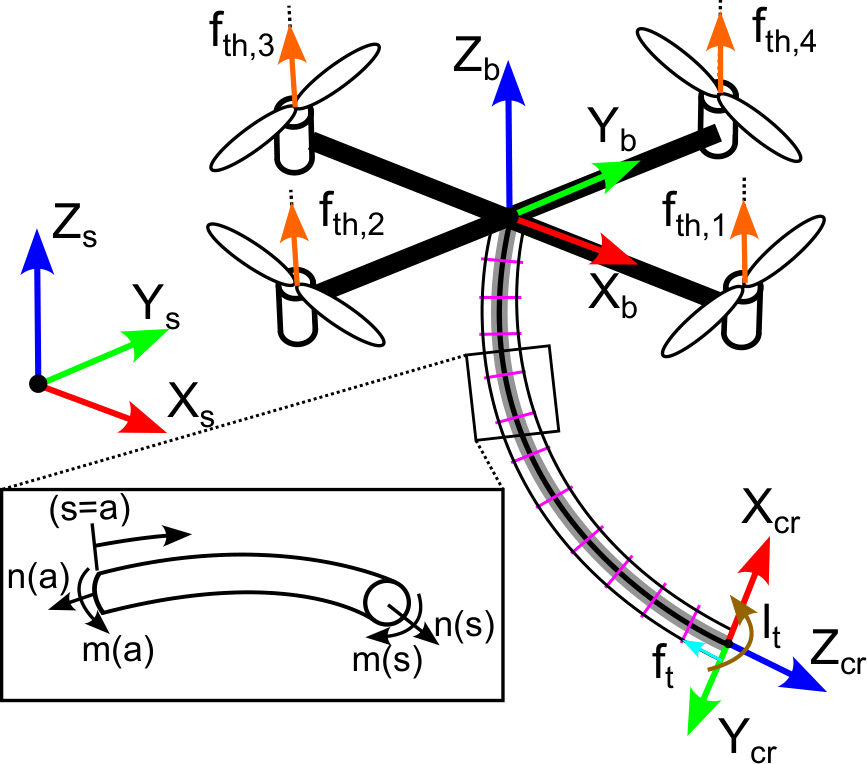
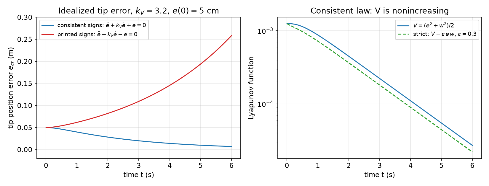
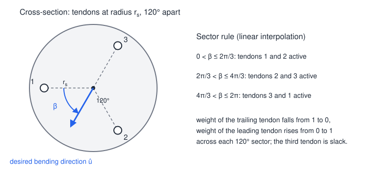
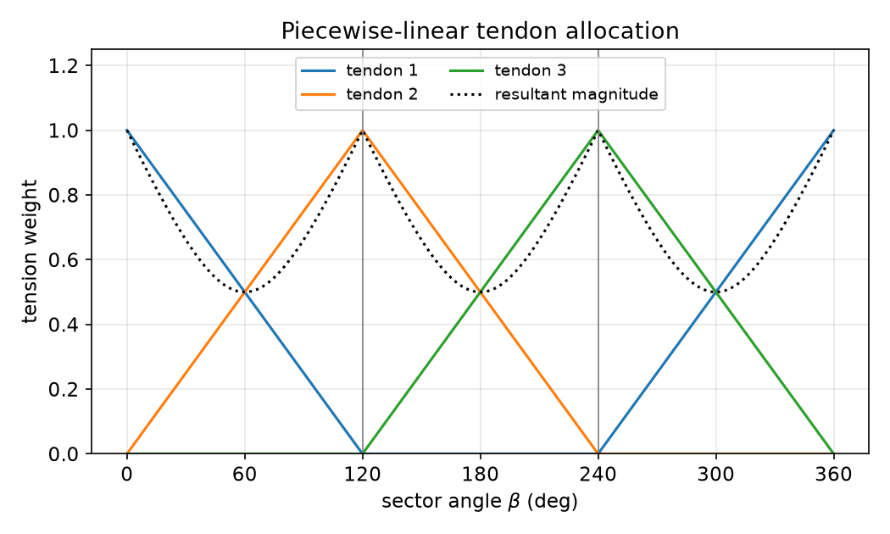
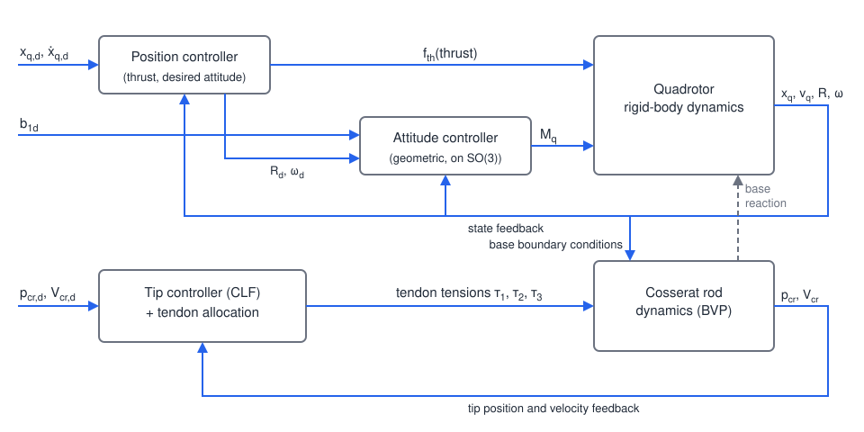
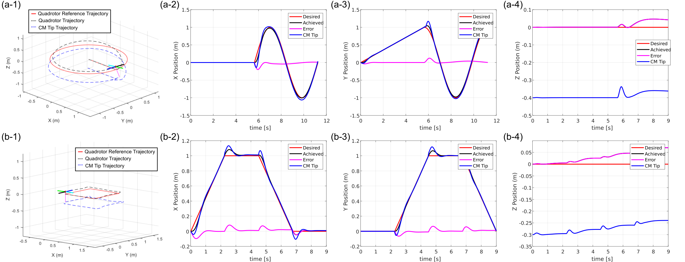
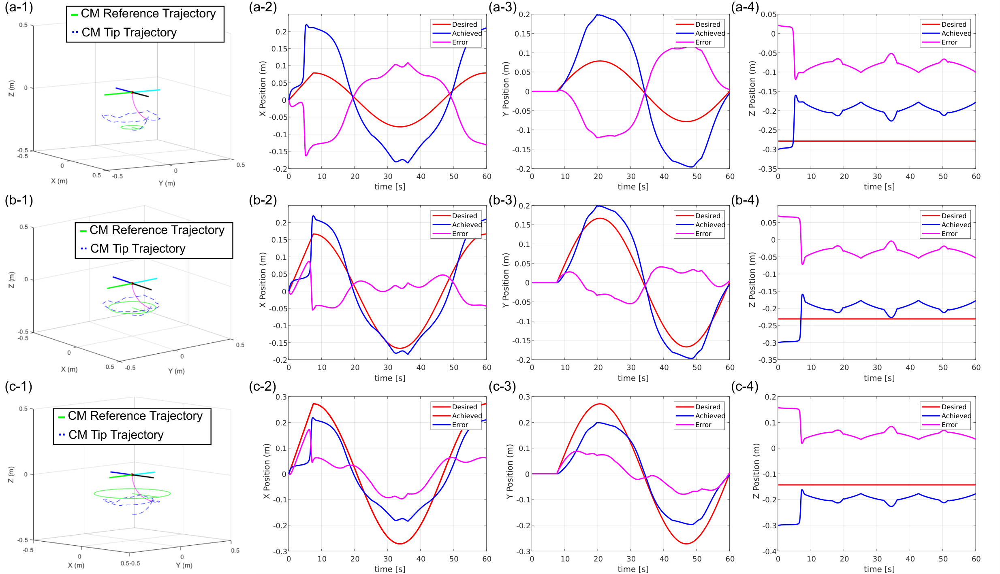
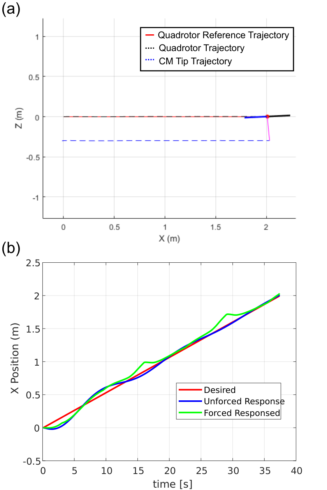

# Case Study: Shape Control of a Soft Manipulator Suspended from a Quadrotor

This chapter puts several tools from Part II to work on one coupled system: a quadrotor carrying a tendon-driven continuum (soft) manipulator hanging beneath it. The aircraft is a rigid body on \\(SE(3)\\), the arm is an elastic rod whose shape obeys partial differential equations, and the two are coupled through the attachment point. The case study goes through the modelling (Cosserat rod theory and its time discretization), a geometric controller for the quadrotor, a Lyapunov-based controller for the arm tip with a tendon allocation rule, and the simulation results, and then looks critically at what the design does and does not guarantee.

This case study is based on the AE 8803 course project report "Shape Control of a Soft Manipulator Suspended from a Quadrotor" by Timothy A. Brumfiel. The modelling choices, controller structure, parameters and simulation results reported below are his. The stability re-derivations, the time-scale estimates and the critical discussion are added here to connect the project to the theory chapters, and they are marked as such.

## The Problem

Quadrotors offer high manoeuvrability in a compact package, and **aerial manipulation** (picking fruit, handling parcels, search and rescue) would greatly extend what they can do. Rigid manipulators mounted on a UAV are risky when the vehicle touches an unknown environment: contact forces pass straight through the arm into the attitude dynamics. **Continuum robots**, slender flexible structures bent by tendons, concentric tubes, heat or magnetic fields, are compliant by construction. That makes them safer in contact, and they also offer intrinsic stiffness modulation and force sensing.

The literature on aerial transport has mostly treated the suspended object as a point mass on a cable:

- point-mass cable-suspended payloads with transverse feedback linearization for path following, assuming a taut, non-deformable cable;
- differential flatness of a quadrotor with a cable-suspended load, modelled as a hybrid system (taut or slack cable), with extensions to several quadrotors and to flexible or elastic cables;
- a tendon-driven continuum robot suspended from a quadrotor, modelled with Cosserat rod theory and controlled at the tip with robust adaptive sliding-mode control.

The project studied here takes the last setting and asks for:

1. a dynamic model of a quadrotor with a suspended tendon-driven continuum robot (CR);
2. position control of the quadrotor centre of mass;
3. control of the **relative** position of the CR tip, with a Lyapunov stability argument;
4. a demonstration on suspended-load motion: cancelling the arm's swing while the vehicle flies.

The intended uses of decoupled tip control are manipulation with the arm independently of the vehicle's motion, and vibration reduction during load transport.

## System Description and Frames

The vehicle is a quadrotor in "plus" configuration. Beneath it hangs a tendon-driven continuum robot of uniform cross-section, with **three tendons** routed along the backbone and terminated at the tip, so the tip can bend in any direction.

*Figure: the spatial frame {X_s, Y_s, Z_s}, the body frame {X_b, Y_b, Z_b} at the quadrotor centre of mass, and the tip frame {X_cr, Y_cr, Z_cr}. The rotor thrusts f_th,1 to f_th,4 act along Z_b. The tendons produce a tip force f_t and moment l_t. The inset shows a rod segment from s = a to s with internal force n and moment m at both ends, the free body used to derive the Cosserat balance laws. (From T. A. Brumfiel's project report.)*

## Quadrotor Model

The quadrotor is a rigid body with position \\(x\_q\in\mathbb{R}^3\\), inertial velocity \\(v\_q\\), attitude \\(R\in SO(3)\\) (body to spatial) and body angular velocity \\(\omega\\):
\\[
\dot x\_q = v\_q, \qquad m\_q\dot v\_q = m\_q g + f\_{th}R\hat e\_3 + F\_{cr}, \qquad \dot R = R[\omega]\_\times, \qquad J\_q\dot\omega + \omega\times J\_q\omega = M\_q + M\_{cr}. \tag{1}
\\]
Here \\(g\\) is the gravity vector, \\(f\_{th}\\) the total thrust magnitude along the body axis \\(\hat e\_3\\), \\(J\_q\\) the body inertia matrix, \\(M\_q\\) the control moment, and \\([\cdot]\_\times : \mathbb{R}^3\to\mathfrak{so}(3)\\) the hat map, \\([a]\_\times b = a\times b\\). The terms \\(F\_{cr}, M\_{cr}\\) are the force and moment exerted by the arm on the vehicle at the attachment point, i.e. the reaction to the rod's internal force and moment at its base \\(s=0\\). (The report's equation leaves this coupling term implicit.) For the controller, \\(F\_{cr}\\) and \\(M\_{cr}\\) are disturbances. The arm's mass is only about 1.3% of the vehicle's (see the parameter table), which is why they are small.

The four rotor thrusts map to the total thrust and the body moments through the mixer
\\[
\begin{bmatrix} f\_{th} \\\\ M\_x \\\\ M\_y \\\\ M\_z \end{bmatrix} =
\begin{bmatrix} 1 & 1 & 1 & 1 \\\\ 0 & -d & 0 & d \\\\ -d & 0 & d & 0 \\\\ C & -C & C & -C \end{bmatrix}
\begin{bmatrix} f\_{th,1} \\\\ f\_{th,2} \\\\ f\_{th,3} \\\\ f\_{th,4} \end{bmatrix}, \tag{2}
\\]
where \\(d\\) is the arm length (centre of mass to motor) and \\(C\\) the coefficient relating thrust to drag torque. The mixer is invertible, so \\((f\_{th}, M\_q)\\) may be treated as the inputs. The quadrotor is **underactuated**: four inputs for six degrees of freedom, with the thrust always along \\(R\hat e\_3\\). The translational dynamics are controlled by steering the thrust direction through the attitude, which is the cascade structure exploited below and analysed in [Backstepping and Forwarding](backstepping.md).

## Cosserat Rod Model of the Continuum Arm

### Kinematics

Cosserat rod theory describes a slender body by its centreline and a rigid cross-section frame at each arc length \\(s\in[0,L]\\):
\\[
g(s,t) = \begin{bmatrix} R\_r(s,t) & p\_r(s,t) \\\\ 0 & 1 \end{bmatrix} \in SE(3),
\\]
relative to the base of the arm. The spatial derivatives define the body-frame **strains**,
\\[
p\_r' = R\_rv\_r, \qquad R\_r' = R\_r[u\_r]\_\times, \tag{3}
\\]
where \\(v\_r\\) (shear and extension) and \\(u\_r\\) (bending and torsion) are the linear and angular strain rates per unit length, and \\((\cdot)' = \partial/\partial s\\). In the undeformed (reference) state, \\(\begin{bmatrix} v\_r^\ast \\\\ u\_r^\ast\end{bmatrix} = (g^{\ast -1}g^{\ast\prime})^\vee\\); for a straight unstretched rod \\(v\_r^\ast = \hat e\_3\\), \\(u\_r^\ast = 0\\). The time derivatives define the body-frame **velocities**,
\\[
\dot p\_r = R\_rq\_r, \qquad \dot R\_r = R\_r[\omega\_r]\_\times . \tag{4}
\\]
Because \\(\partial\_t\partial\_s = \partial\_s\partial\_t\\) (equality of mixed partials), strains and velocities are not independent. Differentiating (3) in time and (4) in space and equating gives the **compatibility equations**
\\[
\dot u\_r = \omega\_r' + [u\_r]\_\times\omega\_r, \qquad \dot v\_r = q\_r' + [u\_r]\_\times q\_r - [\omega\_r]\_\times v\_r . \tag{5}
\\]
This is the same structure as the Lie-bracket compatibility of two flows on a Lie group discussed in [Differential Geometry for Control](differential-geometry.md): the \\(s\\)-flow and the \\(t\\)-flow of \\(g(s,t)\\) must commute.

### Balance laws

Let \\(n(s)\\) and \\(m(s)\\) be the internal force and moment (in the spatial frame) that the material at \\(s^+\\) exerts on the material at \\(s^-\\), and \\(f(s), l(s)\\) the distributed external force and moment per unit length. Newton and Euler applied to the segment \\([a,s]\\) of the figure, in the limit \\(s\to a\\), give
\\[
n' + f = \rho A\\,\ddot p\_r, \qquad m' + p\_r'\times n + l = \partial\_t\big(R\_r\rho J\_r\omega\_r\big), \tag{6}
\\]
with \\(\rho\\) the density, \\(A\\) the cross-sectional area and \\(J\_r\\) the matrix of second moments of area.

The distributed loads are split by origin,
\\[
f = f\_t + f\_e + f\_q, \qquad l = l\_t + l\_e + l\_q ,
\\]
into the loads from the **tendons** (\\(t\\)), the **environment** (\\(e\\), contact; zero in the simulations) and the **quadrotor motion** (\\(q\\)). Because the rod is described relative to its base, which rotates with the vehicle, the base motion appears as inertial loads:
\\[
f\_q(s) = -\rho A[\omega\_q]\_\times[\omega\_q]\_\times p\_{r/q}(s) - \rho A[\dot\omega\_q]\_\times p\_{r/q}(s), \qquad l\_q = p\_{r/q}\times f\_q , \tag{7}
\\]
the centrifugal and Euler (angular-acceleration) forces on a point at position \\(p\_{r/q}\\) relative to the vehicle.

### Tendon loads

A tendon \\(i\\) runs at offset \\(r\_i(s)\\) from the backbone (in the body frame) under tension \\(\tau\_i\\). Its path is \\(p\_i = p\_r + R\_r r\_i\\), with body-frame tangent \\(p\_i^{b\prime} = v\_r + [u\_r]\_\times r\_i + r\_i'\\). A tendon pressing on a curved channel exerts a distributed load proportional to its curvature; following the general tendon-routing model, define for each tendon
\\[
D\_i = -\tau\_i\frac{\big[p\_i^{b\prime}\big]\_\times^2}{\lVert p\_i^{b\prime}\rVert^3}, \qquad
G\_{\tau,i} = -D\_i[r\_i]\_\times, \qquad
a\_i = D\_i\big([u\_r]\_\times p\_i^{b\prime} + [u\_r]\_\times r\_i' + r\_i''\big),
\\]
\\[
B\_i = [r\_i]\_\times D\_i, \qquad H\_i = -B\_i[r\_i]\_\times, \qquad b\_i = [r\_i]\_\times a\_i,
\\]
and sum over the tendons, \\(D = \sum\_iD\_i\\), \\(G\_\tau = \sum\_iG\_{\tau,i}\\), \\(a = \sum\_ia\_i\\), and similarly \\(B, H, b\\). The distributed tendon force and moment on the backbone are then
\\[
f\_t = R\_r\big(a + Dv\_r' + G\_\tau u\_r'\big), \qquad l\_t = R\_r\big(b + Bv\_r' + Hu\_r'\big). \tag{8}
\\]
(The report writes \\(G\\) for \\(G\_\tau\\), which clashes with the shear modulus; the subscript is added here. The term \\(u\_rp\_i'\\) in its expression for \\(a\_i\\) is the cross product \\([u\_r]\_\times p\_i^{b\prime}\\).) The tendon loads depend on the strain *derivatives* \\(v\_r', u\_r'\\); this is what makes the tendon-driven rod equations implicit in \\(s\\).

### Constitutive law

A linear elastic law with Kelvin–Voigt damping relates internal loads to strains and strain rates:
\\[
n = R\_r\big[K\_{se}(v\_r - v\_r^\ast) + B\_{se}\dot v\_r\big], \qquad
m = R\_r\big[K\_{bt}(u\_r - u\_r^\ast) + B\_{bt}\dot u\_r\big], \tag{9}
\\]
\\[
K\_{se} = \mathrm{diag}(GA,\\,GA,\\,EA), \qquad K\_{bt} = \mathrm{diag}(EI\_x,\\,EI\_y,\\,GI\_z),
\\]
with Young's modulus \\(E\\), shear modulus \\(G\\), area \\(A\\) and second moments \\(I\_x, I\_y\\) (bending) and \\(I\_z\\) (polar, torsion). \\(B\_{se}\\) and \\(B\_{bt}\\) are the damping matrices for shear/extension and bending/torsion.

### Boundary conditions

The base of the rod is clamped to the quadrotor, and the tendons terminate at the tip:
\\[
R\_r(0) = R, \quad p\_r(0) = x\_q, \quad q\_r(0) = v\_q, \quad \omega\_r(0) = \omega, \qquad n(L) = f\_t^{tip}, \quad m(L) = l\_t^{tip}, \tag{10}
\\]
where the tip force and moment come from the tendon terminations. Base conditions at \\(s=0\\) and tip conditions at \\(s=L\\) make each time step a **two-point boundary value problem** in \\(s\\). The quadrotor state enters the rod through (10) and (7), and the rod acts on the quadrotor through its base load: a two-way coupling.

## Time Discretization: the BDF-α Scheme

Equations (3)–(10) form a system of PDEs in \\((s,t)\\). A standard and effective way to simulate Cosserat rods is to discretize in **time** first, which turns each time step into a system of ODEs in \\(s\\) (a boundary value problem solved by shooting), instead of discretizing in space.

The **BDF-α** scheme approximates the time derivative of any quantity \\(y\\) at step \\(i\\) by
\\[
\dot y^{\\,i} = c\_0y^{\\,i} + y\_h^{\\,i}, \qquad y\_h^{\\,i} = c\_1y^{\\,i-1} + c\_2y^{\\,i-2} + d\_1\dot y^{\\,i-1}, \tag{11}
\\]
with time step \\(\delta t\\), parameter \\(\alpha\in[-0.5, 0]\\) and
\\[
c\_0 = \frac{1.5+\alpha}{\delta t(1+\alpha)}, \qquad c\_1 = -\frac{2}{\delta t}, \qquad c\_2 = \frac{0.5+\alpha}{\delta t(1+\alpha)}, \qquad d\_1 = \frac{\alpha}{1+\alpha}.
\\]
The **history term** \\(y\_h\\) is known from previous steps. Two limits check the formula. For \\(\alpha = 0\\), \\(\dot y^{\\,i} = (1.5y^{\\,i} - 2y^{\\,i-1} + 0.5y^{\\,i-2})/\delta t\\), the second-order backward differentiation formula (BDF2), which is strongly damped (L-stable). For \\(\alpha = -0.5\\), \\(c\_2 = 0\\), \\(d\_1 = -1\\) and \\(\dot y^{\\,i} + \dot y^{\\,i-1} = 2(y^{\\,i} - y^{\\,i-1})/\delta t\\), the trapezoidal rule, which adds no numerical damping. The parameter \\(\alpha\\) thus blends between them, damping high-frequency numerical modes as much as needed. This matters because a stiff rod is a stiff ODE (see [Averaging and Singular Perturbations](averaging.md) on fast modes, and Numerical Methods for ODEs).

Applying (11) to the strain rates inside the constitutive law (9), \\(R\_r^\top n = K\_{se}(v\_r - v\_r^\ast) + B\_{se}(c\_0v\_r + v\_{r,h})\\), and solving for the strains gives
\\[
v\_r = (K\_{se} + c\_0B\_{se})^{-1}\big[R\_r^\top n + K\_{se}v\_r^\ast - B\_{se}v\_{r,h}\big], \qquad
u\_r = (K\_{bt} + c\_0B\_{bt})^{-1}\big[R\_r^\top m + K\_{bt}u\_r^\ast - B\_{bt}u\_{r,h}\big],
\\]
and similarly \\(\dot v\_r, \dot u\_r, \dot q\_r, \dot\omega\_r\\) are all of the form \\(c\_0(\cdot) + (\cdot)\_h\\). After this substitution every time derivative is an algebraic function of the current spatial state, and the model is an ODE system in \\(s\\) for \\(p\_r, R\_r, n, m, q\_r, \omega\_r\\) (or, equivalently, the strains).

With tendons, the strain derivatives appear on both sides: differentiating the constitutive law in \\(s\\) produces \\(K v\_r'\\) terms, and the tendon loads (8) add \\(Dv\_r' + G\_\tau u\_r'\\) and \\(Bv\_r' + Hu\_r'\\). Collecting them yields a \\(6\times6\\) linear system for the strain derivatives,
\\[
\begin{bmatrix} K\_{se} + c\_0B\_{se} + D & G\_\tau \\\\ B & K\_{bt} + c\_0B\_{bt} + H \end{bmatrix}
\begin{bmatrix} v\_r' \\\\ u\_r' \end{bmatrix} =
\begin{bmatrix} \Pi\_v \\\\ \Pi\_u \end{bmatrix}, \tag{12}
\\]
where the right-hand side collects the inertial terms \\(\rho A([\omega\_r]\_\times q\_r + \dot q\_r)\\) and \\(\rho([\omega\_r]\_\times J\_r\omega\_r + J\_r\dot\omega\_r)\\), the distributed external loads, the tendon terms \\(a\\) and \\(b\\), the curvature coupling \\([u\_r]\_\times(\cdot)\\) of the internal loads, the derivative of the reference strains and the history terms. (The report writes (12) in the spatial frame, with each block multiplied by \\(R\_r\\).) The matrix on the left is invertible for realistic tensions, because the stiffness blocks dominate. Each time step is then solved by **shooting**: guess the unknown base values (internal force and moment at \\(s=0\\)), integrate (12) and the kinematics from \\(s=0\\) to \\(s=L\\), and adjust the guess until the tip conditions (10) hold.

## Quadrotor Control: Geometric Tracking on SE(3)

The vehicle is controlled with the geometric tracking controller of Lee, Leok and McClamroch, which is defined directly on \\(SO(3)\\) and so avoids the singularities of Euler angles. Errors:
\\[
e\_{q,p} = x\_q - x\_{q,d}, \qquad e\_{q,v} = v\_q - v\_{q,d}, \qquad
e\_R = \tfrac12\big(R\_d^\top R - R^\top R\_d\big)^\vee, \qquad e\_\omega = \omega - R^\top R\_d\omega\_d, \tag{13}
\\]
where \\((\cdot)^\vee\\) is the inverse of the hat map. The attitude error \\(e\_R\\) is the gradient of the configuration error function \\(\Psi(R,R\_d) = \tfrac12\mathrm{tr}\big(I - R\_d^\top R\big)\\) on \\(SO(3)\\). It vanishes at \\(R = R\_d\\) and also at the three rotations by \\(\pi\\) from \\(R\_d\\), which is the unavoidable topological obstruction to global continuous stabilization on \\(SO(3)\\) (cf. [Nonlinear Controllability](controllability.md)). The report uses \\(e\_\omega = \omega - \omega\_d\\), which coincides with (13) when \\(R = R\_d\\).

**Thrust.** With \\(g = -g\hat e\_3\\) (gravity pointing down, \\(Z\\) up), the desired force vector is
\\[
F\_d = -k\_xe\_{q,p} - k\_ve\_{q,v} - m\_qg + m\_q\ddot x\_{q,d},
\\]
the force that would make the translational error obey \\(m\_q\ddot e = -k\_xe - k\_v\dot e\\) if it could be applied in any direction. The thrust is its projection on the current body axis,
\\[
f\_{th} = F\_d\cdot R\hat e\_3 . \tag{14}
\\]
(The report prints the gain terms with mixed signs; (14) is the consistent form for the Z-up convention of the figure.)

**Desired attitude.** The desired body axis is aligned with \\(F\_d\\), and the heading is set by a desired direction \\(b\_{1d}\\):
\\[
b\_{3d} = \frac{F\_d}{\lVert F\_d\rVert}, \qquad b\_{2d} = \frac{b\_{3d}\times b\_{1d}}{\lVert b\_{3d}\times b\_{1d}\rVert}, \qquad R\_d = \begin{bmatrix} b\_{2d}\times b\_{3d} & b\_{2d} & b\_{3d}\end{bmatrix}\in SO(3). \tag{15}
\\]

**Moment.**
\\[
M\_q = -k\_Re\_R - k\_\omega e\_\omega + \omega\times J\_q\omega - J\_q\big([\omega]\_\times R^\top R\_d\omega\_d - R^\top R\_d\dot\omega\_d\big). \tag{16}
\\]
The last two terms cancel the gyroscopic coupling and feed forward the desired angular acceleration expressed in the body frame, so the attitude error obeys a rigid-body version of \\(J\dot e\_\omega = -k\_Re\_R - k\_\omega e\_\omega\\).

**Stability.** For the rigid quadrotor alone, Lee, Leok and McClamroch prove that the attitude error dynamics are exponentially stable for initial attitude errors less than \\(90^\circ\\) (almost globally exponentially attractive), and that the full position-attitude tracking errors are exponentially stable on a domain where the initial attitude error is small enough. The proof is a cascade argument: \\(f\_{th}R\hat e\_3 = F\_d + (\text{term proportional to the attitude error})\\), so the translational loop is the stable linear system driven by a perturbation that vanishes exponentially with the attitude error. It uses a Lyapunov function with a cross term, \\(\tfrac12 e\_\omega^\top J e\_\omega + k\_R\Psi + c\\,e\_R^\top e\_\omega\\), the same device that turns the semidefinite derivative of an energy function into a strict one in [Advanced Lyapunov Theory](lyapunov-advanced.md). With the arm attached, the base load \\(F\_{cr}, M\_{cr}\\) is an extra bounded disturbance, so the theory guarantees ultimate boundedness of the errors rather than convergence to zero.

## Tip Control: a Control Lyapunov Function Design

### Tip dynamics

The tip velocity and acceleration are
\\[
V\_{cr} = \dot p\_r\big\rvert\_{s=L} = R\_rq\_r\big\rvert\_{s=L}, \qquad a\_{cr} = \big(\dot R\_rq\_r + R\_r\dot q\_r\big)\big\rvert\_{s=L}.
\\]
From the translational balance law (6), written in the body frame,
\\[
\dot q\_r = \frac{1}{\rho A}R\_r^\top\big(n' + f\_q + f\_t\big) - [\omega\_r]\_\times q\_r ,
\\]
and the \\([\omega\_r]\_\times q\_r\\) term cancels against \\(\dot R\_rq\_r = R\_r[\omega\_r]\_\times q\_r\\). Hence
\\[
a\_{cr} = \mathcal{C} + \frac{1}{\rho A}f\_t, \qquad \mathcal{C} = \frac{1}{\rho A}\big(n' + f\_q\big)\Big\rvert\_{s=L}. \tag{17}
\\]
The project treats (17) as a **fully actuated double integrator** in the tip force \\(f\_t\\), with \\(\mathcal{C}\\) (internal elastic forces and base-motion inertial forces) known from the model at each time step. This is the computed-torque (feedback linearization) idea of [Feedback Linearization](feedback-linearization.md), applied at a single material point of an infinite-dimensional system.

### The Lyapunov design, with consistent signs

Let \\(p\_{cr,d}(t)\\) be the desired tip position and define
\\[
e = p\_{cr} - p\_{cr,d}, \qquad w = V\_{cr,d} - V\_{cr}.
\\]
Note the sign: \\(w\\) is the velocity error with the *opposite* sign to \\(\dot e\\), that is, \\(\dot e = -w\\). (The report calls \\(w\\) "\\(\dot e\_{cr}\\)", which makes the sign easy to lose.) Take the control Lyapunov function candidate
\\[
V(e,w) = \tfrac12\big(e^\top e + w^\top w\big) > 0 \quad \text{for } (e,w)\neq 0 .
\\]
Along (17), \\(\dot w = a\_{cr,d} - \mathcal{C} - f\_t/(\rho A)\\), so
\\[
\dot V = e^\top\dot e + w^\top\dot w = -e^\top w + w^\top\Big(a\_{cr,d} - \mathcal{C} - \frac{1}{\rho A}f\_t\Big).
\\]
To cancel the cross term \\(-e^\top w\\) and add damping, choose
\\[
f\_t = \rho A\big(a\_{cr,d} - \mathcal{C} + k\_Vw - e\big), \qquad k\_V > 0, \tag{18}
\\]
which gives \\(\dot w = -k\_Vw + e\\) and
\\[
\dot V = -e^\top w + w^\top(-k\_Vw + e) = -k\_V\lVert w\rVert^2 \le 0 .
\\]
The report states the law with \\(+e\\) in place of \\(-e\\) in (18) and obtains the same \\(\dot V\\) by writing \\(e^\top\dot e\\) as \\(+e^\top w\\). With the definitions above, \\(+e\\) gives \\(\dot V = -2e^\top w - k\_V\lVert w\rVert^2\\), which is sign-indefinite, and the closed loop \\(\ddot e + k\_V\dot e - e = 0\\) has a positive eigenvalue (\\(0.287\\) for \\(k\_V = 3.2\\)). The figure below compares the two.

**What \\(\dot V \le 0\\) proves.** The derivative is only negative *semi*definite: it vanishes whenever \\(w = 0\\), whatever \\(e\\) is. On its own it gives stability and boundedness, not convergence (the report concludes exponential stability directly at this point). The argument is completed in either of two standard ways:

- **LaSalle's invariance principle** ([Invariant Sets and LaSalle's Principle](invariance.md)): on the set \\(\\{w = 0\\}\\), invariance requires \\(\dot w = e = 0\\), so the largest invariant set is the origin, and the origin is globally asymptotically stable.
- **Explicit linear dynamics:** with (18) the error obeys \\(\ddot e + k\_V\dot e + e = 0\\) componentwise, a linear system with characteristic polynomial \\(s^2 + k\_Vs + 1\\), so it is globally **exponentially** stable. For \\(k\_V = 3.2\\) the roots are \\(-0.351\\) and \\(-2.849\\) (overdamped). A strict Lyapunov function follows from the cross-term device: \\(V\_\epsilon = V - \epsilon\\,e^\top w\\) has
\\[
\dot V\_\epsilon = -(k\_V - \epsilon)\lVert w\rVert^2 + \epsilon k\_V\\,e^\top w - \epsilon\lVert e\rVert^2,
\\]
which is negative definite when \\(\epsilon(k\_V - \epsilon) > \epsilon^2k\_V^2/4\\), i.e. \\(\epsilon < k\_V/(1 + k\_V^2/4)\\) (\\(\approx 0.90\\) for \\(k\_V = 3.2\\)), while \\(V\_\epsilon > 0\\) needs \\(\epsilon < 1\\).

The position gain is fixed at 1 by the CLF choice (the cross term cancels only for equal weights on \\(e\\) and \\(w\\)). A general PD design \\(f\_t = \rho A(a\_{cr,d} - \mathcal{C} + k\_Vw - k\_Pe)\\) with \\(V = \tfrac12(k\_Pe^\top e + w^\top w)\\) frees it; see [Control Lyapunov Functions](clf.md) for the general CLF framework and [Backstepping and Forwarding](backstepping.md) for the same cancellation in a recursive setting.

*Figure: the idealized tip error dynamics (17)–(18) along one axis, with k_V = 3.2 and a 5 cm initial error. Left: with consistent signs the error decays (blue, slow pole −0.351); with the sign as printed the origin is a saddle and the error grows (red). Right: for the consistent law V is nonincreasing, and the strict function V − εew (ε = 0.3) decreases monotonically on the log scale, confirming exponential convergence.*

All of this holds for the *idealized* tip model (17), in which \\(f\_t\\) is a freely assignable vector and \\(\mathcal{C}\\) is known. The next subsection shows why neither is quite true.

### Tendon allocation

Tendons can only **pull** (\\(\tau\_i\ge0\\)), there are only three of them, and none can stretch or compress the rod axially. A commanded tip force vector therefore cannot be realized in general. The project uses the tendons only for the *lateral* (\\(x\\)–\\(y\\)) motion of the tip and leaves the vertical (\\(z\\)) motion to the quadrotor: the arm is underactuated.

*Figure: the three tendons sit at radius r_s, 120° apart. The angle β of the desired bending direction is measured from tendon 1. In each 120° sector only the two adjacent tendons pull, and the third is slack.*

The direction of the desired tip position in the base frame defines the sector angle
\\[
\hat u = \frac{p\_{cr,d}}{\lVert p\_{cr,d}\rVert\_2}, \qquad \beta = \mathrm{atan2}(\hat u\_y, \hat u\_x) - \frac{\pi}{2},
\\]
taken modulo \\(2\pi\\), and the tension direction weights interpolate linearly between the two tendons bounding the sector:
\\[
w(\beta) = \begin{cases}
\Big[\dfrac{2\pi/3 - \beta}{2\pi/3},\ \dfrac{\beta}{2\pi/3},\ 0\Big]^\top, & 0 < \beta \le \dfrac{2\pi}{3},\\\\
\Big[0,\ \dfrac{4\pi/3 - \beta}{2\pi/3},\ \dfrac{\beta - 2\pi/3}{2\pi/3}\Big]^\top, & \dfrac{2\pi}{3} < \beta \le \dfrac{4\pi}{3},\\\\
\Big[\dfrac{\beta - 4\pi/3}{2\pi/3},\ 0,\ \dfrac{2\pi - \beta}{2\pi/3}\Big]^\top, & \dfrac{4\pi}{3} < \beta \le 2\pi .
\end{cases} \tag{19}
\\]
(The report prints the second and third cases with the weights in the first two slots and the last range as "\\(4\pi/3 < \beta \le 0\\)"; the form above activates tendons 2–3 and 3–1 in those sectors, as the cross-section figure intends.) The tensions are the weights scaled by the magnitude demanded by the tip controller.

*Figure: the weights of rule (19) and the magnitude of the resultant of the three unit tendon directions weighted by them (dotted). At sector midpoints (60°, 180°, 300°) the resultant is only half as large as at a tendon (two tendons at 120° partly cancel), and the direction of the resultant deviates from β by up to about 11°. Linear interpolation of weights is therefore not linear in the produced bending direction.*

The weights are nonnegative, so tensions are feasible. But rule (19) chooses a direction from the desired *position* \\(p\_{cr,d}\\), not from the force (18) that the Lyapunov argument requires. The realized tendon load is therefore a different vector from the one in the proof, and the closed-loop guarantee does not carry over to the actual allocation. A constrained allocation, minimizing \\(\lVert \sum\_i\tau\_i b\_i - f\_t^{xy}\rVert\\) subject to \\(\tau\_i \ge 0\\) (with \\(b\_i\\) the tip force direction produced by tendon \\(i\\)), would at least realize the lateral part of (18) exactly whenever it lies in the cone of achievable directions.

## Control Architecture

*Figure: the upper loop is the geometric quadrotor controller. The position controller computes the thrust and the desired attitude, and the attitude controller tracks it with the moment M_q. The quadrotor state sets the base boundary conditions of the Cosserat rod, which reacts on the vehicle at its base (dashed). The lower loop is the tip controller: the CLF law (18) and the tendon allocation (19) produce the tendon tensions, with the tip position and velocity fed back.*

## Simulation

### Setup and parameters

The model was implemented in MATLAB, with quadrotor parameters taken from the literature (Tayebi–McGilvray). At each time step the Cosserat boundary value problem was solved with `fsolve` (Optimization Toolbox) by shooting, on 40 spatial nodes, with time step \\(\delta t = 0.015\\) s.

| Component | Parameter | Value |
|---|---|---|
| UAV | mass \\(m\_q\\) | 0.468 kg |
| | inertia \\(J\_q\\) | \\(\mathrm{diag}(4.85, 4.85, 8.8)\times10^{-3}\\) kg m² |
| | arm length \\(d\\) | 0.225 m |
| | motor coefficient \\(C\\) | \\(1.140\times10^{-7}\\) |
| Continuum robot | density \\(\rho\\) | 6450 kg/m³ (nitinol-like) |
| | diameter | 0.002 m |
| | length \\(L\\) | 0.3 m |
| | tendon location \\(r\_i\\) | \\([0.01, 0, 0]^\top\\) m |
| | Young's modulus \\(E\\) | \\(40\times10^9\\) N/m² |
| | shear modulus \\(G\\) | \\(1.54\times10^{10}\\) N/m² |
| | linear damping \\(B\_{se}\\) | \\(0\_{3\times3}\\) |
| | angular damping \\(B\_{bt}\\) | \\(10^{-2}I\_{3\times3}\\) |

*Table I: simulated system. (The report labels both damping matrices \\(B\_{se}\\); the second is the bending/torsion damping \\(B\_{bt}\\).) The tendon offset of 1 cm is five times the rod radius, which implies spacer disks carrying the tendons.*

**Derived quantities (added here).** With \\(d = 2\\) mm: \\(A = \pi(10^{-3})^2 = 3.14\times10^{-6}\\) m², \\(I\_x = I\_y = \pi d^4/64 = 7.85\times10^{-13}\\) m⁴, bending stiffness \\(EI = 0.0314\\) N m², and arm mass \\(\rho AL \approx 6.1\\) g, about 1.3% of the vehicle mass. A tendon at 1 cm that bends the rod to a constant curvature of \\(1/L\\) needs a tension of about \\(EI/(rL) \approx 10\\) N.

### Time scales (added here)

The gains of the following experiments, together with these parameters, show a clear hierarchy of time scales:

| Mode | Estimate | Natural frequency |
|---|---|---|
| translational loop | \\(\sqrt{k\_x/m\_q}\\) with \\(k\_x = 4\\) | ≈ 2.9 rad/s (\\(\zeta\approx0.73\\)) |
| attitude loop | \\(\sqrt{k\_R/J\_{q,xx}}\\) with \\(k\_R = 0.8\\) | ≈ 12.8 rad/s (\\(\zeta\approx0.80\\)) |
| first bending mode of the clamped rod | \\(1.875^2\sqrt{EI/(\rho AL^4)}\\) | ≈ 49 rad/s (7.7 Hz) |

This is exactly the structure of [Averaging and Singular Perturbations](averaging.md): a slow translational loop, a faster attitude loop (the classical inner–outer loop design of quadrotors is justified by this separation), and still faster elastic modes. The theory there warns that a reduced model is trustworthy only if the neglected fast dynamics are stable *and well damped* (the flexible two-mass example). Here the bending modes are damped only through \\(B\_{bt}\\), and \\(B\_{se} = 0\\), so lightly damped rod oscillations excited by the vehicle's manoeuvres are to be expected. The results confirm it.

### Quadrotor tracking with a passive arm

The geometric controller used heuristically tuned gains \\(k\_x = 4\\), \\(k\_v = 2\\), \\(k\_R = 0.8\\), \\(k\_\omega = 0.1\\), with the tendons slack. Two references were flown. The first is a straight segment followed by a circle,
\\[
x\_{q,d}(t) = \begin{cases} [\\,t\Delta x,\ 0,\ 0\\,]^\top, & 0 < t < t\_1,\\\\ [\\,r\_p\cos((t-t\_1)\Delta\theta),\ r\_p\sin((t-t\_1)\Delta\theta),\ 0\\,]^\top, & t\_1 \le t \le t\_2, \end{cases}
\\]
and the second a square in the horizontal plane.

*Figure: (a) circular and (b) square references. Panels 1 show the 3D paths (red reference, black quadrotor, blue dashed arm tip hanging below). Panels 2–4 show x, y, z against time: desired, achieved, error and arm tip. On the circle the error spikes to about 0.2 m at the transition near t ≈ 6 s, and the tip overshoots the vehicle. In z the tip hangs near −0.4 m with a bump at the transition. On the square, each corner causes overshoots of about 0.1 m, and the quadrotor's z error drifts to 0.05–0.07 m as the arm swings. (From T. A. Brumfiel's project report.)*

| Path | \\(\lVert e\_x\rVert\_2\\) (m) | \\(\lVert e\_v\rVert\_2\\) (m/s) | \\(\lVert e\_\omega\rVert\_2\\) (rad/s) | \\(\lVert e\_R\rVert\_2\\) (rad) |
|---|---|---|---|---|
| Circle | 0.0344 | 0.0664 | 0.7421 | 0.0952 |
| Square | 0.0483 | 0.095 | 0.7788 | 0.1082 |

*Table II: average error norms of the quadrotor controller.*

The average position error stays below 5 cm, and the vehicle's motion visibly excites the arm. The growing \\(z\\) error on the square path is consistent with the arm's base reaction acting as an unmodelled disturbance on the translational loop, which a controller without integral action cannot reject.

### Tip trajectory tracking with the vehicle hovering

With the quadrotor commanded to hold \\(x\_{q,d} = 0\\), the tip was commanded along a straight segment followed by a horizontal circle whose radius and depth are set by a desired bending deflection \\(\phi\\), for \\(\phi = \pi/6, \pi/4, \pi/2\\), with \\(k\_V = 3.2\\) and runs of 60 s.

*Figure: rows (a)–(c) correspond to φ = π/6, π/4, π/2. Panels 1 show the 3D tip path (green reference, blue tip). Panels 2–4 show x, y, z against time. For φ = π/6 the achieved circle (about ±0.2 m) is much larger than the desired one (±0.08 m) and lags it. For φ = π/2 the amplitudes are closer (desired ±0.27 m, achieved ±0.2 m). In z the tip jumps from −0.3 m to about −0.17 to −0.2 m at 5–7 s and stays there, offset from the desired depths of −0.28, −0.23 and −0.14 m. (From T. A. Brumfiel's project report.)*

| Trajectory | mean \\(e\_{cr,x}\\) (m) | mean \\(e\_{cr,y}\\) (m) |
|---|---|---|
| 1 (\\(\phi = \pi/6\\)) | 0.005 | 0.0 |
| 2 (\\(\phi = \pi/4\\)) | 0.01 | 0.0 |
| 3 (\\(\phi = \pi/2\\)) | 0.018 | 0.0 |

*Table III: average tip errors. The report's z-column entries are typographically garbled ("−0.279", "0.-2310", "0.-1429"). Read from the figure, the z error settles near −0.09, −0.04 and +0.05 m for the three trajectories.*

Two observations temper the table. First, a **signed** mean of a sinusoidal error is close to zero even when the error amplitude is 0.1 m, as the panels show; root-mean-square errors would describe the tracking more faithfully. Second, the persistent \\(z\\) offsets are expected: the tendons cannot act axially, and the vehicle was holding a fixed altitude, so nothing in the loop controls the tip depth. The report attributes part of the mismatch to the desired trajectories themselves and suggests that more feasible trajectory planning would help: a desired path should be one that the rod, bent by pull-only tendons, can actually reach.

### Motion cancellation

In the final test the quadrotor flies a straight line to \\(x = 2\\) m in about 37 s, while the tip is commanded to remain in its initial, undeformed position relative to the vehicle, so that the tip controller should suppress the swing excited by the motion.

*Figure: (a) x–z view: the quadrotor at z = 0 and the tip near −0.3 m. (b) Quadrotor x position against time: desired ramp (red), response with the tip controller off (blue, "unforced") and on (green, "forced"). With the tip controller on, extra bumps appear near t ≈ 16 s and 29 s. (From T. A. Brumfiel's project report.)*

Activating the tip controller did not reduce the disturbance. It added impulses to the vehicle's trajectory, which the report hypothesizes come from material damping. The conclusion of the report is that evaluating both controllers simultaneously showed **minimal improvement**, and that computationally efficient control methods are the next step.

## Discussion: Linking the Results to the Theory

The case study is valuable precisely because its results are mixed, and each shortfall points to a hypothesis of a theorem that the design did not meet.

1. **The Lyapunov proof covers a model, not the plant.** The tip CLF argument assumes (17) with \\(f\_t\\) freely assignable and \\(\mathcal{C}\\) known. In the simulation, \\(f\_t\\) passes through the allocation (19), which ignores the commanded force direction and magnitude constraints, and \\(\mathcal{C}\\) depends on \\(n'\\), which itself depends on the tendon tensions through (8)–(12). The guarantee is for a different closed loop. A CLF design for the real system must include the input constraints \\(\tau\_i\ge0\\) (for example a pointwise min-norm or quadratic-program controller, as in [Control Lyapunov Functions](clf.md)) and must account for the fact that only lateral force is available.

2. **Semidefinite \\(\dot V\\) needs LaSalle or a cross term.** \\(\dot V = -k\_V\lVert w\rVert^2\\) proves stability, not convergence. LaSalle's principle, or the explicit linear closed loop, supplies asymptotic and exponential stability ([Invariant Sets and LaSalle's Principle](invariance.md), [Advanced Lyapunov Theory](lyapunov-advanced.md)). The sign of the position term matters: with the opposite sign the same algebra hides a saddle.

3. **Underactuation and relative degree.** The arm has three pull-only inputs for an infinite-dimensional configuration, the vehicle has four inputs for six degrees of freedom, and the tip's axial motion is uncontrolled by the tendons. Handing the \\(z\\) motion to the quadrotor was the right idea, but the experiments held the vehicle's altitude fixed, so the axial offsets of Table III were never corrected. A coordinated design would treat the vehicle altitude as the axial input of the tip.

4. **Time-scale separation and lightly damped modes.** The rotor/attitude/translation/elastic hierarchy fits the singular perturbation framework, but the elastic modes are lightly damped. As the flexible two-mass example in [Averaging and Singular Perturbations](averaging.md) shows, a controller designed on a reduced model is only guaranteed to work when the neglected fast dynamics are stable with adequate damping. Exciting them with a feedback-linearizing tip law, which inverts the elastic forces in \\(\mathcal{C}\\), is the likely source of the extra impulses in the motion-cancellation test.

5. **Geometry.** The quadrotor controller works on \\(SO(3)\\) without parameterization, the rod model works on \\(SE(3)\\) along the arc length, and the compatibility conditions (5) are a commuting-flows condition. The coordinate-free view of [Differential Geometry for Control](differential-geometry.md) is not a luxury here: Euler angles would introduce singularities in both the vehicle and the rod.

6. **Coupling as a disturbance.** For the vehicle, the arm is a small but persistent disturbance. Robust redesigns (integral action, ISS gain assignment as in [Input-to-State Stability](iss.md), or an explicit feedforward of the computed base load, which the Cosserat model provides at every step) would reduce the altitude drift seen on the square path.

## Summary

- **Model:** quadrotor rigid body on \\(SE(3)\\) (thrust along \\(R\hat e\_3\\), mixer (2)) coupled at its base to a Cosserat rod with kinematics \\(p\_r' = R\_rv\_r\\), \\(R\_r' = R\_r[u\_r]\_\times\\), compatibility (5), balance laws \\(n' + f = \rho A\ddot p\_r\\), \\(m' + p\_r'\times n + l = \partial\_t(R\_r\rho J\_r\omega\_r)\\), Kelvin–Voigt constitutive law, tendon loads (8) and base-motion inertial loads (7).
- **Numerics:** BDF-α (\\(\alpha\in[-0.5,0]\\), between trapezoidal and BDF2) turns the PDE into a boundary value problem in \\(s\\) at each time step, solved by shooting with 40 nodes and \\(\delta t = 0.015\\) s.
- **Vehicle control:** geometric \\(SE(3)\\) tracking: \\(F\_d = -k\_xe\_p - k\_ve\_v - m\_qg + m\_q\ddot x\_d\\), \\(f\_{th} = F\_d\cdot R\hat e\_3\\), \\(R\_d\\) from \\(F\_d\\) and \\(b\_{1d}\\), moment (16). The average position error stays below 5 cm with the passive arm.
- **Tip control:** idealized tip dynamics \\(a\_{cr} = \mathcal{C} + f\_t/(\rho A)\\). The CLF \\(V = \tfrac12(\lVert e\rVert^2 + \lVert w\rVert^2)\\) with \\(f\_t = \rho A(a\_d - \mathcal{C} + k\_Vw - e)\\) gives \\(\dot V = -k\_V\lVert w\rVert^2\\) and the exponentially stable \\(\ddot e + k\_V\dot e + e = 0\\) (via LaSalle or a strict cross-term function). Pull-only tendons are allocated by a sector rule.
- **Results:** good vehicle tracking; tip tracking with amplitude and lag mismatch and uncorrected axial offsets; little improvement from combined control.
- **Lessons:** the proof must cover the actual input constraints; semidefinite \\(\dot V\\) needs LaSalle; underactuated directions need a coordinated actuator; lightly damped fast modes undermine reduced-model designs.

## See Also

- [Control Lyapunov Functions](clf.md): CLF design, min-norm and constrained controllers.
- [Backstepping and Forwarding](backstepping.md): cascade designs and cross-term cancellation; the thrust-vectoring cascade of the quadrotor.
- [Differential Geometry for Control](differential-geometry.md): Lie groups, vector fields and commuting flows behind the \\(SO(3)\\)/\\(SE(3)\\) formulation.
- [Advanced Lyapunov Theory](lyapunov-advanced.md): strict Lyapunov functions, exponential stability, ultimate boundedness under disturbances.
- [Averaging and Singular Perturbations](averaging.md): time-scale separation and the flexible two-mass example.
- [Invariant Sets and LaSalle's Principle](invariance.md)
- [Feedback Linearization](feedback-linearization.md)
- [Input-to-State Stability](iss.md)
- [Nonlinear Controllability](controllability.md)
- [Control of Multi-Input Physical Systems](multi-input.md): computed-torque control of robots.
- Robot Control
- Numerical Methods for ODEs
