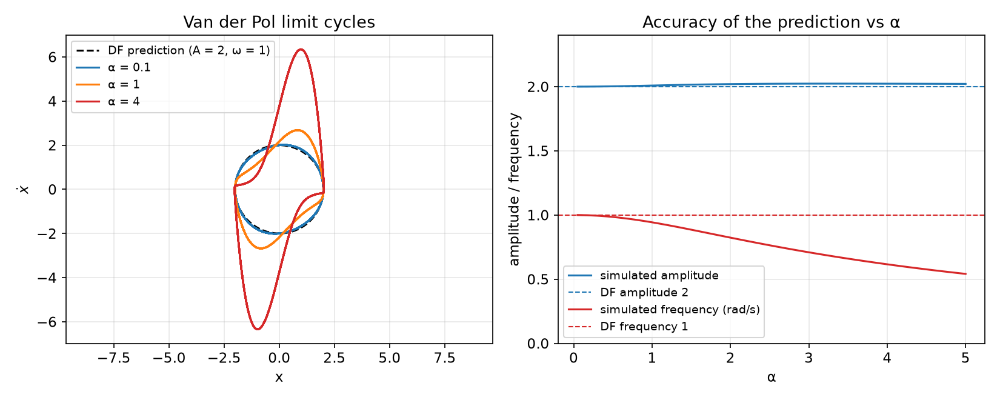
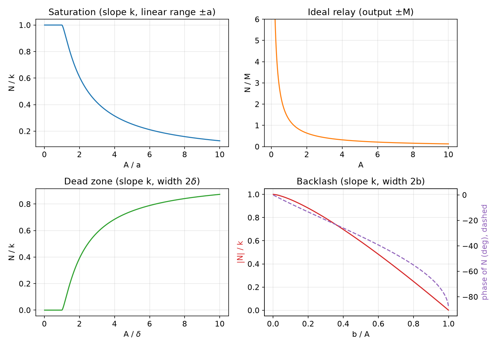
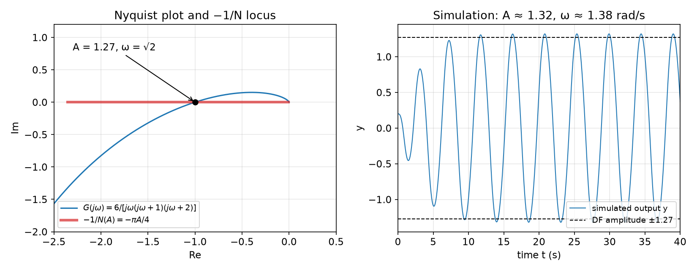
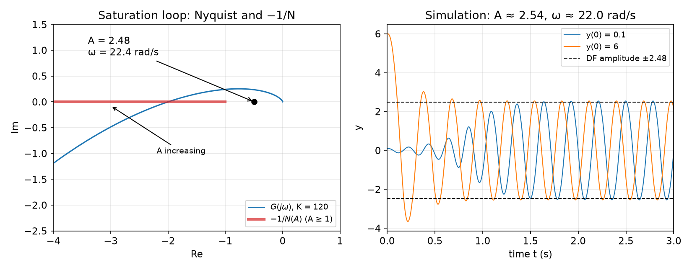
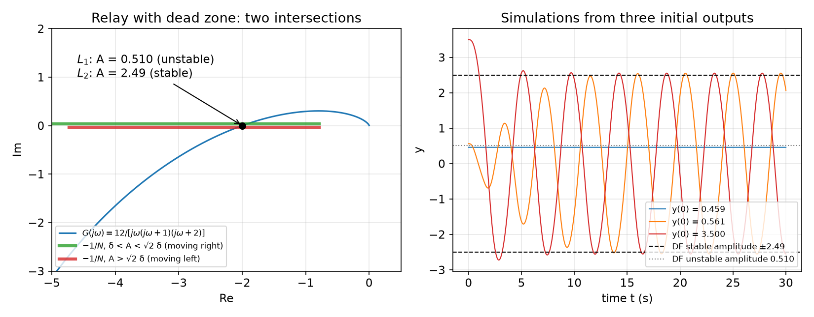

# Describing Function Analysis

Frequency-response methods are the workhorse of linear control: Nyquist and Bode plots are graphical, give physical insight, and do not become harder as the order of the plant grows. None of this applies directly to a nonlinear system, because a nonlinear element driven by a sinusoid does not return a sinusoid. The **describing function** method is an approximate extension of frequency-response analysis to loops that contain a single nonlinear element. It replaces the nonlinearity by an amplitude-dependent "gain", the ratio of the fundamental harmonic of its output to its sinusoidal input, and uses an extended Nyquist criterion to predict whether the loop will oscillate, with what amplitude and frequency, and whether the oscillation is stable. It complements the exact but two-dimensional [phase plane](phase-plane.md) and the general but sometimes hard-to-apply [Lyapunov theory](lyapunov.md); its main use is predicting the limit cycles that [hard nonlinearities](phenomena.md) produce in otherwise linear control loops.

## A First Example: The Van der Pol Oscillator

The idea is best seen on an example before any definitions.

**Example 5.1 (Van der Pol oscillator).** Consider
\\[
\ddot x + \alpha (x^2 - 1)\dot x + x = 0, \qquad \alpha > 0 .
\\]
For small \\(\lvert x \rvert\\) the damping coefficient \\(\alpha(x^2 - 1)\\) is negative, so energy is pumped into the system; for large \\(\lvert x \rvert\\) it is positive and energy is removed. A limit cycle is therefore plausible, and we want to estimate its amplitude and frequency.

*Step 1: split into a linear and a nonlinear part.* Rewrite the equation as
\\[
\ddot x - \alpha \dot x + x = \alpha w, \qquad w = -x^2 \dot x .
\\]
With \\(p = d/dt\\), this is a feedback loop (reference \\(r = 0\\)) made of a linear element
\\[
x = G(p)\\,w, \qquad G(p) = \frac{\alpha}{p^2 - \alpha p + 1},
\\]
and a nonlinear element that maps the fed-back signal \\(-x\\) to \\(w = x^2 \frac{d}{dt}(-x)\\). The linear element is unstable, but it is a **low-pass filter**: its gain falls as \\(1/\omega^2\\) at high frequency.

*Step 2: assume a sinusoid and keep the fundamental.* Suppose the loop oscillates with \\(x(t) = A\sin\omega t\\). Then \\(\dot x = A\omega\cos\omega t\\) and
\\[
w = -x^2\dot x = -A^3\omega \sin^2\omega t \cos\omega t = -\frac{A^3\omega}{4}\left(\cos\omega t - \cos 3\omega t\right),
\\]
using \\(\sin^2\theta\cos\theta = \tfrac14(\cos\theta - \cos 3\theta)\\). The output of the nonlinearity contains a third harmonic. Because \\(G\\) is low-pass, the third harmonic is attenuated much more than the fundamental on its way around the loop, so we neglect it:
\\[
w \approx -\frac{A^3\omega}{4}\cos\omega t = \frac{A^2}{4}\frac{d}{dt}\left[-A\sin\omega t\right] = \frac{A^2}{4}\\,\frac{d}{dt}(-x).
\\]
For sinusoids of amplitude \\(A\\), the nonlinear block behaves like the linear block \\(\frac{A^2}{4}p\\) acting on \\(-x\\). In the frequency domain this **quasi-linear** approximation reads
\\[
w = N(A,\omega)\\,(-x), \qquad N(A,\omega) = \frac{A^2}{4}\\,(j\omega).
\\]
\\(N\\) is called the describing function of the nonlinearity. Unlike a transfer function, it depends on the amplitude of the input.

*Step 3: the condition for a self-sustained oscillation.* A sinusoid circulates around the loop unchanged if \\(x = G(j\omega)N(A,\omega)(-x)\\) with \\(x \ne 0\\), that is,
\\[
1 + \frac{A^2 (j\omega)}{4}\\,\frac{\alpha}{(j\omega)^2 - \alpha (j\omega) + 1} = 0
\quad\Longleftrightarrow\quad
4\left(1 - \omega^2\right) - 4\alpha j\omega + \alpha A^2 j\omega = 0 .
\\]
The real part gives \\(\omega = 1\\) and the imaginary part \\(\alpha\omega(A^2 - 4) = 0\\) gives \\(A = 2\\). The predicted limit cycle has
\\[
\boxed{A = 2, \qquad \omega = 1 \text{ rad/s},}
\\]
independent of \\(\alpha\\).

*Step 4: stability of the oscillation.* Treat \\(A\\) as frozen and look at the quasi-linear closed loop
\\[
1 + \frac{A^2}{4}\\,p\\,\frac{\alpha}{p^2 - \alpha p + 1} = 0
\quad\Longleftrightarrow\quad
p^2 + \frac{\alpha}{4}(A^2 - 4)\\,p + 1 = 0,
\\]
whose roots are
\\[
\lambda\_{1,2} = -\frac{1}{8}\alpha(A^2 - 4) \pm \sqrt{\frac{1}{64}\alpha^2(A^2 - 4)^2 - 1}.
\\]
At \\(A = 2\\) they are \\(\pm j\\), the oscillation found above. If a perturbation makes \\(A > 2\\), the roots move into the left half-plane, the "linear" loop is damped, and the amplitude decreases. If \\(A < 2\\), the roots have positive real part and the amplitude grows. Either way the amplitude returns to 2: the limit cycle is **stable**.

The prediction can be checked by simulation.



*Figure: left, steady-state limit cycles of the Van der Pol equation in the \\((x, \dot x)\\) plane for \\(\alpha = 0.1, 1, 4\\), against the describing-function prediction (dashed circle of radius 2, frequency 1). Right, simulated amplitude and frequency as functions of \\(\alpha\\). For small \\(\alpha\\) the orbit is the predicted circle. As \\(\alpha\\) grows the orbit is distorted into a relaxation oscillation and the frequency drops (0.94 rad/s at \\(\alpha = 1\\), 0.54 rad/s at \\(\alpha = 5\\)), although the peak of \\(x\\) stays close to 2.*

The example shows both the power and the limits of the method. It turned a nonlinear differential equation into an algebraic equation in \\((A, \omega)\\), with a stability test, in a few lines. Its accuracy rests on the third harmonic being negligible, which is true for small \\(\alpha\\), where the nonlinearity is weak, and becomes poor for large \\(\alpha\\).

## Scope and Assumptions

### The standard loop

The method applies to any system that can be rearranged into the loop of a **nonlinear element** \\(w = f(x)\\) in series with a **linear element** \\(G(p)\\), closed by unit negative feedback \\(x = -y\\) with zero reference. Two classes of system fit this form.

1. **Almost-linear systems.** A loop designed with linear methods, whose implementation contains a hard nonlinearity: motor saturation, an actuator or sensor dead-zone, Coulomb friction, backlash in gears, hysteresis. For instance (Example 5.2 of the course text), a loop with a linear controller \\(G\_c(p)\\), a nonlinear actuator and a linear plant \\(G\_p(p)\\) has the standard form with \\(G = G\_cG\_p\\) as linear element and the actuator characteristic as nonlinear element; the loop can be cut at any point, since only the circulating signal matters.
2. **Genuinely nonlinear systems** whose equations can be rearranged into the standard loop, such as the Van der Pol equation above.

Why should a periodic solution of such a loop be close to a sinusoid? A periodic signal entering a low-pass linear element emerges dominated by its lowest harmonic, and it is this filtered signal that drives the nonlinearity. The limit cycle is therefore approximately sinusoidal at the input of the nonlinear element, even if the output of the nonlinearity is far from sinusoidal.

Limit cycles are occasionally desirable: electronic oscillators are designed to have them, and a small high-frequency **dither** is sometimes injected on purpose to overcome Coulomb friction. More often they are harmful, because they cause (i) poor accuracy, (ii) wear and mechanical failure, and (iii) other side effects, such as passenger discomfort in an aircraft under autopilot. Predicting them, and designing compensators that avoid them, is the main application of describing functions.

### The four assumptions

The basic version of the method assumes:

1. **A single nonlinear component.** Several nonlinearities must be lumped into one (possible when they act in parallel), or the secondary ones neglected.
2. **The nonlinear component is time-invariant.** The Nyquist criterion on which the method rests applies to time-invariant systems only.
3. **The filtering hypothesis.** For a sinusoidal input, only the fundamental \\(w\_1(t)\\) of the output of the nonlinearity needs to be considered. This requires the linear element to be low-pass:
\\[
\lvert G(j\omega) \rvert \gg \lvert G(jn\omega) \rvert, \qquad n = 2, 3, \dots
\\]
4. **The nonlinearity is odd**, its graph symmetric about the origin. Then the output has no constant term, and the analysis concerns oscillations about zero.

Each assumption can be relaxed (several nonlinearities, biased oscillations with an extra constant term, inputs that are sums of sinusoids), at the price of considerably more complex analysis.

## The Describing Function

### Definition

Let the input of the nonlinear element be \\(x(t) = A\sin\omega t\\). Its output \\(w(t)\\) is periodic with the same period (for a static nonlinearity, or a dynamic one in periodic steady state) and has the Fourier series
\\[
w(t) = \frac{a\_0}{2} + \sum\_{n=1}^{\infty}\left[a\_n\cos n\omega t + b\_n\sin n\omega t\right],
\\]
with coefficients
\\[
a\_0 = \frac{1}{\pi}\int\_{-\pi}^{\pi} w(t)\\,d(\omega t), \quad
a\_n = \frac{1}{\pi}\int\_{-\pi}^{\pi} w(t)\cos n\omega t\\,d(\omega t), \quad
b\_n = \frac{1}{\pi}\int\_{-\pi}^{\pi} w(t)\sin n\omega t\\,d(\omega t).
\\]
For an odd nonlinearity \\(a\_0 = 0\\). Keeping only the fundamental,
\\[
w(t) \approx w\_1(t) = a\_1\cos\omega t + b\_1\sin\omega t = M\sin(\omega t + \phi),
\qquad M = \sqrt{a\_1^2 + b\_1^2}, \quad \phi = \tan^{-1}\frac{a\_1}{b\_1}.
\\]
In complex notation the input is \\(Ae^{j\omega t}\\) and the fundamental output is \\(Me^{j(\omega t + \phi)}\\).

**Definition (describing function).** The describing function of a nonlinear element is the complex ratio of the fundamental component of its output to its sinusoidal input:
\\[
\boxed{N(A,\omega) = \frac{Me^{j(\omega t + \phi)}}{Ae^{j\omega t}} = \frac{M}{A}e^{j\phi} = \frac{1}{A}\left(b\_1 + j a\_1\right).}
\\]

With this definition the nonlinear element is replaced, for sinusoidal inputs, by a quasi-linear block of "gain" \\(N(A,\omega)\\). For a linear element \\(H(p)\\) the describing function is just \\(H(j\omega)\\), independent of \\(A\\). For a nonlinearity it depends on amplitude, and in general also on frequency. It can also be defined for dynamic nonlinear elements (a nonlinear element with internal states), where it usually has to be measured.

### Single-valued nonlinearities

The most common case is a static, single-valued, odd characteristic \\(w = f(x)\\). Write \\(\theta = \omega t\\), so that \\(w(\theta) = f(A\sin\theta)\\).

**Proposition.** For a single-valued odd nonlinearity, \\(a\_1 = 0\\), the describing function is real (no phase shift), independent of frequency, and given by
\\[
N(A) = \frac{b\_1}{A} = \frac{4}{\pi A}\int\_0^{\pi/2} f(A\sin\theta)\sin\theta\\,d\theta .
\\]

*Proof.* \\(w(\theta)\\) depends on \\(\theta\\) only through \\(\sin\theta\\). The substitution \\(\theta \mapsto \pi - \theta\\) leaves \\(\sin\theta\\), hence \\(w\\), unchanged and changes the sign of \\(\cos\theta\\); the integrand of \\(a\_1\\) over a full period therefore cancels in pairs and \\(a\_1 = 0\\). The same symmetry, together with \\(w(\theta + \pi) = -w(\theta)\\) (oddness of \\(f\\)), makes the four quarter-periods contribute equally to \\(b\_1\\), so \\(b\_1 = \frac{4}{\pi}\int\_0^{\pi/2} w\sin\theta\\,d\theta\\). Finally, \\(\omega\\) enters only through \\(\theta\\), which is integrated out. \\(\square\\)

Physically: a static nonlinearity has no memory, so it cannot delay the signal, and it cannot know how fast the input is changing. Phase shift and frequency dependence require memory (backlash, hysteresis) or dynamics (the derivative in the Van der Pol nonlinearity).

### How describing functions are obtained

- **Analytically**, when \\(f\\) is explicit and the Fourier integrals are tractable. This is preferred when possible, and it is how all the formulas below are derived.
- **By numerical integration**, approximating the integrals by sums over a sampled period, for characteristics given by graphs or tables. The result is a plot or table of \\(N(A)\\).
- **Experimentally**, by driving the component with sinusoids of varying amplitude and frequency and measuring the fundamental of the output with a harmonic analyser. Precision is not critical, since the method itself is approximate.

A few lines of Python compute \\(N\\) numerically from any characteristic, which is also a useful check on hand derivations:

```python
import numpy as np
def describing_function(f, A, n=20000):
    th = np.linspace(0, 2*np.pi, n, endpoint=False)
    w = f(A*np.sin(th))
    b1, a1 = 2*np.mean(w*np.sin(th)), 2*np.mean(w*np.cos(th))
    return (b1 + 1j*a1) / A            # N = (b1 + j a1)/A

sat = lambda x: np.clip(x, -1, 1)      # saturation, a = k = 1
print(describing_function(sat, 3.0))  # 0.4164..., matches the formula below
```

**Example 5.3 (Hardening spring).** Find the describing function of \\(w = x + x^3/2\\).

*Solution.* The characteristic is single-valued and odd, so \\(a\_1 = 0\\) and
\\[
b\_1 = \frac{1}{\pi}\int\_{-\pi}^{\pi}\left[A\sin\theta + \frac{A^3}{2}\sin^3\theta\right]\sin\theta\\,d\theta
= A + \frac{A^3}{2}\cdot\frac{3}{4} = A + \frac{3}{8}A^3,
\\]
using \\(\frac1\pi\int\_{-\pi}^{\pi}\sin^2\theta\\,d\theta = 1\\) and \\(\frac1\pi\int\_{-\pi}^{\pi}\sin^4\theta\\,d\theta = \frac34\\). Hence \\(w\_1 = (A + \frac38 A^3)\sin\omega t\\) and
\\[
N(A) = 1 + \frac{3}{8}A^2 ,
\\]
real, frequency-independent, and increasing with amplitude: the spring looks stiffer to larger oscillations. In particular, the cubic term alone, \\(w = x^3\\), has \\(N(A) = \frac34 A^2\\).

## Common Nonlinearities in Control Systems

Nonlinearities can enter anywhere in a loop: in the controller, the actuators, the plant or the sensors. Some are continuous (the hardening spring), others are **hard** nonlinearities with discontinuities or corners. Four of the latter appear constantly.

- **Saturation.** Every real actuator has a limited output: a servo motor's torque is limited by its magnetic circuit, a hydraulic valve by its maximum flow, an amplifier by its supply voltage. The ideal model is linear with slope \\(k\\) for \\(\lvert x \rvert \le a\\) and constant \\(\pm ka\\) beyond. Saturation reduces the effective gain as signals grow. An unstable linear loop with a saturating actuator often settles into a self-sustained oscillation instead of diverging; a stable loop is slowed down.
- **On-off (relay).** The extreme case of saturation, with a linear range shrunk to zero: the output is \\(\pm M\\) according to the sign of the input. Relays and the gas jets of spacecraft attitude control behave this way. Relay control commonly causes **chattering** (fast switching).
- **Dead-zone.** No output for inputs in \\([-\delta, \delta]\\), slope \\(k\\) outside. Caused by static friction in motors, clearances, valve overlap. A dead-zone degrades static accuracy and may cause limit cycles or instability; it can also be stabilizing (a dead-zone in a relay suppresses contact oscillations), and it is used deliberately in [adaptive control](adaptive-control.md) to stop noise from driving parameter adaptation.
- **Backlash and hysteresis.** In a gear train with a gap, the driven gear does not move until the gap \\(2b\\) is closed; when the drive reverses, the driven gear stays still until the gap is crossed in the other direction. The input–output characteristic is a parallelogram whose height depends on the input amplitude. Backlash is **multi-valued**: the output depends on the history of the input, not just its current value. The resulting stored "energy" and phase lag make backlash a frequent cause of instability and self-oscillation.

## Describing Functions of Common Nonlinearities

In all the derivations, \\(\theta = \omega t\\) and the input is \\(A\sin\theta\\).

### Saturation

Let the slope be \\(k\\) and the linear range \\(\pm a\\). If \\(A \le a\\), the input never leaves the linear range and \\(N(A) = k\\). If \\(A > a\\), the output is a clipped sine wave. Over the first quarter-period,
\\[
w(\theta) = \begin{cases} kA\sin\theta, & 0 \le \theta \le \gamma, \\\\ ka, & \gamma < \theta \le \pi/2, \end{cases}
\qquad \gamma = \sin^{-1}\frac{a}{A},
\\]
where \\(\gamma\\) is the angle at which the input reaches the saturation level. The characteristic is single-valued and odd, so \\(a\_1 = 0\\) and
\\[
b\_1 = \frac{4}{\pi}\int\_0^{\gamma} kA\sin^2\theta\\,d\theta + \frac{4}{\pi}\int\_{\gamma}^{\pi/2} ka\sin\theta\\,d\theta .
\\]
The first integral is \\(kA\left[\frac{\theta}{2} - \frac{\sin 2\theta}{4}\right]\_0^{\gamma} = \frac{kA}{2}(\gamma - \sin\gamma\cos\gamma)\\); the second is \\(ka\cos\gamma\\). With \\(\sin\gamma = a/A\\), \\(\cos\gamma = \sqrt{1 - a^2/A^2}\\), and \\(ka\cos\gamma = kA\sin\gamma\cos\gamma\\),
\\[
b\_1 = \frac{2kA}{\pi}\left(\gamma - \sin\gamma\cos\gamma + 2\sin\gamma\cos\gamma\right)
= \frac{2kA}{\pi}\left[\gamma + \frac{a}{A}\sqrt{1 - \frac{a^2}{A^2}}\right].
\\]
Therefore
\\[
\boxed{N(A) = \frac{2k}{\pi}\left[\sin^{-1}\frac{a}{A} + \frac{a}{A}\sqrt{1 - \frac{a^2}{A^2}}\right], \qquad A > a .}
\\]
Three features matter for limit-cycle analysis: \\(N = k\\) in the linear range; \\(N\\) decreases monotonically with \\(A\\) beyond it (to about \\(0.25k\\) at \\(A = 5a\\) and \\(0.13k\\) at \\(A = 10a\\)); and there is no phase shift.

### Relay (on-off)

A relay with output \\(\pm M\\) is the limit of saturation as \\(a \to 0\\) and \\(k \to \infty\\) with \\(ka = M\\). Directly: \\(w = M\\) on \\((0, \pi)\\), so
\\[
b\_1 = \frac{4}{\pi}\int\_0^{\pi/2} M\sin\theta\\,d\theta = \frac{4M}{\pi},
\qquad
\boxed{N(A) = \frac{4M}{\pi A}.}
\\]
The same result follows from the saturation formula: for \\(a \ll A\\), \\(\sin^{-1}(a/A) \approx a/A\\) and the bracket is about \\(2a/A\\), so \\(N \approx 4ka/(\pi A) = 4M/(\pi A)\\). The describing function is a hyperbola: infinite gain for vanishing amplitude, zero gain for large amplitude, and no linear range at all.

### Relay with dead-zone

A relay that outputs \\(\pm M\\) only when \\(\lvert x \rvert > \delta\\) (and zero otherwise) is common in practice. For \\(A \le \delta\\) the output is zero and \\(N = 0\\). For \\(A > \delta\\), \\(w = M\\) on \\((\gamma, \pi/2)\\) with \\(\gamma = \sin^{-1}(\delta/A)\\), so
\\[
b\_1 = \frac{4}{\pi}\int\_{\gamma}^{\pi/2} M\sin\theta\\,d\theta = \frac{4M}{\pi}\cos\gamma,
\qquad
N(A) = \frac{4M}{\pi A}\sqrt{1 - \frac{\delta^2}{A^2}}, \quad A > \delta .
\\]
Unlike the previous cases this function is not monotonic. It rises from zero at \\(A = \delta\\) to a maximum and then decays like the ideal relay. Setting \\(dN/dA = 0\\) gives \\(A^2 = 2\delta^2\\), so the maximum is
\\[
N\_{\max} = N(\sqrt2\\,\delta) = \frac{2M}{\pi\delta}.
\\]
This non-monotonicity produces pairs of limit cycles, as shown in Example 5.6 below.

### Dead-zone

Let the dead-zone have width \\(2\delta\\) and slope \\(k\\) outside it. For \\(A \le \delta\\), \\(N = 0\\). For \\(A > \delta\\), over the first quarter-period
\\[
w(\theta) = \begin{cases} 0, & 0 \le \theta \le \gamma, \\\\ k(A\sin\theta - \delta), & \gamma < \theta \le \pi/2, \end{cases}
\qquad \gamma = \sin^{-1}\frac{\delta}{A}.
\\]
Then
\\[
b\_1 = \frac{4}{\pi}\int\_{\gamma}^{\pi/2} k(A\sin\theta - \delta)\sin\theta\\,d\theta
= \frac{4k}{\pi}\left[A\left(\frac{\pi}{4} - \frac{\gamma}{2} + \frac{\sin\gamma\cos\gamma}{2}\right) - \delta\cos\gamma\right].
\\]
Using \\(\delta = A\sin\gamma\\), the last two terms combine to \\(-\frac{A}{2}\sin\gamma\cos\gamma\\), and
\\[
\boxed{N(A) = \frac{2k}{\pi}\left[\frac{\pi}{2} - \sin^{-1}\frac{\delta}{A} - \frac{\delta}{A}\sqrt{1 - \frac{\delta^2}{A^2}}\right], \qquad A > \delta .}
\\]
\\(N\\) is real, zero up to \\(A = \delta\\), and rises toward \\(k\\) as \\(A/\delta \to \infty\\): large oscillations barely notice the dead-zone. Comparing with the saturation formula shows the identity
\\[
N\_{\text{dead-zone}}(A;\delta) = k - N\_{\text{sat}}(A; a = \delta),
\\]
which reflects the fact that a dead-zone is exactly a linear gain \\(k\\) minus a saturation with the same breakpoint, and that the describing function of a sum of nonlinearities driven by the same input is the sum of their describing functions (the fundamental is a linear operation on the output).

### Backlash

Let the backlash have slope \\(k\\) and total gap \\(2b\\), and let \\(A > b\\) (otherwise the output never moves and \\(N = 0\\)). In periodic steady state, follow the output over one cycle starting at \\(\theta = \pi/2\\), where the input reaches its maximum \\(A\\) and the output its maximum \\(k(A - b)\\).

- As the input reverses, the gear must cross the gap before the output moves. The output stays at \\(k(A - b)\\) until the input has dropped by \\(2b\\), that is, until \\(A\sin\theta = A - 2b\\). This happens at \\(\theta = \pi - \gamma\\), where
\\[
\gamma = \sin^{-1}\left(1 - \frac{2b}{A}\right).
\\]
- On \\((\pi - \gamma, 3\pi/2]\\) the output follows the lower side of the characteristic, \\(w = k(A\sin\theta + b)\\), reaching \\(-k(A - b)\\) at \\(\theta = 3\pi/2\\).
- It then stays at \\(-k(A - b)\\) until \\(\theta = 2\pi - \gamma\\), and follows \\(w = k(A\sin\theta - b)\\) up to \\(\theta = 5\pi/2\\).

The characteristic is neither odd in the sense of a single-valued function nor even, so both \\(a\_1\\) and \\(b\_1\\) are nonzero. It does have half-wave symmetry, \\(w(\theta + \pi) = -w(\theta)\\), so each coefficient is twice the integral over the half-period \\([\pi/2, 3\pi/2]\\). Write \\(s = \sin\gamma = 1 - 2b/A\\).

*The cosine coefficient.*
\\[
a\_1 = \frac{2}{\pi}\left[\int\_{\pi/2}^{\pi-\gamma} k(A - b)\cos\theta\\,d\theta + \int\_{\pi-\gamma}^{3\pi/2} k(A\sin\theta + b)\cos\theta\\,d\theta\right].
\\]
The first integral is \\(k(A - b)(s - 1)\\); the second is \\(\frac{kA}{2}(1 - s^2) - kb(1 + s)\\). With \\(s - 1 = -2b/A\\), \\(1 - s^2 = \frac{4b}{A}\left(1 - \frac bA\right)\\) and \\(1 + s = 2\left(1 - \frac bA\right)\\), the three terms are \\(-2kb(1 - \frac bA)\\), \\(+2kb(1 - \frac bA)\\) and \\(-2kb(1 - \frac bA)\\). Hence
\\[
a\_1 = \frac{4kb}{\pi}\left(\frac{b}{A} - 1\right) < 0 .
\\]

*The sine coefficient.*
\\[
b\_1 = \frac{2}{\pi}\left[\int\_{\pi/2}^{\pi-\gamma} k(A - b)\sin\theta\\,d\theta + \int\_{\pi-\gamma}^{3\pi/2} k(A\sin\theta + b)\sin\theta\\,d\theta\right].
\\]
The first integral is \\(k(A - b)\cos\gamma\\). In the second, \\(kA\int\sin^2\theta\\,d\theta = kA\left[\frac{\pi}{4} + \frac{\gamma}{2} - \frac{\sin\gamma\cos\gamma}{2}\right]\\) and \\(kb\int\sin\theta\\,d\theta = -kb\cos\gamma\\). Since \\(A - 2b = As\\), the \\(\cos\gamma\\) terms sum to \\(\frac{kA}{2}s\cos\gamma\\), and
\\[
b\_1 = \frac{Ak}{\pi}\left[\frac{\pi}{2} + \sin^{-1}\left(1 - \frac{2b}{A}\right) + \left(1 - \frac{2b}{A}\right)\sqrt{1 - \left(1 - \frac{2b}{A}\right)^2}\right].
\\]
(The course text writes the same expression with \\(\frac{2b}{A} - 1\\) and the opposite signs, using the oddness of \\(\sin^{-1}\\).) The describing function is
\\[
\boxed{\lvert N(A) \rvert = \frac{1}{A}\sqrt{a\_1^2 + b\_1^2}, \qquad \angle N(A) = \tan^{-1}\frac{a\_1}{b\_1} .}
\\]
Because \\(a\_1 < 0\\), backlash introduces a **phase lag**. As \\(b/A\\) increases from 0 to 1, \\(\lvert N \rvert/k\\) decreases from 1 to 0 and the phase goes from \\(0^\circ\\) to \\(-90^\circ\\). The lag reflects the time the input spends crossing the gap: the larger the gap relative to the oscillation, the larger the lag, and the more backlash erodes the phase margin of the loop. Unlike the single-valued nonlinearities, backlash's describing function is still frequency-independent (it depends only on \\(b/A\\)) but complex.



*Figure: normalized describing functions. Saturation: \\(N/k = 1\\) up to \\(A = a\\), then decreasing. Relay: the hyperbola \\(4M/(\pi A)\\). Dead-zone: zero up to \\(A = \delta\\), rising toward \\(k\\). Backlash: magnitude (solid) falling from 1 to 0 and phase (dashed) from \\(0^\circ\\) to \\(-90^\circ\\) as \\(b/A\\) goes from 0 to 1. All formulas were checked against numerical Fourier integration of the sampled characteristics.*

### A quick approximation

For odd single-valued characteristics a crude but convenient estimate, attributed to Tsypkin and proposed as an exercise in the course text, is
\\[
N(A) \approx \frac{2}{3A}\left[f(A) + f(A/2)\right].
\\]
It is exact for the cubic \\(f = x^3\\) (it gives \\(\frac{2}{3A}\cdot\frac98 A^3 = \frac34 A^2\\)) and for linear gains, and gives \\(4M/(3A)\\) for the relay, about 5% above the exact \\(4M/(\pi A)\\).

## Limit-Cycle Analysis

### The Nyquist criterion and its extension

Consider a linear loop with open-loop transfer function \\(G(p)H(p)\\). Its closed-loop poles are the zeros of \\(\delta(p) = 1 + G(p)H(p)\\), and the poles of \\(\delta\\) are the open-loop poles. The Nyquist criterion counts the zeros of \\(\delta\\) in the right half-plane (RHP) by the argument principle. Assuming no poles or zeros on the imaginary axis:

1. Take the Nyquist contour, which encloses the entire RHP.
2. Map it through \\(G(p)H(p)\\).
3. Count the number \\(N\\) of clockwise encirclements of the point \\(-1\\).
4. Then \\(Z = N + P\\), where \\(P\\) is the number of open-loop RHP poles and \\(Z\\) the number of unstable closed-loop poles.

**Extension.** If a constant gain \\(K\\), possibly complex, is inserted in the forward path, the closed-loop poles are the zeros of \\(1 + KG(p)H(p)\\), i.e. the points where \\(G(p)H(p) = -1/K\\). The criterion is unchanged except that encirclements are counted around the point \\(-1/K\\) instead of \\(-1\\).

### Existence of limit cycles

Return to the standard loop with the nonlinearity replaced by its describing function. With \\(x = -y\\), \\(w = N(A,\omega)x\\) and \\(y = G(j\omega)w\\), a sinusoid of amplitude \\(A\\) and frequency \\(\omega\\) circulates if \\(y = G(j\omega)N(A,\omega)(-y)\\) with \\(y \ne 0\\):
\\[
\boxed{G(j\omega)N(A,\omega) + 1 = 0
\quad\Longleftrightarrow\quad
G(j\omega) = -\frac{1}{N(A,\omega)} .}
\\]
This is a complex equation, two real equations in the two unknowns \\(A\\) and \\(\omega\\). Each solution predicts a limit cycle; if there is no solution, no limit cycle is predicted. In the language of the extended Nyquist criterion, the quasi-linear loop with gain \\(N(A,\omega)\\) has closed-loop poles exactly on the imaginary axis.

The equation is usually solved graphically.

- **Frequency-independent \\(N(A)\\)** (all single-valued nonlinearities, and backlash). Plot the Nyquist curve \\(G(j\omega)\\), parametrized by \\(\omega\\), and the locus \\(-1/N(A)\\), parametrized by \\(A\\). Each intersection is a predicted limit cycle: its amplitude is read from the \\(-1/N\\) locus and its frequency from the \\(G\\) curve. For single-valued nonlinearities \\(N\\) is real, so \\(-1/N(A)\\) lies on the negative real axis, and the limit-cycle frequency is a **phase-crossover frequency** of \\(G\\) (where \\(\angle G = -180^\circ\\)).
- **Frequency-dependent \\(N(A,\omega)\\).** There is now a family of \\(-1/N\\) curves, one for each \\(\omega\\), and only intersections at which the \\(\omega\\) on the \\(G\\) curve matches the \\(\omega\\) of the \\(-1/N\\) curve count. An alternative is to plot \\(G(j\omega)N(A,\omega)\\) as \\(\omega\\) runs from 0 to \\(\infty\\), one curve per value of \\(A\\); the curve passing through \\(-1\\) gives the amplitude, and the frequency at that point gives \\(\omega\\). (For the Van der Pol nonlinearity, \\(N = \frac{A^2}{4}j\omega\\) and the algebra of Example 5.1 is the analytic version of this.)

Every prediction must be confirmed by simulation, for reasons explained below under reliability.

### Stability of limit cycles

A limit cycle predicted by an intersection can be stable (nearby oscillations converge to it) or unstable (they move away). The extended Nyquist criterion decides which, by treating the amplitude as quasi-static: around the limit cycle, the loop behaves like a linear loop with gain \\(N(A)\\), and whether that loop is stable tells us whether \\(A\\) grows or decays.

Assume \\(G\\) has no RHP poles, and suppose \\(G(j\omega)\\) and \\(-1/N(A)\\) intersect at two points \\(L\_1\\) (smaller amplitude \\(A\_1\\)) and \\(L\_2\\) (larger \\(A\_2\\)), with \\(G\\) encircling the segment of \\(-1/N\\) between them.

- At \\(L\_1\\), perturb the amplitude **upward** to \\(A\_1 + \epsilon\\). The point \\(-1/N(A\_1 + \epsilon)\\) moves along the locus into the region encircled by \\(G\\). By the extended Nyquist criterion the quasi-linear loop is unstable, so the oscillation grows, carrying the operating point further from \\(L\_1\\) toward \\(L\_2\\). Perturb downward and the point leaves the encircled region: the loop is stable, the amplitude decays, and the operating point again moves away from \\(L\_1\\). So \\(L\_1\\) is **unstable**.
- At \\(L\_2\\), an increase in amplitude moves \\(-1/N\\) out of the encircled region (amplitude decays back), a decrease moves it inside (amplitude grows back). So \\(L\_2\\) is **stable**.

**Limit Cycle Criterion.** *Each intersection of \\(G(j\omega)\\) and \\(-1/N(A)\\) corresponds to a limit cycle. If points near the intersection, on the side of the \\(-1/N(A)\\) locus where \\(A\\) increases, are not encircled by \\(G(j\omega)\\), the limit cycle is stable. Otherwise it is unstable.*

The criterion is a heuristic: it treats amplitude as a slowly varying quantity and applies a linear test to a "frozen-amplitude" loop. It agrees with the more careful Van der Pol argument of Example 5.1 (frozen \\(A\\), closed-loop roots migrating across the imaginary axis), and it is reliable whenever the method itself is.

### Reliability of the predictions

Describing-function analysis is approximate, and three kinds of error occur:

1. the amplitude and frequency of a real limit cycle are predicted inaccurately (the common case, usually by a few percent);
2. a predicted limit cycle does not exist;
3. an existing limit cycle is not predicted.

The first is usually harmless; the other two are serious. They have two main causes.

- **Violation of the filtering hypothesis.** If the linear element is not sufficiently low-pass, for example if it has a lightly damped resonance near a harmonic of the oscillation, the neglected harmonics are not small and the prediction can fail completely. The filtering hypothesis should be checked by comparing \\(\lvert G(j\omega) \rvert\\) with \\(\lvert G(j3\omega) \rvert\\) at the predicted frequency (for odd nonlinearities the second harmonic is absent).
- **Graphical conditions.** If the \\(G\\) curve is tangent, or nearly tangent, to the \\(-1/N\\) locus, small errors in either curve (from the neglected harmonics) can create or destroy an intersection, and the conclusion is unreliable. If the two curves cross **nearly perpendicularly**, the intersection is robust and the prediction is usually good.

A classic warning is Nichols' second-order servo with backlash, for which the describing function predicts a stable high-frequency limit cycle and an unstable low-frequency one; the latter does not exist.

## Worked Examples

### Relay feedback

**Example 5.4 (Relay with a third-order plant).** A relay with output \\(\pm M\\) is in a unity feedback loop with
\\[
G(p) = \frac{K}{p(p+1)(p+2)} .
\\]
Determine whether a limit cycle exists, whether it is stable, and its frequency and amplitude.

*Solution.* The relay describing function is real, \\(N(A) = 4M/(\pi A)\\), so
\\[
-\frac{1}{N(A)} = -\frac{\pi A}{4M}
\\]
covers the whole negative real axis, moving from the origin to \\(-\infty\\) as \\(A\\) increases. An intersection occurs where \\(G(j\omega)\\) crosses the negative real axis. The phase is
\\[
\angle G(j\omega) = -90^\circ - \tan^{-1}\omega - \tan^{-1}\frac{\omega}{2},
\\]
which equals \\(-180^\circ\\) when \\(\tan^{-1}\omega + \tan^{-1}(\omega/2) = 90^\circ\\), i.e. when the product of the tangents is one, \\(\omega \cdot \omega/2 = 1\\):
\\[
\omega^\star = \sqrt{2}\ \text{rad/s}.
\\]
There the magnitude is
\\[
\lvert G(j\sqrt2) \rvert = \frac{K}{\sqrt2\cdot\sqrt3\cdot\sqrt6} = \frac{K}{6},
\\]
so \\(G(j\omega^\star) = -K/6\\). Equating with \\(-\pi A/(4M)\\) gives
\\[
A^\star = \frac{4MK}{6\pi} = \frac{2MK}{3\pi} .
\\]
For stability, note that \\(G\\) has no RHP poles (the pole at the origin is handled by the usual small indentation) and that the Nyquist curve encircles the part of the negative real axis between \\(-K/6\\) and the origin, not the part to the left of \\(-K/6\\). Points of \\(-1/N\\) with \\(A > A^\star\\) lie to the left, outside the encircled region, so the limit cycle is **stable**. A relay loop with this plant always oscillates, whatever \\(K > 0\\): the infinite small-signal gain of the relay guarantees that small oscillations grow.

For \\(K = 6\\), \\(M = 1\\): the prediction is \\(A^\star = 4/\pi = 1.27\\), \\(\omega^\star = 1.41\\) rad/s. Simulation gives \\(A = 1.32\\) and \\(\omega = 1.38\\) rad/s, errors of about 4% and 2%. The filtering hypothesis is reasonably satisfied: \\(\lvert G(3j\omega^\star)/G(j\omega^\star) \rvert \approx 0.07\\).



*Figure: left, the Nyquist curve of \\(G = 6/[j\omega(j\omega+1)(j\omega+2)]\\) crosses the \\(-1/N\\) locus of the relay at \\(-1\\), predicting \\(A = 1.27\\), \\(\omega = \sqrt2\\). Right, the simulated loop started from \\(y(0) = 0.2\\) grows into a limit cycle of amplitude 1.32 (dashed lines: predicted amplitude).*

### Saturation and the onset of oscillation

**Example 5.5 (Saturating actuator).** A saturation with unit slope and unit linear range drives
\\[
G(p) = \frac{K}{p(1 + 0.1p)(1 + 0.02p)} .
\\]
Find the largest \\(K\\) for which the loop is stable, and the limit cycle when \\(K\\) is twice that value.

*Solution.* For saturation, \\(-1/N(A)\\) is the part of the negative real axis from \\(-1\\) (for \\(A \le 1\\), \\(N = 1\\)) to \\(-\infty\\) (as \\(A \to \infty\\), \\(N \to 0\\)). The phase crossover of \\(G\\) satisfies \\(\tan^{-1}(0.1\omega) + \tan^{-1}(0.02\omega) = 90^\circ\\), i.e. \\(0.1\omega \cdot 0.02\omega = 1\\):
\\[
\omega^\star = \sqrt{500} = 22.4\ \text{rad/s},
\qquad
\lvert G(j\omega^\star) \rvert = \frac{K}{22.36\cdot\sqrt{1 + 5}\cdot\sqrt{1 + 0.2}} = \frac{K}{60}.
\\]
If \\(K < 60\\), the crossing point \\(-K/60\\) lies to the right of \\(-1\\), the curves do not intersect, and no limit cycle is predicted. In fact for small signals the saturation is a unit gain and the linear loop is stable (gain margin \\(60/K > 1\\)); the describing function says that larger signals, which see a smaller gain, are even more stable. So \\(K\_{\max} = 60\\).

For \\(K = 120\\) the crossing is at \\(-2\\), and the limit cycle amplitude solves \\(N(A) = 1/2\\):
\\[
\frac{2}{\pi}\left[\sin^{-1}\frac{1}{A} + \frac{1}{A}\sqrt{1 - \frac{1}{A^2}}\right] = \frac12
\quad\Longrightarrow\quad A^\star = 2.48,
\qquad \omega^\star = 22.4\ \text{rad/s}.
\\]
Moving along \\(-1/N\\) in the direction of increasing \\(A\\) leads left of \\(-2\\), outside the region encircled by \\(G\\): the limit cycle is **stable**. Physically, the linear loop with \\(K = 120\\) is unstable; small oscillations grow until saturation reduces the effective gain to exactly the critical value \\(1/2\\) of the stability boundary. Simulation gives \\(A = 2.54\\) and \\(\omega = 22.0\\) rad/s, reached from both small and large initial conditions.



*Figure: left, \\(G(j\omega)\\) for \\(K = 120\\) crosses the negative real axis at \\(-2\\), inside the saturation locus \\(-1/N\\), which starts at \\(-1\\) and moves left as \\(A\\) increases. Right, simulations from \\(y(0) = 0.1\\) and \\(y(0) = 6\\) converge to the same oscillation of amplitude 2.54, near the predicted 2.48: a stable limit cycle.*

### Two limit cycles

**Example 5.6 (Relay with dead-zone).** Replace the ideal relay of Example 5.4 by a relay with dead-zone (\\(M = 1\\), \\(\delta = 0.5\\)), and take \\(K = 12\\).

*Solution.* Now \\(N(A)\\) rises from 0 at \\(A = \delta\\) to \\(N\_{\max} = 2M/(\pi\delta)\\) at \\(A = \sqrt2\\,\delta\\) and then decays. The locus \\(-1/N(A)\\) therefore comes in from \\(-\infty\\) along the negative real axis as \\(A\\) increases from \\(\delta\\), turns back at
\\[
-\frac{1}{N\_{\max}} = -\frac{\pi\delta}{2M} = -0.785,
\\]
and returns to \\(-\infty\\). The Nyquist curve crosses the axis at \\(-K/6 = -2\\), to the left of the turning point, so there are **two** intersections, solutions of \\(N(A) = 1/2\\):
\\[
\frac{4}{\pi A}\sqrt{1 - \frac{0.25}{A^2}} = \frac12
\quad\Longrightarrow\quad
A\_1 = 0.510, \qquad A\_2 = 2.49,
\\]
both at \\(\omega = \sqrt2\\) rad/s.

- At \\(L\_1\\) (\\(A\_1 = 0.510 < \sqrt2\\,\delta\\)), increasing \\(A\\) moves \\(-1/N\\) to the right, into the part of the axis encircled by \\(G\\): **unstable**.
- At \\(L\_2\\) (\\(A\_2 = 2.49 > \sqrt2\\,\delta\\)), increasing \\(A\\) moves \\(-1/N\\) to the left, outside the encircled part: **stable**.

The unstable limit cycle is a threshold. Oscillations smaller than about 0.51 die out (the output enters the dead-zone and, with the integrator in \\(G\\), stops at a constant value inside it, one of a continuum of equilibria); larger ones grow (or decay) to the stable cycle of amplitude about 2.5. Simulation confirms this picture: from \\(y(0) = 0.459\\) the loop stays at rest, from \\(y(0) = 0.561\\) it builds up to the large oscillation, and from \\(y(0) = 3.5\\) it decays to the same cycle, of simulated amplitude 2.55.



*Figure: left, the \\(-1/N\\) locus of a relay with dead-zone runs from \\(-\infty\\) to \\(-0.785\\) and back (drawn slightly offset for visibility); \\(G\\) crosses it at \\(-2\\) for two amplitudes. Right, simulations: below the unstable amplitude \\(A\_1 = 0.51\\) (dotted) the loop comes to rest; above it, the response converges to the stable cycle of predicted amplitude \\(A\_2 = 2.49\\) (dashed). This is the describing-function counterpart of the stable/unstable pair \\(L\_1\\), \\(L\_2\\) of the limit cycle criterion.*

The same mechanism explains why a conditionally stable system with a saturating actuator can be stable for small disturbances and oscillate or diverge after a large one: amplitude-dependent gain moves the operating point along \\(-1/N\\) into a region the linear analysis never examined.

## Summary

- The **describing function** of a nonlinear element is \\(N(A,\omega) = (b\_1 + ja\_1)/A\\), the complex ratio of the fundamental of the output to a sinusoidal input of amplitude \\(A\\). It is valid under four assumptions: a single, time-invariant, odd nonlinearity in a loop with a **low-pass** linear element (\\(\lvert G(j\omega) \rvert \gg \lvert G(jn\omega) \rvert\\)).
- Single-valued odd nonlinearities have real, frequency-independent \\(N(A) = \frac{4}{\pi A}\int\_0^{\pi/2} f(A\sin\theta)\sin\theta\\,d\theta\\); memory (backlash) produces phase lag, dynamics (Van der Pol) frequency dependence.
- Standard results: hardening spring \\(1 + \frac38 A^2\\); saturation \\(\frac{2k}{\pi}\left[\sin^{-1}\frac aA + \frac aA\sqrt{1 - a^2/A^2}\right]\\); relay \\(\frac{4M}{\pi A}\\); relay with dead-zone \\(\frac{4M}{\pi A}\sqrt{1 - \delta^2/A^2}\\); dead-zone \\(k - N\_{\text{sat}}(A;\delta)\\); backlash with \\(a\_1 = \frac{4kb}{\pi}(\frac bA - 1)\\), phase lag from 0 to \\(90^\circ\\).
- **Existence:** a limit cycle is predicted where \\(G(j\omega) = -1/N(A,\omega)\\); for real \\(N\\) this is a phase crossover of \\(G\\).
- **Stability:** the limit cycle is stable if the points of \\(-1/N\\) on the increasing-\\(A\\) side of the intersection are not encircled by \\(G(j\omega)\\).
- **Reliability:** good when the filtering hypothesis holds and the curves cross nearly perpendicularly; doubtful when they are nearly tangent or \\(G\\) has resonances. Always confirm by simulation.
- Van der Pol: \\(A = 2\\), \\(\omega = 1\\), stable, accurate for small \\(\alpha\\). Relay with \\(K/[p(p+1)(p+2)]\\): \\(\omega = \sqrt2\\), \\(A = 2MK/(3\pi)\\). Saturation with \\(K/[p(1+0.1p)(1+0.02p)]\\): stable for \\(K < 60\\), limit cycle \\(A = 2.48\\), \\(\omega = 22.4\\) at \\(K = 120\\).

## See Also

- [Nonlinear Systems and Their Behavior](phenomena.md): limit cycles and the hard nonlinearities analysed here.
- [Phase Plane Analysis](phase-plane.md): exact analysis of second-order relay and saturation systems, a check on describing-function predictions.
- [Lyapunov Stability Theory](lyapunov.md): rigorous stability conclusions where the describing function is only approximate.
- Frequency Response: the Nyquist criterion and stability margins extended here.
- [Feedback Linearization](feedback-linearization.md): the first of the design methods for nonlinear systems.
- [Sliding Control](sliding-control.md): switching control and chattering, where relay behavior is used deliberately.
- Fourier Transform: Fourier series and harmonic analysis.
