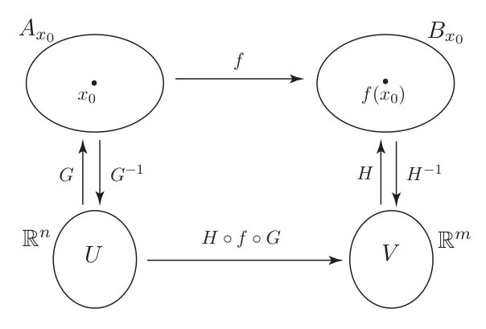
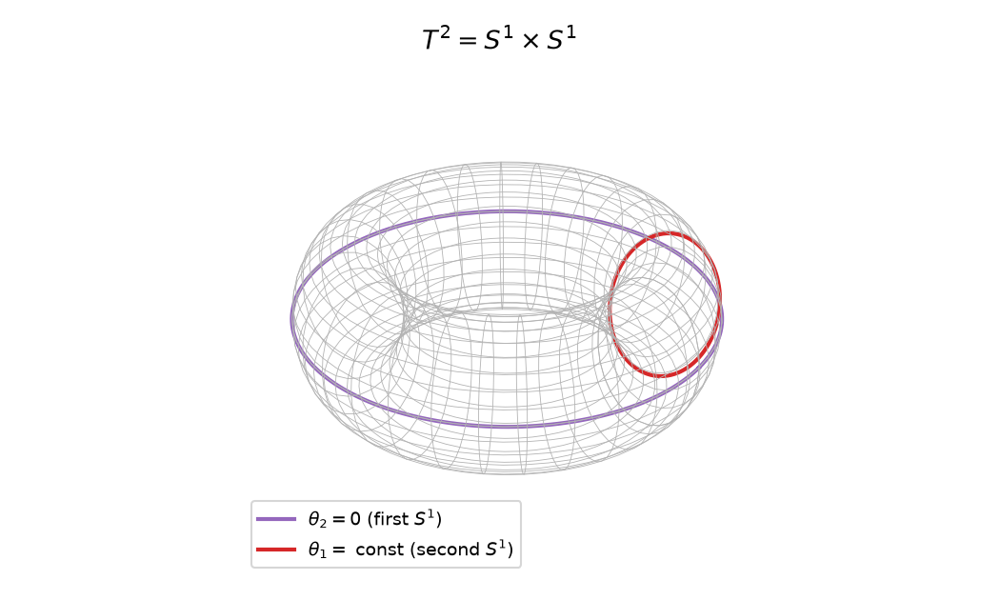
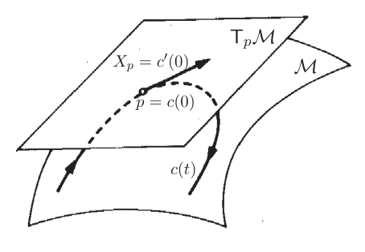
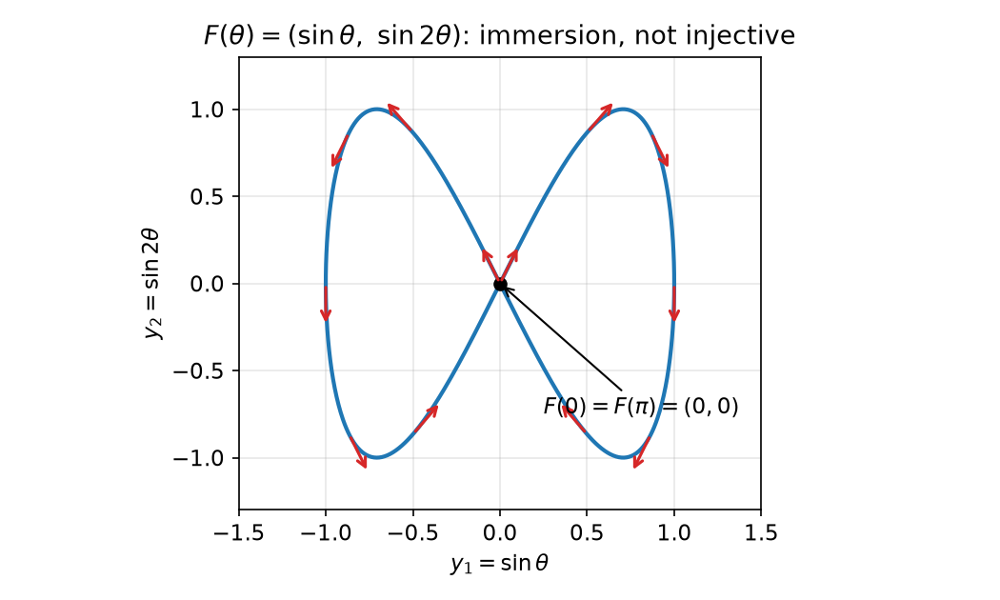
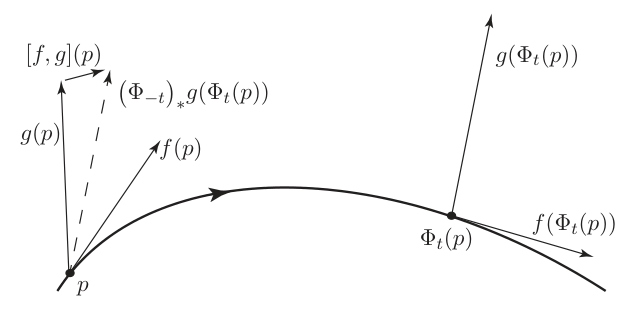
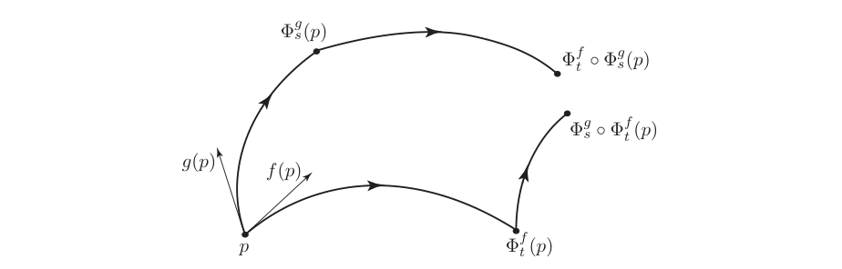
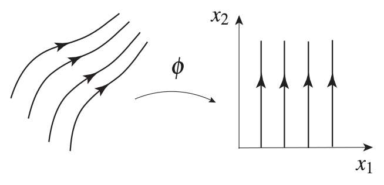
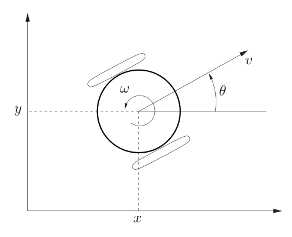
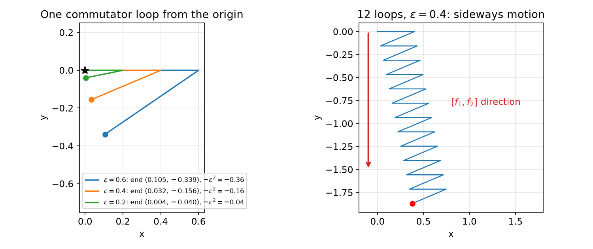
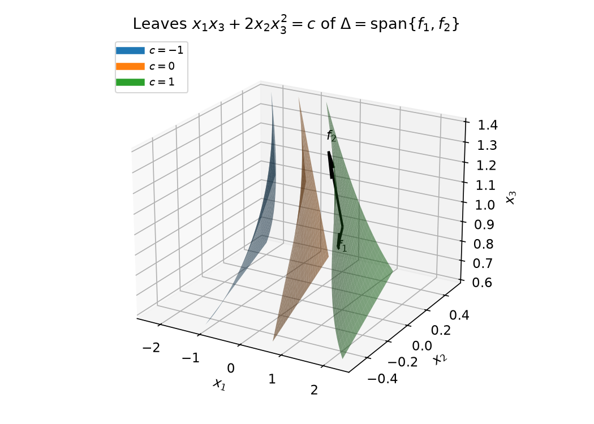

# Differential Geometry for Nonlinear Control

For linear systems, controllability, observability and stabilizability are questions of linear algebra: ranks of matrices built from \\(A\\), \\(B\\) and \\(C\\). Nonlinear systems need more. Their state spaces need not be \\(\mathbb R^n\\) (a pendulum angle lives on a circle, a rigid-body attitude on the rotation group), their natural coordinates change from region to region, and the analogues of the matrices \\(A^kB\\) and \\(CA^k\\) are repeated Lie brackets and Lie derivatives of vector fields. Differential geometry is the mathematical framework that makes these objects precise. This chapter collects the elements needed in the rest of the course: smooth manifolds and maps between them, tangent vectors and vector fields, Lie derivatives and Lie brackets, flows of vector fields and their (non)commutativity, and distributions and Frobenius' theorem. These tools are used directly in [Nonlinear Controllability](controllability.md) and [Feedback Linearization](feedback-linearization.md).

## Smooth Manifolds

### Topological preliminaries

A manifold is a space that looks locally like \\(\mathbb R^n\\). To say "locally" one needs a notion of neighbourhood, which is what a topology provides.

**Definition 5.1 (Topological space).** A topological space \\((X,\tau)\\) is a set \\(X\\) together with a collection \\(\tau\\) of subsets of \\(X\\), called a *topology*, such that

1. \\(\emptyset\in\tau\\) and \\(X\in\tau\\);
2. \\(\tau\\) is closed under arbitrary unions: if \\(\\{U\_\alpha\\}\_{\alpha\in A}\subset\tau\\), then \\(\bigcup\_{\alpha\in A}U\_\alpha\in\tau\\);
3. \\(\tau\\) is closed under finite intersections: if \\(U\_1,\dots,U\_N\in\tau\\), then \\(\bigcap\_{i=1}^NU\_i\in\tau\\).

The elements of \\(\tau\\) are the *open sets*; their complements are the *closed sets*.

**Definition 5.2 (Hausdorff space).** A topological space is *Hausdorff* if any two distinct points \\(x\neq y\\) have disjoint open neighbourhoods: there are open \\(U,V\\) with \\(x\in U\\), \\(y\in V\\), \\(U\cap V=\emptyset\\). In a Hausdorff space limits of sequences are unique, which is why manifolds are required to be Hausdorff.

**Definition 5.3 (Continuity).** A map \\(f:X\to Y\\) between topological spaces is *continuous at \\(x\\)* if for every open neighbourhood \\(V\\) of \\(f(x)\\) there is an open \\(U\ni x\\) with \\(f(U)\subset V\\). It is *continuous* if \\(f^{-1}(V)\\) is open for every open \\(V\subset Y\\). A map is continuous if and only if it is continuous at every point.

**Definition 5.4 (Open map).** \\(f\\) is *open* if \\(f(U)\\) is open whenever \\(U\\) is open.

Recall that \\(f:X\to Y\\) is *injective* (one-to-one) if \\(f(x\_1)=f(x\_2)\\) implies \\(x\_1=x\_2\\), *surjective* (onto) if \\(f(X)=Y\\), and *bijective* if both. An injection has an inverse \\(f^{-1}:f(X)\to X\\) defined on its image.

**Definition 5.5 (Homeomorphism).** A bijection \\(f:X\to Y\\) such that both \\(f\\) and \\(f^{-1}\\) are continuous. Homeomorphic spaces are indistinguishable as topological spaces.

**Definition 5.6 (Topological manifold).** A Hausdorff topological space \\(\mathcal M\\) is a *manifold of dimension \\(n\\)* (locally Euclidean) if every \\(p\in\mathcal M\\) has an open neighbourhood \\(U\\) that is homeomorphic to an open set \\(V\subset\mathbb R^n\\) through some \\(\phi:U\to V\\).

### Smoothness and the three basic theorems of calculus

**Definition 5.7 (Smooth function).** For open \\(D\subseteq\mathbb R^n\\), \\(f:D\to\mathbb R\\) is *smooth* if partial derivatives of every order exist and are continuous. The set of such functions is \\(C^\infty(D,\mathbb R)\\).

**Definition 5.8 (Analytic function).** \\(f\\) is *analytic* at \\(x\_0\\) if its Taylor series about \\(x\_0\\) converges to \\(f\\) on a neighbourhood of \\(x\_0\\). The set of functions analytic at every point of \\(D\\) is \\(C^\omega(D,\mathbb R)\\), and \\(C^\omega\subset C^\infty\\).

The inclusion is strict.

**Example 5.9 (Smooth but not analytic).** Let \\(f(x)=0\\) for \\(x\le0\\) and \\(f(x)=e^{-1/x}\\) for \\(x>0\\). Every derivative of \\(e^{-1/x}\\) has the form \\(P(1/x)e^{-1/x}\\) with \\(P\\) a polynomial, which tends to 0 as \\(x\to0^+\\); hence all derivatives exist and vanish at 0, and \\(f\in C^\infty\\). Its Taylor series at 0 is identically zero, yet \\(f(x)>0\\) for \\(x>0\\), so \\(f\\) is not analytic at 0. A vector-valued \\(f=(f\_1,\dots,f\_m)\\) is smooth (analytic) if and only if each component is.

**Definition 5.10 (Diffeomorphism).** For open \\(U,V\subseteq\mathbb R^n\\), a bijection \\(f:U\to V\\) such that \\(f\\) and \\(f^{-1}\\) are both smooth. Diffeomorphisms are the admissible *changes of coordinates* of nonlinear control.

Whether a smooth map is locally a diffeomorphism is decided by its Jacobian.

**Theorem 5.11 (Inverse Function Theorem).** Let \\(D\subseteq\mathbb R^n\\) be open and \\(f:D\to\mathbb R^n\\) smooth. If the Jacobian \\((\partial f/\partial x)(x\_0)\\) is nonsingular, then there is an open neighbourhood \\(U\\) of \\(x\_0\\) such that \\(V=f(U)\\) is open and \\(f\|\_U:U\to V\\) is a diffeomorphism.

Nonsingularity is sufficient for a local smooth inverse; it is also necessary for the inverse to be differentiable, since \\(f^{-1}\circ f=\mathrm{id}\\) implies \\((\partial f^{-1}/\partial y)(\partial f/\partial x)=I\\). (It is not necessary for a merely continuous inverse: \\(x\mapsto x^3\\) is a homeomorphism of \\(\mathbb R\\) with zero derivative at 0.) The rank of the Jacobian of \\(f\\) at \\(x\\) is called the *rank of \\(f\\) at \\(x\\)*.

**Theorem 5.12 (Rank Theorem).** Let \\(A\subseteq\mathbb R^n\\) and \\(B\subseteq\mathbb R^m\\) be open and \\(f:A\to B\\) smooth with constant rank

\\[
\operatorname{rank}\frac{\partial f}{\partial x}(x)=k\qquad\text{for all }x\in A .
\\]

Then for each \\(x\_0\in A\\) there are neighbourhoods \\(A\_{x\_0}\subseteq A\\) of \\(x\_0\\) and \\(B\_{f(x\_0)}\subseteq B\\) of \\(f(x\_0)\\), open sets \\(U\subseteq\mathbb R^n\\) and \\(V\subseteq\mathbb R^m\\), and diffeomorphisms \\(G:U\to A\_{x\_0}\\), \\(H:B\_{f(x\_0)}\to V\\) such that \\((H\circ f\circ G)(U)\subseteq V\\) and

\\[
(H\circ f\circ G)(x\_1,\dots,x\_n)=(x\_1,\dots,x\_k,0,\dots,0).
\\]

*Figure: the rank theorem. Going down from \\(A\_{x\_0}\\) to \\(U\subset\mathbb R^n\\) with \\(G^{-1}\\), and from \\(B\_{x\_0}\\) to \\(V\subset\mathbb R^m\\) with \\(H\\), the map \\(f\\) becomes the bottom arrow \\(H\circ f\circ G\\), which in these coordinates is a linear projection followed by an inclusion.*

In words: a constant-rank-\\(k\\) map is, in suitable coordinates on the domain and on the range, the projection \\(\mathbb R^n=\mathbb R^k\times\mathbb R^{n-k}\to\mathbb R^k\\) followed by the inclusion \\(\mathbb R^k\to\mathbb R^k\times\\{0\\}\subset\mathbb R^m\\). The theorem contains the inverse function theorem (\\(k=n=m\\)) and the next one as special cases.

**Theorem 5.13 (Implicit Function Theorem).** Let \\(U\subseteq\mathbb R^m\\) and \\(V\subseteq\mathbb R^n\\) be open, \\(f:U\times V\to\mathbb R^n\\) smooth, \\(f(x\_0,y\_0)=0\\), and \\((\partial f/\partial y)(x\_0,y\_0)\\) nonsingular. Then there are neighbourhoods \\(N\_{x\_0}\\) of \\(x\_0\\) and \\(N\_{y\_0}\\) of \\(y\_0\\) and a unique smooth \\(g:N\_{x\_0}\to N\_{y\_0}\\) such that \\(f(x,g(x))=0\\) for all \\(x\in N\_{x\_0}\\).

The equation \\(f(x,y)=0\\) can thus be solved locally for \\(y\\) as a smooth function of \\(x\\) whenever \\(y\\) appears "nondegenerately".

### Charts, atlases and smooth manifolds

In \\(\mathbb R^n\\) a single coordinate system serves everywhere. On a manifold, different coordinate frames may be required on different parts, and they must be compatible where they overlap.

**Definition 5.14 (Chart, atlas).** Let \\(\mathcal M\\) be a topological manifold of dimension \\(n\\) and \\(p\in\mathcal M\\). A *coordinate chart* at \\(p\\) is a pair \\((U,\phi)\\) of an open neighbourhood \\(U\\) of \\(p\\) (the *coordinate patch*) and a homeomorphism \\(\phi:U\to\phi(U)\subset\mathbb R^n\\). A collection \\(\mathcal A=\\{(U\_\alpha,\phi\_\alpha)\\}\_{\alpha\in A}\\) of charts is a *smooth atlas* if

1. the patches cover the manifold, \\(\bigcup\_\alpha U\_\alpha=\mathcal M\\);
2. for all \\(\alpha,\beta\\) the *transition maps*
\\[
\phi\_\alpha\circ\phi\_\beta^{-1}:\phi\_\beta(U\_\alpha\cap U\_\beta)\to\phi\_\alpha(U\_\alpha\cap U\_\beta),\qquad
\phi\_\beta\circ\phi\_\alpha^{-1}:\phi\_\alpha(U\_\alpha\cap U\_\beta)\to\phi\_\beta(U\_\alpha\cap U\_\beta)
\\]
are \\(C^\infty\\).

Charts satisfying condition 2 are called *compatible*. A smooth atlas is a *smooth differentiable structure* if it is maximal, i.e. it contains every chart that is compatible with all of its charts.

**Definition 5.15 (Smooth manifold).** A topological manifold equipped with a smooth differentiable structure.

The differentiable structure is what allows calculus on \\(\mathcal M\\): to differentiate a function on \\(\mathcal M\\), express it in a chart, differentiate in \\(\mathbb R^n\\), and note that the answer does not depend on the chart because the transition maps are diffeomorphisms. Every concept below (smooth maps, tangent vectors, vector fields) is defined this way.

Most manifolds in control arise as level sets.

**Proposition 5.16 (Regular level sets).** Let \\(U\subseteq\mathbb R^n\\) be open, let \\(f\_1,\dots,f\_m\\) (\\(m<n\\)) be smooth real-valued functions on \\(U\\), and let \\(\mathcal M=\\{x\in U: f\_1(x)=\dots=f\_m(x)=0\\}\\). If

\\[
\operatorname{rank}\begin{bmatrix}\dfrac{\partial f\_1}{\partial x}\\\\ \vdots\\\\ \dfrac{\partial f\_m}{\partial x}\end{bmatrix}=m\qquad\text{for all }x\in\mathcal M,
\\]

then \\(\mathcal M\\) is a smooth manifold of dimension \\(n-m\\).

*Proof sketch.* At \\(p\in\mathcal M\\), complete the \\(m\\) independent gradients with \\(n-m\\) linear functions \\(\ell\_j(x)\\) to a set of \\(n\\) independent differentials. By the inverse function theorem, \\((f\_1,\dots,f\_m,\ell\_1,\dots,\ell\_{n-m})\\) is a local diffeomorphism, in which \\(\mathcal M\\) is the coordinate plane \\(\\{f=0\\}\\); the remaining coordinates \\(\ell\_j\\) restricted to \\(\mathcal M\\) form a chart.

**Fact 5.17 (Products).** If \\(\mathcal M\\) and \\(\mathcal N\\) are smooth manifolds of dimensions \\(m\\) and \\(n\\), then \\(\mathcal M\times\mathcal N\\) is a smooth manifold of dimension \\(m+n\\), with product charts.

**Example 5.18 (Sphere).** \\(S^{n-1}=\\{x\in\mathbb R^n: x\_1^2+\dots+x\_n^2-1=0\\}\\) is a smooth manifold of dimension \\(n-1\\): here \\(m=1\\) and the gradient \\(2x^T\\) never vanishes on \\(S^{n-1}\\). The circle \\(S^1\\) (\\(n=2\\)) is the state space of an angle, such as the pendulum angle or a heading.

**Example 5.19 (Rotation group \\(SO(3)\\)).** The proper rotation matrices, \\(3\times3\\) matrices with \\(R^TR=RR^T=I\\) and \\(\det R=1\\), form a smooth manifold \\(SO(3)\\) in \\(\mathbb R^{3\times3}\simeq\mathbb R^9\\). The matrix equation \\(R^TR=I\\) is symmetric, so it imposes 6 independent scalar constraints, and its differential has full rank 6 on \\(SO(3)\\); by Proposition 5.16 the dimension is \\(9-6=3\\), matching the three degrees of freedom of a rigid-body attitude. (\\(\det R=1\\) selects one of the two connected components of \\(\\{R^TR=I\\}\\) and does not change the dimension.)

**Example 5.20 (Torus).** \\(T^2=S^1\times S^1\\) is a smooth two-dimensional manifold by Fact 5.17. It is the configuration space of a two-link planar arm with revolute joints.

*Figure: the torus \\(T^2=S^1\times S^1\\). A point is a pair of angles \\((\theta\_1,\theta\_2)\\); the purple circle is the first factor at fixed \\(\theta\_2\\), the red circle the second factor at fixed \\(\theta\_1\\). No single chart covers \\(T^2\\), but four angle charts do.*

### Smooth maps between manifolds

Let \\(F:\mathcal N\to\mathcal M\\), with \\(\dim\mathcal N=n\\) and \\(\dim\mathcal M=m\\), and let \\((U,\phi)\\) be a chart of \\(\mathcal N\\) at \\(p\\) and \\((V,\psi)\\) a chart of \\(\mathcal M\\) at \\(F(p)\\). The map

\\[
\psi\circ F\circ\phi^{-1}:\phi\big(U\cap F^{-1}(V)\big)\to\psi(V)
\\]

is the *expression of \\(F\\) in local coordinates*. With \\(x=\phi(p)\\) and \\(y=\psi(F(p))\\), and the usual abuse of notation of writing \\(F\\) for its coordinate expression,

\\[
y=\begin{bmatrix}y\_1\\\\ \vdots\\\\ y\_m\end{bmatrix}=\begin{bmatrix}F\_1(x\_1,\dots,x\_n)\\\\ \vdots\\\\ F\_m(x\_1,\dots,x\_n)\end{bmatrix}=F(x).
\\]

**Definition 5.21 (Smooth map).** \\(F:\mathcal N\to\mathcal M\\) is smooth if for every \\(p\\) there are charts \\((U,\phi)\\) at \\(p\\) and \\((V,\psi)\\) at \\(F(p)\\) such that \\(\psi\circ F\circ\phi^{-1}\\) is \\(C^\infty\\). By compatibility of charts, it is then \\(C^\infty\\) in every pair of charts.

**Proposition 5.22 (Functions as coordinates).** If \\(\dim\mathcal M=n\\) and \\(\phi\_1,\dots,\phi\_n\\) are smooth functions whose differentials are linearly independent at \\(p\\), then there is a neighbourhood \\(U\\) of \\(p\\) such that \\((U,(\phi\_1,\dots,\phi\_n))\\) is a coordinate chart.

This is the inverse function theorem in disguise, and it is how new coordinates are built in practice: in feedback linearization, the output \\(h\\) and its Lie derivatives \\(L\_fh,\dots,L\_f^{r-1}h\\) are used as coordinates exactly when their differentials are independent.

## Tangent Spaces and Vector Fields

### Tangent vectors as derivations

On a curved manifold there is no ambient space in which to draw arrows, so tangent vectors are defined intrinsically, by what they do: they differentiate functions. Let \\(\mathcal M\\) be a smooth manifold of dimension \\(n\\) and \\(C^\infty(p)\\) the set of smooth functions defined on some neighbourhood of \\(p\\).

**Definition 5.23 (Tangent space).** The *tangent space* \\(T\_p\mathcal M\\) is the vector space of maps \\(X\_p:C^\infty(p)\to\mathbb R\\) such that, for all \\(f,g\in C^\infty(p)\\) and \\(\alpha,\beta\in\mathbb R\\),

1. (linearity) \\(X\_p(\alpha f+\beta g)=\alpha X\_p(f)+\beta X\_p(g)\\);
2. (Leibniz rule) \\(X\_p(fg)=X\_p(f)\\,g(p)+f(p)\\,X\_p(g)\\).

Maps with these two properties are called *derivations* at \\(p\\). Addition and scalar multiplication are defined pointwise: \\((X\_p+Y\_p)(f)=X\_p(f)+Y\_p(f)\\), \\((\alpha X\_p)(f)=\alpha X\_p(f)\\).

**The geometric picture.** If \\(c:(-\varepsilon,\varepsilon)\to\mathcal M\\) is a smooth curve with \\(c(0)=p\\), then

\\[
X\_p(f)=\frac{d}{dt}(f\circ c)(t)\Big\|\_{t=0}
\\]

is a derivation: the directional derivative of \\(f\\) along the velocity of the curve. Every tangent vector arises this way, so \\(T\_p\mathcal M\\) is the set of velocities \\(c'(0)\\) of curves through \\(p\\).

*Figure: a curve \\(c(t)\\) on the manifold \\(\mathcal M\\) passes through \\(p=c(0)\\); its velocity \\(X\_p=c'(0)\\) lies in the tangent plane \\(T\_p\mathcal M\\). The tangent vector acts on a function \\(f\\) by differentiating \\(f\\) along the curve.*

### Coordinate basis

Let \\((U,\phi)=(U,(\phi\_1,\dots,\phi\_n))\\) be a chart at \\(p\\). The derivations

\\[
\Big\\{\Big(\frac{\partial}{\partial\phi\_1}\Big)\_p,\dots,\Big(\frac{\partial}{\partial\phi\_n}\Big)\_p\Big\\},
\qquad
\Big(\frac{\partial}{\partial\phi\_i}\Big)\_p(f)=\Big(\frac{\partial f}{\partial\phi\_i}\Big)\_p=\frac{\partial(f\circ\phi^{-1})}{\partial(\phi\_i\circ\phi^{-1})}\Big\|\_{x=\phi(p)}=\frac{\partial(f\circ\phi^{-1})}{\partial x\_i}\Big\|\_{x=\phi(p)},
\\]

form the *natural basis* of \\(T\_p\mathcal M\\). The last equality uses \\(\phi\_i\circ\phi^{-1}(x)=x\_i\\): to differentiate \\(f\\) "with respect to the coordinate \\(\phi\_i\\)", express it in the chart and take the ordinary partial derivative. Any tangent vector is a combination

\\[
X\_p=\sum\_{i=1}^n\alpha\_i(p)\Big(\frac{\partial}{\partial\phi\_i}\Big)\_p ,
\\]

and its components are recovered by applying \\(X\_p\\) to the coordinate functions:

\\[
X\_p(\phi\_i)=\sum\_j\alpha\_j(p)\frac{\partial(\phi\_i\circ\phi^{-1})}{\partial x\_j}\Big\|\_{x=\phi(p)}=\sum\_j\alpha\_j(p)\\,\delta\_{ij}=\alpha\_i(p).
\\]

Consequently

\\[
X\_p(f)=\sum\_{i=1}^n\alpha\_i(p)\Big(\frac{\partial f}{\partial\phi\_i}\Big)\_p ,
\\]

and the correspondence \\(X\_p\leftrightarrow(\alpha\_1(p),\dots,\alpha\_n(p))\\) is an isomorphism \\(T\_p\mathcal M\simeq\mathbb R^n\\). In particular \\(\dim T\_p\mathcal M=\dim\mathcal M\\).

The **tangent bundle** \\(T\mathcal M=\bigcup\_{p\in\mathcal M}T\_p\mathcal M\\) collects all tangent spaces; with charts \\((x,\alpha)\\) built from those of \\(\mathcal M\\) it is a smooth manifold of dimension \\(2n\\). For a mechanical system, the configuration space is \\(\mathcal M\\) and the state space (positions and velocities) is \\(T\mathcal M\\).

### Vector fields

**Definition 5.24 (Vector field).** A smooth vector field is a smooth map \\(X:\mathcal M\to T\mathcal M\\) that assigns to each \\(p\\) a tangent vector \\(X\_p\in T\_p\mathcal M\\). In local coordinates,

\\[
X\_p=\alpha\_1(x)\frac{\partial}{\partial x\_1}+\dots+\alpha\_n(x)\frac{\partial}{\partial x\_n},
\\]

which is identified with the vector-valued function \\((\alpha\_1(x),\dots,\alpha\_n(x))\\). Both viewpoints, a first-order differential operator and a column of functions, are used interchangeably; as an operator,

\\[
X\_p(f)=\alpha\_1(x)\frac{\partial f}{\partial x\_1}+\dots+\alpha\_n(x)\frac{\partial f}{\partial x\_n}.
\\]

**Change of coordinates.** Let \\((U,\phi)\\) and \\((V,\psi)\\) be charts at \\(p\\) with \\(x=\phi(p)\\), \\(y=\psi(p)\\). By the chain rule,

\\[
\Big(\frac{\partial}{\partial\psi\_i}\Big)\_p=\sum\_{j=1}^n\Big(\frac{\partial(\phi\_j\circ\psi^{-1})}{\partial y\_i}\Big)\_{y=\psi(p)}\Big(\frac{\partial}{\partial\phi\_j}\Big)\_p ,
\\]

where \\(\partial(\phi\_j\circ\psi^{-1})/\partial y\_i\\) is the Jacobian of \\(x=x(y)=\phi\circ\psi^{-1}(y)\\). Consequently a vector field with coordinate expressions \\(f(x)\\) and \\(\tilde f(y)\\) transforms with the Jacobian of the coordinate change:

\\[
\boxed{\\,\tilde f(y)=\Big[\frac{\partial y}{\partial x}\\,f(x)\Big]\_{x=x(y)}\\,}
\\]

This is the familiar rule for transforming \\(\dot x=f(x)\\) under \\(y=y(x)\\): \\(\dot y=\frac{\partial y}{\partial x}\dot x\\).

**Example (Rotation field in polar coordinates).** On \\(\mathbb R^2\setminus\\{0\\}\\), let \\(f(x)=(-x\_2,\ x\_1)\\), the field of rigid rotation. With \\(y=(r,\theta)\\), \\(r=\sqrt{x\_1^2+x\_2^2}\\), \\(\theta=\operatorname{atan2}(x\_2,x\_1)\\),

\\[
\frac{\partial y}{\partial x}=\begin{bmatrix}x\_1/r & x\_2/r\\\\ -x\_2/r^2 & x\_1/r^2\end{bmatrix},\qquad
\tilde f(y)=\begin{bmatrix}(-x\_1x\_2+x\_2x\_1)/r\\\\ (x\_2^2+x\_1^2)/r^2\end{bmatrix}=\begin{bmatrix}0\\\\ 1\end{bmatrix}.
\\]

In polar coordinates the field is the constant \\(\partial/\partial\theta\\): a nonvanishing field has been straightened, an instance of the Flow-Box Theorem below. Note that \\((r,\theta)\\) is a chart only on a slit plane; \\(\theta\\) itself lives on \\(S^1\\).

## The Lie Derivative and the Lie Bracket

Throughout, a vector field is written either as \\(X=f\_1(x)\frac{\partial}{\partial x\_1}+\dots+f\_n(x)\frac{\partial}{\partial x\_n}\\) or as the column \\(f(x)=(f\_1(x),\dots,f\_n(x))\\); both \\(X\\) and \\(f\\) denote vector fields.

**Definition 5.25 (Lie derivative of a function).** For a smooth vector field \\(f\\) and a smooth function \\(g:\mathcal M\to\mathbb R\\), the Lie derivative of \\(g\\) along \\(f\\) is the function

\\[
(L\_fg)(p)=\big(f(p)\big)(g),
\\]

the tangent vector \\(f(p)\\) acting on \\(g\\). In local coordinates

\\[
\boxed{\\,(L\_fg)(x)=\sum\_{i=1}^nf\_i(x)\frac{\partial g}{\partial x\_i}(x)=\frac{\partial g}{\partial x}f(x)\\,}
\\]

The Lie derivative at a point *is* the action of the tangent vector on functions. Along a solution of \\(\dot x=f(x)\\), \\(\frac{d}{dt}g(x(t))=(L\_fg)(x(t))\\): the Lie derivative is the rate of change of \\(g\\) along the flow. This is precisely \\(\dot V\\) in Lyapunov theory ([Lyapunov Stability](lyapunov.md)), and for \\(\dot x=f+gu\\) one writes \\(\dot V=L\_fV+L\_gV\\,u\\), the notation used throughout [Backstepping and Forwarding](backstepping.md). Higher derivatives are defined recursively, \\(L\_f^kh=L\_f(L\_f^{k-1}h)\\), and mixed ones such as \\(L\_gL\_fh\\) similarly.

The set \\(\mathcal V(\mathcal M)\\) of smooth vector fields is a vector space over \\(\mathbb R\\), but it carries a richer structure.

**Definition 5.26 (Lie algebra).** A real vector space \\(V\\) with a product \\([\cdot,\cdot]:V\times V\to V\\), the *Lie bracket*, such that for all \\(v,w,z\in V\\) and \\(\alpha\_1,\alpha\_2\in\mathbb R\\):

1. (anti-symmetry) \\([v,w]=-[w,v]\\);
2. (bilinearity) \\([\alpha\_1v\_1+\alpha\_2v\_2,w]=\alpha\_1[v\_1,w]+\alpha\_2[v\_2,w]\\), and likewise in the second argument;
3. (Jacobi identity) \\([v,[w,z]]+[w,[z,v]]+[z,[v,w]]=0\\).

**Fact 5.27 (Vector fields form a Lie algebra).** \\(\mathcal V(\mathcal M)\\) is a Lie algebra with the bracket defined by

\\[
\big([f,g] (p)\big)(h)=(L\_fL\_gh)(p)-(L\_gL\_fh)(p),\qquad h\in C^\infty(p).
\\]

In local coordinates

\\[
\boxed{\\,[f,g] (x)=\frac{\partial g}{\partial x}f(x)-\frac{\partial f}{\partial x}g(x)\\,}
\\]

*Derivation.* The composition \\(L\_fL\_g\\) is a second-order operator, but the second-order parts cancel in the commutator. Indeed,

\\[
L\_fL\_gh=\frac{\partial}{\partial x}\Big(\frac{\partial h}{\partial x}g\Big)f=g^T\frac{\partial^2h}{\partial x^2}f+\frac{\partial h}{\partial x}\frac{\partial g}{\partial x}f,
\\]

and the Hessian term is symmetric in \\(f\\) and \\(g\\), so

\\[
L\_fL\_gh-L\_gL\_fh=\frac{\partial h}{\partial x}\Big(\frac{\partial g}{\partial x}f-\frac{\partial f}{\partial x}g\Big).
\\]

The commutator is again a first-order operator, i.e. a vector field, with the stated components. Since \\([f,g]\\) is a vector field, its Lie derivative is

\\[
L\_{[f,g]}h=L\_fL\_gh-L\_gL\_fh .
\\]

The bracket \\([f,g] (p)\in T\_p\mathcal M\\) can be thought of as the derivative of \\(g\\) along \\(f\\); its precise geometric meaning, in terms of flows, is given in Theorem 5.42.

**The ad notation.** Repeated brackets are written with the adjoint operator,

\\[
\operatorname{ad}\_fg=[f,g],\qquad \operatorname{ad}\_f^kg=[f,\operatorname{ad}\_f^{k-1}g]=[f,[f,\dots[f,g]]],\qquad \operatorname{ad}\_f^0g=g .
\\]

The Lie bracket and the Lie derivative are the two most important operations of nonlinear systems theory: brackets generate the directions in which a system can move (controllability), and Lie derivatives of outputs generate what can be seen (observability). The linear case makes this concrete.

**Example 5.28 (Linear vector fields).** On \\(\mathbb R^n\\) let \\(f(x)=Ax\\) and \\(g(x)=Bx\\). Then \\(\partial g/\partial x=B\\), \\(\partial f/\partial x=A\\), and

\\[
[f,g] (x)=BAx-ABx=(BA-AB)\\,x .
\\]

The bracket of linear fields is linear, with matrix the (negative) commutator of the matrices: it measures the non-commutativity of \\(A\\) and \\(B\\).

**Example 5.29 (Linear control systems).** The single-input system \\(\dot x=Ax+bu\\), \\(y=Cx\\) is the special case \\(f(x)=Ax\\), \\(g(x)=b\\) (constant), \\(h(x)=Cx\\) of \\(\dot x=f(x)+g(x)u\\), \\(y=h(x)\\). Repeated Lie derivatives of the output give

\\[
L\_fh=CAx,\quad L\_f^2h=CA^2x,\ \dots,\ L\_f^{n-1}h=CA^{n-1}x,
\\]

whose gradients are the rows \\(C,CA,\dots,CA^{n-1}\\) of the **observability matrix**. Repeated brackets give, since \\(\partial b/\partial x=0\\),

\\[
\operatorname{ad}\_fg=[f,g]=0\cdot Ax-Ab=-Ab,\qquad
\operatorname{ad}\_f^2g=[f,-Ab]=-A(-Ab)=A^2b,\ \dots,\ \operatorname{ad}\_f^{n-1}g=(-1)^{n-1}A^{n-1}b,
\\]

which are, up to sign, the columns of the **controllability matrix** \\(\begin{bmatrix}b&Ab&\cdots&A^{n-1}b\end{bmatrix}\\). The nonlinear rank conditions of [Nonlinear Controllability](controllability.md) and the observability rank condition generalize exactly these constructions; compare [Controllability](../me6401-linear-control/controllability.md) and [Observability](../me6401-linear-control/observability.md) for the linear theory.

**Lie algebra generated by a set.** For \\(\mathcal F=\\{f\_1,\dots,f\_k\\}\subset\mathcal V(\mathcal M)\\), \\(\operatorname{Lie}(\mathcal F)\\) is the smallest Lie algebra of vector fields containing \\(\mathcal F\\). It is obtained by adding to \\(\mathcal F\\) all repeated brackets \\([f\_i,f\_j]\\), \\([f\_i,[f\_j,f\_l]]\\), … and taking linear combinations: the smallest vector space that contains \\(\mathcal F\\) and is closed under brackets. In particular \\(\mathcal F\subseteq\operatorname{Lie}(\mathcal F)\\).

## Vector Fields and Differential Equations

### The differential of a map

**Definition 5.30 (Differential, pushforward).** For a smooth map \\(F:\mathcal N\to\mathcal M\\) and \\(p\in\mathcal N\\), the *differential* (or *pushforward*) of \\(F\\) at \\(p\\) is the linear map

\\[
F\_\*:T\_p\mathcal N\to T\_{F(p)}\mathcal M,\qquad \big(F\_\*(X\_p)\big)(f)=X\_p(f\circ F),\qquad f\in C^\infty(F(p)).
\\]

More precisely one writes \\(F\_{\*p}\\), or \\(D\_pF\\). To push a tangent vector forward, let it differentiate the pulled-back function \\(f\circ F\\). The chain rule takes the form \\((G\circ F)\_\*=G\_\*F\_\*\\). In local coordinates \\(x=\phi(p)\\), \\(y=\psi(F(p))\\), the matrix of \\(F\_\*\\) is the Jacobian of the coordinate expression:

\\[
F\_\*\Big(\frac{\partial}{\partial\phi\_i}\Big)\_p=\sum\_{j=1}^m\Big(\frac{\partial(\psi\_j\circ F\circ\phi^{-1})}{\partial x\_i}\Big)\_{x=\phi(p)}\Big(\frac{\partial}{\partial\psi\_j}\Big)\_{F(p)} .
\\]

If curves represent tangent vectors, \\(F\_\*\\) maps the velocity of a curve \\(c\\) to the velocity of the image curve \\(F\circ c\\).

**Proposition 5.31.** If \\(F\\) is a diffeomorphism, then \\(F\_\*^{-1}\circ F\_\*=F\_\*\circ F\_\*^{-1}=I\\), where \\(F\_\*^{-1}\\) denotes \\((F^{-1})\_\*\\). Hence \\(\dim T\_p\mathcal N=\dim T\_{F(p)}\mathcal M=\operatorname{rank}F\_\*=\operatorname{rank}F\_\*^{-1}\\).

**Definition 5.32 (Rank of a map).** The rank of \\(F\\) at \\(p\\) is the rank of \\(F\_{\*p}\\).

### Immersions and embeddings

**Definition 5.33 (Immersion).** \\(F:\mathcal N\to\mathcal M\\) is an *immersion* if \\(F\_\*\\) is injective at every \\(p\\), equivalently if it has constant rank

\\[
\operatorname{rank}F\_\*=\dim\mathcal N .
\\]

The image is then called an *immersed submanifold*. The map \\(F\\) itself need not be injective.

**Example 5.34 (Figure eight).** \\(F:S^1\to\mathbb R^2\\), \\(F(\theta)=(\sin\theta,\ \sin2\theta)\\). Its derivative \\(F'(\theta)=(\cos\theta,\ 2\cos2\theta)\\) never vanishes (if \\(\cos\theta=0\\) then \\(\cos2\theta=2\cos^2\theta-1=-1\\)), so \\(F\\) is an immersion. But it is not injective: \\(F(0)=F(\pi)=(0,0)\\).

*Figure: the image of \\(F(\theta)=(\sin\theta,\sin2\theta)\\). The arrows are the never-vanishing velocity \\(F'(\theta)\\), so \\(F\\) is an immersion; the curve crosses itself at the origin, where two different parameter values \\(\theta=0\\) and \\(\theta=\pi\\) land, so it is not an embedding.*

**Definition 5.35 (Embedding).** An injective immersion \\(F\\) such that \\(\mathcal N\\) is diffeomorphic to its image \\(F(\mathcal N)\subset\mathcal M\\) (with the topology induced from \\(\mathcal M\\)). The image is an *embedded submanifold*.

**Example 5.36 (The sphere).** \\(S^2=\\{x\_1^2+x\_2^2+x\_3^2=1\\}\\) is embedded in \\(\mathbb R^3\\); locally the embedding is \\(F(\theta,\phi)=(\sin\theta\cos\phi,\ \sin\theta\sin\phi,\ \cos\theta)\\) with \\(\theta\in(0,\pi)\\), \\(\phi\in(0,2\pi)\\), a parametrization that covers \\(S^2\\) minus one meridian (one chart). Its Jacobian has rank 2 because \\(\sin\theta\neq0\\) on this domain.

**Example 5.37.** The figure eight of Example 5.34 is not an embedding, because \\(F\\) is not injective.

**Remarks.**

- If \\(\mathcal N\\) is compact, every injective immersion is an embedding; if \\(\mathcal N\\) is not compact this can fail (an injective immersion of \\(\mathbb R\\) may accumulate on itself, as in the figure-eight traced by an open interval that approaches the crossing point).
- An immersion is precisely a *local* embedding: for every \\(p\\) there is a neighbourhood \\(U\\) such that \\(F\|\_U\\) is an embedding, and conversely.
- If \\(\mathcal N\\) is a \\(k\\)-dimensional embedded (regular) submanifold of \\(\mathcal M\\), then around every \\(p\in\mathcal N\\) there is a chart \\((U,\phi)\\) of \\(\mathcal M\\) such that \\(\phi(\mathcal N\cap U)\\) is the intersection of a \\(k\\)-plane with \\(\phi(U)\\). The restrictions \\((\mathcal N\cap U,\phi\|\_{\mathcal N\cap U})\\), called *slice charts*, form an atlas of \\(\mathcal N\\).

### Related vector fields and integral curves

**Definition 5.38 (\\(F\\)-related vector fields).** Vector fields \\(f\\) on \\(\mathcal N\\) and \\(g\\) on \\(\mathcal M\\) are *\\(F\\)-related* if \\(F\_\*f=g\circ F\\), i.e. \\(F\_{\*p}f(p)=g(F(p))\\) for every \\(p\\).

**Fact 5.39 (Brackets are preserved).** If \\(f\_1\\) is \\(F\\)-related to \\(g\_1\\) and \\(f\_2\\) to \\(g\_2\\), then \\([f\_1,f\_2]\\) is \\(F\\)-related to \\([g\_1,g\_2]\\). In particular, for a diffeomorphism \\(F\\),

\\[
F\_\*[f,g]=[F\_\*f,F\_\*g].
\\]

Brackets are therefore coordinate-independent objects: computing \\([f,g]\\) in \\(x\\) coordinates and transforming, or transforming \\(f\\) and \\(g\\) and then bracketing, gives the same field. This is what makes bracket conditions (controllability, involutivity) meaningful on manifolds.

**Definition 5.40 (Integral curve).** A smooth curve \\(\sigma:(t\_1,t\_2)\to\mathcal M\\) is an *integral curve* of the vector field \\(f\\) if

\\[
\sigma\_\*\Big(\frac{d}{dt}\Big)\_t=f(\sigma(t))\in T\_{\sigma(t)}\mathcal M\qquad\text{for all }t\in(t\_1,t\_2),
\\]

i.e. its velocity equals the field at each of its points. In local coordinates \\(f(\sigma(t))=\sum\_if\_i(\sigma\_1(t),\dots,\sigma\_n(t))\big(\frac{\partial}{\partial\phi\_i}\big)\_{\sigma(t)}\\) and, by the coordinate formula for the pushforward, \\(\sigma\_\*\big(\frac{d}{dt}\big)\_t=\sum\_i\frac{d\sigma\_i}{dt}\big(\frac{\partial}{\partial\phi\_i}\big)\_{\sigma(t)}\\), so that

\\[
\frac{d\sigma\_i}{dt}=f\_i\big(\sigma\_1(t),\dots,\sigma\_n(t)\big),\qquad i=1,\dots,n .
\\]

Integral curves are solutions of \\(n\\) ordinary differential equations; one writes \\(\dot\sigma(t)=\sigma\_\*(d/dt)\_t\\).

**Important remark.** A state-space model

\\[
\dot x=f(x,u),\qquad y=h(x,u)
\\]

is, in general, only a *local* representation: it is the expression of a vector field in the coordinates of one chart. The full state space may be a manifold other than \\(\mathbb R^n\\) (for example \\(\mathbb R^2\times S^1\\) for the unicycle below, or \\(SO(3)\times\mathbb R^3\\) for a rotating rigid body), and several charts, patched together by diffeomorphisms, may be needed to describe all of it. Global results, such as obstructions to global stabilization, depend on this topology.

### Flows

Let \\(I\_p\subseteq\mathbb R\\) denote an open interval containing 0.

**Definition 5.41 (Flow).** The flow of a smooth vector field \\(f\\) is a map \\(\Phi:I\_p\times\mathcal M\to\mathcal M\\) such that

1. \\(\Phi(0,p)=p\\);
2. for each \\(p\\), \\(\sigma\_p(t)=\Phi(t,p)\\) is an integral curve of \\(f\\);
3. \\(\Phi(s,\Phi(t,p))=\Phi(s+t,p)\\) whenever both sides are defined;
4. each \\(p\\) has a neighbourhood \\(U\\) such that for each \\(t\\) the map \\(\Phi\_t:U\to\mathcal M\\), \\(\Phi\_t(p)=\Phi(t,p)\\), is a diffeomorphism onto its image with \\((\Phi\_t)^{-1}=\Phi\_{-t}\\);
5. \\(\frac{\partial}{\partial t}\Phi(t,p)=f\big(\Phi(t,p)\big)\\).

The flow is *complete* if \\(I\_p=\mathbb R\\) for every \\(p\\). Flows of smooth vector fields on **compact** manifolds are always complete. On non-compact manifolds they need not be: the field \\(f(x)=x^2\\) on \\(\mathbb R\\) has flow \\(\Phi(t,x)=x/(1-tx)\\), which escapes to infinity at \\(t=1/x\\), the "finite escape time" of [Nonlinear Phenomena](phenomena.md).

The maps \\(\\{\Phi\_t\\}\\) form a (local) *one-parameter group of diffeomorphisms* under composition, by properties 3 and 4. Common notations are \\(\Phi^X\_t\\), \\(\exp tX\\), or \\(e^{tX}\\); for example \\(e^{tX}e^{sY}p\\) stands for \\((\Phi^X\_t\circ\Phi^Y\_s)(p)\\), read right to left (first \\(Y\\) for time \\(s\\), then \\(X\\) for time \\(t\\)). Conversely, every one-parameter group of diffeomorphisms is the flow of a unique vector field, its *infinitesimal generator*

\\[
f(p)=\frac{\partial}{\partial t}\Phi(t,p)\Big\|\_{t=0},
\\]

so vector fields and flows are in one-to-one correspondence. For linear fields this is the familiar \\(\Phi\_t(x)=e^{At}x\\) with generator \\(Ax\\).

### The Lie bracket through flows

The coordinate formula for \\([f,g]\\) hides its geometric content. The following characterization reveals it.

**Theorem 5.42 (Lie bracket as a derivative along a flow).** Let \\(\Phi\_t\\) be the flow of \\(f\\). Then

\\[
[f,g] (p)=\lim\_{t\to0}\frac1t\Big[(\Phi\_{-t})\_\*\\,g\big(\Phi\_t(p)\big)-g(p)\Big],
\\]

where \\((\Phi\_{-t})\_\*\\) is evaluated at \\(\Phi\_t(p)\\).

*Figure: the vector \\(g(\Phi\_t(p))\\) lives in the tangent space at \\(\Phi\_t(p)\\), not at \\(p\\), so it cannot be subtracted from \\(g(p)\\) directly. Transporting it back along the flow with \\((\Phi\_{-t})\_\*\\) gives the dashed vector at \\(p\\); the difference from \\(g(p)\\), divided by \\(t\\), tends to \\([f,g] (p)\\).*

**Interpretation.** The bracket measures how \\(g\\) changes along the flow of \\(f\\). The vectors \\(g(p)\in T\_p\mathcal M\\) and \\(g(\Phi\_t(p))\in T\_{\Phi\_t(p)}\mathcal M\\) belong to different vector spaces; the flow provides the identification \\((\Phi\_{-t})\_\*\\) between them. In this sense \\([f,g]\\) is the *Lie derivative of the vector field \\(g\\)* along \\(f\\), written \\(L\_fg\\) in some texts. Note that the field \\((\Phi\_{-t})\_\*\\,g\circ\Phi\_t\\) is, by Definition 5.38, \\(\Phi\_t\\)-related to \\(g\\).

The same statement in exponential notation introduces the adjoint action

\\[
\operatorname{Ad}\_{tX}Y(x\_0)=(e^{-tX})\_\*\\,Y\big(e^{tX}x\_0\big),
\\]

with \\((e^{-tX})\_\*\\) evaluated at \\(e^{tX}x\_0\\). Then

\\[
[X,Y] (x\_0)=\lim\_{t\to0}\frac1t\Big[\operatorname{Ad}\_{tX}Y(x\_0)-Y(x\_0)\Big],
\qquad
\operatorname{Ad}\_{tX}Y(x\_0)=\frac{\partial}{\partial s}\Big\|\_{s=0}e^{-tX}e^{sY}e^{tX}x\_0 ,
\\]

the second formula saying that \\(\operatorname{Ad}\_{tX}Y\\) is the velocity of the curve obtained by flowing along \\(X\\) for time \\(t\\), along \\(Y\\) for a short time \\(s\\), and back along \\(X\\). Differentiating repeatedly in \\(t\\),

\\[
\frac{\partial\operatorname{Ad}\_{tX}Y(x\_0)}{\partial t}\Big\|\_{t=t\_0}=\operatorname{Ad}\_{t\_0X}[X,Y] (x\_0)=\operatorname{Ad}\_{t\_0X}\operatorname{ad}\_XY(x\_0),
\qquad
\frac{\partial^k\operatorname{Ad}\_{tX}Y(x\_0)}{\partial t^k}\Big\|\_{t=t\_0}=\operatorname{Ad}\_{t\_0X}\operatorname{ad}^k\_XY(x\_0),
\\]

so at \\(t=0\\)

\\[
\frac{\partial^k\operatorname{Ad}\_{tX}Y(x\_0)}{\partial t^k}\Big\|\_{t=0}=\operatorname{ad}^k\_XY(x\_0),\qquad\text{in particular}\qquad \frac{\partial\operatorname{Ad}\_{tX}Y(x\_0)}{\partial t}\Big\|\_{t=0}=[X,Y] (x\_0).
\\]

For analytic fields this gives the Taylor series

\\[
\operatorname{Ad}\_{tX}Y=\sum\_{k=0}^\infty\frac{t^k}{k!}\operatorname{ad}\_X^kY .
\\]

**Example (Linear fields).** For \\(X=Ax\\) and \\(Y=Bx\\), \\(e^{tX}x\_0=e^{At}x\_0\\) and \\((e^{-tX})\_\*=e^{-At}\\), so \\(\operatorname{Ad}\_{tX}Y(x\_0)=e^{-At}Be^{At}x\_0\\). Differentiating at \\(t=0\\) gives \\((-AB+BA)x\_0\\), which is \\([X,Y] (x\_0)\\) by Example 5.28, and the Taylor series is the familiar \\(e^{-At}Be^{At}=B+t[B,A]+\frac{t^2}{2}[[B,A],A]+\dots\\) of matrix commutators.

### Commuting and non-commuting flows

**Lemma 5.43 (Commuting flows).** \\([f,g]=0\\) if and only if \\(\Phi^f\_t\circ\Phi^g\_s=\Phi^g\_s\circ\Phi^f\_t\\) for all \\(t,s\\) for which the flows are defined.

So if \\([f,g]\neq0\\), there are \\(t,s\\) with \\(\Phi^g\_s(\Phi^f\_t(p))\neq\Phi^f\_t(\Phi^g\_s(p))\\): following \\(f\\) then \\(g\\) does not lead to the same point as following \\(g\\) then \\(f\\), and the bracket measures the gap. This observation is the key to the controllability of nonlinear systems: by switching between two inputs, a system can move in the bracket direction, which may be a direction in which no input acts directly.

*Figure: starting at \\(p\\), flowing along \\(f\\) for time \\(t\\) and then along \\(g\\) for time \\(s\\) ends at \\(\Phi^g\_s\circ\Phi^f\_t(p)\\); doing it in the other order ends at \\(\Phi^f\_t\circ\Phi^g\_s(p)\\). The two endpoints differ unless \\([f,g]=0\\).*

**Proposition 5.44 (Motion along combinations and brackets).** For vector fields \\(f,g\\) on \\(\mathcal M\\):

1. \\(\displaystyle\frac{d}{dt}\big(\Phi^f\_{t\alpha}\circ\Phi^g\_{t\beta}\big)(p)\Big\|\_{t=0}=\alpha f(p)+\beta g(p)\\);
2. \\(\displaystyle\frac{d}{dt}\big(\Phi^g\_{-\sqrt t}\circ\Phi^f\_{-\sqrt t}\circ\Phi^g\_{\sqrt t}\circ\Phi^f\_{\sqrt t}\big)(p)\Big\|\_{t=0}=[f,g] (p)\\).

Equivalently, part 2 says

\\[
e^{-\sqrt t\\,g}\\,e^{-\sqrt t\\,f}\\,e^{\sqrt t\\,g}\\,e^{\sqrt t\\,f}\\,p=e^{t[f,g]}\\,p+o(t),\qquad t\to0 .
\\]

The composition is read right to left: first \\(f\\) for time \\(\sqrt t\\), then \\(g\\), then \\(-f\\), then \\(-g\\). Part 1 shows that switching quickly between two inputs reaches every *linear combination* of the two directions. Part 2 shows that a commutator loop, four legs of length \\(\varepsilon=\sqrt t\\), produces a net displacement of order \\(\varepsilon^2\\) in the *bracket direction*.

*Proof sketch of part 2.* Expand each flow to second order, \\(e^{\varepsilon f}p=p+\varepsilon f+\tfrac{\varepsilon^2}{2}\frac{\partial f}{\partial x}f+O(\varepsilon^3)\\), and compose the four expansions, evaluating each field at the current point by Taylor expansion about \\(p\\). The first-order terms cancel (\\(+f+g-f-g\\)), the pure second-order terms \\(\tfrac12\frac{\partial f}{\partial x}f\\) and \\(\tfrac12\frac{\partial g}{\partial x}g\\) cancel in pairs, and what remains is \\(\varepsilon^2\big(\frac{\partial g}{\partial x}f-\frac{\partial f}{\partial x}g\big)=\varepsilon^2[f,g]\\).

### The Flow-Box Theorem

Near a point where a vector field does not vanish, all vector fields look alike.

**Theorem 5.45 (Flow-Box Theorem).** If \\(f(p)\neq0\\), there is a chart \\((U,(x\_1,\dots,x\_n))\\) around \\(p\\) in which \\(f=\partial/\partial x\_1\\) on \\(U\\).

Geometrically, in these coordinates the integral curves of \\(f\\) are the coordinate lines of \\(x\_1\\), along which \\(x\_i\\) is constant for all \\(i\neq1\\), and the flow is the translation \\(\Phi\_t(x)=(x\_1+t,x\_2,\dots,x\_n)\\).

*Proof sketch.* Choose coordinates \\(y\\) with \\(p=0\\) and \\(f\_1(0)\neq0\\). Define \\(G(x\_1,x\_2,\dots,x\_n)=\Phi\_{x\_1}(0,x\_2,\dots,x\_n)\\): start on the hyperplane \\(y\_1=0\\) at \\((0,x\_2,\dots,x\_n)\\) and flow for time \\(x\_1\\). At the origin the Jacobian of \\(G\\) has first column \\(f(0)\\) and the remaining columns \\(e\_2,\dots,e\_n\\), so it is nonsingular because \\(f\_1(0)\neq0\\). By the inverse function theorem \\(G\\) is a local diffeomorphism, and by construction \\(G\_\*(\partial/\partial x\_1)=f\\).

*Figure: the flow-box theorem. Curved, nonintersecting integral curves of a nonvanishing field (left) are mapped by a change of coordinates \\(\phi\\) to parallel straight lines \\(x\_1=\\) constant (right), along which the field is a constant unit vector.*

Far away from equilibrium points, then, vector fields have a trivial local form: all the interesting local dynamics of \\(\dot x=f(x)\\) are concentrated near the zeros of \\(f\\). The polar-coordinate example above is a global instance on the slit plane.

## Distributions

A single vector field defines a direction at each point. A control system \\(\dot x=f\_1(x)u\_1+\dots+f\_m(x)u\_m\\) defines, at each point, a whole *subspace* of admissible velocities. Such a field of subspaces is a distribution.

**Definition 5.46 (Distribution).** A distribution \\(\Delta\\) on \\(\mathcal M\\) assigns to each \\(p\in\mathcal M\\) a linear subspace \\(\Delta(p)\subseteq T\_p\mathcal M\\). A vector field \\(f\\) *belongs to* \\(\Delta\\), written \\(f\in\Delta\\), if \\(f(p)\in\Delta(p)\\) for all \\(p\\).

**Example 5.51 (Generating distributions).** Smooth vector fields \\(f\_1,\dots,f\_m\\) on an open set \\(U\\) define

\\[
\Delta(p)=\operatorname{span}\\{f\_1(p),\dots,f\_m(p)\\},
\\]

and \\(\Delta\\) is called *smooth* if it can be generated in this way (locally) by smooth fields. This is the usual way of generating smooth distributions, and it is how they arise from control systems.

**Definition 5.47 (Involutive distribution).** \\(\Delta\\) is *involutive* if it is closed under the Lie bracket: \\(f,g\in\Delta\Rightarrow[f,g]\in\Delta\\).

For \\(\Delta=\operatorname{span}\\{f\_1,\dots,f\_m\\}\\) of constant dimension it suffices to check the generators: \\(\Delta\\) is involutive if and only if every \\([f\_i,f\_j]\\) lies in \\(\Delta\\), i.e.

\\[
\operatorname{rank}\begin{bmatrix}f\_1&\cdots&f\_m&[f\_i,f\_j]\end{bmatrix}=\operatorname{rank}\begin{bmatrix}f\_1&\cdots&f\_m\end{bmatrix}\quad\text{for all }i,j,
\\]

because \\([\alpha f\_i,\beta f\_j]=\alpha\beta[f\_i,f\_j]+\alpha(L\_{f\_i}\beta)f\_j-\beta(L\_{f\_j}\alpha)f\_i\\) adds only terms already in \\(\Delta\\).

**Example 5.48 (A non-involutive distribution).** On \\(\mathbb R^3\\) let \\(\Delta=\operatorname{span}\\{f\_1,f\_2\\}\\) with

\\[
f\_1=\begin{bmatrix}2x\_2\\\\ 1\\\\ 0\end{bmatrix},\qquad f\_2=\begin{bmatrix}1\\\\ 0\\\\ x\_2\end{bmatrix}.
\\]

Then

\\[
[f\_1,f\_2]=\frac{\partial f\_2}{\partial x}f\_1-\frac{\partial f\_1}{\partial x}f\_2=\begin{bmatrix}0&0&0\\\\ 0&0&0\\\\ 0&1&0\end{bmatrix}\begin{bmatrix}2x\_2\\\\ 1\\\\ 0\end{bmatrix}-\begin{bmatrix}0&2&0\\\\ 0&0&0\\\\ 0&0&0\end{bmatrix}\begin{bmatrix}1\\\\ 0\\\\ x\_2\end{bmatrix}=\begin{bmatrix}0\\\\ 0\\\\ 1\end{bmatrix}.
\\]

Since

\\[
\det\begin{bmatrix}f\_1&f\_2&[f\_1,f\_2]\end{bmatrix}=\det\begin{bmatrix}2x\_2&1&0\\\\ 1&0&0\\\\ 0&x\_2&1\end{bmatrix}=-1\neq0,
\\]

the bracket is not in \\(\Delta(x)\\) at any point, and \\(\Delta\\) is not involutive.

**Example 5.49 (An involutive distribution).** On \\(\mathcal M=\\{x\in\mathbb R^3: x\_1^2+x\_3^2\neq0\\}\\) let \\(\Delta=\operatorname{span}\\{f\_1,f\_2\\}\\) with

\\[
f\_1=\begin{bmatrix}2x\_3\\\\ -1\\\\ 0\end{bmatrix},\qquad f\_2=\begin{bmatrix}-x\_1\\\\ -2x\_2\\\\ x\_3\end{bmatrix}.
\\]

Here \\(\frac{\partial f\_2}{\partial x}=\operatorname{diag}(-1,-2,1)\\), so \\(\frac{\partial f\_2}{\partial x}f\_1=(-2x\_3,\ 2,\ 0)^T\\), and \\(\frac{\partial f\_1}{\partial x}\\) has the single nonzero entry 2 in position \\((1,3)\\), so \\(\frac{\partial f\_1}{\partial x}f\_2=(2x\_3,\ 0,\ 0)^T\\). Hence

\\[
[f\_1,f\_2]=\begin{bmatrix}-4x\_3\\\\ 2\\\\ 0\end{bmatrix}=-2f\_1\in\Delta ,
\\]

and \\(\Delta\\) is involutive. The restriction \\(x\_1^2+x\_3^2\neq0\\) keeps \\(f\_1\\) and \\(f\_2\\) independent: their cross product is \\(f\_1\times f\_2=-(x\_3,\ 2x\_3^2,\ x\_1+4x\_2x\_3)^T\\), which vanishes only when \\(x\_1=x\_3=0\\). So \\(\dim\Delta=2\\) everywhere on \\(\mathcal M\\). The integral surfaces of this distribution are computed after Frobenius' theorem below.

**Example 5.50 (The nonholonomic unicycle).** A unicycle (or a wheeled robot) at position \\((x,y)\\) with heading \\(\theta\\) moves according to

\\[
\dot x=v\cos\theta,\qquad \dot y=v\sin\theta,\qquad \dot\theta=\omega,
\\]

with inputs the forward speed \\(v\\) and the turning rate \\(\omega\\). The state manifold is \\(\mathcal M=\mathbb R\times\mathbb R\times S^1\\). The dynamics are the vector field \\(v\cos\theta\\,\partial\_x+v\sin\theta\\,\partial\_y+\omega\\,\partial\_\theta\\), or

\\[
\begin{bmatrix}\dot x\\\\ \dot y\\\\ \dot\theta\end{bmatrix}=\begin{bmatrix}\cos\theta\\\\ \sin\theta\\\\ 0\end{bmatrix}v+\begin{bmatrix}0\\\\ 0\\\\ 1\end{bmatrix}\omega=f\_1v+f\_2\omega,
\\]

with \\(f\_1\\) the "driving" field (\\(\omega=0\\)) and \\(f\_2\\) the "steering" field (\\(v=0\\)). The distribution \\(\Delta=\operatorname{span}\\{f\_1,f\_2\\}\\) has dimension 2 everywhere: the wheel cannot slide sideways. Since \\(f\_2\\) is constant and \\(\frac{\partial f\_1}{\partial(x,y,\theta)}f\_2\\) is the \\(\theta\\)-derivative of \\(f\_1\\),

\\[
[f\_1,f\_2]=\frac{\partial f\_2}{\partial x}f\_1-\frac{\partial f\_1}{\partial x}f\_2=0-\begin{bmatrix}-\sin\theta\\\\ \cos\theta\\\\ 0\end{bmatrix}=\begin{bmatrix}\sin\theta\\\\ -\cos\theta\\\\ 0\end{bmatrix},
\\]

a sideways direction, perpendicular to the heading. (The opposite sign, \\([f\_2,f\_1]=(-\sin\theta,\cos\theta,0)^T\\), is also common in the literature; it does not affect what follows.) Then

\\[
\operatorname{rank}\begin{bmatrix}f\_1&f\_2&[f\_1,f\_2]\end{bmatrix}=\operatorname{rank}\begin{bmatrix}\cos\theta&0&\sin\theta\\\\ \sin\theta&0&-\cos\theta\\\\ 0&1&0\end{bmatrix}=3 .
\\]

So \\(\Delta\\) is not involutive, and, by Proposition 5.44, the unicycle can move in every direction of \\(\mathcal M\\), although at each point its admissible velocities span only a two-dimensional subspace. The bracket direction is the sideways motion of parallel parking: drive, turn, reverse, turn back.

*Figure: the unicycle at position \\((x,y)\\) with heading \\(\theta\\), forward speed \\(v\\) along the heading and turning rate \\(\omega\\). The rolling-without-slipping constraint forbids velocity perpendicular to the heading.*

*Figure: Proposition 5.44 on the unicycle, starting at the origin with \\(\theta=0\\). Left: one loop "drive \\(\varepsilon\\), turn \\(\varepsilon\\), reverse \\(\varepsilon\\), turn back \\(\varepsilon\\)" for three values of \\(\varepsilon\\) (turning in place does not show in the \\(xy\\)-plane). The endpoint is \\((\varepsilon(1-\cos\varepsilon),\ -\varepsilon\sin\varepsilon)\approx(0,-\varepsilon^2)\\), e.g. \\((0.032,-0.156)\\) for \\(\varepsilon=0.4\\), matching \\(\varepsilon^2[f\_1,f\_2]=(0,-\varepsilon^2,0)\\). Right: twelve repeated loops produce a steady sideways drift, the direction the wheel itself can never move.*

**Operations on distributions.** Pointwise operations define \\((\Delta\_1+\Delta\_2)(p)=\Delta\_1(p)+\Delta\_2(p)\\), \\((\Delta\_1\cap\Delta\_2)(p)=\Delta\_1(p)\cap\Delta\_2(p)\\), and \\(\Delta\_1\subset\Delta\_2\\) if \\(\Delta\_1(p)\subset\Delta\_2(p)\\) for all \\(p\\). The intersection of two involutive distributions is involutive; the sum in general is not. The *dimension* of \\(\Delta\\) at \\(p\\) is \\(\dim\Delta(p)\\), and it need not be constant.

**Example 5.52 (Non-constant dimension).**

\\[
\Delta(x)=\operatorname{span}\Big\\{\begin{bmatrix}x\_1\\\\ 1+x\_3\\\\ 1\end{bmatrix},\ \begin{bmatrix}x\_1x\_2\\\\ (1+x\_3)x\_2\\\\ x\_2\end{bmatrix},\ \begin{bmatrix}x\_1\\\\ x\_1\\\\ 0\end{bmatrix}\Big\\}.
\\]

The second generator is \\(x\_2\\) times the first, so it never adds a dimension. For \\(x\_1=0\\) the third generator vanishes and \\(\dim\Delta=\dim\operatorname{span}\\{(0,1+x\_3,1)^T\\}=1\\). For \\(x\_1\neq0\\), \\(\dim\Delta=\dim\operatorname{span}\\{(x\_1,1+x\_3,1)^T,(1,1,0)^T\\}=2\\) (the third components differ). The dimension drops on the plane \\(x\_1=0\\).

The sum of two smooth distributions is smooth (take the union of generators), but the intersection need not be.

**Example 5.53 (A non-smooth intersection).** On \\(\mathbb R^2\\) let \\(\Delta\_1=\operatorname{span}\\{(1,1)^T\\}\\) and \\(\Delta\_2=\operatorname{span}\\{(1+x\_1,1)^T\\}\\). The generators are parallel only when \\(x\_1=0\\), so

\\[
(\Delta\_1\cap\Delta\_2)(x)=\begin{cases}\operatorname{span}\\{(1,1)^T\\}, & x\_1=0,\\\\ \\{0\\}, & x\_1\neq0.\end{cases}
\\]

This distribution is not smooth: a smooth vector field belonging to it would vanish on the open set \\(x\_1\neq0\\) and hence, by continuity, on the line \\(x\_1=0\\) as well, so no smooth field can generate \\(\operatorname{span}\\{(1,1)^T\\}\\) on that line.

**Definition 5.54 (Nonsingular distribution; regular and singular points).** \\(\Delta\\) is *nonsingular* on \\(U\\) if \\(\dim\Delta(p)=k\\) for all \\(p\in U\\). A point \\(p\\) is a *regular point* of \\(\Delta\\) if \\(\Delta\\) is nonsingular on some neighbourhood of \\(p\\); otherwise it is a *point of singularity*. The set of regular points of a smooth distribution on \\(U\\) is open and dense in \\(U\\).

(The dimension of a smooth distribution is lower semicontinuous: independent generators at \\(p\\) stay independent nearby, so the dimension can only jump *up* near a point, never down. In Example 5.52 the plane \\(x\_1=0\\) consists of singular points.)

**Proposition 5.55 (Inclusion on a dense set).** Let \\(\Delta\_1,\Delta\_2\\) be smooth distributions on \\(U\\).

1. If \\(\Delta\_2\\) is nonsingular and \\(\Delta\_1(p)\subset\Delta\_2(p)\\) for all \\(p\\) in a dense subset of \\(U\\), then \\(\Delta\_1\subset\Delta\_2\\).
2. If \\(\Delta\_1\\) is nonsingular, \\(\Delta\_1\subset\Delta\_2\\), and \\(\Delta\_1(p)=\Delta\_2(p)\\) on a dense subset of \\(U\\), then \\(\Delta\_1=\Delta\_2\\).

Smoothness of intersections is guaranteed around regular points: if \\(p\\) is a regular point of \\(\Delta\_1\\), \\(\Delta\_2\\) and \\(\Delta\_1\cap\Delta\_2\\), then \\(\Delta\_1\cap\Delta\_2\\) is smooth on some neighbourhood of \\(p\\).

**Fact 5.56 (Local basis).** Let \\(\Delta\\) be smooth and \\(p\\) a regular point with \\(\dim\Delta(p)=k\\). Then there are an open \\(U\ni p\\) and smooth vector fields \\(f\_1,\dots,f\_k\\) on \\(U\\) such that

1. \\(f\_1,\dots,f\_k\\) are linearly independent at every point of \\(U\\);
2. \\(\Delta(q)=\operatorname{span}\\{f\_1(q),\dots,f\_k(q)\\}\\) for all \\(q\in U\\).

Moreover, every vector field \\(f\in\Delta\\) can be written on \\(U\\) as \\(f(q)=\sum\_{i=1}^k\alpha\_i(q)f\_i(q)\\) with smooth functions \\(\alpha\_i:U\to\mathbb R\\).

### Integral manifolds and Frobenius' theorem

**Definition 5.57 (Integral manifold, integrability).** A submanifold \\(\mathcal N\subset\mathcal M\\) is an *integral manifold* of \\(\Delta\\) if \\(T\_p\mathcal N=\Delta(p)\\) for every \\(p\in\mathcal N\\). The distribution is *(completely) integrable* if an integral manifold passes through every point of \\(\mathcal M\\).

An integral manifold is to a distribution what an integral curve is to a vector field: a submanifold that is everywhere tangent to the prescribed subspaces. For a single nonvanishing vector field (a distribution of dimension 1), integral manifolds always exist: they are the integral curves. In higher dimensions they generally do not.

**Proposition 5.58 (Integrable implies involutive).** An integrable distribution is involutive.

*Proof sketch.* Let \\(f,g\in\Delta\\) and \\(p\in\mathcal M\\), and let \\(\mathcal N\\) be the integral manifold through \\(p\\). Both \\(f\\) and \\(g\\) are tangent to \\(\mathcal N\\), so their flows stay in \\(\mathcal N\\), and by Theorem 5.42 \\([f,g] (p)\\) is a limit of differences of vectors tangent to \\(\mathcal N\\). Hence \\([f,g] (p)\in T\_p\mathcal N=\Delta(p)\\). (Equivalently, restrict \\(f\\) and \\(g\\) to \\(\mathcal N\\) and use Fact 5.39 with the inclusion map.)

The converse is the central theorem of the chapter.

**Theorem 5.59 (Frobenius).** Let \\(\Delta\\) be an involutive distribution of constant dimension \\(k\\) on \\(\mathcal M\\). Then for each \\(p\in\mathcal M\\) there is a chart \\((U,\phi)=(U,(\phi\_1,\dots,\phi\_n))\\) with \\(\phi(p)=0\\) and \\(\phi(U)=(-\varepsilon,\varepsilon)\times\dots\times(-\varepsilon,\varepsilon)\\), \\(\varepsilon>0\\), such that for all \\(a\_{k+1},\dots,a\_n\\) with \\(\lvert a\_i\rvert<\varepsilon\\) the submanifold

\\[
\\{q\in U:\ \phi\_{k+1}(q)=a\_{k+1},\ \dots,\ \phi\_n(q)=a\_n\\}
\\]

is an integral manifold of \\(\Delta\\). Moreover, every integral manifold of \\(\Delta\\) in \\(U\\) is of this form.

**Corollary 5.60 (Flat coordinates).** For \\(\Delta\\) as in the theorem, every \\(p\\) has a chart \\((U,(x\_1,\dots,x\_n))\\) in which

\\[
\Delta(q)=\operatorname{span}\Big\\{\Big(\frac{\partial}{\partial x\_1}\Big)\_q,\dots,\Big(\frac{\partial}{\partial x\_k}\Big)\_q\Big\\},\qquad q\in U .
\\]

A distribution of this form is called *flat*. The Flow-Box Theorem 5.45 is the case \\(k=1\\) (every one-dimensional distribution is involutive, since \\([\alpha f,\beta f]\in\operatorname{span}\\{f\\}\\)). Combining Proposition 5.58 and Frobenius' theorem: **a distribution of constant dimension is integrable if and only if it is involutive, if and only if it is flat in suitable coordinates.**

**Integrability as a system of PDEs.** In practice, Frobenius' theorem is used in the following form. Let \\(\Delta=\operatorname{span}\\{f\_1,\dots,f\_m\\}\\) be smooth with constant dimension \\(m\\) on an open set of \\(\mathbb R^n\\), and write \\(F(x)=\begin{bmatrix}f\_1(x)&\cdots&f\_m(x)\end{bmatrix}\\). Then \\(\Delta\\) is integrable if and only if there exist \\(n-m\\) smooth functions \\(h\_1,\dots,h\_{n-m}\\) such that

\\[
\frac{\partial h\_j}{\partial x}\begin{bmatrix}f\_1(x)&\cdots&f\_m(x)\end{bmatrix}=\frac{\partial h\_j}{\partial x}F(x)=0,\qquad j=1,\dots,n-m,
\\]

with the differentials \\(\frac{\partial h\_1}{\partial x},\dots,\frac{\partial h\_{n-m}}{\partial x}\\) linearly independent at each \\(x\\). The \\(h\_j\\) are *first integrals*: they are constant along every field in \\(\Delta\\) (\\(L\_{f\_i}h\_j=0\\)), and their common level sets \\(\\{h\_1=a\_1,\dots,h\_{n-m}=a\_{n-m}\\}\\) are the integral manifolds; together with \\(m\\) further functions they form the chart \\(\phi\\) of the theorem. Frobenius' theorem guarantees that this system of first-order linear PDEs is solvable exactly when \\(\Delta\\) is involutive. This is the form used in [Feedback Linearization](feedback-linearization.md), where the existence of a linearizing output reduces to solving \\(\frac{\partial h}{\partial x}\begin{bmatrix}g&\operatorname{ad}\_fg&\cdots&\operatorname{ad}\_f^{n-2}g\end{bmatrix}=0\\).

**Example (Integral surfaces of Example 5.49).** The distribution of Example 5.49 is involutive of dimension 2 in \\(\mathbb R^3\\), so Frobenius predicts one function \\(h\\) with \\(L\_{f\_1}h=L\_{f\_2}h=0\\). The condition \\(L\_{f\_1}h=2x\_3\\,\partial\_1h-\partial\_2h=0\\) is satisfied by any function of \\(x\_1+2x\_2x\_3\\) and \\(x\_3\\). Try \\(h\_0=x\_1+2x\_2x\_3\\): then \\(L\_{f\_1}h\_0=2x\_3-2x\_3=0\\) but

\\[
L\_{f\_2}h\_0=-x\_1-2x\_2(2x\_3)+x\_3(2x\_2)=-(x\_1+2x\_2x\_3)=-h\_0 .
\\]

Multiplying by a function of \\(x\_3\\) fixes this: for \\(h=x\_3^a h\_0\\), \\(L\_{f\_1}h=0\\) still holds, and \\(L\_{f\_2}h=x\_3^a(-h\_0)+a x\_3^{a-1}h\_0\\,x\_3=(a-1)h\\), which vanishes for \\(a=1\\). Hence

\\[
h(x)=x\_1x\_3+2x\_2x\_3^2,\qquad \frac{\partial h}{\partial x}=\begin{bmatrix}x\_3&2x\_3^2&x\_1+4x\_2x\_3\end{bmatrix}.
\\]

The differential vanishes only when \\(x\_1=x\_3=0\\), which is excluded from \\(\mathcal M\\), and it is proportional to \\(f\_1\times f\_2\\), as it must be. The integral manifolds are the surfaces \\(x\_1x\_3+2x\_2x\_3^2=c\\).

*Figure: three leaves \\(x\_1x\_3+2x\_2x\_3^2=c\\) of the foliation generated by the involutive distribution of Example 5.49, shown for \\(x\_3>0\\). At the marked point on the leaf \\(c=1\\) the generators \\(f\_1\\) and \\(f\_2\\) (black arrows) lie in the tangent plane of the leaf. Every trajectory of \\(\dot x=f\_1u\_1+f\_2u\_2\\) stays on the leaf where it starts, so this system is not controllable, the opposite of the unicycle.*

**Foliations.** If \\(\mathcal N\\) is a \\(k\\)-dimensional (embedded) submanifold of \\(\mathcal M\\), every \\(p\in\mathcal N\\) has a chart \\((U,x\_1,\dots,x\_n)\\) of \\(\mathcal M\\) such that

\\[
U\cap\mathcal N=\\{q\in U:\ x\_i(q)=x\_i(p),\ i=k+1,\dots,n\\},
\\]

i.e. \\(\mathcal N\\) is locally a slice on which the last \\(n-k\\) coordinates are constant. The family of submanifolds in Frobenius' theorem, parametrized by \\((a\_{k+1},\dots,a\_n)\\), is called a *foliation* of \\(U\\), and each submanifold is a *leaf*. Frobenius' theorem can thus be restated: **an involutive distribution of constant dimension generates a foliation whose leaves are its integral manifolds.**

The contrast between Examples 5.49 and 5.50 is the bridge to controllability. For a driftless system \\(\dot x=\sum\_if\_i(x)u\_i\\), if \\(\operatorname{span}\\{f\_i\\}\\) is involutive and of dimension less than \\(n\\), trajectories are trapped on the leaves and the system is not controllable. If instead brackets generate new directions until \\(\operatorname{Lie}\\{f\_1,\dots,f\_m\\}\\) spans the whole tangent space, as for the unicycle, the system can reach every nearby point. This is the content of Chow's theorem, developed in [Nonlinear Controllability](controllability.md).

## Summary

- **Manifold:** a Hausdorff space covered by charts \\((U,\phi)\\) with smooth transition maps \\(\phi\_\alpha\circ\phi\_\beta^{-1}\\). A regular level set \\(\\{f\_1=\dots=f\_m=0\\}\\) with independent gradients is a manifold of dimension \\(n-m\\) (spheres, \\(SO(3)\\) of dimension 3, tori).
- **Inverse, rank and implicit function theorems:** a nonsingular Jacobian gives a local diffeomorphism; a constant-rank-\\(k\\) map is locally \\((x\_1,\dots,x\_n)\mapsto(x\_1,\dots,x\_k,0,\dots,0)\\).
- **Tangent vectors** are derivations; in a chart \\(X\_p=\sum\alpha\_i\partial/\partial x\_i\\), and vector fields transform as \\(\tilde f(y)=\frac{\partial y}{\partial x}f(x)\\).
- **Lie derivative:** \\(L\_fh=\frac{\partial h}{\partial x}f\\), the rate of change of \\(h\\) along \\(\dot x=f(x)\\).
- **Lie bracket:** \\([f,g]=\frac{\partial g}{\partial x}f-\frac{\partial f}{\partial x}g\\), with \\(L\_{[f,g]}h=L\_fL\_gh-L\_gL\_fh\\); for linear fields \\([Ax,Bx]=(BA-AB)x\\); for \\(\dot x=Ax+bu\\), \\(\operatorname{ad}\_f^kg=(-1)^kA^kb\\) and \\(L\_f^kh=CA^kx\\).
- **Pushforward** \\(F\_\*\\) is the Jacobian; brackets are preserved, \\(F\_\*[f,g]=[F\_\*f,F\_\*g]\\).
- **Flows:** \\(\Phi\_t\\) is a one-parameter group of diffeomorphisms; \\([f,g] (p)=\lim\_{t\to0}\frac1t[(\Phi\_{-t})\_\*g(\Phi\_t(p))-g(p)]\\); flows commute iff \\([f,g]=0\\); a commutator loop of size \\(\varepsilon\\) moves by \\(\varepsilon^2[f,g]\\).
- **Flow box:** near a point with \\(f(p)\neq0\\), \\(f=\partial/\partial x\_1\\) in suitable coordinates.
- **Distributions:** involutive if closed under brackets. **Frobenius:** a constant-dimension distribution is integrable \\(\iff\\) involutive \\(\iff\\) flat; integral manifolds are level sets of first integrals solving \\(\frac{\partial h}{\partial x}F(x)=0\\).
- **Unicycle:** \\(\operatorname{span}\\{f\_1,f\_2\\}\\) is non-involutive and \\([f\_1,f\_2]=(\sin\theta,-\cos\theta,0)^T\\) completes the rank, the geometric reason it can parallel-park.

## See Also

- [Nonlinear Controllability](controllability.md): Lie-algebra rank conditions, Chow's theorem and Brockett's condition, built on brackets and distributions.
- [Feedback Linearization](feedback-linearization.md): relative degree via Lie derivatives, and the involutivity condition for input-state linearization.
- [Backstepping and Forwarding](backstepping.md): the \\(L\_fV\\), \\(L\_gV\\) notation in Lyapunov-based design.
- [Lyapunov Stability](lyapunov.md): \\(\dot V=L\_fV\\).
- [Center Manifold Theory](center-manifold.md): invariant manifolds of equilibria.
- Linear counterparts: [Controllability](../me6401-linear-control/controllability.md), [Observability](../me6401-linear-control/observability.md).
- Vector Spaces and Systems of ODEs: the linear algebra and ODE background.
- Robot Control: nonholonomic wheeled robots and rotation groups in practice.
