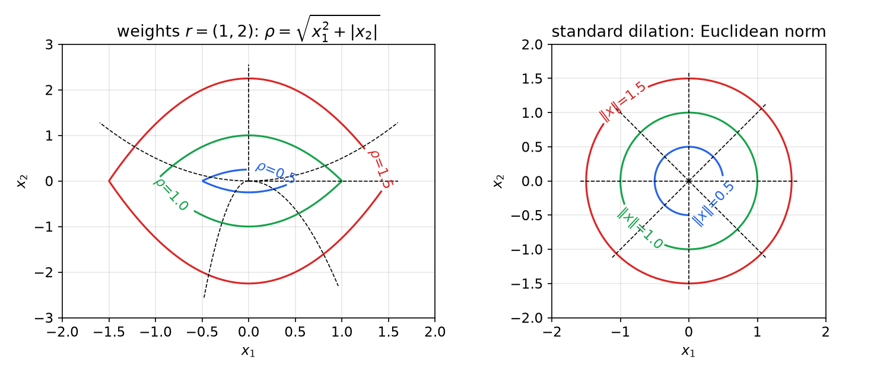
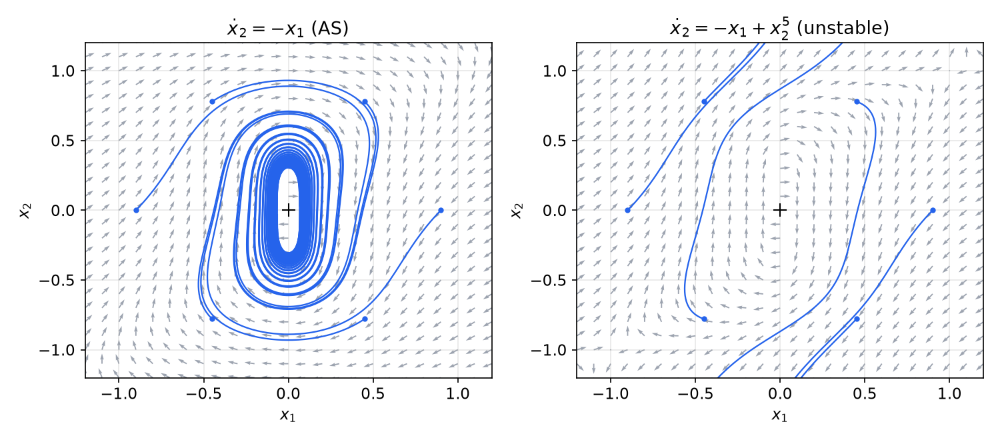
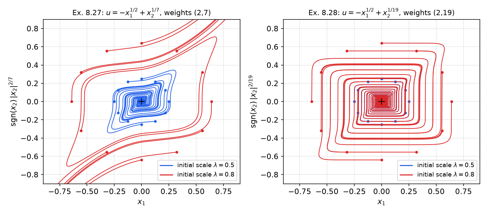
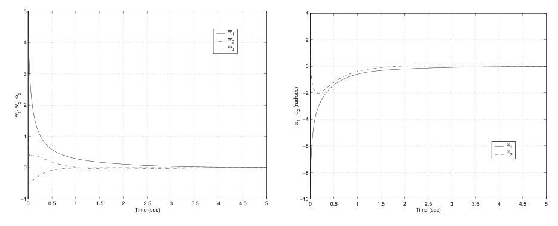
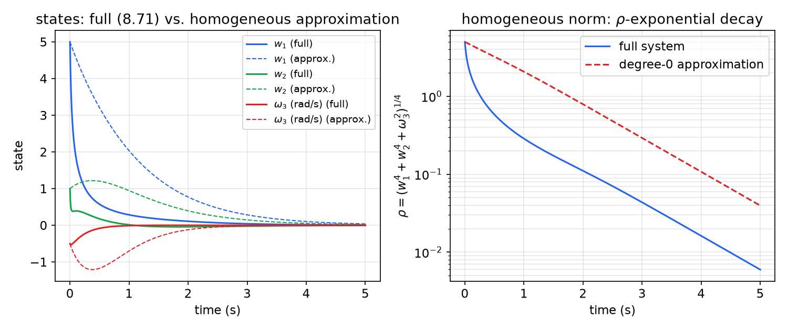

# Homogeneous Systems

The standard way to decide the stability of an equilibrium of \\(\dot x = f(x)\\) is to Taylor-expand \\(f\\) and keep the first significant term: the linearization when it is Hurwitz, the cubic terms when the linear part vanishes, and so on. This works because the leading term is *homogeneous*, and homogeneous systems behave the same at every scale. This chapter makes that idea precise and pushes it further. By assigning different **weights** to different coordinates we obtain approximations that are not Taylor approximations at all, yet still decide local stability; homogeneous Lyapunov functions and homogeneous feedback laws then give a systematic way to stabilize systems that defeat linearization, smooth feedback and backstepping alike.

## Motivation: Beyond the Taylor Approximation

Consider
\\[
\dot x = f(x), \qquad f(0) = 0 .
\\]
Lyapunov's indirect method (see [Lyapunov Stability](lyapunov.md)) says that if \\(A = \partial f/\partial x(0)\\) is Hurwitz the origin is locally asymptotically stable, and if \\(A\\) has an eigenvalue with positive real part it is unstable. The *critical* cases, with eigenvalues on the imaginary axis, are left open. In those cases stability is decided by terms that the linearization throws away, and two questions arise:

1. Which terms should be kept? The answer "the lowest-degree terms of the Taylor series" is sometimes wrong, as Example 8.20 and Example 8.29 below show.
2. When does the stability of the approximation transfer to the full system?

Both questions are answered by **homogeneity**: an approximation is useful when it is homogeneous with respect to some family of dilations and the neglected terms are of higher order with respect to the same dilations.

## Dilations and Weighted Degrees

### Monomials, polynomials and the standard degree

**Definition 8.1 (Monomial).** A monomial of degree \\(\ell\\) on \\(\mathbb R^n\\) is a map
\\[
x \mapsto a\\, x\_1^{k\_1} x\_2^{k\_2} \cdots x\_n^{k\_n}, \qquad a \in \mathbb R,
\\]
where \\(k = (k\_1,\dots,k\_n)\\) is a multi-index of non-negative integers with \\(\lvert k \rvert = \sum\_i k\_i = \ell\\).

**Definition 8.2 (Polynomial).** A polynomial of degree \\(d\\) is a map
\\[
x \mapsto \sum\_{\ell=0}^{d} \sum\_{\lvert k \rvert = \ell} a\_k\\, x\_1^{k\_1}\cdots x\_n^{k\_n},
\\]
and we write \\(\deg(p) = d\\). A polynomial is a sum of monomials, not necessarily all of the same degree.

**Definition 8.3 (Homogeneous polynomial).** A polynomial \\(p\\) is homogeneous of degree \\(d\\) if every term is a monomial of degree \\(d\\). Then
\\[
p(\lambda x) = \lambda^d p(x) \qquad \text{for all } \lambda \in \mathbb R .
\\]

### Dilations

Scaling every coordinate by the same factor is only one way to zoom in on the origin. A more flexible zoom scales each coordinate by its own power of \\(\lambda\\).

**Definition 8.4 (Dilation).** Let \\(r = (r\_1,\dots,r\_n)\\) be positive rational numbers, the **weights**. For \\(\lambda > 0\\) the dilation \\(\delta^r\_\lambda : \mathbb R^n \to \mathbb R^n\\) is
\\[
\delta^r\_\lambda x \overset{\text{def}}{=} \left( \lambda^{r\_1} x\_1,\ \lambda^{r\_2} x\_2,\ \dots,\ \lambda^{r\_n} x\_n \right).
\\]
When all weights equal 1 this is the **standard dilation** \\(\delta\_\lambda x = \lambda x\\).

A dilation is completely determined by its weights. Since multiplying all the weights by the same positive constant only reparameterizes \\(\lambda\\), one often normalizes the weights (for example so that the smallest is 1, or so that they are integers), but nothing below depends on the normalization. As \\(\lambda \to 0\\), \\(\delta^r\_\lambda x \to 0\\) along a curve that is tangent to the axis with the smallest weight: coordinates with large weight shrink faster. From now on \\(\lambda \ge 0\\) only.

**Definition 8.5 (Weighted homogeneity).** A function \\(p\\) is (positively) homogeneous of degree \\(\ell\\) with respect to \\(\delta^r\_\lambda\\) if
\\[
p(\delta^r\_\lambda x) = \lambda^{\ell} p(x), \qquad \lambda \ge 0 .
\\]
"Homogeneous" will always mean positively homogeneous. If a polynomial \\(p\\) is not homogeneous, its degree with respect to a dilation is the **maximal** degree of its homogeneous components.

**Example 8.6 (Weighted degree of a monomial).** For \\(p(x) = a x\_1^{k\_1}\cdots x\_n^{k\_n}\\),
\\[
p(\delta^r\_\lambda x) = a (\lambda^{r\_1}x\_1)^{k\_1}\cdots(\lambda^{r\_n}x\_n)^{k\_n} = \lambda^{\ell}\\, a x\_1^{k\_1}\cdots x\_n^{k\_n}, \qquad \ell = r\_1k\_1 + \cdots + r\_nk\_n .
\\]
Every monomial is homogeneous with respect to every dilation; its weighted degree is \\(\sum\_i r\_ik\_i\\), which reduces to \\(\lvert k \rvert\\) for the standard dilation.

**Example 8.7.** Take \\(\delta^r\_\lambda(x\_1,x\_2) = (\lambda x\_1, \lambda^2 x\_2)\\), weights \\(r = (1,2)\\).

- \\(p\_1 = x\_1x\_2^2\\): \\(p\_1(\delta^r\_\lambda x) = (\lambda x\_1)(\lambda^2x\_2)^2 = \lambda^5 p\_1(x)\\), degree 5.
- \\(p\_2 = x\_1^2x\_2\\): degree \\(2 + 2 = 4\\).
- \\(p\_3 = x\_2\\): degree 2.
- \\(p = x\_1x\_2^2 + x\_1^2x\_2 + x\_2\\): not homogeneous; its degree is the maximum, 5.

Under the standard dilation \\(p\_1\\) and \\(p\_2\\) both have degree 3 and \\(p\_3\\) degree 1, so the ordering of terms by "size near the origin" changes with the dilation.

**Homogeneity beyond polynomials.** The definition makes sense for any function. If \\(p\\) and \\(q\\) are homogeneous of degrees \\(m\\) and \\(k\\), the rational function \\(R = p/q\\) satisfies
\\[
R(\delta^r\_\lambda x) = \frac{\lambda^m p(x)}{\lambda^k q(x)} = \lambda^{m-k} R(x),
\\]
so it is homogeneous of degree \\(m - k\\). Fractional powers are also allowed. For coprime integers \\(p, q\\) with \\(q\\) odd we use the convention
\\[
x^{1/q} \overset{\text{def}}{=} \operatorname{sgn}(x)\\,\lvert x \rvert^{1/q}, \qquad x^{p/q} \overset{\text{def}}{=} (x^p)^{1/q},
\\]
which is the real \\(q\\)-th root. With this convention \\(x\_1^{1/2}\\) means \\(\operatorname{sgn}(x\_1)\lvert x\_1 \rvert^{1/2}\\), an odd function; it is homogeneous of degree \\(r\_1/2\\).

### Elementary facts

Let \\(f : \mathbb R^n \to \mathbb R\\) be homogeneous of degree \\(m\\) with respect to the standard dilation, \\(f(\lambda x) = \lambda^m f(x)\\) for \\(\lambda > 0\\).

- **If \\(m > 0\\) then \\(f(0) = 0\\)**, because \\(f(0) = f(\lambda\cdot 0) = \lambda^m f(0)\\) for every \\(\lambda > 0\\). If in addition \\(f\\) is continuous on \\(\mathbb R^n \setminus\\{0\\}\\), it is continuous at the origin: with \\(M = \max\_{\lVert y \rVert = 1}\lvert f(y) \rvert\\), \\(\lvert f(x) \rvert = \lVert x \rVert^m \lvert f(x/\lVert x \rVert) \rvert \le M\lVert x \rVert^m \to 0\\).
- **If \\(m = 0\\)**, \\(f\\) is constant along rays, \\(f(\lambda x) = f(x)\\), so it is discontinuous at the origin unless it is constant.
- Let \\(H\_m\\) denote the homogeneous functions of degree \\(m\\). Then \\(H\_0\\) contains the constants (among smooth functions, exactly the constants), \\(H\_\ell = \\{0\\}\\) for \\(\ell < 0\\) among functions continuous at the origin, and \\(f \in H\_m,\ g \in H\_q \Rightarrow fg \in H\_{m+q}\\).
- A vector-valued map \\(f : \mathbb R^n \to \mathbb R^n\\) is homogeneous of degree \\(m\\) if every component is.
- **Derivatives lower the degree by the weight.** If \\(f\\) is smooth and homogeneous of degree \\(m\\) with respect to \\(\delta^r\_\lambda\\), then \\(\partial f/\partial x\_i\\) is homogeneous of degree \\(m - r\_i\\). Indeed, differentiate \\(f(\lambda^{r\_1}x\_1,\dots,\lambda^{r\_n}x\_n) = \lambda^m f(x)\\) with respect to \\(x\_i\\):
\\[
\lambda^{r\_i}\frac{\partial f}{\partial x\_i}(\delta^r\_\lambda x) = \lambda^m \frac{\partial f}{\partial x\_i}(x)
\quad\Longrightarrow\quad
\frac{\partial f}{\partial x\_i}(\delta^r\_\lambda x) = \lambda^{m - r\_i}\frac{\partial f}{\partial x\_i}(x).
\\]
- **The sign of a homogeneous function is decided on a sphere.** If \\(f\\) is continuous and homogeneous with respect to the standard dilation, then \\(f(x) = \lVert x \rVert^m f(x/\lVert x \rVert)\\), so \\(f < 0\\) on \\(\mathbb R^n\setminus\\{0\\}\\) if and only if \\(f < 0\\) on the compact unit sphere. The same holds for a weighted dilation with the Euclidean sphere replaced by a level set of a homogeneous norm (Definition 8.9). This observation drives almost every proof in this chapter.

## Homogeneous Vector Fields

A vector field
\\[
X(x) = a\_1(x)\frac{\partial}{\partial x\_1} + \cdots + a\_n(x)\frac{\partial}{\partial x\_n}
\\]
acts on smooth functions by \\(Xp = \sum\_i a\_i\\, \partial p/\partial x\_i = L\_X p\\), the Lie derivative (see [Differential Geometry for Control](differential-geometry.md)). We mostly consider polynomial vector fields, whose coefficients \\(a\_i\\) are polynomials, but fractional powers will appear in the examples.

**Definition 8.8 (Homogeneous vector field).** A vector field \\(X\\) is homogeneous of degree \\(m\\) with respect to \\(\delta^r\_\lambda\\) if each coefficient \\(a\_i\\) is homogeneous of degree
\\[
\ell\_i = r\_i - m, \qquad i = 1,\dots,n .
\\]

The reason for this (at first sight odd) convention is that it makes the degree of a vector field the amount by which it **lowers** the degree of functions. If \\(p\\) is homogeneous of degree \\(\ell\\) and \\(X\\) of degree \\(m\\), then each term \\(a\_i\\, \partial p/\partial x\_i\\) has degree \\((r\_i - m) + (\ell - r\_i) = \ell - m\\), so
\\[
X p \ \text{ is homogeneous of degree } \ \ell - m .
\\]
Some consequences:

- The degree of a vector field can be positive, zero or negative.
- The **Euler field** \\(x\_i\\, \partial/\partial x\_i\\) has degree \\(r\_i - r\_i = 0\\) for *every* dilation. More generally, the linear field \\(Ax\\) has degree zero with respect to the standard dilation, even though its components are of degree 1 in the classical sense.
- A larger vector-field degree means *lower-order* coefficients, which dominate near the origin. A perturbation is "of higher order" than a field of degree \\(m\\) when its degree is **less** than \\(m\\).

**Caution (two conventions).** Identify \\(X\\) with the column \\(a(x) = (a\_1,\dots,a\_n)\\). Under the standard dilation, if the components satisfy \\(a\_i(\lambda x) = \lambda^k a\_i(x)\\) ("classical degree \\(k\\)"), then by Definition 8.8 the vector field has degree \\(1 - k\\). So: all \\(a\_i\\) homogeneous polynomials of degree \\(1 - m\\) \\(\Leftrightarrow\\) \\(X\\) of degree \\(m\\); all \\(a\_i\\) of degree \\(m\\) \\(\Leftrightarrow\\) \\(X\\) of degree \\(1 - m\\). The definition is unfortunate but standard. Part of the literature (including Rosier's theorem below) uses the opposite sign: \\(f\\) is "homogeneous of degree \\(s\\)" when \\(f\_i(\delta^r\_\lambda x) = \lambda^{s + r\_i} f\_i(x)\\). The two are related by \\(s = -m\\):

| Convention | Condition on components | \\(\dot x = Ax\\) | \\(\dot x = -x^3\\) (scalar) |
|---|---|---|---|
| Definition 8.8 (degree \\(m\\)) | \\(f\_i(\delta^r\_\lambda x) = \lambda^{r\_i - m}f\_i(x)\\) | \\(m = 0\\) | \\(m = -2\\) |
| Rosier (degree \\(s\\)) | \\(f\_i(\delta^r\_\lambda x) = \lambda^{r\_i + s}f\_i(x)\\) | \\(s = 0\\) | \\(s = 2\\) |

### Homogeneous norms

With a weighted dilation, the Euclidean norm no longer scales correctly: \\(\lVert \delta^r\_\lambda x \rVert \ne \lambda \lVert x \rVert\\). The replacement is a function that grows by exactly one factor of \\(\lambda\\) under the dilation.

**Definition 8.9 (Homogeneous norm).** A continuous \\(\rho : \mathbb R^n \to \mathbb R\\) is a homogeneous norm with respect to \\(\delta^r\_\lambda\\) if

1. \\(\rho(x) \ge 0\\), and \\(\rho(x) = 0 \iff x = 0\\);
2. \\(\rho(\delta^r\_\lambda x) = \lambda\\,\rho(x)\\) for all \\(\lambda > 0\\).

It is symmetric if \\(\rho(-x) = \rho(x)\\), and smooth if it is \\(C^\infty\\) on \\(\mathbb R^n \setminus \\{0\\}\\).

(A homogeneous norm is not a norm in the sense of linear algebra; the triangle inequality generally fails.) A smooth homogeneous norm always exists. Choose a positive integer \\(c\\) such that every \\(c/r\_i\\) is an even integer, and set
\\[
\rho(x) = \left( x\_1^{c/r\_1} + x\_2^{c/r\_2} + \cdots + x\_n^{c/r\_n} \right)^{1/c} = \left( \sum\_{i=1}^n \lvert x\_i \rvert^{c/r\_i} \right)^{1/c}.
\\]
Each term is non-negative and smooth, the sum vanishes only at \\(x = 0\\), and
\\[
\rho(\delta^r\_\lambda x) = \left( \sum\_i \lambda^{c}\lvert x\_i \rvert^{c/r\_i} \right)^{1/c} = \lambda \rho(x).
\\]
Dropping the evenness requirement and keeping the absolute values still gives a continuous homogeneous norm.

**Example 8.10.** \\(\rho(x\_1,x\_2) = \sqrt{\lvert x\_1 \rvert^2 + \lvert x\_2 \rvert}\\) is a homogeneous norm for \\(\delta^r\_\lambda x = (\lambda x\_1, \lambda^2x\_2)\\): \\(\rho(\lambda x\_1, \lambda^2 x\_2) = \sqrt{\lambda^2 x\_1^2 + \lambda^2\lvert x\_2 \rvert} = \lambda\rho\\). Likewise \\(\rho(x\_1,x\_2) = \sqrt{\lvert x\_1 \rvert^2 + \lvert x\_2 \rvert^{2/3}}\\) is one for \\((\lambda x\_1, \lambda^3 x\_2)\\).

*Figure: left, level sets \\(\rho = 0.5, 1, 1.5\\) of the homogeneous norm of Example 8.10 for weights \\((1,2)\\), with dashed dilation orbits \\(\lambda \mapsto (\lambda a, \lambda^2 b)\\), which are parabolas. Each level set is the image of the unit level set under a dilation, and the orbits cross every level set once. Right, the standard dilation: orbits are rays and the homogeneous norm is the Euclidean norm.*

Two properties of homogeneous norms are used repeatedly. First, any \\(x \ne 0\\) can be written as \\(x = \delta^r\_{\rho(x)} \hat x\\) with \\(\rho(\hat x) = 1\\): the "unit sphere" \\(S\_\rho = \\{\rho = 1\\}\\) plays the role of the Euclidean sphere. Second, if \\(V\\) is continuous, positive definite and homogeneous of degree \\(k\\), then with \\(c\_1 = \min\_{S\_\rho}V > 0\\) and \\(c\_2 = \max\_{S\_\rho}V\\),
\\[
c\_1\\,\rho(x)^k \le V(x) \le c\_2\\,\rho(x)^k ,
\\]
so \\(V\\) is automatically radially unbounded.

## Homogeneous Stabilizers

Consider the control-affine system
\\[
\dot x = f(x) + g(x)u, \tag{8.10}
\\]
where \\(f\\) and \\(g\\) are smooth vector fields, homogeneous with respect to the **standard** dilation. We look for a homogeneous feedback \\(u(x)\\) that makes the closed loop homogeneous, because a homogeneous closed loop that is locally asymptotically stable is automatically globally so.

**Degree bookkeeping.** Suppose the components of \\(f\\) have classical degree \\(k\_0\\) (vector-field degree \\(1 - k\_0\\)) and those of \\(g\\) classical degree \\(k\_1\\) (vector-field degree \\(1 - k\_1\\)), with \\(k\_0 \ge k\_1 \ge 0\\). For \\(g(x)u(x)\\) to have the same classical degree as \\(f\\), \\(u\\) must be homogeneous of degree
\\[
\deg u = k\_0 - k\_1 ,
\\]
and then the closed loop has vector-field degree \\(1 - k\_0\\). We assume \\(k\_0 \ge 1\\) and \\(k\_0\\) **odd**.

*Why odd?* If the closed-loop field \\(F\\) has even classical degree, then \\(F(-x) = F(x)\\). If \\(x(t)\\) is a solution, so is \\(y(t) = -x(-t)\\), because \\(\dot y(t) = \dot x(-t) = F(x(-t)) = F(-y(t)) = F(y(t))\\). Hence the trajectory from \\(-x\_0\\) is the point reflection of the *backward* trajectory from \\(x\_0\\). Backward trajectories from points \\(x\_0\neq 0\\) in a region of attraction cannot converge to the origin (that would contradict uniqueness of the equilibrium solution), so the origin cannot attract both \\(x\_0\\) and \\(-x\_0\\) for every small \\(x\_0\\); a homogeneous system of even degree is never asymptotically stable. The scalar \\(\dot x = -x^2\\) is the simplest illustration.

**Definition 8.11 (Homogeneous stabilizer).** Let \\(f\\) have vector-field degree \\(1 - k\_0\\) with \\(k\_0\\) odd, and \\(g\\) degree \\(1 - k\_1\\) with \\(k\_1\\) even and \\(k\_0 \ge k\_1\\). System (8.10) admits a homogeneous stabilizer if there is a feedback \\(u \in C^1(\mathbb R^n \setminus\\{0\\})\\), \\(u(0) = 0\\), positively homogeneous of degree \\(k\_0 - k\_1\\), that renders the origin asymptotically stable.

**Proposition 8.12.** Every homogeneous stabilizer is a global stabilizer.

*Proof sketch.* The closed-loop field \\(F = f + gu\\) has classical degree \\(k = k\_0\\). If \\(x(t)\\) solves \\(\dot x = F(x)\\), then for any \\(\lambda > 0\\) so does \\(y(t) = \lambda x(\lambda^{k-1}t)\\):
\\[
\dot y(t) = \lambda^{k} F\big(x(\lambda^{k-1}t)\big) = F\big(\lambda x(\lambda^{k-1}t)\big) = F(y(t)).
\\]
Thus the dilation maps solutions to time-rescaled solutions, and the region of attraction is invariant under \\(x \mapsto \lambda x\\). A region of attraction that contains a ball around the origin and is invariant under all dilations is \\(\mathbb R^n\\). \\(\blacksquare\\)

**Regularity.** If \\(k\_0 > k\_1\\), \\(u\\) has positive degree, so it is continuous everywhere (and \\(C^1\\) off the origin). If \\(k\_0 > k\_1 + 1\\), its derivatives have positive degree too and \\(u\\) is \\(C^1\\) everywhere. If \\(k\_0 = k\_1\\), \\(u\\) has degree zero and may be discontinuous at the origin; this is harmless because the closed-loop vector field \\(g(x)u(x)\\) still has positive classical degree \\(k\_1 = k\_0 \ge 1\\) and is therefore continuous at the origin.

**Example 8.13.** Consider
\\[
\dot x\_1 = u, \qquad \dot x\_2 = x\_1^k, \qquad k \text{ odd}.
\\]
This system is small-time locally controllable at the origin (see [Nonlinear Controllability](controllability.md)). Pre-compensate with \\(u = -x\_2^k + v\\), so that
\\[
\dot x = f(x) + g(x)v, \qquad f(x) = \begin{bmatrix} -x\_2^k \\\\ x\_1^k \end{bmatrix}, \quad g = \begin{bmatrix} 1 \\\\ 0 \end{bmatrix}.
\\]
*Lyapunov function.* Take \\(V = x\_1^{k+1} + x\_2^{k+1}\\), positive definite because \\(k + 1\\) is even. Then
\\[
L\_fV = (k+1)x\_1^k(-x\_2^k) + (k+1)x\_2^k x\_1^k = 0, \qquad L\_gV = (k+1)x\_1^k ,
\\]
so \\(\dot V = L\_fV + v\\,L\_gV = v\\,L\_gV\\).

*Damping control.* Choose \\(v = -\alpha L\_gV = -\alpha(k+1)x\_1^k\\), \\(\alpha > 0\\):
\\[
\dot V = -\alpha (L\_gV)^2 = -\alpha(k+1)^2 x\_1^{2k} \le 0 .
\\]
*LaSalle.* On \\(\\{\dot V = 0\\} = \\{x\_1 = 0\\}\\), \\(\dot x\_1 = -x\_2^k\\) must vanish, so \\(x\_2 = 0\\): the largest invariant set is the origin. Hence
\\[
u(x) = -x\_2^k - \alpha(k+1)x\_1^k
\\]
is a smooth, homogeneous (degree \\(k\\)) control law that makes the origin globally asymptotically stable.

### Homogeneous control Lyapunov functions

The construction of Example 8.13 generalizes through control Lyapunov functions (see [Control Lyapunov Functions](clf.md)).

**Definition 8.14 (Homogeneous clf).** Let \\(f\\) have degree \\(1 - k\_0\\) (\\(k\_0\\) odd) and \\(g\\) degree \\(1 - k\_1\\), \\(k\_0 \ge k\_1\\). A homogeneous control Lyapunov function is a smooth, positive definite \\(V\\), homogeneous of degree \\(\mu \ge 2\\) (standard dilation), such that
\\[
L\_fV(x) < 0 \quad \text{for all } x \ne 0 \text{ with } L\_gV(x) = 0 .
\\]

**Proposition 8.15.** If (8.10), with \\(f, g\\) homogeneous polynomial vector fields of degrees \\(1 - k\_0\\) and \\(1 - k\_1\\), admits a homogeneous clf of degree \\(\mu \ge 2\\), then it is homogeneously stabilizable by
\\[
u(x) = -\alpha \lVert x \rVert^{s} L\_gV(x), \qquad s = k\_0 - 2k\_1 - \mu + 1, \tag{8.13}
\\]
for all sufficiently large \\(\alpha > 0\\).

*Choice of \\(s\\).* \\(V\\) has degree \\(\mu\\) and the components of \\(f\\) have classical degree \\(k\_0\\), so \\(L\_fV = \nabla V \cdot f\\) has degree \\(\mu - 1 + k\_0\\). Likewise \\(L\_gV\\) has degree \\(\mu - 1 + k\_1\\). In
\\[
\dot V = L\_fV - \alpha\lVert x \rVert^s (L\_gV)^2
\\]
the second term has degree \\(s + 2(\mu - 1 + k\_1)\\); equating with \\(\mu - 1 + k\_0\\) gives \\(s = k\_0 - 2k\_1 - \mu + 1\\). Then \\(\dot V\\) is homogeneous of degree \\(\mu - 1 + k\_0 \ge 2\\).

*Proof.* Because \\(\dot V\\) is homogeneous, its sign is determined by its sign on the unit sphere \\(S = \\{\lVert x \rVert = 1\\}\\). Split \\(S = S^- \cup S^+\\) with
\\[
S^- = \\{x \in S : L\_fV(x) < 0\\}, \qquad S^+ = \\{x \in S : L\_fV(x) \ge 0\\}.
\\]
On \\(S^-\\), \\(\dot V \le L\_fV < 0\\). By the clf property, \\(\\{x \in S : L\_gV(x) = 0\\} \subseteq S^-\\), so \\(L\_gV \ne 0\\) on \\(S^+\\). If \\(S^+\\) is empty we are done. Otherwise \\(S^+\\) is closed in the compact set \\(S\\), hence compact, and
\\[
\overline L = \max\_{x \in S} L\_fV(x) \ge 0, \qquad \underline L = \min\_{x \in S^+}\big(L\_gV(x)\big)^2 > 0 .
\\]
Choose \\(\alpha > \overline L/\underline L\\). On \\(S^+\\), \\(\dot V \le \overline L - \alpha\underline L < 0\\). Hence \\(\dot V < 0\\) on all of \\(S\\), so on \\(\mathbb R^n\setminus\\{0\\}\\), and the origin is globally asymptotically stable (Proposition 8.12). \\(\blacksquare\\)

**Regularity of (8.13).** The feedback is \\(C^1\\) on \\(\mathbb R^n\setminus\\{0\\}\\) even if \\(s < 0\\); it is \\(C^1\\) at the origin when \\(s \ge 0\\); and it is \\(C^\infty\\) everywhere when \\(g\\) is \\(C^\infty\\) and \\(s\\) is a non-negative even integer (then \\(\lVert x \rVert^s\\) is a polynomial).

**Example 8.16 (Constant input matrix).** Consider
\\[
\dot x = f(x) + Bu, \tag{8.16}
\\]
with \\(f\\) a homogeneous polynomial vector field of degree \\(1 - k\_0\\) (\\(k\_0\\) odd) and \\(B\\) constant, so \\(k\_1 = 0\\). Try the quadratic \\(V = x^\top Px\\), \\(P = P^\top > 0\\), so \\(\mu = 2\\). Then \\(L\_gV = 2B^\top Px\\) and \\(L\_fV = 2x^\top Pf(x)\\), and the clf condition becomes
\\[
\mathcal N(B^\top P) \subseteq \\{x : x^\top Pf(x) < 0\\} \cup \\{0\\}. \tag{8.17}
\\]
Proposition 8.15, with \\(s = k\_0 - 0 - 2 + 1 = k\_0 - 1\\) and the factor 2 absorbed into \\(\alpha\\), gives
\\[
u = -\alpha \lVert x \rVert^{k\_0 - 1} B^\top Px . \tag{8.18}
\\]
For \\(k\_0 = 1\\) (a linear system) this is ordinary linear feedback. For odd \\(k\_0 \ge 3\\), \\(s = k\_0 - 1\\) is even and the law is a polynomial.

**Example 8.17 (Stabilizable but not locally controllable).** Consider
\\[
\dot x\_1 = x\_1^2 x\_2, \qquad \dot x\_2 = x\_2^3 + u .
\\]
Here \\(f = (x\_1^2x\_2,\ x\_2^3)^\top\\) has classical degree \\(k\_0 = 3\\) (vector-field degree \\(-2\\)) and \\(g = B = (0,1)^\top\\) has \\(k\_1 = 0\\). Take
\\[
P = \begin{bmatrix} 2 & 1 \\\\ 1 & 2 \end{bmatrix}, \qquad B^\top P = \begin{bmatrix} 1 & 2 \end{bmatrix}, \qquad \mathcal N(B^\top P) = \\{x : x\_1 + 2x\_2 = 0\\}.
\\]
*Check (8.17).* On \\(x\_1 = -2x\_2\\), \\(f = (4x\_2^3,\ x\_2^3)^\top\\) and
\\[
x^\top Pf = \begin{bmatrix} -2x\_2 & x\_2 \end{bmatrix}\begin{bmatrix} 2 & 1 \\\\ 1 & 2 \end{bmatrix}\begin{bmatrix} 4x\_2^3 \\\\ x\_2^3 \end{bmatrix} = \begin{bmatrix} -3x\_2 & 0 \end{bmatrix}\begin{bmatrix} 4x\_2^3 \\\\ x\_2^3 \end{bmatrix} = -12x\_2^4 < 0 \quad (x\_2 \ne 0).
\\]
*Control law.* With \\(s = k\_0 - 1 = 2\\),
\\[
u = -\alpha\lVert x \rVert^2 B^\top Px = -\alpha(x\_1^2 + x\_2^2)(x\_1 + 2x\_2).
\\]
*Equilibria of the closed loop.* They satisfy
\\[
x\_1^2x\_2 = 0, \qquad x\_2^3 - \alpha(x\_1^2 + x\_2^2)(x\_1 + 2x\_2) = 0 .
\\]
If \\(x\_1 = 0\\), the second equation reads \\((1 - 2\alpha)x\_2^3 = 0\\), so \\(x\_2 = 0\\) for \\(\alpha \ne 1/2\\). If \\(x\_2 = 0\\), it reads \\(-\alpha x\_1^3 = 0\\), so \\(x\_1 = 0\\). The origin is the only equilibrium.

*How large must \\(\alpha\\) be?* Along the closed loop, \\(\dot V = 2x^\top Pf - 2\alpha\lVert x \rVert^2(x\_1 + 2x\_2)^2\\), so on the unit circle the requirement is \\(\alpha > x^\top Pf/(x\_1 + 2x\_2)^2\\) wherever \\(x^\top Pf \ge 0\\). Evaluating this ratio numerically over the circle gives a maximum of about \\(0.552\\), so with this \\(V\\) any \\(\alpha > 0.56\\) works; the coarser bound \\(\alpha > 3\sqrt2\\), obtained by estimating \\(\overline L\\) and \\(\underline L\\) separately, is also sufficient. The origin is then globally asymptotically stable.

*Lack of controllability.* The line \\(x\_1 = 0\\) is invariant for every input (\\(\dot x\_1 = 0\\) there), so states with \\(x\_1 = 0\\) cannot be steered off it: the system is not locally controllable, yet it is smoothly stabilizable.

**Time reversal.** The time-reversed system
\\[
\dot x\_1 = -x\_1^2 x\_2, \qquad \dot x\_2 = -x\_2^3 + u
\\]
has the clf \\(x^\top Px\\) with \\(P = \begin{bmatrix} 2 & -1 \\\\ -1 & 2 \end{bmatrix}\\) (on \\(x\_1 = 2x\_2\\) one finds \\(x^\top Pf = -12x\_2^4\\) by the same computation), so it is also stabilizable, and also not locally controllable. For linear systems, controllability is equivalent to stabilizability in both forward and reverse time; this example shows the equivalence fails for nonlinear systems.

**Remark (When STLC implies smooth stabilizability).** If \\(\operatorname{rank}B = n - 1\\) and (8.16) is small-time locally controllable at the origin, the homogeneous clf condition (8.17) can be met, so for this class STLC implies smooth stabilizability. The rank condition matters:

**Example 8.18 (Counterexample with \\(\operatorname{rank}B < n - 1\\)).** The system
\\[
\dot x\_1 = u, \qquad \dot x\_2 = x\_1^3, \qquad \dot x\_3 = x\_1^2 x\_2
\\]
is STLC at the origin, but it fails Brockett's condition: the map \\((x,u) \mapsto (u, x\_1^3, x\_1^2x\_2)\\) does not cover a neighborhood of the origin, since a point \\((a, 0, \eta)\\) with \\(\eta \ne 0\\) would need \\(x\_1 = 0\\) and then \\(x\_1^2x\_2 = 0\\). By Brockett's theorem (see [Nonlinear Controllability](controllability.md)) it admits no continuous, let alone smooth, time-invariant stabilizer.

## Homogeneous Approximations of Polynomial Systems

### The standard dilation

Write the Taylor expansion of \\(f\\) as a sum of homogeneous terms,
\\[
f(x) = f\_k(x) + f\_{k+1}(x) + \cdots,
\\]
where \\(f\_j\\) collects the terms of classical degree \\(j\\) and \\(k \ge 1\\) because \\(f(0) = 0\\).

**Theorem 8.19.** Consider \\(\dot x = f(x)\\), \\(f(0) = 0\\). If the origin is asymptotically stable for the homogeneous approximation
\\[
\dot x = f\_k(x),
\\]
then it is locally asymptotically stable for \\(\dot x = f(x)\\).

If the minimal-degree terms define an asymptotically stable homogeneous vector field, higher-order terms cannot destroy asymptotic stability. Lyapunov's indirect method is the special case \\(k = 1\\). Homogeneity of the approximation is essential, as the next example shows.

**Example 8.20 (A non-homogeneous approximation can mislead).** The system
\\[
\dot x\_1 = x\_2^3 - x\_1^3, \qquad \dot x\_2 = -x\_1
\\]
is asymptotically stable at the origin: with \\(V = \tfrac12 x\_1^2 + \tfrac14 x\_2^4\\), \\(\dot V = x\_1x\_2^3 - x\_1^4 - x\_2^3x\_1 = -x\_1^4 \le 0\\), and on \\(x\_1 \equiv 0\\) we need \\(\dot x\_1 = x\_2^3 = 0\\), so LaSalle's principle gives asymptotic stability. Adding the "higher-order" term \\(x\_2^5\\),
\\[
\dot x\_1 = x\_2^3 - x\_1^3, \qquad \dot x\_2 = -x\_1 + x\_2^5 ,
\\]
makes the origin unstable. There is no contradiction with Theorem 8.19, because the unperturbed field mixes degrees 1 and 3 and is not homogeneous with respect to the standard dilation.

*Figure: phase portraits of Example 8.20. Left, the unperturbed system: trajectories spiral slowly inward along elongated loops. Right, after adding \\(x\_2^5\\): the same initial conditions are expelled. A term that looks of "higher order" in the standard sense changes the outcome because the unperturbed system is not homogeneous.*

### Weighted dilations: Hermes' theorem

The real power of the method appears when the dilation is chosen to fit the system.

**Theorem 8.21 (Hermes).** Let \\(f\\) be continuous on \\(\mathbb R^n\\) with \\(f(0) = 0\\), homogeneous of degree \\(m\\) with respect to \\(\delta^r\_\lambda\\) (Definition 8.8), and assume that \\(\dot x = f(x)\\) has unique solutions near the origin. Let \\(g\\) be continuous with degree (with respect to the same dilation) strictly less than \\(m\\). If the origin is locally asymptotically stable for \\(\dot x = f(x)\\), then it is locally asymptotically stable for
\\[
\dot x = f(x) + g(x).
\\]

The proof (outlined after Theorem 8.30) uses a homogeneous Lyapunov function for \\(f\\) and the fact that the contribution of \\(g\\) to \\(\dot V\\) is of higher order. The theorem says that local asymptotic stability is *structurally stable*, persisting under higher-order perturbations, even when it is decided by nonlinear terms. Instability is not structurally stable in the same sense:

**Example 8.22.** Consider
\\[
\begin{aligned}
\dot x\_1 &= x\_2^3 + x\_1x\_3^2 - x\_1 w(x), \\\\
\dot x\_2 &= -x\_1^3 + x\_2x\_3^2 - x\_2 w(x), \\\\
\dot x\_3 &= -x\_3^3 .
\end{aligned}
\\]
With \\(w \equiv 0\\) the zero solution is unstable; with \\(w(x) = (x\_1^4 + x\_2^4)^k\\) it is locally asymptotically stable for every integer \\(k \ge 0\\), no matter how high the order of the perturbation.

Theorem 8.21 is often used in the following limit form, which avoids having to identify the degree of \\(g\\) exactly.

**Corollary 8.23.** Let \\(f\\) be homogeneous of degree \\(m\\) with respect to \\(\delta^r\_\lambda\\) with asymptotically stable origin, and let \\(g\\) satisfy, for each \\(i\\) and each \\(x\\),
\\[
\lim\_{\lambda \to 0^+}\frac{g\_i(\delta^r\_\lambda x)}{\lambda^{r\_i - m}} = 0. \tag{8.41}
\\]
Then the origin of \\(\dot x = f(x) + g(x)\\) is asymptotically stable.

Condition (8.41) says that, measured on the scale set by the dilation, each component of \\(g\\) vanishes faster than the corresponding component of \\(f\\), which scales exactly as \\(\lambda^{r\_i - m}\\).

### Degree-zero fields and \\(\rho\\)-exponential stability

**Definition 8.24 (\\(\rho\\)-exponential stability).** The equilibrium \\(x = 0\\) of \\(\dot x = f(x)\\) is locally exponentially stable with respect to the homogeneous norm \\(\rho\\) if there are \\(\alpha, \beta > 0\\) and a neighborhood \\(\mathcal N\\) of the origin such that
\\[
\rho\big(\phi(t; x\_0)\big) \le \beta\\, \rho(x\_0)\\, e^{-\alpha t}, \qquad x\_0 \in \mathcal N,\ t \ge 0, \tag{8.42}
\\]
where \\(\phi(t;x\_0)\\) is the solution through \\(x\_0\\).

This is not equivalent to ordinary exponential stability unless the dilation is standard. Normalize the weights so that \\(r\_{\min} = \min\_i r\_i\\) and \\(r\_{\max} = \max\_i r\_i\\), and use the norm \\(\rho = (\sum\_i \lvert x\_i \rvert^{c/r\_i})^{1/c}\\). Each coordinate satisfies \\(\lvert x\_i \rvert \le \rho(x)^{r\_i}\\), and for \\(\lVert x \rVert \le 1\\) one has \\(\rho(x) \le n^{1/c}\lVert x \rVert^{1/r\_{\max}}\\). Then, for solutions with \\(\rho \le 1\\), (8.42) gives
\\[
\lVert \phi(t;x\_0) \rVert \le \sqrt n\\, \rho(\phi)^{r\_{\min}} \le M \lVert x\_0 \rVert^{r\_{\min}/r\_{\max}} e^{-\alpha r\_{\min} t}
\\]
for some \\(M > 0\\). The envelope is exponential in time, but its size scales like a *fractional* power of the initial condition rather than linearly. This permits non-Lipschitz dependence of solutions on initial conditions, which ordinary exponential stability of a \\(C^1\\) system would not.

A vector field homogeneous of degree zero is invariant under the dilation:
\\[
f(\delta^r\_\lambda x) = \delta^r\_\lambda f(x), \tag{8.44}
\\]
because \\(f\_i(\delta^r\_\lambda x) = \lambda^{r\_i - 0}f\_i(x)\\). Consequently solutions scale without any change of time:
\\[
\delta^r\_\lambda\\, \phi(t;x\_0) = \phi(t; \delta^r\_\lambda x\_0). \tag{8.45}
\\]
Indeed \\(y(t) = \delta^r\_\lambda\phi(t;x\_0)\\) satisfies \\(\dot y = \delta^r\_\lambda f(\phi) = f(\delta^r\_\lambda \phi) = f(y)\\) and \\(y(0) = \delta^r\_\lambda x\_0\\).

**Theorem 8.25.** If \\(f\\) is homogeneous of degree zero, asymptotic stability of the origin of \\(\dot x = f(x)\\) is equivalent to global \\(\rho\\)-exponential stability.

*Idea of proof.* By asymptotic stability there is a time \\(T\\) such that every solution starting on \\(S\_\rho = \\{\rho = 1\\}\\) satisfies \\(\rho(\phi(T)) \le 1/2\\) (uniformity follows from compactness of \\(S\_\rho\\) and continuity of the flow). By (8.45), any solution starting at \\(\rho(x\_0) = \lambda\\) satisfies \\(\rho(\phi(T)) \le \lambda/2\\). Iterating, \\(\rho\\) halves every \\(T\\) seconds, which is (8.42) with \\(\alpha = \ln 2/T\\), for every initial condition. \\(\blacksquare\\)

**Example 8.26 (Why linear systems are global).** The linear system \\(\dot x = Ax\\) is a degree-zero vector field for the standard dilation, so local asymptotic stability implies global exponential stability. The local-equals-global property of linear systems comes from their *homogeneity*, not from their linearity.

### Continuous stabilizers from weighted homogeneity

**Example 8.27 (A continuous, non-smooth stabilizer).** Consider
\\[
\dot x\_1 = u, \qquad \dot x\_2 = x\_2 - x\_1^3 . \tag{8.47}
\\]
*No \\(C^1\\) stabilizer.* The linearization at the origin has the uncontrollable eigenvalue \\(+1\\) (the \\(x\_2\\) equation is \\(\dot x\_2 = x\_2 + \text{h.o.t.}\\) and \\(u\\) does not enter it linearly), so no \\(C^1\\) feedback can stabilize it: the closed-loop linearization would retain that eigenvalue.

*Strategy.* Look for \\(u = a x\_1^\alpha + b x\_2^\beta\\), \\(\alpha, \beta > 0\\), and weights \\((r\_1, r\_2)\\) such that the destabilizing term \\(x\_2\\,\partial/\partial x\_2\\) (degree 0 for *every* dilation) has degree strictly less than the field
\\[
u\\,\frac{\partial}{\partial x\_1} - x\_1^3\\,\frac{\partial}{\partial x\_2},
\\]
which we make homogeneous of degree \\(s = 1\\). Then \\(x\_2\\,\partial\_{x\_2}\\) is a higher-order perturbation and Theorem 8.21 applies.

*Weights and exponents.* Both terms of \\(u\\) must have the same weighted degree, \\(\alpha r\_1 = \beta r\_2\\), and by Definition 8.8 the coefficient of \\(\partial\_{x\_1}\\) must have degree \\(r\_1 - s\\) and that of \\(\partial\_{x\_2}\\) degree \\(r\_2 - s\\):
\\[
\alpha r\_1 = \beta r\_2 = r\_1 - s, \qquad 3r\_1 = r\_2 - s .
\\]
With \\(s = 1\\): \\(r\_2 = 3r\_1 + 1\\) and
\\[
\alpha = \frac{r\_1 - 1}{r\_1}, \qquad \beta = \frac{r\_1 - 1}{3r\_1 + 1}.
\\]
Choosing \\(r\_1 = 2\\) gives \\(r\_2 = 7\\), \\(\alpha = 1/2\\), \\(\beta = 1/7\\), and
\\[
u = a x\_1^{1/2} + b x\_2^{1/7}, \tag{8.50}
\\]
with odd roots in the sense defined above. The closed loop is
\\[
\dot x\_1 = a x\_1^{1/2} + b x\_2^{1/7}, \qquad \dot x\_2 = -x\_1^3 + x\_2,
\\]
whose "first-order approximation" \\(\dot x\_1 = a x\_1^{1/2} + b x\_2^{1/7}\\), \\(\dot x\_2 = -x\_1^3\\) is homogeneous of degree 1 with respect to \\((\lambda^2x\_1, \lambda^7x\_2)\\).

*Lyapunov function for the approximation.* Take \\(a = -b = -1\\), i.e. \\(u = -x\_1^{1/2} + x\_2^{1/7}\\), and the homogeneous function of degree 8
\\[
V = \tfrac14 x\_1^4 + \tfrac78 x\_2^{8/7}
\\]
(both terms have weighted degree 8; \\(x\_2^{8/7} = \lvert x\_2 \rvert^{8/7}\\) since 8 is even). Along the approximation,
\\[
\dot V = x\_1^3\big(-x\_1^{1/2} + x\_2^{1/7}\big) + x\_2^{1/7}\big(-x\_1^3\big) = -x\_1^3 x\_1^{1/2} = -\lvert x\_1 \rvert^{7/2} \le 0 .
\\]
On \\(\\{x\_1 = 0\\}\\), \\(\dot x\_1 = x\_2^{1/7} \ne 0\\) unless \\(x\_2 = 0\\): the flow is transversal to the \\(x\_2\\)-axis, and LaSalle's principle gives asymptotic stability of the approximation, hence (Theorem 8.21) of the closed loop. The system is therefore *continuously* stabilizable although not \\(C^1\\)-stabilizable. The closed loop is not Lipschitz at the origin, but its initial value problem still has unique solutions.

**Example 8.28 (Beyond backstepping).** Consider
\\[
\dot x\_1 = u, \qquad \dot x\_2 = x\_2^3 - x\_1^9 . \tag{8.53}
\\]
*Backstepping fails.* The first step of [backstepping](backstepping.md) needs a smooth virtual control \\(x\_1 = \kappa(x\_2)\\) stabilizing \\(\dot x\_2 = x\_2^3 - x\_1^9\\). But any smooth \\(\kappa(x\_2) = ax\_2 + O(x\_2^2)\\) gives
\\[
\dot x\_2 = x\_2^3 - a^9 x\_2^9 + O(x\_2^{10}),
\\]
whose leading term \\(x\_2^3\\) makes the origin unstable for every \\(a\\).

*Homogeneous design.* Take
\\[
u = -x\_1^{1/2} + x\_2^{1/19}, \tag{8.56}
\\]
homogeneous of weighted degree 1 with respect to \\((\lambda^2x\_1, \lambda^{19}x\_2)\\). The closed loop is
\\[
\dot x\_1 = -x\_1^{1/2} + x\_2^{1/19}, \qquad \dot x\_2 = -x\_1^9 + x\_2^3 .
\\]
*Degrees.* \\((-x\_1^{1/2} + x\_2^{1/19})\\,\partial\_{x\_1}\\): coefficient degree \\(1 = r\_1 - 1\\), field degree 1. \\(-x\_1^9\\,\partial\_{x\_2}\\): coefficient degree \\(18 = r\_2 - 1\\), field degree 1. \\(x\_2^3\\,\partial\_{x\_2}\\): coefficient degree 57, field degree \\(19 - 57 = -38 < 1\\). The "unstable" term has become a higher-order perturbation.

*Lyapunov function.* With \\(V = \tfrac1{10}x\_1^{10} + \tfrac{19}{20}x\_2^{20/19}\\) (weighted degree 20), along the degree-1 approximation
\\[
\dot V = x\_1^9\big(-x\_1^{1/2} + x\_2^{1/19}\big) + x\_2^{1/19}\big(-x\_1^9\big) = -\lvert x\_1 \rvert^{19/2} \le 0,
\\]
and LaSalle (the flow crosses \\(x\_1 = 0\\) transversally away from the origin) proves asymptotic stability of the approximation, hence of the closed loop by Theorem 8.21.

*Figure: closed loops of Examples 8.27 and 8.28, plotted against \\(x\_1\\) and \\(\operatorname{sgn}(x\_2)\lvert x\_2 \rvert^{2/r\_2}\\) so that both axes carry weight 2. Initial conditions are placed at dilation scale \\(\lambda = 0.5\\) (blue) and \\(0.8\\) (red). For Example 8.27 the blue trajectories converge but some red ones escape: stability is local, because the neglected term \\(x\_2\\) is only higher order near the origin. For Example 8.28 the neglected term \\(x\_2^3\\) is much weaker, and all trajectories shown converge.*

**Example 8.29 (The right dilation matters).** Consider
\\[
\begin{aligned}
\dot x\_1 &= -x\_2^5 - x\_1x\_3^2 + x\_3^3, \\\\
\dot x\_2 &= x\_1^5 - x\_2x\_3^2, \\\\
\dot x\_3 &= -x\_3^3 + x\_3^2x\_1^3 .
\end{aligned}
\\]
*Weighted decomposition.* Use the weights \\(r = (1,1,2)\\), \\(\delta^r\_\lambda x = (\lambda x\_1, \lambda x\_2, \lambda^2x\_3)\\). Then
\\[
\begin{aligned}
f\_1(\delta^r\_\lambda x) &= \lambda^5(-x\_2^5 - x\_1x\_3^2) + \lambda^6 x\_3^3, \\\\
f\_2(\delta^r\_\lambda x) &= \lambda^5(x\_1^5 - x\_2x\_3^2), \\\\
f\_3(\delta^r\_\lambda x) &= \lambda^6(-x\_3^3) + \lambda^7 x\_3^2x\_1^3 .
\end{aligned}
\\]
So \\(-x\_2^5 - x\_1x\_3^2 \in H\_5 = H\_{r\_1 + 4}\\), \\(x\_1^5 - x\_2x\_3^2 \in H\_5 = H\_{r\_2 + 4}\\) and \\(-x\_3^3 \in H\_6 = H\_{r\_3 + 4}\\): the vector field
\\[
f\_{(-4)} = (-x\_2^5 - x\_1x\_3^2)\\,\partial\_1 + (x\_1^5 - x\_2x\_3^2)\\,\partial\_2 - x\_3^3\\,\partial\_3
\\]
is homogeneous of degree \\(-4\\). The remaining terms, \\(x\_3^3\\,\partial\_1 + x\_3^2x\_1^3\\,\partial\_3\\), have \\(x\_3^3 \in H\_6 = H\_{r\_1 + 5}\\) and \\(x\_3^2x\_1^3 \in H\_7 = H\_{r\_3 + 5}\\): degree \\(-5 < -4\\), higher order. Thus \\(\dot x = f\_{(-4)}(x) + f\_{(-5)}(x)\\).

*Stability of the approximation.* With \\(V = x\_1^6 + x\_2^6 + x\_3^6\\), along \\(\dot x = f\_{(-4)}(x)\\),
\\[
\dot V = 6x\_1^5(-x\_2^5 - x\_1x\_3^2) + 6x\_2^5(x\_1^5 - x\_2x\_3^2) - 6x\_3^8 = -6x\_3^2(x\_1^6 + x\_2^6 + x\_3^6) \le 0 .
\\]
So \\(V\\) is non-increasing and the origin of the approximation is stable. In fact \\(\dot V = -6x\_3^2V\\) can be integrated exactly, because \\(x\_3\\) evolves on its own, \\(\dot x\_3 = -x\_3^3\\), so \\(x\_3(t)^2 = x\_3(0)^2/(1 + 2x\_3(0)^2t)\\) and
\\[
V(t) = V(0)\exp\left(-6\int\_0^t x\_3(\tau)^2\\,d\tau\right) = \frac{V(0)}{\big(1 + 2x\_3(0)^2t\big)^{3}} \longrightarrow 0 \qquad (x\_3(0) \ne 0).
\\]
Every solution of the approximation with \\(x\_3(0) \ne 0\\) therefore converges to the origin. The exception is the invariant plane \\(\\{x\_3 = 0\\}\\): there the approximation reduces to \\(\dot x\_1 = -x\_2^5\\), \\(\dot x\_2 = x\_1^5\\), which conserves \\(x\_1^6 + x\_2^6\\), so solutions in the plane are closed orbits. The largest invariant set in \\(\\{\dot V = 0\\}\\) is the whole plane, not the origin, so LaSalle's principle gives stability and attraction of the off-plane solutions, but not asymptotic stability. The same plane is invariant for the full system (the extra terms \\(x\_3^3\\) and \\(x\_3^2x\_1^3\\) vanish on it) with the same closed orbits, so the full system is also stable but not asymptotically stable. Theorem 8.21 does not apply, since it needs an asymptotically stable approximation. What the example does show is how the choice of dilation changes the leading part.

*The standard dilation gives a misleading leading part.* With all weights 1 the decomposition is
\\[
\underbrace{\begin{bmatrix} -x\_1x\_3^2 + x\_3^3 \\\\ -x\_2x\_3^2 \\\\ -x\_3^3 \end{bmatrix}}\_{\text{classical degree 3}} + \underbrace{\begin{bmatrix} -x\_2^5 \\\\ x\_1^5 \\\\ x\_3^2x\_1^3 \end{bmatrix}}\_{\text{classical degree 5}},
\\]
and the lower-order part is **not** asymptotically stable: \\(x\_1 = c\_1,\ x\_2 = c\_2,\ x\_3 = 0\\) is an equilibrium of it for all \\(c\_1, c\_2\\). Its equilibria fill the plane \\(x\_3 = 0\\), whereas the true system rotates in that plane. The weighted approximation captures this rotation and, together with \\(V\\), the qualitative behavior of the full system near the origin; the standard one does not.

**Remark (Non-smooth versus smooth stabilizers).** The dilation approach typically produces non-differentiable laws even when smooth ones exist. For Example 8.28, take
\\[
V = x\_2^2(1 - x\_1x\_2) + \tfrac1{10}x\_1^{10},
\\]
positive definite near the origin. Then \\(\partial V/\partial x\_1 = x\_1^9 - x\_2^3\\) and \\(\partial V/\partial x\_2 = 2x\_2 - 3x\_1x\_2^2\\). The smooth feedback
\\[
u = -\frac{\partial V}{\partial x\_1} + \frac{\partial V}{\partial x\_2} = 2x\_2 - 3x\_2^2x\_1 + x\_2^3 - x\_1^9
\\]
gives, using \\(\dot x\_2 = x\_2^3 - x\_1^9 = -\partial V/\partial x\_1\\),
\\[
\dot V = \frac{\partial V}{\partial x\_1}u + \frac{\partial V}{\partial x\_2}\left(-\frac{\partial V}{\partial x\_1}\right) = -\left(\frac{\partial V}{\partial x\_1}\right)^2 = -(x\_2^3 - x\_1^9)^2 \le 0 ,
\\]
which vanishes only on the curve \\(x\_2 = x\_1^3\\). On that curve \\(\dot x\_2 = 0\\) and \\(\dot x\_1 = 2x\_1^3 - 3x\_1^7\\), which is nonzero for small \\(x\_1 \ne 0\\), so no solution other than the origin stays in the curve near the origin, and LaSalle gives local asymptotic stability with a smooth law.

## Homogeneous Lyapunov Functions

Every example above used a Lyapunov function that is itself homogeneous. Rosier's theorem shows that this is no accident: asymptotically stable homogeneous systems always admit such functions, and they can be made as smooth as desired.

**Theorem 8.30 (Rosier).** Consider \\(\dot x = f(x)\\), \\(f(0) = 0\\), with \\(f\\) continuous and homogeneous of degree \\(s \in \mathbb R\\) in Rosier's convention,
\\[
f\_i(\delta^r\_\lambda x) = \lambda^{s + r\_i}f\_i(x), \qquad x \ne 0,\ \lambda > 0
\\]
(degree \\(m = -s\\) in the convention of Definition 8.8). If \\(x = 0\\) is locally asymptotically stable, then there exist a Lyapunov function \\(V \in C^\infty(\mathbb R^n \setminus\\{0\\})\\) and \\(k > 0\\) with
\\[
V(\delta^r\_\lambda x) = \lambda^k V(x) ,
\\]
and \\(V\\) is radially unbounded. Moreover, for any positive integer \\(p\\) and any \\(k > p\max\_i r\_i\\), \\(V\\) can be chosen in \\(C^p(\mathbb R^n) \cap C^\infty(\mathbb R^n\setminus\\{0\\})\\): it can be made as smooth as desired at the origin.

The smoothness claim follows from the derivative rule: \\(\partial^p V/\partial x\_{i\_1}\cdots\partial x\_{i\_p}\\) is homogeneous of degree \\(k - (r\_{i\_1} + \cdots + r\_{i\_p}) \ge k - p\max\_i r\_i > 0\\), hence continuous at the origin.

**Use in proofs.** Theorem 8.30 gives a short proof of Hermes' theorem. Let \\(V\\) be homogeneous of degree \\(k\\) with \\(L\_fV\\) negative definite. Since \\(f\\) has degree \\(m\\), \\(L\_fV\\) is homogeneous of degree \\(k - m\\), so \\(L\_fV \le -c\\,\rho^{k-m}\\) for some \\(c > 0\\). If \\(g\\) has degree \\(m' < m\\), \\(L\_gV\\) has degree \\(k - m' > k - m\\), so \\(\lvert L\_gV \rvert \le C\rho^{k - m'}\\). Then
\\[
\dot V = L\_fV + L\_gV \le -\rho^{k-m}\left(c - C\rho^{m - m'}\right) < 0 \quad \text{for } 0 < \rho < (c/C)^{1/(m - m')},
\\]
which is local asymptotic stability of \\(f + g\\).

## Case Study: Partial Detumbling of a Spacecraft

**Example 8.31 (Spacecraft with a failed thruster).** Euler's equations for a rigid body in principal axes are
\\[
\begin{aligned}
I\_1\dot\omega\_1 &= (I\_2 - I\_3)\omega\_2\omega\_3 + M\_1, \\\\
I\_2\dot\omega\_2 &= (I\_3 - I\_1)\omega\_3\omega\_1 + M\_2, \\\\
I\_3\dot\omega\_3 &= (I\_1 - I\_2)\omega\_1\omega\_2 + M\_3,
\end{aligned}
\\]
and we suppose the thruster about the third axis has failed, \\(M\_3 = 0\\).

*Inertia parameters.* Let
\\[
a = \frac{I\_2 - I\_3}{I\_1}, \qquad \epsilon = \frac{I\_1 - I\_2}{I\_3}.
\\]
From \\(I\_2 = I\_3 + aI\_1\\) and \\(I\_1 - I\_2 = \epsilon I\_3\\) we get \\(I\_1(1 - a) = (1 + \epsilon)I\_3\\), so
\\[
I\_1 = \frac{1 + \epsilon}{1 - a}I\_3, \qquad I\_2 = \frac{1 + a\epsilon}{1 - a}I\_3, \qquad \frac{I\_3 - I\_1}{I\_2} = -\frac{a + \epsilon}{1 + a\epsilon}.
\\]
With \\(\tilde u\_i = M\_i/I\_i\\),
\\[
\dot\omega\_1 = a\omega\_2\omega\_3 + \tilde u\_1, \qquad \dot\omega\_2 = -\frac{a + \epsilon}{1 + a\epsilon}\\,\omega\_3\omega\_1 + \tilde u\_2, \qquad \dot\omega\_3 = \epsilon\\,\omega\_1\omega\_2 .
\\]
Since \\(\tilde u\_1, \tilde u\_2\\) are free, redefine the inputs to cancel the gyroscopic terms:
\\[
\dot\omega\_1 = u\_1, \qquad \dot\omega\_2 = u\_2, \qquad \dot\omega\_3 = \epsilon\\,\omega\_1\omega\_2 . \tag{8.69}
\\]
The parameter \\(\epsilon\\) measures the asymmetry about the unactuated axis. In the axisymmetric case \\(\epsilon = 0\\), \\(\dot\omega\_3 = 0\\) and the spin about axis 3 cannot be changed; we assume \\(\epsilon \ne 0\\).

*Kinematics.* Use the \\((w,z)\\) parameterization of attitude:
\\[
\begin{aligned}
\dot w\_1 &= \omega\_3 w\_2 + \tfrac12(1 + w\_1^2 - w\_2^2)\omega\_1 + w\_1w\_2\omega\_2, \\\\
\dot w\_2 &= -\omega\_3 w\_1 + \tfrac12(1 - w\_1^2 + w\_2^2)\omega\_2 + w\_1w\_2\omega\_1, \\\\
\dot z &= \omega\_3 + w\_1\omega\_2 - w\_2\omega\_1 .
\end{aligned}
\\]
Here \\((w\_1, w\_2)\\) describes (roughly) the direction of the unactuated body axis and \\(z\\) the rotation about it. We aim at *partial* stabilization: drive \\(w\_1, w\_2, \omega\_3\\) to zero (the unactuated axis points in the desired direction and stops spinning), ignoring \\(z\\). Since \\(\omega\_1, \omega\_2\\) are integrators of the inputs, we design them as virtual controls (a backstepping step then recovers \\(u\_1, u\_2\\)). The system to stabilize is
\\[
\begin{bmatrix} \dot w\_1 \\\\ \dot w\_2 \\\\ \dot\omega\_3 \end{bmatrix} =
\underbrace{\begin{bmatrix} \tfrac12\omega\_1 \\\\ \tfrac12\omega\_2 \\\\ \epsilon\omega\_1\omega\_2 \end{bmatrix}}\_{f} +
\underbrace{\begin{bmatrix} w\_1w\_2\omega\_2 + w\_2\omega\_3 + \tfrac12\omega\_1(w\_1^2 - w\_2^2) \\\\ w\_1w\_2\omega\_1 - w\_1\omega\_3 + \tfrac12\omega\_2(w\_2^2 - w\_1^2) \\\\ 0 \end{bmatrix}}\_{g}. \tag{8.71}
\\]
*Dilation.* Use the weights
\\[
\delta^r\_\lambda(\omega\_3, w\_1, w\_2, \omega\_1, \omega\_2) = (\lambda^2\omega\_3, \lambda w\_1, \lambda w\_2, \lambda\omega\_1, \lambda\omega\_2). \tag{8.72}
\\]
Then \\(f\_1(\delta\cdot) = \lambda f\_1\\), \\(f\_2(\delta\cdot) = \lambda f\_2\\), \\(f\_3(\delta\cdot) = \lambda^2 f\_3\\): each component scales like its own state, so \\(f\\) has degree 0. Every term of \\(g\_1\\) and \\(g\_2\\) has weighted degree 3 (for instance \\(w\_2\omega\_3\\): \\(1 + 2\\)), so \\(g\_i(\delta\cdot)/\lambda = \lambda^2 g\_i \to 0\\), and \\(g\_3 = 0\\). By Corollary 8.23 it suffices to stabilize the degree-zero approximation
\\[
\dot\omega\_3 = \epsilon\\,\omega\_1\omega\_2, \qquad \dot w\_1 = \tfrac12\omega\_1, \qquad \dot w\_2 = \tfrac12\omega\_2 \tag{8.73}
\\]
with feedback laws \\(\omega\_1, \omega\_2\\) homogeneous of degree 1 (so that the closed loop keeps degree 0).

*Normalization.* Assume \\(\epsilon > 0\\) and rescale
\\[
\omega\_i^n = \sqrt\epsilon\\,\omega\_i\ (i = 1,2), \qquad w\_i^n = \sqrt{4\epsilon}\\,w\_i, \qquad \omega\_3^n = \omega\_3 .
\\]
Then \\(\dot w\_i^n = 2\sqrt\epsilon\cdot\tfrac12\omega\_i = \omega\_i^n\\) and \\(\dot\omega\_3^n = \epsilon\omega\_1\omega\_2 = \omega\_1^n\omega\_2^n\\). Dropping the superscript,
\\[
\dot\omega\_3 = \omega\_1\omega\_2, \qquad \dot w\_1 = \omega\_1, \qquad \dot w\_2 = \omega\_2 . \tag{8.75}
\\]
*Control law.* With \\(\mu > 4\\),
\\[
\omega\_1 = -w\_1 + s\\,w\_2\\,\psi, \qquad \omega\_2 = -w\_2 + s\\,w\_1\\,\psi, \qquad s = \omega\_3 + \tfrac12 w\_1w\_2, \qquad \psi = \frac{\mu}{\sqrt{w\_1^4 + w\_2^4 + (\mu s)^2}} .
\\]
The closed loop is locally asymptotically stable for initial conditions satisfying
\\[
\left\lvert \frac{s(0)}{w\_1(0)^2 + w\_2(0)^2} \right\rvert \le \frac{\sqrt{\mu^2 - 16}}{4\mu}, \tag{8.78}
\\]
and this yields asymptotic stability of (8.71). (Theorem 8.21 cannot be applied verbatim because the set (8.78) is a cone-like region rather than an open neighborhood of the origin; a more careful argument is needed.)

*Homogeneity of the law.* Under (8.72), \\(s(\delta\cdot) = \lambda^2\omega\_3 + \tfrac12\lambda^2 w\_1w\_2 = \lambda^2 s\\), and \\(w\_1^4 + w\_2^4 + (\mu s)^2\\) scales as \\(\lambda^4\\), so \\(\psi(\delta\cdot) = \lambda^{-2}\psi\\). Hence
\\[
\omega\_1(\delta\cdot) = -\lambda w\_1 + \lambda^2 s\cdot\lambda w\_2\cdot\lambda^{-2}\psi = \lambda\\,\omega\_1,
\\]
and likewise for \\(\omega\_2\\): the controls are homogeneous of degree one, and the closed loop (8.75) is homogeneous of degree zero. By Theorem 8.25, asymptotic stability upgrades to \\(\rho\\)-exponential stability with respect to a homogeneous norm for (8.72), such as \\(\rho = (w\_1^4 + w\_2^4 + \omega\_3^2)^{1/4}\\).

*Simulation.* Take \\(w\_1(0) = 5\\), \\(w\_2(0) = 1\\), \\(\omega\_3(0) = -0.5\\) rad/s, \\(\mu = 7\\), \\(\epsilon = 0.2\\). In normalized coordinates \\(w^n(0) = 2\sqrt{0.2}\\,(5, 1) \approx (4.47, 0.89)\\), \\(s(0) \approx -0.5 + 2.0 = 1.5\\), and the left side of (8.78) is \\(1.5/20.8 \approx 0.072\\), below \\(\sqrt{33}/28 \approx 0.205\\). The initial commanded rate is \\(\omega\_1(0) \approx -9.07\\) rad/s.

*Figure: partial attitude stabilization of an underactuated rigid spacecraft with the homogeneous degree-zero feedback (\\(\mu = 7\\), \\(\epsilon = 0.2\\)). Left: \\(w\_1\\) drops quickly from 5 and decays to zero within 2 to 3 s, while \\(w\_2\\) and \\(\omega\_3\\) stay small and converge by about 1 s. Right: the commanded rates; \\(\omega\_1\\) starts near \\(-9\\) rad/s and \\(\omega\_2\\) dips to about \\(-2\\) rad/s before both return to zero.*

*Figure: re-simulation of the same scenario. Left, solid lines are the full kinematics (8.71) and dashed lines the degree-zero approximation (8.73) under the same feedback; the neglected terms \\(g\\) speed up the initial transient, since \\(w\_1(0) = 5\\) is far from "small", but both converge. Right, the homogeneous norm on a log scale: the approximation decays along a straight line, which is \\(\rho\\)-exponential stability (Theorem 8.25), and the full system approaches the same exponential rate once the state is small.*

## Summary

- A dilation \\(\delta^r\_\lambda x = (\lambda^{r\_1}x\_1,\dots,\lambda^{r\_n}x\_n)\\) assigns a weight to each coordinate; the monomial \\(x^k\\) has weighted degree \\(\sum\_i r\_ik\_i\\), and \\(\partial f/\partial x\_i\\) has degree \\(\deg f - r\_i\\).
- A vector field has degree \\(m\\) when its \\(i\\)-th component has degree \\(r\_i - m\\); then \\(L\_X\\) lowers the degree of functions by \\(m\\). Linear fields have degree 0; fields of lower degree are higher-order perturbations. Rosier's convention uses \\(s = -m\\).
- A homogeneous norm satisfies \\(\rho(\delta^r\_\lambda x) = \lambda\rho(x)\\); \\(\rho = (\sum\_i\lvert x\_i \rvert^{c/r\_i})^{1/c}\\) always works. Signs of homogeneous functions are decided on \\(\\{\rho = 1\\}\\).
- Homogeneous closed loops are global: local asymptotic stability implies global (Proposition 8.12). Homogeneous systems of even classical degree are never asymptotically stable.
- Homogeneous clf: \\(L\_fV < 0\\) where \\(L\_gV = 0\\). Then \\(u = -\alpha\lVert x \rVert^{s}L\_gV\\), \\(s = k\_0 - 2k\_1 - \mu + 1\\), stabilizes for large \\(\alpha\\); for \\(\dot x = f(x) + Bu\\), \\(u = -\alpha\lVert x \rVert^{k\_0 - 1}B^\top Px\\).
- Hermes: asymptotic stability of a homogeneous \\(\dot x = f(x)\\) survives perturbations of lower degree (equivalently, (8.41)). Instability does not.
- Degree-zero fields commute with the dilation; for them asymptotic stability equals global \\(\rho\\)-exponential stability. This is why linear systems are global.
- Weighted dilations yield continuous (Hölder) stabilizers for systems with no \\(C^1\\) stabilizer (Example 8.27) and for systems where backstepping fails (Example 8.28).
- Rosier: an asymptotically stable homogeneous system has a homogeneous Lyapunov function, \\(C^\infty\\) off the origin and \\(C^p\\) at it when \\(k > p\max\_ir\_i\\).

## See Also

- [Lyapunov Stability](lyapunov.md) and [Advanced Lyapunov Theory](lyapunov-advanced.md): the indirect method and the converse theorems that homogeneity refines.
- [Invariant Sets, LaSalle and Barbalat](invariance.md): the invariance principle used in every example.
- [Control Lyapunov Functions](clf.md): clf-based feedback, of which Proposition 8.15 is a homogeneous version.
- [Backstepping and Forwarding](backstepping.md): the recursive design that Example 8.28 goes beyond.
- [Nonlinear Controllability](controllability.md): STLC and Brockett's condition (Examples 8.13 and 8.18).
- [Center Manifold Theory](center-manifold.md): the other main tool for critical equilibria.
- Stability: the introductory treatment.
