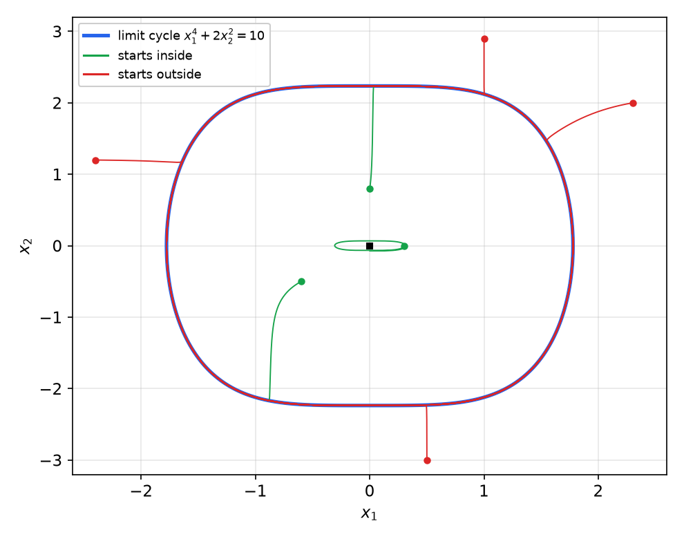
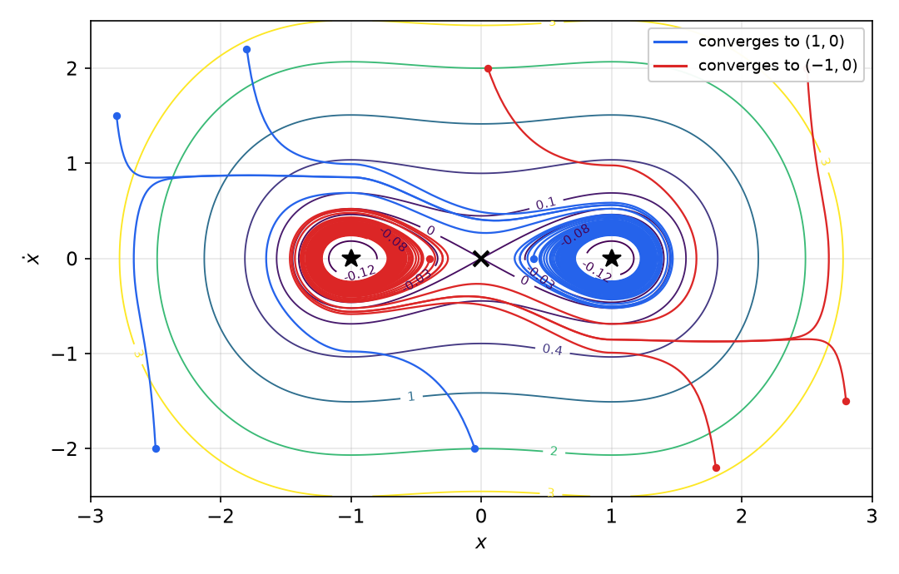
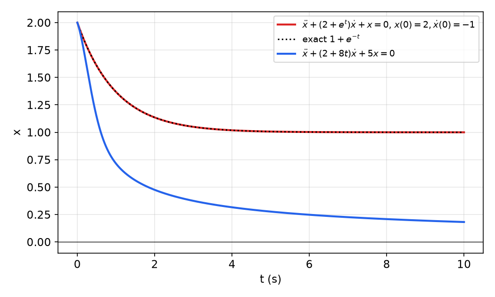
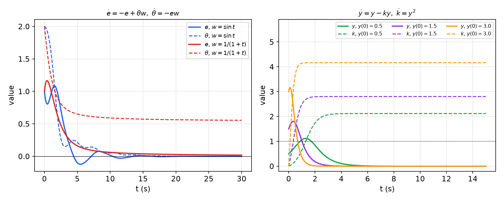
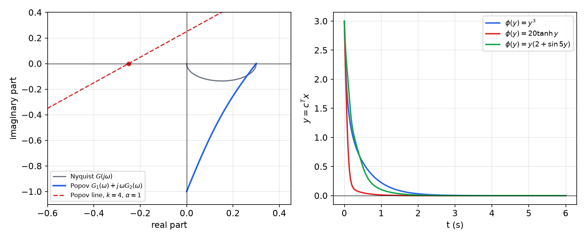
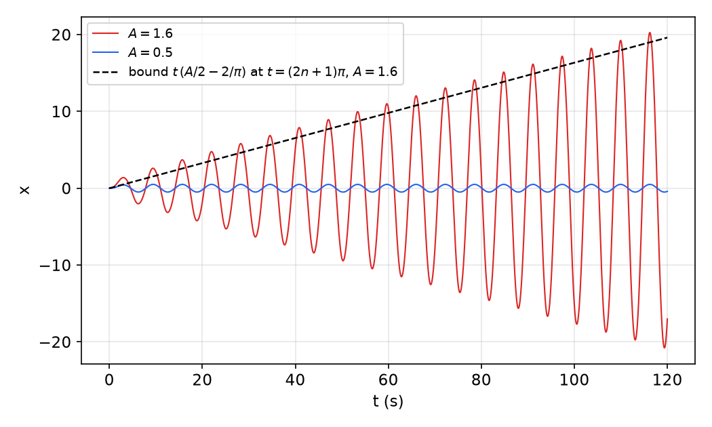

# Invariant Sets, Barbalat's Lemma and Non-Autonomous Systems

Lyapunov's direct method, as developed in [Lyapunov Stability Theory](lyapunov.md), has two gaps that appear constantly in practice. First, the natural Lyapunov function, usually an energy, often has a derivative that is only negative *semi*-definite, because friction dissipates energy only while something moves. Second, many closed loops, including every adaptive controller and every tracking problem, are non-autonomous. This chapter closes both gaps. LaSalle's invariant set theorems extract asymptotic conclusions from a semi-definite \\(\dot V\\) for autonomous systems. Lyapunov's theorem for non-autonomous systems and Barbalat's lemma handle time-varying systems. The chapter then introduces, at an introductory level, the other tools of advanced stability theory: instability and converse theorems, positive real systems and the Kalman–Yakubovich lemma, passivity, absolute stability, and methods for establishing boundedness. [Advanced Lyapunov Theory](lyapunov-advanced.md) and [Passivity](passivity.md) give the rigorous graduate treatment.

## Invariant Sets

**Definition (Invariant set).** A set \\(G\\) is an **invariant set** for a dynamic system if every system trajectory that starts from a point in \\(G\\) remains in \\(G\\) for all future time.

Examples are any equilibrium point, the domain of attraction of an equilibrium, the whole state space, any limit cycle, and indeed any trajectory of an autonomous system. Strictly, the property just defined is *positive* invariance; the theorems below use only this forward-in-time version.

A related notion is the **positive limit set** of a trajectory: the set of points \\(p\\) for which there is a sequence of times \\(t\_k \to \infty\\) with \\(x(t\_k) \to p\\). For an autonomous system with locally Lipschitz \\(f\\), a classical result (Birkhoff) states that a bounded trajectory has a non-empty, compact positive limit set, that the set is invariant, and that the trajectory approaches it as \\(t \to \infty\\). This is the engine of the theorems that follow.

## Local Invariant Set Theorem

**Theorem (Local invariant set theorem, LaSalle).** Consider the autonomous system \\(\dot x = f(x)\\) with \\(f\\) continuous, and let \\(V(x)\\) be a scalar function with continuous first partial derivatives. Assume that

- for some \\(l > 0\\), the region \\(\Omega\_l\\) defined by \\(V(x) < l\\) is bounded, and
- \\(\dot V(x) \le 0\\) for all \\(x\\) in \\(\Omega\_l\\).

Let \\(R\\) be the set of all points within \\(\Omega\_l\\) where \\(\dot V(x) = 0\\), and let \\(M\\) be the largest invariant set in \\(R\\). Then every solution \\(x(t)\\) originating in \\(\Omega\_l\\) tends to \\(M\\) as \\(t \to \infty\\).

Several features deserve emphasis.

- "Largest" means the union of all invariant sets (equilibria, limit cycles and so on) contained in \\(R\\). If \\(R\\) is itself invariant, then \\(M = R\\).
- \\(V\\) need **not** be positive definite. It only has to define a bounded region \\(\Omega\_l\\) on which it does not increase. This is what lets the theorem prove convergence to limit cycles and to sets of equilibria.
- \\(R\\) and \\(M\\) need not be connected.

Picture \\(V\\) as a bowl cut at height \\(l\\). Its projection onto the state space is \\(\Omega\_l\\). Inside it lies the region \\(R\\) where the bowl is "flat along the flow", and inside \\(R\\) the smaller set \\(M\\). Every trajectory starting in \\(\Omega\_l\\) ends up in \\(M\\).

*Proof sketch.* Since \\(\dot V \le 0\\), \\(V(x(t)) \le V(x(0)) < l\\), so the trajectory stays in \\(\Omega\_l\\) and is bounded. \\(V\\) is continuous on the bounded region, hence bounded below, and it is non-increasing, so \\(V(x(t))\\) converges. Because \\(f\\) is continuous, \\(V\\) is continuously differentiable and \\(\Omega\_l\\) is bounded, \\(\dot V(x(t))\\) is uniformly continuous in time. Barbalat's lemma (below) then gives \\(\dot V(x(t)) \to 0\\), so the trajectory approaches \\(R\\). Finally, a bounded trajectory of an autonomous system converges to its positive limit set, which is invariant and, by continuity, lies in \\(R\\); hence it lies in \\(M\\). ∎

The local asymptotic stability theorem of the previous chapter is the special case \\(M = \\{0\\}\\). The most useful form of the theorem is the following.

**Corollary (Asymptotic stability with semi-definite \\(\dot V\\)).** Consider \\(\dot x = f(x)\\) with \\(f\\) continuous, and let \\(V(x)\\) have continuous first partial derivatives. Assume that in a neighbourhood \\(\Omega\\) of the origin

- \\(V(x)\\) is locally positive definite,
- \\(\dot V(x)\\) is negative semi-definite, and
- the set \\(R\\) defined by \\(\dot V(x) = 0\\) contains no trajectory of \\(\dot x = f(x)\\) other than the trivial trajectory \\(x \equiv 0\\).

Then the equilibrium \\(x = 0\\) is asymptotically stable. Furthermore, the largest connected region of the form \\(\Omega\_l\\) (defined by \\(V(x) < l\\)) within \\(\Omega\\) is a domain of attraction of the equilibrium.

The corollary replaces "negative definite" by "negative semi-definite plus a condition on \\(R\\)". The region \\(\Omega\_l\\) it gives is *a* domain of attraction, not necessarily *the* domain of attraction, since \\(V\\) is not unique. And \\(\Omega\\) itself need not be a domain of attraction, because it need not be invariant.

**Example 1 (Mass–damper–spring).** For \\(m\ddot x + b\dot x\lvert \dot x \rvert + k\_0x + k\_1x^3 = 0\\) with the energy \\(V = \frac12m\dot x^2 + \frac12k\_0x^2 + \frac14k\_1x^4\\), the previous chapter found \\(\dot V = -b\lvert \dot x \rvert^3\\). This vanishes on the whole horizontal axis \\(\dot x = 0\\) of the phase plane, so \\(R = \\{\dot x = 0\\}\\). Suppose \\(M\\) contained a point with \\(x \ne 0\\). There the acceleration is
\\[
\ddot x = -\frac{k\_0}{m}x - \frac{k\_1}{m}x^3 \ne 0,
\\]
so \\(\dot x\\) immediately becomes nonzero and the trajectory leaves \\(R\\). That contradicts invariance, so \\(M = \\{0\\}\\) and the origin is asymptotically stable. This is exactly the energy argument made rigorous.

**Example 2 (An explicit domain of attraction).** For the system of [Example 9 of the previous chapter](lyapunov.md#local-stability),
\\[
\dot x\_1 = x\_1(x\_1^2 + x\_2^2 - 2) - 4x\_1x\_2^2, \qquad \dot x\_2 = 4x\_1^2x\_2 + x\_2(x\_1^2 + x\_2^2 - 2),
\\]
take \\(V = x\_1^2 + x\_2^2\\) and \\(l = 2\\). \\(\Omega\_2\\), the open disk of radius \\(\sqrt2\\), is bounded, and \\(\dot V = 2V(V - 2) \le 0\\) on it. \\(R = \\{0\\}\\) is invariant, so every trajectory starting within the circle converges to the origin: the disk is an explicit domain of attraction.

**Example 3 (Attractive limit cycle).** Consider
\\[
\dot x\_1 = x\_2 - x\_1^7\left[x\_1^4 + 2x\_2^2 - 10\right], \qquad \dot x\_2 = -x\_1^3 - 3x\_2^5\left[x\_1^4 + 2x\_2^2 - 10\right].
\\]
*The closed curve \\(x\_1^4 + 2x\_2^2 = 10\\) is invariant.* Let \\(S = x\_1^4 + 2x\_2^2 - 10\\). Then
\\[
\dot S = 4x\_1^3\dot x\_1 + 4x\_2\dot x\_2 = 4x\_1^3x\_2 - 4x\_1^{10}S - 4x\_1^3x\_2 - 12x\_2^6S = -\left(4x\_1^{10} + 12x\_2^6\right)S,
\\]
which is zero on the curve \\(S = 0\\). On the curve the motion reduces to \\(\dot x\_1 = x\_2\\), \\(\dot x\_2 = -x\_1^3\\), which never stops (the origin is the only equilibrium of this reduced system and it is not on the curve). The curve is therefore a limit cycle, traversed clockwise.

*It attracts everything else.* Take \\(V = S^2 = (x\_1^4 + 2x\_2^2 - 10)^2\\), a measure of the "distance" to the cycle. For any \\(l > 0\\), \\(\Omega\_l\\) is bounded, and
\\[
\dot V = 2S\dot S = -8\left(x\_1^{10} + 3x\_2^6\right)\left(x\_1^4 + 2x\_2^2 - 10\right)^2 \le 0 .
\\]
\\(\dot V = 0\\) only on the cycle or where \\(x\_1^{10} + 3x\_2^6 = 0\\), that is, at the origin. Both are invariant, so \\(M\\) is the cycle together with the origin, and every trajectory in \\(\Omega\_l\\) converges to one of the two.

*The origin is unstable.* The linearization \\(\dot x\_1 = x\_2\\), \\(\dot x\_2 = 0\\) is marginal and cannot decide. Instead take \\(l = 100\\). The origin is a local *maximum* of \\(V\\), with \\(V(0) = 100\\), so it does not belong to \\(\Omega\_{100}\\), but every other point inside the cycle does. For trajectories starting in \\(\Omega\_{100}\\), \\(M\\) is now just the cycle. Hence every trajectory starting inside the cycle, except at the origin itself, converges to the cycle, and the origin is unstable.

*Figure: Example 3. The blue curve is the invariant set \\(x\_1^4 + 2x\_2^2 = 10\\). Trajectories started outside (red) and inside (green) all converge to it; the trajectory started near the origin first creeps away along a thin loop before joining the cycle, showing the instability of the origin. Because of the seventh- and fifth-power terms, the approach from outside is very fast.*

## Global Invariant Set Theorem

**Theorem (Global invariant set theorem).** Consider \\(\dot x = f(x)\\) with \\(f\\) continuous, and let \\(V(x)\\) be a scalar function with continuous first partial derivatives. Assume that

- \\(V(x) \to \infty\\) as \\(\lVert x \rVert \to \infty\\), and
- \\(\dot V(x) \le 0\\) over the whole state space.

Let \\(R\\) be the set of all points where \\(\dot V(x) = 0\\), and \\(M\\) the largest invariant set in \\(R\\). Then all solutions globally asymptotically converge to \\(M\\) as \\(t \to \infty\\).

*Proof.* Radial unboundedness makes every \\(\Omega\_l\\) bounded, and every initial state lies in some \\(\Omega\_l\\). Apply the local theorem. ∎

In Example 3, for instance, convergence is global: every trajectory converges to the limit cycle, except the one sitting at the unstable origin. In particular, if \\(M = \\{0\\}\\), the origin is globally asymptotically stable.

**Example 4 (A class of second-order nonlinear systems).** Consider
\\[
\ddot x + b(\dot x) + c(x) = 0,
\\]
where \\(b\\) and \\(c\\) are continuous and satisfy the sign conditions
\\[
\dot x\\,b(\dot x) > 0 \ \ (\dot x \ne 0), \qquad x\\,c(x) > 0 \ \ (x \ne 0) .
\\]
These imply \\(b(0) = c(0) = 0\\). The system can be read as a nonlinear series R–L–C loop carrying current \\(i = \dot x\\): an inductor with voltage \\(\ddot x\\), a resistor with voltage \\(b(\dot x)\\) and a capacitor with voltage \\(c(x)\\), with \\(b\\) the "damping" and \\(c\\) the "spring". In the linear case \\(b = \alpha\_1\dot x\\), \\(c = \alpha\_0x\\), the sign conditions reduce to \\(\alpha\_1 > 0\\), \\(\alpha\_0 > 0\\), which are necessary and sufficient for stability. Take the energy
\\[
V = \frac12\dot x^2 + \int\_0^x c(y)\\,dy,
\\]
which is positive definite. Then
\\[
\dot V = \dot x\ddot x + c(x)\dot x = -\dot x\\,b(\dot x) - \dot x\\,c(x) + c(x)\dot x = -\dot x\\,b(\dot x) \le 0,
\\]
the power dissipated in the resistor. \\(\dot x\\,b(\dot x) = 0\\) only if \\(\dot x = 0\\), and on that line \\(\ddot x = -c(x) \ne 0\\) unless \\(x = 0\\). So \\(M = \\{x = 0, \dot x = 0\\}\\), and the origin is locally asymptotically stable. If in addition \\(\int\_0^x c(r)\\,dr \to \infty\\) as \\(\lvert x \rvert \to \infty\\), then \\(V\\) is radially unbounded and the origin is **globally** asymptotically stable.

For instance, \\(\ddot x + \dot x^3 + x^5 = x^4\sin^2x\\) is GAS. Here \\(b = \dot x^3\\) and \\(c = x^5 - x^4\sin^2x\\), with \\(xc(x) = x^5(x - \sin^2x) > 0\\) for \\(x \ne 0\\) (since \\(\sin^2x < \lvert x \rvert\\)), and \\(\int\_0^xc\\) grows like \\(x^6/6\\). The linearization \\(\ddot x = 0\\) is inconclusive even locally.

**Example 5 (Cubic damping and stiffness).** Show that the origin of \\(\dot x\_1 = x\_2\\), \\(\dot x\_2 = -x\_1^3 - x\_2^3\\) is GAS. Take \\(V = \frac14x\_1^4 + \frac12x\_2^2\\), which is radially unbounded:
\\[
\dot V = x\_1^3x\_2 + x\_2(-x\_1^3 - x\_2^3) = -x\_2^4 \le 0 .
\\]
\\(R = \\{x\_2 = 0\\}\\). At any point \\((x\_1, 0)\\) with \\(x\_1 \ne 0\\), \\(\dot x\_2 = -x\_1^3 \ne 0\\), so the trajectory leaves \\(R\\). Equivalently, \\(\dot V \equiv 0 \Rightarrow x\_2 \equiv 0 \Rightarrow \dot x\_2 = -x\_1^3 \equiv 0 \Rightarrow x\_1 \equiv 0\\). Hence \\(M = \\{0\\}\\) and the origin is GAS by the global invariant set theorem. Its linearization has a double zero eigenvalue and says nothing.

**Example 6 (Liénard equation: two Lyapunov functions).** Consider \\(\ddot y + h(y)\dot y + g(y) = 0\\), with state \\(x\_1 = y\\), \\(x\_2 = \dot y\\):
\\[
\dot x\_1 = x\_2, \qquad \dot x\_2 = -g(x\_1) - h(x\_1)x\_2 .
\\]
The equilibria satisfy \\(x\_2 = 0\\) and \\(g(x\_1) = 0\\), so the origin is an isolated equilibrium if \\(g\\) has an isolated root at zero. Assume \\(yg(y) > 0\\) for \\(y \ne 0\\) in a domain \\(D\\) containing the origin.

*(a) Energy.* Take \\(V = \int\_0^{x\_1}g(y)\\,dy + \frac12x\_2^2\\), positive definite in \\(D\\). Then
\\[
\dot V = g(x\_1)x\_2 + x\_2\left(-g(x\_1) - h(x\_1)x\_2\right) = -h(x\_1)x\_2^2 .
\\]
If \\(h(x\_1) > 0\\) in \\(D\\), \\(\dot V \le 0\\), and \\(\dot V \equiv 0 \Rightarrow x\_2 \equiv 0 \Rightarrow g(x\_1) \equiv 0 \Rightarrow x\_1 \equiv 0\\). The origin is asymptotically stable by the invariance principle.

*(b) A second function.* Take
\\[
V = \frac12\left[x\_2 + \int\_0^{x\_1}h(y)\\,dy\right]^2 + \int\_0^{x\_1}g(y)\\,dy .
\\]
Since \\(\frac{d}{dt}\left[x\_2 + \int\_0^{x\_1}h\right] = \dot x\_2 + h(x\_1)\dot x\_1 = -g(x\_1)\\),
\\[
\dot V = \left[x\_2 + \int\_0^{x\_1}h(y)\\,dy\right]\left(-g(x\_1)\right) + x\_2g(x\_1) = -g(x\_1)\int\_0^{x\_1}h(y)\\,dy .
\\]
If \\(g(x\_1)\int\_0^{x\_1}h(y)dy \ge 0\\), with \\(\int\_0^{x\_1}h \ne 0\\) for \\(x\_1 \ne 0\\) in \\(D\\), then \\(\dot V \le 0\\) and \\(\dot V \equiv 0 \Rightarrow g(x\_1) \equiv 0 \Rightarrow x\_1 \equiv 0 \Rightarrow \dot x\_1 = x\_2 \equiv 0\\). Again asymptotically stable, now under a condition on the *integral* of the damping rather than its sign, which allows locally negative damping.

**Example 7 (Spring and quadratic drag under gravity).** A mass hangs on a spring with linear and quadratic drag: \\(M\ddot y = Mg - ky - c\_1\dot y - c\_2\dot y\lvert \dot y \rvert\\), all parameters positive. The equilibrium is \\(y = Mg/k\\), \\(\dot y = 0\\). With \\(x\_1 = y - Mg/k\\), \\(x\_2 = \dot y\\):
\\[
\dot x\_1 = x\_2, \qquad \dot x\_2 = -\frac kMx\_1 - \frac{c\_1}{M}x\_2 - \frac{c\_2}{M}x\_2\lvert x\_2 \rvert .
\\]
Try \\(V = ax\_1^2 + bx\_2^2\\):
\\[
\dot V = 2\left(a - \frac{bk}{M}\right)x\_1x\_2 - \frac{2bc\_1}{M}x\_2^2 - \frac{2bc\_2}{M}x\_2^2\lvert x\_2 \rvert .
\\]
The choice \\(a = k/2\\), \\(b = M/2\\), which makes \\(V\\) the total energy about the equilibrium, cancels the cross term: \\(\dot V = -c\_1x\_2^2 - c\_2x\_2^2\lvert x\_2 \rvert \le 0\\). As before \\(\dot V \equiv 0 \Rightarrow x\_2 \equiv 0 \Rightarrow x\_1 \equiv 0\\), and \\(V\\) is radially unbounded, so the equilibrium is GAS.

**Example 8 (LaSalle versus linearization).** The closed loop
\\[
\dot x\_1 = x\_2, \qquad \dot x\_2 = -x\_2 - \sin x\_1 - 2(x\_1 + x\_2)
\\]
arises inside the boundary layer of a sliding controller (see [Sliding Control](sliding-control.md)).

*Equilibria.* \\(x\_2 = 0\\) and \\(2x\_1 = -\sin x\_1\\). Since \\(\lvert \sin x\_1 \rvert \le \lvert x\_1 \rvert < 2\lvert x\_1 \rvert\\) for \\(x\_1 \ne 0\\), the only solution is \\(x\_1 = 0\\): the origin is the unique equilibrium.

*Lyapunov.* \\(V = x\_1^2 + \frac12x\_2^2 + 1 - \cos x\_1\\) is positive definite and radially unbounded. Then
\\[
\dot V = (2x\_1 + \sin x\_1)x\_2 + x\_2\left(-x\_2 - \sin x\_1 - 2x\_1 - 2x\_2\right) = -3x\_2^2 \le 0 .
\\]
\\(R = \\{x\_2 = 0\\}\\), and the only invariant set in it is the unique equilibrium (elsewhere on the axis \\(\dot x\_2 = -\sin x\_1 - 2x\_1 \ne 0\\)). By the global invariant set theorem the origin is **GAS**.

*Linearization.* \\(A = \begin{bmatrix} 0 & 1 \\\\ -3 & -3 \end{bmatrix}\\), with \\(\lambda^2 + 3\lambda + 3 = 0\\) and \\(\lambda = -\frac32 \pm j\frac{\sqrt3}{2}\\). This proves only *local* asymptotic stability. The Lyapunov argument gives the stronger, global result.

**Example 9 (Adaptive stabilization).** The plant \\(\dot y = ay + u\\) has an unknown constant \\(a\\). Use the adaptive feedback
\\[
u = -ky, \qquad \dot k = \gamma y^2, \qquad \gamma > 0 .
\\]
Show that \\(y(t) \to 0\\) and that \\(k(t)\\) stays bounded. With \\(x\_1 = y\\), \\(x\_2 = k\\), the closed loop is
\\[
\dot x\_1 = -(x\_2 - a)x\_1, \qquad \dot x\_2 = \gamma x\_1^2 .
\\]
The closed loop has a whole line of equilibria (the \\(k\\) axis), so no Lyapunov function can be positive definite about a single point. Pick any constant \\(b > a\\) and use
\\[
V = \frac12x\_1^2 + \frac{1}{2\gamma}(x\_2 - b)^2,
\\]
which is radially unbounded. (Leaving the parameter error unsquared, as \\(\frac{1}{2\gamma}(x\_2 - b)\\), gives a function that is not bounded below, and the theorem cannot be applied.) Then
\\[
\dot V = -(x\_2 - a)x\_1^2 + (x\_2 - b)x\_1^2 = -(b - a)x\_1^2 \le 0 .
\\]
All trajectories are bounded, so \\(k\\) is bounded. \\(R = \\{x\_1 = 0\\}\\), and on it \\(\dot x\_2 = 0\\), so every point of \\(R\\) is an equilibrium and \\(R\\) itself is invariant. By LaSalle, \\(x(t) \to R\\): **\\(y \to 0\\)**. Since \\(k\\) is nondecreasing and bounded, it converges to a finite limit \\(k\_\infty\\). In fact, dividing \\(\frac{d}{dt}\frac{y^2}{2} = -(k - a)y^2\\) by \\(\dot k = \gamma y^2\\) gives \\(d(y^2/2)/dk = -(k - a)/\gamma\\), which integrates to
\\[
k\_\infty = a + \sqrt{(k(0) - a)^2 + \gamma y(0)^2},
\\]
so the gain settles at a value above \\(a\\) that depends on the initial condition. The constant \\(b\\) appears only in the analysis, never in the controller: the unknown parameter enters the proof, not the implementation.

**Example 10 (Multimodal Lyapunov function).** Consider
\\[
\ddot x + \lvert x^2 - 1 \rvert\\,\dot x^3 + x = \sin\frac{\pi x}{2} .
\\]
Take
\\[
V = \frac12\dot x^2 + \int\_0^x\left(y - \sin\frac{\pi y}{2}\right)dy = \frac12\dot x^2 + \frac{x^2}{2} + \frac2\pi\left(\cos\frac{\pi x}{2} - 1\right).
\\]
Its potential part has two minima at \\(x = \pm1\\), where it equals \\(\frac12 - \frac2\pi \approx -0.137\\), and a local maximum at \\(x = 0\\). In the state space, \\(V\\) has minima at \\((\pm1, 0)\\) and a saddle at the origin. Along trajectories,
\\[
\dot V = \dot x\ddot x + \left(x - \sin\frac{\pi x}{2}\right)\dot x = -\lvert x^2 - 1 \rvert\\,\dot x^4 \le 0 .
\\]
\\(\dot V = 0\\) requires \\(\dot x = 0\\) or \\(x = \pm1\\). If \\(\dot x = 0\\), then \\(\ddot x = \sin(\pi x/2) - x\\), which is nonzero unless \\(x \in \\{0, \pm1\\}\\). On the lines \\(x = \pm1\\) with \\(\dot x \ne 0\\), the trajectory moves off the line at once. So \\(M = \\{(1, 0), (-1, 0), (0, 0)\\}\\). \\(V\\) is radially unbounded, so every trajectory converges to one of these three equilibria. The two at \\(x = \pm1\\) are local minima of \\(V\\), hence stable; with \\(z = x \mp 1\\) their linearizations are \\(\ddot z + \left(1 - \frac\pi2\cos\frac\pi2\right)z = \ddot z + z = 0\\), which are only marginally stable and decide nothing. The origin is unstable: its linearization \\(\ddot x = (\pi/2 - 1)x\\) has a positive eigenvalue, and it is also a local maximum of \\(V\\) along \\(x\\).

*Figure: Example 10. Coloured contours are level sets of \\(V\\), with minima at \\((\pm1, 0)\\) (stars) and a saddle at the origin (cross). Every trajectory converges to one of the two minima, blue to \\((1, 0)\\) and red to \\((-1, 0)\\). Near the minima the damping \\(\lvert x^2 - 1 \rvert\dot x^3\\) is very weak, so the final approach is a slow spiral.*

**Several Lyapunov functions.** If several functions \\(V\_i\\) each satisfy the theorem, every trajectory converges to the intersection of their invariant sets \\(M\_i\\), which is non-empty. Equivalently, \\(V\_1 + V\_2\\) is also a valid function, and its set \\(R\\) is the intersection of the individual sets \\(R\_i\\).

## Stability of Non-Autonomous Systems

Now consider
\\[
\dot x = f(x, t) .
\\]
An equilibrium \\(x\_e\\) must satisfy \\(f(x\_e, t) \equiv 0\\) for all \\(t \ge t\_0\\). The LTV system \\(\dot x = A(t)x\\) has the unique equilibrium \\(x = 0\\) unless \\(A(t)\\) is always singular. Not every time-varying system has an equilibrium. For example, \\(\dot x = -a(t)x/(1 + x^2)\\) has the equilibrium \\(x = 0\\), but \\(\dot x = -a(t)x/(1 + x^2) + b(t)\\) with \\(b(t) \ne 0\\) has none. The second is better treated as a system under the disturbance \\(b(t)\\), using the boundedness tools at the end of this chapter. The definition of an invariant set is unchanged, but a trajectory of a non-autonomous system is generally *not* an invariant set, because a trajectory through the same point at a different time follows a different path. This is why LaSalle's theorems do not carry over.

The stability definitions now carry the initial time \\(t\_0\\).

**Definition (Stability at \\(t\_0\\)).** The equilibrium \\(x = 0\\) is **stable at \\(t\_0\\)** if for any \\(R > 0\\) there exists \\(r(R, t\_0) > 0\\) such that \\(\lVert x(t\_0) \rVert < r\\) implies \\(\lVert x(t) \rVert < R\\) for all \\(t \ge t\_0\\). Otherwise it is unstable.

**Definition (Asymptotic stability at \\(t\_0\\)).** The equilibrium is **asymptotically stable at \\(t\_0\\)** if it is stable and there exists \\(r(t\_0) > 0\\) such that \\(\lVert x(t\_0) \rVert < r(t\_0)\\) implies \\(x(t) \to 0\\) as \\(t \to \infty\\).

**Definition (Exponential stability).** The equilibrium is **exponentially stable** if there exist \\(\alpha, \lambda > 0\\) such that, for sufficiently small \\(x(t\_0)\\),
\\[
\lVert x(t) \rVert \le \alpha\lVert x(t\_0) \rVert e^{-\lambda(t - t\_0)} \qquad \forall t \ge t\_0 .
\\]

**Definition (Global asymptotic stability).** The equilibrium is **globally asymptotically stable** if \\(x(t) \to 0\\) as \\(t \to \infty\\) for every \\(x(t\_0)\\).

**Example 11 (First-order LTV systems).** The solution of \\(\dot x = -a(t)x\\) is
\\[
x(t) = x(t\_0)\exp\left[-\int\_{t\_0}^ta(r)\\,dr\right].
\\]
The origin is stable if \\(a(t) \ge 0\\) for all \\(t \ge t\_0\\); asymptotically stable if, in addition, \\(\int\_0^\infty a(r)dr = +\infty\\); and exponentially stable if there is \\(T > 0\\) with \\(\int\_t^{t+T}a(r)dr \ge \gamma > 0\\) for all \\(t \ge 0\\). Thus:

- \\(\dot x = -x/(1 + t)^2\\) is stable but not asymptotically stable, since \\(\int\_0^\infty(1 + t)^{-2}dt = 1\\);
- \\(\dot x = -x/(1 + t)\\) is asymptotically stable, since the integral diverges logarithmically;
- \\(\dot x = -tx\\) is exponentially stable.

The same reasoning applies to the nonlinear system \\(\dot x = -x/(1 + \sin^2x)\\). Its solution is \\(x(t) = x(t\_0)\exp\left[-\int\_{t\_0}^t\frac{dr}{1 + \sin^2x(r)}\right]\\), and since \\(1 + \sin^2 x \le 2\\), the integral is at least \\((t - t\_0)/2\\): the origin is exponentially stable with rate \\(1/2\\). (Some printings write \\(\sin x^2\\) in the denominator; the intended function is \\(\sin^2x\\).)

### Uniformity

For autonomous systems every stability property is automatically uniform in the initial time. For non-autonomous systems uniformity is an extra requirement, and it matters: only uniform properties survive persistent disturbances.

**Definition (Uniform stability).** The equilibrium \\(x = 0\\) is **locally uniformly stable** if the radius \\(r\\) in the definition of stability can be chosen independently of \\(t\_0\\): \\(r = r(R)\\).

**Definition (Uniform asymptotic stability).** The equilibrium is **locally uniformly asymptotically stable** (UAS) if it is uniformly stable and there is a ball of attraction \\(B\_{R\_0}\\), whose radius does not depend on \\(t\_0\\), such that trajectories starting in it converge to zero uniformly in \\(t\_0\\). Precisely: for all \\(0 < R\_2 < R\_1 \le R\_0\\) there exists \\(T(R\_1, R\_2) > 0\\) such that, for all \\(t\_0 \ge 0\\),
\\[
\lVert x(t\_0) \rVert < R\_1 \implies \lVert x(t) \rVert < R\_2 \quad \forall t \ge t\_0 + T(R\_1, R\_2) .
\\]
If \\(B\_{R\_0}\\) can be replaced by the whole state space, the equilibrium is **globally uniformly asymptotically stable**.

Uniform asymptotic stability implies asymptotic stability, but not conversely. The system \\(\dot x = -x/(1 + t)\\) has the solution
\\[
x(t) = \frac{1 + t\_0}{1 + t}x(t\_0),
\\]
which tends to zero, but the time needed to halve \\(x\\) is \\(1 + t\_0\\), which grows without bound with the initial time: the convergence is not uniform. Exponential stability, as defined above with constants independent of \\(t\_0\\), always implies UAS.

## Lyapunov's Direct Method for Non-Autonomous Systems

The theory needs two new notions for time-varying scalar functions \\(V(x, t)\\).

**Definition (Positive definite function, time-varying).** \\(V(x, t)\\) is **locally positive definite** if \\(V(0, t) = 0\\) and there is a time-invariant positive definite function \\(V\_0(x)\\) such that
\\[
V(x, t) \ge V\_0(x) \qquad \forall t \ge t\_0 .
\\]
In words, \\(V\\) dominates a time-invariant positive definite function. Global positive definiteness and the semi-definite and negative versions are defined in the same way.

**Definition (Decrescent function).** \\(V(x, t)\\) is **decrescent** if \\(V(0, t) = 0\\) and there is a time-invariant positive definite function \\(V\_1(x)\\) such that
\\[
V(x, t) \le V\_1(x) \qquad \forall t \ge 0 .
\\]
In words, \\(V\\) is dominated by a time-invariant positive definite function.

For example, \\(V(x, t) = (1 + \sin^2t)(x\_1^2 + x\_2^2)\\) is positive definite, since it dominates \\(x\_1^2 + x\_2^2\\), and decrescent, since it is dominated by \\(2(x\_1^2 + x\_2^2)\\). The derivative along trajectories now contains an explicit time derivative:
\\[
\dot V = \frac{\partial V}{\partial t} + \frac{\partial V}{\partial x}f(x, t) .
\\]

Both definitions are conveniently expressed with comparison functions.

**Definition (Class K).** A continuous function \\(\alpha: \mathbb R^+ \to \mathbb R^+\\) is of **class K** if \\(\alpha(0) = 0\\), \\(\alpha(p) > 0\\) for \\(p > 0\\), and \\(\alpha\\) is non-decreasing.

Many texts require \\(\alpha\\) to be *strictly* increasing; see [Advanced Lyapunov Theory](lyapunov-advanced.md) for the full theory of class \\(\mathcal K\\), \\(\mathcal K\_\infty\\) and \\(\mathcal{KL}\\) functions.

**Lemma (Class K bounds).** \\(V(x, t)\\) is locally (globally) positive definite if and only if there is a class K function \\(\alpha\\) with \\(V(0, t) = 0\\) and
\\[
V(x, t) \ge \alpha(\lVert x \rVert) \qquad \forall t \ge 0,
\\]
for all \\(x\\) in a ball \\(B\_{R\_0}\\) (the whole space). \\(V\\) is locally (globally) decrescent if and only if there is a class K function \\(\beta\\) with \\(V(0, t) = 0\\) and
\\[
V(x, t) \le \beta(\lVert x \rVert) \qquad \forall t \ge 0 .
\\]

*Proof.* Sufficiency is immediate, because \\(\alpha(\lVert x \rVert)\\) is a time-invariant positive definite function. For necessity, given \\(V\_0\\), define
\\[
\alpha(p) = \inf\_{p \le \lVert x \rVert \le R}V\_0(x),
\\]
which is continuous, non-decreasing, zero at zero and positive for \\(p > 0\\), and satisfies \\(V \ge V\_0 \ge \alpha(\lVert x \rVert)\\). Similarly \\(\beta(p) = \sup\_{\lVert x \rVert \le p}V\_1(x)\\). ∎

**Theorem (Lyapunov theorem for non-autonomous systems).** Suppose that in a neighbourhood of the origin there is a scalar function \\(V(x, t)\\) with continuous first partial derivatives and class K functions \\(\alpha\\), \\(\beta\\), \\(\gamma\\) such that, for all \\(x \ne 0\\) and \\(t \ge 0\\):

1. \\(V(x, t) \ge \alpha(\lVert x \rVert) > 0\\) (\\(V\\) is positive definite);
2. (a) \\(\dot V(x, t) \le 0\\), or (b) \\(\dot V(x, t) \le -\gamma(\lVert x \rVert) < 0\\);
3. \\(V(x, t) \le \beta(\lVert x \rVert)\\) (\\(V\\) is decrescent).

Then:

- conditions 1 and 2(a) imply that the origin is **Lyapunov stable**;
- conditions 1, 2(a) and 3 imply that it is **uniformly stable**;
- conditions 1, 2(b) and 3 imply that it is **uniformly asymptotically stable**;
- if conditions 1, 2(b) and 3 hold in the whole state space and \\(\alpha(\lVert x \rVert) \to \infty\\) as \\(\lVert x \rVert \to \infty\\) (radial unboundedness), it is **globally uniformly asymptotically stable**.

A function satisfying 1 and 2(a) is called a Lyapunov function for the non-autonomous system.

*Proof.* *Stability.* Along any trajectory,
\\[
\alpha(\lVert x(t) \rVert) \le V(x(t), t) \le V(x(t\_0), t\_0) .
\\]
Given \\(R\\), continuity of \\(V(\cdot, t\_0)\\) and \\(V(0, t\_0) = 0\\) give an \\(r\\) such that \\(\lVert x(t\_0) \rVert < r\\) implies \\(V(x(t\_0), t\_0) < \alpha(R)\\), hence \\(\alpha(\lVert x(t) \rVert) < \alpha(R)\\) and \\(\lVert x(t) \rVert < R\\). This \\(r\\) may depend on \\(t\_0\\).

*Uniform stability.* Now \\(\alpha(\lVert x \rVert) \le V \le \beta(\lVert x \rVert)\\). Choose \\(r(R)\\) with \\(\beta(r) < \alpha(R)\\). If \\(\lVert x(t\_0) \rVert < r\\),
\\[
\alpha(R) > \beta(r) \ge V(x(t\_0), t\_0) \ge V(x(t), t) \ge \alpha(\lVert x(t) \rVert),
\\]
so \\(\lVert x(t) \rVert < R\\), and \\(r\\) does not depend on \\(t\_0\\). The two class K bounds squeeze the possibly wildly time-varying \\(V\\) between two fixed curves, and that is what makes \\(r\\) uniform.

*Uniform asymptotic stability.* The idea: if \\(x\\) stayed away from zero, \\(-\dot V\\) would stay above some \\(\varepsilon > 0\\), and \\(V\\) would become negative in finite time. In detail, let \\(\lVert x(t\_0) \rVert < r\\) with \\(r\\) as above, and pick any \\(0 < \mu < r\\). Choose \\(\delta(\mu)\\) with \\(\beta(\delta) < \alpha(\mu)\\), set \\(\varepsilon = \gamma(\delta)\\) and \\(T = \beta(r)/\varepsilon\\). If \\(\lVert x(t) \rVert > \delta\\) on the whole interval \\([t\_0, t\_1]\\), \\(t\_1 = t\_0 + T\\), then
\\[
0 < \alpha(\delta) \le V(x(t\_1), t\_1) \le V(x(t\_0), t\_0) - \int\_{t\_0}^{t\_1}\gamma(\lVert x(s) \rVert)\\,ds \le \beta(r) - T\varepsilon = 0,
\\]
a contradiction. So there is a \\(t\_2 \in [t\_0, t\_1]\\) with \\(\lVert x(t\_2) \rVert \le \delta\\), and for all \\(t \ge t\_2\\),
\\[
\alpha(\lVert x(t) \rVert) \le V(x(t), t) \le V(x(t\_2), t\_2) \le \beta(\delta) < \alpha(\mu),
\\]
so \\(\lVert x(t) \rVert < \mu\\) for all \\(t \ge t\_0 + T\\). \\(T\\) depends on \\(\mu\\) and \\(r\\) but not on \\(t\_0\\).

*Global.* If \\(\alpha\\) is unbounded, then for any \\(r\\), however large, there is an \\(R\\) with \\(\beta(r) < \alpha(R)\\), and the argument applies from any initial state. ∎

**Example 12 (Global asymptotic stability).** Consider
\\[
\dot x\_1 = -x\_1 - e^{-2t}x\_2, \qquad \dot x\_2 = x\_1 - x\_2 .
\\]
Take \\(V(x, t) = x\_1^2 + (1 + e^{-2t})x\_2^2\\). It is positive definite (it dominates \\(x\_1^2 + x\_2^2\\)), decrescent (it is dominated by \\(x\_1^2 + 2x\_2^2\\)) and radially unbounded. Its derivative, including the \\(\partial V/\partial t = -2e^{-2t}x\_2^2\\) term, is
\\[
\begin{aligned}
\dot V &= 2x\_1(-x\_1 - e^{-2t}x\_2) + 2(1 + e^{-2t})x\_2(x\_1 - x\_2) - 2e^{-2t}x\_2^2 \\\\
&= -2\left[x\_1^2 - x\_1x\_2 + x\_2^2(1 + 2e^{-2t})\right] \le -2(x\_1^2 - x\_1x\_2 + x\_2^2) = -(x\_1 - x\_2)^2 - x\_1^2 - x\_2^2,
\end{aligned}
\\]
which is negative definite. The origin is globally uniformly asymptotically stable.

**Example 13 (Why decrescence matters).** Massera's example shows that a positive definite \\(V\\) with a negative definite \\(\dot V\\) does not guarantee asymptotic stability when \\(V\\) is not decrescent. Let \\(g(t)\\) be a continuously differentiable function that coincides with \\(e^{-t/2}\\) except for narrow peaks of height 1 at each integer \\(t = n\\), the \\(n\\)-th peak having width less than \\((1/2)^n\\). Then
\\[
\int\_0^\infty g^2(r)\\,dr < \int\_0^\infty e^{-r}dr + \sum\_{n = 1}^\infty\frac{1}{2^n} = 2 .
\\]
Define
\\[
V(x, t) = \frac{x^2}{g^2(t)}\left[3 - \int\_0^tg^2(r)\\,dr\right].
\\]
Since \\(g \le 1\\) and the bracket exceeds 1, \\(V > x^2\\): \\(V\\) is positive definite. For the system
\\[
\dot x = \frac{\dot g(t)}{g(t)}x,
\\]
a direct computation gives \\(\dot V = -x^2\\), which is negative definite. Yet the solution \\(x(t) = \frac{g(t)}{g(t\_0)}x(t\_0)\\) returns to \\(x(t\_0)/g(t\_0)\\) at every peak, so it does not converge to zero. The trouble is that \\(V\\) is not decrescent: \\(1/g^2(t)\\) is unbounded. Without decrescence, a negative definite \\(\dot V\\) only guarantees a sequence of times \\(t\_i\\) at which \\(x(t\_i) \to 0\\).

### Time-varying damping

For \\(\ddot x + c(t)\dot x + k\_0x = 0\\) with \\(c(t) \ge 0\\), one might expect asymptotic stability whenever the damping is bounded away from zero. This is **not** true if the damping grows too fast. For instance,
\\[
\ddot x + (2 + e^t)\dot x + x = 0, \qquad x(0) = 2,\ \dot x(0) = -1,
\\]
has the solution \\(x(t) = 1 + e^{-t}\\). (Check: \\(\dot x = -e^{-t}\\), \\(\ddot x = e^{-t}\\), and \\(e^{-t} - (2 + e^t)e^{-t} + 1 + e^{-t} = 0\\).) The state gets stuck at \\(x = 1\\): the enormous damping freezes the mass before the spring can return it.

**Example 14 (Asymptotic stability with time-varying damping).** Take
\\[
V(x, t) = \frac{(\dot x + \alpha x)^2}{2} + \frac{b(t)}{2}x^2, \qquad b(t) = k\_0 - \alpha^2 + \alpha c(t), \qquad 0 < \alpha < \sqrt{k\_0},
\\]
so that \\(b(t) \ge k\_0 - \alpha^2 > 0\\). Using \\(\ddot x = -c\dot x - k\_0x\\),
\\[
\begin{aligned}
\dot V &= (\dot x + \alpha x)\left[(\alpha - c)\dot x - k\_0x\right] + b\\,x\dot x + \frac{\dot b}{2}x^2 \\\\
&= (\alpha - c)\dot x^2 + \left[-k\_0 + \alpha^2 - \alpha c + b\right]x\dot x - \alpha k\_0x^2 + \frac{\alpha\dot c}{2}x^2 .
\end{aligned}
\\]
The coefficient of \\(x\dot x\\) vanishes by the choice of \\(b\\), leaving
\\[
\dot V = \left[\alpha - c(t)\right]\dot x^2 + \frac\alpha2\left[\dot c(t) - 2k\_0\right]x^2 .
\\]
If there are constants with \\(c(t) > \alpha\_c > \alpha > 0\\) and \\(\dot c(t) \le \beta < 2k\_0\\), then \\(\dot V\\) is negative definite. If \\(c(t)\\) is also bounded above, \\(V\\) is decrescent, and the origin is uniformly asymptotically stable. The condition \\(\dot c < 2k\_0\\) rules out the exploding damping of the counterexample. A finer analysis shows that the upper bound on \\(c\\) is not actually needed: \\(\ddot x + (2 + 8t)\dot x + 5x = 0\\) is asymptotically stable (\\(\dot c = 8 < 10 = 2k\_0\\)).

*Figure: with damping \\(2 + e^t\\) (red) the state freezes at \\(x = 1\\), following the exact solution \\(1 + e^{-t}\\) (dotted). With damping \\(2 + 8t\\) (blue), whose growth rate respects \\(\dot c < 2k\_0\\), the state does converge to zero, although only slowly: once the damping dominates, \\(x\\) decays roughly like \\(t^{-5/8}\\).*

### Linear time-varying systems

For \\(\dot x = A(t)x\\), the eigenvalues of \\(A(t)\\) do **not** determine stability. The system
\\[
\begin{bmatrix} \dot x\_1 \\\\ \dot x\_2 \end{bmatrix} = \begin{bmatrix} -1 & e^{2t} \\\\ 0 & -1 \end{bmatrix}\begin{bmatrix} x\_1 \\\\ x\_2 \end{bmatrix}
\\]
has eigenvalues \\(-1, -1\\) for every \\(t\\). Yet \\(x\_2 = x\_2(0)e^{-t}\\), and then \\(\dot x\_1 + x\_1 = x\_2(0)e^t\\), whose solution grows like \\(\frac12x\_2(0)e^t\\): the system is unstable.

**A sufficient condition.** The LTV system is (globally exponentially) stable if the eigenvalues of the symmetric matrix \\(A(t) + A^T(t)\\) remain strictly in the left half-plane:
\\[
\exists\lambda > 0,\ \forall i,\ \forall t \ge 0: \quad \lambda\_i\left(A(t) + A^T(t)\right) \le -\lambda .
\\]
*Proof.* With \\(V = x^Tx\\), \\(\dot V = x^T(A + A^T)x \le -\lambda x^Tx = -\lambda V\\), so \\(0 \le x^Tx \le V(0)e^{-\lambda t}\\). ∎ The proof also works if \\(A\\) depends on the state. The condition is only sufficient: for instance \\(A(t) = \begin{bmatrix} -1 & e^{t/2} \\\\ 0 & -1 \end{bmatrix}\\) violates it, yet the system is GAS (now \\(\dot x\_1 + x\_1 = x\_2(0)e^{-t/2}\\), so \\(x\_1\\) decays like \\(e^{-t/2}\\)). The counterexample above violates it too, as it must.

**Perturbed linear systems.** For \\(\dot x = (A\_1 + A\_2(t))x\\) with \\(A\_1\\) constant and Hurwitz, if \\(A\_2(t) \to 0\\) as \\(t \to \infty\\) and \\(\int\_0^\infty\lVert A\_2(t) \rVert dt < \infty\\), the system is globally exponentially stable.

**Example 15 (A cascade).** Consider
\\[
\dot x\_1 = -(5 + x\_2^5 + x\_3^8)x\_1, \qquad \dot x\_2 = -x\_2 + 4x\_3^2, \qquad \dot x\_3 = -(2 + \sin t)x\_3 .
\\]
The last equation is a first-order LTV system with \\(a(t) = 2 + \sin t \ge 1\\), so \\(x\_3 \to 0\\) exponentially. Then \\(x\_3^2\\) is an exponentially decaying input to the stable second equation, so \\(x\_2 \to 0\\) exponentially. Finally the first equation is \\(\dot x\_1 = (-5 + A\_2(t))x\_1\\) with \\(A\_2 = -(x\_2^5 + x\_3^8)\\) decaying exponentially and hence integrable. By the perturbed-system result the whole system is globally exponentially stable.

**Smoothness conditions.** If there is \\(\alpha > 0\\) with \\(\mathrm{Re}\\,\lambda\_i[A(t)] \le -\alpha\\) for all \\(i\\) and \\(t \ge 0\\), and \\(A(t)\\) is bounded with \\(\int\_0^\infty \lVert \dot A(t) \rVert^2 dt < \infty\\), then the system is globally exponentially stable. Frozen-time eigenvalues do tell the truth for slowly varying systems.

### Linearization of non-autonomous systems

For \\(\dot x = f(x, t)\\), let \\(A(t) = (\partial f/\partial x)\_{x = 0}\\) and write \\(\dot x = A(t)x + f\_{\mathrm{h.o.t.}}(x, t)\\). The linear part is a valid linearization only if the higher-order terms are small *uniformly in time*:
\\[
\lim\_{\lVert x \rVert \to 0}\ \sup\_{t \ge 0}\ \frac{\lVert f\_{\mathrm{h.o.t.}}(x, t) \rVert}{\lVert x \rVert} = 0 .
\\]
This can hold even with constant \\(A\\): \\(\dot x = -x + x^2/t\\) linearizes to \\(\dot x = -x\\) for \\(t\\) away from zero. It can also fail: for \\(\dot x = -x + tx^2\\) the coefficient of \\(x^2\\) grows without bound.

**Theorem.** If the linearized system \\(\dot x = A(t)x\\), with the uniformity condition above, is **uniformly** asymptotically stable, then the origin is uniformly asymptotically stable for the original non-autonomous system. Mere asymptotic stability of the linearization allows no conclusion.

**Theorem.** If the Jacobian is constant, \\(A(t) = A\_0\\), and the uniformity condition holds, then the original system is unstable if \\(A\_0\\) has one or more eigenvalues with positive real part.

## Barbalat's Lemma

For non-autonomous systems, finding a \\(V\\) with a negative *definite* derivative is often impossible, and LaSalle's theorems are unavailable. Barbalat's lemma, a purely analytical result about functions of time, partially fills the gap. It is the workhorse of [adaptive control](adaptive-control.md).

### Asymptotic properties of functions and their derivatives

Three facts are easily confused.

- \\(\dot f \to 0\\) does **not** imply that \\(f\\) converges. The function \\(f(t) = \sin(\log t)\\) has \\(\dot f = \cos(\log t)/t \to 0\\) but keeps oscillating, ever more slowly. \\(f(t) = \sqrt t\sin(\log t)\\) is even unbounded.
- \\(f\\) converging does **not** imply \\(\dot f \to 0\\). The function \\(f(t) = e^{-t}\sin(e^{2t})\\) tends to zero, but its derivative is unbounded. This is not caused by sign changes: \\(f(t) = e^{-t}\sin^2(e^{2t}) \ge 0\\) also tends to zero with an unbounded derivative.
- If \\(f\\) is bounded below and non-increasing (\\(\dot f \le 0\\)), then \\(f\\) converges to a limit. This says nothing about whether \\(\dot f \to 0\\).

### The lemma

**Definition (Uniform continuity).** A function \\(g(t)\\) is continuous on \\([0, \infty)\\) if, for every \\(t\_1 \ge 0\\) and \\(R > 0\\), there is \\(\eta(R, t\_1) > 0\\) such that \\(\lvert t - t\_1 \rvert < \eta\\) implies \\(\lvert g(t) - g(t\_1) \rvert < R\\). It is **uniformly continuous** if \\(\eta\\) can be chosen independently of \\(t\_1\\):
\\[
\forall R > 0,\ \exists\eta(R) > 0,\ \forall t\_1, t \ge 0: \quad \lvert t - t\_1 \rvert < \eta \implies \lvert g(t) - g(t\_1) \rvert < R .
\\]

A convenient sufficient condition is that **\\(\dot g\\) is bounded**. If \\(\lvert \dot g \rvert \le R\_1\\), the mean value theorem gives \\(\lvert g(t) - g(t\_1) \rvert = \lvert \dot g(t\_2) \rvert\lvert t - t\_1 \rvert \le R\_1\lvert t - t\_1 \rvert\\) for some \\(t\_2\\) between them, and \\(\eta = R/R\_1\\) works for every \\(t\_1\\).

**Lemma (Barbalat).** If the differentiable function \\(f(t)\\) has a finite limit as \\(t \to \infty\\), and if \\(\dot f\\) is uniformly continuous, then \\(\dot f(t) \to 0\\) as \\(t \to \infty\\).

*Proof.* Suppose not. Then there is \\(\varepsilon\_0 > 0\\) such that for every \\(T > 0\\) some \\(t > T\\) has \\(\lvert \dot f(t) \rvert \ge \varepsilon\_0\\). This gives a sequence \\(t\_i \to \infty\\) with \\(\lvert \dot f(t\_i) \rvert \ge \varepsilon\_0\\). By uniform continuity there is \\(\eta > 0\\) such that \\(\lvert t' - t'' \rvert < \eta\\) implies \\(\lvert \dot f(t') - \dot f(t'') \rvert < \varepsilon\_0/2\\). Hence \\(\lvert \dot f(t) \rvert > \varepsilon\_0/2\\) on each interval \\(\lvert t - t\_i \rvert < \eta\\), and by continuity \\(\dot f\\) keeps one sign there. Therefore
\\[
\left\lvert\int\_{t\_i - \eta}^{t\_i + \eta}\dot f(t)\\,dt\right\rvert = \int\_{t\_i - \eta}^{t\_i + \eta}\lvert \dot f(t) \rvert\\,dt \ge \frac{\varepsilon\_0}{2}\cdot2\eta = \varepsilon\_0\eta
\\]
for every \\(i\\). But \\(\int\_0^t\dot f(r)dr = f(t) - f(0)\\) converges as \\(t \to \infty\\), so the integrals over intervals marching off to infinity must tend to zero. Contradiction. ∎

**Corollary.** If \\(f(t)\\) has a finite limit as \\(t \to \infty\\) and \\(\ddot f\\) exists and is bounded, then \\(\dot f(t) \to 0\\).

**Example 16 (Outputs of stable linear systems are uniformly continuous).** Let \\(\dot x = Ax + Bu\\), \\(y = Cx\\), with \\(A\\) strictly stable and \\(u\\) bounded. Then \\(x\\) is bounded, so \\(\dot x = Ax + Bu\\) is bounded, so \\(\dot y = C\dot x\\) is bounded, and therefore \\(y\\) is uniformly continuous.

Applied to a Lyapunov-like function, Barbalat's lemma reads as follows.

**Lemma (Lyapunov-like lemma).** If a scalar function \\(V(x, t)\\) satisfies

- \\(V(x, t)\\) is bounded below,
- \\(\dot V(x, t)\\) is negative semi-definite, and
- \\(\dot V(x, t)\\) is uniformly continuous in time,

then \\(\dot V(x, t) \to 0\\) as \\(t \to \infty\\).

*Proof.* The first two conditions make \\(V\\) converge to a finite limit \\(V\_\infty \le V(x(0), 0)\\). Barbalat's lemma, using the third, then gives \\(\dot V \to 0\\). ∎

Uniform continuity of \\(\dot V\\) is usually shown by proving that \\(\ddot V\\) is bounded. Lyapunov-like analysis differs from Lyapunov analysis in two ways: \\(V\\) need only be bounded below, not positive definite, and the uniform continuity of \\(\dot V\\) must be checked separately. The difficulty of choosing \\(V\\) remains.

**Example 17 (Adaptive control error dynamics).** The closed-loop error dynamics of an adaptive control system for a first-order plant with one unknown parameter take the form
\\[
\dot e = -e + \theta\\,w(t), \qquad \dot\theta = -e\\,w(t),
\\]
where \\(e\\) is the tracking error, \\(\theta\\) the parameter error and \\(w(t)\\) a bounded continuous function. With \\(V = e^2 + \theta^2\\),
\\[
\dot V = 2e(-e + \theta w) + 2\theta(-ew) = -2e^2 \le 0 .
\\]
So \\(V(t) \le V(0)\\), and \\(e\\) and \\(\theta\\) are bounded. The system is non-autonomous, so the invariant set theorem does not apply. However,
\\[
\ddot V = -4e\dot e = -4e(-e + \theta w)
\\]
is bounded, because \\(e\\), \\(\theta\\) and \\(w\\) are. So \\(\dot V\\) is uniformly continuous, Barbalat's lemma gives \\(\dot V \to 0\\), and therefore **\\(e \to 0\\)**. The system is *not* asymptotically stable in the full state: the analysis shows only that \\(\theta\\) stays bounded. Whether \\(\theta\\) also converges to zero depends on whether \\(w(t)\\) is *persistently exciting*.

*Figure: left, Example 17 from \\(e(0) = 1\\), \\(\theta(0) = 2\\). The tracking error \\(e\\) (solid) tends to zero for both inputs, as Barbalat's lemma predicts. The parameter error \\(\theta\\) (dashed) also tends to zero when \\(w = \sin t\\) is persistently exciting, but settles at a nonzero value when \\(w = 1/(1 + t)\\) dies out. Right, the adaptive stabilizer of Example 9 with \\(a = 1\\), \\(\gamma = 1\\), \\(k(0) = 0\\): \\(y \to 0\\) and the gain \\(k\\) (dashed) settles at \\(1 + \sqrt{1 + y(0)^2}\\), above the critical value \\(a = 1\\) (dotted).*

**Example 18 (Model-reference adaptive control of a mass).** A mass \\(m\ddot x = u\\) with unknown \\(m\\) must follow a reference model output \\(x\_m(t)\\). Let \\(\tilde x = x - x\_m\\), \\(s = \dot{\tilde x} + \lambda\tilde x\\) with \\(\lambda > 0\\), and \\(v = \ddot x\_m - 2\lambda\dot{\tilde x} - \lambda^2\tilde x\\). Use the control \\(u = \hat mv\\) and adaptation law \\(\dot{\hat m} = -\gamma vs\\), and let \\(\tilde m = \hat m - m\\). The closed loop is \\(m\dot s + \lambda ms = \tilde mv\\). With
\\[
V = \frac12\left[ms^2 + \frac1\gamma\tilde m^2\right],
\\]
and \\(\dot{\tilde m} = \dot{\hat m}\\) because \\(m\\) is constant,
\\[
\dot V = ms\dot s + \frac1\gamma\tilde m\dot{\hat m} = s(\tilde mv - \lambda ms) - \tilde mvs = -\lambda ms^2 \le 0 .
\\]
So \\(V\\) converges, and \\(s\\) and \\(\tilde m\\) are bounded. Bounded \\(s\\) means bounded \\(\tilde x\\) and \\(\dot{\tilde x}\\), since \\(\tilde x\\) is \\(s\\) filtered by the stable \\(1/(p + \lambda)\\). With bounded reference signals, \\(v\\) is bounded, so \\(\dot s = \tilde mv/m - \lambda s\\) is bounded, and \\(\ddot V = -2\lambda ms\dot s\\) is bounded. Hence \\(\dot V\\) is uniformly continuous, Barbalat's lemma gives \\(\dot V \to 0\\), and so \\(s \to 0\\), which implies \\(\tilde x \to 0\\) and \\(\dot{\tilde x} \to 0\\). Note the logic: boundedness of \\(\ddot V\\) is what yields uniform continuity of \\(\dot V\\).

## Instability Theorems

The linearization method cannot decide instability when the linearization is marginal, and sometimes it is simply more convenient to work without one. Three instability theorems fill this role. They are stated for non-autonomous systems.

**Theorem (First instability theorem).** If, in a neighbourhood \\(\Omega\\) of the origin, there is a continuously differentiable, decrescent scalar function \\(V(x, t)\\) such that

- \\(V(0, t) = 0\\) for all \\(t \ge t\_0\\),
- \\(V(x, t\_0)\\) can take strictly positive values arbitrarily close to the origin, and
- \\(\dot V(x, t)\\) is positive definite (locally in \\(\Omega\\)),

then the equilibrium at \\(t\_0\\) is unstable.

The second condition is weaker than positive definiteness. For example, \\(V = x\_1^2 - x\_2^2\\) qualifies, since it is positive along \\(x\_2 = 0\\).

**Example 19 (Unstable center-like equilibrium).** Consider
\\[
\dot x\_1 = 2x\_2 + x\_1(x\_1^2 + 2x\_2^4), \qquad \dot x\_2 = -2x\_1 + x\_2(x\_1^2 + x\_2^4) .
\\]
The linearization \\(\dot x\_1 = 2x\_2\\), \\(\dot x\_2 = -2x\_1\\) has eigenvalues \\(\pm2j\\): inconclusive. With \\(V = \frac12(x\_1^2 + x\_2^2)\\), the rotational terms cancel and
\\[
\dot V = x\_1^2(x\_1^2 + 2x\_2^4) + x\_2^2(x\_1^2 + x\_2^4) = (x\_1^2 + x\_2^2)(x\_1^2 + x\_2^4) + x\_1^2x\_2^4,
\\]
which is positive definite. (Some printings omit the last term; it does not change the conclusion.) The origin is unstable.

**Theorem (Second instability theorem).** If, in a neighbourhood \\(\Omega\\) of the origin, there is a continuously differentiable, decrescent scalar function \\(V(x, t)\\) such that \\(V(0, t\_0) = 0\\), \\(V(x, t\_0)\\) can take strictly positive values arbitrarily close to the origin, and
\\[
\dot V(x, t) - \lambda V(x, t) \ge 0 \qquad \forall t \ge t\_0,\ \forall x \in \Omega,
\\]
with \\(\lambda > 0\\), then the equilibrium at \\(t\_0\\) is unstable.

**Example 20.** For
\\[
\dot x\_1 = x\_1 + 3x\_2\sin^2x\_2 + 5x\_1x\_2^2\sin^2x\_1, \qquad \dot x\_2 = 3x\_1\sin^2x\_2 + x\_2 - 5x\_1^2x\_2\cos^2x\_1,
\\]
take \\(V = \frac12(x\_1^2 - x\_2^2)\\). The terms in \\(3x\_1x\_2\sin^2x\_2\\) cancel, and \\(5x\_1^2x\_2^2(\sin^2x\_1 + \cos^2x\_1) = 5x\_1^2x\_2^2\\), so
\\[
\dot V = x\_1^2 - x\_2^2 + 5x\_1^2x\_2^2 = 2V + 5x\_1^2x\_2^2 \ge 2V .
\\]
The second theorem with \\(\lambda = 2\\) shows that the origin is unstable. (Here the linearization, with eigenvalues \\(1, 1\\), also shows it.)

**Theorem (Third instability theorem, Chetaev).** Let \\(\Omega\\) be a neighbourhood of the origin. Suppose there is a scalar function \\(V(x, t)\\) with continuous first partial derivatives, decrescent in \\(\Omega\\), and a region \\(\Omega\_1\\) in \\(\Omega\\) such that

- \\(V(x, t)\\) and \\(\dot V(x, t)\\) are positive definite in \\(\Omega\_1\\),
- the origin is a boundary point of \\(\Omega\_1\\), and
- at the boundary points of \\(\Omega\_1\\) within \\(\Omega\\), \\(V(x, t) = 0\\) for all \\(t \ge t\_0\\).

Then the equilibrium at \\(t\_0\\) is unstable.

The geometry: \\(\Omega\_1\\) is a wedge with its tip at the origin, bounded by the curves where \\(V = 0\\). A trajectory starting inside the wedge, however close to the origin, has \\(V > 0\\) increasing, so it cannot cross the boundary (where \\(V = 0\\)) and cannot approach the origin. It must leave \\(\Omega\\).

**Example 21.** Consider \\(\dot x\_1 = x\_1^2 + x\_2^3\\), \\(\dot x\_2 = -x\_2 + x\_1^3\\). The linearization has eigenvalues \\(0\\) and \\(-1\\): inconclusive. Take \\(V = x\_1 - \frac12x\_2^2\\) and \\(\Omega\_1 = \\{x\_1 > \frac12x\_2^2\\}\\), on which \\(V > 0\\), and on whose boundary \\(V = 0\\). Then
\\[
\dot V = \dot x\_1 - x\_2\dot x\_2 = x\_1^2 + x\_2^3 + x\_2^2 - x\_1^3x\_2 = x\_1^2 + x\_2^2 + \left(x\_2^3 - x\_1^3x\_2\right),
\\]
and near the origin the quadratic terms dominate the quartic and cubic ones, so \\(\dot V > 0\\) in \\(\Omega\_1 \cap B\_r\\) for small \\(r\\). By Chetaev's theorem the origin is unstable. As an exercise, the first instability theorem shows that the inverted pendulum of [the previous chapter](lyapunov.md#lyapunovs-linearization-method) is unstable.

## Existence of Lyapunov Functions

Lyapunov's theorems are sufficient conditions. **Converse theorems** show that they are also, in a sense, necessary: if the equilibrium has a stability property, a Lyapunov function proving it exists. These results do not construct \\(V\\), and were long thought to have no practical value. They are useful nonetheless: if a subsystem is known to be stable, a Lyapunov function for it exists and can be used in building one for the whole system. They underlie the robustness analysis of feedback-linearized and adaptive systems.

**Theorem (Stability).** If the origin of \\(\dot x = f(x, t)\\) is stable, there exists a positive definite function \\(V(x, t)\\) with a non-positive derivative.

**Theorem (Uniform asymptotic stability).** If the origin is uniformly asymptotically stable, there exists a positive definite and decrescent function \\(V(x, t)\\) with a negative definite derivative.

**Theorem (Exponential stability).** If \\(f(x, t)\\) has continuous and bounded first partial derivatives with respect to \\(x\\) and \\(t\\) for all \\(x \in B\_r\\) and \\(t \ge 0\\), then the origin is exponentially stable if and only if there exist a function \\(V(x, t)\\) and constants \\(\alpha\_1, \dots, \alpha\_4 > 0\\) such that, for all \\(x \in B\_r\\) and \\(t \ge 0\\),
\\[
\alpha\_1\lVert x \rVert^2 \le V(x, t) \le \alpha\_2\lVert x \rVert^2, \qquad \dot V \le -\alpha\_3\lVert x \rVert^2, \qquad \left\lVert\frac{\partial V}{\partial x}\right\rVert \le \alpha\_4\lVert x \rVert .
\\]

The proofs build \\(V\\) from the (assumed) solutions, for instance as an integral of \\(\lVert x(\tau) \rVert^2\\) along the trajectory over a finite horizon. The quadratic bounds of the last theorem are exactly what is needed to show that exponential stability survives small perturbations; [Advanced Lyapunov Theory](lyapunov-advanced.md) develops these converse results and their consequences.

## Positive Real Systems

A common structure decomposes a system into a linear part and a nonlinear (or time-varying) part. If the linear part has a property called *positive realness*, a Lyapunov function for the whole system often follows. Throughout, \\(p\\) denotes the Laplace variable.

### PR and SPR transfer functions

Consider a rational transfer function with real coefficients,
\\[
h(p) = \frac{b\_mp^m + b\_{m-1}p^{m-1} + \dots + b\_0}{p^n + a\_{n-1}p^{n-1} + \dots + a\_0}, \qquad n \ge m,
\\]
whose relative degree is \\(n - m\\).

**Definition (Positive real).** \\(h(p)\\) is **positive real** (PR) if
\\[
\mathrm{Re}\left[h(p)\right] \ge 0 \qquad \text{for all } \mathrm{Re}\left[p\right] \ge 0 .
\\]
It is **strictly positive real** (SPR) if \\(h(p - \varepsilon)\\) is positive real for some \\(\varepsilon > 0\\).

A PR function maps the closed right half-plane into the closed right half-plane. The concept comes from circuit theory: the driving-point impedance of any passive RLC network is a positive real rational function.

**Example 22 (A first-order lag).** For \\(h(p) = 1/(p + \lambda)\\) with \\(\lambda > 0\\), put \\(p = \sigma + j\omega\\):
\\[
h(p) = \frac{1}{\sigma + \lambda + j\omega} = \frac{\sigma + \lambda - j\omega}{(\sigma + \lambda)^2 + \omega^2} .
\\]
The real part is non-negative whenever \\(\sigma \ge 0\\), so \\(h\\) is PR. It is also SPR: \\(h(p - \lambda/2) = 1/(p + \lambda/2)\\) is PR.

**Theorem (Frequency-domain test for SPR).** A transfer function \\(h(p)\\) is SPR if and only if

1. \\(h(p)\\) is strictly stable, and
2. \\(\mathrm{Re}\left[h(j\omega)\right] > 0\\) for all \\(\omega \ge 0\\).

(For strictly proper \\(h\\), the second condition is usually supplemented by a condition on the rate at which \\(\mathrm{Re}\\,h(j\omega)\\) decays as \\(\omega \to \infty\\); the simplified form suffices for the examples here.)

Necessary conditions for \\(h\\) to be SPR follow at once:

- \\(h\\) is strictly stable;
- the Nyquist plot of \\(h(j\omega)\\) lies entirely in the right half-plane, so the phase shift never exceeds 90°;
- the relative degree is 0 or 1 (a relative degree of 2 would produce a phase lag approaching 180°);
- \\(h\\) is strictly minimum phase (all zeros strictly in the left half-plane), because \\(1/h\\) must also be SPR.

**Example 23 (Testing for SPR).**

- \\(h\_1 = \dfrac{p - 1}{p^2 + ap + b}\\) is not SPR: it is non-minimum phase.
- \\(h\_2 = \dfrac{p + 1}{p^2 - p + 1}\\) is not SPR: it is unstable.
- \\(h\_3 = \dfrac{1}{p^2 + ap + b}\\) is not SPR: its relative degree is 2.
- \\(h\_4 = \dfrac{p + 1}{p^2 + p + 1}\\) is strictly stable and minimum phase with relative degree 1. On the imaginary axis,
\\[
h\_4(j\omega) = \frac{j\omega + 1}{1 - \omega^2 + j\omega} = \frac{(1 + j\omega)(1 - \omega^2 - j\omega)}{(1 - \omega^2)^2 + \omega^2},
\qquad
\mathrm{Re}\left[h\_4(j\omega)\right] = \frac{1 - \omega^2 + \omega^2}{(1 - \omega^2)^2 + \omega^2} = \frac{1}{(1 - \omega^2)^2 + \omega^2} > 0,
\\]
so \\(h\_4\\) is SPR.

A PR function may have poles on the imaginary axis; an SPR function cannot. The integrator \\(h(p) = 1/p\\) gives \\(h(\sigma + j\omega) = (\sigma - j\omega)/(\sigma^2 + \omega^2)\\), so it is PR but not SPR.

**Theorem (Test for PR).** \\(h(p)\\) is PR if and only if

1. \\(h(p)\\) is stable;
2. its poles on the imaginary axis are simple, with real non-negative residues;
3. \\(\mathrm{Re}\left[h(j\omega)\right] \ge 0\\) for every \\(\omega \ge 0\\) at which \\(j\omega\\) is not a pole.

### The Kalman–Yakubovich lemma

The frequency-domain property of positive realness has an exact state-space counterpart.

**Lemma (Kalman–Yakubovich).** Consider a controllable LTI system
\\[
\dot x = Ax + bu, \qquad y = c^Tx .
\\]
Its transfer function \\(h(p) = c^T(pI - A)^{-1}b\\) is SPR if and only if there exist positive definite matrices \\(P\\) and \\(Q\\) such that
\\[
A^TP + PA = -Q, \qquad Pb = c .
\\]

The first equation says that \\(x^TPx\\) is a Lyapunov function for the free system; the second ties that Lyapunov function to the output. The lemma, also called the *positive real lemma*, extends to PR systems with \\(P\\) positive definite and \\(Q\\) only positive *semi*-definite, which covers pure integrators.

**Lemma (Meyer–Kalman–Yakubovich).** Given a scalar \\(\gamma \ge 0\\), vectors \\(b\\) and \\(c\\), an asymptotically stable \\(A\\) and a symmetric positive definite \\(L\\): if
\\[
H(p) = \frac\gamma2 + c^T(pI - A)^{-1}b
\\]
is SPR, then there exist \\(\varepsilon > 0\\), a vector \\(q\\) and a symmetric positive definite \\(P\\) such that
\\[
A^TP + PA = -qq^T - \varepsilon L, \qquad Pb = c + \sqrt\gamma\\,q .
\\]
This version allows a direct feedthrough term (output \\(y = c^Tx + \frac\gamma2u\\)) and requires only stabilizability rather than controllability.

For square transfer matrices, \\(H(p)\\) (\\(m \times m\\)) is **PR** if its elements are analytic for \\(\mathrm{Re}(p) > 0\\) and \\(H(p) + H^T(p^{\ast})\\) is positive semi-definite for \\(\mathrm{Re}(p) > 0\\), where \\(p^{\ast}\\) is the complex conjugate; it is **SPR** if \\(H(p - \varepsilon)\\) is PR for some \\(\varepsilon > 0\\). Both lemmas extend to this case.

**Example 24 (SPR error equations).** A key result of [adaptive control](adaptive-control.md) states: if
\\[
e(t) = H(p)\left[k\\,\phi^T(t)v(t)\right],
\\]
where \\(H\\) is SPR, \\(k\\) is a constant of known sign, \\(v(t)\\) is a bounded signal vector, and the parameter error \\(\phi\\) is updated by \\(\dot\phi = -\mathrm{sgn}(k)\\,\gamma\\,e\\,v\\) with \\(\gamma > 0\\), then \\(e\\) and \\(\phi\\) are bounded and \\(e \to 0\\).

*Proof.* Take a minimal realization \\(\dot x = Ax + bk\phi^Tv\\), \\(e = c^Tx\\). By the Kalman–Yakubovich lemma there are \\(P, Q > 0\\) with \\(PA + A^TP = -Q\\) and \\(Pb = c\\). Let
\\[
V = x^TPx + \frac{\lvert k \rvert}{\gamma}\phi^T\phi .
\\]
Then, using \\(x^TPb = x^Tc = e\\) and \\(\lvert k \rvert\mathrm{sgn}(k) = k\\),
\\[
\dot V = x^T(PA + A^TP)x + 2x^TPb\\,k\phi^Tv + \frac{2\lvert k \rvert}{\gamma}\phi^T\dot\phi = -x^TQx + 2ek\phi^Tv - 2\lvert k \rvert\mathrm{sgn}(k)\phi^Tev = -x^TQx \le 0 .
\\]
So \\(V\\) is bounded, and with it \\(x\\) and \\(\phi\\). Since \\(v\\) is bounded, \\(\dot x\\) is bounded, so \\(\ddot V = -2x^TQ\dot x\\) is bounded and \\(\dot V\\) is uniformly continuous. Barbalat's lemma gives \\(\dot V \to 0\\), so \\(x \to 0\\) and \\(e = c^Tx \to 0\\). ∎ The output relation \\(Pb = c\\) is what makes the cross term \\(2x^TPb\\,k\phi^Tv\\) equal to \\(2ek\phi^Tv\\), so that it can be cancelled by an adaptation law that uses only the measurable error \\(e\\).

## The Passivity Formalism

Lyapunov functions that are energies should be *additive*: the energy of an interconnection is the sum of the energies of its parts. Passivity formalizes this. It rests on the energy balance
\\[
\frac{d}{dt}\left[\text{stored energy}\right] = \left[\text{external power input}\right] + \left[\text{internal power generation}\right],
\\]
where the external power is the product of an "effort" and a "flow", \\(y^Tu\\). This section is an introduction; [Passivity](passivity.md) gives the full theory.

### Systems in power form

Consider a system with input \\(u\_1\\) and output \\(y\_1\\) for which there are scalar functions \\(V\_1(t)\\) and \\(g\_1(t)\\) such that
\\[
\dot V\_1(t) = y\_1^Tu\_1 - g\_1(t) .
\\]
This form is completely general (one could take \\(g\_1 \equiv 0\\) and \\(V\_1 = \int\_0^ty\_1^Tu\_1dr\\)); what matters are the properties of \\(V\_1\\) and \\(g\_1\\).

**Definition (Passive, dissipative).** A system in power form is **passive**, and \\(u\_1 \mapsto y\_1\\) is a passive mapping, if \\(V\_1\\) is bounded below and \\(g\_1 \ge 0\\). It is **dissipative** if, moreover,
\\[
\int\_0^\infty y\_1^Tu\_1\\,dt \ne 0 \implies \int\_0^\infty g\_1\\,dt > 0 .
\\]

**Feedback interconnection.** Connect two such systems in negative feedback: \\(u\_2 = y\_1\\) and \\(u\_1 = -y\_2\\). Adding the two power balances, the exchanged powers cancel:
\\[
\frac{d}{dt}\left[V\_1 + V\_2\right] = y\_1^Tu\_1 + y\_2^Tu\_2 - (g\_1 + g\_2) = -y\_1^Ty\_2 + y\_2^Ty\_1 - (g\_1 + g\_2) = -\left[g\_1(t) + g\_2(t)\right] .
\\]
If \\(V\_1 + V\_2\\) is bounded below and \\(g\_1 + g\_2 \ge 0\\), then \\(V\_1 + V\_2\\) is bounded above (non-increasing) and \\(\int\_0^\infty(g\_1 + g\_2)dt < \infty\\). If, in addition, \\(g\_1 + g\_2\\) is uniformly continuous, Barbalat's lemma gives \\(g\_1 + g\_2 \to 0\\); in particular, if \\(g\_1\\) and \\(g\_2\\) are both non-negative and uniformly continuous, both tend to zero. More generally, whenever \\(V\_1 + V\_2\\) has a finite limit and \\(g\_1 + g\_2\\) is uniformly continuous, \\(g\_1 + g\_2 \to 0\\).

**Example 25 (A dissipative mechanical system).** For \\(m\ddot x + x^2\dot x^3 + x^7 = F\\),
\\[
\frac{d}{dt}\left[\frac12m\dot x^2 + \frac18x^8\right] = \dot xF - x^2\dot x^4 .
\\]
The mapping from force \\(F\\) to velocity \\(\dot x\\) is dissipative, with \\(V\_1\\) the total energy and \\(g\_1 = x^2\dot x^4\\) the dissipated power.

**Example 26 (A filter followed by a nonlinearity).** Consider
\\[
\dot x + \lambda(t)x = u, \qquad y = h(x),
\\]
with \\(\lambda(t) \ge 0\\) and \\(h\\) a first-and-third-quadrant nonlinearity (\\(xh(x) \ge 0\\)), possibly discontinuous. Then
\\[
\frac{d}{dt}\int\_0^xh(\xi)\\,d\xi = h(x)\dot x = yu - \lambda(t)h(x)x .
\\]
Since \\(\int\_0^xh \ge 0\\) and \\(\lambda hx \ge 0\\), the mapping \\(u \mapsto y\\) is passive, and dissipative if \\(\lambda \not\equiv 0\\). \\(\lambda\\) may also depend on the state: \\(\dot x + x^3 = u\\), \\(y = x - \sin^2x\\) is dissipative.

**Interconnections preserve power form.** For a parallel connection (\\(u\_1 = u\_2 = u\\), \\(y = y\_1 + y\_2\\)) and a feedback connection (\\(u\_1 = u - y\_2\\), \\(u\_2 = y\_1\\), \\(y = y\_1\\)),
\\[
(y\_1 + y\_2)^Tu = y\_1^Tu\_1 + y\_2^Tu\_2, \qquad y\_1^T(u\_1 + y\_2) = y\_1^Tu\_1 + u\_2^Ty\_2 .
\\]
In both cases \\(y^Tu = y\_1^Tu\_1 + y\_2^Tu\_2\\), an instance of Tellegen's theorem. The overall system is therefore in power form with \\(V = \sum\_iV\_i\\) and \\(g = \sum\_ig\_i\\), for any interconnection of this kind and whether or not the subsystems are linear. The whole is passive if \\(\sum\_ig\_i \ge 0\\), even if some blocks are "active" (\\(g\_i < 0\\)). With positive gains in the loop, \\(V = \sum\alpha\_iV\_i\\) and \\(g = \sum\alpha\_ig\_i\\), where \\(\alpha\_i\\) is the product of the input and output gains of block \\(i\\).

**Example 27 (Adaptive control as a passive feedback loop).** In Example 17,
\\[
\frac12\frac{d}{dt}e^2 = e\dot e = e\\,\theta w(t) - e^2,
\\]
so the mapping \\(\theta w(t) \mapsto e\\) is dissipative. The adaptation law \\(\dot\theta = -e\\,w(t)\\) closes the loop with a passive block from \\(e\\) to \\(-\theta w(t)\\), since \\(\frac12\frac{d}{dt}\theta^2 = -\theta w(t)e\\). The sum \\(\frac12(e^2 + \theta^2)\\) is the Lyapunov function of Example 17.

Passivity can also be written with \\(g \equiv 0\\) by moving \\(\int g\\) into \\(V\\): \\(u \mapsto y\\) is passive if
\\[
\exists\alpha > -\infty,\ \forall t \ge 0: \quad \int\_0^ty^T(r)u(r)\\,dr \ge \alpha .
\\]
Passivity is invariant under any change of variables that preserves the power: if \\(y\_a^Tu\_a = y^Tu\\), the two mappings are passive together. For instance, if \\(u \mapsto y\\) is passive, so is \\(Au \mapsto A^{-T}y\\) for any invertible, possibly time-varying \\(A\\).

### Passivity of linear systems

**Theorem.** A strictly stable linear SISO system \\(h(p)\\) is passive if and only if
\\[
\mathrm{Re}\left[h(j\omega)\right] \ge 0 \qquad \forall\omega \ge 0,
\\]
that is, if and only if \\(\lvert \arg h(j\omega) \rvert \le \pi/2\\): its phase shift never exceeds 90°.

*Proof.* Start the system at rest at \\(t = 0\\), apply an arbitrary input on \\([0, t]\\), and set it to zero afterwards. By causality this does not change \\(y\\) on \\([0, t]\\). By Parseval's theorem,
\\[
\int\_0^ty(r)u(r)\\,dr = \int\_{-\infty}^\infty y(r)u(r)\\,dr = \frac{1}{2\pi}\int\_{-\infty}^\infty y(j\omega)u^{\ast}(j\omega)\\,d\omega = \frac{1}{2\pi}\int\_{-\infty}^\infty h(j\omega)\lvert u(j\omega) \rvert^2d\omega .
\\]
Since \\(h(-j\omega)\\) is the complex conjugate of \\(h(j\omega)\\), the imaginary parts cancel between positive and negative frequencies, leaving
\\[
\int\_0^ty(r)u(r)\\,dr = \frac1\pi\int\_0^\infty\mathrm{Re}\left[h(j\omega)\right]\lvert u(j\omega) \rvert^2d\omega .
\\]
If \\(\mathrm{Re}\\,h \ge 0\\) the integral is non-negative and the system is passive. Conversely, if \\(\mathrm{Re}\\,h(j\omega) < 0\\) on some frequency interval, an input with its energy concentrated there makes the integral arbitrarily negative. ∎

The result extends to systems with simple imaginary-axis poles with non-negative residues: **a linear SISO system is passive if and only if it is positive real**. If \\(\mathrm{Re}\left[h(j\omega)\right] > 0\\) for all \\(\omega \ge 0\\) (except possibly at \\(\omega = \infty\\)), the system is dissipative; these are the SPR systems. A MIMO system is passive if \\(H(j\omega) + H^T(-j\omega) \ge 0\\) for all \\(\omega\\), and dissipative if the inequality is strict.

**The Kalman–Yakubovich lemma from passivity.** If \\(A\\) is strictly stable, then for any \\(Q > 0\\) there is \\(P > 0\\) with \\(A^TP + PA = -Q\\). For \\(\dot x = Ax + Bu\\), \\(V = \frac12x^TPx\\) gives
\\[
\dot V = x^TP(Ax + Bu) = x^TPBu - \frac12x^TQx .
\\]
If the output is \\(y = Cx\\) with \\(C = B^TP\\), then \\(x^TPBu = y^Tu\\), and this is a dissipative power form. So any open-loop strictly stable linear system can be made to look dissipative, and SPR, by an infinity of output choices, namely \\(y = B^TPx\\) for each \\(Q > 0\\). In the SISO case this is equivalent to the Kalman–Yakubovich lemma: controllability of \\((A, b)\\) ensures that \\(h(p)\\) characterizes the triple \\((A, b, c)\\), and \\(P > 0\\) with \\((A, b)\\) controllable makes \\((A, c^T) = (A, b^TP)\\) observable.

**Example 28 (Replacing the integrator).** In Example 27 the integrator \\(\dot\theta = -e\\,w(t)\\) makes \\(-e\\,w(t) \mapsto \theta\\) passive, hence \\(e \mapsto -w(t)\theta\\) passive, since \\(\theta\left[-ew\right] = \left[-w\theta\right]e\\). Because only passivity of this block was used, the integrator can be replaced by **any PR transfer function** while still guaranteeing \\(e \to 0\\). The Kalman–Yakubovich lemma gives \\(P > 0\\) and \\(Q \ge 0\\) for a realization of the PR block, leading to a function of the form \\(V = e^2 + P\theta^2 + \int\_0^tQ\theta^2dr\\) (for a scalar state) with \\(\dot V = -2e^2\\), and Barbalat's lemma finishes the argument.

**SPR as dissipation.** The transfer function
\\[
h\_5(p) = \frac{10p}{4p^2 + 5p + 1}
\\]
is the mass–spring–damper \\(4\ddot x + 5\dot x + x = 10u\\) with output \\(y = \dot x\\), the map from force to velocity. It is dissipative and strictly stable, hence SPR. The formalism yields quickly some useful properties: if \\(h\\) is SPR, so is \\(1/h\\); if \\(h\_1\\) and \\(h\_2\\) are SPR, so are \\(\alpha\_1h\_1 + \alpha\_2h\_2\\) (\\(\alpha\_i \ge 0\\), not both zero) and the feedback connection \\(h\_1/(1 + h\_1h\_2)\\). If either \\(h\_1\\) or \\(h\_2\\) is SPR and the other merely passive, the parallel and feedback connections are SPR. Thus new SPR functions are built by placing any stable transfer function with phase shift below 90° in feedback or in parallel with an SPR one.

## Absolute Stability

A classical structure, the **Lur'e system**, has a linear time-invariant forward path \\(G(p)\\) and a memoryless nonlinearity \\(\phi\\) in negative feedback:
\\[
\dot x = Ax - b\\,\phi(y), \qquad y = c^Tx, \qquad G(p) = c^T(pI - A)^{-1}b .
\\]
If \\(\phi(y) = \alpha y\\), stability is decided by the eigenvalues of \\(A - \alpha bc^T\\). For a general \\(\phi\\) it is much harder. The problem of **absolute stability** asks for conditions on \\(G\\) that guarantee global asymptotic stability for every nonlinearity in a given class.

**Definition (Sector).** A continuous function \\(\phi\\) belongs to the **sector** \\([k\_1, k\_2]\\) if there are non-negative numbers \\(k\_1\\) and \\(k\_2\\) such that
\\[
y \ne 0 \implies k\_1 \le \frac{\phi(y)}{y} \le k\_2 .
\\]
The graph of \\(\phi\\) lies between the lines \\(k\_1y\\) and \\(k\_2y\\). This implies \\(\phi(0) = 0\\) and \\(y\phi(y) \ge 0\\). An important special case is the sector \\([0, k]\\): \\(0 \le \phi(y)y \le ky^2\\).

**Aizerman's conjecture** (1949) proposed that if \\(A - bc^Tk\\) is stable for every constant \\(k \in [k\_1, k\_2]\\), the nonlinear system is GAS for every \\(\phi\\) in the sector \\([k\_1, k\_2]\\). It is **false**: counterexamples exist. Linear stability for all gains in the sector is not enough, and frequency-domain conditions stronger than the Nyquist criterion are needed.

**Theorem (Popov criterion).** Suppose that

- \\(A\\) is Hurwitz and \\((A, b)\\) is controllable;
- \\(\phi\\) is in the sector \\([0, k]\\);
- there is \\(\alpha > 0\\) such that, for an arbitrarily small \\(\varepsilon > 0\\),
\\[
\mathrm{Re}\left[(1 + j\alpha\omega)G(j\omega)\right] + \frac1k \ge \varepsilon \qquad \forall\omega \ge 0 .
\\]

Then the origin is globally asymptotically stable.

The proof constructs a Lyapunov function of Lur'e–Postnikov type, a quadratic form plus \\(\alpha\int\_0^y\phi(\sigma)d\sigma\\), and uses the Kalman–Yakubovich lemma to choose the quadratic part. The criterion applies to autonomous systems with a single memoryless, time-invariant nonlinearity; it is a frequency-domain test that needs no explicit Lyapunov function; and it is only sufficient.

**The Popov plot.** Write \\(G(j\omega) = G\_1(\omega) + jG\_2(\omega)\\). The inequality becomes
\\[
G\_1(\omega) - \alpha\omega G\_2(\omega) + \frac1k \ge \varepsilon .
\\]
Define the **Popov plot** \\(W(j\omega) = G\_1(\omega) + j\\,\omega G\_2(\omega)\\), with coordinates \\(X = G\_1\\), \\(Y = \omega G\_2\\). The condition says that \\(W\\) lies (uniformly) to the right of, or below, the straight line \\(X - \alpha Y + 1/k = 0\\), which passes through \\((-1/k, 0)\\) with slope \\(1/\alpha\\). It is the analogue of the Nyquist criterion with the critical point \\(-1\\) replaced by a line.

**Example 29 (Popov criterion).** Let
\\[
G(p) = \frac{p + 3}{p^2 + 7p + 10},
\\]
with \\(\phi\\) in the sector \\([0, k]\\). The poles are \\(-2\\) and \\(-5\\), so \\(G\\) is strictly stable, and the realization is controllable (there is no pole–zero cancellation). Multiplying numerator and denominator by the conjugate of \\(10 - \omega^2 + 7j\omega\\),
\\[
G(j\omega) = \frac{(3 + j\omega)(10 - \omega^2 - 7j\omega)}{(10 - \omega^2)^2 + 49\omega^2}, \qquad
G\_1 = \frac{4\omega^2 + 30}{\omega^4 + 29\omega^2 + 100}, \qquad G\_2 = \frac{-\omega(\omega^2 + 11)}{\omega^4 + 29\omega^2 + 100} .
\\]
The Popov inequality, multiplied by the positive denominator, becomes
\\[
4\omega^2 + 30 + \alpha\omega^2(\omega^2 + 11) + \left(\frac1k - \varepsilon\right)(\omega^4 + 29\omega^2 + 100) > 0,
\\]
which holds for every \\(\alpha > 0\\) and every \\(0 < k < \infty\\) (take \\(\varepsilon < 1/k\\)). The closed loop is therefore GAS for *every* nonlinearity in the first and third quadrants.

*Figure: Example 29. Left: the Nyquist plot of \\(G(j\omega)\\) (grey) and the Popov plot \\(G\_1 + j\omega G\_2\\) (blue). Both lie in the right half-plane or below, entirely to the right of the Popov line through \\(-1/k\\) (shown for \\(k = 4\\), \\(\alpha = 1\\)). As \\(k \to \infty\\) the line passes through the origin and still clears the plot. Right: the output \\(y\\) of the closed loop with three different sector nonlinearities, all converging to zero.*

**Theorem (Circle criterion).** Suppose that \\(A\\) has no eigenvalues on the imaginary axis and \\(\rho\\) eigenvalues strictly in the right half-plane, that \\(\phi\\) is in the sector \\([k\_1, k\_2]\\), and that one of the following holds. Let \\(D(k\_1, k\_2)\\) denote the closed disk in the complex plane whose diameter is the segment from \\(-1/k\_1\\) to \\(-1/k\_2\\) on the real axis.

- \\(0 < k\_1 \le k\_2\\): the Nyquist plot of \\(G(j\omega)\\) does not enter \\(D(k\_1, k\_2)\\) and encircles it \\(\rho\\) times counter-clockwise;
- \\(0 = k\_1 < k\_2\\): the Nyquist plot of \\(G(j\omega)\\) stays in the half-plane \\(\mathrm{Re}\\,p > -1/k\_2\\) (this case requires \\(\rho = 0\\));
- \\(k\_1 < 0 < k\_2\\): the Nyquist plot stays in the interior of \\(D(k\_1, k\_2)\\);
- \\(k\_1 < k\_2 < 0\\): the Nyquist plot of \\(-G(j\omega)\\) does not enter \\(D(-k\_1, -k\_2)\\) and encircles it \\(\rho\\) times counter-clockwise.

Then the origin is globally asymptotically stable.

The critical point \\(-1/k\\) of the Nyquist criterion is replaced by the disk \\(D(k\_1, k\_2)\\), which shrinks to the point \\(-1/k\_1\\) as \\(k\_2 \to k\_1\\). Unlike the Popov criterion, the circle criterion also applies to time-varying nonlinearities \\(\phi(y, t)\\) in the sector, and it is still only sufficient. Both criteria are consequences of the passivity theorem for feedback loops after a loop transformation; see [Passivity](passivity.md). The [describing function](describing-function.md) method addresses the complementary question of predicting limit cycles when such criteria fail.

## Establishing Boundedness of Signals

Lyapunov-like arguments often need a signal to be bounded: to show that \\(\ddot V\\) is bounded for Barbalat's lemma, or to show that a system stays bounded under disturbances. Two tools are standard.

### The Bellman–Gronwall lemma

**Lemma (Bellman–Gronwall).** Let \\(y(t)\\) satisfy
\\[
y(t) \le \int\_0^ta(\tau)y(\tau)\\,d\tau + b(t),
\\]
where \\(a(t) \ge 0\\) and \\(b(t)\\) are known real functions. Then
\\[
y(t) \le \int\_0^ta(\tau)b(\tau)\exp\left[\int\_\tau^ta(r)\\,dr\right]d\tau + b(t) .
\\]
If \\(b\\) is differentiable,
\\[
y(t) \le b(0)\exp\left[\int\_0^ta(\tau)\\,d\tau\right] + \int\_0^t\dot b(\tau)\exp\left[\int\_\tau^ta(r)\\,dr\right]d\tau,
\\]
and if \\(b\\) is constant, \\(y(t) \le b(0)\exp\left[\int\_0^ta(\tau)d\tau\right]\\).

*Proof.* Let \\(v(t) = \int\_0^ta(\tau)y(\tau)d\tau\\). Then \\(\dot v = a(t)y(t) \le a(t)v(t) + a(t)b(t)\\), using \\(a \ge 0\\). Define the slack \\(s(t) = a(t)y(t) - a(t)v(t) - a(t)b(t) \le 0\\), so that \\(\dot v - av = ab + s\\) with \\(v(0) = 0\\). Solving this linear equation,
\\[
v(t) = \int\_0^t\exp\left[\int\_\tau^ta(r)dr\right]\left[a(\tau)b(\tau) + s(\tau)\right]d\tau \le \int\_0^t\exp\left[\int\_\tau^ta(r)dr\right]a(\tau)b(\tau)\\,d\tau,
\\]
since \\(s \le 0\\) and the exponential is positive. The first result follows from \\(y \le v + b\\). For differentiable \\(b\\), integrate by parts, noting that \\(a(\tau)\exp\left[\int\_\tau^ta\right] = -\frac{d}{d\tau}\exp\left[\int\_\tau^ta\right]\\):
\\[
\int\_0^t\exp\left[\int\_\tau^ta\right]a(\tau)b(\tau)\\,d\tau = -b(\tau)\exp\left[\int\_\tau^ta\right]\Big\rvert\_{\tau = 0}^{\tau = t} + \int\_0^t\dot b(\tau)\exp\left[\int\_\tau^ta\right]d\tau,
\\]
and the boundary term is \\(-b(t) + b(0)\exp\left[\int\_0^ta\right]\\). ∎

### Total stability

Consider \\(\ddot x + 2\dot x^3 + 3x = d(t)\\), where \\(d(t)\\) represents unmodeled Coulomb friction, motor torque ripple or parameter variations. Is \\(x\\) bounded when \\(d\\) is bounded? In general, consider a perturbed system and its unperturbed version,
\\[
\dot x = f(x, t) + g(x, t), \qquad \dot x = f(x, t), \qquad f(0, t) = 0,
\\]
where the origin need not be an equilibrium of the perturbed system.

**Definition (Total stability).** The equilibrium \\(x = 0\\) of the unperturbed system is **totally stable** if for every \\(\varepsilon > 0\\) there exist \\(\delta\_1, \delta\_2 > 0\\) such that \\(\lVert x(t\_0) \rVert < \delta\_1\\) and \\(\lVert g(x, t) \rVert < \delta\_2\\) imply that every solution of the perturbed system satisfies \\(\lVert x(t) \rVert < \varepsilon\\) for all \\(t \ge t\_0\\).

Total stability is a local, small-signal version of bounded-input bounded-state stability. For a linear unperturbed system, asymptotic stability implies total stability.

**Theorem.** If the equilibrium of the unperturbed system is uniformly asymptotically stable, then it is totally stable.

The proof uses the converse theorem for UAS: a decrescent Lyapunov function with a negative definite derivative exists, and it continues to decrease outside a small ball when the perturbation is small enough. Asymptotic stability alone is not sufficient; exponential stability is.

**Example 30.** The unperturbed system \\(\ddot x + 2\dot x^3 + 3x = 0\\) is GAS: \\(V = \frac12(\dot x^2 + 3x^2)\\) gives \\(\dot V = -2\dot x^4\\), and the invariant set theorem applies exactly as in Example 4. Being autonomous, it is uniformly asymptotically stable, hence totally stable: it withstands small bounded disturbances \\(d(t)\\).

**Example 31 (Large disturbances can still cause unbounded motion).** Global uniform asymptotic stability does not imply boundedness under *large* bounded perturbations. Consider
\\[
\ddot x + f(\dot x) + x = w(t),
\\]
where \\(f\\) is a continuous first-and-third-quadrant function with \\(\lvert f(y) \rvert \le 1\\), a saturating damper. With \\(V = \frac12(\dot x^2 + x^2)\\), \\(\dot V = -\dot xf(\dot x) \le 0\\), and the invariant set theorem shows that the unperturbed system is GUAS, hence totally stable. Now apply the resonant input \\(w(t) = A\sin t\\) from rest. Treating \\(f(\dot x)\\) as a forcing term of the oscillator \\(\ddot x + x\\),
\\[
x(t) = \frac A2\left(\sin t - t\cos t\right) - \int\_0^t\sin(t - \tau)f(\dot x(\tau))\\,d\tau \ge \frac A2\left(\sin t - t\cos t\right) - \int\_0^t\lvert \sin(t - \tau) \rvert\\,d\tau .
\\]
At \\(t\_n = (2n + 1)\pi\\), \\(\sin t\_n = 0\\), \\(\cos t\_n = -1\\), and \\(\int\_0^{t\_n}\lvert \sin(t\_n - \tau) \rvert d\tau = 2(2n + 1) = 2t\_n/\pi\\). Hence
\\[
x(t\_n) \ge t\_n\left(\frac A2 - \frac2\pi\right) \to \infty \qquad \text{if } A > \frac4\pi .
\\]
(A cruder bound on the integral leads to the sufficient condition \\(A > 8/\pi\\) found in some texts.) Bounded damping cannot absorb the energy pumped in at resonance, which grows linearly with time.

*Figure: Example 31 with \\(f(y) = \mathrm{sat}(y)\\), starting from rest. With \\(A = 1.6 > 4/\pi\\) (red) the amplitude grows without bound, and its peaks at \\(t = (2n + 1)\pi\\) track the linear lower bound \\(t(A/2 - 2/\pi)\\) (dashed). With \\(A = 0.5\\) (blue) the damper never saturates and the response stays bounded.*

### Existence and uniqueness of solutions

All of the above presumes that solutions exist and are unique. Continuity of \\(f\\) guarantees existence but not uniqueness.

**Theorem (Cauchy–Peano existence).** If \\(f(x, t)\\) is continuous in the closed region \\(\lvert t - t\_0 \rvert \le T\\), \\(\lVert x - x\_0 \rVert \le R\\), then \\(\dot x = f(x, t)\\), \\(x(t\_0) = x\_0\\), has at least one solution, continuous over some finite interval \\([t\_0, t\_1]\\), \\(t\_1 > t\_0\\).

For example, \\(\dot y = 3y^{2/3}\\), \\(y(0) = 0\\), has the two solutions \\(y \equiv 0\\) and \\(y = t^3\\).

**Theorem (Uniqueness).** If \\(f(x, t)\\) is continuous in \\(t\\) and there is \\(L > 0\\) such that
\\[
\lVert f(x\_2, t) - f(x\_1, t) \rVert \le L\lVert x\_2 - x\_1 \rVert
\\]
for all \\(x\_1, x\_2\\) in a finite neighbourhood of the origin and all \\(t \in [t\_0, t\_0 + T]\\), then \\(\dot x = f(x, t)\\) has a unique solution for sufficiently small initial states and a sufficiently short time interval.

This is the **Lipschitz condition**, with Lipschitz constant \\(L\\). A function with a continuous, bounded Jacobian is locally Lipschitz, and a globally Lipschitz \\(f\\) has a unique solution for all time. The condition is conservative, and most results simply assume a smooth \\(f\\), as classical physical models provide. The existence of a Lyapunov function is itself closely tied to good behaviour of solutions: with mild smoothness, a Lyapunov function guarantees that solutions exist and stay bounded. See Numerical Methods for ODEs for the computational side.

## Summary

- **Local invariant set theorem (LaSalle):** if \\(\Omega\_l = \\{V < l\\}\\) is bounded and \\(\dot V \le 0\\) on it, every trajectory starting in \\(\Omega\_l\\) converges to the largest invariant set \\(M\\) in \\(R = \\{\dot V = 0\\}\\). \\(V\\) need not be positive definite. If \\(V\\) is positive definite and \\(R\\) contains no trajectory other than \\(x \equiv 0\\), the origin is asymptotically stable with domain of attraction \\(\Omega\_l\\).
- **Global invariant set theorem:** radially unbounded \\(V\\) with \\(\dot V \le 0\\) everywhere gives global convergence to \\(M\\). Typical use: energy functions whose derivative vanishes only where the velocity does.
- **Non-autonomous systems:** stability notions depend on \\(t\_0\\); uniformity matters. \\(\alpha(\lVert x \rVert) \le V(x, t) \le \beta(\lVert x \rVert)\\) and \\(\dot V \le -\gamma(\lVert x \rVert)\\) give uniform asymptotic stability. Decrescence cannot be dropped (Massera), and frozen-time eigenvalues of \\(A(t)\\) do not decide stability.
- **Barbalat's lemma:** a convergent \\(f\\) with uniformly continuous \\(\dot f\\) has \\(\dot f \to 0\\). Lyapunov-like form: \\(V\\) bounded below, \\(\dot V \le 0\\) and \\(\ddot V\\) bounded imply \\(\dot V \to 0\\). It proves error convergence in adaptive control without proving parameter convergence.
- **Instability:** first and second instability theorems and Chetaev's theorem decide marginal cases. **Converse theorems** guarantee that Lyapunov functions exist for stable, UAS and exponentially stable equilibria.
- **Positive realness:** \\(h\\) is SPR iff strictly stable with \\(\mathrm{Re}\\,h(j\omega) > 0\\); Kalman–Yakubovich: SPR \\(\iff\\) \\(A^TP + PA = -Q\\), \\(Pb = c\\) with \\(P, Q > 0\\). A linear SISO system is passive iff it is PR.
- **Passivity:** power form \\(\dot V = y^Tu - g\\); parallel and feedback interconnections add the \\(V\\)'s and \\(g\\)'s.
- **Absolute stability:** Popov, \\(\mathrm{Re}\left[(1 + j\alpha\omega)G(j\omega)\right] + 1/k > 0\\) for sector \\([0, k]\\); circle criterion with the disk \\(D(k\_1, k\_2)\\). Aizerman's conjecture is false.
- **Boundedness:** Bellman–Gronwall lemma; UAS implies total stability, but large bounded inputs can still produce unbounded motion.

## See Also

- [Lyapunov Stability Theory](lyapunov.md): equilibria, the linearization and direct methods, and the Lyapunov equation.
- [Advanced Lyapunov Theory](lyapunov-advanced.md): comparison functions, non-autonomous theory, converse theorems, total stability and ultimate boundedness at graduate level.
- [Passivity](passivity.md): dissipativity, the passivity theorem and loop transformations behind the Popov and circle criteria.
- [Input-to-State Stability](iss.md): the modern framework for systems with inputs and disturbances.
- [Adaptive Control](adaptive-control.md): where Barbalat's lemma and SPR error equations are used systematically.
- [Sliding Control](sliding-control.md) and [Describing Function Analysis](describing-function.md).
- Frequency Response: Nyquist plots, which the Popov and circle criteria generalize.
