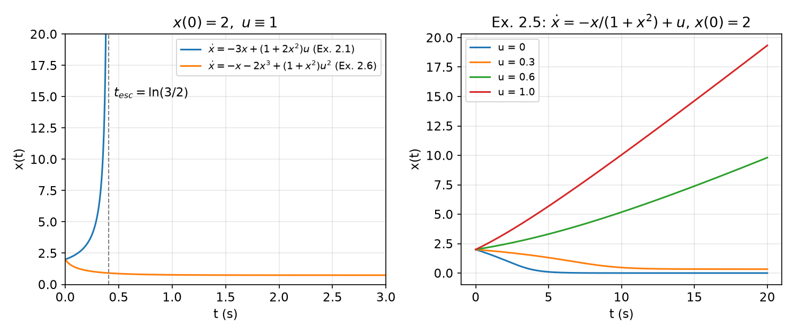
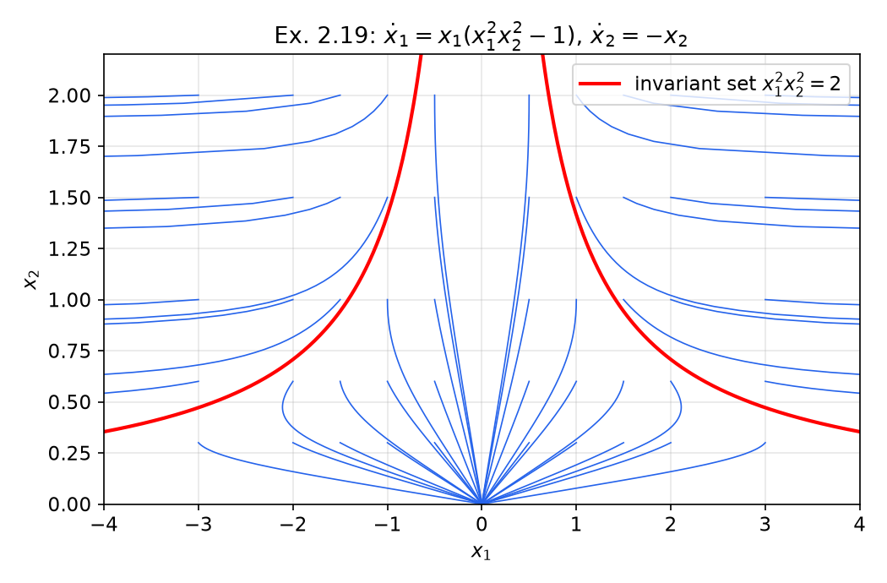
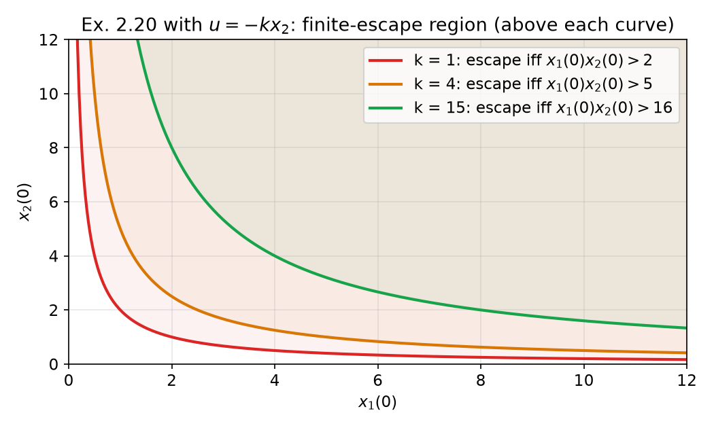
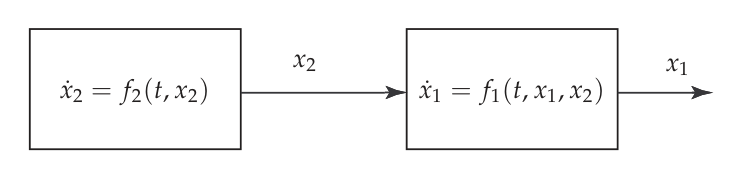
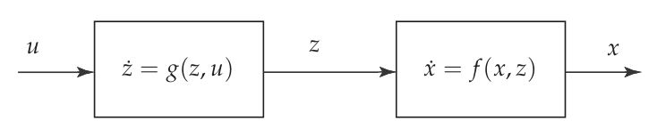
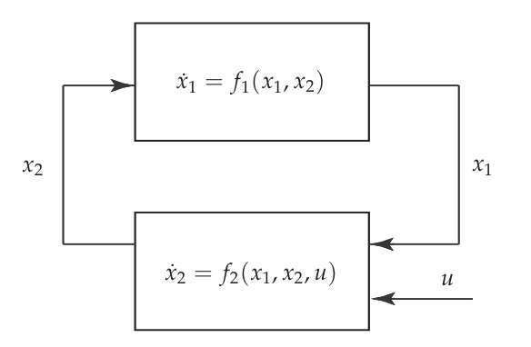
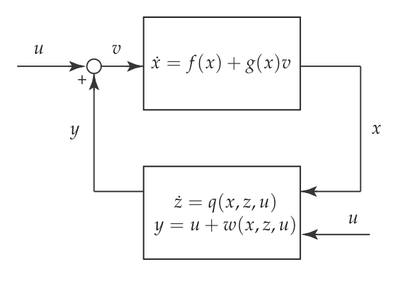

# Input-to-State Stability

Lyapunov theory answers one question: how does a system respond when its *initial condition* is perturbed? A real control system is also driven by inputs it does not choose: actuator errors, measurement noise, disturbances, and the states of other subsystems it is coupled to. **Input-to-state stability** (ISS) is the nonlinear notion of stability with respect to such inputs: bounded inputs produce bounded states, and inputs that die out produce states that converge to the unperturbed equilibrium. This chapter defines ISS, characterizes it through ISS-Lyapunov functions and the Sontag–Wang equivalences, and then uses it as a tool for the analysis of cascade and feedback interconnections, culminating in the ISS small-gain theorem and a robust redesign against unmodeled dynamics. It builds on the comparison functions and uniform stability results of [Advanced Lyapunov Theory](lyapunov-advanced.md); its companion chapter [Passivity and Dissipativity](passivity.md) develops the other great interconnection tool.

## Motivation: Robustness with Respect to Inputs

ISS formalizes robustness with respect to **additive perturbations entering through the input**. Its intuitive content is two implications:

- bounded inputs \\(\Rightarrow\\) bounded states;
- inputs converging to zero \\(\Rightarrow\\) states converging to the unperturbed equilibrium.

The idea is related to the classical notion of total stability (stability under small persistent perturbations, treated in [Advanced Lyapunov Theory](lyapunov-advanced.md)), but ISS is global and does not require the perturbation to be small.

The second motivation is **interconnections**. Large systems are built from subsystems connected in cascade or in feedback. Writing the whole as a single equation \\(\dot x = f(t,x)\\) is usually unwieldy and throws away structure. If each subsystem has a property that is expressed in terms of its own inputs and states, one can hope to conclude stability of the whole from properties of the parts. ISS (and passivity) are exactly such properties.

It is worth contrasting ISS with the older **input–output (operator) approach**, in which a system is a black-box operator between signal spaces such as \\(L\_p\\) or the extended spaces \\(L\_{pe}\\), and stability means that bounded input signals give bounded output signals. That approach needs no state space at all and covers infinite-dimensional systems and systems with memory. ISS keeps the state-space model and Lyapunov arguments instead of operator theory, which makes it directly compatible with the constructive design methods of nonlinear control (backstepping, control Lyapunov functions).

## Systems with Inputs

The general model is
\\[
\dot x = f(t,x,u), \qquad x \in D \subseteq \mathbb{R}^n, \quad u : [t\_0,\infty) \to \mathbb{R}^m,
\\]
with \\(f : [t\_0,\infty)\times D \times \mathbb{R}^m \to \mathbb{R}^n\\) piecewise continuous in \\(t\\) and locally Lipschitz in \\(x\\) and \\(u\\), uniformly in \\(t\\). This is a blanket assumption for the chapter, and unless stated otherwise \\(D = \mathbb{R}^n\\). Inputs are piecewise continuous and bounded, and \\(\lVert u \rVert\_\infty := \sup\_{t \ge t\_0}\lVert u(t)\rVert\\).

Suppose the unforced system \\(\dot x = f(t,x,0)\\) has a globally uniformly asymptotically stable (GUAS) origin. Two natural questions arise:

1. Converging input, converging state: does \\(u(t)\to 0\\) imply \\(x(t)\to 0\\)?
2. Bounded input, bounded state: does a bounded \\(u\\) produce a bounded \\(x\\)?

### The linear case: both answers are yes

Take \\(\dot x = Ax + Bu\\), \\(x(t\_0) = x\_0\\), with \\(A\\) Hurwitz. The solution is
\\[
x(t) = e^{A(t-t\_0)}x(t\_0) + \int\_{t\_0}^{t} e^{A(t-\tau)}Bu(\tau)\\,d\tau .
\\]
Because \\(A\\) is Hurwitz there are constants \\(k \ge 1\\), \\(\lambda > 0\\) with \\(\lVert e^{A(t-t\_0)}\rVert \le k e^{-\lambda(t-t\_0)}\\). Then
\\[
\begin{aligned}
\lVert x(t)\rVert &\le \lVert e^{A(t-t\_0)}x(t\_0)\rVert + \Big\lVert \int\_{t\_0}^{t} e^{A(t-\tau)}Bu(\tau)\\,d\tau \Big\rVert \\\\
&\le k e^{-\lambda(t-t\_0)}\lVert x(t\_0)\rVert + \int\_{t\_0}^{t} k e^{-\lambda(t-\tau)}\lVert B\rVert\\,\lVert u(\tau)\rVert\\,d\tau \\\\
&\le k e^{-\lambda(t-t\_0)}\lVert x(t\_0)\rVert + \frac{k\lVert B\rVert}{\lambda}\big(1 - e^{-\lambda(t-t\_0)}\big)\sup\_{t\_0\le\tau\le t}\lVert u(\tau)\rVert \\\\
&\le k e^{-\lambda(t-t\_0)}\lVert x(t\_0)\rVert + \frac{k\lVert B\rVert}{\lambda}\lVert u\rVert\_\infty .
\end{aligned}
\\]
In the last step the supremum over \\([t\_0,t]\\) was replaced by the supremum over all time; by causality, \\(x(t)\\) depends only on \\(u\\) on \\([t\_0,t]\\), so nothing is lost by using the larger number. Hence
\\[
\lVert x(t)\rVert \le \beta(\lVert x(t\_0)\rVert, t - t\_0) + \gamma(\lVert u\rVert\_\infty),
\qquad \beta(r,s) = k r e^{-\lambda s} \in \mathcal{KL}, \quad \gamma(r) = \frac{k\lVert B\rVert}{\lambda}\\,r \in \mathcal{K}.
\\]
This is the bounded-input, bounded-state property of exponentially stable linear systems: the effect of the initial condition decays, and the state is eventually bounded by a quantity *proportional* to the input bound. Both questions above are answered affirmatively (see [Stability of linear systems](../me6401-linear-control/stability.md)).

### Nonlinear systems: a GES system that escapes in finite time

For nonlinear systems neither implication holds in general, even with exponential stability of the unforced system.

**Example 1 (GES, yet finite escape under a bounded input).** Consider
\\[
\dot x = -3x + (1 + 2x^2)u .
\\]
With \\(u = 0\\) this is \\(\dot x = -3x\\), globally exponentially stable. Now take \\(x(0) = 2\\) and the constant input \\(u(t)\equiv 1\\), so that \\(\dot x = 2x^2 - 3x + 1 = (2x-1)(x-1)\\). Separating variables and using partial fractions,
\\[
\int \frac{dx}{(2x-1)(x-1)} = \ln\left\lvert\frac{x-1}{2x-1}\right\rvert = t + C,
\\]
and \\(x(0)=2\\) gives \\(\frac{x-1}{2x-1} = \frac13 e^{t}\\). Solving for \\(x\\),
\\[
x(t) = \frac{3 - e^{t}}{3 - 2e^{t}}, \qquad t \ge 0 ,
\\]
whose denominator vanishes at \\(t\_{esc} = \ln(3/2) \approx 0.405\\). A unit input drives the state to infinity in finite time. The culprit is the term \\(2x^2u\\): the input gain grows with the state, so the input eventually overwhelms the linear restoring term.

*Figure: left, the GES system of Example 1 escapes at t = ln(3/2) under u = 1 (blue), while the ISS system of Example 3 (orange, with cubic damping) stays bounded and settles near a small value. Right, the system of Example 2 drifts to infinity for any constant input u ≥ 1/2 (u = 0.6 and 1 shown), although it is globally Lipschitz and GAS for u = 0.*

## Input-to-State Stability

### Definition and immediate consequences

Comparison functions are as in [Advanced Lyapunov Theory](lyapunov-advanced.md): \\(\mathcal{K}\\) is the class of continuous, strictly increasing functions \\([0,a)\to[0,\infty)\\) vanishing at zero, \\(\mathcal{K}\_\infty\\) the unbounded ones defined on \\([0,\infty)\\), and \\(\beta\in\mathcal{KL}\\) means \\(\beta(\cdot,s)\in\mathcal{K}\\) for each \\(s\\) and \\(\beta(r,\cdot)\\) decreases to zero for each \\(r\\).

**Definition (Input-to-state stability).** The system \\(\dot x = f(t,x,u)\\) is **input-to-state stable (ISS)** if there exist \\(\beta\in\mathcal{KL}\\) and \\(\gamma\in\mathcal{K}\\) such that for every initial state \\(x(t\_0)\in\mathbb{R}^n\\) and every bounded input \\(u \in L\_\infty\\), the solution \\(x(t)\\) exists for all \\(t\ge t\_0\\) and
\\[
\lVert x(t)\rVert \le \beta(\lVert x(t\_0)\rVert, t-t\_0) + \gamma(\lVert u\rVert\_\infty), \qquad \forall t \ge t\_0 .
\\]
The function \\(\gamma\\) is an **ISS gain**.

The definition is the linear estimate above with \\(\beta\\) and \\(\gamma\\) now allowed to be nonlinear. Several consequences follow at once.

- **Boundedness.** \\(x\\) is bounded for every bounded input, and is *ultimately* bounded by \\(\gamma(\lVert u\rVert\_\infty)\\), a class-\\(\mathcal{K}\\) function of the input bound that does not depend on the initial condition.
- **Unforced stability.** With \\(u = 0\\) the estimate reduces to \\(\lVert x(t)\rVert \le \beta(\lVert x(t\_0)\rVert, t-t\_0)\\), which is exactly the \\(\mathcal{KL}\\) characterization of GUAS. So ISS implies that the unforced system is GUAS.
- **Max form.** Since \\(\max\\{a,b\\} \le a+b \le \max\\{2a,2b\\}\\) for \\(a,b\ge0\\), an equivalent definition (with \\(\beta,\gamma\\) replaced by \\(2\beta, 2\gamma\\)) is
\\[
\lVert x(t)\rVert \le \max\\{\beta(\lVert x(t\_0)\rVert, t - t\_0),\\; \gamma(\lVert u\rVert\_\infty)\\}.
\\]
- **Asymptotic gain.** Because \\(\beta(r,s)\to 0\\) as \\(s\to\infty\\),
\\[
\limsup\_{t\to\infty}\lVert x(t)\rVert \le \gamma(\lVert u\rVert\_\infty),
\\]
and applying the estimate from a late initial time shows that this is equivalent to
\\[
\limsup\_{t\to\infty}\lVert x(t)\rVert \le \gamma\Big(\limsup\_{t\to\infty}\lVert u(t)\rVert\Big).
\\]
In particular \\(u(t)\to 0\\) implies \\(x(t)\to 0\\): converging inputs give converging states.

Local versions (local ISS, where the estimate is required only for small initial states and small inputs) exist; this chapter deals with the global notion.

### ISS-Lyapunov functions

Checking the definition directly requires solving the differential equation. As with Lyapunov stability, the practical route is a function whose derivative along solutions has the right sign.

**Theorem (ISS-Lyapunov sufficient condition).** Let \\(V : [t\_0,\infty)\times\mathbb{R}^n\to\mathbb{R}\\) be continuously differentiable with
\\[
\alpha\_1(\lVert x\rVert) \le V(t,x) \le \alpha\_2(\lVert x\rVert),
\\]
\\[
\frac{\partial V}{\partial t} + \frac{\partial V}{\partial x}f(t,x,u) \le -\alpha\_3(\lVert x\rVert), \qquad \forall\\, \lVert x\rVert \ge \rho(\lVert u\rVert),
\\]
for all \\((t,x,u)\\), where \\(\alpha\_1,\alpha\_2\in\mathcal{K}\_\infty\\) and \\(\alpha\_3,\rho\in\mathcal{K}\\). Then the system is ISS with gain
\\[
\gamma = \alpha\_1^{-1}\circ\alpha\_2\circ\rho .
\\]

*Proof.* Fix an input \\(u\\) and a time \\(t\\), and let \\(\mu = \rho\big(\sup\_{t\_0\le\tau\le t}\lVert u(\tau)\rVert\big)\\). On \\([t\_0,t]\\), \\(\dot V \le -\alpha\_3(\lVert x\rVert)\\) whenever \\(\lVert x\rVert \ge \mu\\). This is precisely the hypothesis of the global uniform ultimate boundedness theorem (see [Advanced Lyapunov Theory](lyapunov-advanced.md)) with radius \\(\mu\\): solutions starting outside the ball of radius \\(\mu\\) decrease \\(V\\) at a uniform rate until they enter the sublevel set \\(\\{V \le \alpha\_2(\mu)\\}\\), which they then never leave because \\(\dot V<0\\) on its boundary; on that set \\(\lVert x\rVert \le \alpha\_1^{-1}(\alpha\_2(\mu))\\). That theorem provides a \\(\beta\in\mathcal{KL}\\) with
\\[
\lVert x(t)\rVert \le \beta(\lVert x(t\_0)\rVert, t-t\_0) + \alpha\_1^{-1}\Big(\alpha\_2\Big(\rho\big(\sup\_{t\_0\le\tau\le t}\lVert u(\tau)\rVert\big)\Big)\Big) \le \beta(\lVert x(t\_0)\rVert, t-t\_0) + \alpha\_1^{-1}\big(\alpha\_2(\rho(\lVert u\rVert\_\infty))\big).
\\]
The same bound shows that solutions cannot escape in finite time, so they exist for all \\(t\ge t\_0\\). ∎

A function satisfying the theorem is an **ISS-Lyapunov function**. Two normalizations are possible without loss of generality: \\(\alpha\_3\\) may be taken in \\(\mathcal{K}\_\infty\\), and the decay can even be taken exponential in \\(V\\), \\(\dot V \le -\lambda V\\) for \\(\lVert x\rVert\ge\rho(\lVert u\rVert)\\) (see the Praly–Wang exponential-decay proposition below).

The geometric picture: outside a ball whose radius grows with the input size, \\(V\\) decreases. A large input can push the state further out, but only to the level set that the ball of radius \\(\rho(\lVert u\rVert)\\) touches, and the gain is the radius of the smallest ball containing that level set.

The first application recovers the linear result for a broad class of nonlinear systems.

**Proposition (GES and global Lipschitz imply ISS).** Suppose \\(f(t,x,u)\\) is continuously differentiable and globally Lipschitz in \\((x,u)\\), uniformly in \\(t\\), and the origin of the unforced system \\(\dot x = f(t,x,0)\\) is globally exponentially stable. Then \\(\dot x = f(t,x,u)\\) is ISS.

*Proof.* By the converse Lyapunov theorem for exponential stability there is a \\(V(t,x)\\) with

1. \\(c\_1\lVert x\rVert^2 \le V(t,x) \le c\_2\lVert x\rVert^2\\),
2. \\(\frac{\partial V}{\partial t} + \frac{\partial V}{\partial x}f(t,x,0) \le -c\_3\lVert x\rVert^2\\),
3. \\(\big\lVert\frac{\partial V}{\partial x}\big\rVert \le c\_4\lVert x\rVert\\).

The Lipschitz property gives \\(\lVert f(t,x,u) - f(t,x,0)\rVert \le L\lVert u\rVert\\). Adding and subtracting \\(f(t,x,0)\\),
\\[
\begin{aligned}
\dot V &= \frac{\partial V}{\partial t} + \frac{\partial V}{\partial x}f(t,x,0) + \frac{\partial V}{\partial x}\big[f(t,x,u) - f(t,x,0)\big] \\\\
&\le -c\_3\lVert x\rVert^2 + c\_4 L\lVert x\rVert\\,\lVert u\rVert \\\\
&= -c\_3(1-\theta)\lVert x\rVert^2 - \lVert x\rVert\big(c\_3\theta\lVert x\rVert - c\_4L\lVert u\rVert\big), \qquad 0<\theta<1, \\\\
&\le -c\_3(1-\theta)\lVert x\rVert^2, \qquad \forall\\,\lVert x\rVert \ge \frac{c\_4L}{c\_3\theta}\lVert u\rVert .
\end{aligned}
\\]
The ISS-Lyapunov theorem applies with \\(\rho(r) = \frac{c\_4L}{c\_3\theta}r\\), \\(\alpha\_1(r) = c\_1r^2\\), \\(\alpha\_2(r) = c\_2r^2\\), giving the linear gain
\\[
\gamma(r) = \sqrt{\frac{c\_2}{c\_1}}\\,\frac{c\_4L}{c\_3\theta}\\,r . \qquad ∎
\\]

The function in Example 1 is not globally Lipschitz (because of \\(2x^2u\\)), which is why the proposition does not apply there. Exponential stability is also essential:

**Example 2 (GES cannot be weakened to GAS).** Consider
\\[
\dot x = -\frac{x}{1+x^2} + u .
\\]
Here \\(f\\) is globally Lipschitz (the derivative of \\(x/(1+x^2)\\) is bounded by 1), and the unforced system \\(\dot x = -x/(1+x^2)\\) is GAS and locally exponentially stable, but not globally exponentially stable: the restoring term decays like \\(1/x\\) for large \\(x\\). The system is not ISS. With \\(u\equiv 1\\), since \\(x/(1+x^2)\le\frac12\\) for all \\(x\\),
\\[
\dot x = 1 - \frac{x}{1+x^2} \ge \frac12 \quad\Longrightarrow\quad x(t) \ge x(0) + \frac{t}{2},
\\]
which is unbounded. The bounded restoring force cannot balance a constant input larger than its maximum \\(\tfrac12\\) (right panel of the figure above).

**Example 3 (An ISS system with a quadratic gain).** Consider
\\[
\dot x = -x - 2x^3 + (1+x^2)u^2 .
\\]
The unforced system \\(\dot x = -x - 2x^3\\) is GES. With \\(V = \frac12x^2\\),
\\[
L\_fV = -x^2 - 2x^4 + x(1+x^2)u^2 = -x(x - u^2) - x^4 - x^3(x - u^2).
\\]
If \\(\lvert x\rvert \ge u^2\\), then \\(x(x-u^2)\ge0\\) (for \\(x\ge u^2\\) both factors are nonnegative; for \\(x\le -u^2\\) both are nonpositive) and \\(x^3(x-u^2) = x^2\cdot x(x-u^2) \ge 0\\). Hence
\\[
L\_fV \le -x^4, \qquad \forall\\,\lvert x\rvert \ge u^2 = \rho(\lvert u\rvert).
\\]
Since \\(\alpha\_1 = \alpha\_2 = \frac12r^2\\), the system is ISS with gain \\(\gamma(r) = \alpha\_1^{-1}(\alpha\_2(\rho(r))) = r^2\\). Note that the cubic damping \\(-2x^3\\) dominates the \\(x^2u^2\\) term for large \\(x\\); that is what Example 1 lacked. (In the figure above the orange curve uses \\(u=1\\).)

**Example 4 (A two-state system, with the gain computed).** Consider
\\[
\dot x\_1 = -x\_1 + x\_2^2, \qquad \dot x\_2 = -x\_2 + u .
\\]
Take \\(V = \frac12x\_1^2 + \frac14x\_2^4\\). Then
\\[
L\_fV = -x\_1^2 + x\_1x\_2^2 - x\_2^4 + x\_2^3u = -\tfrac12(x\_1 - x\_2^2)^2 - \tfrac12(x\_1^2 + x\_2^4) + x\_2^3u,
\\]
as one checks by expanding the square. For \\(u=0\\), completing the square differently,
\\[
L\_fV = -\big(x\_1 - \tfrac12x\_2^2\big)^2 - \tfrac34x\_2^4 ,
\\]
which is negative definite; \\(V\\) is radially unbounded, so the unforced system is GAS. With \\(u\ne0\\), drop the first square and split the second term with \\(0<\theta<1\\):
\\[
L\_fV \le -\tfrac12(1-\theta)(x\_1^2 + x\_2^4) - \tfrac12\theta(x\_1^2 + x\_2^4) + \lvert x\_2\rvert^3\lvert u\rvert .
\\]
The last two terms together are nonpositive in two cases:

- if \\(\lvert x\_2\rvert \ge 2\lvert u\rvert/\theta\\), then \\(\frac12\theta x\_2^4 \ge \lvert x\_2\rvert^3\lvert u\rvert\\);
- if \\(\lvert x\_2\rvert \le 2\lvert u\rvert/\theta\\) and \\(\lvert x\_1\rvert \ge (2\lvert u\rvert/\theta)^2\\), then \\(\frac12\theta x\_1^2 \ge \frac12\theta(2\lvert u\rvert/\theta)^4 = (2\lvert u\rvert/\theta)^3\lvert u\rvert \ge \lvert x\_2\rvert^3\lvert u\rvert\\).

Both cases are covered by
\\[
\lVert x\rVert\_\infty = \max\\{\lvert x\_1\rvert,\lvert x\_2\rvert\\} \ge \max\left\\{\frac{2\lvert u\rvert}{\theta}, \Big(\frac{2\lvert u\rvert}{\theta}\Big)^2\right\\} =: \rho(\lvert u\rvert),
\\]
on which \\(L\_fV \le -\frac12(1-\theta)(x\_1^2 + x\_2^4)\\). Since \\(\rho\in\mathcal{K}\\), the system is ISS (all norms on \\(\mathbb{R}^2\\) being equivalent, using \\(\lVert\cdot\rVert\_\infty\\) is harmless).

To compute the gain we need \\(\alpha\_1,\alpha\_2\\) in terms of \\(\lVert x\rVert\_\infty\\). From above, \\(V \le \frac12\lVert x\rVert\_\infty^2 + \frac14\lVert x\rVert\_\infty^4\\). From below, if \\(\lvert x\_2\rvert\le\lvert x\_1\rvert\\) then \\(V \ge \frac12\lVert x\rVert\_\infty^2\\), and if \\(\lvert x\_2\rvert \ge \lvert x\_1\rvert\\) then \\(V \ge \frac14\lVert x\rVert\_\infty^4\\). So
\\[
\alpha\_1(r) = \min\\{r^2/2,\\; r^4/4\\}, \qquad \alpha\_2(r) = r^2/2 + r^4/4, \qquad \gamma = \alpha\_1^{-1}\circ\alpha\_2\circ\rho,
\\]
where, since \\(r^4/4 \le r^2/2\\) exactly when \\(r\le\sqrt2\\) (that is, when \\(\alpha\_1\le 1\\)),
\\[
\alpha\_1^{-1}(s) = \begin{cases} (4s)^{1/4}, & s\le 1,\\\\ (2s)^{1/2}, & s\ge 1. \end{cases}
\\]

### ISS is much stronger than GAS plus bounded-input bounded-state

ISS mimics the bounded-input, bounded-state behaviour of stable linear systems, but for nonlinear systems it is strictly stronger than "GAS when \\(u=0\\), and bounded state for bounded input."

**Example 5.** Consider \\(\dot x = (\sin^2 u - 1)x\\), \\(x(0) = x\_0\\). For \\(u = 0\\), \\(\dot x = -x\\) is GAS. For any input, \\(\sin^2u - 1 \le 0\\), so \\(\lvert x(t)\rvert \le \lvert x\_0\rvert\\): bounded inputs give bounded states. But the constant input \\(u = \pi/2\\) gives \\(\dot x = 0\\) and \\(x(t) = x\_0\\) for all time. The state is not ultimately bounded by any function of the input size that is independent of \\(x\_0\\), so the system is not ISS.

Two remarks put the definition in perspective. First, ISS is a *global* property and not a "small perturbation" robustness: inputs can be arbitrarily large, and the gain is only required to be a class-\\(\mathcal{K}\\) function (usually \\(\mathcal{K}\_\infty\\)). Second, a useful analogy is that ISS plays for nonlinear systems the role that exponential stability plays for linear ones: an exponentially stable linear system remains stable under sufficiently small perturbations of its dynamics, and its state response to inputs is bounded by a gain. From here on the systems are mostly time-invariant, \\(\dot x = f(x,u)\\).

## Characterizations of ISS

### The dissipation form

The ISS-Lyapunov condition is stated as an implication ("\\(\dot V<0\\) whenever \\(\lVert x\rVert\\) is large relative to \\(\lVert u\rVert\\)"). An equivalent form states it as a single inequality, a dissipation inequality whose supply rate is \\(\alpha\_4(\lVert u\rVert) - \alpha\_3(\lVert x\rVert)\\). This form connects ISS with the dissipativity framework of the [next chapter](passivity.md).

**Theorem (Dissipation characterization of ISS-Lyapunov functions).** For \\(\dot x = f(x,u)\\), a continuously differentiable \\(V\\) is an ISS-Lyapunov function if and only if there exist \\(\alpha\_1,\alpha\_2,\alpha\_3\in\mathcal{K}\_\infty\\) and \\(\alpha\_4\in\mathcal{K}\\) such that
\\[
\alpha\_1(\lVert x\rVert) \le V(x) \le \alpha\_2(\lVert x\rVert),
\\]
\\[
L\_fV(x,u) = \frac{\partial V}{\partial x}f(x,u) \le -\alpha\_3(\lVert x\rVert) + \alpha\_4(\lVert u\rVert), \qquad \forall x, u.
\\]

*Proof.* (\\(\Leftarrow\\)) Fix \\(k>1\\) and set \\(\rho(r) = \alpha\_3^{-1}(k\alpha\_4(r))\\), which is class \\(\mathcal{K}\\) because \\(\alpha\_3\in\mathcal{K}\_\infty\\). If \\(\lVert x\rVert \ge \rho(\lVert u\rVert)\\), then \\(\alpha\_3(\lVert x\rVert) \ge k\alpha\_4(\lVert u\rVert)\\), so
\\[
L\_fV \le -\alpha\_3(\lVert x\rVert) + \frac1k\alpha\_3(\lVert x\rVert) = -\frac{k-1}{k}\alpha\_3(\lVert x\rVert),
\\]
which is the ISS-Lyapunov condition.

(\\(\Rightarrow\\)) Suppose \\(L\_fV \le -\alpha\_3(\lVert x\rVert)\\) for \\(\lVert x\rVert \ge \rho(\lVert u\rVert)\\). In that region the dissipation inequality holds with any nonnegative \\(\alpha\_4\\). In the complementary region \\(\lVert x\rVert \le \rho(\lVert u\rVert)\\), which is compact for each fixed \\(\lVert u\rVert\\), define
\\[
\varphi(r) := \max\_{\lVert u\rVert = r,\\ \lVert x\rVert \le \rho(r)} \Big[\frac{\partial V}{\partial x}f(x,u) + \alpha\_3(\rho(\lVert u\rVert))\Big].
\\]
Then for \\(\lVert x\rVert\le\rho(\lVert u\rVert)\\), using \\(\alpha\_3(\lVert x\rVert) \le \alpha\_3(\rho(\lVert u\rVert))\\),
\\[
L\_fV \le -\alpha\_3(\rho(\lVert u\rVert)) + \varphi(\lVert u\rVert) \le -\alpha\_3(\lVert x\rVert) + \varphi(\lVert u\rVert).
\\]
The function \\(\alpha\_4(r) := \max\\{0,\varphi(r)\\}\\) is continuous, nonnegative and satisfies \\(\alpha\_4(0) = 0\\) (at \\(u=0\\) the max is over \\(x=0\\), where \\(f(0,0)=0\\)); if it is not strictly increasing it can be majorized by a class-\\(\mathcal{K}\\) function. Both regions are then covered. (If the given \\(\alpha\_3\\) is only class \\(\mathcal{K}\\), it can be replaced by a \\(\mathcal{K}\_\infty\\) function, as noted after the ISS-Lyapunov theorem.) ∎

The pair \\(\\{\alpha\_3,\alpha\_4\\}\\) is called an **ISS pair**. Combining the (\\(\Leftarrow\\)) construction with the ISS-Lyapunov theorem, an ISS gain is
\\[
\gamma = \alpha\_1^{-1}\circ\alpha\_2\circ\rho, \qquad \rho = \alpha\_3^{-1}\circ(k\\,\alpha\_4), \quad k>1 .
\\]

### Feedback equivalence and robust stability

ISS is not invariant under feedback, but every globally stabilizable system can be made ISS by a suitable input transformation.

**Definition (Feedback equivalence).** The system \\(\dot x = f(x,u)\\) is **feedback equivalent** to \\(\dot x = g(x,v)\\) if there exist \\(\alpha : \mathbb{R}^n\to\mathbb{R}^m\\) and \\(\beta : \mathbb{R}^n \to \mathbb{R}^{m\times m}\\), with \\(\beta(x)\\) invertible for all \\(x\\), such that
\\[
g(x,v) = f\big(x, \alpha(x) + \beta(x)v\big).
\\]

**Theorem (Input rescaling makes GAS systems ISS).** If \\(x\_e = 0\\) is GAS for \\(\dot x = f(x,0)\\), there exists a smooth, everywhere nonsingular \\(\beta(x)\in\mathbb{R}^{m\times m}\\) such that
\\[
\dot x = f\big(x, \beta(x)v\big)
\\]
is ISS with respect to \\(v\\).

Thus a GAS system that is not ISS is feedback equivalent to one that is. The idea is to shrink the effect of the input where it is dangerous (for large \\(\lVert x\rVert\\)); the construction of \\(\beta\\) is not obvious in general. Combining with the definition of stabilizability:

**Corollary.** A system is globally asymptotically stabilizable by smooth feedback if and only if it is feedback equivalent to an ISS system.

ISS can also be read as a *robustness margin* against feedback perturbations.

**Definition (Robust stability).** The system \\(\dot x = f(x,u)\\) is **robustly stable** if there exist \\(\rho\in\mathcal{K}\_\infty\\), called a **stability margin**, and \\(\beta\in\mathcal{KL}\\) such that
\\[
\lVert x(t)\rVert \le \beta(\lVert x(0)\rVert, t), \qquad \forall t\ge0,
\\]
for all (possibly time-varying) feedbacks \\(u = \kappa(t,x)\\) with \\(\lVert \kappa(t,x)\rVert \le \rho(\lVert x\rVert)\\), where \\(x(t)\\) is the closed-loop solution. In words, uniform global asymptotic stability is maintained under every feedback perturbation bounded by a \\(\mathcal{K}\_\infty\\) function of the state.

**Theorem.** \\(\dot x = f(x,u)\\) is ISS if and only if it is robustly stable.

The direction "ISS \\(\Rightarrow\\) robustly stable" can be seen with an ISS-Lyapunov function: if \\(\dot V \le -\alpha\_3(\lVert x\rVert)\\) whenever \\(\lVert x\rVert\ge\rho(\lVert u\rVert)\\), then any feedback with \\(\lVert u\rVert \le \rho^{-1}(\lVert x\rVert)\\) (with \\(\rho\in\mathcal{K}\_\infty\\), and margin chosen slightly smaller) keeps \\(\lVert x\rVert\ge\rho(\lVert u\rVert)\\) at every point, so \\(\dot V\\) is negative definite along the closed loop.

### The Sontag–Wang equivalences

The central structural result of ISS theory is that all of the above notions coincide.

**Theorem (Sontag–Wang).** Let \\(\dot x = f(x,u)\\) with \\(f\\) locally Lipschitz and \\(f(0,0) = 0\\). The following are equivalent:

1. the system is ISS;
2. an ISS-Lyapunov function exists;
3. a smooth ISS-Lyapunov function exists;
4. (robust stability) there is \\(\rho\in\mathcal{K}\_\infty\\) such that for every \\(\kappa\\) with \\(\lVert\kappa(t,x)\rVert \le \rho(\lVert x\rVert)\\) the closed loop with \\(u = \kappa(t,x)\\) is GAS (uniformly);
5. (nonlinear asymptotic gain) there exist \\(\alpha,\gamma\in\mathcal{K}\\) such that for every \\(u\in L\_\infty\\)
\\[
\lVert x\rVert\_\infty \le \max\\{\alpha(\lVert x(0)\rVert),\\; \gamma(\lVert u\rVert\_\infty)\\},
\\]
\\[
\limsup\_{t\to\infty}\lVert x(t)\rVert \le \gamma\Big(\limsup\_{t\to\infty}\lVert u(t)\rVert\Big).
\\]

The last item says that the two "intuitive" properties, a uniform overshoot bound plus an asymptotic gain, are not just consequences of ISS but characterize it. One caution: the ISS estimate with gain \\(\gamma\\) implies the asymptotic-gain estimates with the *same* \\(\gamma\\), but the converse in general produces a *different* ISS gain. The following example shows why.

**Example 6 (An arbitrarily small gain, but no ISS estimate with zero gain).** Consider
\\[
\dot x = -\frac{1}{1+u^2}\\,x, \qquad x(t) = x(0)\exp\left(-\int\_0^t\frac{d\tau}{1+u^2(\tau)}\right).
\\]
For bounded \\(u\\) the integrand is bounded below by \\(1/(1+\lVert u\rVert\_\infty^2)>0\\), so \\(\lvert x(t)\rvert \le \lvert x(0)\rvert\\) and \\(x(t)\to0\\). The asymptotic-gain estimates of item 5 hold with \\(\alpha(r) = r\\) and \\(\gamma = 0\\). But there is no ISS estimate of the max form with \\(\gamma = 0\\): the convergence rate \\(1/(1+\lVert u\rVert\_\infty^2)\\) degrades as the input grows, so no single \\(\beta\\) bounds all solutions.

The system is nevertheless ISS, with an arbitrarily small gain. Take \\(V = x^4\\), so \\(L\_fV = -\frac{4x^4}{1+u^2}\\). Fix \\(\epsilon>0\\). If \\(\lvert x\rvert \ge \epsilon\lvert u\rvert\\), then \\(u^2 \le x^2/\epsilon^2\\), hence \\(1+u^2 \le (\epsilon^2 + x^2)/\epsilon^2\\) and
\\[
\frac{4x^4}{1+u^2} \ge \frac{4\epsilon^2x^4}{\epsilon^2 + x^2}.
\\]
With \\(\rho(r) = \epsilon r\\) and \\(\alpha(r) = \frac{4\epsilon^2r^4}{\epsilon^2+r^2}\in\mathcal{K}\\),
\\[
L\_fV = -\frac{4x^4}{1+u^2} \le -\alpha(\lvert x\rvert), \qquad \forall\\,\lvert x\rvert\ge\rho(\lvert u\rvert),
\\]
so \\(V\\) is an ISS-Lyapunov function. Since \\(\alpha\_1 = \alpha\_2 = r^4\\), the gain is \\(\gamma(r) = \alpha\_1^{-1}\circ\alpha\_2\circ\rho(r) = \epsilon r\\), as small as desired but never zero.

Two further normal forms of ISS-Lyapunov functions are useful in constructions.

**Proposition (Praly–Wang).** The system \\(\dot x = f(x,u)\\) is ISS if there exist a \\(C^1\\) function \\(V\\) and \\(\alpha\_1,\alpha\_2,\alpha\_3\in\mathcal{K}\_\infty\\) with
\\[
\alpha\_1(\lVert x\rVert)\le V(x)\le\alpha\_2(\lVert x\rVert), \qquad L\_fV \le -V + \alpha\_3(\lVert u\rVert).
\\]
An interpretation: along trajectories, the positive definite proper function \\(y = V(x)\\) obeys \\(\dot y \le -y + v\\) with \\(v = \alpha\_3(\lVert u\rVert)\\), a stable first-order linear system driven by a positive definite function of the input.

**Proposition (Praly–Wang, exponential decay).** Suppose a \\(C^1\\) function \\(V\\), \\(\alpha\_1,\alpha\_2\in\mathcal{K}\_\infty\\) and \\(\alpha\_3,\rho\in\mathcal{K}\\) satisfy (i) \\(\alpha\_1(\lVert x\rVert)\le V\le\alpha\_2(\lVert x\rVert)\\) and (ii) \\(L\_fV \le -\alpha\_3(\lVert x\rVert)\\) for \\(\lVert x\rVert\ge\rho(\lVert u\rVert)\\). Then for each \\(\lambda>0\\) there exist a \\(C^1\\) function \\(\tilde V\\) and \\(\tilde\alpha\_1,\tilde\alpha\_2\in\mathcal{K}\_\infty\\) with \\(\tilde\alpha\_1(\lVert x\rVert)\le\tilde V\le\tilde\alpha\_2(\lVert x\rVert)\\) and
\\[
L\_f\tilde V \le -\lambda\tilde V, \qquad \forall\\,\lVert x\rVert\ge\rho(\lVert u\rVert).
\\]
The new function is obtained by reshaping the old one, \\(\tilde V = \sigma(V)\\) with a suitable class-\\(\mathcal{K}\_\infty\\) function \\(\sigma\\).

## Cascade Interconnections

Consider the cascade
\\[
\dot x\_1 = f\_1(x\_1, x\_2), \qquad \dot x\_2 = f\_2(x\_2),
\\]
in which the state \\(x\_2\\) of the driving system acts as the input of the driven system. What do the stability of \\(\dot x\_1 = f\_1(x\_1,0)\\) and of \\(\dot x\_2 = f\_2(x\_2)\\) imply for the cascade? Since \\(x\_2(t)\to 0\\), one might hope for global asymptotic stability. The hope is false.

### Why GAS of the parts is not enough

**Example 7 (A cascade of two GES systems that is not GAS).** Consider
\\[
\dot x\_1 = x\_1(x\_1^2x\_2^2 - 1), \qquad \dot x\_2 = -x\_2 .
\\]
With \\(x\_2 = 0\\) the first equation is \\(\dot x\_1 = -x\_1\\), GES, and the second subsystem is GES. Yet the cascade is not GAS. Let \\(p = x\_1x\_2\\). Then
\\[
\dot p = \dot x\_1x\_2 + x\_1\dot x\_2 = x\_1x\_2(x\_1^2x\_2^2 - 1) - x\_1x\_2 = p\\,(p^2 - 2).
\\]
So the set \\(\Omega = \\{(x\_1,x\_2) : x\_1^2x\_2^2 = 2\\}\\) is invariant (on it \\(\dot p = 0\\)), and it does not contain the origin. Moreover, from \\(\dot p = p(p^2-2)\\), any initial condition with \\(p(0)^2 > 2\\) has \\(\lvert p\rvert\\) growing, and since \\(x\_2\to0\\) this forces \\(\lvert x\_1\rvert\to\infty\\). The cascade is locally but not globally asymptotically stable.

*Figure: trajectories of Example 7. Inside the red hyperbolae x₁²x₂² = 2 solutions converge to the origin; the hyperbolae themselves are invariant; outside them x₁ diverges even though x₂ decays exponentially.*

The general principle is that GAS of the components implies GAS of the cascade **provided all solutions of the cascade are bounded**. The danger is that the driving signal, while decaying, can push the driven state to infinity before it has decayed. This is the **peaking** mechanism of the next example.

**Example 8 (Finite escape and semiglobal stabilization).** Consider
\\[
\dot x\_1 = -x\_1 + x\_1^2x\_2, \qquad \dot x\_2 = u .
\\]
The \\(x\_1\\)-subsystem is GAS when \\(x\_2 = 0\\), and the linear feedback \\(u = -kx\_2\\), \\(k>0\\), makes the \\(x\_2\\)-subsystem GES. The cascade nevertheless has finite escape times. To see exactly which initial conditions escape, note \\(x\_2(t) = x\_2(0)e^{-kt}\\) and substitute \\(w = 1/x\_1\\) (a Bernoulli substitution):
\\[
\dot w = -\frac{\dot x\_1}{x\_1^2} = \frac{1}{x\_1} - x\_2 = w - x\_2(0)e^{-kt}.
\\]
This linear equation has the solution
\\[
w(t) = \Big(w(0) - \frac{x\_2(0)}{k+1}\Big)e^{t} + \frac{x\_2(0)}{k+1}e^{-kt}.
\\]
If \\(w(0) < x\_2(0)/(k+1)\\) the first term drives \\(w\\) to \\(-\infty\\), so \\(w\\) crosses zero in finite time and \\(x\_1 = 1/w\\) escapes. For \\(x\_1(0) > 0\\) the condition reads
\\[
x\_1(0)\\,x\_2(0) > k+1 ,
\\]
and the same inequality holds for \\(x\_1(0)<0\\), \\(x\_2(0)<0\\). For every \\(k\\) there are initial conditions that escape. The region of escape recedes as \\(k\\) increases, but never disappears.

*Figure: with u = −k x₂ the solution of Example 8 escapes in finite time exactly when x₁(0)x₂(0) > k + 1 (region above each curve). Raising the gain enlarges the set of safe initial conditions, but no finite gain makes it global.*

The same conclusion follows from a Lyapunov estimate. With \\(u = -kx\_2\\) the origin is locally asymptotically stable, and with \\(V = x\_1^2 + x\_2^2\\),
\\[
L\_fV = -2\big(x\_1^2 + kx\_2^2 - x\_2x\_1^3\big) = -\begin{bmatrix}x\_1 & x\_2\end{bmatrix}\begin{bmatrix}2 & -x\_1^2\\\\ -x\_1^2 & 2k\end{bmatrix}\begin{bmatrix}x\_1\\\\ x\_2\end{bmatrix} < 0 \quad\text{for } x\_1^2 < 2\sqrt{k},
\\]
since the matrix is positive definite exactly when \\(4k > x\_1^4\\). An estimate of the region of attraction is the largest sublevel set inside the strip, \\(\\{x\_1^2 + x\_2^2 \le c\\}\\) with \\(c < 2\sqrt k\\). Given any \\(c\\), choosing \\(k > c^2/4\\) makes this estimate contain the ball of radius \\(\sqrt c\\). This is **semiglobal** stabilization: for every prescribed compact set of initial conditions there is a gain whose region of attraction contains it. It is not global, because the gain depends on the set. The price is an unbounded gain, with the usual high-gain sensitivity to noise and unmodeled dynamics. A full-state feedback that achieves global stabilization of this system is derived by passivation in [Passivity and Dissipativity](passivity.md).

### Cascades with an ISS driven subsystem

The cure is to require the driven subsystem to be ISS with respect to the driving state.

*Figure: cascade interconnection. The state x₂ of the driving subsystem is the input of the driven subsystem.*

**Theorem (ISS cascade theorem).** Consider the time-varying cascade
\\[
\dot x\_1 = f\_1(t, x\_1, x\_2), \qquad \dot x\_2 = f\_2(t, x\_2).
\\]
If the \\(x\_1\\)-subsystem is ISS with \\(x\_2\\) as input and the origin of the \\(x\_2\\)-subsystem is GUAS, then the origin of the cascade is GUAS.

*Proof.* The hypotheses give, for \\(t\_0\le s\le t\\),
\\[
\lVert x\_1(t)\rVert \le \beta\_1(\lVert x\_1(s)\rVert, t-s) + \gamma\_1\Big(\sup\_{s\le\tau\le t}\lVert x\_2(\tau)\rVert\Big), \qquad \lVert x\_2(t)\rVert \le \beta\_2(\lVert x\_2(s)\rVert, t-s).
\\]
The idea is to split \\([t\_0,t]\\) in half: in the first half \\(x\_2\\) may still be large but its effect is forgotten exponentially during the second half, while in the second half \\(x\_2\\) is already small. Take \\(s = (t+t\_0)/2\\):
\\[
\lVert x\_1(t)\rVert \le \beta\_1\Big(\big\lVert x\_1\big(\tfrac{t+t\_0}{2}\big)\big\rVert, \tfrac{t-t\_0}{2}\Big) + \gamma\_1\Big(\sup\_{\frac{t+t\_0}{2}\le\tau\le t}\lVert x\_2(\tau)\rVert\Big).
\\]
Apply the ISS estimate on the first half interval to bound the state at the midpoint:
\\[
\big\lVert x\_1\big(\tfrac{t+t\_0}{2}\big)\big\rVert \le \beta\_1\Big(\lVert x\_1(t\_0)\rVert, \tfrac{t-t\_0}{2}\Big) + \gamma\_1\Big(\sup\_{t\_0\le\tau\le\frac{t+t\_0}{2}}\lVert x\_2(\tau)\rVert\Big).
\\]
The GUAS estimate bounds the two suprema of \\(x\_2\\):
\\[
\sup\_{t\_0\le\tau\le\frac{t+t\_0}{2}}\lVert x\_2(\tau)\rVert \le \beta\_2(\lVert x\_2(t\_0)\rVert, 0), \qquad \sup\_{\frac{t+t\_0}{2}\le\tau\le t}\lVert x\_2(\tau)\rVert \le \beta\_2\Big(\lVert x\_2(t\_0)\rVert, \tfrac{t-t\_0}{2}\Big).
\\]
Substitute these into the two previous inequalities, use \\(\lVert x\_i(t\_0)\rVert \le \lVert x(t\_0)\rVert\\) and \\(\lVert x(t)\rVert \le \lVert x\_1(t)\rVert + \lVert x\_2(t)\rVert\\), and write \\(r = \lVert x(t\_0)\rVert\\), \\(s = t - t\_0\\). Then \\(\lVert x(t)\rVert \le \beta(r,s)\\) with
\\[
\beta(r,s) = \beta\_1\Big(\beta\_1\big(r,\tfrac s2\big) + \gamma\_1\big(\beta\_2(r,0)\big), \tfrac s2\Big) + \gamma\_1\Big(\beta\_2\big(r,\tfrac s2\big)\Big) + \beta\_2(r,s).
\\]
Each term is class \\(\mathcal{K}\\) in \\(r\\) and decreasing to zero in \\(s\\), so \\(\beta\in\mathcal{KL}\\), which is the \\(\mathcal{KL}\\) characterization of GUAS. ∎

Without the ISS assumption, weaker conclusions survive locally.

**Corollary (Stability of a cascade).** Let \\(\dot x = f(x,z)\\), \\(\dot z = g(z)\\) with \\(f,g\\) locally Lipschitz. If the origin of \\(\dot x = f(x,0)\\) is locally asymptotically stable and the origin of \\(\dot z = g(z)\\) is stable, then the origin of the cascade is stable.

*Proof.* Given \\(\varepsilon>0\\), choose \\(\delta\_1\\) such that \\(\lVert z(0)\rVert<\delta\_1\\) implies \\(\lVert z(t)\rVert<\varepsilon\\) for all \\(t\\). Along such a solution write
\\[
f(x, z(t)) = f(x,0) + g(t,x), \qquad g(t,x) := f(x,z(t)) - f(x,0).
\\]
By the local Lipschitz property, \\(\lVert g(t,x)\rVert \le M\lVert z(t)\rVert \le M\varepsilon\\) for \\(\lVert x\rVert\le\eta\\). The \\(x\\)-subsystem is thus an asymptotically stable system under a small, persistent perturbation, and the total stability theorem (see [Advanced Lyapunov Theory](lyapunov-advanced.md)) keeps \\(x\\) small for small initial conditions and small \\(\varepsilon\\). ∎

The perturbation \\(g(t,0)\\) need not vanish: for fixed \\(z\ne0\\) the perturbed system may have a new, even unstable, equilibrium. Total stability keeps trajectories close but says nothing about convergence; convergence needs \\(z\to0\\).

**Theorem (Local asymptotic stability of cascades).** If the origins of \\(\dot x = f(x,0)\\) and \\(\dot z = g(z)\\) are locally asymptotically stable, the origin of the cascade is locally asymptotically stable.

Local asymptotic stability is preserved in cascades; global asymptotic stability is not, as Example 7 showed. Boundedness is the missing ingredient.

**Theorem (GAS cascades with bounded solutions).** If the origins of \\(\dot x = f(x,0)\\) and \\(\dot z = g(z)\\) are GAS and all solutions of the cascade are defined for \\(t\ge0\\) and bounded, then the origin of the cascade is GAS.

*Proof.* Stability follows from the local theorem. For attractivity, take any solution \\((x(t),z(t))\\). It is bounded, so its \\(\omega\\)-limit set \\(L\\) is nonempty, compact and invariant. Since \\(z(t)\to0\\), \\(L\subset\\{z = 0\\}\\), and on this set the dynamics reduce to \\(\dot x = f(x,0)\\). Pick \\(p\in L\\); the solution of \\(\dot x = f(x,0)\\) through \\(p\\) stays in \\(L\\) and converges to \\(0\\) by GAS, so \\(0\in L\\) because \\(L\\) is closed. Hence \\((x(t),z(t))\\) enters every neighbourhood of the origin, in particular its region of attraction (which is open, by local asymptotic stability), and therefore converges to the origin. ∎

For systems with an external input the ISS property itself cascades.

*Figure: cascade of two ISS systems. ISS from u to z and from z to x implies ISS from u to (x, z).*

**Theorem (Cascade of ISS systems).** If \\(\dot x = f(x,z)\\) is ISS with respect to \\(z\\) and \\(\dot z = g(z,u)\\) is ISS with respect to \\(u\\), then the cascade is ISS from \\(u\\) to \\((x,z)\\).

The proof follows the same half-interval argument, carrying the extra term \\(\gamma\_2(\lVert u\rVert\_\infty)\\) through the estimates of \\(z\\); the composite gain contains \\(\gamma\_1\circ\gamma\_2\\).

**Corollary (Autonomous ISS cascade).** If \\(\dot x = f(x,z)\\) is ISS with respect to \\(z\\) and \\(\dot z = g(z)\\) is GAS, then \\((0,0)\\) is GAS. This is the time-invariant restatement of the ISS cascade theorem.

### Using feedback equivalence to stabilize a cascade

The input-rescaling theorem turns the corollary into a design method. Consider the **dynamic extension**
\\[
\dot x = f(x,z), \qquad \dot z = u, \qquad z\in\mathbb{R},
\\]
where \\(\dot x = f(x,0)\\) is GAS. Choose a nonvanishing \\(\beta(x)\\) such that \\(\dot x = f(x,\beta(x)y)\\) is ISS with respect to \\(y\\), and change coordinates to \\(y = \beta^{-1}(x)z\\). In the new coordinates
\\[
\dot x = f\big(x, \beta(x)y\big), \qquad \dot y = \frac{\partial \beta^{-1}}{\partial x}f\big(x,\beta(x)y\big)\\,\beta(x)y + \beta^{-1}(x)u =: k(x,y) + h(x)u,
\\]
with \\(h(x) = \beta^{-1}(x) \ne 0\\). In general the \\(y\\)-subsystem depends on \\(x\\), so the corollary does not apply directly. But here the input enters with an invertible coefficient, and the feedback
\\[
u = \frac{1}{h(x)}\big(-k(x,y) - y\big)
\\]
gives \\(\dot y = -y\\). The \\(x\\)-subsystem is ISS with respect to \\(y\\) and \\(y\\) is GAS, so the composite system is GAS. This is the seed of the recursive designs in [Backstepping](backstepping.md).

### ISS and inputs of finite energy

ISS also gives bounds for inputs that are not uniformly bounded but have finite \\(L\_q\\) norm, \\(\lVert u\rVert\_q^q = \int\_0^\infty\lVert u(t)\rVert^q\\,dt<\infty\\). Suppose
\\[
\alpha\_1(\lVert x\rVert)\le V(x)\le\alpha\_2(\lVert x\rVert), \qquad L\_fV \le -\alpha(\lVert x\rVert) + \sigma(\lVert u\rVert), \qquad \sigma(r) = \kappa r^q,
\\]
with \\(\alpha,\sigma\in\mathcal{K}\_\infty\\). Dropping \\(-\alpha\le0\\) and integrating,
\\[
V(x(t)) - V(x(0)) \le \kappa\int\_0^t\lVert u(\tau)\rVert^q\\,d\tau \le \kappa\lVert u\rVert\_q^q
\quad\Longrightarrow\quad
\lVert x(t)\rVert \le \alpha\_1^{-1}\big(\alpha\_2(\lVert x(0)\rVert) + \kappa\lVert u\rVert\_q^q\big).
\\]
So ISS systems with such a dissipation inequality have small overshoot both for uniformly bounded inputs and for inputs of bounded total energy.

### Summary of cascade results

| Driven system (with \\(x\_2 = 0\\)) | Driving system | Cascade |
|---|---|---|
| LAS | LAS | LAS |
| GAS | GAS | LAS, but not necessarily GAS (GAS if all solutions are bounded) |
| LAS | stable | stable |
| ISS (w.r.t. \\(x\_2\\)) | GAS | GAS |

### Cascades with growth restrictions

ISS of the driven subsystem is sufficient but often not available. A finer analysis looks at how the interconnection term grows. Write the cascade as
\\[
\dot x = f(x) + \psi(x,z), \qquad \dot z = a(z,u),
\\]
where \\(\psi\\) is regarded as a "disturbance" on the nominal system \\(\dot x = f(x)\\), with \\(\psi(x,0) = 0\\). Example 8 failed because \\(\psi = x\_1^2x\_2\\) is quadratic in \\(x\\): even an exponentially decaying \\(z\\) can produce unbounded \\(x\\), the **peaking phenomenon**. Three remedies are available: global Lipschitz conditions (the GES-plus-Lipschitz proposition), ISS (the corollary above), or a growth restriction on \\(\psi\\).

**Definition (Linear growth).** The interconnection term satisfies a **linear growth** condition if
\\[
\lVert\psi(x,z)\rVert \le \gamma\_1(\lVert z\rVert)\lVert x\rVert + \gamma\_2(\lVert z\rVert), \qquad \forall x,z,
\\]
with \\(\gamma\_1,\gamma\_2\in\mathcal{K}\\) differentiable at zero.

**Theorem (Boundedness under linear growth).** Suppose \\(\psi\\) has linear growth, and \\(u = \kappa(z)\\) is a \\(C^1\\) partial-state feedback such that \\(\dot z = \tilde a(z) := a(z,\kappa(z))\\) is GAS and locally exponentially stable. Suppose there exist a positive definite, radially unbounded \\(W(x)\\) and constants \\(c>0\\), \\(\mu>0\\) such that for \\(\lVert x\rVert>\mu\\):

1. \\(L\_fW(x) \le 0\\);
2. \\(\big\lVert\frac{\partial W}{\partial x}\big\rVert\\,\lVert x\rVert \le c\\,W(x)\\).

Then all solutions of the closed-loop cascade are bounded. If in addition \\(\dot x = f(x)\\) is GAS, the origin \\((0,0)\\) is GAS.

The idea: along solutions, for \\(\lVert x\rVert>\mu\\), \\(\dot W \le \lVert\partial W/\partial x\rVert(\gamma\_1(\lVert z\rVert)\lVert x\rVert + \gamma\_2(\lVert z\rVert)) \le c\big(\gamma\_1(\lVert z\rVert) + \gamma\_2(\lVert z\rVert)/\mu\big)W\\) (condition 2 gives \\(\lVert\partial W/\partial x\rVert \le cW/\lVert x\rVert < cW/\mu\\)), a linear differential inequality whose coefficient \\(\gamma\_i(\lVert z(t)\rVert)\\) is integrable over \\([0,\infty)\\) because \\(z\\) converges exponentially (local exponential stability) and \\(\gamma\_i\\) are differentiable at zero. Gronwall's inequality then bounds \\(W\\), hence \\(x\\); the GAS conclusion follows from the bounded-solutions theorem above.

Condition 2 holds for any positive definite, radially unbounded *polynomial* \\(W\\) (both sides grow like the degree of \\(W\\)). It restricts how fast \\(W\\) can grow, and it cannot be dropped: linear growth plus exponential convergence of \\(z\\) alone are not sufficient.

**Example 9 (Condition 2 cannot be dropped).** Consider
\\[
\dot x\_1 = -x\_1 + x\_2z, \qquad \dot x\_2 = -x\_2 + x\_1^2x\_2, \qquad \dot z = u .
\\]
The interconnection \\(\psi = (x\_2z, 0)^T\\) is linear in \\(x\\). The unperturbed system \\(\dot x\_1 = -x\_1\\), \\(\dot x\_2 = -x\_2 + x\_1^2x\_2\\) is GAS, as shown by \\(W = x\_1^2 + e^{x\_1^2}x\_2^2\\):
\\[
L\_fW = -2x\_1^2 + 2x\_1e^{x\_1^2}x\_2^2(-x\_1) + 2e^{x\_1^2}x\_2(-x\_2 + x\_1^2x\_2) = -2x\_1^2 - 2e^{x\_1^2}x\_2^2 = -2W .
\\]
Condition 1 holds, but condition 2 fails because of the exponential factor. No \\(C^1\\) feedback \\(u = \kappa(z)\\) achieves GAS. Take \\(z(0)>0\\); then \\(z(t)>0\\) for all \\(t\\) (\\(z = 0\\) is an equilibrium of \\(\dot z = \kappa(z)\\)), and because \\(\kappa\\) is \\(C^1\\) there is a \\(K>0\\) with \\(\dot z\ge -Kz\\) near the origin. Take \\(x\_2(0)>0\\). As long as \\(x\_1^2\ge K+2\\), \\(\dot x\_2 \ge (K+1)x\_2\\), and therefore
\\[
\frac{d}{dt}(x\_2z) = \dot x\_2z + x\_2\dot z \ge (K+1)x\_2z - Kx\_2z = x\_2z .
\\]
Choose initial conditions with \\(x\_2(0)z(0) > x\_1(0) > \sqrt{K+2}\\). Then \\(\dot x\_1(0) = x\_2(0)z(0) - x\_1(0) > 0\\) and
\\[
\frac{d}{dt}(x\_2z - x\_1) \ge x\_2z - \dot x\_1 = x\_1 \ge 0,
\\]
so \\(x\_2z - x\_1\\) stays positive, \\(x\_1\\) keeps increasing and the condition \\(x\_1^2\ge K+2\\) persists for all \\(t\\). Then \\(x\_2z\\) grows at least like \\(e^t\\); since \\(z(t)\to0\\), \\(x\_2(t)\to\infty\\).

A sharper result trades the condition on \\(W\\) for a comparison of rates.

**Proposition (Sussmann–Kokotović).** Suppose \\(\psi\\) has linear growth, \\(\dot x = f(x)\\) is GAS, and \\(u = \kappa(z)\\) is \\(C^1\\) with \\(\dot z = a(z,\kappa(z))\\) GAS and locally exponentially stable, with Jacobian \\(A\\) at the origin. If there are constants \\(c\_1, c\_2\\) such that

1. \\(\mathrm{Re}\\,\lambda(A) < -c\_1\\) for all eigenvalues of \\(A\\),
2. \\(\lVert f(x)\rVert\le c\_1\lVert x\rVert\\),
3. \\(\lVert\psi(x,z)\rVert\le c\_2\lVert z\rVert\\),

then the origin is GAS with \\(u = \kappa(z)\\). The driving system must converge faster than the driven system can grow.

## Feedback Interconnections: The ISS Small-Gain Theorem

Now couple two systems in a loop:
\\[
\dot x\_1 = f\_1(x\_1,x\_2), \qquad \dot x\_2 = f\_2(x\_1,x\_2,u), \qquad f\_1(0,0) = 0, \quad f\_2(0,0,0) = 0 .
\\]

*Figure: feedback interconnection. Each subsystem's state is an input to the other; u is the external input.*

Assume the \\(x\_1\\)-subsystem is ISS with respect to \\(x\_2\\) with gain \\(\gamma\_1\\), and the \\(x\_2\\)-subsystem is ISS with respect to \\((x\_1, u)\\) with gains \\((\gamma\_2, \gamma\_u)\\). By the asymptotic-gain characterization (Sontag–Wang item 5),
\\[
\lVert x\_1\rVert\_\infty \le \max\\{\gamma\_{01}(\lVert x\_1(0)\rVert),\\; \gamma\_1(\lVert x\_2\rVert\_\infty)\\}, \qquad \limsup\_{t\to\infty}\lVert x\_1(t)\rVert \le \gamma\_1\Big(\limsup\_{t\to\infty}\lVert x\_2(t)\rVert\Big),
\\]
\\[
\lVert x\_2\rVert\_\infty \le \max\\{\gamma\_{02}(\lVert x\_2(0)\rVert),\\; \gamma\_2(\lVert x\_1\rVert\_\infty),\\; \gamma\_u(\lVert u\rVert\_\infty)\\},
\\]
\\[
\limsup\_{t\to\infty}\lVert x\_2(t)\rVert \le \max\Big\\{\gamma\_2\Big(\limsup\_{t\to\infty}\lVert x\_1(t)\rVert\Big),\\; \gamma\_u\Big(\limsup\_{t\to\infty}\lVert u(t)\rVert\Big)\Big\\}.
\\]

**Theorem (ISS small-gain theorem).** Under these assumptions, if
\\[
\gamma\_1(\gamma\_2(r)) < r, \qquad \forall r>0,
\\]
then the interconnection with state \\(x = (x\_1,x\_2)\\) and input \\(u\\) is ISS. In particular
\\[
\lVert x\rVert\_\infty \le \max\\{\gamma\_0(\lVert x(0)\rVert),\\; \gamma(\lVert u\rVert\_\infty)\\}, \qquad \limsup\_{t\to\infty}\lVert x(t)\rVert \le \gamma\Big(\limsup\_{t\to\infty}\lVert u(t)\rVert\Big),
\\]
with
\\[
\gamma\_0(r) = \max\\{2\gamma\_{01}(r),\\; 2\gamma\_{02}(r),\\; 2\gamma\_1\circ\gamma\_{02}(r),\\; 2\gamma\_2\circ\gamma\_{01}(r)\\}, \qquad \gamma(r) = \max\\{2\gamma\_1\circ\gamma\_u(r),\\; 2\gamma\_u(r)\\}.
\\]

The interpretation is the nonlinear version of the classical small-gain theorem: the loop is stable if the composition of the gains around the loop is a **contraction**. To see why on the asymptotic estimates (assuming for the moment the limsups are finite), let \\(a\_i = \limsup\lVert x\_i\rVert\\) with \\(u\to0\\). Then \\(a\_1\le\gamma\_1(a\_2)\le\gamma\_1(\gamma\_2(a\_1))\\), and if \\(a\_1>0\\) this contradicts \\(\gamma\_1\circ\gamma\_2(a\_1)<a\_1\\); so \\(a\_1 = 0\\) and then \\(a\_2 = 0\\). The full proof also establishes boundedness of solutions by the same contraction argument applied to the \\(\lVert\cdot\rVert\_\infty\\) estimates. Note that the condition \\(\gamma\_1\circ\gamma\_2<\mathrm{id}\\) is equivalent to \\(\gamma\_2\circ\gamma\_1<\mathrm{id}\\).

**Example 10 (Small-gain analysis).** Consider
\\[
\dot x\_1 = -x\_1^3 + x\_1x\_2, \qquad \dot x\_2 = a x\_1^2 - x\_2 + u, \qquad a\in\mathbb{R}.
\\]
For which \\(a\\) is the system ISS from \\(u\\) to \\(x\\)?

*\\(x\_1\\)-subsystem.* With \\(V\_1 = \frac12x\_1^2\\) and \\(0<\theta<1\\),
\\[
L\_fV\_1 = -x\_1^4 + x\_1^2x\_2 \le -\lvert x\_1\rvert^4 + \lvert x\_1\rvert^2\lvert x\_2\rvert = -(1-\theta)\lvert x\_1\rvert^4 + \lvert x\_1\rvert^2\big(\lvert x\_2\rvert - \theta\lvert x\_1\rvert^2\big) \le -(1-\theta)\lvert x\_1\rvert^4
\\]
whenever \\(\lvert x\_1\rvert^2\ge\lvert x\_2\rvert/\theta\\), i.e. \\(\lvert x\_1\rvert\ge\rho(\lvert x\_2\rvert)\\) with \\(\rho(r) = \sqrt{r/\theta}\\). Since \\(\alpha\_1=\alpha\_2=\frac12r^2\\), \\(\gamma\_1(r) = \sqrt{r/\theta}\\).

*\\(x\_2\\)-subsystem.* With \\(V\_2 = \frac12x\_2^2\\),
\\[
\begin{aligned}
L\_fV\_2 &= ax\_2x\_1^2 - x\_2^2 + x\_2u \le \lvert x\_2\rvert\big(\lvert a\rvert\lvert x\_1\rvert^2 + \lvert u\rvert\big) - \lvert x\_2\rvert^2 \\\\
&= -(1-\theta)\lvert x\_2\rvert^2 + \lvert x\_2\rvert\big(-\theta\lvert x\_2\rvert + \lvert a\rvert\lvert x\_1\rvert^2 + \lvert u\rvert\big) \le -(1-\theta)\lvert x\_2\rvert^2
\end{aligned}
\\]
whenever \\(\lvert x\_2\rvert\ge\frac{\lvert a\rvert\lvert x\_1\rvert^2}{\theta} + \frac{\lvert u\rvert}{\theta}\\). Using \\(p+q\le\max\\{2p,2q\\}\\), this holds in particular when
\\[
\lvert x\_2\rvert \ge \max\\{\gamma\_2(\lvert x\_1\rvert),\\; \gamma\_u(\lvert u\rvert)\\}, \qquad \gamma\_2(r) = \frac{2\lvert a\rvert r^2}{\theta}, \quad \gamma\_u(r) = \frac{2r}{\theta}.
\\]

*Small-gain condition.*
\\[
\gamma\_2(\gamma\_1(r)) = \frac{2\lvert a\rvert}{\theta}\cdot\frac{r}{\theta} = \frac{2\lvert a\rvert}{\theta^2}\\,r < r \quad\forall r>0 \iff \lvert a\rvert < \frac{\theta^2}{2}.
\\]
Since \\(\theta<1\\) is arbitrary, the small-gain theorem guarantees ISS for
\\[
\lvert a\rvert < \tfrac12 .
\\]
The theorem is sufficient, not necessary; for this example the bound reflects the conservatism of the max-splitting step, but it shows how a loop condition reduces to a scalar inequality on gains.

## ISS and Robust Stabilization against Unmodeled Dynamics

The small-gain theorem gives a design method for robustness against **unmodeled dynamics**. Consider
\\[
\dot x = f(x) + g(x)\big(u + w(x,z,u)\big), \qquad \dot z = q(x,z,u),
\\]
where the \\(z\\)-subsystem, with output \\(y = u + w(x,z,u)\\), represents dynamics left out of the design model.

*Figure: the nominal plant ẋ = f(x) + g(x)v is driven by v = y, the output of unmodeled dynamics that are themselves excited by the plant state x and the control u.*

A nominal law \\(u = \kappa(x)\\) that makes \\(\dot x = f(x) + g(x)u\\) GAS will in general not stabilize the true system. Consider the special case \\(w = z\\), \\(q = q(z,x)\\), with scalar input:
\\[
\dot x = f(x) + g(x)(u + z), \qquad \dot z = q(z,x),
\\]
and assume the unmodeled dynamics are ISS with respect to \\(x\\):
\\[
\lVert z(t)\rVert \le \max\\{\beta(\lVert z(0)\rVert, t),\\; \gamma\_1(\lVert x\rVert\_\infty)\\}.
\\]
Let \\(V\\) be a Lyapunov function for the nominal closed loop: \\(\alpha\_1(\lVert x\rVert)\le V(x)\le\alpha\_2(\lVert x\rVert)\\) and \\(\frac{\partial V}{\partial x}\big(f + g\kappa\big) \le -\alpha\_3(\lVert x\rVert)\\). Choose a target gain \\(\gamma\_2\in\mathcal{K}\_\infty\\) with
\\[
\gamma\_1(\gamma\_2(r)) < r, \qquad \forall r>0,
\\]
define \\(\rho\\) through \\(\gamma\_2 = \alpha\_1^{-1}\circ\alpha\_2\circ\rho\\), i.e. \\(\rho = \alpha\_2^{-1}\circ\alpha\_1\circ\gamma\_2\\), and redesign the control as
\\[
u = \kappa(x) - \mathrm{sgn}\big(L\_gV(x)\big)\\,\rho^{-1}(\lVert x\rVert).
\\]
Then, using \\(\mathrm{sgn}(L\_gV)L\_gV = \lvert L\_gV\rvert\\) and \\(L\_gV z \le \lvert L\_gV\rvert\lVert z\rVert\\),
\\[
\dot V \le -\alpha\_3(\lVert x\rVert) - \lvert L\_gV\rvert\rho^{-1}(\lVert x\rVert) + \lvert L\_gV\rvert\lVert z\rVert = -\alpha\_3(\lVert x\rVert) - \lvert L\_gV\rvert\big(\rho^{-1}(\lVert x\rVert) - \lVert z\rVert\big) \le -\alpha\_3(\lVert x\rVert)
\\]
for all \\(\lVert x\rVert\ge\rho(\lVert z\rVert)\\). By the ISS-Lyapunov theorem, the redesigned \\(x\\)-subsystem is ISS with respect to \\(z\\) with gain \\(\gamma\_2\\). The loop gain \\(\gamma\_1\circ\gamma\_2\\) is a contraction, so by the small-gain theorem the closed loop is GAS for **every** unmodeled dynamics satisfying the ISS bound with gain \\(\gamma\_1\\). The pair of conditions (ISS of the unmodeled dynamics with gain \\(\gamma\_1\\), and \\(\gamma\_1\circ\gamma\_2<\mathrm{id}\\)) acts as an **ISS gain margin**, the nonlinear analogue of a classical gain margin. In practice the discontinuous \\(\mathrm{sgn}\\) is replaced by a smooth approximation, as in [sliding control](sliding-control.md).

## Summary

- **ISS:** \\(\lVert x(t)\rVert\le\beta(\lVert x(t\_0)\rVert,t-t\_0)+\gamma(\lVert u\rVert\_\infty)\\), \\(\beta\in\mathcal{KL}\\), \\(\gamma\in\mathcal{K}\\). It implies GUAS for \\(u=0\\), bounded states for bounded inputs and \\(x\to0\\) when \\(u\to0\\). For \\(\dot x = Ax+Bu\\) with \\(A\\) Hurwitz, \\(\beta = kre^{-\lambda s}\\), \\(\gamma = k\lVert B\rVert r/\lambda\\).
- **GAS is not enough:** \\(\dot x=-3x+(1+2x^2)u\\) escapes at \\(t=\ln(3/2)\\) for \\(u=1\\); \\(\dot x = -x/(1+x^2)+u\\) drifts; \\(\dot x = (\sin^2u-1)x\\) is GAS and BIBS but not ISS.
- **ISS-Lyapunov function:** \\(\alpha\_1\le V\le\alpha\_2\\), \\(\dot V\le-\alpha\_3(\lVert x\rVert)\\) for \\(\lVert x\rVert\ge\rho(\lVert u\rVert)\\) gives gain \\(\gamma=\alpha\_1^{-1}\circ\alpha\_2\circ\rho\\). Equivalent dissipation form: \\(\dot V\le-\alpha\_3(\lVert x\rVert)+\alpha\_4(\lVert u\rVert)\\).
- **GES + globally Lipschitz \\(\Rightarrow\\) ISS** with a linear gain.
- **Sontag–Wang:** ISS \\(\Leftrightarrow\\) (smooth) ISS-Lyapunov function \\(\Leftrightarrow\\) robust stability with a \\(\mathcal{K}\_\infty\\) margin \\(\Leftrightarrow\\) uniform overshoot bound plus asymptotic gain. Every GAS system is ISS after a suitable input rescaling \\(u=\beta(x)v\\).
- **Cascades:** LAS is preserved; GAS is preserved if solutions are bounded; ISS driven subsystem + GAS driving subsystem \\(\Rightarrow\\) GAS; ISS cascades are ISS. Peaking can destroy global stability (\\(\dot x\_1=-x\_1+x\_1^2x\_2\\): escape iff \\(x\_1(0)x\_2(0)>k+1\\)); growth restrictions (linear growth plus \\(\lVert\partial W/\partial x\rVert\lVert x\rVert\le cW\\)) prevent it.
- **Small gain:** \\(\gamma\_1\circ\gamma\_2<\mathrm{id}\\) \\(\Rightarrow\\) the feedback loop is ISS. Robust redesign \\(u=\kappa(x)-\mathrm{sgn}(L\_gV)\rho^{-1}(\lVert x\rVert)\\) assigns an ISS gain that tolerates any unmodeled dynamics within the gain margin.

## See Also

- [Advanced Lyapunov Theory](lyapunov-advanced.md): comparison functions, uniform stability, converse theorems, total stability, ultimate boundedness.
- [Passivity and Dissipativity](passivity.md): the other interconnection tool; passivation of cascades.
- [Backstepping and Forwarding](backstepping.md): recursive designs built on cascade and ISS arguments.
- [Control Lyapunov Functions](clf.md)
- [Lyapunov Theory](lyapunov.md) and [Invariant Sets and LaSalle's Principle](invariance.md)
- [Sliding Control](sliding-control.md)
- [Stability of Linear Systems](../me6401-linear-control/stability.md) and Stability
