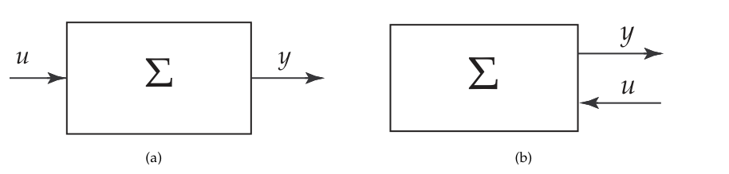
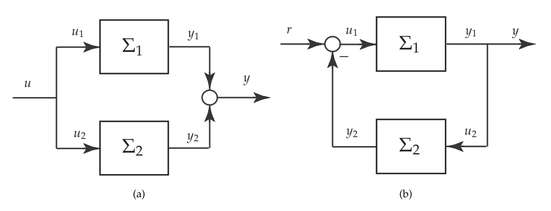
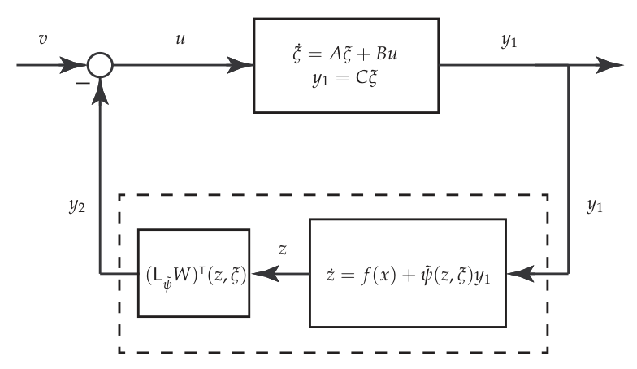
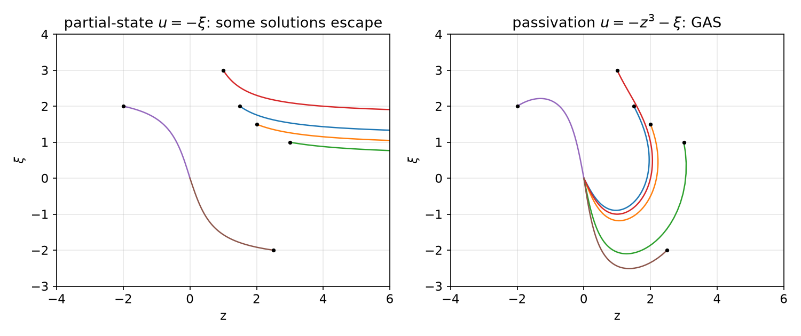
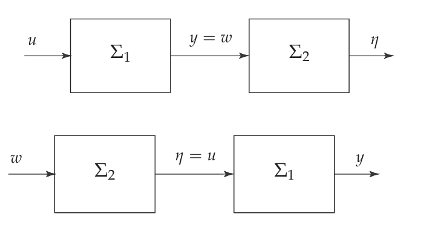
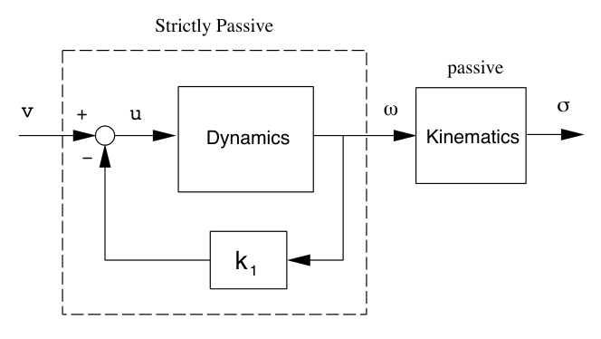
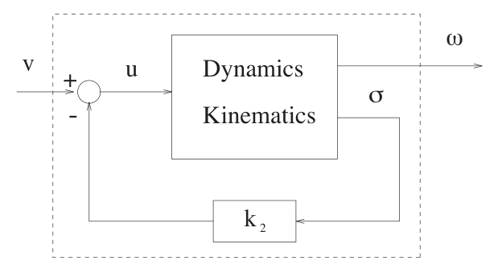
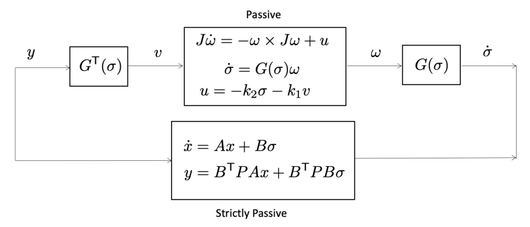
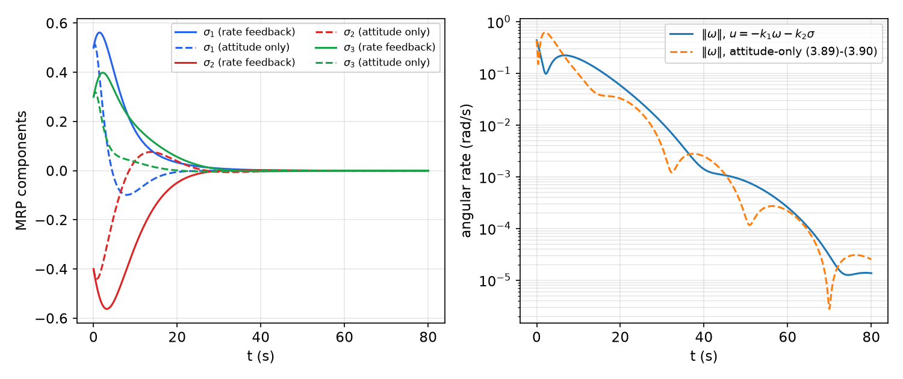

# Passivity and Dissipativity

Passivity is the input–output abstraction of energy conservation: a passive system cannot deliver more energy to its environment than was stored in it initially plus what was supplied through its port. The property implies Lyapunov stability, implies asymptotic stability under a mild observability condition, and, decisively for design, is preserved when passive systems are connected in parallel or in feedback. This chapter develops dissipativity and passivity for nonlinear state-space systems, characterizes passive affine systems through a nonlinear Kalman–Yakubovich–Popov (KYP) lemma, and then uses **passivation**, rendering a system passive by feedback and choice of output, to stabilize cascades that defeat the partial-state designs of [Input-to-State Stability](iss.md). It closes with stabilization without damping injection and a complete case study: global attitude stabilization of a rigid spacecraft, first with and then without angular-rate measurements.

## Dissipative Systems

Consider
\\[
\dot x = f(x,u), \qquad y = h(x,u), \qquad x\in\mathbb{R}^n,\quad u,y\in\mathbb{R}^m ,
\\]
with as many outputs as inputs. A **supply rate** is a function \\(w : \mathbb{R}^m\times\mathbb{R}^m\to\mathbb{R}\\) that is locally integrable along input–output pairs,
\\[
\int\_{t\_0}^{t\_1}\lvert w(u(t),y(t))\rvert\\,dt < \infty .
\\]

**Definition (Dissipativity).** The system is **dissipative** with respect to the supply rate \\(w\\) if there is a positive semidefinite function \\(V(x)\\), called a **storage function**, such that
\\[
V(x(t)) - V(x(t\_0)) \le \int\_{t\_0}^{t} w\big(u(\tau),y(\tau)\big)\\,d\tau
\\]
for all admissible inputs \\(u\\) (functions bounded on bounded intervals), all initial states and all \\(t\ge t\_0\\).

Because \\(V\ge0\\), the inequality implies \\(-V(x(t\_0)) \le \int\_{t\_0}^t w\\,d\tau\\): the integral of the supply rate is bounded below, by an amount that depends only on the initial state. The energy interpretation is direct. The integral of \\(w\\) is the energy that flows into the system through its input–output port; \\(V\\) is the energy stored in the system. The inequality says that the energy stored at time \\(t\\) is at most the initial energy plus the energy supplied; the difference has been dissipated. Passivity is thus a restatement of the energy balance.



*Figure: (a) the usual input/output (signal-flow) representation. (b) The port representation: the pair (u, y) is attached to a single port through which energy is exchanged with the environment. In the port view the distinction between input and output is less important than the power u^T y flowing through the port.*

**Definition (Passivity).** A system that is dissipative with respect to \\(w(u,y) = u^Ty\\) is **passive**.

For an electrical one-port, \\(u\\) and \\(y\\) are voltage and current and \\(u^Ty\\) is power; for a mechanical system, force and velocity. More general supply rates (for example \\(\gamma^2\lVert u\rVert^2 - \lVert y\rVert^2\\), which gives finite \\(L\_2\\) gain) fit the same framework.

### The differential form and the passivity zoo

When the storage function is differentiable, the integral inequality can be replaced by a pointwise one.

**Definition (Differential dissipation inequality).** The system is dissipative if there is a \\(C^1\\) positive semidefinite \\(V\\) with
\\[
\dot V := \frac{\partial V}{\partial x}f(x,u) \le w(u,y) \qquad \text{for all } (x,u), \text{ with } y = h(x,u).
\\]
With this form the system is called

1. **lossless** if \\(\dot V = u^Ty\\);
2. **passive** if \\(\dot V\le u^Ty\\);
3. **input-feedforward passive** if \\(\dot V\le u^Ty - u^T\varphi(u)\\);
4. **input strictly passive** if it is input-feedforward passive with \\(u^T\varphi(u)>0\\) for all \\(u\ne0\\);
5. **output-feedback passive** if \\(\dot V\le u^Ty - y^T\varphi(y)\\);
6. **output strictly passive** if it is output-feedback passive with \\(y^T\varphi(y)>0\\) for all \\(y\ne0\\);
7. **strictly passive** if \\(\dot V\le u^Ty - \psi(x)\\) with \\(\psi\\) positive definite.

Integrating the differential inequality gives the integral one, but not conversely: a storage function in the integral definition need not be differentiable. The integral form is therefore slightly more general; in calculations one almost always uses the differential form.

The names describe where the excess dissipation sits. Input-feedforward passivity with negative \\(\varphi\\) (a "shortage" of passivity) can be repaired by a feedforward path \\(\varphi(u)\\) in parallel; output-feedback passivity with negative \\(\varphi\\) can be repaired by output feedback.

**Example 1 (Integrator and first-order lag).** The integrator \\(g(s) = 1/s\\), realized as \\(\dot x = u\\), \\(y = x\\), with \\(V = \frac12x^2\\), gives
\\[
\dot V = xu = uy ,
\\]
so it is **lossless**. The first-order lag \\(g(s) = 1/(s+a)\\), \\(a>0\\), realized as \\(\dot x = -ax + u\\), \\(y = x\\), gives
\\[
\dot V = -ax^2 + xu = uy - ay^2 ,
\\]
so it is **output strictly passive** with \\(\varphi(y) = ay\\).

The second calculation shows a mechanism used throughout this chapter. If a system is passive from \\(u\\) to \\(y\\) with storage \\(V\\), the feedback
\\[
u = -ky + v, \qquad k>0,
\\]
gives \\(\dot V\le y^Tv - k\lVert y\rVert^2\\): the closed loop is output strictly passive from \\(v\\) to \\(y\\). This is called **damping injection** or **output injection** of the passive output, and for affine systems \\(\dot x = f(x) + g(x)u\\) with output \\(y = (L\_gV)^T\\) it is the classical **\\(L\_gV\\) control** \\(u = -k(L\_gV)^T\\).

## Interconnections of Passive Systems



*Figure: (a) parallel interconnection, u₁ = u₂ = u and y = y₁ + y₂. (b) Negative feedback interconnection, u₁ = r − y₂, u₂ = y₁ = y.*

**Theorem (Parallel and feedback interconnections).** Let
\\[
\Sigma\_i : \quad \dot x\_i = f\_i(x\_i,u\_i), \qquad y\_i = h\_i(x\_i,u\_i), \qquad i = 1,2,
\\]
be passive with storage functions \\(V\_1, V\_2\\). Then the parallel interconnection (input \\(u\\), output \\(y = y\_1+y\_2\\)) and the negative feedback interconnection (input \\(r\\), output \\(y = y\_1\\)) are passive.

*Proof.* Use \\(V = V\_1(x\_1) + V\_2(x\_2)\\). For the parallel connection, \\(u\_1 = u\_2 = u\\) and
\\[
\dot V \le u\_1^Ty\_1 + u\_2^Ty\_2 = u^T(y\_1 + y\_2) = u^Ty .
\\]
For the feedback connection, \\(u\_1 = r - y\_2\\), \\(u\_2 = y\_1\\), and
\\[
\dot V \le u\_1^Ty\_1 + u\_2^Ty\_2 = (r - y\_2)^Ty\_1 + y\_1^Ty\_2 = r^Ty\_1 = r^Ty .
\\]
The cross terms cancel exactly: the energy that \\(\Sigma\_1\\) delivers to \\(\Sigma\_2\\) is the energy \\(\Sigma\_2\\) receives. ∎

A *cascade* of two passive systems, by contrast, need not be passive: the integrator \\(1/s\\) is passive, but \\(1/s^2\\) has phase \\(-180^\circ\\) and is not.

Passivity is also preserved by a state-dependent change of input and output that is "power preserving".

**Proposition (Pre- and post-multiplication).** Let \\(\Sigma\\) be passive with storage \\(V\\). Define a new input \\(\bar u\\) and output \\(\bar y\\) by \\(u = M(x)\bar u\\), \\(\bar y = M^T(x)y\\) (diagram: \\(\bar u\to M(x)\to\Sigma\to M^T(x)\to\bar y\\)). Then \\(\bar u\mapsto\bar y\\) is passive with the same storage function.

*Proof.*
\\[
V(x(t)) - V(x(0)) \le \int\_0^t u^Ty\\,d\tau = \int\_0^t (M\bar u)^Ty\\,d\tau = \int\_0^t\bar u^T M^Ty\\,d\tau = \int\_0^t\bar u^T\bar y\\,d\tau . \qquad ∎
\\]

**Corollary.** Parallel and feedback interconnections remain passive if either or both subsystems are pre-multiplied by \\(M(x\_1,x\_2)\\) and post-multiplied by \\(M^T(x\_1,x\_2)\\). This is used in the spacecraft case study, where \\(M = G^T(\sigma)\\).

## Zero-State Detectability and Stability

Passivity alone gives stability. Asymptotic stability needs an additional property: the system must not be able to hide a non-converging motion behind an identically zero output.

**Definition (Zero-state detectability).** Consider \\(\dot x = f(x,u)\\), \\(y = h(x,u)\\) with \\(u = 0\\), and let \\(Z\\) be the largest invariant set of \\(\dot x = f(x,0)\\) contained in \\(\\{x : h(x,0) = 0\\}\\). The system is **zero-state detectable (ZSD)** if \\(x = 0\\) is asymptotically stable for the dynamics restricted to \\(Z\\) (every solution starting in \\(Z\\) converges to zero), and **zero-state observable (ZSO)** if \\(Z = \\{0\\}\\).

Equivalently: ZSD means that \\(u\equiv0\\), \\(y\equiv0\\) implies \\(x(t)\to0\\); ZSO means that \\(u\equiv0\\), \\(y\equiv0\\) implies \\(x\equiv0\\). For linear systems, ZSD is detectability: the unobservable part is asymptotically stable.

**Theorem (Passivity and stability).** Let the system be passive with a \\(C^1\\) storage function \\(V\\).

1. If \\(V\\) is positive definite, the origin of \\(\dot x = f(x,0)\\) is stable.
2. If the system is ZSD, the origin of \\(\dot x = f(x,0)\\) is stable.
3. If \\(y = h(x)\\) (no direct feedthrough), the feedback \\(u = -y\\) achieves asymptotic stability if and only if the system is ZSD.

If \\(V\\) is radially unbounded, the conclusions are global.

*Proof sketch.* (1) With \\(u = 0\\), \\(\dot V \le 0\\), so \\(V\\) is a Lyapunov function. (2) If \\(V\\) is only positive semidefinite, \\(\dot V\le0\\) still confines solutions to sublevel sets of \\(V\\), and the only way stability can fail is through motions inside the set where \\(V\\) vanishes; ZSD says that such motions converge to the origin, and a refinement of the argument in (1) gives stability (see Sepulchre, Janković and Kokotović, *Constructive Nonlinear Control*). (3) With \\(u = -y\\), \\(\dot V\le -\lVert y\rVert^2\le 0\\). By LaSalle's invariance principle ([Invariant Sets](invariance.md)), solutions converge to the largest invariant set in \\(\\{y = 0\\}\\); on it \\(u = -y = 0\\), so this set is the set \\(Z\\) of the definition, and ZSD gives convergence to the origin. Conversely, if the closed loop is asymptotically stable, any solution of \\(\dot x = f(x,0)\\) with \\(y\equiv 0\\) is also a closed-loop solution, so it converges. ∎

The next result generalizes the interconnection theorem: a *shortage* of passivity in one subsystem can be compensated by an *excess* in the other.

**Theorem (Feedback interconnection of dissipative systems).** Let \\(\Sigma\_1,\Sigma\_2\\) be connected in negative feedback (with \\(r = 0\\)) and be dissipative with \\(C^1\\) storage functions \\(V\_1,V\_2\\) and supply rates
\\[
w\_i(u\_i,y\_i) = u\_i^Ty\_i - \rho\_i^T(y\_i)y\_i - \nu\_i^T(u\_i)u\_i, \qquad i = 1,2,
\\]
where each \\(\rho\_i,\nu\_i\\) lies (componentwise) in the sector \\((0,+\infty)\\) or \\((-\infty,0)\\). (A scalar function \\(\psi\\) lies in the sector \\((\alpha,\beta)\\) if \\(\alpha s^2\le\psi(s)s\le\beta s^2\\).) Suppose both systems are ZSD. Then the origin \\((0,0)\\) of the interconnection is

1. stable if \\(\nu\_1^T(v)v + \rho\_2^T(v)v\ge0\\) and \\(\nu\_2^T(v)v + \rho\_1^T(v)v\ge0\\) for all \\(v\\);
2. asymptotically stable if both inequalities are strict for all \\(v\ne0\\).

If \\(V\_1,V\_2\\) are radially unbounded, the results are global.

*Proof sketch.* With \\(u\_1 = -y\_2\\), \\(u\_2 = y\_1\\) and \\(V = V\_1 + V\_2\\), the cross terms \\(u\_1^Ty\_1 + u\_2^Ty\_2\\) cancel, leaving
\\[
\dot V \le -\big[\nu\_1^T(-y\_2)(-y\_2) + \rho\_2^T(y\_2)y\_2\big] - \big[\nu\_2^T(y\_1)y\_1 + \rho\_1^T(y\_1)y\_1\big],
\\]
in which each bracket is the corresponding condition evaluated at \\(v = \pm y\_2\\) or \\(v = y\_1\\) (for the common odd nonlinearities, such as linear \\(\nu\\), the sign of the argument does not matter). The conditions make \\(\dot V\le0\\); strictness makes \\(\dot V<0\\) unless \\(y\_1 = y\_2 = 0\\), and ZSD of both subsystems finishes the LaSalle argument. ∎

The most common case is linear: \\(\rho\_i(y) = \rho\_iy\\), \\(\nu\_i(u) = \nu\_iu\\), and the conditions become \\(\nu\_1 + \rho\_2 \ge 0\\), \\(\nu\_2 + \rho\_1\ge0\\). For example, a system with an output-feedback passivity shortage \\(\rho\_1 = -0.5\\) can be stabilized by a partner that is input strictly passive with \\(\nu\_2 > 0.5\\).

## Affine Dissipative Systems and the KYP Lemma

For systems affine in the input,
\\[
\dot x = f(x) + g(x)u, \qquad y = h(x) + j(x)u,
\\]
dissipativity can be characterized algebraically.

**Theorem (Nonlinear KYP / Hill–Moylan conditions).** The system is dissipative with respect to the supply rate
\\[
w(u,y) = u^Ty - \rho\\,y^Ty - \nu\\,u^Tu
\\]
with a \\(C^1\\) storage function \\(V\\) if and only if there exist functions \\(q : \mathbb{R}^n\to\mathbb{R}^k\\) and \\(W : \mathbb{R}^n\to\mathbb{R}^{k\times m}\\) such that
\\[
L\_fV = -\tfrac12q^Tq - \rho\\,h^Th,
\\]
\\[
L\_gV = h^T - 2\rho\\,h^Tj - q^TW,
\\]
\\[
W^TW = -2\nu I + j + j^T - 2\rho\\,j^Tj .
\\]

*Proof of sufficiency.* Compute \\(w - \dot V\\) with \\(\dot V = L\_fV + L\_gV\\,u\\) and \\(y = h + ju\\). The supply rate expands to
\\[
w = u^Th + u^Tju - \rho\big(h^Th + 2h^Tju + u^Tj^Tju\big) - \nu u^Tu .
\\]
Substituting the first two conditions for \\(L\_fV\\) and \\(L\_gV\\),
\\[
\dot V = -\tfrac12q^Tq - \rho h^Th + h^Tu - 2\rho h^Tju - q^TWu .
\\]
Subtracting, the terms \\(h^Tu\\), \\(\rho h^Th\\) and \\(2\rho h^Tju\\) cancel:
\\[
w - \dot V = u^Tju - \rho u^Tj^Tju - \nu u^Tu + \tfrac12q^Tq + q^TWu .
\\]
Since \\(u^Tju = \frac12u^T(j+j^T)u\\), the third condition gives \\(\frac12u^TW^TWu = -\nu u^Tu + u^Tju - \rho u^Tj^Tju\\), hence
\\[
w - \dot V = \tfrac12q^Tq + q^TWu + \tfrac12u^TW^TWu = \tfrac12\lVert q + Wu\rVert^2 \ge 0 .
\\]
Necessity follows by observing that \\(w - \dot V\\) is a nonnegative function, quadratic in \\(u\\), and factoring it as a sum of squares. ∎

The vector \\(q\\) measures the internal dissipation and \\(W\\) the dissipation through the feedthrough. For passivity (\\(\rho = \nu = 0\\)) and no feedthrough (\\(j = 0\\)), the conditions reduce to
\\[
L\_fV \le 0, \qquad L\_gV = h^T ,
\\]
which says: a system without feedthrough is passive with storage \\(V\\) exactly when its unforced dynamics do not increase \\(V\\) and its output is \\(y = (L\_gV)^T\\). This observation is the basis of passivation by output selection.

For linear systems the conditions become the classical KYP lemma. Recall that a square transfer matrix \\(G(s)\\) is **positive real (PR)** if it is analytic in \\(\mathrm{Re}\\,s>0\\) and \\(G(s) + G^{\*}(s)\ge0\\) there, and **strictly positive real (SPR)** if \\(G(s-\varepsilon)\\) is PR for some \\(\varepsilon>0\\). For SISO systems, PR means a stable (poles in the closed left half-plane, simple on the axis with positive residues) transfer function with \\(\mathrm{Re}\\,G(j\omega)\ge0\\); its phase never leaves \\([-90^\circ, 90^\circ]\\).

**Theorem (Kalman–Yakubovich–Popov lemma).** Let \\(G(s) = C(sI - A)^{-1}B + D\\) be square, with \\((A,B)\\) controllable and \\((A,C)\\) observable. Then \\(G\\) is strictly positive real if and only if there exist \\(P = P^T>0\\), matrices \\(L\\), \\(W\\) and \\(\varepsilon>0\\) such that
\\[
PA + A^TP = -L^TL - \varepsilon P, \qquad PB = C^T - L^TW, \qquad W^TW = D + D^T .
\\]

**Corollary (Positive real lemma).** Under the same assumptions, \\(G\\) is positive real if and only if the same equations hold with \\(\varepsilon = 0\\):
\\[
PA + A^TP = -L^TL, \qquad PB = C^T - L^TW, \qquad W^TW = D + D^T .
\\]
For a strictly proper \\(G\\) (\\(D = 0\\), hence \\(W = 0\\)) the conditions are
\\[
PA + A^TP \le 0, \qquad PB = C^T .
\\]

**Proposition (Linear passive systems).** The LTI system \\(\dot x = Ax + Bu\\), \\(y = Cx + Du\\) (minimal) is passive if \\(G(s)\\) is PR, with storage function \\(V = \frac12x^TPx\\), and strictly passive if \\(G(s)\\) is SPR.

Indeed, with \\(D=0\\) and \\(V = \frac12x^TPx\\), \\(\dot V = \frac12x^T(PA + A^TP)x + x^TPBu \le x^TC^Tu = y^Tu\\). For the lag of Example 1, \\(A = -a\\), \\(B = C = 1\\): \\(P = 1\\) gives \\(PA + A^TP = -2a<0\\) and \\(PB = 1 = C^T\\), so \\(1/(s+a)\\) is SPR.

## Passivation as a Tool for Stabilization

Return to the cascade
\\[
\dot z = f(z) + \psi(z,\xi), \qquad \dot\xi = a(\xi,u),
\\]
studied in [Input-to-State Stability](iss.md). With *partial-state* feedback \\(u(\xi)\\), global stabilization required a linear growth restriction on \\(\psi\\) and GAS of \\(\dot z = f(z)\\). With **full-state** feedback \\(u(z,\xi)\\), the growth condition can be removed altogether, and GAS of \\(\dot z = f(z)\\) can be weakened to global stability. The method is **passivation**: use feedback and the choice of an output to render the system passive, then close the loop with damping injection.

### Linear driving subsystem

Let the driving subsystem be linear:
\\[
\dot z = f(z) + \psi(z,\xi), \qquad \dot\xi = A\xi + Bu,
\\]
and let \\(W(z)\\) be \\(C^1\\), positive definite and radially unbounded with
\\[
L\_fW(z)\le0 ,
\\]
so that \\(\dot z = f(z)\\) is globally stable. The design has four steps.

1. **Factor the interconnection** through a linear output: \\(\psi(z,\xi) = \tilde\psi(z,\xi)\\,C\xi\\). The system becomes
\\[
\dot z = f(z) + \tilde\psi(z,\xi)y\_1, \qquad \dot\xi = A\xi + Bu, \qquad y\_1 = C\xi .
\\]
Choose \\(C\\) (when there is freedom to do so) so that \\(C(sI - A)^{-1}B\\) is positive real. Then \\(u\mapsto y\_1\\) is passive by the KYP lemma.
2. **Make the nonlinear subsystem passive.** Regard \\(\dot z = f(z) + \tilde\psi u\_2\\) as a system with input \\(u\_2\\). Then
\\[
\dot W = L\_fW + \frac{\partial W}{\partial z}\tilde\psi\\,u\_2 \le L\_{\tilde\psi}W(z,\xi)\\,u\_2 ,
\\]
so the choice of output \\(y\_2 = h\_2(z,\xi) = (L\_{\tilde\psi}W)^T(z,\xi)\\) makes \\(u\_2\mapsto y\_2\\) passive with storage \\(W\\).
3. **Interconnect in feedback.** With \\(u\_2 = y\_1\\) (which is how the subsystems are actually coupled) and
\\[
u = -h\_2(z,\xi) + v ,
\\]
the system is the feedback interconnection of two passive systems, hence passive from \\(v\\) to \\(y\_1\\) with storage \\(\frac12\xi^TP\xi + W(z)\\).
4. **Inject damping.** Close the loop with \\(v = -ky\_1\\), \\(k>0\\). The closed loop is GAS provided it is ZSD from \\(v\\) to \\(y\_1\\) (passivity and stability theorem, part 3).



*Figure: the passivation loop. The linear block (passive from u to y₁) drives the nonlinear z-subsystem (dashed box, read ż = f(z) + ψ̃ y₁), whose passive output y₂ = (L_ψ̃ W)ᵀ is fed back negatively; the result is passive from v to y₁.*

**Example 2 (The peaking cascade, globally stabilized).** The system
\\[
\dot z = -z + z^2\xi, \qquad \dot\xi = u
\\]
cannot be globally stabilized by any partial-state feedback \\(u = \kappa(\xi)\\) because of the quadratic growth of \\(\psi = z^2\xi\\) in \\(z\\) (the peaking example of [Input-to-State Stability](iss.md)). Passivation handles it directly:

- Factor \\(\psi = z^2\xi = \tilde\psi\\,y\_1\\) with \\(\tilde\psi = z^2\\) and \\(y\_1 = \xi\\). The integrator \\(u\mapsto\xi\\) is passive (lossless).
- Take \\(W = \frac12z^2\\): \\(L\_fW = -z^2\le0\\), and \\(y\_2 = L\_{\tilde\psi}W = z\cdot z^2 = z^3\\).
- \\(u = -y\_2 + v = -z^3 + v\\) renders \\(v\mapsto y\_1\\) passive; then \\(v = -ky\_1 = -k\xi\\).

The resulting control law is
\\[
u(z,\xi) = -z^3 - k\xi, \qquad k>0 ,
\\]
and the origin is GAS. To verify, take \\(V = \frac12z^2 + \frac12\xi^2\\):
\\[
\dot V = z(-z + z^2\xi) + \xi(-z^3 - k\xi) = -z^2 + z^3\xi - z^3\xi - k\xi^2 = -z^2 - k\xi^2 ,
\\]
negative definite with \\(V\\) radially unbounded. The term \\(-z^3\\) cancels exactly the destabilizing cross term \\(z^3\xi\\); it is not high gain, and it does not depend on the initial condition. Compare the semiglobal high-gain design \\(u = -k\xi\\), which escapes for \\(z(0)\xi(0)>k+1\\).



*Figure: left, the partial-state law u = −ξ: initial conditions with z(0)ξ(0) > 2 escape. Right, the passivation law u = −z³ − ξ: all trajectories converge to the origin.*

The same construction works when the driving subsystem is nonlinear but passive.

**Proposition (Nonlinear affine driving subsystem).** Consider \\(\dot z = f(z) + \psi(z,\xi)\\), \\(\dot\xi = a(\xi) + b(\xi)u\\). If \\(\psi = \tilde\psi(z,\xi)h(\xi)\\) and the system \\(\dot\xi = a(\xi) + b(\xi)u\\), \\(y = h(\xi)\\), is passive with storage \\(U(\xi)\\), then
\\[
u = -(L\_{\tilde\psi}W)^T(z,\xi) + v
\\]
renders the interconnection passive from \\(v\\) to \\(y\\), with storage \\(W(z) + U(\xi)\\).

### Feedback passivity of linear systems

Step 1 required a passive linear subsystem. When \\((A,B,C)\\) is given, which linear systems can be made passive by feedback? Consider the controllable and observable system
\\[
\dot x = Ax + Bu, \qquad y = Cx ,
\\]
with \\(B, C\\) of full rank. By the positive real lemma, passivity is equivalent to the existence of \\(P>0\\) with
\\[
PA + A^TP\le0, \qquad B^TP = C .
\\]
Then \\(CB = B^TPB>0\\), so \\(CB\\) is nonsingular: the system has **relative degree one**. Choose \\(T\\) with \\(TB = 0\\) such that \\((\xi\_0, y) = (Tx, Cx)\\) is a change of coordinates. Since \\(TB = 0\\), the input does not enter \\(\dot\xi\_0\\), and the system takes the **normal form**
\\[
\dot\xi\_0 = Q\_{11}\xi\_0 + Q\_{12}y, \qquad \dot y = Q\_{21}\xi\_0 + Q\_{22}y + CB\\,u,
\\]
with \\(\det(CB)\ne0\\). The feedback
\\[
u = -(CB)^{-1}\big(Q\_{21}\xi\_0 + Q\_{22}y - v\big)
\\]
gives \\(\dot\xi\_0 = Q\_{11}\xi\_0 + Q\_{12}y\\), \\(\dot y = v\\). The dynamics compatible with \\(y\equiv0\\),
\\[
\dot\xi\_0 = Q\_{11}\xi\_0 ,
\\]
are the **zero dynamics**. If they are asymptotically stable the system is **minimum phase**; if they are only Lyapunov stable, **weakly minimum phase**.

**Fact.** The eigenvalues of \\(Q\_{11}\\) are the transmission zeros of \\(C(sI - A)^{-1}B\\).

**Fact.** A passive linear system has relative degree one and is weakly minimum phase.

Relative degree and zero dynamics are invariant under feedback \\(u = Fx + Gv\\) with \\(\det G\ne0\\). Hence only relative-degree-one, weakly minimum-phase systems can be rendered passive by such feedback, and the converse also holds:

**Proposition (Feedback passivity, linear case).** With \\(C\\) of full rank, the system is feedback passive via \\(u = Fx + Gv\\), \\(\det G\ne0\\), if and only if it has relative degree one and is weakly minimum phase.

**Proposition (Explicit passivating feedback).** Let \\(B,C\\) have full rank, \\((A,B)\\) be controllable, \\((A,C)\\) observable, and the system be weakly minimum phase with relative degree one. Let \\(P\_{11}>0\\) satisfy
\\[
P\_{11}Q\_{11} + Q\_{11}^TP\_{11}\le0 .
\\]
Then the feedback
\\[
u = (CB)^{-1}\big(-2Q\_{12}^TP\_{11}\xi\_0 - Q\_{21}\xi\_0 - Q\_{22}y + v\big) =: Fx + Gv
\\]
renders the system passive from \\(v\\) to \\(y\\), with storage function
\\[
U(\xi\_0,y) = \xi\_0^TP\_{11}\xi\_0 + \tfrac12y^Ty .
\\]

*Proof.* Weak minimum phase means \\(Q\_{11}\\) is Lyapunov stable, so \\(P\_{11}\\) exists; relative degree one makes \\(CB\\) invertible. The closed loop is
\\[
\dot\xi\_0 = Q\_{11}\xi\_0 + Q\_{12}y, \qquad \dot y = -2Q\_{12}^TP\_{11}\xi\_0 + v .
\\]
Then
\\[
\begin{aligned}
\dot U &= \xi\_0^T\big(Q\_{11}^TP\_{11} + P\_{11}Q\_{11}\big)\xi\_0 + 2\xi\_0^TP\_{11}Q\_{12}y + y^T\big(-2Q\_{12}^TP\_{11}\xi\_0 + v\big) \\\\
&= \xi\_0^T\big(Q\_{11}^TP\_{11} + P\_{11}Q\_{11}\big)\xi\_0 + y^Tv \le y^Tv,
\end{aligned}
\\]
because \\(\xi\_0^TP\_{11}Q\_{12}y = y^TQ\_{12}^TP\_{11}\xi\_0\\) is a scalar. Since the storage contains \\(\xi\_0^TP\_{11}\xi\_0\\) without a factor \\(\frac12\\), the factor 2 in the feedback is exactly what cancels the cross terms. ∎

### Partially linear cascades

Combining the pieces:

**Proposition (Passivation of partially linear cascades).** Consider
\\[
\dot z = f(z) + \psi(z,\xi), \qquad \dot\xi = A\xi + Bu,
\\]
and suppose

1. \\(\dot z = f(z)\\) is globally stable with a Lyapunov function \\(W\\) (positive definite, radially unbounded, \\(L\_fW\le0\\));
2. \\(\psi(z,\xi) = \tilde\psi(z,\xi)C\xi = \tilde\psi(z,\xi)y\\);
3. \\((A,B,C)\\) is minimal, of relative degree one and weakly minimum phase.

With \\(u = F\xi + G\bar v\\) the passivating feedback of the previous proposition, the choice \\(\bar v = -(L\_{\tilde\psi}W)^T(z,\xi) + v\\), that is,
\\[
u = F\xi - G(L\_{\tilde\psi}W)^T(z,\xi) + Gv ,
\\]
renders the cascade passive from \\(v\\) to \\(y\\). If, in addition, either (4) \\(\dot z = f(z)\\) is GAS and \\((A,B)\\) is stabilizable, or (5) the cascade is ZSD from \\(v\\) to \\(y\\), then
\\[
u = F\xi - G(L\_{\tilde\psi}W)^T(z,\xi) - kGy, \qquad k>0,
\\]
makes the origin GAS.

**Example 3 (Passivation through a double integrator).** Consider
\\[
\dot z = -qz^3 + (c\xi\_1 + \xi\_2)z^3, \qquad \dot\xi\_1 = \xi\_2, \qquad \dot\xi\_2 = u .
\\]
The nominal system \\(\dot z = -qz^3\\) is GAS if \\(q>0\\) and only globally stable if \\(q = 0\\). Choose the output \\(y\_1 = c\xi\_1 + \xi\_2\\), so that \\(\psi = (c\xi\_1 + \xi\_2)z^3 = \tilde\psi\\,y\_1\\) with \\(\tilde\psi = z^3\\). In the coordinates \\((\xi\_1, y\_1)\\), using \\(\xi\_2 = y\_1 - c\xi\_1\\),
\\[
\dot\xi\_1 = -c\xi\_1 + y\_1, \qquad \dot y\_1 = c\xi\_2 + u = -c^2\xi\_1 + cy\_1 + u .
\\]
The input appears in \\(\dot y\_1\\): relative degree one. The zero dynamics (\\(y\_1\equiv0\\)) are \\(\dot\xi\_1 = -c\xi\_1\\): minimum phase if \\(c>0\\), weakly minimum phase if \\(c = 0\\), non-minimum phase if \\(c<0\\). So passivation is possible for \\(c\ge0\\).

*Passivating the linear part.* For \\(c\ge0\\) take
\\[
u = -(1 - c^2)\xi\_1 - (1+c)y\_1 + v ,
\\]
which gives \\(\dot\xi\_1 = -c\xi\_1 + y\_1\\), \\(\dot y\_1 = -\xi\_1 - y\_1 + v\\). With \\(U = \frac12(\xi\_1^2 + y\_1^2)\\),
\\[
\dot U = \xi\_1(-c\xi\_1 + y\_1) + y\_1(-\xi\_1 - y\_1 + v) = -c\xi\_1^2 - y\_1^2 + y\_1v \le y\_1v ,
\\]
so \\(v\mapsto y\_1\\) is passive.

*Passivating the nonlinear part.* \\(W = \frac12z^2\\) gives \\(L\_fW = -qz^4\le0\\) and \\(y\_2 = L\_{\tilde\psi}W = z\cdot z^3 = z^4\\). Set \\(v = -y\_2 + w = -z^4 + w\\); the total storage \\(W + U\\) satisfies
\\[
\dot W + \dot U = -qz^4 + z^4y\_1 - c\xi\_1^2 - y\_1^2 - y\_1z^4 + y\_1w = -qz^4 - c\xi\_1^2 - y\_1^2 + y\_1w ,
\\]
passive from \\(w\\) to \\(y\_1\\).

*Closing the loop* with \\(w = -y\_1\\) gives \\(\dot W + \dot U = -qz^4 - c\xi\_1^2 - 2y\_1^2\le0\\) and the overall control
\\[
u = -(1-c^2)\xi\_1 - (2+c)(c\xi\_1 + \xi\_2) - z^4 .
\\]

- *Case \\(q>0\\):* \\(\dot W + \dot U = 0\\) forces \\(z = 0\\) and \\(y\_1 = 0\\); then \\(\dot y\_1 = -\xi\_1 = 0\\). The only invariant solution is the origin, and the origin is GAS for every \\(c\ge0\\).
- *Case \\(q = 0\\):* the nominal \\(z\\)-dynamics are only stable, and GAS requires zero-state detectability, which needs \\(c>0\\) (strictly minimum phase). With \\(y\_1\equiv0\\) (so \\(w\equiv 0\\)), \\(\dot y\_1\equiv0\\); from \\(\dot\xi\_1 = -c\xi\_1\\), \\(\xi\_1\to0\\); and \\(\dot y\_1 = -c^2\xi\_1 + u = 0\\) gives \\(-c^2\xi\_1 - (1-c^2)\xi\_1 - z^4 = -\xi\_1 - z^4 = 0\\), so \\(z\to0\\) and \\(\xi\_2 = -c\xi\_1\to0\\). The origin is GAS if \\(c>0\\).

### The fully nonlinear case

For \\(\dot z = f(z) + \psi(z,\xi)\\), \\(\dot\xi = a(z,\xi) + b(z,\xi)u\\), with \\(\dot z = f(z)\\) globally stable with Lyapunov function \\(W\\) and \\(b^{-1}\\) existing, take the output \\(y = \xi\\) and factor \\(\psi = \tilde\psi(z,\xi)\xi\\). The feedback
\\[
u = b^{-1}(z,y)\Big(v - a(z,y) - (L\_{\tilde\psi}W)^T(z,y)\Big)
\\]
gives \\(\dot y = v - (L\_{\tilde\psi}W)^T\\), and with \\(V(z,y) = W(z) + \frac12y^Ty\\),
\\[
\dot V = L\_fW + L\_{\tilde\psi}W\\,y + y^T\big(v - (L\_{\tilde\psi}W)^T\big) \le y^Tv .
\\]
The system is passive from \\(v\\) to \\(y\\), and \\(v = -ky\\) completes the design under ZSD. This is the first step of [backstepping](backstepping.md) seen through the passivity lens.

## Stabilization of Passive Cascades without Damping Injection

A feedback interconnection of passive systems is passive and hence stable; asymptotic stability needs strict passivity plus ZSD, and strictness is usually obtained by damping injection, that is, feeding back the passive output. In many applications this is undesirable. In mechanical systems the passive output is velocity, which is often noisy or not measured at all and must be obtained by differentiating position. The question is then whether stabilization is possible when only the **integral** of the passive output is reliable.

Consider the cascade of two passive systems:
\\[
\Sigma\_1 : \ \dot x = f(x) + g(x)u, \quad y = h(x), \qquad\qquad \Sigma\_2 : \ \dot\xi = \alpha(\xi) + \beta(\xi)w, \quad \eta = \gamma(\xi),
\\]
with \\(f(0) = 0\\), \\(h(0) = 0\\), \\(\alpha(0) = 0\\), \\(\gamma(0) = 0\\), all smooth, \\(x\in\mathbb{R}^n\\), \\(\xi\in\mathbb{R}^q\\), \\(u,y,w,\eta\in\mathbb{R}^m\\), connected by \\(w = y\\). Each \\(\Sigma\_i\\) is passive with a smooth, positive definite, radially unbounded storage function \\(V\_i\\).



*Figure: top, the forward cascade Σ₁ → Σ₂ (u ↦ η) that is to be stabilized. Bottom, the reverse cascade Σ₂ → Σ₁ (w ↦ y) used in the bi-directional detectability condition.*

**Definition (Bi-directional zero-state detectability).** The cascade is **bi-directionally ZSD** if (i) the forward cascade \\(\Sigma\_2\circ\Sigma\_1 : u\mapsto\eta\\) is ZSD (\\(\eta\equiv0\Rightarrow \xi,x\to0\\)), and (ii) the reverse cascade \\(\Sigma\_1\circ\Sigma\_2 : w\mapsto y\\) is ZSD (\\(y\equiv0\Rightarrow \xi,x\to0\\)).

**Proposition (Gain-scheduled feedback of the cascade output).** Let \\(\Sigma\_1,\Sigma\_2\\) be SISO, passive and bi-directionally ZSD. Then
\\[
u = \kappa(y,\eta)\\,\eta, \qquad \kappa(y,\eta) = -\big(1 + \mathrm{sat}(y^T\eta)\big)
\\]
makes the origin GAS.

*Proof.* Take \\(V = V\_1(x) + V\_2(\xi)\\), with \\(\dot V\_1\le y^Tu\\) and \\(\dot V\_2\le\eta^Tw = \eta^Ty\\). Then
\\[
\dot V \le y^Tu + y^T\eta = (\kappa + 1)\\,y^T\eta = -\mathrm{sat}(y^T\eta)\\,(y^T\eta)\le0 .
\\]
\\(V\\) is radially unbounded, so solutions are bounded, and by LaSalle they converge to the largest invariant set on which \\(y^T\eta\equiv0\\). On that set \\(\kappa = -1\\) and \\(u = -\eta\\), and a continuity argument shows that along an invariant solution \\(y\\) or \\(\eta\\) vanishes identically on intervals; bi-directional ZSD then forces \\((x,\xi)\to0\\). ∎

The saturation is not essential: any \\(\sigma\\) with \\(\sigma(s)s>0\\) for \\(s\ne0\\) and \\(\sigma(0) = 0\\) works, for example \\(\kappa = -(1 + \mathrm{sgn}(y^T\eta))\\). The saturation is preferred because it avoids switching and chattering.

The controller feeds back \\(\eta\\), the output of the *second* system, with a gain that is modulated by the sign of \\(y^T\eta\\). The term \\(-\eta\\) alone produces a lossless loop (pure oscillation); the modulation adds dissipation only when \\(y^T\eta>0\\), without feeding back \\(y\\) linearly.

**Example 4 (Double integrator without velocity damping).** Let both subsystems be integrators: \\(f = \alpha = 0\\), \\(g = \beta = h = \gamma = 1\\). Each is lossless with \\(V\_1 = \frac12x^2\\), \\(V\_2 = \frac12\xi^2\\), and the cascade is bi-directionally ZSD. Since \\(\eta = \xi\\) and \\(\dot\eta = \dot\xi = y\\), the cascade is the double integrator \\(\ddot\eta = u\\) with position \\(\eta\\) and velocity \\(y = \dot\eta\\). The control
\\[
u = -\big(1 + \mathrm{sat}(y\eta)\big)\eta = -\big(1 + \mathrm{sat}(\eta\dot\eta)\big)\eta
\\]
is GAS. It is a position feedback whose stiffness is raised while the mass moves away from the origin (\\(\eta\dot\eta>0\\)) and lowered when it moves back. Indeed, with \\(V = \frac12\dot\eta^2 + \frac12\eta^2\\),
\\[
\dot V = \dot\eta\big(-(1 + \mathrm{sat}(\eta\dot\eta))\eta\big) + \eta\dot\eta = -\mathrm{sat}(\eta\dot\eta)\\,\eta\dot\eta\le0 .
\\]
The velocity enters only through the *sign* of \\(\eta\dot\eta\\), not as a linear damping term.

When the second subsystem is lossless, its storage function measures the integral of \\(y^T\eta\\), so the modulation can be computed from \\(\xi\\) alone.

**Theorem (Sampled modulation using the storage of the driven subsystem).** Consider the cascade of passive \\(\Sigma\_1,\Sigma\_2\\), with \\(\Sigma\_2\\) **lossless** and the cascade bi-directionally ZSD. Let \\(\\{t\_k\\}\\) be a strictly increasing, unbounded sequence of times. The control
\\[
u = -\kappa(\xi)\\,\gamma(\xi), \qquad \kappa(\xi(t))\big\|\_{t\in[t\_k,t\_{k+1})} = 1 + \mathrm{sat}\Big(V\_2(\xi(t)) - V\_2(\xi(t\_k))\Big)
\\]
renders the closed loop GAS for almost all such sequences.

Since \\(\Sigma\_2\\) is lossless, \\(V\_2(\xi(t)) - V\_2(\xi(t\_k)) = \int\_{t\_k}^t y^T\eta\\,d\tau\\): the law replaces the instantaneous product \\(y^T\eta\\) of the previous proposition by its integral over the current sampling interval, which is available from measurements of \\(\xi\\) only. Written this way, \\(u = -(1 + \mathrm{sat}(\cdot))\eta\\) has the same sign structure as the continuous law. (Some statements write \\(\kappa = -1 + \mathrm{sat}(V\_2(\xi(t\_k)) - V\_2(\xi(t)))\\); because \\(\mathrm{sat}\\) is odd this is \\(-(1 + \mathrm{sat}(V\_2(\xi(t)) - V\_2(\xi(t\_k))))\\), and the negative feedback requires the overall sign shown above.)

**Theorem (Stabilization from the integral of the passive output).** Let \\(\Sigma : \dot x = f(x) + g(x)u\\), \\(y = L\_fh(x)\\), with \\(f(0) = 0\\) and \\(L\_gh\equiv0\\), be passive, and ZSD with respect to the output \\(h(x)\\). Then the sampled feedback
\\[
u\_i(t)\big\|\_{t\in[t\_k,t\_{k+1})} = -\mathrm{sat}\Big(h\_i^2(x(t)) - h\_i^2(x(t\_k))\Big)\\,h\_i(x(t)), \qquad i = 1,\dots,m,
\\]
renders the origin GAS for almost all sequences \\(\\{t\_k\\}\\).

Here \\(\dot h = L\_fh + L\_ghu = L\_fh = y\\): \\(h\\) is the time integral of the passive output, a "position" whose derivative is the passive "velocity". The law needs only \\(h\\), and \\(h\_i^2(x(t)) - h\_i^2(x(t\_k)) = 2\int\_{t\_k}^t h\_iy\_i\\,d\tau\\) again encodes the sign information that the continuous law extracts from \\(y\\).

## Case Study: Spacecraft Attitude Stabilization

Attitude stabilization of a rigid spacecraft is a showcase for passivity. The rotational equations are genuinely nonlinear (gyroscopic coupling, and kinematics on the rotation group), yet the passivity structure delivers a **linear** feedback that is globally asymptotically stabilizing for the exact nonlinear equations, and then an extension that uses **attitude measurements only**, useful when rate gyros fail.

### Dynamics and kinematics

The rotational dynamics are Euler's equations in body axes,
\\[
J\dot\omega = S(\omega)J\omega + u, \qquad \omega(0) = \omega\_0,
\\]
with \\(\omega\in\mathbb{R}^3\\) the body angular velocity, \\(u\\) the control torque and \\(J = J^T>0\\) the inertia matrix. The skew-symmetric matrix \\(S(v)\\) is defined by \\(S(v)w = -v\times w\\), so the gyroscopic term is \\(S(\omega)J\omega = -\omega\times J\omega\\).

The attitude is described by the **modified Rodrigues parameters** (MRPs) \\(\sigma\in\mathbb{R}^3\\). For a rotation by angle \\(\Phi\\) about the unit axis \\(\hat e\\), \\(\sigma = \hat e\tan(\Phi/4)\\); this is nonsingular for all rotations short of a full turn \\((\Phi = \pm 360^\circ)\\), and \\(\sigma = 0\\) is the target attitude. The kinematics are
\\[
\dot\sigma = G(\sigma)\omega, \qquad G(\sigma) = \frac12\Big[\Big(\frac{1 - \sigma^T\sigma}{2}\Big)I - S(\sigma) + \sigma\sigma^T\Big].
\\]
Two identities make the passivity analysis work:
\\[
\sigma^TG(\sigma) = \Big(\frac{1 + \sigma^T\sigma}{4}\Big)\sigma^T, \qquad G^T(\sigma)G(\sigma) = \Big(\frac{1 + \sigma^T\sigma}{4}\Big)^2I .
\\]
The first is a short computation: \\(\sigma^TS(\sigma)w = -\sigma^T(\sigma\times w) = 0\\) for every \\(w\\), so \\(\sigma^TS(\sigma) = 0\\) and
\\[
\sigma^TG(\sigma) = \frac12\Big[\frac{1 - \sigma^T\sigma}{2} + \sigma^T\sigma\Big]\sigma^T = \frac{1 + \sigma^T\sigma}{4}\\,\sigma^T .
\\]
The second says that \\(G(\sigma)\\) is a scaled orthogonal matrix, so it is invertible with \\(G^{-1} = \big(\frac{4}{1 + \sigma^T\sigma}\big)^2G^T\\).

**Proposition (Passivity of the attitude equations).** (i) The dynamics are passive from \\(u\\) to \\(\omega\\). (ii) The kinematics are passive from \\(\omega\\) to \\(\sigma\\).

*Proof.* (i) With \\(V\_1 = \frac12\omega^TJ\omega\\), \\(\dot V\_1 = \omega^TJ\dot\omega = \omega^TS(\omega)J\omega + \omega^Tu = \omega^Tu\\), because \\(\omega^T(\omega\times J\omega) = 0\\). Integrating, \\(\int\_0^T\omega^Tu\\,dt + V\_1(\omega\_0) = V\_1(\omega(T))\ge0\\); the dynamics are in fact lossless (kinetic energy).
(ii) With \\(V\_2 = 2\ln(1 + \sigma^T\sigma)\\), by the first identity
\\[
\dot V\_2 = \frac{4\sigma^T\dot\sigma}{1 + \sigma^T\sigma} = \frac{4}{1 + \sigma^T\sigma}\\,\sigma^TG(\sigma)\omega = \sigma^T\omega ,
\\]
so \\(\int\_0^T\sigma^T\omega\\,dt + V\_2(\sigma\_0)\ge0\\). ∎

The logarithmic storage function is the key: it grows only logarithmically in \\(\lVert\sigma\rVert\\) but is still radially unbounded, and it turns the nonlinear kinematics into an exactly passive map with output \\(\sigma\\).

### Passivity-based state feedback

The system is a cascade of the dynamics (\\(u\mapsto\omega\\)) and the kinematics (\\(\omega\mapsto\sigma\\)). A preliminary rate feedback makes the dynamics strictly passive, and the kinematics output then closes the loop as a feedback interconnection of a strictly passive and a passive system.



*Figure: inside the dashed box, the rate feedback −k₁ω makes the dynamics strictly passive from v to ω. The kinematics block is passive from ω to σ.*

**Proposition (Rate damping).** The feedback \\(u = -k\_1\omega + \nu\\), \\(k\_1>0\\), renders the dynamics strictly passive from \\(\nu\\) to \\(\omega\\):
\\[
\dot V\_1 = -k\_1\lVert\omega\rVert^2 + \omega^T\nu \quad\Longrightarrow\quad \int\_0^T\omega^T\nu\\,dt + V\_1(\omega\_0)\ge k\_1\int\_0^T\lVert\omega\rVert^2dt .
\\]

**Theorem (Linear PD attitude control).** The linear feedback
\\[
u = -k\_1\omega - k\_2\sigma, \qquad k\_1,k\_2>0,
\\]
globally asymptotically stabilizes the nonlinear attitude equations.

*Proof.* Take the positive definite, radially unbounded function
\\[
V = V\_1 + k\_2V\_2 = \tfrac12\omega^TJ\omega + 2k\_2\ln(1 + \sigma^T\sigma).
\\]
Then
\\[
\dot V = \omega^TJ\dot\omega + 4k\_2\frac{\sigma^T\dot\sigma}{1 + \sigma^T\sigma} = \omega^Tu + k\_2\frac{\sigma^T}{1 + \sigma^T\sigma}(1 + \sigma^T\sigma)\omega = \omega^T(-k\_1\omega - k\_2\sigma) + k\_2\sigma^T\omega = -k\_1\lVert\omega\rVert^2\le0 .
\\]
On the set \\(\dot V = 0\\), \\(\omega\equiv0\\), hence \\(\dot\omega\equiv0\\), and the dynamics give \\(0 = u = -k\_2\sigma\\), so \\(\sigma = 0\\). By LaSalle's principle the origin of \\((\omega,\sigma)\\) is asymptotically stable, and globally so because \\(V\\) is radially unbounded. ∎

The gain \\(k\_2\\) acts as a spring on the "MRP angle" and \\(k\_1\\) as a damper. The result is global in MRP coordinates, which cover every attitude except the full-turn rotation.

### Stabilization without angular-velocity feedback

Now suppose \\(\omega\\) is not measured. The first step is to absorb the attitude feedback into the plant.



*Figure: the attitude feedback −k₂σ around the combined dynamics and kinematics renders the map v ↦ ω passive.*

**Proposition (Passivity with attitude feedback).** With \\(u = -k\_2\sigma + v\\), \\(k\_2>0\\), the attitude equations are passive from \\(v\\) to \\(\omega\\), with storage \\(V = V\_1 + k\_2V\_2\\): \\(\dot V = \omega^Tu + k\_2\sigma^T\omega = \omega^Tv\\).

Damping must now be injected without \\(\omega\\). Since only \\(\sigma\\) is measured, change the port variables so that the output is \\(\dot\sigma\\), the derivative of a measured signal.

**Proposition (Input–output transformation).** Define the new input \\(y\\) and output \\(w\\) by
\\[
v = G^T(\sigma)y, \qquad w = G(\sigma)\omega = \dot\sigma .
\\]
Then \\(y\mapsto w\\) is passive with the same storage function.

*Proof.* This is the pre/post-multiplication proposition with \\(M = G^T(\sigma)\\): \\(\int\_0^Tw^Ty\\,dt = \int\_0^T\omega^TG^Ty\\,dt = \int\_0^T\omega^Tv\\,dt\\). Equivalently, writing \\(y = \big(\frac{4}{1 + \sigma^T\sigma}\big)^2G(\sigma)v\\) and using the second identity,
\\[
\int\_0^Tw^Ty\\,dt = \int\_0^T\Big(\frac{4}{1 + \sigma^T\sigma}\Big)^2\omega^TG^TGv\\,dt = \int\_0^T\Big(\frac{1 + \sigma^T\sigma}{4}\Big)^2\Big(\frac{4}{1 + \sigma^T\sigma}\Big)^2\omega^Tv\\,dt = \int\_0^T\omega^Tv\\,dt . \qquad ∎
\\]

It remains to find a strictly passive system with input \\(w = \dot\sigma\\) and output \\(y\\) that can be implemented from \\(\sigma\\) alone. A strictly positive real linear filter driven by \\(\sigma\\), with output proportional to the derivative of its state, does the job. Let \\(A\\) be Hurwitz, \\(B\\) of full column rank with \\((A,B)\\) controllable, \\(Q>0\\), and \\(P>0\\) the solution of the Lyapunov equation \\(A^TP + PA = -Q\\).

**Theorem (Attitude-only feedback).** The control
\\[
u = -k\_2\sigma - k\_1G^T(\sigma)y, \qquad k\_1,k\_2>0,
\\]
where \\(y\\) is the output of the linear filter
\\[
\dot x = Ax + B\sigma, \qquad y = B^TPAx + B^TPB\sigma\quad(= B^TP\dot x),
\\]
renders the closed loop GAS: \\((\omega(t),\sigma(t),x(t))\to0\\) for all \\((\omega\_0,\sigma\_0)\\) and filter initial states.

*Proof.* Take
\\[
V = \tfrac12\omega^TJ\omega + 2k\_2\ln(1 + \sigma^T\sigma) + \tfrac{k\_1}{2}(Ax + B\sigma)^TP(Ax + B\sigma) = \tfrac12\omega^TJ\omega + 2k\_2\ln(1 + \sigma^T\sigma) + \tfrac{k\_1}{2}\dot x^TP\dot x .
\\]
Along solutions, \\(\ddot x = A\dot x + B\dot\sigma = A\dot x + BG(\sigma)\omega\\), so
\\[
\begin{aligned}
\dot V &= \omega^TJ\dot\omega + k\_2\Big(\frac{4}{1 + \sigma^T\sigma}\Big)\sigma^TG\omega + k\_1\dot x^TP\ddot x \\\\
&= \omega^T\big(-k\_2\sigma - k\_1G^Ty\big) + k\_2\sigma^T\omega + k\_1\dot x^TPA\dot x + k\_1\dot x^TPBG\omega \\\\
&= -k\_1\omega^TG^TB^TP\dot x + k\_1\dot x^TPBG\omega + \tfrac{k\_1}{2}\dot x^T\big(PA + A^TP\big)\dot x \\\\
&= -\tfrac{k\_1}{2}\dot x^TQ\dot x\le0 ,
\end{aligned}
\\]
using \\(y = B^TP\dot x\\) (so the two \\(\omega\\) terms are transposes of each other and cancel) and \\(\omega^TS(\omega)J\omega = 0\\). The function \\(V\\) is radially unbounded in \\((\omega,\sigma,\dot x)\\), and since \\(A\\) is invertible, \\(x = A^{-1}(\dot x - B\sigma)\\) is bounded as well; all solutions are bounded.

On the set \\(\mathcal{E} = \\{\dot V = 0\\}\\), \\(\dot x = 0\\), so \\(x\equiv x\_0\\) is constant, and from the filter equation \\(B\sigma = -Ax\_0\\) is constant; \\(B\\) has full column rank, so \\(\sigma\equiv\sigma\_0\\). Then \\(\dot\sigma = 0\\), and since \\(G(\sigma)\\) is invertible the kinematics give \\(\omega\equiv0\\). Also \\(y = B^TP\dot x = 0\\). The dynamics with \\(\omega = \dot\omega = 0\\) and \\(y = 0\\) give \\(0 = u = -k\_2\sigma\\), so \\(\sigma = 0\\); then \\(Ax = 0\\) and, \\(A\\) being Hurwitz, \\(x = 0\\). The largest invariant set in \\(\mathcal{E}\\) is \\(\mathcal{M} = \\{\omega = 0, \sigma = 0, x = 0\\}\\). LaSalle's principle and radial unboundedness give GAS. ∎



*Figure: the attitude-only controller as a passive feedback loop. The upper block (attitude equations with u = −k₂σ − k₁v) is passive from v to ω; G(σ) and Gᵀ(σ) convert it to a passive map y ↦ σ̇; the lower block is the linear filter driven by σ, strictly passive from σ̇ to y. Only σ is measured.*

An alternative reading: the filter, viewed from \\(\dot\sigma\\) to \\(y = B^TP\dot x\\), is the strictly positive real system \\(\dot\chi = A\chi + B\dot\sigma\\), \\(y = B^TP\chi\\) with \\(\chi = \dot x\\) (it satisfies the KYP conditions with \\(PB = (B^TP)^T\\) and \\(PA + A^TP = -Q<0\\)). The closed loop is a feedback interconnection of a passive and a strictly passive system, and the Lyapunov function above is the sum of the two storage functions. The filter output \\(y = B^TP\dot x\\) is a *filtered derivative* of the attitude, an implementable surrogate for the missing rate.

**Simulation.** The figure below compares the two controllers for an illustrative spacecraft with \\(J = \mathrm{diag}(10, 15, 20)\\) kg·m², initial attitude \\(\sigma\_0 = (0.5, -0.4, 0.3)\\) and initial rate \\(\omega\_0 = (0.3, -0.2, 0.25)\\) rad/s. The PD law uses \\(k\_1 = 5\\), \\(k\_2 = 2\\). The attitude-only law uses \\(k\_1 = 50\\), \\(k\_2 = 2\\) and the filter \\(A = -I\\), \\(B = I\\), \\(Q = 2I\\) (so \\(P = I\\)), started at \\(x(0) = 0\\).



*Figure: left, MRP components under the PD law (solid) and the attitude-only law (dashed). Right, the angular-rate norm on a log scale. Both controllers drive the spacecraft to rest at σ = 0; without rate measurements the transient oscillates more, because damping enters only through the filtered derivative of σ.*

```python
import numpy as np
from scipy.integrate import solve_ivp

J = np.diag([10., 15., 20.]); Ji = np.linalg.inv(J)
S = lambda v: np.array([[0, v[2], -v[1]], [-v[2], 0, v[0]], [v[1], -v[0], 0]])  # S(v)w = -v x w
G = lambda s: 0.5*((1 - s@s)/2*np.eye(3) - S(s) + np.outer(s, s))
k1, k2, A, P = 50.0, 2.0, -np.eye(3), np.eye(3)            # attitude-only law, B = I

def rhs(t, z):
    w, s, x = z[:3], z[3:6], z[6:]
    y = P @ (A @ x + s)                                     # y = B^T P xdot
    u = -k2*s - k1*G(s).T @ y
    return np.r_[Ji @ (S(w) @ J @ w + u), G(s) @ w, A @ x + s]

sol = solve_ivp(rhs, [0, 80], np.r_[0.3, -0.2, 0.25, 0.5, -0.4, 0.3, 0, 0, 0], rtol=1e-8)
```

## Summary

- **Dissipativity:** \\(V(x(t)) - V(x(t\_0))\le\int w(u,y)\\,d\tau\\); in differential form \\(\dot V\le w\\). **Passive:** \\(w = u^Ty\\). Lossless, input/output strictly passive and strictly passive refine it.
- **Damping injection:** \\(u = -ky + v\\) makes a passive system output strictly passive (\\(L\_gV\\) control).
- **Interconnections:** parallel and negative-feedback connections of passive systems are passive (storage \\(V\_1 + V\_2\\)); cascades are not. Power-preserving transformations \\(u = M\bar u\\), \\(\bar y = M^Ty\\) keep passivity. Passivity shortage in one subsystem can be offset by excess in the other: \\(\nu\_1 + \rho\_2\ge0\\), \\(\nu\_2 + \rho\_1\ge0\\).
- **Stability:** passive with positive definite \\(V\\) or ZSD \\(\Rightarrow\\) stable; with \\(y = h(x)\\), \\(u = -y\\) gives asymptotic stability iff ZSD.
- **KYP:** \\(\dot x = f+gu\\), \\(y = h+ju\\) is dissipative w.r.t. \\(u^Ty - \rho y^Ty - \nu u^Tu\\) iff \\(L\_fV = -\frac12q^Tq - \rho h^Th\\), \\(L\_gV = h^T - 2\rho h^Tj - q^TW\\), \\(W^TW = -2\nu I + j + j^T - 2\rho j^Tj\\). Linear PR lemma: \\(PA + A^TP\le0\\), \\(PB = C^T\\) for \\(D = 0\\).
- **Feedback passivity (linear):** possible iff relative degree one and weakly minimum phase; explicit law \\(u = (CB)^{-1}(-2Q\_{12}^TP\_{11}\xi\_0 - Q\_{21}\xi\_0 - Q\_{22}y + v)\\).
- **Passivation of cascades:** factor \\(\psi = \tilde\psi\\,y\\), use the output \\((L\_{\tilde\psi}W)^T\\) and feed it back; e.g. \\(u = -z^3 - k\xi\\) globally stabilizes \\(\dot z = -z + z^2\xi\\), \\(\dot\xi = u\\).
- **Without damping injection:** \\(u = -(1 + \mathrm{sat}(y^T\eta))\eta\\) stabilizes bi-directionally ZSD passive cascades; sampled versions use only storage or position signals.
- **Spacecraft:** MRP kinematics are passive from \\(\omega\\) to \\(\sigma\\) with \\(V\_2 = 2\ln(1 + \sigma^T\sigma)\\); \\(u = -k\_1\omega - k\_2\sigma\\) is GAS; without rate gyros, \\(u = -k\_2\sigma - k\_1G^T(\sigma)B^TP\dot x\\) with the filter \\(\dot x = Ax + B\sigma\\) is GAS.

## See Also

- [Input-to-State Stability](iss.md): cascades, peaking and growth conditions that passivation overcomes.
- [Backstepping and Forwarding](backstepping.md): recursive passivation-based designs.
- [Lyapunov Theory](lyapunov.md) and [Invariant Sets and LaSalle's Principle](invariance.md)
- [Advanced Lyapunov Theory](lyapunov-advanced.md)
- [Control of Multi-Input Physical Systems](multi-input.md): energy-based control of robots.
- [Control Lyapunov Functions](clf.md)
- Robot Control
- Frequency Response
