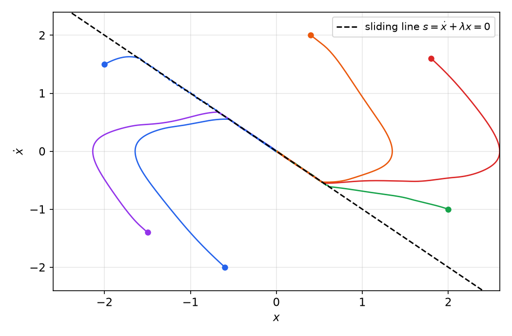
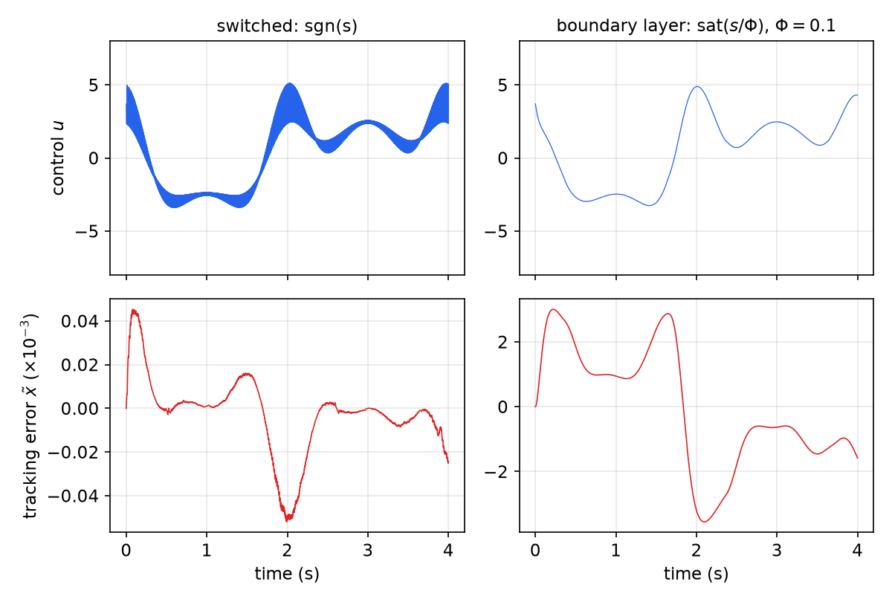
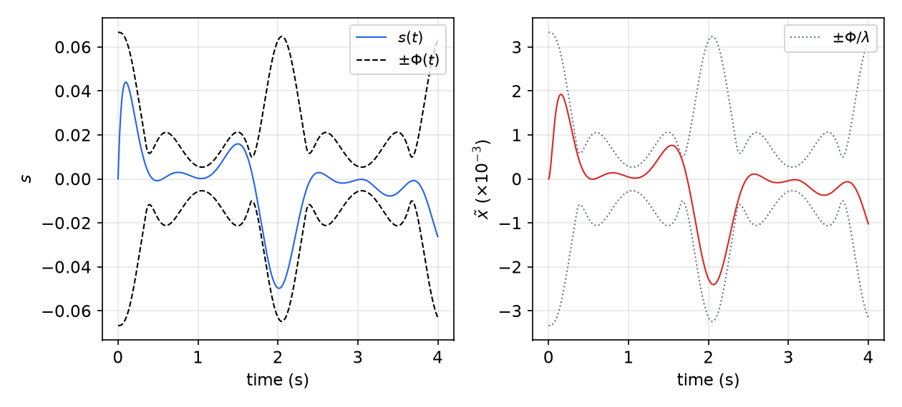
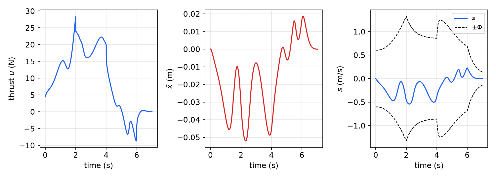
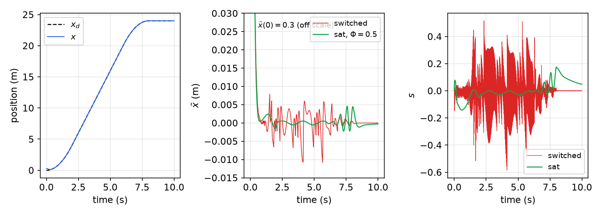

# Sliding Control

Every model is wrong. Some parameters are known only within bounds (a payload mass, a drag coefficient), and some dynamics are left out on purpose (actuator lags, structural modes, sampling). Sliding control is a systematic way to keep nominal performance in the presence of the first kind of uncertainty, called *structured* or *parametric*, while respecting the bandwidth limits imposed by the second kind, called *unstructured* or *unmodeled dynamics*. The idea is to replace an \\(n\\)th-order tracking problem by a first-order stabilization problem in a scalar variable \\(s\\), which a sufficiently strong control can always solve. The price of that robustness is a discontinuous control that chatters. Smoothing it inside a thin boundary layer turns the price into a quantified trade-off between model precision and tracking accuracy. The chapter builds on Lyapunov theory ([Lyapunov's Direct Method](lyapunov.md)) and on the cancellation idea of [Feedback Linearization](feedback-linearization.md). [Adaptive Control](adaptive-control.md) takes the complementary route of learning the uncertain parameters instead of dominating them.

## Problem Setting

Consider the single-input system
\\[
x^{(n)} = f(\mathbf{x}) + b(\mathbf{x})\\,u, \qquad \mathbf{x} = [x, \dot x, \dots, x^{(n-1)}]^T,
\\]
where \\(x\\) is the scalar output of interest and \\(u\\) the control input. The function \\(f\\) is not exactly known, but the size of the error in our estimate \\(\hat f\\) is bounded by a known function of \\(\mathbf{x}\\). The control gain \\(b(\mathbf{x})\\) is likewise uncertain, but its sign and its bounds are known. The task is to make \\(\mathbf{x}\\) track a desired state \\(\mathbf{x}\_d = [x\_d, \dot x\_d, \dots, x\_d^{(n-1)}]^T\\) despite this uncertainty. Write the tracking error as
\\[
\tilde x = x - x\_d, \qquad \tilde{\mathbf{x}} = \mathbf{x} - \mathbf{x}\_d = [\tilde x, \dot{\tilde x}, \dots, \tilde x^{(n-1)}]^T .
\\]
Exact tracking with a finite control also requires the initial condition to match,
\\[
\mathbf{x}\_d(0) = \mathbf{x}(0),
\\]
since otherwise the error must first be removed in finite time, which an \\(n\\)th-order integrator chain cannot do with bounded \\(u\\). When this fails, the bounds derived below are reached after a short transient instead.

Many engineering systems fit this structure: robot joints, underwater vehicles, automotive transmissions and engines, electric motors, power systems. Because the control appears additively once \\(b\\) is accounted for, the nominal part of every sliding controller is a feedback-linearizing law; the sliding part adds what is needed to cope with what the nominal model gets wrong.

## Sliding Surfaces

### The sliding variable

Define a time-varying surface \\(S(t)\\) in the state space \\(\mathbb{R}^n\\) by \\(s(\mathbf{x}; t) = 0\\), where
\\[
\boxed{s(\mathbf{x}; t) = \left(\frac{d}{dt} + \lambda\right)^{n-1}\tilde x, \qquad \lambda > 0 .}
\\]
For \\(n = 2\\), \\(s = \dot{\tilde x} + \lambda\tilde x\\), a weighted sum of position and velocity error. For \\(n = 3\\), \\(s = \ddot{\tilde x} + 2\lambda\dot{\tilde x} + \lambda^2\tilde x\\). The coefficients are binomial, so all \\(n-1\\) roots of the polynomial are at \\(-\lambda\\).

Two facts make this definition useful.

1. **Tracking reduces to staying on the surface.** Given \\(\tilde{\mathbf{x}}(0) = 0\\), the problem \\(\mathbf{x} \equiv \mathbf{x}\_d\\) is equivalent to keeping \\(s \equiv 0\\) for all \\(t\\): \\(s \equiv 0\\) is a linear differential equation whose unique solution with zero initial condition is \\(\tilde x \equiv 0\\).
2. **The control appears in the first derivative of \\(s\\).** \\(s\\) contains \\(\tilde x^{(n-1)}\\), so \\(\dot s\\) contains \\(x^{(n)}\\) and hence \\(u\\). Keeping a scalar quantity at zero when the control enters its first derivative is a first-order problem.

The \\(n\\)th-order tracking problem has been replaced by a first-order stabilization problem in \\(s\\). The next result shows that bounds on \\(s\\) carry over directly to bounds on the tracking error, so nothing is lost in the reduction.

**Proposition (from \\(s\\) to the tracking error).** Let \\(\tilde{\mathbf{x}}(0) = 0\\). If \\(\lvert s(t) \rvert \le \Phi\\) for all \\(t \ge 0\\), then
\\[
\lvert \tilde x^{(i)}(t) \rvert \le (2\lambda)^i\\,\varepsilon, \qquad i = 0, \dots, n-1, \qquad \varepsilon = \frac{\Phi}{\lambda^{n-1}} .
\\]

*Proof.* By definition \\(\tilde x\\) is obtained from \\(s\\) by passing it through a chain of \\(n-1\\) first-order low-pass filters \\(1/(p + \lambda)\\), where \\(p = d/dt\\). The output of one filter with zero initial condition is
\\[
y\_1(t) = \int\_0^t e^{-\lambda(t-T)}s(T)\\,dT ,
\qquad
\lvert y\_1(t) \rvert \le \Phi\int\_0^t e^{-\lambda(t-T)}dT = \frac{\Phi}{\lambda}\left(1 - e^{-\lambda t}\right) \le \frac{\Phi}{\lambda}.
\\]
Each filter divides the bound by \\(\lambda\\), so after \\(n-1\\) filters \\(\lvert \tilde x \rvert \le \Phi/\lambda^{n-1} = \varepsilon\\). For \\(\tilde x^{(i)}\\), note that \\(\tilde x^{(i)}\\) is obtained by passing \\(s\\) through \\(n-1-i\\) filters \\(1/(p+\lambda)\\), giving a signal bounded by \\(\Phi/\lambda^{n-1-i}\\), and then through \\(i\\) blocks \\(p/(p+\lambda)\\). Since
\\[
\frac{p}{p + \lambda} = 1 - \frac{\lambda}{p + \lambda},
\\]
and the second term has unit DC gain with a positive impulse response, each such block has peak gain at most \\(1 + 1 = 2\\). Hence \\(\lvert \tilde x^{(i)} \rvert \le 2^i\Phi/\lambda^{n-1-i} = (2\lambda)^i\varepsilon\\). \\(\blacksquare\\)

If \\(\tilde{\mathbf{x}}(0) \ne 0\\), the same bounds are reached asymptotically, within a short time of order \\((n-1)/\lambda\\). The number \\(\varepsilon\\) is the *width* of the region in which the tracking error is guaranteed to lie. It will reappear as the precision achieved by the smoothed controller.

### The sliding condition

To keep the scalar \\(s\\) at zero, choose the control so that, outside \\(S(t)\\),
\\[
\boxed{\frac{1}{2}\frac{d}{dt}s^2 \le -\eta\\,\lvert s \rvert, \qquad \eta > 0 .}
\\]
This is the **sliding condition**. It says that the squared "distance" to the surface, measured by \\(s^2\\), decreases along every trajectory; equivalently, \\(s\dot s \le -\eta\lvert s \rvert\\), so \\(\dot s \le -\eta\\) when \\(s > 0\\) and \\(\dot s \ge \eta\\) when \\(s < 0\\). Trajectories on both sides point toward the surface, which makes \\(S(t)\\) an invariant set. Once on it, the system is said to be in **sliding mode**, and \\(S(t)\\) is called a **sliding surface**. The surface is "both a place and a dynamics": being on it means obeying \\((d/dt + \lambda)^{n-1}\tilde x = 0\\), an exponentially stable linear system with all poles at \\(-\lambda\\).

**Finite reaching time.** Suppose \\(s(0) > 0\\) and let \\(t\_{\text{reach}}\\) be the first time \\(s = 0\\). For \\(0 \le t < t\_{\text{reach}}\\) the sliding condition gives \\(\dot s \le -\eta\\); integrating from 0 to \\(t\_{\text{reach}}\\),
\\[
0 - s(0) = s(t\_{\text{reach}}) - s(0) \le -\eta\\,t\_{\text{reach}}
\quad\Longrightarrow\quad
t\_{\text{reach}} \le \frac{s(0)}{\eta}.
\\]
The case \\(s(0) < 0\\) is symmetric, so in general \\(t\_{\text{reach}} \le \lvert s(0) \rvert/\eta\\). Moreover, satisfying the sliding condition makes the surface an invariant set: once on it, the trajectory stays. Any initial condition therefore reaches the surface in finite time, and the tracking error then tends to zero exponentially with time constant \\((n-1)/\lambda\\).

*Figure: regulation of the second-order plant \\(\ddot x + a(t)\dot x^2\cos 3x = u\\) (true \\(a = \lvert\sin t\rvert + 1\\)) with the switching controller derived below, \\(\lambda = 1\\), \\(\eta = 0.5\\), control updated at 50 Hz. Each trajectory first moves toward the dashed line \\(s = \dot x + \lambda x = 0\\) (reaching phase, finite time), then slides along it to the origin (sliding phase, exponential with time constant \\(1/\lambda\\)). Close inspection of the sliding phase would show a fine zig-zag about the line: chattering.*

For \\(n = 2\\) the picture is the phase plane: \\(S(t)\\) is a line of slope \\(-\lambda\\) through the moving point \\(\mathbf{x}\_d(t)\\). Starting anywhere, the state reaches the line in finite time and then slides along it, as in the figure.

**Chattering.** The control that achieves the sliding condition is discontinuous across \\(S(t)\\). Real switching is never ideal: a sampled controller switches only at sample instants, actuators have finite bandwidth, and there are small delays. The state therefore overshoots the surface, the control switches, the state overshoots back, and so on, producing a high-frequency zig-zag called **chattering**. Chattering means high control activity and, worse, it can excite high-frequency dynamics neglected in the model. Removing it without losing the guarantees is the subject of the boundary-layer section.

### Filippov's construction and the equivalent control

What does it mean to "slide" along a surface across which the vector field is discontinuous? Filippov's construction (A. F. Filippov, 1960s) gives the answer. While sliding, \\(s \equiv 0\\) and therefore
\\[
\dot s = 0 .
\\]
Solving this formally for \\(u\\) gives the **equivalent control** \\(u\_{eq}\\), the continuous control that would keep the state exactly on the surface. For example, for \\(\ddot x = f + u\\) and \\(s = \dot{\tilde x} + \lambda\tilde x\\),
\\[
\dot s = f + u - \ddot x\_d + \lambda\dot{\tilde x} = 0
\quad\Longrightarrow\quad
u\_{eq} = -f + \ddot x\_d - \lambda\dot{\tilde x},
\\]
and the sliding dynamics are \\(\ddot{\tilde x} = -\lambda\dot{\tilde x}\\), that is, \\(\dot{\tilde x} + \lambda \tilde x = \text{const} = 0\\).

Geometrically, let \\(u\_+\\) and \\(u\_-\\) be the control values on the two sides of the surface and \\(f\_+ = [\dot x, f + u\_+]^T\\), \\(f\_- = [\dot x, f + u\_-]^T\\) the corresponding vector fields. Filippov's solution moves with the convex combination of \\(f\_+\\) and \\(f\_-\\) that is tangent to the surface:
\\[
u\_{eq} = \alpha\\,u\_+ + (1 - \alpha)\\,u\_-, \qquad 0 \le \alpha \le 1 .
\\]
Physically, \\(\alpha\\) is the fraction of time the chattering state spends on the \\(s > 0\\) side. The equivalent control is therefore the *average* of the switching control, which is what a low-pass filter (or a sluggish actuator) would see. This interpretation will reappear when the switching is smoothed.

## Robust Design: Perfect Performance at a Price

### Uncertainty in the dynamics

Start with the second-order system
\\[
\ddot x = f + u ,
\\]
where \\(f\\), possibly nonlinear and time-varying, is estimated by \\(\hat f\\) with a known bound on the error,
\\[
\lvert \hat f - f \rvert \le F .
\\]

**Example 1 (an uncertain nonlinear damper).** The system
\\[
\ddot x + a(t)\\,\dot x^2\cos 3x = u
\\]
has an unknown, time-varying coefficient \\(a(t)\\) known only to satisfy \\(1 \le a(t) \le 2\\). Taking the midpoint gives
\\[
\hat f = -1.5\\,\dot x^2\cos 3x, \qquad F = 0.5\\,\dot x^2\lvert\cos 3x\rvert .
\\]
Note that \\(\hat f\\) and \\(F\\) are allowed to depend on any measured signal, and on time.

With \\(s = \dot{\tilde x} + \lambda\tilde x\\),
\\[
\dot s = \ddot x - \ddot x\_d + \lambda\dot{\tilde x} = f + u - \ddot x\_d + \lambda\dot{\tilde x} .
\\]
The best approximation of the equivalent control, given the information available, replaces \\(f\\) by \\(\hat f\\):
\\[
\hat u = -\hat f + \ddot x\_d - \lambda\dot{\tilde x} .
\\]
To satisfy the sliding condition despite the error in \\(\hat f\\), add a discontinuous term across \\(s = 0\\):
\\[
\boxed{u = \hat u - k\\,\mathrm{sgn}(s), \qquad k = F + \eta .}
\\]
Indeed,
\\[
\frac{1}{2}\frac{d}{dt}s^2 = s\dot s = s\left[(f - \hat f) - k\\,\mathrm{sgn}(s)\right] = (f - \hat f)\\,s - k\lvert s \rvert \le F\lvert s \rvert - (F + \eta)\lvert s \rvert = -\eta\lvert s \rvert .
\\]
The switching gain is proportional to the size of the uncertainty: the larger the doubt about \\(f\\), the harder the controller must push. For the system of Example 1 this gives
\\[
u = 1.5\\,\dot x^2\cos 3x + \ddot x\_d - \lambda\dot{\tilde x} - \left(0.5\\,\dot x^2\lvert\cos 3x\rvert + \eta\right)\mathrm{sgn}\left(\dot{\tilde x} + \lambda\tilde x\right).
\\]
The idea behind this design is that for a first-order system in \\(s\\), "pushing hard enough in the right direction" always works.

### Integral action

Integral control can be built into the same framework by defining the sliding variable on the integral of the error, \\(\int\_0^t \tilde x\\,dr\\), which has relative degree three with respect to \\(u\\):
\\[
s = \left(\frac{d}{dt} + \lambda\right)^2\int\_0^t\tilde x\\,dr = \dot{\tilde x} + 2\lambda\tilde x + \lambda^2\int\_0^t\tilde x\\,dr .
\\]
Then \\(\dot s = f + u - \ddot x\_d + 2\lambda\dot{\tilde x} + \lambda^2\tilde x\\), and the nominal control becomes
\\[
\hat u = -\hat f + \ddot x\_d - 2\lambda\dot{\tilde x} - \lambda^2\tilde x ,
\\]
with the same switching term and gain \\(k = F + \eta\\). Since \\(s(0)\\) is generally not zero, it is convenient to shift the integration constant so that the surface passes through the initial state:
\\[
s = \dot{\tilde x} + 2\lambda\tilde x + \lambda^2\int\_0^t\tilde x\\,dr - \dot{\tilde x}(0) - 2\lambda\tilde x(0),
\qquad s(0) = 0 .
\\]
The system then starts in sliding mode, and there is no reaching phase. The advantage of integral action is that the controller keeps adjusting \\(u\\) as long as the *accumulated* error is nonzero; a PD-type law can be misled by an instant at which \\(\tilde x = 0\\) or \\(\dot{\tilde x} = 0\\) happens to hold. The price is that \\(\tilde x(0)\\) and \\(\dot{\tilde x}(0)\\) must be known, which may be hard in practice.

### Uncertainty in the control gain: gain margin

Now let the input gain be uncertain too:
\\[
\ddot x = f + b\\,u, \qquad 0 < b\_{\min} \le b \le b\_{\max},
\\]
where \\(b\\) may be time-varying or state-dependent. Since the control enters multiplied by \\(b\\), the natural estimate is the *geometric* mean of the bounds,
\\[
\hat b = \left(b\_{\min}\\,b\_{\max}\right)^{1/2}.
\\]
Define the **gain margin** of the design as
\\[
\beta = \left(\frac{b\_{\max}}{b\_{\min}}\right)^{1/2},
\qquad\text{so that}\qquad
\beta^{-1} \le \frac{\hat b}{b} \le \beta .
\\]
The name comes from linear control: \\(\beta\\) is the factor by which the true loop gain may differ from the nominal one in either direction. The control law takes the form
\\[
\boxed{u = \hat b^{-1}\left[\hat u - k\\,\mathrm{sgn}(s)\right], \qquad k \ge \beta\\,(F + \eta) + (\beta - 1)\lvert \hat u \rvert ,}
\\]
with \\(\hat u = -\hat f + \ddot x\_d - \lambda\dot{\tilde x}\\) as before.

*Derivation.* Substituting the control into \\(\dot s = f + bu - \ddot x\_d + \lambda\dot{\tilde x}\\),
\\[
\dot s = \left(f - b\hat b^{-1}\hat f\right) + \left(1 - b\hat b^{-1}\right)\left(-\ddot x\_d + \lambda\dot{\tilde x}\right) - b\hat b^{-1}k\\,\mathrm{sgn}(s).
\\]
The sliding condition \\(s\dot s \le -\eta\lvert s \rvert\\) holds if
\\[
b\hat b^{-1}k \ge \left\lvert f - b\hat b^{-1}\hat f + \left(1 - b\hat b^{-1}\right)\left(-\ddot x\_d + \lambda\dot{\tilde x}\right)\right\rvert + \eta .
\\]
Multiply by \\(\hat b b^{-1} > 0\\) and write \\(\hat bb^{-1}f - \hat f = \hat bb^{-1}(f - \hat f) + (\hat bb^{-1} - 1)\hat f\\):
\\[
k \ge \left\lvert \hat bb^{-1}(f - \hat f) + \left(\hat bb^{-1} - 1\right)\left(\hat f - \ddot x\_d + \lambda\dot{\tilde x}\right)\right\rvert + \eta\\,\hat bb^{-1}
= \left\lvert \hat bb^{-1}(f - \hat f) - \left(\hat bb^{-1} - 1\right)\hat u\right\rvert + \eta\\,\hat bb^{-1}.
\\]
Using \\(\hat bb^{-1} \le \beta\\), \\(\lvert \hat bb^{-1} - 1 \rvert \le \beta - 1\\) and \\(\lvert f - \hat f \rvert \le F\\), the right-hand side is at most \\(\beta F + (\beta - 1)\lvert\hat u\rvert + \beta\eta\\), which is the boxed gain. \\(\blacksquare\\)

The term \\((\beta - 1)\lvert\hat u\rvert\\) is the cost of not knowing the control gain: the nominal control itself may be wrong by up to a factor \\(\beta\\), and the switching must cover the difference. General bounds such as these are often conservative; it usually pays to redo the derivation for the specific system at hand, as the next example shows.

**Example 2 (underwater vehicle).** A simplified model of an underwater vehicle moving along a line is
\\[
m\ddot x + c\\,\dot x\lvert\dot x\rvert = u ,
\\]
where \\(u\\) is the thruster force, \\(m\\) the mass including added mass, and \\(c\\) a quadratic drag coefficient. Suppose \\(1 \le m \le 5\\) and \\(0.5 \le c \le 1.5\\). Then \\(\hat m = \sqrt{1\cdot 5} = \sqrt 5\\), \\(\beta = \sqrt{5}\\), \\(\hat c = 1\\), and \\(\lvert\hat c - c\rvert \le 0.5\\). Write the reference acceleration \\(\ddot x\_r = \ddot x\_d - \lambda\dot{\tilde x}\\), so that \\(s = \dot{\tilde x} + \lambda\tilde x\\) gives \\(\dot s = \ddot x - \ddot x\_r\\), and choose
\\[
u = \hat m\\,\ddot x\_r + \hat c\\,\dot x\lvert\dot x\rvert - k\\,\mathrm{sgn}(s).
\\]
Then
\\[
m\dot s = u - c\\,\dot x\lvert\dot x\rvert - m\ddot x\_r = (\hat m - m)\\,\ddot x\_r + (\hat c - c)\\,\dot x\lvert\dot x\rvert - k\\,\mathrm{sgn}(s).
\\]
The sliding condition \\(s\dot s \le -\eta\lvert s\rvert\\) is \\(s\\,m\dot s \le -m\eta\lvert s \rvert\\), which holds if \\(k \ge \lvert\hat m - m\rvert\lvert\ddot x\_r\rvert + 0.5\dot x^2 + m\eta\\). With \\(\lvert\hat m - m\rvert \le \hat m(\beta - 1)\\) and \\(m \le \hat m\beta\\) a sufficient gain is
\\[
k = F + \hat m\beta\eta + \hat m(\beta - 1)\lvert\ddot x\_r\rvert, \qquad F = 0.5\\,\dot x^2 .
\\]
The drag uncertainty enters additively through \\(F\\) without being multiplied by \\(\beta\\), which is tighter than the general formula. (Dividing by \\(\hat m\\) puts the gain in the acceleration units of the general formula, \\(k/\hat m = F/\hat m + \beta\eta + (\beta - 1)\lvert\ddot x\_r\rvert\\).)

**Example 3 (the \\(h = 1/b\\) formulation).** For \\(x^{(n)} = f + bu\\) it is sometimes more natural to bound the uncertainty in \\(h = 1/b\\) additively, \\(h = \hat h + \Delta h\\) with \\(\lvert h - \hat h\rvert \le \Delta h\\). Multiplying the plant by \\(h\\) gives \\(hx^{(n)} = hf + u\\). With the simplified surface \\(s = \tilde x^{(n-1)} + \lambda\tilde x\\), choose
\\[
u = \hat u - k\\,\mathrm{sgn}(s), \qquad \hat u = \hat h\\,x\_d^{(n)} - \hat h\hat f - \hat h\lambda\dot{\tilde x} .
\\]
Then, since \\(h\\) is treated as constant over the derivation,
\\[
\frac{h}{2}\frac{d}{dt}s^2 = hs\left(\tilde x^{(n)} + \lambda\dot{\tilde x}\right) = s\left(hf + u - hx\_d^{(n)} + h\lambda\dot{\tilde x}\right)
= s\left(hf - \hat h\hat f + (\hat h - h)x\_d^{(n)} + (h - \hat h)\lambda\dot{\tilde x} - k\\,\mathrm{sgn}(s)\right).
\\]
The condition \\(\tfrac{h}{2}\tfrac{d}{dt}s^2 \le -\eta h\lvert s\rvert\\) holds when
\\[
k \ge F + \Delta h\\,\lvert x\_d^{(n)}\rvert + \Delta h\\,\lambda\lvert\dot{\tilde x}\rvert + h\_{\max}\eta, \qquad F \ge \lvert hf - \hat h\hat f\rvert .
\\]
For the full surface \\(s = (d/dt + \lambda)^{n-1}\tilde x\\), the intermediate derivatives contribute a term \\(\gamma\_1(\lambda)\tilde x^{(n-1)} + \dots + \gamma\_{n-2}(\lambda)\dot{\tilde x}\\) with binomial coefficients, which is added to \\(\hat u\\) (multiplied by \\(-\hat h\\)) and to \\(k\\) (multiplied by \\(\Delta h\\)) in the same way.

**Example 4 (adding derivative feedback of \\(s\\)).** Suppose a term \\(-\alpha\dot s\\), \\(\alpha > 0\\), is added inside the bracket: \\(u = \hat b^{-1}(\hat u - k\\,\mathrm{sgn}\\,s - \alpha\dot s)\\), with \\(\hat u\\) and \\(k\\) as in the gain-margin design. Then
\\[
\dot s = f + b\hat b^{-1}\left(\hat u - k\\,\mathrm{sgn}\\,s - \alpha\dot s\right) - x\_d^{(n)} + \lambda\dot{\tilde x}
\;\Longrightarrow\;
\left(1 + \alpha b\hat b^{-1}\right)\dot s = f + b\hat b^{-1}\left(\hat u - k\\,\mathrm{sgn}\\,s\right) - x\_d^{(n)} + \lambda\dot{\tilde x} .
\\]
The right-hand side is exactly the \\(\dot s\\) of the original design, so
\\[
\frac{1}{2}\frac{d}{dt}s^2 \le -\frac{\eta}{1 + \alpha b\hat b^{-1}}\lvert s\rvert .
\\]
The sliding condition still holds, with the reaching rate divided by \\(1 + \alpha b/\hat b\\), at worst by \\(1 + \alpha\beta\\). Extra damping on \\(s\\) slows the approach to the surface without destroying it. If \\(\dot s\\) is measured with a relative error \\(I\\) (the measurement is \\((1 + I)\dot s\\)), the factor becomes \\(1 + (1 + I)\alpha b\hat b^{-1}\\), and the conclusion survives as long as this factor stays positive, which is guaranteed for \\(I > -1\\): the measured derivative must not have the wrong sign. Such small variations of the design require their own derivation each time; there is no universal formula, and the analysis leans on the same tools as linear control.

### The exact control and direct switching implementations

For a feasible desired trajectory there is a unique control that achieves exact tracking from matched initial conditions,
\\[
u = b(\mathbf{x}\_d)^{-1}\left[x\_d^{(n)} - f(\mathbf{x}\_d)\right].
\\]
Sliding control reaches it without knowing \\(f\\) and \\(b\\) exactly: averaged over the chattering, the switching control equals the equivalent control, which on the surface is this exact control.

In some applications the switching itself is the right implementation, because the actuator already switches or because chattering is harmless at the relevant frequencies:

- **Electric motors** driven by switching power electronics: the sliding switching law replaces pulse-width modulation, provided the switching is fast compared with the unmodeled electrical dynamics.
- **Switching observers**: a linear observer runs in parallel and the switching drives an estimated sliding variable \\(s\_e\\) to zero; the gains cover the observer error, so \\(s \to s\_e \to 0\\).
- **Dither for stiction and torque ripple**: a switching term above the structural modes but below the actuator bandwidth acts as dither, smoothing friction effects.

In most mechanical applications, however, chattering must be removed.

## Chattering and the Boundary Layer

### Constant boundary layer

Smooth the discontinuity in a thin **boundary layer** around the surface,
\\[
B(t) = \\{\mathbf{x} : \lvert s(\mathbf{x}; t)\rvert \le \Phi\\}, \qquad \Phi > 0,
\\]
where \\(\Phi\\) is the boundary-layer **thickness** and \\(\varepsilon = \Phi/\lambda^{n-1}\\) its **width** in \\(\tilde x\\). Outside \\(B(t)\\) the control is unchanged, so the sliding condition still holds there and \\(B(t)\\) is attractive and invariant: every trajectory starting inside stays inside, and every trajectory starting outside enters it in finite time. Inside, the discontinuous \\(\mathrm{sgn}(s)\\) is interpolated linearly by \\(s/\Phi\\), that is, replaced by the saturation function
\\[
\mathrm{sat}(y) = \begin{cases} y, & \lvert y\rvert \le 1 \\\\ \mathrm{sgn}(y), & \lvert y\rvert > 1 \end{cases}
\qquad\Longrightarrow\qquad
u = \hat u - k\\,\mathrm{sat}(s/\Phi).
\\]
By the proposition on \\(s\\), the tracking error is then guaranteed (after the transient) to satisfy
\\[
\lvert\tilde x^{(i)}\rvert \le (2\lambda)^i\varepsilon, \qquad \varepsilon = \Phi/\lambda^{n-1} .
\\]
The controller trades a guaranteed *precision* \\(\varepsilon\\) for a continuous control. The control is no longer a discontinuous function of the state; how much "chattering" remains depends on how steep the smoothed control is, which the next subsection quantifies.

**Example 5 (switched versus smoothed control).** Return to Example 1 with true coefficient \\(a(t) = \lvert\sin t\rvert + 1\\), desired trajectory \\(x\_d(t) = \sin(\pi t/2)\\), \\(\lambda = 20\\), \\(\eta = 0.1\\), and the control computed at 1 kHz. The switched controller is
\\[
u = 1.5\\,\dot x^2\cos 3x + \ddot x\_d - 20\dot{\tilde x} - \left(0.5\\,\dot x^2\lvert\cos 3x\rvert + 0.1\right)\mathrm{sgn}\left[\dot{\tilde x} + 20\tilde x\right],
\\]
and the smoothed one replaces \\(\mathrm{sgn}[\cdot]\\) by \\(\mathrm{sat}[(\dot{\tilde x} + 20\tilde x)/0.1]\\), a boundary layer of thickness \\(\Phi = 0.1\\) and width \\(\varepsilon = \Phi/\lambda = 0.005\\).

*Figure: Example 5, re-simulated. Left: the switched law tracks almost perfectly (\\(\lvert\tilde x\rvert < 5.2\times 10^{-5}\\)) but the control chatters at the sampling rate across a band about 2 units wide. Right: with the boundary layer \\(\Phi = 0.1\\) the control is smooth (between about \\(-3.3\\) and \\(4.9\\)) and the tracking error stays within \\(3.6\times 10^{-3}\\), inside the guaranteed width \\(\varepsilon = 0.005\\). Note the different vertical scales of the error plots.*

### Time-varying boundary layer and the balance condition

A constant \\(\Phi\\) wastes precision whenever the uncertainty is small. Let \\(\Phi\\) vary with time and require the boundary layer to remain attractive. For \\(\beta = 1\\) (no uncertainty in \\(b\\)) the requirement is that the distance to the moving boundary decreases:
\\[
s \ge \Phi \Rightarrow \frac{d}{dt}(s - \Phi) \le -\eta, \qquad s \le -\Phi \Rightarrow \frac{d}{dt}(s + \Phi) \ge \eta ,
\\]
or in compact form
\\[
\lvert s\rvert \ge \Phi \quad\Longrightarrow\quad \frac{1}{2}\frac{d}{dt}s^2 \le \left(\dot\Phi - \eta\right)\lvert s\rvert .
\\]
When the boundary layer is shrinking (\\(\dot\Phi < 0\\)) the condition is stricter than the original sliding condition; when it is growing it is looser. It is met by replacing \\(k\\) with
\\[
\bar k(\mathbf{x}) = k(\mathbf{x}) - \dot\Phi, \qquad u = \hat u - \bar k(\mathbf{x})\\,\mathrm{sat}(s/\Phi).
\\]

**Dynamics inside the layer.** Inside \\(B(t)\\), with \\(\Delta f = \hat f - f\\), the closed loop for the sliding variable reads
\\[
\dot s = -\bar k(\mathbf{x})\frac{s}{\Phi} - \Delta f(\mathbf{x}) .
\\]
Since \\(\bar k\\) and \\(\Delta f\\) are continuous and \\(\mathbf{x} = \mathbf{x}\_d + O(\varepsilon)\\) inside the layer, this can be rewritten as
\\[
\dot s + \frac{\bar k(\mathbf{x}\_d)}{\Phi}\\,s = -\Delta f(\mathbf{x}\_d) + O(\varepsilon).
\\]
This is the key observation: **inside the boundary layer, \\(s\\) is the output of a first-order low-pass filter whose input is the model error evaluated along the desired trajectory**, with break frequency \\(\bar k(\mathbf{x}\_d)/\Phi\\). The tracking error is then obtained from \\(s\\) by \\(n - 1\\) more filters \\(1/(p+\lambda)\\). High-frequency "unmodeled dynamics" of the uncertainty are filtered out, and there is no chattering: the control is a smooth function of time provided the desired trajectory is.

*Figure: Example 6 below. Left: \\(s(t)\\) remains inside the time-varying boundary layer \\(\pm\Phi(t)\\), whose thickness follows the uncertainty along the desired trajectory (large when \\(\dot x\_d\\) is large, small near the turning points of \\(x\_d = \sin(\pi t/2)\\)). Right: the tracking error stays at the level of \\(\Phi/\lambda\\); it peaks at \\(2.4\times10^{-3}\\), versus \\(3.6\times10^{-3}\\) with the constant layer of Example 5, and is several times smaller over most of the run.*

The structure suggests a natural choice of \\(\Phi\\). The time-varying \\(\Phi\\) gives an extra degree of freedom; use it to make the filter bandwidth \\(\bar k(\mathbf{x}\_d)/\Phi\\) equal to \\(\lambda\\), the bandwidth of the remaining \\(n - 1\\) filters, so that the whole error chain behaves like an \\(n\\)th-order critically damped system:
\\[
\frac{\bar k(\mathbf{x}\_d)}{\Phi} = \lambda .
\\]
With \\(\bar k = k - \dot\Phi\\), this gives the **balance condition**
\\[
\boxed{\dot\Phi + \lambda\Phi = k(\mathbf{x}\_d)}
\\]
and correspondingly
\\[
\bar k(\mathbf{x}) = k(\mathbf{x}) - k(\mathbf{x}\_d) + \lambda\Phi .
\\]
Here \\(\lambda\\) is itself chosen small compared with the frequencies of unmodeled dynamics (next section). The balance condition is a first-order filter driven by the uncertainty bound \\(k(\mathbf{x}\_d)\\) along the desired trajectory, so \\(\Phi(t)\\) automatically tracks how much is not known. Plotting \\(s(t)\\) together with \\(\pm\Phi(t)\\) gives a compact picture of both the closed-loop performance and the validity of the uncertainty assumptions: if \\(s\\) ever leaves the layer, the assumed bounds were violated.

**Example 6 (time-varying boundary layer).** For the system of Examples 1 and 5, with \\(\eta = 0.1\\) and \\(\lambda = 20\\),
\\[
u = \ddot x\_d - \lambda\dot{\tilde x} + 1.5\\,\dot x^2\cos 3x - \left(0.5\\,\dot x^2\lvert\cos 3x\rvert + \eta - \dot\Phi\right)\mathrm{sat}\left[(\dot{\tilde x} + \lambda\tilde x)/\Phi\right],
\qquad
\dot\Phi = -\lambda\Phi + \left(0.5\\,\dot x\_d^2\lvert\cos 3x\_d\rvert + \eta\right).
\\]
In the simulation shown, \\(\Phi(0) = k(\mathbf{x}\_d(0))/\lambda\\). The maximum of \\(\Phi\\) is about 0.067, close to the constant value used before, but \\(\Phi\\) shrinks wherever \\(\dot x\_d\\) is small, which improves the tracking substantially there.

### Balance conditions when the control gain is uncertain

With \\(\beta \ne 1\\), the filter bandwidth inside the layer is \\(\bar k(\mathbf{x}\_d)/\Phi\\) multiplied by \\(b/\hat b\\), which is only known to lie in \\([\beta^{-1}, \beta]\\). Let \\(\beta\_d = \beta(\mathbf{x}\_d)\\). Matching the *worst-case* (largest) bandwidth to \\(\lambda\\), that is,
\\[
\frac{\bar k(\mathbf{x}\_d)}{\Phi}\left(\frac{b}{\hat b}\right)\_{\max} = \lambda
\quad\Longleftrightarrow\quad
\bar k(\mathbf{x}\_d) = \frac{\lambda\Phi}{\beta\_d},
\\]
and enforcing attractiveness of the time-varying layer with the gain uncertainty taken into account, leads to the modified definitions: when \\(\dot\Phi > 0\\), \\(\bar k = k - \dot\Phi/\beta\\); when \\(\dot\Phi < 0\\), \\(\bar k = k - \beta\dot\Phi\\). Combining these with the bandwidth condition gives the balance conditions
\\[
k(\mathbf{x}\_d) \ge \frac{\lambda\Phi}{\beta\_d} \;\Rightarrow\; \dot\Phi + \lambda\Phi = \beta\_d\\,k(\mathbf{x}\_d), \quad \bar k = k - \frac{\dot\Phi}{\beta};
\qquad
k(\mathbf{x}\_d) \le \frac{\lambda\Phi}{\beta\_d} \;\Rightarrow\; \dot\Phi + \frac{\lambda}{\beta\_d^2}\Phi = \frac{k(\mathbf{x}\_d)}{\beta\_d}, \quad \bar k = k - \beta\dot\Phi ,
\\]
with initial condition
\\[
\Phi(0) = \frac{\beta\_d\\,k(\mathbf{x}\_d(0))}{\lambda} .
\\]
Neglecting time constants of order \\(1/\lambda\\), the first condition says \\(\lambda\Phi \approx \beta\_dk(\mathbf{x}\_d)\\), and since \\(\varepsilon = \Phi/\lambda^{n-1}\\),
\\[
\boxed{\lambda^n\varepsilon \approx \beta\_d\\,k(\mathbf{x}\_d).}
\\]
In words: **(bandwidth)\\(^n\\) \\(\times\\) (tracking precision) \\(\approx\\) (parametric uncertainty measured along the desired trajectory)**. This is the best performance attainable with a given bandwidth and a given quality of model, and it is the quantitative form of the modeling/performance trade-off.

**Example 7 (underwater vehicle with balance conditions).** Apply the design of Example 2 to the vehicle with \\(1 \le m \le 5\\), \\(0.5 \le c \le 1.5\\), \\(\hat m = \sqrt 5\\), \\(\hat c = 1\\), \\(\beta = \sqrt 5\\), \\(\eta = 0.1\\), \\(\lambda = 10\\). The true parameters vary rapidly, \\(m(t) = 3 + 1.5\sin(\lvert\dot x\rvert t)\\) and \\(c(t) = 1.2 + 0.2\sin(\lvert\dot x\rvert t)\\), and the desired trajectory has a trapezoidal velocity profile: constant acceleration \\(2\\) m/s² for 2 s, constant velocity \\(4\\) m/s for 2 s, deceleration \\(-2\\) m/s² for 2 s. The control is \\(u = \hat m\left[\ddot x\_r - \bar k\\,\mathrm{sat}(s/\Phi)\right] + \hat c\\,\dot x\lvert\dot x\rvert\\), with \\(k\\) the gain of Example 2 expressed in acceleration units, \\(k = 0.5\dot x^2/\hat m + \beta\eta + (\beta - 1)\lvert\ddot x\_r\rvert\\), and \\(\Phi\\), \\(\bar k\\) from the \\(\beta \ne 1\\) balance conditions.

*Figure: Example 7, re-simulated. Left: thrust rises from about 5 N to a peak near 28 N during acceleration and drops to about \\(-9\\) N during deceleration; the jumps occur where the desired acceleration is discontinuous. Middle: the tracking error stays within about \\(-0.05\\) to \\(0.02\\) m despite a factor-of-three, rapidly varying mass. Right: \\(s\\) stays inside \\(\pm\Phi(t)\\); the layer widens while the velocity (and hence the drag uncertainty) is large and narrows when the vehicle comes to rest.*

### Practical remarks

- The desired trajectory must be smooth enough for its derivatives up to \\(x\_d^{(n)}\\) to exist and be bounded; this is a property of the trajectory, not of the controller.
- Among the surfaces \\((d/dt + \lambda)^{n-1}\tilde x\\) and other Hurwitz polynomials, the binomial choice is the best-conditioned: it gives the cleanest bounds and the smallest sensitivity to numerical errors.
- If the uncertainty bound \\(F\\) is a large constant, the smoothed sliding controller degenerates into an ordinary PD controller with a feedforward term. There is "no free lunch": the method's advantage comes from using *state-dependent* bounds that are small along the desired trajectory.
- With integral action, exceptional disturbances (a collision, actuator saturation) can drive the system far outside the boundary layer. Stop the integration while \\(\lvert s\rvert > \Phi\\) to avoid **integrator windup**.
- A time-varying \\(\lambda\\) is allowed: add \\(-\dot\lambda\tilde x\\) to \\(\hat u\\) and \\((\beta - 1)\lvert\dot\lambda\tilde x\rvert\\) to \\(k\\).

**Example 8 (reaching the boundary layer with a saturated control).** Consider
\\[
\dot x\_1 = x\_2, \qquad \dot x\_2 = -x\_2 - \sin x\_1 + u, \qquad u = -2\\,\mathrm{sat}(x\_1 + x\_2),
\\]
with \\(s = x\_1 + x\_2\\) and boundary layer \\(\lvert s\rvert \le 1\\). Outside the layer \\(\mathrm{sat}(s) = \mathrm{sgn}(s)\\), so
\\[
s\dot s = s\left(x\_2 - x\_2 - \sin x\_1 - 2\\,\mathrm{sgn}(s)\right) = -s\sin x\_1 - 2\lvert s\rvert \le \lvert s\rvert - 2\lvert s\rvert = -\lvert s\rvert .
\\]
The sliding condition holds with \\(\eta = 1\\) (or any \\(0 < \eta \le 1\\)), so every trajectory enters the layer within \\((\lvert s(0)\rvert - 1)/\eta\\) time units and stays there. Inside the layer the closed loop is smooth:
\\[
\dot x\_1 = x\_2, \qquad \dot x\_2 = -x\_2 - \sin x\_1 - 2(x\_1 + x\_2).
\\]
Its only equilibrium is the origin, because \\(x\_2 = 0\\) forces \\(2x\_1 = -\sin x\_1\\), and \\(\lvert\sin x\_1\rvert < 2\lvert x\_1\rvert\\) for \\(x\_1 \ne 0\\). Take the energy-like function
\\[
V = x\_1^2 + \tfrac{1}{2}x\_2^2 + 1 - \cos x\_1 ,
\\]
which is positive definite and radially unbounded. Along solutions,
\\[
\dot V = (2x\_1 + \sin x\_1)x\_2 + x\_2\left(-x\_2 - \sin x\_1 - 2x\_1 - 2x\_2\right) = -3x\_2^2 \le 0 .
\\]
The set where \\(\dot V = 0\\) is \\(x\_2 = 0\\), and the only invariant set within it is the origin, so by the invariant set theorem ([Invariant Sets and LaSalle's Principle](invariance.md)) the origin is globally asymptotically stable for this smooth system. Linearization gives \\(A = \begin{bmatrix} 0 & 1 \\\\ -3 & -3 \end{bmatrix}\\) with eigenvalues \\(-\tfrac{3}{2} \pm j\tfrac{\sqrt 3}{2}\\), which proves only local stability; the Lyapunov argument is stronger. Combined with the finite-time reaching of the layer, the origin attracts every initial condition.

**Example 9 (integral sliding control of the vehicle).** Combine integral action with the gain-margin design for \\(m\ddot x + c\dot x\lvert\dot x\rvert = u\\), \\(1 \le m \le 5\\), \\(0.5 \le c \le 1.5\\). In the form \\(\ddot x = f + bu\\),
\\[
f = -\frac{c}{m}\dot x\lvert\dot x\rvert, \qquad b = \frac{1}{m} \in [0.2, 1], \qquad \hat b = \frac{1}{\sqrt 5}, \qquad \beta = \sqrt 5, \qquad \hat f = -\frac{\hat c}{\hat m}\dot x\lvert\dot x\rvert = -0.447\\,\dot x\lvert\dot x\rvert .
\\]
Since \\(c/m \in [0.1, 1.5]\\), \\(\lvert c/m - 0.447\rvert \le \max(1.5 - 0.447,\\, 0.447 - 0.1) = 1.053\\), so \\(F = 1.053\\,\dot x^2\\). The integral sliding variable, shifted to vanish at \\(t = 0\\), is
\\[
s = \dot{\tilde x} + 2\lambda\tilde x + \lambda^2\int\_0^t\tilde x\\,d\tau - \dot{\tilde x}(0) - 2\lambda\tilde x(0),
\\]
and the control is
\\[
u = \hat b^{-1}\left[\hat u - k\\,\mathrm{sgn}(s)\right], \qquad \hat u = -\hat f + \ddot x\_d - 2\lambda\dot{\tilde x} - \lambda^2\tilde x, \qquad k = \beta(F + \eta) + (\beta - 1)\lvert\hat u\rvert .
\\]

*Figure: Example 9, re-simulated with \\(\lambda = 10\\), \\(\eta = 0.1\\), the control held constant over 10 ms samples, the true time-varying \\(m(t)\\), \\(c(t)\\) of Example 7, a 0.3 m initial position error, and desired acceleration \\(+2\\) m/s² for 2 s, coast for 4 s, \\(-2\\) m/s² for 2 s (\\(x\_d\\) goes from 0 to 24 m). Left: tracking. Middle: the initial error is removed within about 0.6 s; afterwards the switched law keeps \\(\lvert\tilde x\rvert\\) below about 0.011 m, and the smoothed law (\\(\mathrm{sat}\\), \\(\Phi = 0.5\\)) below about 0.002 m. Right: with sampled switching, \\(s\\) chatters within roughly \\(\pm 0.55\\) while the smoothed version stays small and smooth.*

The sampled switching law is a good illustration of why boundary layers are used: at 100 Hz the switching control jumps by more than 200 N between samples, while the smoothed control achieves better precision with a fraction of the control activity.

## Choosing \\(\lambda\\): Modeling and Performance Trade-offs

The balance condition gives the achievable precision in terms of \\(\lambda\\),
\\[
\varepsilon \approx \frac{\beta\_d\\,k(\mathbf{x}\_d)}{\lambda^n} .
\\]
An incremental version shows how much a better model is worth:
\\[
\delta\varepsilon \approx \frac{\beta\_d\\,\delta k}{\lambda^n} .
\\]
With a large \\(\lambda\\), even crude models give good precision; a large \\(\lambda\\) is therefore the most valuable resource. What limits it is everything *not* modeled. Rules of thumb, assuming the unmodeled effects are not too well damped:
\\[
\lambda \le \lambda\_R \approx \frac{2\pi}{3}\\,\nu\_R
\qquad\text{(lowest unmodeled structural resonant mode, frequency } \nu\_R\text{)},
\\]
\\[
\lambda \le \lambda\_A \approx \frac{1}{3T\_A}
\qquad\text{(largest unmodeled time delay } T\_A\text{)},
\\]
\\[
\lambda \le \lambda\_S \approx \frac{1}{5}\\,\nu\_{\text{sampling}}
\qquad\text{(sampling rate)} .
\\]
In a well-designed system \\(\lambda\_R \approx \lambda\_A \approx \lambda\_S\\): there is no point in sampling much faster than the structure or the actuators allow, or in building stiffer hardware than the computer can exploit. The first two limits are "hard" (fixed by hardware); the sampling limit is "soft", because it depends on the computational cost of the model. If sampling limits \\(\lambda\\), simplifying the model so that it runs faster can *improve* performance: a simpler model with bandwidth \\(\lambda\_{\text{fast}}\\) beats a complete one with \\(\lambda\_{\text{slow}}\\) whenever
\\[
\frac{(\beta\_d\\,k\_d)\_{\text{simple}}}{\lambda\_{\text{fast}}^n} < \frac{(\beta\_d\\,k\_d)\_{\text{full}}}{\lambda\_{\text{slow}}^n},
\\]
an inequality that is rarely violated, since \\(\lambda\\) enters to the power \\(n\\). Beyond this point, further improvement requires reducing \\(k\\) itself by updating the model on line, which is the topic of [Adaptive Control](adaptive-control.md).

## Multi-Input Systems

Consider the square system with \\(m\\) inputs and \\(m\\) outputs
\\[
x\_i^{(n\_i)} = f\_i(\mathbf{x}) + \sum\_{j=1}^m b\_{ij}(\mathbf{x})\\,u\_j, \qquad i = 1, \dots, m,
\\]
or in vector form \\(\mathbf{x}^{(n)} = \mathbf{f} + B\mathbf{u}\\), where the matrix \\(B\\) is invertible over the region of interest (the uncertainty is *matched*) and is estimated by an invertible \\(\hat B\\). The uncertainty is described by
\\[
\lvert\hat f\_i - f\_i\rvert \le F\_i, \qquad B = (I + \Delta)\hat B, \qquad \lvert\Delta\_{ij}\rvert \le D\_{ij} .
\\]
Define one sliding variable per output, \\(s\_i = (d/dt + \lambda\_i)^{n\_i - 1}\tilde x\_i\\), and impose the individual sliding conditions
\\[
\frac{1}{2}\frac{d}{dt}s\_i^2 \le -\eta\_i\lvert s\_i\rvert, \qquad i = 1, \dots, m .
\\]
Let \\(x\_{ri}^{(n\_i)}\\) denote \\(x\_{di}^{(n\_i)}\\) minus the feedback terms, so that \\(\dot s\_i = x\_i^{(n\_i)} - x\_{ri}^{(n\_i)}\\). The control law
\\[
\mathbf{u} = \hat B^{-1}\left(\mathbf{x}\_r^{(n)} - \hat{\mathbf{f}} - \mathbf{k}\\,\mathrm{sgn}(\mathbf{s})\right),
\\]
where \\(\mathbf{k}\\,\mathrm{sgn}(\mathbf{s})\\) is the vector with components \\(k\_i\\,\mathrm{sgn}(s\_i)\\), gives
\\[
\dot{\mathbf{s}} = \mathbf{f} - \hat{\mathbf{f}} + \Delta\left(\mathbf{x}\_r^{(n)} - \hat{\mathbf{f}}\right) - (I + \Delta)\\,\mathbf{k}\\,\mathrm{sgn}(\mathbf{s}).
\\]
Requiring \\(s\_i\dot s\_i \le -\eta\_i\lvert s\_i\rvert\\) for each \\(i\\), and bounding the cross-coupling through \\(\Delta\\), a sufficient set of gains is given by the solution of
\\[
(1 - D\_{ii})\\,k\_i - \sum\_{j \ne i}D\_{ij}\\,k\_j = F\_i + \sum\_{j}D\_{ij}\left\lvert x\_{rj}^{(n\_j)} - \hat f\_j\right\rvert + \eta\_i, \qquad i = 1, \dots, m .
\\]
Whether this linear system has a nonnegative solution is settled by a classical result on nonnegative matrices.

**Theorem (Frobenius–Perron).** A square matrix \\(A\\) with nonnegative entries has a real eigenvalue \\(\rho\_1 \ge 0\\) that is at least as large as the modulus of every other eigenvalue. For any \\(\rho > \rho\_1\\) and any vector \\(\mathbf{z}\\) with nonnegative entries, the system \\((I - \rho^{-1}A)\mathbf{y} = \mathbf{z}\\) has a unique solution \\(\mathbf{y}\\), and its entries are nonnegative.

Apply it with \\(A = D\\) and \\(\rho = 1\\): if the largest eigenvalue of the matrix of uncertainty bounds satisfies \\(\rho\_1(D) < 1\\), the gain equations have a unique nonnegative solution \\(\mathbf{k}\\). The condition is a multivariable gain margin: the uncertainty in the input matrix must be small enough that the nominal decoupling is not completely wrong. The boundary-layer and balance-condition machinery then carries over channel by channel. For mechanical systems a better approach exists, which uses the energy structure instead of channel-by-channel bounds; see [Control of Multi-Input Physical Systems](multi-input.md).

## Summary

- **Sliding variable**: \\(s = (d/dt + \lambda)^{n-1}\tilde x\\). Tracking from matched initial conditions is equivalent to \\(s \equiv 0\\), and \\(\lvert s\rvert \le \Phi\\) implies \\(\lvert\tilde x^{(i)}\rvert \le (2\lambda)^i\varepsilon\\), \\(\varepsilon = \Phi/\lambda^{n-1}\\).
- **Sliding condition**: \\(\tfrac{1}{2}\tfrac{d}{dt}s^2 \le -\eta\lvert s\rvert\\) makes the surface invariant and reached in time at most \\(\lvert s(0)\rvert/\eta\\); then \\(\tilde x \to 0\\) exponentially.
- **Equivalent control** (Filippov): the solution of \\(\dot s = 0\\), equal to the average of the switching control.
- **Robust law**: \\(u = \hat b^{-1}[\hat u - k\\,\mathrm{sgn}(s)]\\), \\(\hat u = -\hat f + \ddot x\_d - \lambda\dot{\tilde x}\\), \\(k \ge \beta(F + \eta) + (\beta - 1)\lvert\hat u\rvert\\), \\(\hat b = (b\_{\min}b\_{\max})^{1/2}\\), \\(\beta = (b\_{\max}/b\_{\min})^{1/2}\\).
- **Integral action**: \\(s = (d/dt + \lambda)^2\int\tilde x\\), shifted so that \\(s(0) = 0\\).
- **Boundary layer**: replace \\(\mathrm{sgn}(s)\\) by \\(\mathrm{sat}(s/\Phi)\\); inside, \\(s\\) is the first-order filtered model error along \\(\mathbf{x}\_d\\).
- **Balance condition** (\\(\beta = 1\\)): \\(\dot\Phi + \lambda\Phi = k(\mathbf{x}\_d)\\), \\(\bar k = k - k(\mathbf{x}\_d) + \lambda\Phi\\); in general \\(\lambda^n\varepsilon \approx \beta\_dk(\mathbf{x}\_d)\\).
- **Choice of \\(\lambda\\)**: \\(\lambda \lesssim \tfrac{2\pi}{3}\nu\_R\\), \\(\lambda \lesssim 1/(3T\_A)\\), \\(\lambda \lesssim \nu\_{\text{sampling}}/5\\).
- **MIMO**: \\(\mathbf{u} = \hat B^{-1}(\mathbf{x}\_r^{(n)} - \hat{\mathbf{f}} - \mathbf{k}\\,\mathrm{sgn}\\,\mathbf{s})\\); gains from a linear system whose nonnegative solution exists when \\(\rho\_1(D) < 1\\).

## See Also

- [Feedback Linearization](feedback-linearization.md): the nominal part \\(\hat u\\) of every sliding controller.
- [Lyapunov's Direct Method](lyapunov.md) and [Invariant Sets and LaSalle's Principle](invariance.md): the stability tools behind the sliding condition.
- [Adaptive Control](adaptive-control.md): reducing the uncertainty \\(k\\) by on-line estimation, and the boundary layer as a natural adaptation dead-zone.
- [Control of Multi-Input Physical Systems](multi-input.md): sliding control of robot manipulators using \\(s^THs\\).
- [Phase Plane Analysis](phase-plane.md): the geometry of switching lines.
- Modern Control Overview and PID Control.
- Numerical Methods for ODEs: simulating discontinuous right-hand sides.
