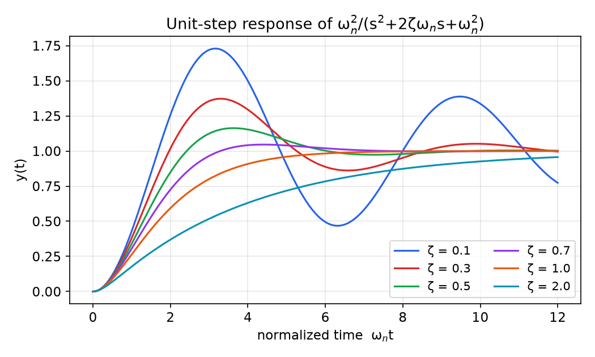
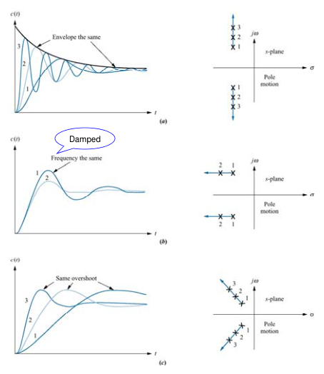
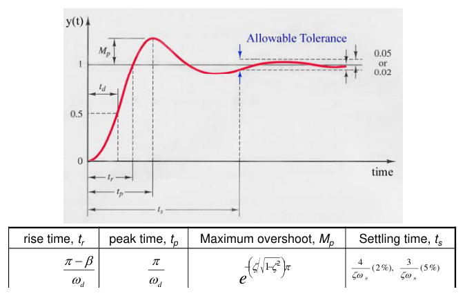
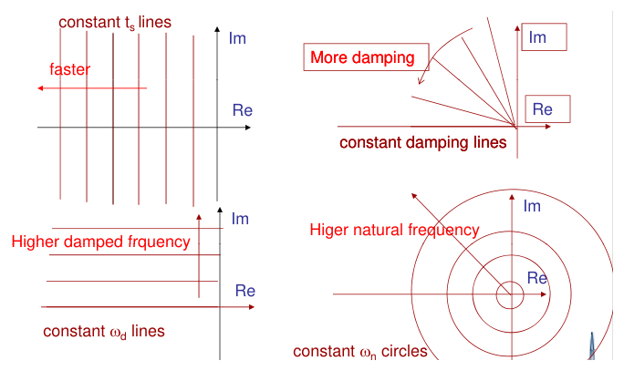
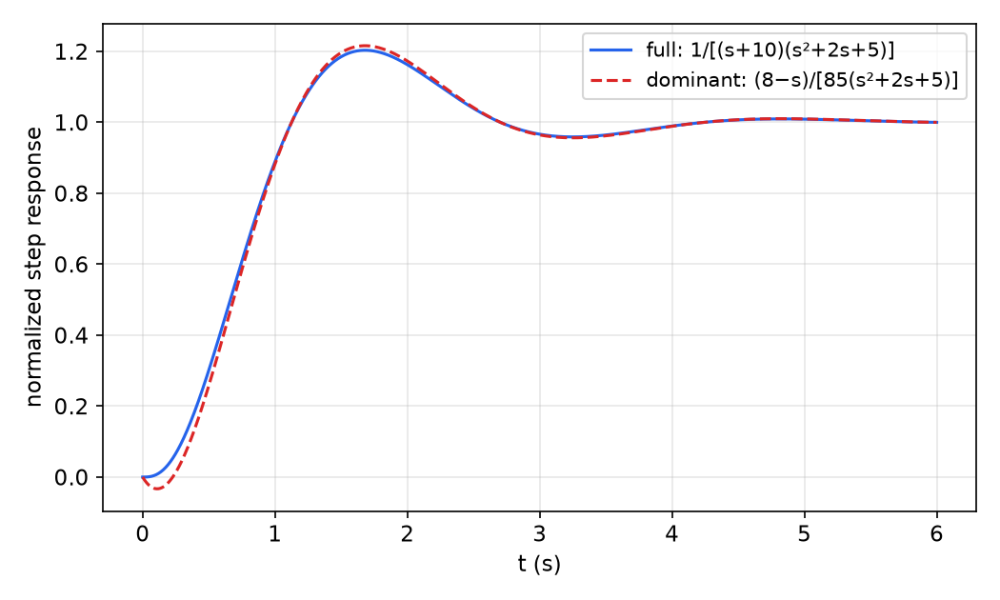
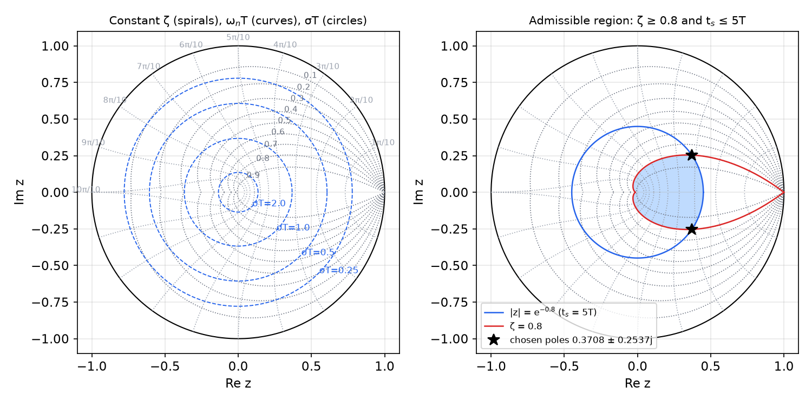
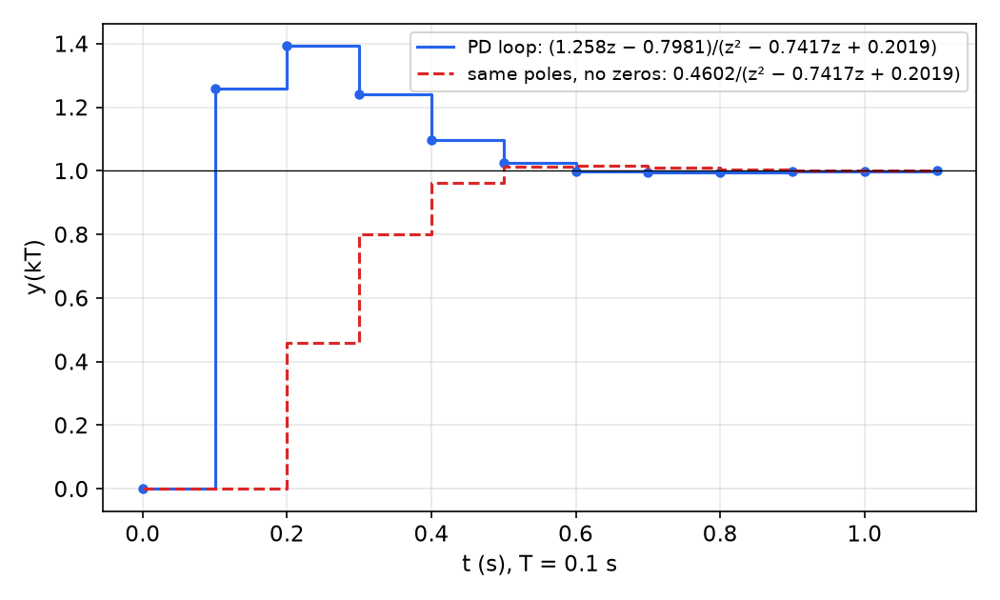

# Transient Specifications and the s-to-z Mapping

A digital controller is usually specified in the language of continuous time: "settle within two seconds, with no more than 15% overshoot". The controller, however, acts on a pulse transfer function, and its closed-loop poles live in the z-plane. This chapter builds the bridge. It reviews how the poles of first- and second-order continuous systems fix the shape of the transient response, turns the usual time-domain specifications into a region of allowed pole locations, carries that region into the z-plane through the map \\(z = e^{sT}\\), and finishes with the simplest classical design method: choose the closed-loop poles inside the region and solve for the controller gains. The root-locus and frequency-response methods of the next two chapters work toward the same pole targets.

## The Design Problem

### Feedback in a digital loop

A feedback controller compares the desired output with the measured output and adjusts the plant input so that the error shrinks. Compared with open-loop control (which computes the input from the desired output alone, with no sensor), closed-loop control

- adjusts the input automatically,
- is less sensitive to plant variations and disturbances, and
- can stabilize an unstable plant,

at the price of extra hardware (a sensor) and the possibility of making a stable plant unstable. In a digital loop, the comparator and the control law are implemented on a microprocessor. The output is sampled every \\(T\\) seconds, the controller computes a number, and a zero-order hold (ZOH) applies that number to the actuator until the next sample.

The loop was reduced to a single z-domain block diagram in [Z-Plane Analysis](z-plane.md): with plant \\(P(s)\\), sensor \\(H(s)\\) and a ZOH, the sampled plant seen by the controller \\(C(z)\\) is
\\[
G(z) = (1 - z^{-1})\\, \mathcal{Z}\left\\{ \frac{P(s)H(s)}{s} \right\\},
\\]
and the unity-feedback closed loop is
\\[
\frac{Y(z)}{R(z)} = \frac{C(z)G(z)}{1 + C(z)G(z)} .
\\]
The closed-loop poles are the roots of \\(1 + C(z)G(z) = 0\\). Classical design shapes \\(C(z)\\) so that these roots fall where the transient response is acceptable.

### Classical and modern design

Two families of methods are in use. **Classical** design (1930s onward) works with transfer functions and frequency-domain tools. It suits single-input single-output (SISO) loops and is the subject of this chapter and the next two: pole placement on transfer functions, the [root locus](root-locus.md) and [frequency response](frequency-response.md). **Modern** design (1950s onward) works with state models in the time domain. It was introduced for large multi-input multi-output systems, mostly in aerospace, and is developed from [Discrete State-Space Models](state-space.md) onward.

## Transient Response of Low-Order Systems

The specifications we want to impose are statements about the step response. The step response is fixed by the poles (and, to a lesser extent, the zeros) of the closed loop. We first make that connection precise for first- and second-order continuous systems.

### First-order systems

The model
\\[
\tau \dot y + y = k u
\\]
has, with zero initial condition, the transfer function
\\[
G(s) = \frac{Y(s)}{U(s)} = \frac{k}{\tau s + 1},
\\]
and the response to any input is \\(y(t) = (g \* u)(t) = \mathcal{L}^{-1}\\{G(s)U(s)\\}\\). The two standard responses are
\\[
g(t) = \frac{k}{\tau} e^{-t/\tau} \quad \text{(impulse)}, \qquad
y(t) = \mathcal{L}^{-1}\left\\{ \frac{k}{s(\tau s + 1)} \right\\} = k\left(1 - e^{-t/\tau}\right) \quad \text{(step)} .
\\]
The single pole is at \\(p = -1/\tau\\). Moving it to the left (smaller \\(\tau\\)) makes the response faster. A pole at the origin gives a constant impulse response, and a pole in the right half-plane gives a growing exponential. The step response reaches 63% of its final value at \\(t = \tau\\) and 98% at \\(t = 4\tau\\).

### Second-order systems

The normalized second-order model is
\\[
\ddot y + 2\zeta\omega\_n \dot y + \omega\_n^2 y = \omega\_n^2 u,
\qquad
G(s) = \frac{\omega\_n^2}{s^2 + 2\zeta\omega\_n s + \omega\_n^2},
\\]
with **damping ratio** \\(\zeta\\) and **undamped natural frequency** \\(\omega\_n\\). The DC gain is one. The characteristic equation \\(s^2 + 2\zeta\omega\_n s + \omega\_n^2 = 0\\) has roots
\\[
s\_{1,2} = -\zeta\omega\_n \pm \omega\_n\sqrt{\zeta^2 - 1},
\\]
which gives four cases.

| Case | \\(\zeta\\) | Poles | Name |
|---|---|---|---|
| 0 | \\(\zeta = 0\\) | \\(\pm j\omega\_n\\) | undamped |
| 1 | \\(0 < \zeta < 1\\) | \\(-\zeta\omega\_n \pm j\omega\_n\sqrt{1-\zeta^2} = -\sigma \pm j\omega\_d\\) | underdamped |
| 2 | \\(\zeta = 1\\) | \\(-\omega\_n\\) (double) | critically damped |
| 3 | \\(\zeta > 1\\) | \\(-\zeta\omega\_n \pm \omega\_n\sqrt{\zeta^2-1}\\) (real, distinct) | overdamped |

**Geometry of a complex pole pair.** In the underdamped case write the poles as \\(-\sigma \pm j\omega\_d\\) with
\\[
\sigma = \zeta\omega\_n, \qquad \omega\_d = \omega\_n\sqrt{1 - \zeta^2} .
\\]
Then \\(\sigma^2 + \omega\_d^2 = \omega\_n^2\\), so \\(\omega\_n = \lvert -\sigma \pm j\omega\_d \rvert\\) is the distance of the pole from the origin. If \\(\theta\\) is the angle between the pole vector and the imaginary axis, then \\(\sin\theta = \sigma/\omega\_n = \zeta\\). Equivalently, \\(\beta = \cos^{-1}\zeta\\) is the angle measured from the negative real axis. The decay rate \\(\sigma\\) is the horizontal distance from the imaginary axis, and the **damped frequency** \\(\omega\_d\\) is the height above the real axis.

**Impulse responses.** Inverting \\(G(s)\\) case by case:
\\[
\begin{aligned}
\zeta = 0 &: \quad g(t) = \omega\_n \sin\omega\_n t, \\\\
0 < \zeta < 1 &: \quad g(t) = \frac{\omega\_n}{\sqrt{1-\zeta^2}}\\, e^{-\sigma t}\sin\omega\_d t, \\\\
\zeta = 1 &: \quad g(t) = \omega\_n^2\\, t\\, e^{-\omega\_n t}, \\\\
\zeta > 1 &: \quad g(t) = \frac{\omega\_n}{2\sqrt{\zeta^2-1}}\left[ e^{-(\zeta - \sqrt{\zeta^2-1})\omega\_n t} - e^{-(\zeta + \sqrt{\zeta^2-1})\omega\_n t} \right].
\end{aligned}
\\]
The underdamped case follows from \\(G(s) = \dfrac{\omega\_n^2}{(s+\sigma)^2 + \omega\_d^2}\\) and the transform pair \\(\mathcal{L}\\{e^{-\sigma t}\sin\omega\_d t\\} = \omega\_d/[(s+\sigma)^2+\omega\_d^2]\\), with \\(\omega\_n^2/\omega\_d = \omega\_n/\sqrt{1-\zeta^2}\\). The oscillation sits inside the envelope \\(\pm e^{-\sigma t}\\).

**Step responses.** Dividing by \\(s\\) and inverting:
\\[
\begin{aligned}
\zeta = 0 &: \quad y(t) = 1 - \cos\omega\_n t, \\\\
0 < \zeta < 1 &: \quad y(t) = 1 - e^{-\zeta\omega\_n t}\left( \cos\omega\_d t + \frac{\zeta}{\sqrt{1-\zeta^2}}\sin\omega\_d t \right)
= 1 - \frac{e^{-\zeta\omega\_n t}}{\sqrt{1-\zeta^2}}\sin\left( \omega\_d t + \beta \right), \\\\
\zeta = 1 &: \quad y(t) = 1 - e^{-\omega\_n t}(1 + \omega\_n t), \\\\
\zeta > 1 &: \quad y(t) = 1 + \frac{e^{-(\zeta+\sqrt{\zeta^2-1})\omega\_n t}}{2(\zeta+\sqrt{\zeta^2-1})\sqrt{\zeta^2-1}} - \frac{e^{-(\zeta-\sqrt{\zeta^2-1})\omega\_n t}}{2(\zeta-\sqrt{\zeta^2-1})\sqrt{\zeta^2-1}},
\end{aligned}
\\]
where \\(\beta = \tan^{-1}\left(\sqrt{1-\zeta^2}/\zeta\right) = \cos^{-1}\zeta\\). The two forms of the underdamped response are related by \\(\cos x + \frac{\zeta}{\sqrt{1-\zeta^2}}\sin x = \frac{1}{\sqrt{1-\zeta^2}}\left(\sqrt{1-\zeta^2}\cos x + \zeta\sin x\right) = \frac{\sin(x+\beta)}{\sqrt{1-\zeta^2}}\\), using \\(\sin\beta = \sqrt{1-\zeta^2}\\) and \\(\cos\beta = \zeta\\).

*Figure: unit-step responses of the normalized second-order system plotted against \\(\omega\_n t\\). Small ζ gives a fast rise with large, slowly decaying oscillation; ζ = 1 is the fastest response without overshoot; ζ = 2 is sluggish because one real pole lies close to the origin.*

### How pole motion changes the response

Since \\(y(t)\\) depends on the poles only through \\(\sigma\\), \\(\omega\_d\\) and \\(\zeta\\), the effect of moving the poles can be read off directly:

- **Vertical motion** (constant \\(\sigma\\)): the envelope \\(e^{-\sigma t}\\) is unchanged; the oscillation frequency increases.
- **Horizontal motion** (constant \\(\omega\_d\\)): the oscillation frequency is unchanged; moving left increases the damping.
- **Radial motion** along a ray (constant \\(\zeta\\)): the response keeps its shape, overshoot included, and is compressed or stretched in time.

*Figure: (a) poles moved vertically share an envelope but oscillate faster; (b) poles moved horizontally share a frequency but are more damped; (c) poles moved outward along a constant-ζ ray share the overshoot and respond faster.*

## Transient-Response Specifications

*Figure: the quantities used to specify an underdamped step response. Delay time \\(t\_d\\) to 50%, rise time \\(t\_r\\), peak time \\(t\_p\\), maximum overshoot \\(M\_p\\), and settling time \\(t\_s\\) into a 2% or 5% band. The table gives the second-order formulas derived below.*

For the underdamped second-order system, each specification has a closed form.

**Peak time.** Differentiate the step response. Since \\(\dot y = g\\),
\\[
\dot y(t) = \frac{\omega\_n}{\sqrt{1-\zeta^2}}\\, e^{-\sigma t}\sin\omega\_d t = 0
\quad\Rightarrow\quad \omega\_d t = 0, \pi, 2\pi, \dots
\\]
The first maximum is at
\\[
\boxed{t\_p = \frac{\pi}{\omega\_d} = \frac{\pi}{\omega\_n\sqrt{1-\zeta^2}}}, \qquad \omega\_n t\_p = \frac{\pi}{\sqrt{1-\zeta^2}} .
\\]

**Maximum overshoot.** Substitute \\(t\_p\\) into the first form of \\(y(t)\\): \\(\cos\pi = -1\\), \\(\sin\pi = 0\\), so
\\[
y(t\_p) = 1 + e^{-\zeta\omega\_n\pi/\omega\_d}, \qquad
\boxed{M\_p = e^{-\pi\zeta/\sqrt{1-\zeta^2}}} .
\\]
The overshoot depends on \\(\zeta\\) alone, which is why it is constant along a ray. Taking logarithms, \\(\ln M\_p = -\pi\zeta/\sqrt{1-\zeta^2}\\); squaring and solving for \\(\zeta\\),
\\[
\boxed{\zeta = \frac{\lvert \ln M\_p \rvert}{\sqrt{\pi^2 + \ln^2 M\_p}}} .
\\]
For example, \\(M\_p = 0.163\\) gives \\(\zeta = 0.5\\), \\(M\_p = 0.046\\) gives \\(\zeta = 0.7\\), and \\(\zeta = 0.8\\) gives \\(M\_p = 0.015\\).

**Rise time** (0 to 100%). The first time \\(y = 1\\) is when \\(\sin(\omega\_d t + \beta) = 0\\) with \\(\omega\_d t + \beta = \pi\\):
\\[
\boxed{t\_r = \frac{\pi - \beta}{\omega\_d}}, \qquad \beta = \cos^{-1}\zeta .
\\]

**Settling time.** The error is bounded by the envelope, \\(\lvert y - 1 \rvert \le e^{-\sigma t}/\sqrt{1-\zeta^2}\\). Ignoring the factor \\(1/\sqrt{1-\zeta^2}\\) (close to one for moderate damping), the envelope falls below 2% when \\(e^{-\sigma t} = 0.02\\), i.e. \\(\sigma t = 3.9\\), and below 5% when \\(\sigma t = 3.0\\). The standard rules are
\\[
\boxed{t\_s \approx \frac{4}{\zeta\omega\_n} = \frac{4}{\sigma} \ (2\\%), \qquad t\_s \approx \frac{3}{\zeta\omega\_n} \ (5\\%)} .
\\]

| Specification | Formula | Fixed by |
|---|---|---|
| peak time \\(t\_p\\) | \\(\pi/\omega\_d\\) | height \\(\omega\_d\\) |
| overshoot \\(M\_p\\) | \\(e^{-\pi\zeta/\sqrt{1-\zeta^2}}\\) | angle (\\(\zeta\\)) |
| rise time \\(t\_r\\) | \\((\pi - \beta)/\omega\_d\\) | \\(\zeta\\) and \\(\omega\_d\\) |
| settling time \\(t\_s\\) | \\(4/\sigma\\) (2%) | real part \\(\sigma\\) |

### Specifications as regions in the s-plane

Each formula fixes one coordinate of the pole, and so each specification is a curve in the s-plane:

- constant \\(t\_s\\) (constant \\(\sigma\\)): vertical lines; further left is faster;
- constant \\(\zeta\\) (constant overshoot): rays from the origin; a larger angle from the imaginary axis is more damping;
- constant \\(\omega\_d\\) (constant \\(t\_p\\)): horizontal lines;
- constant \\(\omega\_n\\): circles centred at the origin.

*Figure: constant-specification contours in the s-plane. Vertical lines fix the settling time, rays fix the damping ratio, horizontal lines fix the damped frequency and circles fix the natural frequency.*

An inequality specification is a half-plane or a wedge. "\\(t\_s \le t\_s^\ast\\)" requires \\(\sigma \ge 4/t\_s^\ast\\) (to the left of a vertical line); "\\(M\_p \le M\_p^\ast\\)" requires \\(\zeta \ge \zeta^\ast\\) (inside the wedge \\(\lvert \angle s \rvert \ge 180^\circ - \cos^{-1}\zeta^\ast\\)). The admissible region is the intersection, and the designer's job is to put the dominant closed-loop poles in it.

### Higher-order systems and dominant poles

A physical system (mechanical, electrical, hydraulic) is modeled by an \\(n\\)-th order differential equation; with zero initial conditions this gives \\(G(s) = Y(s)/U(s)\\), and the response follows by inverting \\(G(s)U(s)\\). A partial-fraction expansion writes \\(G(s)\\) as a sum of first-order terms (real poles) and second-order terms (complex pairs), so the response is a sum of first- and second-order responses. Terms whose poles lie far to the left decay quickly and carry little weight. When one complex pair is much closer to the imaginary axis than the rest, the response is close to that of a **dominant second-order** subsystem, and the formulas above apply to it.

**Example (dominant-pole approximation).** Consider
\\[
G(s) = \frac{1}{(s+10)(s^2+2s+5)} = \frac{a}{s+10} + \frac{bs + c}{s^2 + 2s + 5} .
\\]
Clearing denominators, \\(1 = a(s^2+2s+5) + (bs+c)(s+10)\\). At \\(s = -10\\): \\(a = 1/85\\). The \\(s^2\\) coefficient gives \\(a + b = 0\\), so \\(b = -1/85\\); the constant term gives \\(5a + 10c = 1\\), so \\(c = 8/85\\). The pole at \\(-10\\) decays five times faster than the complex pair at \\(-1 \pm 2j\\), so
\\[
G(s) \approx \frac{(8 - s)/85}{s^2 + 2s + 5} .
\\]

*Figure: step responses of the full third-order system and its dominant second-order part, each normalized to a final value of one. The two nearly coincide (peak about 1.2 near 1.6 s); they differ only in the first fraction of a second, where the fast pole matters.*

## Mapping Between the s- and z-Planes

### The mapping z = e^{sT}

If a continuous signal contains the mode \\(e^{st}\\), its samples are \\(e^{skT} = (e^{sT})^k\\), which is the mode \\(z^k\\) of a discrete system with
\\[
\boxed{z = e^{sT}} .
\\]
The same relation links the poles of a continuous system to those of its sampled (for example ZOH) equivalent, and it is the bridge we use to translate specifications. Writing \\(s = -\sigma + j\omega\\),
\\[
z = e^{-\sigma T}e^{j\omega T}, \qquad \lvert z \rvert = e^{-\sigma T}, \qquad \angle z = \omega T .
\\]
The left half-plane (\\(\sigma > 0\\)) maps to the inside of the unit circle, the imaginary axis to the unit circle, and the right half-plane to the outside. The map is periodic in \\(\omega\\) with period \\(\omega\_s = 2\pi/T\\): the whole z-plane is covered once by the **primary strip** \\(-\pi/T < \omega \le \pi/T\\), and poles that differ by a multiple of \\(j\omega\_s\\) land on the same z. This is aliasing seen through the poles (see [Sampling and Reconstruction](sampling.md)), and it is why only s-plane poles in the primary strip have meaningful z-plane images.

### Images of the specification contours

Each s-plane contour has a simple image.

- **Constant settling time** (\\(\sigma\\) fixed): \\(\lvert z \rvert = e^{-\sigma T}\\), a circle centred at the origin. Faster settling means a smaller circle. A 2% settling time \\(t\_s\\) requires \\(\lvert z \rvert \le e^{-4T/t\_s}\\); a settling time of \\(N\\) samples requires \\(\lvert z \rvert \le e^{-4/N}\\).
- **Constant damped frequency** (\\(\omega\_d\\) fixed): \\(\angle z = \omega\_d T\\), a ray from the origin. A pole at angle \\(\theta\\) produces an oscillation with \\(2\pi/\theta\\) samples per cycle.
- **Constant damping ratio**: along the ray \\(s = \omega\_n(-\zeta + j\sqrt{1-\zeta^2})\\),
\\[
z = \exp\left(-\zeta\omega\_n T\right)\exp\left(j\omega\_n T\sqrt{1-\zeta^2}\right), \qquad
\lvert z \rvert = \exp\left( -\frac{\zeta}{\sqrt{1-\zeta^2}}\\, \angle z \right),
\\]
a **logarithmic spiral** that starts at \\(z = 1\\) (\\(\omega\_n = 0\\)) and winds toward the origin as \\(\omega\_n\\) grows. \\(\zeta = 0\\) gives the unit circle itself; larger \\(\zeta\\) gives a tighter spiral. Within the primary strip the spiral is drawn until \\(\angle z = \pi\\).
- **Constant natural frequency** (\\(\omega\_n\\) fixed, \\(\zeta\\) from 0 to 1): \\(z = e^{-\zeta\omega\_n T}e^{j\omega\_n T\sqrt{1-\zeta^2}}\\) traces a curve from \\(e^{j\omega\_n T}\\) on the unit circle (\\(\zeta = 0\\)) to the real point \\(e^{-\omega\_n T}\\) (\\(\zeta = 1\\)), crossing the spirals at right angles.

These are the curves drawn by MATLAB's `zgrid`: spirals for \\(\zeta = 0.1, \dots, 0.9\\) and \\(\omega\_n T\\) curves at multiples of \\(\pi/10\\) (labelled 0.314, 0.628, ..., 3.14 rad).

*Figure: left, the `zgrid` curves (dotted ζ spirals from z = 1, dotted ω_nT curves from the unit circle) with circles of constant σT; the circles shrink toward the origin as the settling time decreases. Right, the admissible region of the pole-placement example below: inside the circle |z| = e^{−0.8} (settling time at most 5T) and inside the ζ = 0.8 spiral. The stars are the chosen closed-loop poles, at the corner of the region.*

### Reading a z-plane pole

The inverse map gives the equivalent continuous parameters of any z-plane pole \\(z = re^{j\theta}\\) with \\(0 < r < 1\\):
\\[
s = \frac{\ln z}{T} = \frac{\ln r + j\theta}{T}, \qquad
\sigma = -\frac{\ln r}{T}, \quad \omega\_d = \frac{\theta}{T}, \quad
\omega\_n = \frac{\sqrt{\ln^2 r + \theta^2}}{T}, \quad
\zeta = \frac{-\ln r}{\sqrt{\ln^2 r + \theta^2}} .
\\]
Some landmarks: the origin \\(z = 0\\) corresponds to \\(\sigma = \infty\\) (a mode that vanishes after a finite number of steps, the **dead-beat** pole); poles on the positive real axis near 1 are slow and non-oscillatory; poles on the negative real axis correspond to \\(\omega\_d = \pi/T\\) and alternate in sign every sample, a behaviour no continuous second-order system has without aliasing.

### Design recipe

To translate continuous specifications into a z-plane target:

1. From \\(M\_p\\) find \\(\zeta\\); from \\(t\_s\\) find \\(\sigma = 4/t\_s\\) (or from \\(t\_p\\) find \\(\omega\_d\\)).
2. Form \\(s\_d = -\sigma \pm j\omega\_d\\) with \\(\omega\_d = \sigma\sqrt{1-\zeta^2}/\zeta\\).
3. Map: \\(z\_d = e^{s\_d T} = e^{-\sigma T}\left(\cos\omega\_d T \pm j\sin\omega\_d T\right)\\).
4. The desired dominant characteristic polynomial is \\((z - z\_d)(z - \bar z\_d) = z^2 - 2e^{-\sigma T}\cos(\omega\_d T)\\, z + e^{-2\sigma T}\\).

The sample period must be short enough that \\(\omega\_d T\\) is well below \\(\pi\\); a common rule is 8 to 10 samples per damped period or more.

## Design by Pole Placement

When the controller has as many free parameters as the closed-loop characteristic polynomial has coefficients, the controller can be found by matching coefficients: choose all closed-loop poles, expand the desired polynomial, and equate it with the closed-loop characteristic polynomial. With fewer parameters (the usual case for PID-type controllers on higher-order plants), only some poles can be placed this way and the [root locus](root-locus.md) is the better tool.

**Example (PD pole placement on a double integrator).** The sampled plant
\\[
G(z) = \frac{z}{(z-1)^2}
\\]
has a double pole at \\(z = 1\\) (a double integrator). Design a PD controller so that the closed loop has settling time less than \\(5T\\) and damping ratio greater than 0.8.

*Desired poles.* Take the boundary values. The settling-time condition \\(4/\sigma = 5T\\) gives \\(\sigma = 0.8/T\\). With \\(\zeta = 0.8\\),
\\[
\omega\_d = \sigma\frac{\sqrt{1-\zeta^2}}{\zeta} = \frac{0.8}{T}\cdot\frac{0.6}{0.8} = \frac{0.6}{T},
\qquad s\_d = \frac{-0.8 \pm j0.6}{T} .
\\]
Note that \\(\sigma T\\) and \\(\omega\_d T\\) do not depend on \\(T\\): specifications stated in samples give z-plane poles that do not depend on the sample period. Mapping,
\\[
z\_d = e^{s\_d T} = e^{-0.8}\left(\cos 0.6 \pm j\sin 0.6\right) = 0.4493\\,(0.8253 \pm j0.5646) = 0.3708 \pm j0.2537,
\\]
and the desired characteristic polynomial is
\\[
(z - 0.3708)^2 + 0.2537^2 = z^2 - 0.7417 z + 0.2019 .
\\]
(Indeed \\(2 \times 0.3708 = 0.7417\\) and \\(e^{-1.6} = 0.2019\\).)

*Controller.* The discrete PD law \\(u(k) = K\_p e(k) + K\_d\left[e(k) - e(k-1)\right]\\) has transfer function
\\[
C(z) = K\_p + K\_d(1 - z^{-1}) = (K\_p + K\_d) - K\_d z^{-1} = \frac{(K\_p + K\_d)z - K\_d}{z} .
\\]
*Closed loop.* With unity feedback,
\\[
C(z)G(z) = \frac{(K\_p + K\_d)z - K\_d}{(z-1)^2},
\qquad
\frac{Y(z)}{R(z)} = \frac{(K\_p + K\_d)z - K\_d}{(z-1)^2 + (K\_p + K\_d)z - K\_d}
= \frac{(K\_p + K\_d)z - K\_d}{z^2 + (K\_p + K\_d - 2)z + 1 - K\_d} .
\\]
The factor \\(z\\) in the controller denominator cancels the plant zero at the origin, so the closed loop is of second order and two gains suffice to place both poles.

*Matching coefficients* with \\(z^2 - 0.7417z + 0.2019\\):
\\[
1 - K\_d = 0.2019 \ \Rightarrow\ K\_d = 0.7981, \qquad
K\_p + K\_d - 2 = -0.7417 \ \Rightarrow\ K\_p + K\_d = 1.2583,
\\]
so
\\[
\boxed{K\_p = 0.4602, \qquad K\_d = 0.7981}, \qquad
\frac{Y(z)}{R(z)} = \frac{1.258z - 0.7981}{z^2 - 0.7417z + 0.2019} .
\\]
(The value \\(K\_p = 0.4062\\) that sometimes appears for this example is a transposition of digits; the closed-loop numerator \\(1.258z\\) requires \\(K\_p + K\_d = 1.258\\).)

*Steady state.* At \\(z = 1\\), \\(Y/R = (1.2583 - 0.7981)/(1 - 0.7417 + 0.2019) = 0.4602/0.4602 = 1\\): the step error is zero, as it must be with a double integrator in the loop.

*Step response.* The response to a unit step, computed by long division or simulation with \\(T = 0.1\\) s, is
\\[
y(k) = 0,\ 1.258,\ 1.394,\ 1.240,\ 1.098,\ 1.025,\ 0.998,\ 0.994,\ 0.996,\ \dots
\\]
It settles into the 2% band after five samples, as specified. The overshoot, however, is 39%, far above the 1.5% that \\(\zeta = 0.8\\) predicts.

*Figure: unit-step response of the PD design (solid, T = 0.1 s) compared with a system that has the same poles but no finite zero (dashed). The poles fix the decay; the zero at z = 0.634 produces the large early overshoot.*

*Why the overshoot is large.* The closed loop has a zero at \\(z = K\_d/(K\_p + K\_d) = 0.7981/1.2583 = 0.634\\), introduced by the derivative action. A zero adds a scaled derivative (in discrete time, a scaled difference) of the response to the response itself; a zero close to \\(z = 1\\) relative to the poles makes that contribution large. The second-order formulas describe pole effects only. When a design has zeros near the dominant poles, the specifications must be checked by simulation, and the poles may need to be placed more conservatively. The dashed curve in the figure, \\(0.4602/(z^2 - 0.7417z + 0.2019)\\), has the same poles without the zero and overshoots by only 1.6%.

**Remark (dead-beat placement).** The extreme choice is to place every closed-loop pole at \\(z = 0\\). The characteristic polynomial becomes \\(z^n\\), the error dies in at most \\(n\\) samples, and the corresponding continuous settling time is zero. The first-order version of this design appears in [Z-Plane Analysis](z-plane.md). Dead-beat control is fast but demands large control effort and is sensitive to model error, so practical designs keep the poles inside the admissible region but away from the origin.

## Summary

- First-order system \\(k/(\tau s+1)\\): pole at \\(-1/\tau\\); 2% settling in about \\(4\tau\\).
- Second-order system: poles \\(-\sigma \pm j\omega\_d\\) with \\(\sigma = \zeta\omega\_n\\), \\(\omega\_d = \omega\_n\sqrt{1-\zeta^2}\\), \\(\zeta = \sin\theta\\) (angle from the imaginary axis).
- Specifications: \\(t\_p = \pi/\omega\_d\\), \\(M\_p = e^{-\pi\zeta/\sqrt{1-\zeta^2}}\\), \\(\zeta = \lvert\ln M\_p\rvert/\sqrt{\pi^2 + \ln^2 M\_p}\\), \\(t\_r = (\pi - \cos^{-1}\zeta)/\omega\_d\\), \\(t\_s \approx 4/\sigma\\) (2%) or \\(3/\sigma\\) (5%).
- Higher-order systems are approximated by their dominant pole pair when the other poles are much faster.
- \\(z = e^{sT}\\): constant \\(\sigma\\) maps to circles \\(\lvert z \rvert = e^{-\sigma T}\\), constant \\(\omega\_d\\) to rays \\(\angle z = \omega\_d T\\), constant \\(\zeta\\) to logarithmic spirals from \\(z = 1\\), constant \\(\omega\_n\\) to curves orthogonal to the spirals (`zgrid`).
- Inverse: \\(\sigma = -\ln r/T\\), \\(\omega\_d = \theta/T\\), \\(\zeta = -\ln r/\sqrt{\ln^2 r + \theta^2}\\).
- Pole placement: pick \\(z\_d = e^{s\_d T}\\), expand the desired polynomial, match coefficients. Example: \\(G = z/(z-1)^2\\), \\(\zeta = 0.8\\), \\(t\_s = 5T\\) gives \\(z\_d = 0.3708 \pm j0.2537\\), \\(K\_p = 0.4602\\), \\(K\_d = 0.7981\\).
- Closed-loop zeros (here at 0.634) can raise the overshoot well above the second-order prediction; always check by simulation.

## See Also

- [Z-Plane Analysis](z-plane.md): pulse transfer functions, the z-domain loop and dead-beat control of a first-order plant.
- [Root-Locus Design of Digital Controllers](root-locus.md): placing the dominant poles when the controller has too few parameters for full pole placement.
- [Frequency-Response Analysis of Digital Systems](frequency-response.md): phase margin as a damping specification.
- [Sampling and Reconstruction](sampling.md): aliasing and the primary strip.
- [Z-Transform](z-transform.md) and Z-Transform (Signals).
- Stability and PID Control: the continuous-time counterparts.
- [State Feedback](state-feedback.md): pole placement with state models.
