# Frequency-Response Analysis of Digital Systems

The root locus works with the closed-loop poles directly. Frequency-response methods work instead with the open-loop transfer function evaluated on the stability boundary, which for a digital loop is the unit circle \\(z = e^{j\omega T}\\). From that one curve they deliver a stability test (the Nyquist criterion) that does not require factoring the characteristic polynomial, and robustness measures (gain and phase margins) that are tied to the transient response through the rule PM ≈ 100ζ. This chapter derives the discrete frequency response, adapts Bode and Nyquist plots to sampled systems, defines the margins, introduces the w-transform that lets continuous design rules be reused, and closes with a PD design for the servo plant used in [Root-Locus Design of Digital Controllers](root-locus.md).

## The Frequency-Response Principle

### Continuous time

If a stable linear time-invariant system with transfer function \\(G(s)\\) is driven by \\(u(t) = A\_i\sin\omega t\\), then after the transient dies out the output is a sinusoid of the same frequency,
\\[
y\_{ss}(t) = A\_o\sin(\omega t + \varphi), \qquad \frac{A\_o}{A\_i} = \lvert G(j\omega) \rvert, \qquad \varphi = \angle G(j\omega) .
\\]
The function \\(G(j\omega)\\) is the **frequency response** (see Frequency Response for the continuous theory).

### Discrete time

**Theorem (discrete frequency response).** Let \\(G(z)\\) be the pulse transfer function of a stable discrete-time LTI system (all poles inside the unit circle). If the input is the sampled sinusoid \\(u(k) = A\_i\sin(\omega kT)\\), the steady-state output is
\\[
y\_{ss}(k) = A\_o\sin(\omega kT + \varphi), \qquad \frac{A\_o}{A\_i} = \lvert G(e^{j\omega T}) \rvert, \qquad \varphi = \angle G(e^{j\omega T}) .
\\]

*Proof.* Normalize \\(T = 1\\) and let \\(g(i)\\) be the impulse response, so \\(G(z) = \sum\_{i \ge 0} g(i)z^{-i}\\). For the complex input \\(u(k) = e^{j\omega k}\\) applied from \\(k = 0\\), the convolution sum gives
\\[
y(k) = \sum\_{i=0}^{k} g(i)u(k - i) = \sum\_{i=0}^{k} g(i)e^{j\omega(k - i)} = e^{j\omega k}\sum\_{i=0}^{k} g(i)e^{-j\omega i} .
\\]
Because the system is stable, \\(g(i)\\) decays geometrically and the partial sum converges, as \\(k \to \infty\\), to \\(\sum\_{i=0}^{\infty} g(i)(e^{j\omega})^{-i} = G(e^{j\omega})\\). Writing \\(G(e^{j\omega}) = \lvert G \rvert e^{j\varphi}\\),
\\[
y\_{ss}(k) = G(e^{j\omega})e^{j\omega k} = \lvert G \rvert e^{j(\omega k + \varphi)} .
\\]
Since \\(g\\) is real, \\(G(e^{-j\omega}) = \overline{G(e^{j\omega})}\\), and the input \\(e^{-j\omega k}\\) gives \\(\lvert G \rvert e^{-j(\omega k + \varphi)}\\). By linearity, \\(\sin\omega k = (e^{j\omega k} - e^{-j\omega k})/(2j)\\) produces \\(\lvert G \rvert\sin(\omega k + \varphi)\\), and \\(\cos\omega k\\) produces \\(\lvert G \rvert\cos(\omega k + \varphi)\\). \\(\blacksquare\\)

The discrete frequency response is \\(G(z)\\) evaluated on the unit circle. Two properties distinguish it from the continuous one:

- **Periodicity.** \\(e^{j(\omega + 2\pi/T)T} = e^{j\omega T}\\), so \\(G(e^{j\omega T})\\) is periodic in \\(\omega\\) with period \\(\omega\_s = 2\pi/T\\).
- **Conjugate symmetry.** \\(G(e^{-j\omega T}) = \overline{G(e^{j\omega T})}\\).

Together they mean that the whole response is determined by \\(0 \le \omega \le \pi/T\\), up to the **Nyquist frequency** \\(\omega\_N = \pi/T\\). At \\(\omega = \pi/T\\) the point \\(z = -1\\) is real, so \\(G(e^{j\pi})\\) is real and the phase there is a multiple of \\(180^\circ\\).

**Example (first-order lag and its ZOH equivalent).** For \\(G(s) = 1/(s + 1)\\) with a ZOH and \\(T = 0.5\\) s,
\\[
G(z) = \frac{1 - e^{-T}}{z - e^{-T}} = \frac{0.3935}{z - 0.6065} .
\\]
At low frequency the two responses agree (both have DC gain 1). As \\(\omega\\) grows the discrete phase falls faster, reaching \\(-180^\circ\\) at \\(\omega = \pi/T = 6.28\\) rad/s, where \\(\lvert G \rvert = 0.3935/1.6065 = 0.245\\); the continuous phase never passes \\(-90^\circ\\). The extra lag is that of the hold: the ZOH output is, on average, the input delayed by \\(T/2\\), which contributes about \\(-\omega T/2\\) rad of phase.

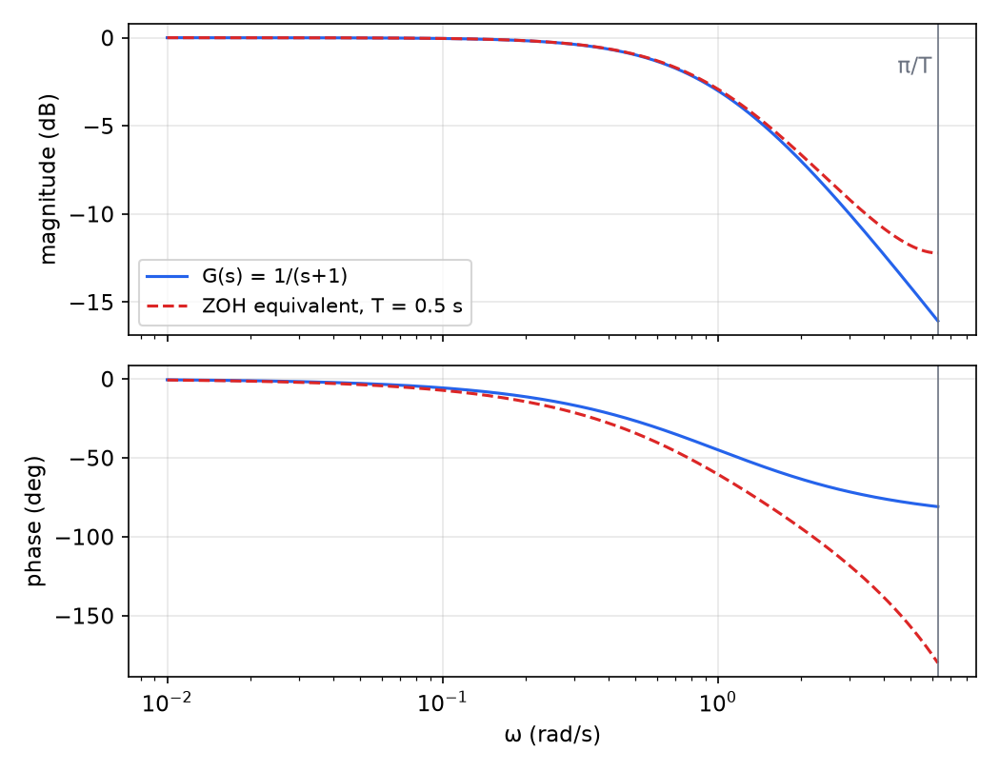

*Figure: Bode plots of the continuous first-order lag (solid) and its ZOH equivalent with T = 0.5 s (dashed), up to the Nyquist frequency π/T. The magnitudes nearly agree; the sampled system accumulates extra phase lag, reaching −180° at π/T.*

## Bode Diagrams

A **Bode diagram** plots the magnitude in decibels, \\(M\_{dB} = 20\log\_{10}\lvert G \rvert\\), and the phase \\(\varphi = \angle G\\) against \\(\omega\\) on a logarithmic axis. For a discrete system the curves are \\(\lvert G(e^{j\omega T}) \rvert\\) and \\(\angle G(e^{j\omega T})\\), drawn for \\(0 < \omega \le \pi/T\\).

**Superposition in dB.** If \\(G = G\_1G\_2\cdots G\_n\\), then \\(\lvert G \rvert = \lvert G\_1 \rvert\cdots\lvert G\_n \rvert\\) and \\(\angle G = \sum\angle G\_i\\), so
\\[
M\_{dB} = M\_{1,dB} + M\_{2,dB} + \cdots + M\_{n,dB}, \qquad \varphi = \varphi\_1 + \varphi\_2 + \cdots + \varphi\_n .
\\]
The plot of a product is the sum of the plots of its factors. For continuous systems this makes hand sketching easy: each factor has straight-line asymptotes (an integrator is a −20 dB/decade line with \\(-90^\circ\\) phase; a first-order zero at \\(\omega\_0\\) adds +20 dB/decade and \\(+90^\circ\\) above \\(\omega\_0\\); a double pole adds −40 dB/decade and \\(-180^\circ\\)), and the actual curve departs from the asymptotes by at most a few dB near each corner. A loop such as \\(K(s + 0.5)/[s(s/50 + 1)^2]\\) has a −20 dB/decade slope at low frequency, a flat stretch between 0.5 and 50 rad/s, and −40 dB/decade beyond.

For a discrete \\(G(e^{j\omega T})\\) the factors \\(e^{j\omega T} - p\\) do not have straight-line asymptotes in \\(\log\omega\\), and the curves bend near the Nyquist frequency. Two remedies are common: plot numerically (as every software package does), or transform to the w-plane, where the asymptote rules return (see below).

## The Nyquist Stability Criterion

### Cauchy's argument principle

**Theorem (argument principle).** Let \\(F\\) be a rational function and \\(c\\) a simple closed curve, traversed counter-clockwise, that passes through no pole or zero of \\(F\\). If \\(c\\) encloses \\(Z\\) zeros and \\(P\\) poles of \\(F\\) (counted with multiplicity), then the image curve \\(F(c)\\) encircles the origin \\(Z - P\\) times counter-clockwise.

*Proof sketch.* Write \\(F(z) = k\prod(z - z\_j)/\prod(z - p\_i)\\), so \\(\angle F = \angle k + \sum\angle(z - z\_j) - \sum\angle(z - p\_i)\\). As \\(z\\) goes once around \\(c\\), the vector \\(z - a\\) turns through \\(+360^\circ\\) if \\(a\\) is inside \\(c\\) and returns to its starting angle if \\(a\\) is outside. The net change of \\(\angle F\\) is therefore \\(360^\circ(Z - P)\\), which is \\(Z - P\\) counter-clockwise turns of \\(F(z)\\) around the origin. For example, around a circle enclosing \\(a\\), \\(F = z - a\\) encircles the origin once counter-clockwise and \\(F = (z - a)^{-1}\\) once clockwise.

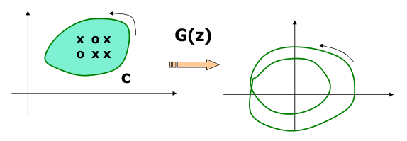

*Figure: a counter-clockwise contour c enclosing three poles (×) and three zeros (○) is mapped by G(z) to a closed curve; the number of times the image winds around the origin counts zeros minus poles inside c.*

### The criterion for discrete-time loops

Consider the loop with forward path \\(G(z)\\) and feedback \\(H(z)\\); its characteristic equation is \\(1 + GH(z) = 0\\). Apply the argument principle to
\\[
F(z) = 1 + GH(z)
\\]
on the unit circle traversed counter-clockwise. The zeros of \\(F\\) are the closed-loop poles; the poles of \\(F\\) are the open-loop poles. Let \\(n\\) be the order (the common number of poles and zeros of \\(F\\), finite ones included), and let

- \\(P\\) = number of open-loop poles **outside** the unit circle (unstable poles of \\(GH\\)),
- \\(Z\\) = number of closed-loop poles **outside** the unit circle.

Inside the circle there are \\(n - Z\\) zeros and \\(n - P\\) poles of \\(F\\), so \\(F\\) encircles the origin \\((n - Z) - (n - P) = P - Z\\) times counter-clockwise. Since \\(GH = F - 1\\), encirclements of the origin by \\(F\\) are encirclements of the point \\(-1\\) by \\(GH\\). Let \\(N\\) be the number of **clockwise** encirclements of \\(-1\\) by the image of the unit circle under \\(GH\\). Then \\(N = Z - P\\), that is:

**Theorem (Nyquist criterion, discrete time).** With \\(P\\), \\(Z\\) and \\(N\\) as above,
\\[
\boxed{Z = P + N} .
\\]
The closed loop is stable if and only if \\(Z = 0\\), i.e. the Nyquist plot of \\(GH(e^{j\omega T})\\) encircles \\(-1\\) counter-clockwise exactly \\(P\\) times. For an open-loop stable \\(GH\\) (\\(P = 0\\)), the plot must not encircle \\(-1\\) at all.

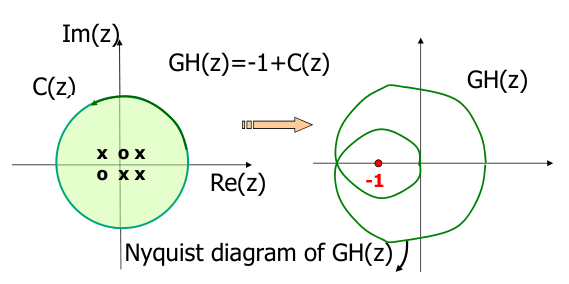

*Figure: the unit circle, traversed counter-clockwise, is mapped by GH(z) = −1 + F(z). Encirclements of the origin by F are encirclements of the point −1 by GH.*

The structure matches the continuous criterion with the unit circle in place of the imaginary axis and the outside in place of the right half-plane. Unlike the continuous case, the contour is bounded: there is no large semicircle to map, because the unstable region is the outside of a finite curve.

### Drawing the Nyquist plot

- Only \\(0 \le \omega T \le \pi\\) needs to be computed: the lower half of the circle maps to the complex-conjugate (mirror) image, and the curve repeats with period \\(2\pi\\) in \\(\omega T\\).
- A Bode plot is a good first step: the polar plot of magnitude \\(M = \lvert GH \rvert\\) against phase \\(\phi = \angle GH\\) is the Nyquist plot.
- **Poles on the unit circle** (an integrator at \\(z = 1\\) is the usual case) must be avoided by a small detour. Indent the contour outward around the pole with \\(z = 1 + \varepsilon e^{j\theta}\\), \\(\theta\\) from \\(-90^\circ\\) to \\(+90^\circ\\). Then the pole is counted as inside (stable), consistent with not counting it in \\(P\\). Near it \\(GH \approx c/(z - 1) = (c/\varepsilon)e^{-j\theta}\\), so the detour maps to a half circle of infinite radius traversed clockwise, which closes the plot.

**Example 1 (an unstable open loop).** Take \\(GH(z) = K/(z - 2)\\), which has one pole outside the unit circle (\\(P = 1\\)). On \\(z = e^{j\theta}\\), the point \\(z - 2\\) runs around the unit circle centred at \\(-2\\). The map \\(w \mapsto 1/w\\) sends circles to circles, so \\(1/(z - 2)\\) also traces a circle; it is symmetric about the real axis and passes through \\(1/(1 - 2) = -1\\) (\\(z = 1\\)) and \\(1/(-1 - 2) = -1/3\\) (\\(z = -1\\)). Its centre is \\(-2/3\\) and its radius \\(1/3\\), and it is traversed counter-clockwise. Scaling by \\(K\\) gives the circle through \\(-K\\) and \\(-K/3\\). Stability requires \\(N = Z - P = -1\\): one counter-clockwise encirclement of \\(-1\\), i.e. \\(-1\\) inside the circle:
\\[
-K < -1 < -\frac{K}{3} \iff 1 < K < 3 .
\\]
*Check.* The closed-loop CE \\(z - 2 + K = 0\\) has its root at \\(2 - K\\), inside the unit circle exactly when \\(1 < K < 3\\).

**Example 2 (a delayed first-order loop).** For \\(GH(z) = Kz^{-2}/(z - 0.5)\\), find the gains \\(K > 0\\) for which the loop is stable. Here \\(P = 0\\), so the plot of \\(GH\\) must not encircle \\(-1\\). The phase \\(\angle GH(e^{j\theta}) = -2\theta - \angle(e^{j\theta} - 0.5)\\) first reaches \\(-180^\circ\\) at \\(\theta = 0.8758\\) rad, where \\(\lvert e^{j\theta} - 0.5 \rvert = 0.7808\\); the plot for \\(K = 1\\) crosses the negative real axis at \\(-1/0.7808 = -1.281\\). For general \\(K\\) the crossing is at \\(-1.281K\\), and the point \\(-1\\) is not encircled when \\(1.281K < 1\\):
\\[
0 < K < 0.7808 .
\\]
*Check.* The CE is \\(z^3 - 0.5z^2 + K = 0\\). At the critical gain it factors as \\((z + K)(z^2 - (0.5 + K)z + 1)\\); comparing coefficients requires \\(1 - 0.5K - K^2 = 0\\), so \\(K = (\sqrt{17} - 1)/4 = 0.7808\\), with a complex pair on the unit circle (product 1) at \\(0.640 \pm j0.768 = e^{\pm j0.876}\\). The two delays cost a lot: without them, \\(K/(z - 0.5)\\) is stable for \\(K < 1.5\\).

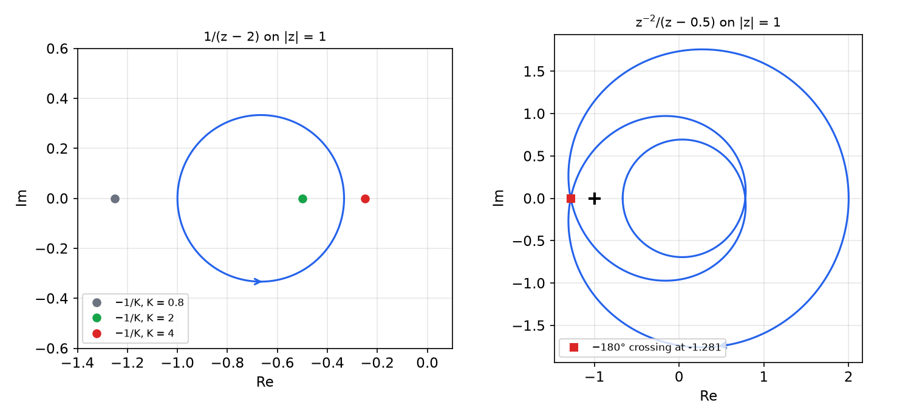

*Figure: left, the Nyquist plot of 1/(z−2) is a circle traversed counter-clockwise from −1 to −1/3; the closed loop with gain K is stable when −1/K lies inside it (K = 2), unstable otherwise (K = 0.8, K = 4). Right, z⁻²/(z−0.5): the curve crosses the negative real axis at −1.281, so the gain margin is 1/1.281 = 0.781.*

**Example 3 (the effect of sampling).** For the continuous loop \\(G(s) = 1/[(s + 1)(0.1s + 1)]\\) and its ZOH equivalents with \\(T = 0.01\\) s and \\(T = 0.1\\) s, for which \\(K\\) is \\(KG/(1 + KG)\\) stable?
```matlab
% Nyquist Diagram Example
ghc  = tf(1, conv([1 1],[0.1 1]));
ghd1 = c2d(ghc, 0.01);
ghd2 = c2d(ghc, 0.1);
nyquist(ghc, ghd1, ghd2);
grid;
```
The continuous plot stays in the lower half-plane and never crosses the negative real axis (phase between \\(0^\circ\\) and \\(-180^\circ\\)), so the continuous loop is stable for every \\(K > 0\\). The sampled loops gain the extra phase lag of the hold, cross the negative real axis, and so have finite critical gains:

| | phase crossover | crossing point | critical gain |
|---|---|---|---|
| continuous | none | none | \\(\infty\\) |
| \\(T = 0.01\\) s | 46.6 rad/s | \\(-0.00446\\) | 224 (47.0 dB) |
| \\(T = 0.1\\) s, \\(G(z) = \dfrac{0.0355z + 0.0247}{z^2 - 1.2727z + 0.3329}\\) | 14.1 rad/s | \\(-0.0370\\) | 27.1 (28.6 dB) |

The slower the sampling, the smaller the stable gain range.

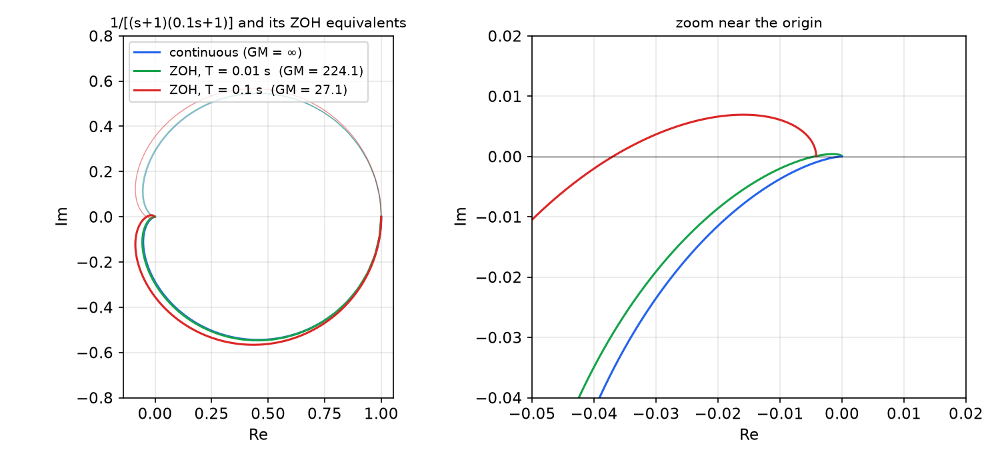

*Figure: Nyquist plots of 1/[(s+1)(0.1s+1)] (blue) and its ZOH equivalents for T = 0.01 s (green) and T = 0.1 s (red); faint curves are the negative-frequency mirror images. The zoom shows that only the sampled plots cross the negative real axis, at −1/224 and −1/27.1.*

## Gain and Phase Margins

The Nyquist criterion says how many encirclements there are; the margins say how close the plot comes to producing one more. For an open-loop stable \\(GH\\) whose plot does not encircle \\(-1\\):

**Definition (margins).** Let \\(\omega\_c\\) be the **gain-crossover frequency**, where \\(\lvert GH(e^{j\omega\_c T}) \rvert = 1\\) (0 dB), and \\(\omega\_p\\) the **phase-crossover frequency**, where \\(\angle GH(e^{j\omega\_p T}) = -180^\circ\\). Then
\\[
\boxed{\text{PM} = \angle GH(e^{j\omega\_c T}) + 180^\circ}, \qquad
\boxed{\text{GM} = \frac{1}{\lvert GH(e^{j\omega\_p T}) \rvert}, \quad \text{GM}\_{dB} = -20\log\_{10}\lvert GH(e^{j\omega\_p T}) \rvert} .
\\]
The gain margin is the factor by which the loop gain can be raised before the plot passes through \\(-1\\); the phase margin is the extra phase lag (at the gain crossover) that would do the same.

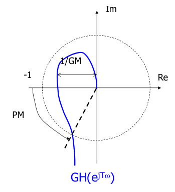

*Figure: the Nyquist plot crosses the unit circle at an angle PM above the negative real axis, and crosses the negative real axis at distance 1/GM from the origin.*

**Relative stability.** By the Nyquist theorem, if \\(GH\\) has no unstable poles, the closed loop \\(G/(1 + GH)\\) is stable when both margins are positive (GM > 1, i.e. GM\\(\_{dB}\\) > 0, and PM > 0). The margins measure relative stability: how much gain change or unmodeled lag (a computational delay, a hold, an unmodeled pole) the loop tolerates. The phase margin also shapes the transient response, as shown next. A phase margin above about \\(50^\circ\\) is desirable in most control systems.

**Example 4 (margins from a Bode plot).** For \\(L(s) = 1/[s(s + 1)(s + 2)]\\), the phase \\(-90^\circ - \tan^{-1}\omega - \tan^{-1}(\omega/2)\\) equals \\(-180^\circ\\) when \\(\tan^{-1}\omega + \tan^{-1}(\omega/2) = 90^\circ\\), i.e. \\(\omega \cdot \omega/2 = 1\\), so \\(\omega\_p = \sqrt 2 = 1.414\\) rad/s. There \\(\lvert L \rvert = 1/(\sqrt2\sqrt3\sqrt6) = 1/6\\), so \\(\text{GM} = 6 = 15.56\\) dB. Solving \\(\lvert L(j\omega) \rvert = 1\\) numerically gives \\(\omega\_c = 0.4457\\) rad/s and \\(\text{PM} = 53.41^\circ\\). MATLAB's `margin(L)` reports exactly these numbers.

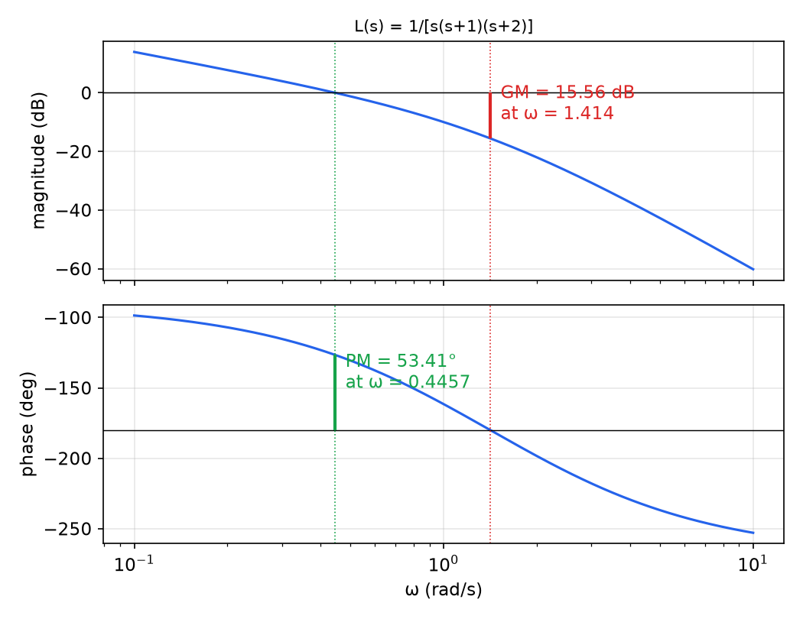

*Figure: Bode plot of 1/[s(s+1)(s+2)]. The gain margin (15.56 dB) is read on the magnitude plot at the phase crossover 1.414 rad/s; the phase margin (53.41°) is read on the phase plot at the gain crossover 0.4457 rad/s.*

### Phase margin and damping

For the standard second-order loop
\\[
L(s) = \frac{\omega\_n^2}{s(s + 2\zeta\omega\_n)}, \qquad \frac{L}{1 + L} = \frac{\omega\_n^2}{s^2 + 2\zeta\omega\_n s + \omega\_n^2},
\\]
the margins can be computed exactly. The gain crossover satisfies \\(\omega\_n^4 = \omega\_c^2(\omega\_c^2 + 4\zeta^2\omega\_n^2)\\), a quadratic in \\(\omega\_c^2\\) whose positive root is
\\[
\omega\_c = \omega\_n\sqrt{\sqrt{1 + 4\zeta^4} - 2\zeta^2} .
\\]
The phase there is \\(-90^\circ - \tan^{-1}(\omega\_c/2\zeta\omega\_n)\\), so
\\[
\boxed{\text{PM} = 90^\circ - \tan^{-1}\frac{\omega\_c}{2\zeta\omega\_n} = \tan^{-1}\frac{2\zeta}{\sqrt{\sqrt{1 + 4\zeta^4} - 2\zeta^2}}} \quad\Rightarrow\quad \boxed{\zeta \approx \frac{\text{PM}}{100}}\ (\text{PM in degrees}) .
\\]
The exact values are PM = 33.3° at ζ = 0.3, 51.8° at 0.5, 59.2° at 0.6, 65.2° at 0.7 and 76.3° at 1. The linear rule is accurate up to ζ ≈ 0.6 (PM ≈ 60°) and overestimates the damping needed beyond. The crossover frequency also sets the speed of response; roughly \\(\omega\_c \approx 1/t\_r\\). These rules carry over to digital loops whose dominant closed-loop poles are well inside the primary strip, provided the margins are computed from \\(GH(e^{j\omega T})\\) with the hold included.

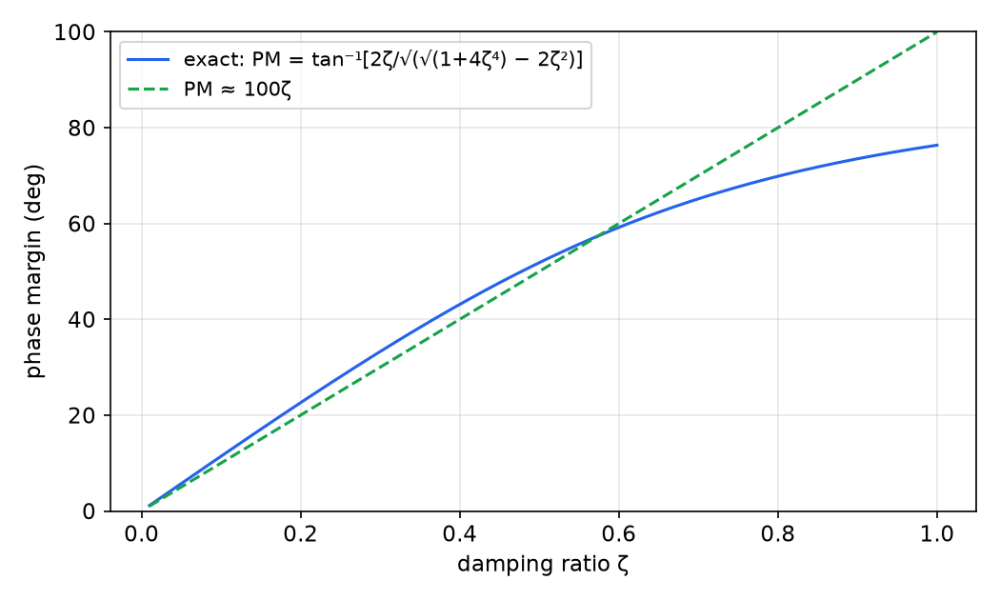

*Figure: phase margin of the standard second-order loop versus damping ratio (solid) and the rule PM = 100ζ (dashed). They agree closely below ζ ≈ 0.6 and diverge above.*

## The w-Transform

Continuous design rules (asymptotic Bode plots, lead and lag networks sized in rad/s) assume a variable whose stability boundary is the imaginary axis. The **bilinear** or **w-transform**
\\[
w = \frac{2}{T}\\,\frac{z - 1}{z + 1}, \qquad z = \frac{1 + wT/2}{1 - wT/2},
\\]
maps the inside of the unit circle onto the left half of the w-plane and the unit circle onto the imaginary axis. A pulse transfer function \\(G(z)\\) becomes a rational function \\(G(w)\\), to which all continuous frequency-domain tools apply. On the unit circle, \\(z = e^{j\omega T}\\) gives
\\[
w = \frac{2}{T}\\,\frac{e^{j\omega T/2} - e^{-j\omega T/2}}{e^{j\omega T/2} + e^{-j\omega T/2}} = j\frac{2}{T}\tan\frac{\omega T}{2} \equiv j\nu,
\qquad
\boxed{\frac{\nu T}{2} = \tan\frac{\omega T}{2}} .
\\]
The **w-plane frequency** \\(\nu\\) is close to the true frequency \\(\omega\\) when \\(\omega T/2\\) is small, because \\(\tan x \approx x\\). The whole \\(\nu\\) axis, \\(0 \le \nu < \infty\\), is compressed onto \\(0 \le \omega < \pi/T\\): this nonlinear compression is **frequency warping**.

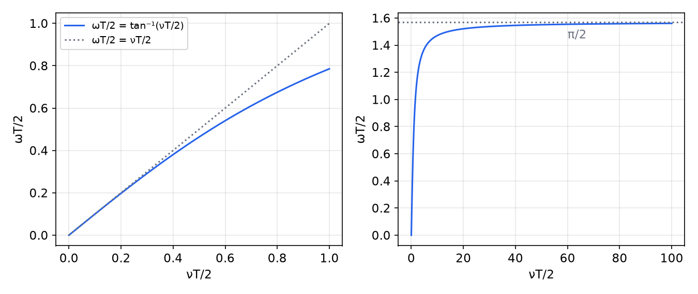

*Figure: the relation ωT/2 = tan⁻¹(νT/2). Left: for νT/2 ≤ 1 the map is nearly linear (ωT/2 = 0.785 at νT/2 = 1). Right: as νT/2 grows, ωT/2 saturates at π/2, so the entire w-plane frequency axis maps onto 0 ≤ ω ≤ π/T.*

**Design procedure.** (1) Compute \\(G(z)\\) with the hold and transform it to \\(G(w)\\). (2) Design a compensator \\(C(w)\\) with continuous methods, using specifications on \\(\nu\\); critical frequencies in rad/s should be **prewarped**, \\(\nu = (2/T)\tan(\omega T/2)\\). (3) Map back with \\(w = (2/T)(z - 1)/(z + 1)\\) to obtain \\(C(z)\\), and verify the margins and the step response in the z-domain.

**Example (the servo plant in the w-plane).** For \\(P(s) = 1/[s(s + 2)]\\) with a ZOH and \\(T = 0.1\\) s,
\\[
G(z) = \frac{0.004683(z + 0.9355)}{(z - 1)(z - 0.8187)} ,
\\]
and substituting \\(z = (1 + 0.05w)/(1 - 0.05w)\\) gives
\\[
G(w) = \frac{0.9967\left(1 - w/20\right)\left(1 + w/600.4\right)}{w(w + 1.993)} .
\\]
The pole at \\(w = 0\\) (the integrator) and the pole at \\(-1.993\\) (close to the continuous \\(-2\\)) are inherited from the plant, and \\(\lim\_{w \to 0} wG(w) = 0.5\\) matches \\(\lim\_{s \to 0} sP(s)\\). The new feature is a right-half-plane zero at \\(w = 2/T = 20\\): the ZOH makes the w-plane model non-minimum phase, which is the w-plane signature of the hold's phase lag. A crossover frequency well below 20 rad/s is required, as for any non-minimum-phase plant.

## Design Example: Digital PD Control by Frequency Response

**Problem.** For \\(P(s) = 1/[s(s + 2)]\\) with a ZOH, \\(T = 0.1\\) s and unity feedback, design a digital PD controller giving a phase margin of at least \\(50^\circ\\) and a settling time of at most 1 s.

*Specifications.* PM ≥ 50° means \\(\zeta \gtrsim 0.5\\) (from the PM–ζ relation); \\(t\_s = 4/(\zeta\omega\_n) \le 1\\) s means \\(\sigma = \zeta\omega\_n \ge 4\\) s\\(^{-1}\\), i.e. closed-loop poles inside \\(\lvert z \rvert \le e^{-0.4} = 0.670\\).

*Plant.*
```matlab
nums = [0 0 1]; dens = [1 2 0];
gps  = tf(nums, dens);
gp   = c2d(gps, 0.1)      % 0.004683(z+0.9355)/((z-1)(z-0.8187))
rltool(gp)                % root locus and Bode views together
```
*Controller structure.* Write the PD controller as \\(C(z) = K\_c(z - a)/z\\) with \\(K\_c = K\_p + K\_d\\) and \\(a = K\_d/(K\_p + K\_d)\\). The plant's slow pole at 0.8187 (the image of \\(s = -2\\)) costs phase over the whole crossover region; put the PD zero on it, \\(a = 0.8187\\). The compensated loop is then
\\[
C(z)G(z) = \frac{K(z + 0.9355)}{z(z - 1)}, \qquad K = 0.004683K\_c,
\\]
with closed-loop CE \\(z^2 + (K - 1)z + 0.9355K = 0\\).

*Choosing the gain.* Raising \\(K\\) raises the crossover frequency (faster response) and lowers the phase margin. A sweep:

| \\(K\\) | \\(K\_c\\) | PM | GM | \\(\omega\_c\\) (rad/s) | closed-loop ζ | overshoot | \\(t\_s\\) |
|---|---|---|---|---|---|---|---|
| 0.1 | 21.4 | 79.1° | 20.6 dB | 1.93 | 1 (real poles) | 0% | 1.7 s |
| 0.2 | 42.7 | 68.5° | 14.6 dB | 3.82 | 0.91 | 0.1% | 0.6 s |
| 0.3 | 64.1 | 58.2° | 11.0 dB | 5.65 | 0.60 | 9.4% | 0.6 s |
| 0.4 | 85.4 | 48.4° | 8.5 dB | 7.39 | 0.42 | 23% | 0.8 s |
| 0.5 | 106.8 | 39.3° | 6.6 dB | 9.01 | 0.30 | 34% | 0.9 s |

The phase crossover stays at 16.05 rad/s for every \\(K\\), since the phase of \\(C(z)G(z)\\) does not depend on the gain. \\(K = 0.4\\) violates the phase-margin specification; \\(K = 0.3\\) satisfies both, with margin to spare on the settling time. Note how closely PM ≈ 100ζ holds: 58.2° against \\(\zeta = 0.60\\), and 48.4° against 0.42 (the rule is approximate because the loop is not exactly the standard second-order one).

*Result.* \\(K = 0.3\\) gives \\(K\_c = 64.07\\) and
\\[
\boxed{C(z) = 64.07\\,\frac{z - 0.8187}{z} = 11.61 + 52.45\left(1 - z^{-1}\right)},
\\]
i.e. \\(K\_p = 64.07(1 - 0.8187) = 11.61\\) and \\(K\_d = 64.07 \times 0.8187 = 52.45\\). The margins are PM = 58.2° at \\(\omega\_c = 5.65\\) rad/s and GM = 11.0 dB at 16.05 rad/s. The closed-loop poles are \\(0.350 \pm j0.398\\), equivalent to \\(\omega\_n = 10.6\\) rad/s, \\(\zeta = 0.60\\) and \\(\sigma = 6.35\\) s\\(^{-1}\\), inside the settling-time circle. The step response overshoots by 9.4% and enters the 2% band at 0.6 s.

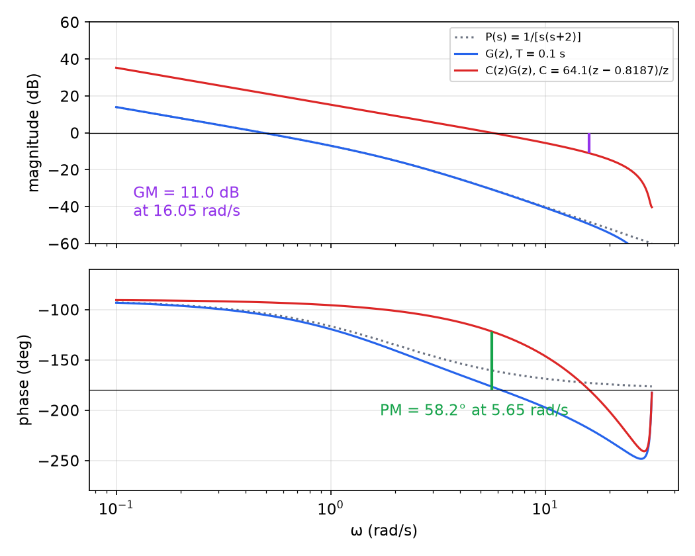

*Figure: Bode plots of the continuous plant (dotted), its ZOH equivalent G(z) with T = 0.1 s (blue) and the compensated loop C(z)G(z) (red). The PD zero cancels the phase lag of the plant pole, so the compensated phase stays near −90° to −120° through the crossover at 5.65 rad/s (PM = 58.2°). The sampled phase falls steeply toward the Nyquist frequency 31.4 rad/s, which fixes the phase crossover at 16.05 rad/s (GM = 11.0 dB).*

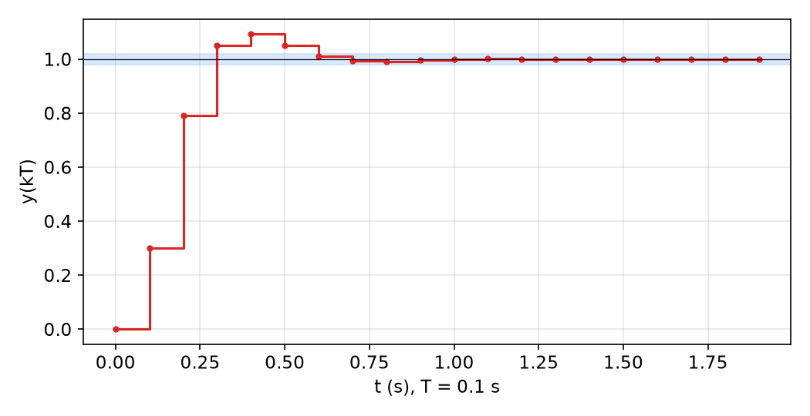

*Figure: closed-loop step response of the PD design (T = 0.1 s). The shaded band is ±2%; the output enters it at 0.6 s after a 9.4% overshoot, meeting the 1 s settling specification.*

The design shows how the two views complement each other: the Bode plot sets the gain from a robustness specification (phase margin), and the root locus or a simulation confirms the time-domain specification. MATLAB's `rltool` shows both views at once.

## Summary

- Discrete frequency response: \\(u = \sin\omega kT \Rightarrow y\_{ss} = \lvert G(e^{j\omega T}) \rvert\sin(\omega kT + \angle G(e^{j\omega T}))\\) for stable \\(G\\); periodic with period \\(2\pi/T\\), conjugate symmetric, so only \\(0 \le \omega \le \pi/T\\) matters.
- Bode: \\(M\_{dB} = 20\log\_{10}\lvert G \rvert\\); products add in dB and phase. The hold adds roughly \\(-\omega T/2\\) of phase.
- Argument principle: the image of a CCW contour encircles the origin \\(Z - P\\) times CCW.
- Nyquist (discrete): map the unit circle through \\(GH\\); \\(Z = P + N\\) with \\(N\\) the clockwise encirclements of \\(-1\\) and \\(P, Z\\) the open- and closed-loop poles outside the unit circle. Detour outward around poles on the circle.
- Examples: \\(K/(z - 2)\\) stable for \\(1 < K < 3\\); \\(Kz^{-2}/(z - 0.5)\\) for \\(0 < K < 0.7808\\); sampling 1/[(s+1)(0.1s+1)] at T = 0.01 and 0.1 s reduces the critical gain from ∞ to 224 and 27.1.
- Margins: PM \\(= \angle GH(e^{j\omega\_c T}) + 180^\circ\\) at \\(\lvert GH \rvert = 1\\); GM \\(= 1/\lvert GH(e^{j\omega\_p T}) \rvert\\) at \\(\angle GH = -180^\circ\\). Example \\(1/[s(s+1)(s+2)]\\): GM = 15.56 dB at 1.414 rad/s, PM = 53.41° at 0.4457 rad/s.
- Second-order loop: \\(\omega\_c = \omega\_n\sqrt{\sqrt{1 + 4\zeta^4} - 2\zeta^2}\\), \\(\text{PM} = \tan^{-1}[2\zeta/\sqrt{\sqrt{1 + 4\zeta^4} - 2\zeta^2}] \approx 100\zeta\\); PM > 50° is the usual target.
- w-transform \\(w = (2/T)(z - 1)/(z + 1)\\); warping \\(\nu T/2 = \tan(\omega T/2)\\); the ZOH appears as a right-half-plane zero at \\(w = 2/T\\).
- PD design for \\(1/[s(s+2)]\\), \\(T = 0.1\\): \\(C(z) = 64.07(z - 0.8187)/z\\) gives PM = 58.2°, GM = 11.0 dB, 9.4% overshoot, \\(t\_s\\) = 0.6 s.

## See Also

- [Root-Locus Design of Digital Controllers](root-locus.md): the same plant designed by the angle condition.
- [Transient Specifications and the s-to-z Mapping](classical-design.md): the time-domain specifications behind PM ≈ 100ζ.
- [Sampling and Reconstruction](sampling.md): the hold, aliasing and the Nyquist frequency.
- [Z-Plane Analysis](z-plane.md): pulse transfer functions and Jury-type stability tests.
- Frequency Response and Stability: the continuous-time Bode and Nyquist methods.
- Fourier Transform and Z-Transform.
