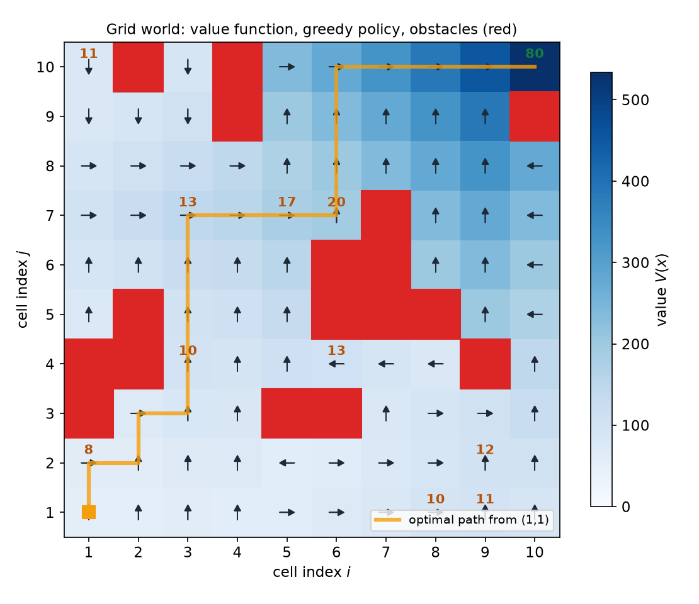
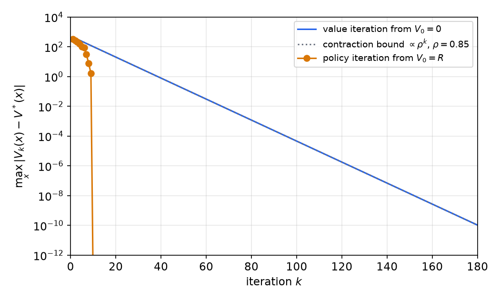
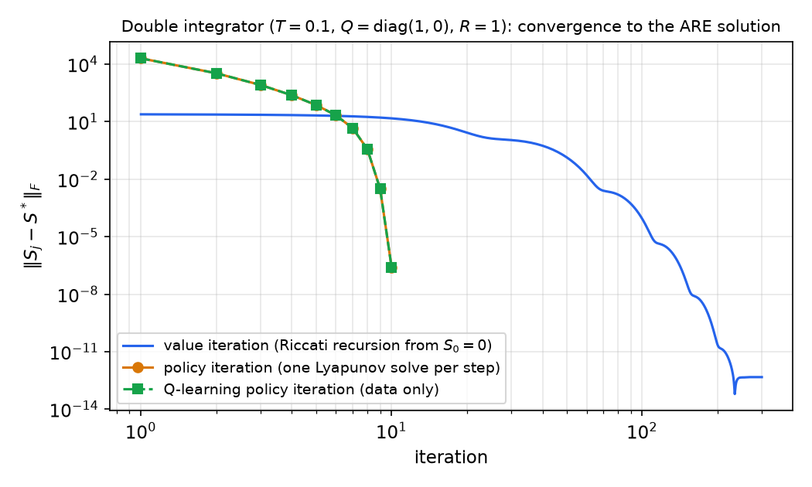

# Dynamic Programming and Reinforcement Learning for Control

Optimal control and reinforcement learning (RL) solve the same problem from two directions. A controller designer minimizes a cost made of tracking error and control effort; an RL agent maximizes a cumulative reward. Both rest on Bellman's principle of optimality and on one equation, the Hamilton–Jacobi–Bellman (HJB) or Bellman equation, for the **value function**. This chapter states the general discrete-time problem with discounting, derives the HJB equation, and develops the two basic iterative solution methods, **value iteration** and **policy iteration**, with their convergence arguments. It then applies them to a scalar LQ problem (where the golden ratio appears), to a grid-world navigation task, and to the discrete LQR of the [previous chapter](lqr.md), where policy iteration converges to the Riccati solution in a handful of steps, even when only measured data are available (Q-learning).

## The General Optimal Control Problem

Many AI and control applications rely on optimizing a decision or control action:

- reinforcement learning seeks to **maximize reward**;
- optimal controllers seek to **minimize** a combination of error and control cost;
- optimal controllers offer an alternative to design by pole placement, and LQ optimal control gives a state-feedback law.

**Problem.** Given the (possibly nonlinear) system \\(x(k+1) = f(x(k), u(k))\\), find the input sequence \\(u(k)\\) that minimizes, or maximizes,
\\[
J = \sum\_{k=0}^{\infty}\rho^k\phi\big(x(k), u(k)\big),\qquad 0 < \rho \le 1 .
\\]
Here \\(\phi(x,u)\\) is the **incremental cost** (or reward), and \\(\rho\\) is a **discount factor** that weights future costs or rewards by an exponentially decaying factor. With \\(\rho < 1\\) the sum converges for any bounded \\(\phi\\). With \\(\rho = 1\\), as in LQR, convergence must come from the controller driving \\(\phi\\) to zero.

**A simple example.** For the single integrator \\(x^+ = x + u\\) with \\(\phi = x^2 + u^2\\), the cost trades the state penalty \\(x^2\\), which we want to decay fast, against the control penalty \\(u^2\\), which grows if we push hard. This is the same trade-off as in the LQ problem, in its simplest form.

## Principle of Optimality and Dynamic Programming

**Bellman's principle of optimality.** At any intermediate state \\(x\_i\\) on an optimal path from \\(x\_0\\) to \\(x\_f\\), the policy from \\(x\_i\\) to the goal \\(x\_f\\) must itself be an optimal policy. (See the staged network figure in [Discrete-Time Linear Quadratic Regulation](lqr.md#dynamic-programming).)

The optimal solution method based on this principle is called **dynamic programming**. Bellman later explained the choice of name: he wanted a term that would shelter mathematical research from a sceptical sponsor. In his words, "Try thinking of some combination that will possibly give it a pejorative meaning. It's impossible. Thus, I thought dynamic programming was a good name. It was something not even a Congressman could object to. So I used it as an umbrella for my activities." The name *Hamilton–Jacobi–Bellman* equation records that Bellman's recursion is the discrete-time, controlled counterpart of the Hamilton–Jacobi equation of classical mechanics.

## The Value Function and the HJB Equation

Bellman's principle implies that the optimal value of \\(J\\) from now on depends only on the **current state**, not on how the system got there. Define the **value function** \\(V(x)\\) as the optimal value of \\(J\\) starting from \\(x\\). If \\(u^\*(k)\\) is the optimal input sequence and \\(x^\*(k+1) = f(x^\*(k), u^\*(k))\\) with \\(x^\*(0) = x\\), then
\\[
V(x) = \sum\_{k=0}^{\infty}\rho^k\phi\big(x^\*(k), u^\*(k)\big).
\\]

### Derivation

Split off the first term of the cost:
\\[
J = \phi\big(x(0), u(0)\big) + \sum\_{k=1}^{\infty}\rho^k\phi\big(x(k), u(k)\big)
= \phi(x, u\_0) + \rho\sum\_{k=0}^{\infty}\rho^k\phi\big(x^+(k), u^+(k)\big),
\\]
where \\(u\_0 = u(0)\\), \\(x^+(k) := x(k+1)\\) and \\(u^+(k) := u(k+1)\\). The second sum is the cost of a trajectory that *starts* at \\(x^+(0) = x(1) = f(x, u\_0)\\). Whatever \\(u\_0\\) is, by the principle of optimality the best we can do from \\(x(1)\\) onward is to use the optimal inputs from there, which makes that sum equal to \\(V(f(x, u\_0))\\). Optimizing over the remaining choice \\(u\_0\\):
\\[
\boxed{V(x) = \min\_u\big[\phi(x,u) + \rho V\big(f(x,u)\big)\big]\quad\text{(or }\max\_u\text{ for rewards)}\qquad\text{(HJB)}.}
\\]

**Comments.**

- The HJB equation yields both the optimal input and the value function in one shot. Equivalently, \\(V(x) = \phi(x, u^\*) + \rho V(f(x, u^\*))\\), where
\\[
u^\*(x) = \arg\min\_u\ \big(\text{or }\arg\max\_u\big)\big[\phi(x,u) + \rho V(f(x,u))\big].
\\]
The optimal control is a **state feedback** \\(u^\* = \pi^\*(x)\\), called the optimal *policy*.
- The HJB equation is a functional equation, with \\(V\\) appearing on both sides. Depending on \\(f\\) and \\(\phi\\), it may be solved in closed form (as for LQR) or iteratively.

## A Scalar Example: the Golden Ratio

**Example 1.** Single integrator \\(x^+ = x + u\\), \\(\phi = x^2 + u^2\\), \\(\rho = 1\\). Try \\(V(x) = sx^2\\) with \\(s > 0\\) unknown.

*Optimal input.* \\(u^\* = \arg\min\_u[u^2 + s(x + u)^2]\\). Setting the derivative \\(2u + 2s(x + u)\\) to zero gives
\\[
u^\*(x) = -\frac{s}{1 + s}x .
\\]
*HJB.* \\(V(x) = x^2 + u^{\*2} + s(x + u^\*)^2\\), with \\(x + u^\* = x/(1 + s)\\):
\\[
sx^2 = x^2 + \frac{s^2x^2}{(1 + s)^2} + \frac{sx^2}{(1 + s)^2}.
\\]
Dropping \\(x^2\\) and simplifying \\((s^2 + s)/(1 + s)^2 = s/(1 + s)\\):
\\[
s = 1 + \frac{s}{1 + s}\quad\Longrightarrow\quad s^2 - s - 1 = 0\quad\Longrightarrow\quad s = \frac{1 + \sqrt5}{2} = 1.618\ldots
\\]
taking the positive root. The value function coefficient is the **golden ratio**. The optimal feedback is \\(u^\* = -0.618x\\), and the closed loop is \\(x^+ = x/(1 + s) = 0.382x\\). This is the scalar ARE of the [LQR chapter](lqr.md) with \\(G = H = Q = R = 1\\): \\(s = 1 + s - s^2/(1 + s)\\) reduces to the same equation.

## Iterative Solution of the HJB Equation

For nonlinear systems, or for problems given as tables (as in RL), the HJB equation is solved iteratively. There are two classical schemes. Let \\(\mathcal{U}(x)\\) denote the admissible inputs at \\(x\\).

### Value iteration

Starting from any \\(V\_0\\), for example \\(V\_0 \equiv 0\\), repeat the HJB right-hand side:
\\[
V\_{k+1}(x) = \min\_{u \in \mathcal{U}(x)}\big[\phi(x,u) + \rho V\_k(f(x,u))\big].
\\]
\\(V\_k\\) is the optimal cost of the \\(k\\)-step problem with terminal cost \\(V\_0\\), so value iteration is the finite-horizon Riccati recursion of the LQR chapter, run until the horizon is effectively infinite.

**Theorem (Convergence of value iteration).** Let \\(\rho < 1\\) and \\(\phi\\) be bounded. Then the Bellman operator \\((\mathcal{T}V)(x) = \min\_u[\phi(x,u) + \rho V(f(x,u))]\\) is a contraction in the sup norm,
\\[
\lVert\mathcal{T}V - \mathcal{T}W\rVert\_\infty \le \rho\lVert V - W\rVert\_\infty,
\\]
so the HJB equation has a unique bounded solution \\(V^\*\\), and \\(\lVert V\_k - V^\*\rVert\_\infty \le \rho^k\lVert V\_0 - V^\*\rVert\_\infty\\).

*Proof.* For any \\(x\\), let \\(u\_W\\) attain the minimum for \\(W\\). Then
\\[
(\mathcal{T}V)(x) - (\mathcal{T}W)(x) \le \phi(x,u\_W) + \rho V(f(x,u\_W)) - \phi(x,u\_W) - \rho W(f(x,u\_W)) \le \rho\lVert V - W\rVert\_\infty .
\\]
Exchanging \\(V\\) and \\(W\\) bounds the difference from the other side. The rest is the Banach fixed-point theorem. ∎

The same argument applies to maximization.

### Policy iteration

1. Initialize \\(V\_0(x)\\) at every admissible \\(x\\) (for example \\(V\_0 = 0\\)).
2. **Policy improvement:** act greedily with respect to the current value,
\\[
\pi\_{k+1}(x) = \arg\min\_u\ \big(\text{or }\arg\max\_u\big)\big[\phi(x,u) + \rho V\_k(f(x,u))\big].
\\]
3. **Policy evaluation:** compute the exact value of the new policy by solving the linear equation
\\[
V\_{k+1}(x) - \rho V\_{k+1}\big(f(x, \pi\_{k+1}(x))\big) = \phi\big(x, \pi\_{k+1}(x)\big).
\\]
4. Repeat until the policy stops changing.

For a finite state set, step 3 is a linear system. Let \\(P\_\pi\\) be the 0/1 transition matrix of the policy (row \\(x\\) has a 1 in the column of \\(f(x, \pi(x))\\)) and \\(\phi\_\pi\\) the vector of stage costs. Then
\\[
(I - \rho P\_\pi)V = \phi\_\pi .
\\]
This is solvable for \\(\rho < 1\\) because \\(\rho P\_\pi\\) has spectral radius at most \\(\rho\\).

**Theorem (Policy improvement).** If \\(\pi'\\) is greedy with respect to \\(V\_\pi\\), then \\(V\_{\pi'} \le V\_\pi\\) for cost minimization (\\(\ge\\) for reward maximization), with equality everywhere only if \\(V\_\pi\\) already satisfies the HJB equation. Hence, for finitely many states and actions, policy iteration terminates at an optimal policy after finitely many steps.

*Proof sketch (minimization).* Let \\(\mathcal{T}\_{\pi'}\\) be the one-step evaluation operator of \\(\pi'\\). Greediness means \\(\mathcal{T}\_{\pi'}V\_\pi = \mathcal{T}V\_\pi \le \mathcal{T}\_\pi V\_\pi = V\_\pi\\). The operator \\(\mathcal{T}\_{\pi'}\\) is monotone, so applying it repeatedly gives \\(\mathcal{T}\_{\pi'}^kV\_\pi \le V\_\pi\\) for all \\(k\\), and the left side converges to \\(V\_{\pi'}\\). A policy can therefore never repeat unless it is optimal, and there are finitely many policies. ∎

Value iteration takes cheap steps and converges geometrically at rate \\(\rho\\). Policy iteration takes expensive steps (a linear solve each) but needs very few of them; near the solution it behaves like Newton's method.

**Example 1, continued.** *Value iteration* from \\(s\_0 = 0\\) is \\(s\_{k+1} = 1 + s\_k/(1 + s\_k)\\):
\\[
s\_k = 1,\ \tfrac32,\ \tfrac85,\ \tfrac{21}{13},\ \tfrac{55}{34},\ \ldots
\\]
These are ratios of alternate Fibonacci numbers, converging to the golden ratio with error shrinking by the factor \\(1/(1 + \varphi)^2 = 1/\varphi^4 \approx 0.146\\) per step. *Policy iteration*: for the policy \\(u = -kx\\) (stable if \\(\lvert 1 - k\rvert < 1\\)), evaluation gives \\(s = (1 + k^2) + (1 - k)^2s\\), that is,
\\[
s = \frac{1 + k^2}{1 - (1 - k)^2},
\\]
and improvement gives \\(k = s/(1 + s)\\). Starting from the deadbeat policy \\(k\_0 = 1\\):
\\[
s = 2,\quad 1.625,\quad 1.618037,\quad 1.6180339888,
\\]
with the number of correct digits roughly doubling at each step.

## Example: the Hungry Rabbit Grid World

A hungry rabbit lives on a \\(10 \times 10\\) grid and searches for as much food as possible by maximizing
\\[
J = \sum\_{k=0}^{\infty}\rho^k\phi\big(x(k)\big),\qquad \rho = 0.85,
\\]
where \\(\phi(x)\\) is the food reward at cell \\(x\\). It starts in the bottom-left cell \\((1,1)\\). The richest food (reward 80) is in the target cell \\((10,10)\\). Ten random cells carry smaller rewards, \\(\lfloor 100/\lVert(10,10) - x\rVert\rfloor\\), which grow toward the target. Twenty random cells are obstacles with reward \\(-1000\\), which the rabbit must avoid. Each step it moves left, down, up or right, or stays put; moves off the grid are not admissible.

Because the reward depends only on the current cell and the motion is deterministic, \\(f(x,u) = x + u\\), and the HJB equation reads
\\[
V(x) = \phi(x) + \rho\max\_{u \in \mathcal{U}(x)}V(x + u),
\\]
and the greedy policy simply moves to the admissible neighbor (or stays) with the largest value.

### The course implementation (policy iteration)

```matlab
%Reinforcement Learning Example: Rabbit looking for Food
N=10;      %Grid size
df=0.85;   %Discount factor
R=zeros(N,N); P=zeros(N,N,2); %Reward, Policy
nr=10;     %other cells with reward
no=20;     %number of obstacles
for kk=1:nr
    xk=fix(rand(2,1)*N+1);
    R(xk(1),xk(2))=fix(100/norm([N;N]-xk));
end
R(N,N)=100; %Target cell
for kk=1:no
    xk=fix(rand(2,1)*N+1);
    R(xk(1),xk(2))=-1000;
end
R(N,N)=80;
U=[-1 0 0 0 1;0 -1 1 0 0];   % left, down, up, stay, right
nu=size(U,2);
V=R; del=1; it=0;
while(del>1e-10)
    for ii=1:N                % policy improvement
        for jj=1:N
            xij=[ii;jj]; Rij=[]; Uij=[];
            for kk=1:nu
                xijn=xij+U(:,kk);
                if all(xijn>=1) & all(xijn<=N)
                    Rij=[Rij;V(xijn(1),xijn(2))]; Uij=[Uij U(:,kk)];
                end
            end
            [rij,kij]=max(Rij);
            P(ii,jj,:)=Uij(:,kij);
        end
    end
    M=eye(N*N); B=zeros(N*N,1);   % policy evaluation: (I - df*P_pi) V = R
    for ii=1:N
        for jj=1:N
            kk=ii+(jj-1)*N; B(kk)=R(ii,jj);
            xijn=[ii;jj]+[P(ii,jj,1);P(ii,jj,2)];
            ll=xijn(1)+(xijn(2)-1)*N;
            M(kk,ll)=M(kk,ll)-df;
        end
    end
    Vnew=reshape(M\B,N,N);
    del=norm(Vnew-V); V=Vnew; it=it+1;
end
```

The code initializes \\(V = R\\) and alternates greedy improvement with an exact linear-system evaluation.

### Value iteration in Python

```python
import numpy as np
N, rho = 10, 0.85
U = [(-1, 0), (0, -1), (0, 1), (0, 0), (1, 0)]       # left, down, up, stay, right

def value_iteration(R, tol=1e-10):
    V = np.zeros((N, N))
    while True:
        Vn = np.empty_like(V)
        for i in range(N):
            for j in range(N):
                best = max(V[i+a, j+b] for a, b in U if 0 <= i+a < N and 0 <= j+b < N)
                Vn[i, j] = R[i, j] + rho * best        # HJB: V = phi + rho * max V(next)
        if np.abs(Vn - V).max() < tol:
            return Vn
        V = Vn

def greedy_policy(V):
    P = {}
    for i in range(N):
        for j in range(N):
            moves = [(a, b) for a, b in U if 0 <= i+a < N and 0 <= j+b < N]
            P[i, j] = max(moves, key=lambda m: V[i+m[0], j+m[1]])
    return P
```

### Results

For one random layout (generated as in the MATLAB code with a fixed seed), both methods give the same value function and policy.

- **Target value.** At the target the rabbit stays forever, so \\(V(10,10) = 80/(1 - 0.85) = 533.3\\). Values decay by the factor 0.85 per step of distance from the target, plus whatever is collected on the way.
- **Optimal path.** From \\((1,1)\\) the path takes 18 moves: up to \\((1,2)\\) (reward 8), through \\((2,2), (2,3)\\) to \\((3,3)\\), up column 3 through \\((3,4)\\) (reward 10) to \\((3,7)\\) (reward 13), right along row 7 through \\((5,7)\\) (17) to \\((6,7)\\) (20), up to \\((6,10)\\), and right along the top row to the target. It detours slightly to pick up every intermediate reward that lies roughly on the way, and it never enters an obstacle. The value of the start cell is \\(V(1,1) = 50.08\\).
- **Convergence.** Value iteration from \\(V\_0 = 0\\) reaches \\(\lVert V\_k - V^\*\rVert\_\infty < 10^{-6}\\) after 124 iterations, exactly as the contraction bound predicts: \\(533 \times 0.85^k < 10^{-6}\\) requires \\(k \ge 124\\). Policy iteration from \\(V\_0 = R\\) finds the exact optimal policy after 10 evaluations, and the 11th confirms that the policy no longer changes.



*Figure: the converged value function (blue shading, darker is higher) on the \\(10 \times 10\\) grid. Red cells are obstacles (reward \\(-1000\\)); numbers are food rewards (green: the target, 80). Arrows show the greedy policy in every cell (a dot means "stay"), and the orange line is the optimal path from the start cell \\((1,1)\\). The value increases toward the target, and the policy routes around the obstacle clusters while collecting rewards 8, 10, 13, 17 and 20 on the way.*



*Figure: error \\(\max\_x\lvert V\_k(x) - V^\*(x)\rvert\\) against iteration. Value iteration (blue) follows the contraction bound \\(\rho^k\\) (dotted) almost exactly, a straight line on the log scale. Policy iteration (orange) reaches the exact solution in 10 iterations, each of which solves a \\(100 \times 100\\) linear system.*

The obstacles are encoded as large negative rewards, not as hard constraints. The rabbit could in principle step on one; it never does, because \\(-1000\\) outweighs any reward reachable by doing so. A reward cell close to the target can also become a local "stay" attractor if \\(\phi/(1 - \rho)\\) there exceeds the discounted value of moving on. This happens for some random layouts, and it is a genuine feature of the discounted problem.

## Policy Iteration for the Discrete LQR

For the linear system \\(x^+ = Gx + Hu\\) with \\(\phi = x^TQx + u^TRu\\) and \\(\rho = 1\\), both iterations can be carried out exactly on matrices, because the value of any linear policy is quadratic.

**Value iteration** with \\(V\_k(x) = x^TS\_kx\\) and \\(S\_0 = 0\\) is the Riccati difference recursion:
\\[
S\_{k+1} = Q + G^TS\_kG - G^TS\_kH(R + H^TS\_kH)^{-1}H^TS\_kG .
\\]

**Policy iteration** (Hewer's algorithm). Start from a stabilizing gain \\(K\_0\\) (\\(G - HK\_0\\) Schur stable). Then for \\(j = 0, 1, 2, \ldots\\):

1. *Evaluation.* The value of \\(u = -K\_jx\\) is \\(x^TS\_jx\\), where \\(S\_j\\) solves the discrete **Lyapunov equation**
\\[
S\_j = Q + K\_j^TRK\_j + (G - HK\_j)^TS\_j(G - HK\_j).
\\]
This is the policy-evaluation equation \\(V(x) - V(f(x, \pi(x))) = \phi(x, \pi(x))\\) for a quadratic \\(V\\). It is linear in \\(S\_j\\).
2. *Improvement.* Act greedily, using the quadratic-minimization lemma:
\\[
K\_{j+1} = (R + H^TS\_jH)^{-1}H^TS\_jG .
\\]

**Theorem (Hewer, 1971).** If \\((G,H)\\) is stabilizable, \\((G,Q^{1/2})\\) is detectable and \\(K\_0\\) is stabilizing, then every \\(K\_j\\) is stabilizing, \\(S\_0 \ge S\_1 \ge \dots \ge S^\*\\), and \\(S\_j \to S^\*\\), the stabilizing solution of the ARE, with quadratic convergence near the solution.

The monotonicity is the policy improvement theorem in matrix form. It is also Newton's method applied to the ARE, which explains the quadratic rate.

```python
import numpy as np
from scipy.linalg import solve_discrete_lyapunov, solve_discrete_are
T = 0.1
G = np.array([[1, T], [0, 1]]); H = np.array([[T**2/2], [T]])
Q = np.diag([1.0, 0.0]); R = np.eye(1)
K = np.array([[1/T**2, 1.5/T]])                  # deadbeat gain: stabilizing start
for j in range(10):
    Gc = G - H @ K
    S = solve_discrete_lyapunov(Gc.T, Q + K.T @ R @ K)   # policy evaluation
    K = np.linalg.solve(R + H.T @ S @ H, H.T @ S @ G)    # policy improvement
print(S, K)                     # -> [[14.651, 10], [10, 14.151]], [[0.9317, 1.3651]]
print(solve_discrete_are(G, H, Q, R))            # same S
```

**Example 2 (Double integrator).** Same data as the LQR example: \\(T = 0.1\\), \\(Q = \operatorname{diag}(1,0)\\), \\(R = 1\\). Start from the deadbeat gain \\(K\_0 = [1/T^2\ \ 1.5/T] = [100\ \ 15]\\), which places both poles at the origin.

| \\(j\\) | \\(S\_j\\) (entries 11, 12, 22) | \\(K\_{j+1}\\) | \\(\lVert S\_j - S^\*\rVert\_F\\) |
|---|---|---|---|
| 0 | 20001, 2000.0, 250.0 | \\([50.00\ \ 10.83]\\) | \\(2.0\times10^4\\) |
| 1 | 3274.5, 545.5, 120.9 | \\([25.00\ \ 7.72]\\) | \\(3.3\times10^3\\) |
| 2 | 789.0, 203.8, 72.1 | \\([12.51\ \ 5.48]\\) | \\(8.2\times10^2\\) |
| 3 | 225.3, 86.5, 46.4 | \\([6.28\ \ 3.89]\\) | \\(2.4\times10^2\\) |
| 4 | 73.0, 39.6, 31.1 | \\([3.20\ \ 2.77]\\) | 74 |
| 5 | 29.0, 19.9, 21.7 | \\([1.73\ \ 2.01]\\) | 21 |
| 6 | | | 4.5 |
| 7 | | | 0.37 |
| 8 | | | \\(3.2\times10^{-3}\\) |
| 9 | | | \\(2.5\times10^{-7}\\) |

The deadbeat start is very expensive (\\(S\_{11} \approx 2\times10^4\\)). Early on, each improvement roughly halves the gain; once close, convergence is quadratic, and after 10 evaluations \\(S\_j\\) agrees with the ARE solution
\\[
S^\* = \begin{bmatrix} 14.651 & 10 \\\\ 10 & 14.151 \end{bmatrix},\qquad K^\* = [0.9317\ \ 1.3651]
\\]
to better than \\(10^{-6}\\). Value iteration (the Riccati recursion from \\(S\_0 = 0\\)) needs 86 steps to reach an error of \\(10^{-3}\\) and 135 to reach \\(10^{-6}\\).

## Learning Without a Model: Q-Functions

Both iterations above use \\(G\\) and \\(H\\). Reinforcement learning removes this need by learning the **Q-function** (action-value function) of a policy, the cost of taking action \\(u\\) in state \\(x\\) and following the policy afterwards:
\\[
Q\_K(x,u) = x^TQx + u^TRu + V\_K(Gx + Hu).
\\]
For LQR with \\(V\_K = x^TS\_Kx\\), it is a quadratic form in \\((x, u)\\):
\\[
Q\_K(x,u) = \begin{bmatrix} x \\\\ u \end{bmatrix}^T\Theta\begin{bmatrix} x \\\\ u \end{bmatrix},\qquad
\Theta = \begin{bmatrix} Q + G^TS\_KG & G^TS\_KH \\\\ H^TS\_KG & R + H^TS\_KH \end{bmatrix}
= \begin{bmatrix} \Theta\_{xx} & \Theta\_{xu} \\\\ \Theta\_{ux} & \Theta\_{uu} \end{bmatrix}.
\\]
The greedy improvement needs only \\(\Theta\\): minimizing over \\(u\\) gives
\\[
K\_{new} = \Theta\_{uu}^{-1}\Theta\_{ux},
\\]
which is identical to \\((R + H^TS\_KH)^{-1}H^TS\_KG\\), but with no explicit \\(G\\) or \\(H\\). And \\(\Theta\\) can be **estimated from data**. Along any measured transition \\((x\_k, u\_k, x\_{k+1})\\) the Q-function satisfies its own Bellman equation,
\\[
Q\_K(x\_k, u\_k) = x\_k^TQx\_k + u\_k^TRu\_k + Q\_K(x\_{k+1}, -Kx\_{k+1}),
\\]
which is linear in the \\((n+m)(n+m+1)/2\\) distinct entries of \\(\Theta\\). Collecting enough transitions and solving by least squares evaluates the policy. The inputs must contain **exploration noise**, \\(u\_k = -Kx\_k + \text{noise}\\); otherwise \\(u\_k\\) is a fixed linear function of \\(x\_k\\) and the regression is rank deficient. This Q-learning policy iteration for LQR is due to Bradtke, Ydstie and Barto (1994). It is a simple, fully analysable instance of the actor–critic idea: the critic estimates \\(\Theta\\), and the actor updates \\(K\\).

**Example 2, continued.** Starting again from \\(K\_0 = [100\ \ 15]\\), each iteration collects 60 transitions of the true system with exploration noise of standard deviation 0.5, fits the 6 entries of \\(\Theta\\) by least squares, and updates \\(K\\). With noise-free measurements the fit is exact, and the iterates coincide with model-based policy iteration to about eight digits. After 10 iterations,
\\[
\Theta = \begin{bmatrix} 15.651 & 11.465 & 1.0733 \\\\ 11.465 & 16.297 & 1.5724 \\\\ 1.0733 & 1.5724 & 1.1519 \end{bmatrix},\qquad K = \Theta\_{uu}^{-1}\Theta\_{ux} = [0.9317\ \ 1.3651],
\\]
the LQR gain, learned without ever forming \\(G\\) or \\(H\\).



*Figure: distance from the ARE solution, \\(\lVert S\_j - S^\*\rVert\_F\\), for the double-integrator LQR (log–log axes). Value iteration (blue) starts close, because \\(S\_0 = 0\\) is not far from \\(S^\*\\) in absolute terms, but converges slowly, through a long plateau and a sequence of linear phases. Policy iteration (orange) starts from the expensive deadbeat policy and reaches machine-level accuracy in 10 steps. Q-learning policy iteration (green, from data only) lies on top of it.*

## Summary

- **General problem:** \\(x^+ = f(x,u)\\); minimize or maximize \\(J = \sum\rho^k\phi(x(k), u(k))\\) with discount \\(0 < \rho \le 1\\).
- **HJB (Bellman) equation:** \\(V(x) = \min\_u/\max\_u[\phi(x,u) + \rho V(f(x,u))]\\). The optimal policy is the minimizing or maximizing \\(u\\), a state feedback.
- **Scalar example** \\(x^+ = x + u\\), \\(\phi = x^2 + u^2\\): \\(s = (1 + \sqrt5)/2\\), \\(u^\* = -0.618x\\).
- **Value iteration:** \\(V\_{k+1} = \mathcal{T}V\_k\\). It is a \\(\rho\\)-contraction, with error at most \\(\rho^k\lVert V\_0 - V^\*\rVert\_\infty\\).
- **Policy iteration:** greedy improvement plus exact evaluation, \\((I - \rho P\_\pi)V = \phi\_\pi\\). It improves monotonically and terminates in finitely many steps for finite problems.
- **Grid world** (\\(\rho = 0.85\\)): VI needs 124 iterations to reach \\(10^{-6}\\), PI 10 evaluations. The optimal path avoids obstacles and collects rewards on the way to the target, where \\(V = 80/(1 - \rho) = 533.3\\).
- **LQR:** VI is the Riccati recursion. PI (Hewer) solves \\(S\_j = Q + K\_j^TRK\_j + G\_j^TS\_jG\_j\\) with \\(G\_j = G - HK\_j\\), then sets \\(K\_{j+1} = (R + H^TS\_jH)^{-1}H^TS\_jG\\); it converges quadratically from any stabilizing \\(K\_0\\).
- **Q-learning:** \\(Q\_K(x,u) = [x;u]^T\Theta[x;u]\\) and \\(K \leftarrow \Theta\_{uu}^{-1}\Theta\_{ux}\\), with \\(\Theta\\) fitted from data by least squares. This requires exploration.

## See Also

- [Discrete-Time Linear Quadratic Regulation](lqr.md): the Riccati solution these iterations converge to
- [Dynamic Programming](../ae8803-optimal-learning-control/dynamic-programming.md) and [Reinforcement Learning for Control](../ae8803-optimal-learning-control/reinforcement-learning.md)
- Reinforcement Learning (machine learning)
- Optimal Control overview
- Optimization
- Robot Control
